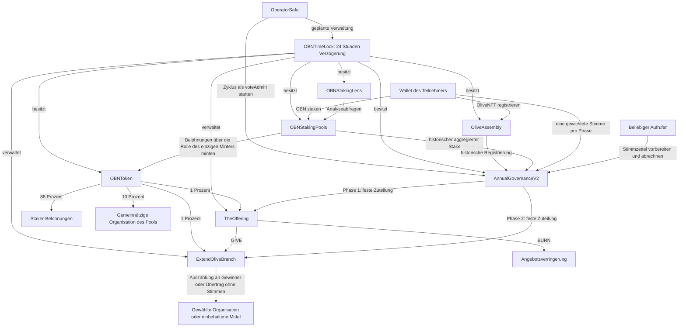

# Geben ohne Opfer: Eine Protokollantwort auf den Rückgang der breiten gemeinnützigen Beteiligung

[English](THESIS.md) · [Tiếng Việt](THESIS.vi.md) · [한국어](THESIS.ko.md) · [日本語](THESIS.ja.md) · [简体中文](THESIS.zh-CN.md) · [हिन्दी](THESIS.hi.md) · [العربية](THESIS.ar.md) · [Русский](THESIS.ru.md) · **Deutsch** · [Português](THESIS.pt.md) · [Español](THESIS.es.md) · [Bahasa Indonesia](THESIS.id.md)

> Diese Übersetzung dient lediglich der besseren Lesbarkeit. Maßgeblich ist die englische Fassung ([THESIS.md](THESIS.md)); bei Abweichungen hat die englische Fassung Vorrang. Die Übersetzung wurde mit KI-Unterstützung auf Basis der Revision `3c740d855` erstellt und noch nicht von einem professionellen Übersetzer geprüft. Vertragsnamen, Funktionsnamen und Adressen bleiben auf Englisch.

**These des Olive Branch Network**

*Olive Branch Network — Base Mainnet*

*Juli 2026 — Governance-Überarbeitung vom 14. Oktober 2026*

---

## Abstract

Gemeinnütziges Geben in den Vereinigten Staaten zeigt ein Paradox: Die gespendeten Gesamtbeträge erreichen fast jedes Jahr Rekordhöhen, während die Zahl der Menschen, die überhaupt spenden, seit einem Vierteljahrhundert sinkt. Der Anteil amerikanischer Haushalte mit irgendeiner gemeinnützigen Spende fiel von 66.2% im Jahr 2000 auf 49.6% im Jahr 2018, und die Spenderzahlen sind seit 2021 jedes Jahr zurückgegangen, obwohl die Gesamteinnahmen stiegen. Philanthropie konzentriert sich auf eine kleinere, wohlhabendere Spenderklasse und höhlt die breite Beteiligung aus, auf der die zivile Legitimität des gemeinnützigen Sektors beruht.

Diese These argumentiert, dass die Wurzel des Beteiligungseinbruchs strukturell und nicht moralisch ist: Unter jeder historischen Form von Geld — Warengeld, Fiatgeld und frühem digitalem Geld — ist Geben *opfernd*. Eine Spende überträgt Kapital dauerhaft vom Spender auf den Empfänger, sodass die Schwelle zur Teilnahme der verfügbare Überschuss ist — eine Hürde, die ein wachsender Anteil der Haushalte nicht mehr nehmen kann, da sich reale Einkommensgewinne am oberen Ende der Verteilung konzentrieren. Programmierbares Geld beseitigt diese Einschränkung erstmals in der Geldgeschichte. Da ein Smart Contract das *Eigentum an einem Vermögenswert* von der *Lenkung der von diesem Vermögenswert erzeugten Rendite* trennen kann, wird es möglich, **Geben ohne Opfer** zu gestalten: Ein Spender behält sein Kapital dauerhaft und leitet zugleich fortlaufend einen vom Protokoll durchgesetzten Anteil von dessen Produktivität an unabhängig überprüfbaren öffentlichen Nutzen.

Das Protokoll Olive Branch Network (OBN) wird als Referenzimplementierung dieses Designs vorgestellt. Die These (i) verortet OBN in der langen Geschichte der Geldtechnologie; (ii) dokumentiert mit zitierten empirischen Daten den Rückgang gemeinnütziger Beteiligung, der es motiviert; (iii) formalisiert die Teilnahme-Sperr-Rückkopplungsschleife des Protokolls, in der jeder zusätzliche Teilnehmer OBN-Token aus dem umlaufenden Float in ein nicht verwahrendes vertragliches Escrow überführt und so das effektive Angebot mit zunehmender Verbreitung verringert; und (iv) liefert eine vollständige technische Beschreibung jedes Kern-Smart-Contracts — `OBNToken`, `OBNStakingPools`, `TheOffering`, `ExtendOliveBranch`, `AnnualGovernanceV2`, `OliveAssembly`, `OBNTimeLock`, `TeamVesting`, `OliveNFT` und `OBNStakingLens` — einschließlich Speicherlayouts, Invarianten, Zugriffskontrollstruktur und Upgrade-Sicherheitsmechanik, wie auf dem Base-Mainnet bereitgestellt.

---

## Inhaltsverzeichnis

1. [Einleitung](#kapitel-1--einleitung)
2. [Eine Geschichte des Geldes: Von der Ware zur Programmierbarkeit](#kapitel-2--eine-geschichte-des-geldes-von-der-ware-zur-programmierbarkeit)
3. [Der empirische Rückgang gemeinnütziger Beteiligung](#kapitel-3--der-empirische-rückgang-gemeinnütziger-beteiligung)
4. [Der Teilnahme-Sperr-Mechanismus: Token-Fluss-Ökonomie von OBN](#kapitel-4--der-teilnahme-sperr-mechanismus-token-fluss-ökonomie-von-obn)
5. [Die Kernverträge: Eine vollständige technische Beschreibung](#kapitel-5--die-kernverträge-eine-vollständige-technische-beschreibung)
6. [Sicherheitsarchitektur und institutionelles Design](#kapitel-6--sicherheitsarchitektur-und-institutionelles-design)
7. [Grenzen, Gefährdungen der Validität und künftige Arbeit](#kapitel-7--grenzen-gefährdungen-der-validität-und-künftige-arbeit)
8. [Fazit](#kapitel-8--fazit)
9. [Literatur](#literatur)

---

## Kapitel 1 — Einleitung

### 1.1 Problemstellung

Zwei langfristige Trends bilden den Rahmen dieser Arbeit. Erstens bricht die *Breite* gemeinnützigen Gebens ein: Der Anteil der US-Haushalte, die überhaupt etwas spenden, fiel zwischen 2000 und 2018 um fast siebzehn Prozentpunkte (Indiana University Lilly Family School of Philanthropy, 2021), und die Daten nach 2020 zeigen, dass sich der Rückgang eher beschleunigt als stabilisiert (Fundraising Effectiveness Project, 2025). Zweitens konzentriert sich die *Tiefe* des Gebens: Die Gesamtbeträge erreichen Rekordhöhen — $592.50 billion im Jahr 2024 (Giving USA, 2025) — weil größere Spenden von weniger, wohlhabenderen Spendern die Millionen ausgeschiedener Kleinspender ersetzen.

Die üblichen Erklärungen — abnehmende Religiosität, stagnierende Löhne, generationsbedingtes Misstrauen gegenüber Institutionen — beschreiben das Phänomen, lösen es aber nicht auf, weil sie alle auf dieselbe strukturelle Einschränkung hinauslaufen: **Geben, wie es historisch verfasst ist, ist die dauerhafte Veräußerung von Kapital.** Ein Haushalt beteiligt sich nur dann an Philanthropie, wenn er die Schwelle „Ich habe genug Überschuss, um mir den Verlust leisten zu können“ überschreitet. Als sich der reale verfügbare Überschuss am oberen Ende der Einkommensverteilung konzentrierte, konzentrierte sich mit ihm auch die Beteiligung.

### 1.2 Thesenformulierung

Diese These verteidigt drei Behauptungen:

1. **Historische Behauptung.** Jede frühere Geldtechnologie — vom lydischen Elektron über Verbindlichkeiten der Federal Reserve bis zu Kryptowährungen der ersten Generation, die als bloße Inhaberinstrumente genutzt werden — macht die Veräußerung von Kapital zum *einzigen* verfügbaren Grundbaustein für das Geben. Programmierbares Geld ist die erste Geldform, in der *Eigentum* und *Renditelenkung* auf der Ebene des Geldes selbst trennbar sind, statt über vertrauenswürdige Vermittler (Stiftungsvermögen, Trusts, spenderberatene Fonds), die vor allem Wohlhabenden zugänglich sind.

2. **Empirische Behauptung.** Die breite gemeinnützige Beteiligung befindet sich im säkularen Rückgang, und dieser konzentriert sich genau auf die Kohorte der Kleinspender, für die die Opferschwelle am stärksten greift. Diese Behauptung stützt sich auf Paneldaten (Philanthropy Panel Study), sektorweite Transaktionsdaten (Fundraising Effectiveness Project) und Makroschätzungen (Giving USA), die in Kapitel 3 untersucht werden.

3. **Mechanismus-Behauptung.** Ein Protokoll, das (a) Teilnehmern das Staken eines Tokens ermöglicht, ohne ihn aufzugeben, (b) einen festen Anteil der Protokollemissionen an verifizierte gemeinnützige Organisationen leitet und (c) gestaktes Kapital in einem nicht verwahrenden Escrow sperrt, erzeugt eine Rückkopplung zwischen Teilnahme und Angebot: Jeder marginale Teilnehmer entfernt Token aus dem umlaufenden Float, sodass — bei konstanter Nachfrage und Emissionspolitik — breitere Beteiligung das effektive Angebot mechanisch verknappt. Kapitel 4 formalisiert dies und benennt die Annahmen offen, einschließlich der Gegenkraft der Belohnungsemissionen.

### 1.3 Beiträge

- Eine Synthese der Geldgeschichte entlang einer einzigen Achse: *was das Geld selbst durchsetzen kann* (Kapitel 2).
- Eine konsolidierte, zitierte empirische Aufzeichnung des Rückgangs gemeinnütziger Beteiligung in den USA, 2000–2025 (Kapitel 3).
- Ein formales Token-Fluss-Modell der OBN-Staking-Ökonomie, einschließlich der Float-Identität, der Emissions-/Sperr-Gleichgewichtsbedingung und der von der Governance kontrollierten Verbrennungssenke (Kapitel 4).
- Die erste vollständige schriftliche Spezifikation der OBN-Kernvertragssuite, wie auf Base bereitgestellt und in einer Mainnet-Fork-Testumgebung validiert, die jede Zustandsvariable, Funktion, jedes Ereignis, jede Invariante und jeden Upgrade-Pfad abdeckt (Kapitel 5), zusammen mit ihrer Sicherheits- und institutionellen Architektur (Kapitel 6).

### 1.4 Das Protokoll in einem Absatz

Olive Branch Network ist ein ERC-20-Token (`OBN`) auf Base mit einem Staking-System aus Pools je gemeinnütziger Organisation. Ein Teilnehmer zahlt OBN in den Pool einer gemeinnützigen Organisation ein, die er unterstützen möchte. Die Einzahlung wird niemals ausgegeben, an die gemeinnützige Organisation übertragen oder dem Risiko eines Verlusts an das Protokoll ausgesetzt; sie kann jederzeit abgehoben werden (außer ausdrücklich gesperrten Bootstrap-Positionen). Während des Stakings mintet das Protokoll zeitbasierte Emissionen auf den Stake und teilt jede realisierte Belohnung bei der Beanspruchung vierfach auf: **88% an den Staker, 10% an die gemeinnützige Organisation des Pools, 1% an den Gemeingut-Tresor (`TheOffering`) und 1% an den Ausschüttungstresor (`ExtendOliveBranch`).** Das Schicksal der zu Zyklusbeginn festgehaltenen Zuteilung des Gemeingut-Tresors — verbrennen oder geben — wird jährlich durch eine zweiphasige Abstimmung von Wallets mit registriertem OliveNFT entschieden, gewichtet nach der Quadratwurzel des Snapshot-Stakes (`AnnualGovernance`), deren zweite Phase die feste Zykluszuteilung des Ausschüttungstresors an eine von der Community gewählte gemeinnützige Organisation lenkt. Das Design verwirklicht Artikel I der Charta: *„es einer Person zu ermöglichen, das Eigentum an ihren Vermögenswerten zu bewahren und zugleich fortlaufend einen Teil des von diesen Vermögenswerten erzeugten Werts auf unabhängig rechenschaftspflichtigen öffentlichen Nutzen zu lenken“* (OBN-Charta, Art. I).

---

## Kapitel 2 — Eine Geschichte des Geldes: Von der Ware zur Programmierbarkeit

Der Zweck dieses Kapitels ist nicht antiquarisch. Jede Stufe der Geldgeschichte wird anhand einer Frage gelesen: *Was kann das Geld selbst durchsetzen, und was muss an vertrauenswürdige Institutionen delegiert werden?* Die Antwort bestimmt, welche Formen des Gebens auf jeder Stufe möglich sind.

### 2.1 Vor der Münzprägung: Gabe, Schuld und der Tauschmythos

Die Volkstheorie der Geldentstehung — unbequemer Tauschhandel weicht spontan einem Tauschmittel — geht auf Adam Smith (1776) zurück und wurde von Menger (1892) formalisiert, der Geld als emergente Konvergenz auf die *absatzfähigste* Ware modellierte, sowie von Jevons (1875), der die von ihm gelösten Reibungen als „doppelte Koinzidenz der Bedürfnisse“ bezeichnete. Moderne suchtheoretische Modelle (Kiyotaki & Wright, 1989) bewahren diese Logik, und Kocherlakota (1998) destillierte ihre tiefste Implikation: Geld ist technologisch gleichwertig mit einem gesellschaftlichen *Gedächtnis* darüber, wer was beigetragen hat — „Geld ist Gedächtnis“.

Doch der anthropologische Befund stützt reine Tauschwirtschaften als Vorläufer des Geldes nicht. Humphrey (1985) kam zu dem Schluss, dass „noch nie ein Beispiel einer reinen Tauschwirtschaft beschrieben wurde, geschweige denn die Entstehung von Geld daraus“. Graeber (2011) trug ethnografische und mesopotamische Belege dafür zusammen, dass *Kredit und Verpflichtung der Münze um Jahrtausende vorausgehen*: Die Tempel- und Palastbuchführung in Sumer (um 3000 v. Chr.) lautete Schulden auf Silber und Gerste, lange bevor jemand Silber als Bargeld umlaufen ließ. Die Kredittheorie des Geldes (Mitchell-Innes, 1913) und die Staatstheorie (Knapp, 1905/1924) — Geld als übertragbare Schuld und Geld als das, was der Staat zur Steuerzahlung annimmt — erfassen diese ältere Schicht.

Zwei Beobachtungen sind für das Folgende wichtig. Erstens war das früheste „Geld“ bereits eine *Buchführungstechnologie* — ein Hauptbuch — und seine physischen Token waren sekundär. Zweitens war Geben in Gaben- und Verpflichtungsökonomien konstitutiv für soziale Zugehörigkeit und kein Akt der freien Überschussverwendung (Mauss, 1925). Die Reduzierung des Gebens auf freiwillige Überschussübertragung ist ein Artefakt späterer Geldformen, keine menschliche Konstante.

### 2.2 Münzprägung: Geld als souveränes Inhaberinstrument (ca. 640 v. Chr. – 1000 n. Chr.)

Standardisierte Münzprägung erscheint im siebten Jahrhundert v. Chr. in Lydien — vom Staat gestempelte Elektronstücke — und breitet sich mit erstaunlicher Geschwindigkeit in den griechischen Poleis, Persien, Indien (punzierte *karshapana*) und dem China der Streitenden Reiche aus (Davies, 2002; Schaps, 2004). Die Innovation der Münze ist die *Überprüfung auf einen Blick*: Der Stempel des Souveräns löst das Prüfproblem auf und macht Wert zwischen Fremden ohne Vertrauen oder Aufzeichnung übertragbar.

Beachten Sie aber, was die Technologie durchsetzt und was nicht. Eine Münze setzt *Inhaber-Finalität* durch: Wer sie hält, besitzt sie absolut. Sie kann keine Bedingungen, Ströme, Aufteilungen oder Rückfälle kodieren. Folglich ist der einzige Grundbaustein des Gebens, den die Münzprägung unterstützt, die vollständige Übertragung der Münze — reines Opfer von Kapital. Alles Anspruchsvollere (Tempelstiftungen, die römischen *alimenta*, der islamische *waqf*, die mittelalterliche Chantry) erforderte, Geld in eine von vertrauenswürdigen Menschen verwaltete *Rechtsinstitution* zu hüllen. Renditegelenktes Geben gab es — ein Waqf ist genau ein Vermögenswert, dessen Einkommen dauerhaft auf öffentlichen Nutzen gelenkt wird, während der Stamm unveräußerlich ist (Kuran, 2001) —, aber es stand nur denen offen, die reich genug waren, um eine Institution um ihr Vermögen herum zu errichten.

### 2.3 Papier, Banken und der Kreditüberbau (1000–1971)

Das China der Song-Dynastie gab das erste staatliche Papiergeld aus (*jiaozi*, formalisiert 1024 n. Chr.) und entdeckte dabei sowohl die Ausgabe konvertierbarer Noten als auch, innerhalb von zwei Jahrhunderten, die inflationäre Überausgabe (Von Glahn, 1996). In Europa verlief die Abfolge über Wechsel, Goldschmiedequittungen, die Bank of England (1694) und den Goldstandard des neunzehnten Jahrhunderts — eine Geldordnung, in der die Geldmenge durch Konvertibilität diszipliniert wurde, das tatsächliche Umlaufmittel aber ganz überwiegend Bank*kredit* war (Ferguson, 2008; Eichengreen, 1996). Das Bretton-Woods-System (1944) bewahrte einen Goldanker in einer Stufe Entfernung; seine Aussetzung durch die Vereinigten Staaten am 15. August 1971 (der „Nixon-Schock“) vollendete den Übergang zu reinem Fiatgeld: Geld als ungedeckte Verbindlichkeit des Staates, bewertet durch Dekret, Steuerannahme und Netzwerkerwartung — Knapps Chartalismus vollständig verwirklicht (Eichengreen, 1996).

Für das Geben änderte die Ära von Fiatgeld und Banken das Ausmaß, nicht die Struktur. Regelungen zum Spendenabzug (in den USA seit 1917) subventionierten das Opfer; die Stiftung, der gemeinnützige Restwert-Trust und der spenderberatene Fonds industrialisierten das Waqf-Muster — *Eigentum behalten oder geschützt, Rendite gelenkt* —, doch jedes erfordert rechtliche Gründung, Mindestbeträge und Berater. Die strukturelle Asymmetrie blieb bestehen: **Die Wohlhabenden geben aus der Rendite; alle anderen geben aus dem Kapital.** Kapitel 3 dokumentiert das vorhersehbare Ergebnis.

### 2.4 Digitale Abwicklung und elektronisches Fiatgeld (1971–2008)

Zwischen dem Nixon-Schock und 2008 entmaterialisierte sich Geld operativ — Fedwire, SWIFT (1973), Kartennetze und Internetzahlungen machten das meiste Geld zu Einträgen in Bankdatenbanken —, ohne seine Logik zu ändern. Elektronisches Fiatgeld ist weiterhin ein Schuldschein, dessen Regeln von regulierten Vermittlern durchgesetzt werden. Chaum (1983) zeigte, dass Kryptografie digitales Inhaberbargeld schaffen kann, doch sein DigiCash zentralisierte die Ausgabe und scheiterte kommerziell; Dais „b-money“ (1998) und Szabos „bit gold“ (Ende der 1990er konzipiert, 2005 veröffentlicht) skizzierten dezentrale Ausgabe, ohne das Double-Spending zu lösen.

### 2.5 Bitcoin: Knappheit ohne Souverän (2008)

Nakamoto (2008) löste das Double-Spending-Problem ohne vertrauenswürdige Partei, indem er Proof-of-Work-Konsens über ein öffentliches Hauptbuch mit einem festen Ausgabeplan verband. Bitcoins Beitrag zur Geldgeschichte ist präzise: **digitale Knappheit und endgültige Abwicklung, durchgesetzt durch Protokoll statt durch Institution.** Erstmals wurden die *Regeln des Geldes* — vor allem seine Angebotskurve — zu Eigenschaften des Geldes selbst.

Doch Bitcoins Skript schränkt die Ausdrucksfähigkeit bewusst ein. Als Geld bleibt es der Münze nahe: ein Inhaberinstrument mit hartem Angebot. Geben in Bitcoin ist weiterhin Veräußerung von Kapital.

### 2.6 Ethereum und programmierbares Geld (2015– )

Buterin (2014) verallgemeinerte die Blockchain zu einer Turing-vollständigen Zustandsmaschine. Mit Ethereum — und EVM-Chains wie Base, wo OBN bereitgestellt ist — wird Geld *programmierbar*: Beliebige Logik wird mit derselben Finalität ausgeführt wie die Zahlung selbst. Der ERC-20-Standard (Vogelsteller & Buterin, 2015) machte tokenisierten Wert zu einem kombinierbaren Grundbaustein; ERC-4626, Staking-Systeme und On-Chain-Governance (z. B. Compounds Governor-Muster) zeigten, dass **Verwahrung, Rendite, Abstimmung und Auszahlung allesamt Protokolleigenschaften sein können.**

Das ist der Angelpunkt des historischen Arguments. Das Waqf-/Stiftungsmuster — Stamm unveräußerlich, Nießbrauch auf öffentlichen Nutzen gelenkt — benötigte tausend Jahre lang eine vertrauenswürdige Institution und war daher ein Instrument der Reichen. Ein Smart Contract setzt dasselbe Muster für jeden Inhaber jeder Größe um, mit:

- **nicht verwahrendem Escrow** (der „Stiftungsstamm“ wird von unveränderlichem Code gehalten, nicht von einem Treuhänder);
- **fortlaufender, widerruflicher Zuweisung** (der Teilnehmer kann jederzeit umleiten oder abheben — die Trennbarkeit nach Artikel III der Charta);
- **vom Protokoll durchgesetzten Aufteilungen** (die Teilung 88/10/1/1 in OBN ist Arithmetik in `_mintSlices`, nicht das Ermessen eines Treuhänders);
- **überprüfbarer Aufzeichnung** (jeder Beitrag ist ein On-Chain-Ereignis und erfüllt Artikel VI der Charta).

In dieser Lesart ist die Geschichte des Geldes eine Geschichte der schrittweisen Verlagerung von Funktionen, die einst an Institutionen delegiert waren, in das Geld selbst: Überprüfung (Münzprägung), Aufzeichnung (Banken), Knappheit (Bitcoin) und schließlich *treuhänderische Struktur* (programmierbares Geld). OBN ist eine Anwendung dieser letzten Stufe auf die älteste Geldfunktion überhaupt — die Gabe.

---

## Kapitel 3 — Der empirische Rückgang gemeinnütziger Beteiligung

Dieses Kapitel belegt die zweite Prämisse mit veröffentlichten Daten: **Die Zahl der Gebenden sinkt, anhaltend und in jeder wichtigen Datenquelle, selbst wenn die Gesamtbeträge steigen.**

### 3.1 Der langfristige Beteiligungsrückgang (Philanthropy Panel Study, 2000–2018)

Die strengste Längsschnittevidenz stammt aus der *Philanthropy Panel Study* der Indiana University Lilly Family School of Philanthropy, einem national repräsentativen Panel von mehr als 9,000 US-Haushalten, deren Geben alle zwei Jahre erfasst wird.

- Im **Jahr 2000 leisteten 66.2% der US-Haushalte** eine gemeinnützige Spende.
- Bis **2018 waren es nur noch 49.6%** — erstmals seit Beginn der Aufzeichnungen gab weniger als die Hälfte der amerikanischen Haushalte, ein Rückgang um fast 17 Prozentpunkte (Lilly Family School of Philanthropy, 2021).
- Religiöses Geben fiel von **46% der Haushalte (2000–2004) auf 29% (2018)**; säkulares Geben fiel von einem Plateau von 55–57% (2000–2008) auf **42% im Jahr 2018** (Lilly Family School of Philanthropy, 2021).
- Folgeanalysen ergaben, dass sich der Rückgang **im ersten Jahr der COVID-19-Pandemie beschleunigte** (Lilly Family School of Philanthropy, *The Giving Environment*, 2022; NonProfit PRO, 2022) und die Beteiligung in allen ethnischen Gruppen sank (The NonProfit Times, 2023).

Der Bericht *Giving Environment* der Hochschule führt den Rückgang teilweise auf sinkende und stagnierende Einkommen mittlerer und niedriger Einkommenshaushalte sowie auf sich wandelnde Normen zur religiösen Zugehörigkeit zurück (Lilly Family School of Philanthropy, 2022) — beides Ausdruck der Opferschwelle: Haushalte geben, wenn sie es sich leisten können, das Geld zu verlieren, und das können immer weniger.

### 3.2 Spenderzahlen fallen nach 2018 weiter (Fundraising Effectiveness Project, 2021–2025)

Das Fundraising Effectiveness Project (FEP), das tatsächliche Spendentransaktionsdaten tausender gemeinnütziger Organisationen zusammenführt, verlängert die Aufzeichnung über die Panelstudien hinaus und zeigt, dass der Rückgang anhält:

- Die Spenderzahlen sind **seit 2021 jedes Jahr** gesunken (AFP/FEP, 2026).
- Von 2023 auf 2024 fiel die Zahl der Spender um **4.5% im Jahresvergleich**, wobei sich der Rückgang gegenüber den Vorjahren *beschleunigte* (FEP-Bericht Q4 2024; GlobeNewswire, 2025).
- Im **Jahr 2025 fielen die Spenderzahlen um weitere geschätzte 3.6%**, obwohl die gesamten Spendenbeträge um 5.0% wuchsen — das stärkste Einnahmenwachstum seit fünf Jahren, erreicht mit weniger Gebenden (AFP/FEP, 2026).
- Die Abwanderung konzentriert sich am unteren Ende: Spender mit **$1–$100 — die über die Hälfte aller Spender ausmachen — gingen 2024 um 8.8% und im ersten Quartal 2025 um 11.1% im Jahresvergleich zurück** (FEP; NonProfit PRO, 2025).
- Die gesamte Spenderbindung liegt bei rund **43%**, die Bindung neuer Spender ist weit niedriger, sodass die meisten Erstspender nie wieder geben (FEP, 2025–2026).

Die eigene Einordnung des FEP ist genau die Konzentrationsthese: Einnahmengewinne sind „auf größere Spenden konzentriert“, bei „anhaltenden Rückgängen der Gesamtspenderzahlen“ (AFP, 2025).

### 3.3 Dollar rauf, Spender runter (Giving USA, 2024–2025)

Giving USA, die am längsten laufende Makroschätzung der US-Philanthropie, vervollständigt das Paradox:

- Das Gesamtspendenaufkommen erreichte **$592.50 billion im Jahr 2024**, ein Rekord in laufenden Dollar, nominal 6.3% und inflationsbereinigt 3.3% mehr (Giving USA 2025).
- Es stieg 2025 erneut auf geschätzte **$617.2 billion** (Giving USA 2026; Give.org, 2026).
- Doch **der Anteil individuellen Gebens am Gesamtaufkommen fiel von rund 80% in 1986–1990 auf 66% im Jahr 2024 und 64% im Jahr 2025**, während Stiftungen, Vermächtnisse und Unternehmen — Vehikel angesammelten Vermögens — die Lücke füllen (Giving USA 2026; Give.org, 2026; Stelter, 2026).

### 3.4 Synthese: die Opferschwelle

Über drei unabhängige Methoden hinweg — Haushaltspanel (PPS), Transaktionsaggregation (FEP) und Makroschätzung (Giving USA) — zeigt sich dasselbe Bild:

| Indikator | Damals | Heute | Richtung |
|---|---|---|---|
| Haushalte, die überhaupt geben (PPS) | 66.2% (2000) | 49.6% (2018) | ↓ 16.6 pts |
| Haushalte, die für Religion geben (PPS) | 46% (2000–04) | 29% (2018) | ↓ 17 pts |
| Spenderzahl, im Jahresvergleich (FEP) | — | −4.5% (2024), −3.6% (2025) | ↓ beschleunigt |
| Kleinspender $1–$100 (FEP) | 50–57% aller Spender | −8.8% bis −11.1% im Jahresvergleich | ↓ stärkste Kohorte |
| Anteil von Einzelpersonen am Gesamtaufkommen (Giving USA) | ~80% (1986–90) | 64% (2025) | ↓ 16 pts |
| Gesamtbeträge (Giving USA) | — | $592.5B (2024), $617.2B (2025) | ↑ Rekordhöhen |

Der Sektor wird von oben rekapitalisiert, während seine Beteiligungsbasis erodiert. Genau das ist zu erwarten, wenn Geben Überschuss erfordert und sich Überschuss konzentriert hat. Das *Finanzierungsproblem* des gemeinnützigen Sektors wird von den Wohlhabenden gelöst; sein *Beteiligungsproblem* — die zivile, demokratische, legitimierende Funktion von Millionen kleiner Spenden — wird überhaupt nicht gelöst, weil es kein Instrument gibt, mit dem ein nicht wohlhabender Haushalt fortlaufend ohne Verlust geben kann.

Kapitel 4 beschreibt ein solches Instrument.

---

## Kapitel 4 — Der Teilnahme-Sperr-Mechanismus: Token-Fluss-Ökonomie von OBN

Dieses Kapitel formalisiert den ökonomischen Kern des Protokolls: **Teilnahme sperrt Angebot.** Jede Behauptung stützt sich auf konkreten Vertragscode, der in Kapitel 5 vollständig beschrieben ist; hier behandeln wir das System als Token-Fluss-Maschine.

### 4.1 Genesis-Zuteilungen und aktuelle Reserven

Die folgende Tabelle hält den historischen Genesis-Mint fest, nicht aktuelle unverbrauchte Reserven. `OBNToken.initialize` mintete das gesamte Anfangsangebot genau einmal in festen Anteilen (OBNToken.sol):

| Zuteilung | Anteil | Zweck |
|---|---|---|
| Liquidität | 40% | DEX-Liquidität, damit der Token erworben werden kann |
| Airdrop | 30% | Aussaat einer breiten Anfangsverteilung |
| Gemeinnütziger Fonds | 10% | Bootstrapping von Positionen gemeinnütziger Pools (dauerhaft gesperrt — §4.4) |
| Treasury | 10% | Protokollbetrieb (einmalige Genesis-Zuteilung; kein Emissionsstrom fließt dorthin) |
| Team-Vesting | 10% | Zeitgesperrt in `TeamVesting` (4 Monate Cliff, 20 Monate linear) |

Weiteres Minting ist nur durch den einzigen, einmalig gesetzten Minter möglich — den Staking-Vertrag —, sodass *sämtliches* Angebotswachstum nach der Genesis aus Staking-Emissionen besteht.

Die gemeinnützige Seed-Reserve hat eine Gesamtzuteilung von **300M OBN**, wobei **50M OBN** separat für Protokollbedarf gehalten werden. Treasury- und Airdrop-Bestände wurden in die Seed-Zuteilung konsolidiert. Zu diesem Zeitpunkt hatten 11M OBN bereits 11 gemeinnützige Seeds finanziert, sodass 289M OBN für 289 weitere Seeds zu je 1M OBN verblieben.

Dies ist eine Umschichtung bestehender Bestände, kein neuer Mint und keine Änderung des bereitgestellten Initialisierers.

### 4.2 Die Float-Identität

Zum Zeitpunkt *t* definieren wir:

- **S(t)** — Gesamtangebot: Genesis-Angebot plus kumulierte Emissionen minus kumulierte Verbrennungen.
- **K(t)** — vom Staking-Vertrag gehaltene Token: die Summe aller `userAmount`-Guthaben (nur Kapital; Belohnungen werden direkt an Empfänger gemintet und nie gebündelt).
- **V(t)** — noch in `TeamVesting` gesperrte Token.
- **G(t)** — in den beiden Governance-Tresoren (`TheOffering` und `ExtendOliveBranch`) angesammelte Token, die auf den Jahreszyklus warten.
- **B(t)** — kumuliert verbrannte Token (über `TheOffering.burn` und jedes freiwillige `ERC20Burnable.burn`).

Der **umlaufende Float** — das tatsächlich handelbare Angebot — ist dann:

> **F(t) = S(t) − K(t) − V(t) − G(t)**   mit   **S(t) = S₀ + E(t) − B(t)**

wobei E(t) die kumulierten Bruttoemissionen sind. Die Mechanismus-Behauptung ist eine Aussage über ∂F/∂(Teilnahme): **Jede Einzahlung bewegt Token eins zu eins von F nach K** (`_depositCore` führt `safeTransferFrom(msg.sender, address(this), amount)` aus), und die Token bleiben in K, bis genau dieser Teilnehmer die Abhebung wählt. Das Protokoll verleiht, verpfändet oder verausgabt K niemals weiter; es gibt kein Slashing und keinen Protokollanspruch auf Kapital. K ist träges Escrow.

### 4.3 Emissionspolitik: abnehmend und teilnahmeproportional

Emissionen sind *kein* fester Hahn. `_sumRewardAcrossPhases` lässt Belohnungen pro Pool als `poolStake × bps × Δt / (10000 × 365 days)` auflaufen — also als **annualisierten Prozentsatz dessen, was tatsächlich gestakt ist**, nach einem abnehmenden Zeitplan:

| Jahre seit Bereitstellung | Jährliche Emissionsrate (auf gestaktes Guthaben) |
|---|---|
| 0–2 | 10.00% |
| 2–4 | 7.50% |
| 4–6 | 5.00% |
| 6–8 | 2.50% |
| 8–10 | 1.25% |
| 10+ | 3.00% Rückfallrate (`FALLBACK_EMISSION_BPS`), bis die Governance über `addPhase` ändert |

Daraus folgen zwei Konsequenzen. Erstens **skalieren Emissionen mit K, nicht mit S**: Ungestakte Token erzeugen nichts. Zweitens sind nicht beanspruchte Belohnungen, da Belohnungen nur bei *Beanspruchungsereignissen* (Einzahlung, Abhebung, Beanspruchung) gemintet werden, lediglich ein Buchungseintrag (`accRewardPerShare × balance − rewardDebt`) — sie existieren erst nach der Realisierung als Token.

### 4.4 Die Vierfach-Aufteilung und ihre Senken

Bei jeder Realisierung teilt `_mintSlices` die brutto ausstehende Belohnung auf:

- **88% → der Staker.** Die Rendite des Teilnehmers. Neu gemintet, fließt in F (oder wird erneut gestakt).
- **10% → die Wallet der gemeinnützigen Organisation des Pools.** Die Gabe. Fortlaufend, vom Protokoll durchgesetzt, proportional zu Stake und Zeit des Teilnehmers. Das ist der *Beitrag* nach Artikel VII der Charta, und er kostet den Staker kein Kapital — nur einen Teil der Rendite, die ohne das Protokoll nicht existieren würde.
- **1% → `TheOffering`** (der Gemeingut-Tresor). Sammelt sich das ganze Jahr an; jeder jährliche Governance-Zyklus stimmt ab, die zu Zyklusbeginn festgehaltene Zuteilung zu **verbrennen** (deflationäre Senke, verringert S) oder zu **geben** (Übertragung an `ExtendOliveBranch`).
- **1% → `ExtendOliveBranch`** (der Ausschüttungstresor). Sammelt sich das ganze Jahr an; die Abstimmung in Phase 2 jedes jährlichen Governance-Zyklus lenkt die feste Zuteilung dieses Zyklus an eine von der Community gewählte, auf der Whitelist stehende gemeinnützige Organisation (oder überträgt es, wenn niemand abstimmt).

Beachten Sie, dass **kein Emissionsstrom an eine Treasury fließt**: Beide Restanteile speisen von der Governance kontrollierte Tresore. Bis zur jährlichen Verfügung liegen beide Ströme im Tresor-Escrow (G in §4.2) — außerhalb des handelbaren Floats.

Zusätzlich wird die 10%-Genesis-Zuteilung des gemeinnützigen Fonds über `charityFundBootstrap`/`depositForWithLock` eingesetzt, die Token *im Namen der eigenen Wallet jeder gemeinnützigen Organisation* staken und `lockedAmount` gleich der Einzahlung setzen — eine **dauerhafte Sperre** (Sperren können nur erhöht, nie verringert werden). Bootstrap-Positionen tragen daher für immer zu K bei, garantieren jedem Pool einen Grundstrom an Belohnungen für seine gemeinnützige Organisation und können nie abverkauft werden.

### 4.5 Die Teilnahme-Sperr-Rückkopplungsschleife

Setzen wir die Teile zusammen. Sei *n* die Zahl aktiver Teilnehmer und *k̄* der durchschnittliche Stake. Dann ist K = n·k̄ (plus Bootstrap-Sperren), und:

1. **Verbreitung verknappt den Float.** Jeder neue Teilnehmer wandelt Float-Token in Kapital im Escrow um: ΔF = −Δstake. Bei konstanter Nachfrage erhöht ein schrumpfender handelbarer Float den markträumenden Preis — das Standardergebnis von Angebot und Nachfrage und das On-Chain-Pendant zum lange beobachteten „Float-Schrumpfen“ in Proof-of-Stake-Ökonomien, in denen hohe Staking-Quoten das liquide Angebot verringern.
2. **Rendite belohnt Geduld, und 88% der Rendite können reinvestiert werden.** Staker, die ihren 88%-Anteil erneut staken, bewegen neu gemintete Token direkt zurück nach K und verknappen F weiter.
3. **Der Gabenstrom finanziert Legitimität in der realen Welt.** Der gemeinnützige 10%-Strom gibt externen Institutionen einen dauerhaften Grund, die Beteiligung zu fördern, was weitere Teilnehmer gewinnt — der einzige Marketingkanal, der selbst ein gemeinnütziger Akt ist.
4. **Die Governance kann den Gemeingut-Tresor in reine Deflation verwandeln.** Ein BURN-Ergebnis in Phase 1 vernichtet die zu Zyklusbeginn festgehaltene Gemeingut-Zuteilung und verringert S unmittelbar. Beachten Sie, dass der Standard bewusst deflationär ist: *keine Beteiligung → BURN* (GIVE muss BURN *strikt* übersteigen).
5. **Die Stimmberechtigung erfordert Teilnahme zum Snapshot.** V2 kombiniert den registrierten NFT-Status mit mindestens 1 OBN aggregiertem Stake mit Checkpoints und wendet dann die Quadratwurzel-Gewichtung an. Die Governance liefert einen Grund, vor jedem Zyklusstart gestakt zu sein; sie verlangt weder, danach gestakt zu bleiben, noch begründet sie eine durchgehende Sperre während der Abstimmung (§5.5).

Die Schleife: **mehr Teilnehmer → mehr gesperrte Token → kleinerer Float und größere kumulierte Verbrennungsoption → bessere Preisstützung → höherer Rendite- und Gabenwert pro Token → stärkere Gewinnung → mehr Teilnehmer.**

### 4.6 Ehrliche Rechnung: das Gegengewicht der Emissionen

Der Mechanismus hat eine Gegenkraft. Emissionen sind inflationär: Bei der anfänglichen Rate von 10% wächst S proportional zu K. Ob der Nettofloat *schrumpft*, hängt von den realisierten Flüssen ab. Durch Differenzieren der Float-Identität ergibt sich der in den Float eingehende Emissionsfluss:

> **dF/dt ≈ e·K·[0.88·(1−r) + 0.10 + 0.02·(1−β)·δ] − dK/dt**

wobei *e* die aktuelle Emissionsrate ist, *r* der Anteil erneut gestakter Staker-Belohnungen, *β* der Anteil der Tresorströme, der in Phase 1 letztlich verbrannt wird, und *δ* ≤ 1 ein Verzögerungsfaktor, der widerspiegelt, dass die beiden 1%-Tresorströme erst nach der Ausschüttung im Jahreszyklus in den Float gelangen (verbrannte Beträge gelangen nie hinein; Übertragungen verschieben den Eintritt weiter). Der Float schrumpft (dF/dt < 0), wenn **neues Netto-Staking den nicht erneut gestakten Teil der Emissionen übersteigt**. Strukturelle Merkmale drängen in diese Richtung — der Emissionsplan nimmt von 10% → 1.25% ab, während die Verbreitung wachsen soll; gemeinnützige Empfänger sind missionsgetriebene Verkäufer, aber ihr Zufluss beträgt nur 10% der Emissionen; der Verbrennungsstandard entfernt das Gemeingut dauerhaft; Bootstrap-Sperren treten nie aus —, doch die Bedingung ist empirisch und nicht garantiert. Die hier verteidigte Behauptung ist daher präzise begrenzt: *Das Protokoll ist so konstruiert, dass Teilnahmewachstum den Float mechanisch verringert und Bedingungen schafft, die den Token-Preis stützen, ceteris paribus; es garantiert keine Preissteigerung und kann sie nicht garantieren, da diese auch von exogener Nachfrage abhängt.*

### 4.7 Geben ohne Opfer, neu formuliert

Das ökonomische Design löst das Problem aus Kapitel 3 unmittelbar. Die Teilnahmeschwelle ist nicht mehr „Überschuss, dessen Verlust ich mir leisten kann“, sondern „Kapital, das ich zu parken bereit bin“. Der Haushalt, der niemals $500 spenden könnte, kann $500 staken, behalten, im Notfall abheben und währenddessen fortlaufend 10% der von seinem Stake erzeugten Rendite — reale, vom Protokoll durchgesetzte, öffentlich aufgezeichnete Beiträge — an eine verifizierte gemeinnützige Organisation lenken. Geben wird zu einer *Entscheidung der Vermögensallokation* statt zu einem *Konsumopfer*. Das ist die Antwort des Designs auf den Beteiligungseinbruch: nicht die Menschen zu ermahnen, mehr zu geben, sondern den strukturellen Grund zu beseitigen, aus dem sie aufgehört haben.

---

## Kapitel 5 — Die Kernverträge: Eine vollständige technische Beschreibung

Alle Verträge zielen auf Solidity ^0.8.28, bauen auf OpenZeppelin v5 auf und sind auf Base bereitgestellt. Upgradefähige Verträge verwenden das UUPS-Muster (`_authorizeUpgrade` ist auf den Eigentümer beschränkt, nämlich `OBNTimeLock`). Dieses Kapitel beschreibt jeden Vertrag der Suite: Zweck, Speicher, Funktionen, Ereignisse, Invarianten und Interaktionen.

### 5.1 `OBNToken` — die Geldbasis (OBNToken.sol)

**Vererbung.** `Initializable`, `IOBNMintable`, `ERC20Upgradeable`, `ERC20PermitUpgradeable` (gaslose Genehmigungen nach EIP-2612), `ERC20VotesUpgradeable` (Delegation mit Checkpoints), `ERC20BurnableUpgradeable`, `OwnableUpgradeable`, `UUPSUpgradeable`.

**Identität.** Name "Olive Branch Network", Symbol "OBN".

**Speicher.** Eine einzige benutzerdefinierte Variable — `address public minter` — plus ein `uint256[100] __gap`, das Upgrade-Spielraum reserviert.

**Initialisierung.** `initialize(initialOwner, initialSupply, liquidityAddress, airdropAddress, charityAddress, treasuryAddress, teamVestingAddress)` läuft einmal (Modifier initializer; der Konstruktor ruft `_disableInitializers()` auf, sodass die Implementierung selbst nie initialisiert werden kann). Nach Prüfungen auf Nulladresse und Nicht-Null-Angebot mintet sie die vollständige Verteilung: 30% Airdrop, 40% Liquidität, 10% Charity, 10% Treasury, 10% Team-Vesting (§4.1).

**Minter-Mechanik.** `setMinterOnce(addr)` — nur Eigentümer, erfordert `minter == address(0)`: Der Minter kann über die Lebensdauer der Implementierung **genau einmal** gesetzt werden (nur ein vollständiges UUPS-Upgrade könnte ihn ändern). `mint(to, amount)` erfordert `msg.sender == minter`. In der Bereitstellung ist der Minter der `OBNStakingPools`-Proxy; daher besteht *alles künftige Angebot aus Staking-Emissionen*. `isMinter(addr)` ist eine Komfortansicht.

**Überschreibungen.** OZ v5 leitet alle Guthabenänderungen über `_update`, sodass eine einzige Überschreibung `ERC20Upgradeable` und `ERC20VotesUpgradeable` in Einklang bringt (Stimm-Checkpoints verfolgen Transfers automatisch). `nonces()` wird überschrieben, um `ERC20PermitUpgradeable` mit `NoncesUpgradeable` in Einklang zu bringen.

**Sicherheitseigenschaften.** Keine Pausierbarkeit, keine Blacklist, keine Transfersteuer: Der Token ist maximal neutral. Verbrennen steht jedem Inhaber über `ERC20Burnable` zur Verfügung — der Hook, mit dem `TheOffering` das Gemeingut vernichtet.

### 5.2 `OBNStakingPools` — der Motor (StakingPoolsV931.sol; Versionszeichenfolge "9.3.1")

Der Staking-Vertrag ist der größte und folgenreichste Vertrag im System: Er ist der einzige OBN-Minter, der Verwahrer des gesamten gestakten Kapitals (K in §4.2) und das Stimmkraft-Orakel für die Governance. Er läuft hinter einem UUPS-Proxy unter einer stabilen Adresse.

#### 5.2.1 Konstanten — die unveränderliche Aufteilung

```solidity
STAKER_BPS = 8800; CHARITY_BPS = 1000; CHARITY_FUND_BPS = 100; TREASURY_BPS = 100;
TOTAL_BPS = 10000; FALLBACK_EMISSION_BPS = 300;
```

Die Aufteilung 88/10/1/1 ist `constant` — in den Bytecode kompiliert und ohne vollständiges Implementierungs-Upgrade über das timelock nicht änderbar. Die beiden 100-bps-Anteile werden an die Adressen in den Speichervariablen `treasury` und `charityFund` gemintet; **in der bereitgestellten Konfiguration enthalten diese Variablen `TheOffering` (0xc75B…E341) bzw. `ExtendOliveBranch` (0xE1Bb…6d8B)** — die Bezeichner sind historisch, und die tatsächlichen Empfänger beider 1%-Ströme sind die beiden Governance-Tresore (§5.3, §5.4). `FALLBACK_EMISSION_BPS` ist die dauerhafte 3%-Untergrenze, die nach Ablauf des definierten Phasenplans gilt (§4.3).

#### 5.2.2 Speicherlayout

Nach Slots geordnet und upgradekritisch (der Vertrag dokumentiert seine Slot-Karte; die abschließende Lücke ist `uint256[93]`; der Zustand des monatlichen Auto-Claims liegt außerhalb dieser Karte im ERC-7201-Namespace-Speicher unter `obn.storage.MonthlyAutoClaim`):

- **Konfiguration:** `stakingToken` (der OBN-Token als `IOBNMintable`), `treasury` (→ TheOffering), `charityFund` (→ ExtendOliveBranch), `version` (Zeichenfolge, "9.3.1").
- **Emissionsplan:** `Phase[] phases`, jeweils `{start, end, bps}` in Zeitstempeln.
- **Pools:** `PoolInfo[] poolInfo`, jeweils `{charityWallet, totalStaked}` — ein Pool pro gemeinnütziger Organisation.
- **Nutzerbuchführung:** `userAmount[pid][user]`, `userRewardDebt[pid][user]` — das Akkumulator-/Belohnungsschuld-Muster (§5.2.3).
- **Akkumulatoren:** `accRewardPerShare[pid]` (skaliert 1e12), `lastRewardTime[pid]`.
- **Global:** `globalTotalStaked`.
- **Sperren:** `lockedAmount[pid][user]` — das Hauptbuch dauerhafter Sperren (§4.4).
- **Statistiken:** `totalClaimedByUser`, `totalDepositedByUser`, `totalWithdrawnByUser`, Summen pro Pool für Einzahlung/Abhebung/gemintete Charity, `uniqueStakersByPool`, `uniqueStakersGlobal`, `activePoolCount[user]`, `stakedSince[user]`, `cumulativeStakeSeconds[user]` (bleibt über vollständige Unstakes hinweg bestehen — eine dauerhafte Aufzeichnung der Zugehörigkeitsdauer).
- **Lebenszyklus:** `poolRemoved[pid]` (Einzahlungen deaktiviert), `poolFullyRemoved[pid]` (von Governance-Stimmzetteln gestrichen — nur von `removePool` gesetzt, nie von `shutdownPool`).
- **Beitragsverfolgung:** `charityContributedByUserInPool[pid][user]` und `totalCharityContributedByUser[user]` — das lebenslange zurechenbare Geben jedes Teilnehmers, die On-Chain-*Aufzeichnung* nach Artikel VI der Charta.
- **Governance-Infrastruktur (Slots 28–30):** `charityFundOperator` + `_migrationExecuted` + `upgradeBlock` (in einen Slot gepackt), `totalStakedByUser[user]` (laufende Summe über Pools) und `_stakeCheckpoints[user]` (`Checkpoints.Trace208` — die Stimmkrafthistorie). `poolFullyRemoved`, oben unter Lebenszyklus aufgeführt, belegt Slot 31.

#### 5.2.3 Das Buchführungsmodell

OBN verwendet das Akkumulator-/Belohnungsschuld-Schema mit einer entscheidenden Variation: **Der Akkumulator verfolgt BRUTTO-Belohnungen.** Bei jeder Pool-Berührung berechnet `_accruePool` die Bruttoemission seit `lastRewardTime` über `_sumRewardAcrossPhases` — das den Phasenplan Segment für Segment durchläuft, Phasengrenzen exakt mit `Math.mulDiv(poolStake, bps × duration, 10000 × 365 days)` behandelt und die 3%-Rückfallrate auf jedes Intervall jenseits der letzten definierten Phase anwendet — und addiert sie zu `accRewardPerShare[pid] += grossReward × 1e12 / totalStaked`. Der ausstehende Bruttobetrag eines Nutzers ist dann:

> `pending = userAmount × accRewardPerShare / 1e12 − userRewardDebt`

Die Aufteilung in 88/10/1/1 erfolgt erst bei der Realisierung innerhalb von `_mintSlices`, das strikt checks-effects-interactions folgt: Alle Statistiken werden *vor* den vier externen `mint`-Aufrufen aktualisiert. Für einen Pool ohne Stake wird nichts gemintet (die Auflaufung kehrt früh zurück und rückt nur die Uhr vor), und Belohnungen liegen nie im Vertrag — sie gehen direkt vom Mint zum endgültigen Empfänger. Ein öffentlicher `sumRewardAcrossPhases`-Wrapper stellt den Phasendurchlauf für den schreibgeschützten Lens bereit (§5.9).

#### 5.2.4 Nutzerseitige Funktionen

- **`deposit(pid, amount)`** — in einen Pool staken. Erfordert einen gültigen, nicht stillgelegten Pool. Wirkungen: Pool auflaufen lassen; eindeutigen Staker registrieren (pro Pool und global, wobei `stakedSince` die Zugehörigkeitsuhr beim Übergang von 0→1 Pools startet); `userAmount`, `poolInfo.totalStaked`, `globalTotalStaked` und Einzahlungsstatistiken erhöhen; Belohnungsschuld zurücksetzen; einen Checkpoint `(block.number, totalStakedByUser)` anfügen; dann `safeTransferFrom` für das Kapital und `_mintSlices` für jede ausstehende Belohnung. Eine Einzahlung *realisiert* als Nebenwirkung ausstehende Belohnungen.
- **`depositFor(pid, amount, beneficiary)`** — Finanzierung des Stakes einer anderen Adresse durch Dritte (Geben nach Art der Gehaltsabrechnung, Geschenke der Teilnahme).
- **`depositWithPermit(...)`** — Genehmigung+Stake in einer Transaktion über EIP-2612.
- **`withdraw(pid, amount)`** — Ausstieg. Setzt `amount ≤ userAmount − lockedAmount` durch (das *nicht gesperrte* Guthaben); aktualisiert alle Guthaben, Checkpoints und Hooks (`_afterWithdrawBalanceHooks` begrenzt Sperren auf das neue Guthaben, löscht Flags aktiver Staker bei null und verbucht beim Ausstieg aus dem letzten Pool die Sitzung in `cumulativeStakeSeconds` und verringert `uniqueStakersGlobal`); überträgt das Kapital zurück; realisiert ausstehende Belohnungen über dieselbe Aufteilung 88/10/1/1. **Keine Wartezeit, keine Strafe, keine Gebühr** — die Trennbarkeit nach Artikel III verlangt reibungslosen Ausstieg.
- **`claim(pid)` / `claimFor(pid, user)` / `claimMultiple(pids)`** — realisieren Belohnungen, ohne das Kapital zu berühren. `claimFor` ist dem Vertragseigentümer vorbehalten (hinter dem timelock) und kann Belohnungen nur an ihren rechtmäßigen Empfänger senden (es mintet *an `user`*, nicht an den Aufrufer). Geplante Beanspruchungen nutzen den separaten, zustimmungsbasierten Pfad `autoClaimFor`, der in V9.3.1 hinzugefügt wurde (Whitepaper §3.2.1); er reinvestiert keine Belohnungen.
- **Ansichtssuite:** `pendingRewards`, `getPoolInfo`, `getUserStakeValue`, `unlockedBalance`, `poolLength`, `isGloballyStaked`, `stakeElapsed`, `currentRewardsPerSecond` (schwerere Analysen liegen im Lens — §5.9).

#### 5.2.5 Bootstrap des gemeinnützigen Fonds und Einfrieren des Selbst-Stakings

`charityFundBootstrap(pid, amount, beneficiary)` / `depositForWithLock(...)` — nur von `charityFund` oder `charityFundOperator` (einem Betriebs-Safe) aufrufbar, nur für die eigene Charity-Wallet des Pools und durch `_enforceCharitySelfStakePolicy` geleitet, die **genau eine** gesperrte Bootstrap-Einzahlung pro Pool-Charity erlaubt: Die Charity-Wallet muss ein Nullguthaben haben, der Aufrufer muss autorisiert sein und die Einzahlung muss gesperrt sein. Jedes andere Selbst-Staking durch die gemeinnützige Organisation eines Pools wird abgelehnt ("charity self-stake disabled"). Begründung: Eine gemeinnützige Organisation, die in ihren eigenen Pool stakt, würde den 10%-Charity-Anteil an sich selbst zurückleiten und in ein Schwungrad von Governance-Gewicht verwandeln; das Einfrieren beschränkt Positionen gemeinnütziger Organisationen auf den einen transparenten, dauerhaft gesperrten Bootstrap.

`setLockedAmount(pid, user, amount)` — charityFund oder Operator (der Operator ist auf Pool-Charity-Adressen beschränkt) können Sperren **nur erhöhen**, nie verringern und nie über das Guthaben des Nutzers hinaus. Sperren sind konstruktionsbedingt einseitig.

#### 5.2.6 Administrative Funktionen (alle hinter dem timelock-eigenen `onlyOwner`)

- **`addPool(charityWallet)`** — erstellt einen Pool für eine gemeinnützige Organisation; initialisiert seine Auflaufuhr.
- **`shutdownPool(pid)`** — blockiert *neue* Einzahlungen; Beanspruchungen und Abhebungen laufen weiter, sodass Nutzer immer aussteigen können. Stillgelegte Pools bleiben für den Governance-Stimmzettel berechtigt.
- **`removePool(pid)`** — nur wenn `totalStaked == 0`; leitet aufgelaufene Alt-Charity weiter, setzt `poolFullyRemoved` (streicht die gemeinnützige Organisation von künftigen Stimmzetteln) und richtet die Charity-Wallet des Pools neu auf die Adresse `treasury` (TheOffering) aus, sodass restliche Mints nie bei address(0) festhängen können.
- **`updateCharityWallet(pid, newWallet)`** — rotiert eine kompromittierte oder migrierte Wallet einer gemeinnützigen Organisation.
- **`migrateBootstrap(pid, old, new)`** — verschiebt eine gesamte Bootstrap-Position (Guthaben, Belohnungsschuld, Sperre) atomar zwischen Adressen gemeinnütziger Organisationen, führt Stimmkraft-Checkpoints durch beide Seiten und liefert einen On-Chain-Nachweis, dass ausstehende Belohnungen bis auf 1 wei erhalten bleiben (`pendingAfter ≥ pendingBefore && pendingAfter ≤ pendingBefore + 1`).
- **`addPhase(start, end, bps)`** — fügt Emissionsphasen an; muss lückenlos an die letzte anschließen. Dies ist auch der Hebel der Governance über die 3%-Rückfallrate.
- **`forceExitUserToSelf(pid, user, claimRewards)`** — Notfall: gibt das gesamte Kapital eines Nutzers *an den Nutzer selbst* zurück (nie an den Admin), realisiert optional Belohnungen und ignoriert Sperren. Der Admin kann nicht beschlagnahmen; er kann nur die Rückgabe erzwingen.
- **`sweep(token, amount)`** — holt versehentlich eingegangene ERC-20 an die Adresse `treasury` zurück und **schließt den Staking-Token ausdrücklich aus** ("Cannot sweep staking token"), sodass der Admin K nie berühren kann.
- **`migrateV93(newTreasury, newCharityFund, newOperator)`** — die einmalige Verbindungsfunktion, atomar mit der Implementierungsbereitstellung über `upgradeToAndCall` durch das timelock ausgeführt. Sie setzte `treasury` → TheOffering, `charityFund` → ExtendOliveBranch und `charityFundOperator` → den Betriebs-Safe; hielt `upgradeBlock` als Genesis-Anker für Stimmkraft-Checkpoints fest; und deaktivierte sich dauerhaft (`_migrationExecuted`). Das V9.3.1-Upgrade ergänzte `initializeV931(executor)`, einen separaten einmaligen Reinitializer, der `version` auf "9.3.1" und den Auto-Claim-Executor setzte; später kann `setAutoClaimExecutor(executor)` diesen Executor ändern, und die Nulladresse pausiert die Automatisierung.
- **`upgradeTo(newImpl, data)` / `setVersion`** — UUPS-Upgrade-Pfad, kompatibel mit timelock-Planung.

#### 5.2.7 Stimmkraft mit Checkpoints

Gestakte Guthaben sind *per Snapshot abfragbar*, sodass die Governance Stimmen an einem festen vergangenen Block gewichten kann, statt aktuellen Guthaben zu vertrauen (was Flash-Stake-Angriffe einladen würde):

- Jede Einzahlung, Abhebung und Bootstrap-Migration fügt `(block.number, totalStakedByUser)` in einen `Checkpoints.Trace208` pro Nutzer ein.
- **Genesis-Bootstrap:** Staker, deren Positionen älter als das Checkpoint-System sind, haben keine Historieneinträge. Drei sich ergänzende Pfade initialisieren sie bei `upgradeBlock`: `_initializeCheckpointIfNeeded` (automatisch bei der nächsten Nutzerinteraktion, vor jeder Guthabenänderung); `bootstrapCheckpoint(user)` (erlaubnisfrei — jeder kann jeden initialisieren); und `batchBootstrap(users[])` (erlaubnisfreie Massenzeremonie). `AnnualGovernance` initialisiert Wähler außerdem verzögert beim ersten Abstimmungsversuch (§5.5).
- **`getPastVotingPower(user, blockNumber)`** — Binärsuche (`upperLookup`) des gestakten Gesamtbetrags des Nutzers an einem beliebigen vergangenen Block; **`checkpointCount(user)`** zeigt den Initialisierungsstatus.
- Diese Schnittstelle gibt **rohe aggregierte gestakte OBN beim Snapshot** zurück, nicht das endgültige V2-Stimmgewicht. AnnualGovernanceV2 prüft zuerst die historische OliveAssembly-Registrierung und das Minimum von 1 OBN und wendet dann die Quadratwurzel-Gewichtung an (§5.5). Ungestakte Wallet-Guthaben und ERC20Votes-Delegation verleihen keine jährliche Stimmkraft. Historische Zyklen vor der NFT-Abstimmung behalten ihre ursprüngliche lineare Gewichtung.

### 5.3 `TheOffering` — der Gemeingut-Tresor (TheOffering.sol)

Ein bewusst minimaler, **nicht upgradefähiger** Tresor, der das ganze Jahr über einen 1%-Anteil aller OBN-Staking-Emissionen erhält. Keine ETH-Verarbeitung; nur zwei Rollen:

- `timelockOwner` (unveränderlich, bei der Erstellung gesetzt) — kann `setGovernance(addr)` (address(0) pausiert die Governance) und `emergencySweep(token, to)` (Rückholung des gesamten ERC-20-Guthabens, die Übersteuerung vor der Ausschüttung) aufrufen.
- `governance` (der `AnnualGovernance`-Proxy) — kann genau zwei Funktionen aufrufen, beide nach der Abstimmung: **`burn(amount)`** (ruft `ERC20Burnable.burn` von OBN auf und vernichtet Angebot) oder **`sendToExtend(amount)`** (SafeERC20-Transfer an `ExtendOliveBranch`).

Die Bereitstellungsreihenfolge ist wichtig und im Vertrag dokumentiert: zuerst `ExtendOliveBranch` (seine Adresse ist hier immutable), die Governance wird später verbunden. Der Vertrag hält das im Jahr angesammelte Gemeingut und tut sonst nichts — eine Angriffsfläche aus zwei geschützten Funktionen.

### 5.4 `ExtendOliveBranch` — der Ausschüttungstresor (ExtendOliveBranch.sol)

Der zweite nicht upgradefähige Tresor, der seinen eigenen 1%-Anteil aller Staking-Emissionen sowie alle GIVE-Transfers von `TheOffering` erhält. Speicher: unveränderliche `obn` und `timelockOwner`; veränderliche `governance`; `mapping(address => bool) approvedNonprofit` — die **Whitelist**, die Artikel IV der Charta umsetzt (die Legitimität des Empfängers muss unabhängig verifiziert sein, nicht selbst erklärt).

Zwei Ausschüttungspfade, bewusst asymmetrisch:

- **`distribute(nonprofit, amount)`** — timelockOwner oder governance; *Whitelist durchgesetzt*. Manueller Kanal, Kanal vor der Governance und Notfallkanal.
- **`distributeFromGovernance(nonprofit, amount)`** — nur governance; **Whitelist auf diesem Ausschüttungspfad absichtlich ausgelassen**. V2 validiert jeden Empfänger bei der Verarbeitung seines Stimmzettel-Stapels gegen die Whitelist und bewahrt diese Mitgliedschaft dann für den Zyklus. Ein späterer Whitelist-Widerruf kann weder einen aufgenommenen Empfänger entfernen noch den gewählten Empfänger bei der Zahlung ungültig machen. Das Timelock behält `emergencySweep`; das Abheben reservierter Mittel kann die Abrechnung verhindern, bis der Fehlbetrag aufgefüllt ist.

Admin: `setApprovedNonprofit(addr, bool)`, `setGovernance(addr)`, `emergencySweep(token, to)` — alle nur für das timelock.

### 5.5 `AnnualGovernanceV2` — jährliche Governance (AnnualGovernanceV2.sol)

Dieser Abschnitt beschreibt AnnualGovernanceV2, die Live-Implementierung hinter dem bestehenden AnnualGovernance-Proxy seit dem Upgrade am 7. Oktober 2026 (Base-Block 52283807). Die Live-Verträge wurden keinem Sicherheitsaudit durch Dritte unterzogen; die früheren eigenen Prüfungen des Teams in `governance-operations` beschreiben frühere Versionen, nicht die Live-Bereitstellung.

#### 5.5.1 Was die Community entscheidet

Die jährliche Governance lenkt die beiden gemeinsamen 1%-Emissionsströme. In Phase 1 wählen Teilnehmer, ob die Zuteilung von TheOffering verbrannt oder an ExtendOliveBranch gegeben wird. In Phase 2 wählen sie eine berechtigte gemeinnützige Organisation, die die Zuteilung von ExtendOliveBranch für den Zyklus erhält. Beide Phasen laufen, auch wenn Phase 1 BURN wählt. Diese Abstimmungen ändern weder die 88%-Staker-Belohnung noch leiten sie den poolspezifischen 10%-Anteil gemeinnütziger Organisationen um, geben kein Nutzerkapital aus und genehmigen keine beliebigen Protokoll-Upgrades.

Der OperatorSafe startet als `voteAdmin` einen Zyklus direkt. Der Eigentümer bleibt das Timelock, und Onboarding sowie Konfiguration gemeinnütziger Organisationen bleiben darüber kontrolliert. Der Begriff *jährlich* beschreibt den vorgesehenen Betriebsrhythmus: Der Vertrag setzt zwei 30-tägige Abstimmungsfenster durch und verhindert überlappende Zyklen, plant aber weder automatisch einen Zyklus noch verlangt er ein Jahr Abstand zwischen den Starts. Jemand muss jede Vorbereitungs- und Abrechnungstransaktion einreichen.

#### 5.5.2 Registrierung und Stimmkraft

Ein Wähler verwendet dieselbe Wallet, um OBN zu staken und ein OliveNFT in OliveAssembly zu registrieren. Nachdem sie dem Assembly-Proxy die Übertragung des NFT genehmigt hat, ruft die Wallet `deposit(tokenId)` auf. Assembly hält das NFT und setzt einen Checkpoint für die Registrierung der Wallet; das NFT außerhalb von Assembly zu halten, genügt nicht. Die Registrierung bleibt über Zyklen hinweg bis zur Abhebung bestehen, und zusätzliche NFTs in derselben Wallet zu registrieren ist nicht erlaubt. Staking und NFT-Registrierung sind getrennte Aktionen, und keine ersetzt die andere.

Für einen Zyklus, der in Block `B` beginnt, verwenden beide Phasen die Registrierung und das aggregierte gestakte Guthaben am Ende von Block `B - 1`. Eine registrierte Wallet mit mindestens 1 gestakten OBN ist berechtigt. Einzahlungen oder Registrierungen in Block `B` oder danach erhöhen den Anspruch dieses Zyklus nicht. Spätere Abhebungen von Stake oder NFT entfernen den vom Snapshot erfassten Anspruch nicht. Der Mechanismus misst daher die Teilnahme zu einem definierten Zeitpunkt, statt eine 60-tägige Stake- oder NFT-Sperre aufzuerlegen.

Für berechtigte Wallets entspricht die Stimmkraft in menschenlesbaren Einheiten ungefähr der Quadratwurzel der gestakten OBN. Für einen Stake-Betrag `s` mit 18 Dezimalstellen lautet die exakte Vertragsberechnung `floor(sqrt(s)) * 10^9`, zurückgegeben in Stimmkrafteinheiten mit 18 Dezimalstellen. Die Stimmkraft ist null unter dem Minimum oder ohne Snapshot-Registrierung.

| Aggregierter Stake beim Snapshot | Stimmkrafteinheiten, falls registriert |
|---|---:|
| Weniger als 1 OBN | 0 |
| 1 OBN | 1 |
| 100 OBN | 10 |
| 10,000 OBN | 100 |

Dies verringert den Vorteil konzentrierten Stakes: Eine Verhundertfachung des Stakes verzehnfacht das Gewicht. Es begründet nicht das Prinzip eine Person, eine Stimme. Eine Person kann mehrere Wallets kontrollieren und mehrere NFTs erwerben; die Aufteilung des Stakes auf berechtigte Wallets kann das kombinierte Quadratwurzelgewicht erhöhen. Die NFT-Registrierung ist eine Berechtigungsschranke, kein Nachweis einer einzigartigen menschlichen Identität.

Jede berechtigte Wallet kann pro Phase eine Stimme mit `castOfferingVote(cycleId, burn)` und `castNonprofitVote(cycleId, nonprofit)` abgeben. Stimmen können über diese Endpunkte nicht geändert werden. Ein Wähler in Phase 2 muss in Phase 1 nicht abgestimmt haben. Der Stake bestimmt das Gewicht über alle Pools, sodass der Wähler jede gemeinnützige Organisation auf dem Stimmzettel wählen kann, nicht nur einen Pool, in dem diese Wallet stakt. In diesen jährlichen Abstimmungsendpunkten gibt es kein Beteiligungsquorum und keinen Delegationsmechanismus.

#### 5.5.3 Zyklus-Lebenszyklus und Stimmzettelvorbereitung

| Schritt | Wer handelt | Vertragsverhalten |
|---|---|---|
| Registrieren und staken | Teilnehmer | Begründet NFT-Registrierung und Stake vor dem Snapshot |
| Phase 1 starten | voteAdmin-Safe | Ruft `startAnnualCycle(2592000, 2592000)` auf; erfasst Snapshots und öffnet eine 30-tägige Abstimmung |
| Restlichen Stimmzettel vorbereiten | Beliebiger Aufrufer | Ruft `prepareBallot(cycleId, maxPools)` oder `executeCurrentCycle()` in begrenzten Stapeln auf |
| Für BURN oder GIVE stimmen | Berechtigte Wallets | Jede gibt eine gewichtete Stimme in Phase 1 ab |
| Phase 1 abrechnen | Beliebiger Aufrufer | Führt nach Fristablauf und abgeschlossener Vorbereitung das Ergebnis aus und öffnet Phase 2 |
| Für eine gemeinnützige Organisation stimmen | Berechtigte Wallets | Jede gibt während des vollen 30-tägigen Fensters eine gewichtete Stimme in Phase 2 ab |
| Phase 2 abrechnen | Beliebiger Aufrufer | Zahlt die feste Zuteilung des Gewinners oder hält eine Übertragung fest, wenn es keine Stimmen gab |

Der Start erfordert, dass Assembly an die Governance gebunden ist, mindestens eine Registrierung beim Snapshot besteht, die Pool-Historie nicht leer ist und jeder frühere Zyklus abgeschlossen oder abgebrochen ist. Eine Anzahl registrierter Wallets garantiert nicht, dass eine Wallet die Staking-Schwelle erreicht. Beide Dauerargumente müssen genau 2,592,000 Sekunden betragen. Die Startaktion des Safe erfordert keine neue Timelock-Operation und keine zweite Safe-Aktion, um Phase 2 zu öffnen.

**Snapshot und Mittel.** Die Starttransaktion legt Wählerberechtigung und aggregierten Stake am vorherigen Block fest und erfasst beide Fondszuteilungen. Ein OliveNFT muss in OliveAssembly registriert sein, und der aggregierte Stake muss mindestens 1 OBN betragen. Die Stimmkraft ist quadratwurzelgewichtet. Beide Phasen verwenden denselben Snapshot; eine spätere Abhebung löscht den Anspruch dieses Zyklus nicht. Spätere Mitteleingänge gehören zum nächsten Zyklus, abgesehen von der Offering-GIVE-Zuteilung dieses Zyklus.

**Stimmzettelvorbereitung.** Der Start friert die Länge der Pool-Historie ein, öffnet Phase 1 und verarbeitet die ersten 100 Pool-IDs. Erlaubnisfreie Keeper-Aufrufe verarbeiten während Phase 1 weitere Stapel von höchstens 100 IDs. Dies ist eine Arbeitsgrenze pro Transaktion, keine Mitgliedschaftsgrenze. Die Deduplizierung verwendet ein Mapping und behält die Reihenfolge der ersten berechtigten PID. Aktive und stillgelegte Pools bleiben berechtigt, sofern sie nicht vollständig entfernt sind. Es ist keine zusätzliche Startinteraktion von Safe oder Timelock nötig.

**Zeitpunkt der Konfiguration.** Wähler- und Mittel-Snapshots werden beim Start festgelegt, doch der Staking-Vertrag liefert keine historische Konfiguration gemeinnütziger Organisationen. Entfernungsstatus und Wallet jedes Pools sowie die Genehmigung eines neuen Empfängers werden gelesen, wenn dieser Stapel ausgeführt wird. Bereits hinzugefügte Empfänger sind für den Zyklus unveränderlich; später hinzugefügte Pool-IDs bleiben ausgeschlossen. Timelock-Änderungen während der Vorbereitung können daher unverarbeitete Pools beeinflussen. Ein nicht genehmigter Empfänger macht den Stapel atomar rückgängig; das Timelock muss die Konfiguration reparieren oder den Zyklus abbrechen. Eine nach der Aufnahme widerrufene Genehmigung entfernt dieses Stimmzettelmitglied nicht. Vermeiden Sie Konfigurationsänderungen, solange die Vorbereitung aussteht.

**Ausführung.** Stimmen für Phase 1 können abgegeben werden, während der gemeinnützige Stimmzettel vorbereitet wird. Phase 1 kann erst ausgeführt werden, wenn die Vorbereitung abgeschlossen und ihre Frist abgelaufen ist. Der Dispatcher treibt ausstehende Stapel voran, bevor er die Phase ausführt. Ein leerer endgültiger Stimmzettel kann die Vorbereitung nicht abschließen; der Eigentümer kann vor der Ausführung von Phase 1 abbrechen. GIVE muss BURN strikt übersteigen; Gleichstände und keine Beteiligung verbrennen nur die feste Offering-Zuteilung. Phase 2 öffnet dann für volle 30 Tage ab der tatsächlichen Ausführung. Jede Stimme für eine gemeinnützige Organisation aktualisiert den Führenden mit konstantem Aufwand, wobei Gleichstände an die früheste Stimmzettelposition gehen. Die Abrechnung zahlt diesem Führenden nur die feste Zykluszuteilung oder überträgt sie, wenn keine Stimmen abgegeben wurden. Weder Vorbereitung noch Abrechnung durchsuchen den gesamten Stimmzettel in einer einzigen zustandsändernden Transaktion.

Wenn beispielsweise die Frist von Phase 1 an Tag 30 abläuft, sie aber an Tag 34 abgerechnet wird, schließt Phase 2 an Tag 64. Stimmen für Phase 1 enden zur ursprünglichen Frist; eine verzögerte Ausführung verlängert diese Abstimmung nicht. `executeCurrentCycle()` treibt pro Aufruf einen Stapel oder eine Abrechnung voran, sodass nach Abschluss des letzten Vorbereitungsstapels ein weiterer Aufruf zur Abrechnung von Phase 1 nötig sein kann. Das erlaubnisfreie Ausführungsmodell erlaubt jedem willigen Aufrufer, diese Arbeit zu leisten; es garantiert nicht, dass ein Keeper-Dienst läuft.

#### 5.5.4 Feste Zuteilungen und Ergebnisregeln

Sei `O` das OBN-Guthaben von TheOffering und `E` das Guthaben von ExtendOliveBranch in der Starttransaktion. Phase 1 verbrennt `O`, sofern die gewichtete Summe von GIVE die von BURN nicht strikt übersteigt. Ein Gleichstand oder keine Stimmen in Phase 1 führen daher zu BURN. Gewinnt GIVE, geht `O` an ExtendOliveBranch. Die Zuteilung von Phase 2 ist `E` bei BURN oder `E + O` bei GIVE. Spätere Eingänge sind ausgeschlossen und bleiben für einen künftigen Zyklus verfügbar.

Mit beispielsweise 1,000 OBN in TheOffering und 2,000 OBN in ExtendOliveBranch beim Start macht GIVE 3,000 OBN für Phase 2 verfügbar. Erhält ExtendOliveBranch später weitere 200 OBN, werden diese 200 nicht zur aktuellen Auszahlung hinzugefügt. Bei BURN werden 1,000 OBN vernichtet und Phase 2 teilt 2,000 OBN zu. Ohne Stimmen in Phase 2 bleibt ihre Zuteilung für einen künftigen Zyklus im Tresor; ein in Phase 1 bereits ausgeführtes BURN wird nicht rückgängig gemacht.

Phase 2 wählt die höchste gewichtete Summe, wobei Gleichstände durch die früheste Stimmzettelposition aufgelöst werden, die durch aufsteigende Pool-ID-Verarbeitung und Empfänger-Deduplizierung bestimmt ist. Es ist eine Zuteilung an einen einzigen Empfänger, keine proportionale Verteilung unter allen Nominierten. Die Mittel verbleiben in den bestehenden Tresoren: Der Snapshot ist eine buchhalterische Reservierung, kein separates Escrow. Administrative Abhebungen können einen Fehlbetrag verursachen; die Abrechnung wird rückgängig gemacht, statt eine reduzierte Zuteilung zu zahlen, und kann nach dem Auffüllen wiederholt werden.

#### 5.5.5 Befugnisse, Kompatibilität und Überprüfung

| Akteur | Befugnis im aktuellen Design |
|---|---|
| Registrierte berechtigte Wähler | Entscheiden die beiden jährlichen Zuteilungsergebnisse mit Snapshot-Gewicht |
| voteAdmin-Safe | Startet Zyklen; kann über die Startfunktion weder Stimmzettel durch eine handverlesene Liste ersetzen noch Zählungen übersteuern |
| Beliebiger Aufrufer | Bereitet deterministische Stimmzettel-Stapel vor und führt Ergebnisse aus, sobald ihre Bedingungen erfüllt sind |
| Timelock-Eigentümer | Ändert voteAdmin, verwaltet die Konfiguration gemeinnütziger Organisationen und die Tresorverwaltung, bricht vor der Abrechnung von Phase 1 ab und autorisiert zulässige Upgrades |

Jährliche Wähler erwerben nicht die administrativen Befugnisse des Timelock. Governance und Assembly blockieren ihre eigenen Upgrades während aktiver Zyklen, aber Staking-, Token- und Tresor-Abhängigkeiten behalten ihre administrativen Vertrauensannahmen. Der Zyklus kann nach der Ausführung von Phase 1 nicht über `cancelCycle` abgebrochen werden; diese Einschränkung beseitigt weder die Notfallbefugnisse der Tresore noch garantiert sie eine ununterbrochene Abrechnung.

**Kompatibilität und Abfragen.** Bestehende Cycle-Felder und Slots oberster Ebene bleiben an ihrem Platz; neue Cycle-Felder werden angefügt. Der alte maxBallotSize-Wert und sein Setter bleiben für ABI-/Speicherkompatibilität erhalten, beschränken die Mitgliedschaft aber nicht. Der beratende Pool-Index wird nicht zum Aufbau von Stimmzetteln verwendet. getCyclePreparation zeigt den Fortschritt; getBallotPage liest bis zu 100 Mitglieder pro Aufruf. Bei großen Zyklen enthält das veraltete Ereignis CycleStarted nur den ersten Stapel; Indexer müssen für den vollständigen Stimmzettel BallotBatchPrepared-Ereignisse oder paginierte Abfragen verwenden. Das Frontend wartet auf den Abschluss, bevor es den Stimmzettel für Phase 2 anzeigt, und liest die Seiten an einem Block.

**Vertrauen und praktische Grenzen.** Keine harte Mitgliedschaftsobergrenze bedeutet nicht unbegrenzten Durchsatz: Die Vorbereitung erfordert mit wachsender Historie mehr Keeper-Transaktionen. Veraltetes Staking-Bootstrapping und Live-Stake-Rückfallpfade können weiterhin die Pool-Historie durchsuchen. Upgrade-Befugnisse von Timelock und Abhängigkeiten bleiben vertrauenspflichtig. Ein Abbruch ist nur vor der Ausführung von Phase 1 möglich; Upgrades von governance und Assembly bleiben während aktiver Zyklen einschließlich der Vorbereitung blockiert.

Leser können den Lebenszyklus über `getCycleSummary`, `getCyclePreparation`, `getCycleFundSnapshot`, `getPhase2Allocation`, `getCycleParticipation` und `getPhase2Result` überprüfen. Verwenden Sie `getVotingPowerForCycle` für den zyklusspezifischen Anspruch einer Wallet; `getCurrentVoterInfo` beschreibt aktuelle Registrierung und aktuellen Stake und kann vom Zyklus-Snapshot abweichen. Altstaker benötigen möglicherweise ein Checkpoint-Bootstrapping, das die Abstimmungsendpunkte automatisch versuchen. Die Stimmkraftansichten von Staking und Lens zeigen rohen Stake und dürfen nicht als endgültiges V2-Stimmgewicht angezeigt werden. Historische Zyklen werden nicht rückwirkend neu gewichtet, und veraltete Analyse-Flags unterscheiden nicht verfügbare historische Aufzeichnungen von echten Nullergebnissen.

#### 5.5.6 OliveAssembly-Verwahrung und Abhebung

OliveAssembly ist ein separater Timelock-eigener UUPS-Proxy für die bestehende OliveNFT-Kollektion. Er zeichnet ein eingezahltes NFT pro Wallet, dessen Einzahler, historische Registrierungs-Checkpoints und historische Anzahlen registrierter Wallets auf. Er bindet sich einmal an den Governance-Proxy und erfordert kompatibles Eigentum und wechselseitige Konfiguration. Seine Upgrade-Autorisierung prüft, dass die Governance im Leerlauf ist.

Einzahler können `withdraw()` aufrufen, um ihr NFT zu erhalten, oder `withdrawTo(recipient)`, um einen Empfänger zu wählen. `withdrawExpected(tokenId, recipient)` prüft zusätzlich, dass der registrierte Token derjenige ist, den der Einzahler abheben wollte. Für registrierte NFTs gibt es weder eine Sperrfrist noch einen administrativen Abhebungspfad. Eine Abhebung ändert künftige Registrierungs-Snapshots, ohne vergangene umzuschreiben. Unaufgeforderte Safe-Transfers werden rückgängig gemacht; einfache ERC-721-Transfers registrieren keinen Wähler und können eine Timelock-Wiederherstellung mit Verweis auf die Transferhistorie erfordern. Die Registrierung sollte daher `deposit` verwenden, keinen direkten NFT-Transfer.

Die Bereitstellungsreferenzen sind der AnnualGovernance-Proxy `0x1135d5fEA8098b09b4ED3AFbfFDc7B248359D270`, seine V2-Implementierung `0x000a76f74b47498D6a9A593F9Cb7cfB71d975437` und der OliveAssembly-Proxy `0xE1ba5a8bC457E60FC2377B1837a40FF85da1578c`. Nutzer interagieren mit den Proxys. Die Bereitstellung oder das Upgrade dieser Verträge startet für sich genommen keinen Abstimmungszyklus.

### 5.6 `OBNTimeLock` — die konstitutionelle Verzögerung (OBNTimeLock.sol)

Eine schlichte Unterklasse von OpenZeppelins `TimelockController(minDelay, proposers, executors, admin)`, bereitgestellt mit einer Mindestverzögerung von 24 Stunden. Sie besitzt jeden upgradefähigen Vertrag (token, staking, governance, lens und Assembly) und hält die Rolle `timelockOwner` in beiden Tresoren. Ihre Kürze ist der Punkt: Die gesamte Komplexität liegt in der praxiserprobten OZ-Implementierung, und die hier aufgeführten eigentümerkontrollierten Aktionen — Upgrades, Pool-Verwaltung, Whitelist-Änderungen, Governance-Verbindung, Notfallrückholungen — müssen öffentlich geplant werden und vor der Ausführung einen vollen Tag Prüfung überstehen. Zyklusstarts sind eine separate voteAdmin-Berechtigung; Vorbereitung und Abrechnung sind erlaubnisfrei. Diese Aktionen erfordern keine neue 24-Stunden-Timelock-Operation.

### 5.7 `TeamVesting` — ausgerichtete Insider (TeamVesting.sol)

Nicht upgradefähiger `Ownable`-Tresor für die 10%-Team-Zuteilung. Unveränderlich: `token`, `start`. Konstanten: `CLIFF = 4 × 30 days`, `DURATION = 20 × 30 days` nach dem Cliff. `vestedAmount()` berechnet lineares Vesting über `(balance + released)`, sodass die Mathematik gegenüber Nachschüssen robust ist; `release()` (erlaubnisfrei) folgt CEI (Wirkungen, Ereignis, dann Transfer) und zahlt an `teamWallet`. UI-Hilfsfunktionen (`claimableNow`, `timeUntilCliff`, `timeUntilNextRelease`, `nextReleaseTimestamp`) legen ein freundliches tägliches Tick-Modell über den kontinuierlichen linearen Zeitplan. `updateTeamWallet` ist nur für den Eigentümer; `rescueERC20` schließt den gevesteten Token ausdrücklich aus. Insider können daher vier Monate lang auf keine Team-Token zugreifen und erreichen das volle Vesting erst in Monat 24 — das richtet das Team auf den mehrjährigen Emissionsplan aus statt auf Preisbewegungen im Startfenster.

### 5.8 `OliveNFT` — das kulturelle Artefakt (OliveNFT.sol)

Eine ERC-721Enumerable-Kollektion, die kein OBN hält und keine Staking-Rendite gewährt. Seit AnnualGovernanceV2 erfüllt die Einzahlung eines OliveNFT in OliveAssembly die Registrierungsanforderung für die jährliche Abstimmung; das Stimmgewicht ergibt sich weiterhin aus dem Snapshot-Stake, nicht aus der NFT-Menge (§5.5). Das bloße Halten des NFT verleiht keine jährliche Stimmberechtigung. `MAX_SUPPLY = 20,000` und `MINT_PRICE = 0.005 ether` sind Konstanten. Bemerkenswerte Mechaniken:

- **Einer zur Zeit pro Wallet** (`enforceOnePerAddress`, umschaltbar): `mint()` mintet genau einen Token und macht mit `AlreadyHolding()` rückgängig, wenn die Wallet bereits einen hält — eine auf breite Verteilung ausgerichtete Haltung gegen Großhalter, die die Teilnahmeethik des Protokolls widerspiegelt.
- **Commit–Reveal-Fairness:** Der Eigentümer legt sich vor dem Verkauf auf `keccak256(seed)` fest (`commitMetadataSeed`) und kann nur das exakte Urbild offenlegen (`revealMetadata`), wodurch die Merkmalszuweisung nachweislich im Voraus festgelegt ist, ohne On-Chain-Zufall oder manipulierbare Blockvariablen.
- **Feistel-Streuung:** Metadatentypen (N Buckets, deren Anzahlen genau 20,000 ergeben müssen; über `freezeTypeCounts` einfrierbar) werden über eine 4-Runden-16-Bit-Feistel-Permutation, die mit dem offengelegten Seed initialisiert wird, auf Token-IDs abgebildet, mit Cycle-Walking (`_scatterIndex` wendet die Permutation erneut an, bis das Bild unter `MAX_SUPPLY` liegt — die Terminierung ist garantiert, da Permutationszyklen endlich sind). Dies streut Seltenheit gleichmäßig über die Mint-Reihenfolge, sodass sequenzielle Minter seltene Bereiche nicht gezielt abgreifen können.
- `tokenURI` gibt vor der Offenlegung einen Platzhalter zurück; danach `baseURI + typeIndex + ".json"`. Versehentlich eingegangenes ETH wird durch rückgängig machende `receive`/`fallback` abgelehnt; `withdraw` verwendet `Address.sendValue`, wobei das Ereignis vor dem externen Aufruf ausgegeben wird.

### 5.9 `OBNStakingLens` — die schreibgeschützte Analyseebene (OBNStakingLens.sol)

Ein über UUPS upgradefähiger, timelock-eigener **reiner Ansichtsvertrag**, der keine Mittel hält und keine Privilegien besitzt: Sein einziger Speicher-Slot zeigt auf den Staking-*Proxy* (Adresse über Upgrades stabil). Er bietet die vollständige Analysesuite für Frontends — `getUserStats`, `getUserPoolView`, `getPoolStats`, `listPoolsBasic`, `pendingRewards[Multiple]`, `getPoolAPR`, `getGlobalStats`, `currentRewardsPerSecond`, `pendingCharityFor` — indem er Live-Akkumulatorprojektionen über den öffentlichen `sumRewardAcrossPhases`-Wrapper des Staking-Vertrags neu berechnet, und ergänzt `getVotingPower(user, snapshotBlock)` für rohen historischen Stake. Oberflächen der jährlichen Governance müssen `getVotingPowerForCycle` von V2 für das NFT-beschränkte Quadratwurzel-Stimmgewicht verwenden. Das Architekturprinzip ist die Trennung der Ebenen: *Schreibpfade und Verwahrung bleiben im Motor minimal und ändern sich langsam; Lese-/UX-Iteration findet in einem Vertrag statt, der frei aktualisiert werden kann, weil er nichts stehlen kann.*

### 5.10 Interaktionstopologie



---

## Kapitel 6 — Sicherheitsarchitektur und institutionelles Design

### 6.1 Verteidigung auf Code-Ebene

- **Checks-effects-interactions überall dort, wo es darauf ankommt:** `_mintSlices` aktualisiert alle Statistiken vor dem Minten; `TeamVesting.release` aktualisiert `released` vor dem Transfer; `OliveNFT.withdraw` gibt das Ereignis vor dem Senden aus.
- **Reentrancy-Schutz** auf jedem zustandsändernden Nutzerpfad in Staking und NFT-Minting.
- **SafeERC20** für alle Token-Bewegungen; `Math.mulDiv` für alle proportionale Arithmetik (Zwischenprodukte in voller Breite, keine Überlauf- oder Präzisionsklippen).
- **Minimierung der Verwahrung:** Belohnungen werden direkt an endgültige Empfänger gemintet; der Staking-Vertrag hält nur Kapital, und das Admin-`sweep` kann den Staking-Token ausdrücklich nicht berühren.
- **Einseitige Sperrklinken:** Der Token-Minter wird einmal gesetzt; Sperren steigen nur; `migrateV93` deaktiviert sich selbst; Typanzahlen frieren ein; Commit–Reveal ist einmalig.
- **Snapshot-Abstimmung vor dem Start** (Block − 1) sowie Stake mit Checkpoints und NFT-Registrierung verhindern, dass Berechtigungsänderungen im selben Block zählen; jede Wallet gibt pro Phase höchstens eine gewichtete Stimme ab, mit aufgezeichneten Ereignissen. Dies begründet keine Identität einer einzigartigen Person und verhindert nicht jede Leihe über den Snapshot hinweg.
- **Upgrade-Disziplin:** UUPS mit `_disableInitializers()` in jedem Konstruktor; dokumentierte Speicherkarten und Lückenbuchführung; ein On-Chain-Verbot von Upgrades von governance oder OliveAssembly während eines Zyklus.

### 6.2 Institutionelle Verteidigung

Die Charta fungiert als Verfassung des Systems, und die Verträge setzen ihre Artikel fast Klausel für Klausel um: Zustimmung und Widerruflichkeit (strafloses `withdraw`), Trennbarkeit von Eigentum und Renditelenkung (das Staking selbst), Rechenschaftspflicht der Empfänger (die Whitelist und die Stimmzettelvalidierung), Gemeingut-Governance (der zweiphasige Zyklus mit deflationären Standards) und Überprüfbarkeit (die Ereignis- und Statistikoberfläche einschließlich lebenslanger Beitragsverfolgung pro Nutzer). Befugnisse sind bewusst aufgeteilt: Das timelock kann verwalten, aber nicht beschlagnahmen (`forceExitUserToSelf` zahlt an den *Nutzer*); der Abstimmungsadmin kann Zyklen starten, aber nicht entscheiden; die Governance kann das Gemeingut bewegen, aber nur auf zwei vorab autorisierten Pfaden; und sobald Phase 1 ausgeführt ist, kann niemand — nicht einmal das timelock — den Zyklus über `cancelCycle` abbrechen. Notfallbefugnisse der Tresore und Upgrades von Abhängigkeiten bleiben separate Vertrauensannahmen, wie in §5.5.5 ausgeführt.

---

## Kapitel 7 — Grenzen, Gefährdungen der Validität und künftige Arbeit

1. **Die Behauptung der Preisstützung ist bedingt.** Wie in §4.6 hergeleitet, erfordert eine Float-Verringerung, dass der Netto-Staking-Zufluss die nicht erneut gestakten Emissionen übersteigt. Exogene Nachfrageschocks, die Tiefe der Liquiditätspools und der Verkaufsdruck gemeinnütziger Organisationen auf den 10%-Strom liegen alle außerhalb der Kontrolle des Protokolls. Diese These behauptet einen *Mechanismus*, keine Rendite.
2. **Emissionsfinanziertes Geben erbt das Token-Preisrisiko.** Der reale Wert des gemeinnützigen Stroms hängt vom OBN-Markt ab. Ein anhaltender Preisrückgang verringert den Gabenstrom, selbst wenn die nominalen Emissionen weiterlaufen. Die Diversifizierung der Treasuries gemeinnütziger Organisationen ist eine Off-Chain-Notwendigkeit, die das Protokoll nicht durchsetzen kann.
3. **Stake-Konzentration und Teilnahme mit mehreren Wallets.** Die Quadratwurzel-Gewichtung von V2 verringert den Einfluss konzentrierten Stakes im Vergleich zur linearen Gewichtung, beseitigt aber Vermögensvorteile nicht. Die Aufteilung des Stakes auf mehrere Wallets, jede mit einem registrierten NFT, kann das kombinierte Gewicht erhöhen. Die Registrierung ist keine Überprüfung einer einzigartigen Person; Checkpoints verhindern Stake-Manipulation im selben Block, aber nicht jede Form geliehenen Stakes oder koordinierter Teilnahme. Designs mit Identität, Delegation, Quorum und Zugehörigkeitsdauer bleiben mögliche künftige Arbeit, keine bereitgestellten Garantien.
4. **Zentralisierung der Whitelist.** Die Überprüfung gemeinnütziger Organisationen läuft derzeit über den timelock-Eigentümer. Artikel IV der Charta verlangt *unabhängige* Überprüfbarkeit; ein dezentrales Attestierungsregister (vgl. die CDRs des kanonischen Registers für öffentlichen Nutzen des Projekts) ist der vorgesehene Nachfolger.
5. **Empirische Verallgemeinerung.** Die Beteiligungsdaten sind US-zentriert; die Theorie der Opferschwelle sollte an Panels zur Spendenbeteiligung anderer Volkswirtschaften und letztlich an den eigenen On-Chain-Kohortendaten von OBN geprüft werden — das Protokoll ist unter anderem ein natürliches Experiment dazu, ob die Beseitigung des Kapitalverlusts die Beteiligung erhöht.
6. **Regulatorische Haltung.** Die Analyse in Kapitel 4 ist ökonomisch und keine wertpapierrechtliche Stellungnahme; Token-Verteilung und -Marketing müssen unabhängig von dieser These nach geltendem Recht beurteilt werden.

---

## Kapitel 8 — Fazit

Geld war schon immer eine Durchsetzungstechnologie; die Frage jeder Epoche ist, welche Versprechen es durchsetzen kann, ohne dass eine vertrauenswürdige Institution dahintersteht. Münzprägung setzte Inhaberwert durch, Banken Hauptbücher, Bitcoin Knappheit — und programmierbares Geld setzt *treuhänderische Struktur* durch und verdichtet das tausend Jahre alte Stiftungsmuster zu einem erlaubnisfreien Grundbaustein, den jeder Haushalt halten kann.

Diese Verdichtung kommt genau im historischen Moment, in dem sie gebraucht wird. Die Daten sind eindeutig: Die amerikanische Spendenbeteiligung fiel innerhalb einer Generation von zwei Dritteln der Haushalte auf unter die Hälfte, die Spenderzahlen sinken jedes Jahr, während sich Rekordbeträge in immer weniger Händen konzentrieren, und der Kleinspender — das zivile Rückgrat des Sektors — ist die am schnellsten verschwindende Kohorte. Die hier verteidigte Ursache ist strukturell: Geben hat immer das Opfer von Kapital verlangt, und die Bevölkerung, die sich dieses Opfer leisten kann, ist geschrumpft.

Das Olive Branch Network antwortet mit einem Mechanismus statt mit einer Ermahnung. Ein Teilnehmer stakt und behält sein Kapital; das Protokoll mintet abnehmende, teilnahmeproportionale Emissionen und teilt jede realisierte Belohnung unwiderruflich 88/10/1/1 zwischen Staker, gewählter gemeinnütziger Organisation und den beiden Governance-Tresoren auf; das Gemeingut wird standardmäßig verbrannt, sofern die Community nicht ausdrücklich dafür stimmt, es zur Gabe zu machen; und jeder zusätzliche Teilnehmer verknappt den umlaufenden Float, indem er Kapital in träges Escrow bewegt — sodass der Akt des Beitritts zugleich ein Akt des Gebens und ein Akt der Angebotsverringerung ist. Die in Kapitel 5 spezifizierten Verträge setzen dies mit einer Sicherheitsarchitektur um, deren Thema die *einseitige Sperrklinke* ist: einmal gesetzte Minter, Sperren, die nur wachsen, Stimmen, die nach der Ausführung nicht abgebrochen werden können, und ein Admin, der Nutzern Mittel zurückgeben, sie aber nie nehmen kann.

Die tiefste Behauptung dieser These ist die einfachste: Großzügigkeit sollte kein Opfer erfordern, und zum ersten Mal in der Geschichte des Geldes muss sie das nicht.

---

## Literatur

### Geldgeschichte und -theorie

- Buterin, V. (2014). *Ethereum: A Next-Generation Smart Contract and Decentralized Application Platform.* Ethereum whitepaper.
- Chaum, D. (1983). "Blind Signatures for Untraceable Payments." *Advances in Cryptology: Proceedings of Crypto 82.*
- Davies, G. (2002). *A History of Money: From Ancient Times to the Present Day.* University of Wales Press.
- Eichengreen, B. (1996). *Globalizing Capital: A History of the International Monetary System.* Princeton University Press.
- Ferguson, N. (2008). *The Ascent of Money: A Financial History of the World.* Penguin.
- Graeber, D. (2011). *Debt: The First 5,000 Years.* Melville House.
- Humphrey, C. (1985). "Barter and Economic Disintegration." *Man*, 20(1), 48–72.
- Jevons, W. S. (1875). *Money and the Mechanism of Exchange.* D. Appleton & Co.
- Kiyotaki, N., & Wright, R. (1989). "On Money as a Medium of Exchange." *Journal of Political Economy*, 97(4), 927–954.
- Knapp, G. F. (1924 [1905]). *The State Theory of Money.* Macmillan.
- Kocherlakota, N. (1998). "Money is Memory." *Journal of Economic Theory*, 81(2), 232–251.
- Kuran, T. (2001). "The Provision of Public Goods under Islamic Law: Origins, Impact, and Limitations of the Waqf System." *Law & Society Review*, 35(4), 841–898.
- Mauss, M. (1925). *The Gift: Forms and Functions of Exchange in Archaic Societies.*
- Menger, C. (1892). "On the Origin of Money." *Economic Journal*, 2(6), 239–255.
- Mitchell-Innes, A. (1913). "What is Money?" *Banking Law Journal*, May 1913.
- Nakamoto, S. (2008). *Bitcoin: A Peer-to-Peer Electronic Cash System.*
- Schaps, D. (2004). *The Invention of Coinage and the Monetization of Ancient Greece.* University of Michigan Press.
- Smith, A. (1776). *An Inquiry into the Nature and Causes of the Wealth of Nations.*
- Vogelsteller, F., & Buterin, V. (2015). *EIP-20: Token Standard.*
- Von Glahn, R. (1996). *Fountain of Fortune: Money and Monetary Policy in China, 1000–1700.* University of California Press.

### Daten zur gemeinnützigen Beteiligung (Online-Quellen)

- Indiana University Lilly Family School of Philanthropy (2021). ["Latest data shows new low in share of Americans who donated to charity."](https://philanthropy.indianapolis.iu.edu/news-events/news/_news/2021/latest-data-shows-new-low-in-share-of-americans-who-donated-to-charity.html)
- Indiana University Lilly Family School of Philanthropy (2022). [*The Giving Environment: Understanding How Donors…*](https://scholarworks.indianapolis.iu.edu/server/api/core/bitstreams/9631fc6a-945b-4d25-b6dd-06bd0bcf233e/content)
- Newsweek (2021). ["Number of Americans Giving to Charities Declined to 49.6 Percent, Study Shows."](https://www.newsweek.com/number-americans-giving-charities-declines-42-percent-study-shows-1613539)
- NonProfit PRO (2022). ["Study: Drop in Share of Americans Who Give to Charity Accelerated in First Year of Pandemic."](https://www.nonprofitpro.com/article/study-drop-in-share-of-americans-who-give-to-charity-accelerated-in-first-year-of-pandemic/)
- The NonProfit Times (2023). ["Philanthropy Rates Dropped Across Racial, Ethnic Groups: Report."](https://thenonprofittimes.com/npt_articles/philanthropy-rates-dropped-across-racial-ethnic-groups-report/)
- The Chronicle of Philanthropy. ["In Search of … America's Missing Donors."](https://www.philanthropy.com/news/in-search-of-americas-missing-donors/)
- Stanford Social Innovation Review. ["Collapse of Grassroots Giving Threatens Social Innovation."](https://ssir.org/articles/entry/grassroots-giving-collapse-social-innovation-threat)
- Philanthropy Roundtable. ["What to Make of New Insights into Pre-Pandemic Giving."](https://www.philanthropyroundtable.org/what-to-make-of-new-insights-into-pre-pandemic-giving/)
- Giving USA (2025). ["U.S. charitable giving grew to $592.50 billion in 2024, lifted by stock market gains."](https://givingusa.org/giving-usa-2025-u-s-charitable-giving-grew-to-592-50-billion-in-2024-lifted-by-stock-market-gains/)
- Give.org / BBB Wise Giving Alliance (2026). ["As America Nears 250, Giving USA 2026 Highlights Changing Giving Trends."](https://give.org/news/giving-usa-2026-charitable-giving-trends)
- NonProfit PRO (2026). ["Bequests Lift Giving USA 2026 Total Past $600B."](https://www.nonprofitpro.com/article/giving-usa-2026-bequests-do-the-heavy-lifting-as-total-giving-tops-600b/)
- Candid (2025). ["Key takeaways from Giving USA on 2025 philanthropy trends."](https://candid.org/blogs/philanthropy-trends-giving-usa/)
- Stelter (2026). ["Beyond the Record High: What Giving USA 2026 Numbers Reveal."](https://blog.stelter.com/2026/06/23/beyond-the-record-high-what-giving-usa-2026-numbers-reveal-and-what-comes-next/)
- Association of Fundraising Professionals / Fundraising Effectiveness Project (2025). ["FEP Data for Q1 2025 Shows Increases in Dollars Raised, but Declining Numbers of Donors."](https://afpglobal.org/news/fundraising-effectiveness-project-data-q1-2025-shows-increases-dollars-raised-declining)
- GlobeNewswire (2025). ["FEP Data for Q4 2024 highlights the growing role of high-dollar donors."](https://www.globenewswire.com/news-release/2025/04/25/3068473/0/en/Fundraising-Effectiveness-Project-Data-for-Q4-2024-highlights-the-growing-role-of-high-dollar-donors-in-driving-fundraising-performance-across-the-sector.html)
- Association of Fundraising Professionals / FEP (2026). ["FEP Reports Strongest Revenue Growth in Five Years, Even as Fewer Donors Give."](https://afpglobal.org/news/fundraising-effectiveness-project-reports-strongest-revenue-growth-five-years-even-fewer)
- NonProfit PRO (2025). ["FEP Q3 Report: Nonprofits Continue to Rely on Fewer Donors."](https://www.nonprofitpro.com/article/nonprofits-continue-to-rely-on-fewer-donors-to-fund-their-missions-per-latest-fep-data/)
- Nonprofit Quarterly. ["Donor Base Continues to Decline, FEP Report Says."](https://nonprofitquarterly.org/donor-base-continues-to-decline-fep-report-says/)
- National Philanthropic Trust. ["Charitable Giving Statistics."](https://www.nptrust.org/philanthropic-resources/charitable-giving-statistics/)

### Protokollquellen

- OBN-Whitepaper — [WHITEPAPER.md](WHITEPAPER.de.md)
- Kernverträge — [`obn-project/contracts/`](obn-project/contracts/): `OBNToken.sol`, `StakingPoolsV931.sol`, `MonthlyAutoClaimUpgradeable.sol`, `TheOffering.sol`, `ExtendOliveBranch.sol`, `AnnualGovernanceV2.sol`, `OliveAssembly.sol`, `OBNTimeLock.sol`, `TeamVesting.sol`, `OliveNFT.sol`, `OBNStakingLens.sol`
- OBN-Charta v0.1 und *The Philosophy of Olive Branch Network* — Governance-Dokumente des Protokolls

---

*Ursprünglich im Juli 2026 erstellt. Governance-Abschnitte am 14. Oktober 2026 anhand des Quellcodes von AnnualGovernanceV2 und OliveAssembly sowie der Repository-Aufzeichnungen zur Aktivierung am 7. Oktober (Base-Block 52283807, Chain-ID 8453) überarbeitet. Diese Überarbeitung dokumentiert das Vertragsverhalten, nicht den aktuellen Status eines einzelnen Abstimmungszyklus.*
