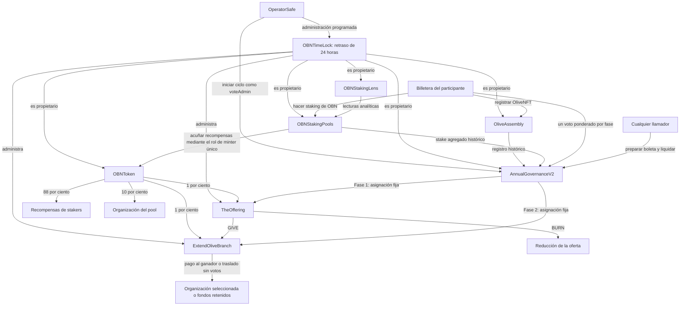

# Dar sin sacrificio: una respuesta de protocolo al declive de la participación benéfica masiva

[English](THESIS.md) · [Tiếng Việt](THESIS.vi.md) · [한국어](THESIS.ko.md) · [日本語](THESIS.ja.md) · [简体中文](THESIS.zh-CN.md) · [हिन्दी](THESIS.hi.md) · [العربية](THESIS.ar.md) · [Русский](THESIS.ru.md) · [Deutsch](THESIS.de.md) · [Português](THESIS.pt.md) · **Español** · [Bahasa Indonesia](THESIS.id.md)

> Esta traducción se ofrece solo por comodidad. La versión en inglés ([THESIS.md](THESIS.md)) es la oficial; en caso de discrepancia, prevalece la versión en inglés. Esta traducción se realizó con ayuda de IA a partir de la revisión `3c740d855` y aún no ha sido revisada por un traductor profesional. Los nombres de contratos y funciones y las direcciones se mantienen en inglés.

**Tesis de Olive Branch Network**

*Olive Branch Network — Base Mainnet*

*Julio de 2026 — revisión de gobernanza del 14 de octubre de 2026*

---

## Resumen

Las donaciones benéficas en Estados Unidos presentan una paradoja: el total donado alcanza máximos históricos casi todos los años, mientras que el número de personas que donan lleva un cuarto de siglo cayendo. La proporción de hogares estadounidenses que hicieron alguna contribución benéfica cayó del 66.2% en 2000 al 49.6% en 2018, y el número de donantes ha disminuido cada año desde 2021 aun cuando creció el ingreso total. La filantropía se está concentrando en una clase de donantes más pequeña y más rica, vaciando la participación masiva sobre la que descansa la legitimidad cívica del sector sin fines de lucro.

Esta tesis sostiene que la raíz del colapso de la participación es estructural, no moral: en todas las formas históricas de dinero — mercancía, fiduciario y digital temprano — dar es *sacrificial*. Una donación transfiere permanentemente el capital del donante al receptor, por lo que el umbral de participación es el excedente disponible, una barrera que una proporción creciente de hogares ya no puede superar a medida que las ganancias de ingreso real se concentran en la cima de la distribución. El dinero programable elimina esta restricción por primera vez en la historia monetaria. Como un contrato inteligente puede separar la *propiedad de un activo* de la *dirección del rendimiento que ese activo genera*, se vuelve posible diseñar **dar sin sacrificio**: un donante conserva su capital permanentemente mientras dirige de forma continua una parte de su productividad, impuesta por el protocolo, a un beneficio público verificable de forma independiente.

El protocolo Olive Branch Network (OBN) se presenta como una implementación de referencia de este diseño. La tesis (i) sitúa a OBN en la larga historia de la tecnología monetaria; (ii) documenta, con datos empíricos citados, el declive de la participación benéfica que la motiva; (iii) formaliza el ciclo de retroalimentación participación–bloqueo del protocolo, en el que cada participante adicional transfiere tokens OBN del float circulante a un escrow contractual no custodial, contrayendo la oferta efectiva a medida que crece la adopción; y (iv) ofrece una descripción técnica completa de cada contrato inteligente central — `OBNToken`, `OBNStakingPools`, `TheOffering`, `ExtendOliveBranch`, `AnnualGovernanceV2`, `OliveAssembly`, `OBNTimeLock`, `TeamVesting`, `OliveNFT` y `OBNStakingLens` — incluidos diseños de almacenamiento, invariantes, estructura de control de acceso y mecánica de seguridad de actualización, tal como están desplegados en la mainnet de Base.

---

## Índice

1. [Introducción](#capítulo-1--introducción)
2. [Una historia del dinero: de la mercancía a la programabilidad](#capítulo-2--una-historia-del-dinero-de-la-mercancía-a-la-programabilidad)
3. [El declive empírico de la participación benéfica](#capítulo-3--el-declive-empírico-de-la-participación-benéfica)
4. [El mecanismo participación–bloqueo: economía de flujo de tokens de OBN](#capítulo-4--el-mecanismo-participaciónbloqueo-economía-de-flujo-de-tokens-de-obn)
5. [Los contratos centrales: una descripción técnica completa](#capítulo-5--los-contratos-centrales-una-descripción-técnica-completa)
6. [Arquitectura de seguridad y diseño institucional](#capítulo-6--arquitectura-de-seguridad-y-diseño-institucional)
7. [Limitaciones, amenazas a la validez y trabajo futuro](#capítulo-7--limitaciones-amenazas-a-la-validez-y-trabajo-futuro)
8. [Conclusión](#capítulo-8--conclusión)
9. [Referencias](#referencias)

---

## Capítulo 1 — Introducción

### 1.1 Planteamiento del problema

Dos tendencias de largo plazo enmarcan este trabajo. Primero, la *amplitud* de las donaciones se está derrumbando: la fracción de hogares de EE. UU. que donan algo cayó casi diecisiete puntos porcentuales entre 2000 y 2018 (Indiana University Lilly Family School of Philanthropy, 2021), y los datos posteriores a 2020 muestran que el declive se acelera en lugar de estabilizarse (Fundraising Effectiveness Project, 2025). Segundo, la *profundidad* de las donaciones se está concentrando: el total alcanza máximos históricos — $592.50 billion en 2024 (Giving USA, 2025) — porque donaciones más grandes de donantes menos numerosos y más ricos sustituyen a los millones de pequeños donantes que se han ido.

Las explicaciones habituales — menor religiosidad, estancamiento salarial, desconfianza generacional en las instituciones — describen el fenómeno pero no lo resuelven, porque todas se reducen a la misma restricción estructural: **dar, tal como se ha constituido históricamente, es la enajenación permanente del capital.** Un hogar solo participa en la filantropía cuando supera el umbral de "tengo suficiente excedente para asumir la pérdida". A medida que el excedente real disponible se concentró en la cima de la distribución del ingreso, la participación se concentró con él.

### 1.2 Enunciado de la tesis

Esta tesis defiende tres afirmaciones:

1. **Afirmación histórica.** Toda tecnología monetaria previa — desde el electro lidio hasta los pasivos de la Reserva Federal y las criptomonedas de primera generación usadas como meros instrumentos al portador — hace de la enajenación del capital el *único* primitivo disponible para dar. El dinero programable es la primera forma monetaria en la que *propiedad* y *dirección del rendimiento* son separables al nivel del propio dinero, en lugar de mediante intermediarios de confianza (fondos patrimoniales, fideicomisos, fondos asesorados por donantes) accesibles principalmente a los ricos.

2. **Afirmación empírica.** La participación benéfica masiva está en declive secular, y ese declive se concentra precisamente en la cohorte de pequeños donantes, para quienes el umbral de sacrificio es más restrictivo. Esta afirmación se apoya en datos de panel (Philanthropy Panel Study), datos de transacciones de todo el sector (Fundraising Effectiveness Project) y estimaciones macro (Giving USA), revisados en el Capítulo 3.

3. **Afirmación del mecanismo.** Un protocolo que (a) permite a los participantes hacer staking de un token sin renunciar a él, (b) dirige una parte fija de las emisiones del protocolo a organizaciones verificadas y (c) bloquea el capital en staking en escrow no custodial produce una retroalimentación entre participación y oferta: cada participante marginal retira tokens del float circulante, de modo que — manteniendo constantes la demanda y la política de emisión — una participación más amplia ajusta mecánicamente la oferta efectiva. El Capítulo 4 lo formaliza y expone honestamente sus supuestos, incluida la fuerza contraria de las emisiones de recompensas.

### 1.3 Aportes

- Una síntesis de la historia monetaria orientada por un único eje: *lo que el propio dinero puede imponer* (Capítulo 2).
- Un registro empírico consolidado y citado del declive de la participación benéfica en EE. UU., 2000–2025 (Capítulo 3).
- Un modelo formal de flujo de tokens de la economía de staking de OBN, incluida la identidad del float circulante, la condición de equilibrio entre emisión y bloqueo y el sumidero de quema controlado por la gobernanza (Capítulo 4).
- La primera especificación escrita completa del conjunto de contratos centrales de OBN tal como está desplegado en Base y validado en un entorno de prueba de fork de mainnet, que cubre cada variable de estado, función, evento, invariante y vía de actualización (Capítulo 5), junto con su arquitectura de seguridad e institucional (Capítulo 6).

### 1.4 El protocolo en un párrafo

Olive Branch Network es un token ERC-20 (`OBN`) en Base con un sistema de staking de pools por organización. Un participante deposita OBN en el pool de la organización que desea apoyar. El depósito nunca se gasta, no se transfiere a la organización ni se pone en riesgo de pérdida frente al protocolo; puede retirarse en cualquier momento (salvo las posiciones de bootstrap bloqueadas explícitamente). Mientras está en staking, el protocolo acuña emisiones basadas en el tiempo sobre el stake y divide cada recompensa realizada en cuatro partes en el momento del reclamo: **88% para el staker, 10% para la organización del pool, 1% para la bóveda común (`TheOffering`) y 1% para la bóveda de distribución (`ExtendOliveBranch`).** El destino de la asignación de la bóveda común registrada al inicio del ciclo — quemar o dar — se decide anualmente mediante una votación de dos fases de billeteras con un OliveNFT registrado, ponderada por la raíz cuadrada del stake en la instantánea (`AnnualGovernance`), cuya segunda fase dirige la asignación fija del ciclo de la bóveda de distribución a una organización elegida por la comunidad. El diseño materializa el Artículo I de la Carta: *"hacer posible que una persona conserve la propiedad de sus activos mientras dirige continuamente una parte del valor que esos activos generan hacia un beneficio público con rendición de cuentas independiente"* (Carta de OBN, Art. I).

---

## Capítulo 2 — Una historia del dinero: de la mercancía a la programabilidad

El propósito de este capítulo no es anticuario. Cada etapa de la historia del dinero se lee a la luz de una pregunta: *¿qué puede imponer el propio dinero y qué debe delegarse en instituciones de confianza?* La respuesta determina qué formas de dar son posibles en cada etapa.

### 2.1 Antes de la acuñación: regalo, deuda y el mito del trueque

La teoría popular sobre los orígenes monetarios — el trueque incómodo que cede espontáneamente ante un medio de intercambio — desciende de Adam Smith (1776) y fue formalizada por Menger (1892), quien modeló el dinero como la convergencia emergente hacia la mercancía más *vendible*, y por Jevons (1875), quien llamó "doble coincidencia de deseos" a las fricciones que resuelve. Los modelos modernos de teoría de la búsqueda (Kiyotaki & Wright, 1989) conservan esta lógica, y Kocherlakota (1998) destiló su implicación más profunda: el dinero es tecnológicamente equivalente a una *memoria* social de quién ha aportado qué — "el dinero es memoria".

Sin embargo, el registro antropológico no respalda las economías de puro trueque como predecesoras del dinero. Humphrey (1985) concluyó que "nunca se ha descrito ningún ejemplo de una economía de trueque, pura y simple, y mucho menos el surgimiento del dinero a partir de ella". Graeber (2011) reunió la evidencia etnográfica y mesopotámica de que *el crédito y la obligación preceden a la moneda por milenios*: la contabilidad de templos y palacios en Sumer (c. 3000 a. C.) denominaba deudas en plata y cebada mucho antes de que alguien hiciera circular plata como efectivo. La teoría crediticia del dinero (Mitchell-Innes, 1913) y la teoría estatal (Knapp, 1905/1924) — el dinero como deuda transferible y el dinero como aquello que el Estado acepta en pago de impuestos — captan esta capa más antigua.

Dos observaciones importan para lo que sigue. Primero, el "dinero" más antiguo ya era una *tecnología contable* — un libro mayor — y sus fichas físicas eran secundarias. Segundo, en las economías de regalo y obligación, dar era constitutivo de la pertenencia social, y no un acto discrecional de disposición del excedente (Mauss, 1925). La reducción de dar a la transferencia voluntaria de excedente es un artefacto de formas monetarias posteriores, no una constante humana.

### 2.2 Acuñación: el dinero como instrumento soberano al portador (c. 640 a. C. – 1000 d. C.)

La acuñación estandarizada aparece en Lidia en el siglo VII a. C. — piezas de electro selladas por el Estado — y se extiende con asombrosa rapidez por las polis griegas, Persia, India (*karshapana* perforados) y la China de los Reinos Combatientes (Davies, 2002; Schaps, 2004). La innovación de la moneda es la *verificación de un vistazo*: el sello soberano elimina el problema del ensayo, y hace que el valor sea transferible entre desconocidos sin confianza ni registro.

Pero observa lo que la tecnología impone y lo que no puede. Una moneda impone la *finalidad del portador*: quien la tiene la posee, de forma absoluta. No puede codificar condiciones, flujos, divisiones ni reversiones. En consecuencia, el único primitivo de dar que admite la acuñación es la transferencia directa de la moneda: puro sacrificio de capital. Cualquier cosa más sofisticada (fondos de templos, las *alimenta* romanas, el *waqf* islámico, la capellanía medieval) requería envolver el dinero en una *institución jurídica* administrada por humanos de confianza. Dar dirigido por rendimiento existía — un waqf es precisamente un activo cuyo ingreso se dirige perpetuamente al beneficio público mientras el corpus es inalienable (Kuran, 2001) —, pero solo estaba al alcance de quienes eran lo bastante ricos para constituir una institución en torno a sus activos.

### 2.3 Papel, banca y la superestructura del crédito (1000–1971)

La China de la dinastía Song emitió el primer papel moneda estatal (*jiaozi*, formalizado en 1024 d. C.), y descubrió tanto la emisión de billetes convertibles como, en dos siglos, la sobreemisión inflacionaria (Von Glahn, 1996). En Europa, la secuencia pasó por letras de cambio, recibos de orfebres, el Banco de Inglaterra (1694) y el patrón oro del siglo XIX, un orden monetario en el que la oferta de dinero estaba disciplinada por la convertibilidad, pero el medio circulante real era abrumadoramente *crédito* bancario (Ferguson, 2008; Eichengreen, 1996). El sistema de Bretton Woods (1944) conservó un ancla de oro a un paso de distancia; su suspensión por parte de Estados Unidos el 15 de agosto de 1971 (el "shock de Nixon") completó la transición al puro dinero fiduciario: dinero como pasivo sin respaldo del Estado, valorado por decreto, aceptación tributaria y expectativa de red — el cartalismo de Knapp plenamente realizado (Eichengreen, 1996).

Para el acto de dar, la era fiduciaria y bancaria cambió la escala, no la estructura. Los regímenes de deducción benéfica (en EE. UU., desde 1917) subsidiaron el sacrificio; la fundación, el fideicomiso de remanente benéfico y el fondo asesorado por donantes industrializaron el patrón del waqf — *propiedad conservada o protegida, rendimiento dirigido* —, pero cada uno requiere constitución legal, mínimos y asesores. La asimetría estructural persistió: **los ricos dan del rendimiento; todos los demás dan del capital.** El Capítulo 3 documenta el resultado previsible.

### 2.4 Liquidación digital y dinero fiduciario electrónico (1971–2008)

Entre el shock de Nixon y 2008, el dinero se desmaterializó operativamente — Fedwire, SWIFT (1973), las redes de tarjetas y los pagos por internet convirtieron la mayor parte del dinero en entradas de bases de datos bancarias — sin cambiar su lógica. El dinero fiduciario electrónico sigue siendo un pagaré cuyas reglas imponen intermediarios regulados. Chaum (1983) mostró que la criptografía podía crear efectivo digital al portador, pero su DigiCash centralizó la emisión y fracasó comercialmente; el "b-money" de Dai (1998) y el "bit gold" de Szabo (concebido a fines de los años 1990, publicado en 2005) esbozaron la emisión descentralizada sin resolver el doble gasto.

### 2.5 Bitcoin: escasez sin soberano (2008)

Nakamoto (2008) resolvió el problema del doble gasto sin una parte de confianza combinando un consenso de proof-of-work sobre un libro mayor público con un calendario fijo de emisión. El aporte de Bitcoin a la historia monetaria es preciso: **escasez digital y liquidación final impuestas por protocolo y no por institución.** Por primera vez, las *reglas del dinero* — sobre todo su curva de oferta — fueron propiedades del propio dinero.

Sin embargo, el script de Bitcoin restringe deliberadamente la expresividad. Como dinero, sigue cerca de la moneda: un instrumento al portador con oferta rígida. Dar en Bitcoin sigue siendo enajenación del capital.

### 2.6 Ethereum y el dinero programable (2015– )

Buterin (2014) generalizó la blockchain en una máquina de estados Turing-completa. Con Ethereum — y cadenas EVM como Base, donde se despliega OBN — el dinero se vuelve *programable*: una lógica arbitraria se ejecuta con la misma finalidad que el propio pago. El estándar ERC-20 (Vogelsteller & Buterin, 2015) convirtió el valor tokenizado en un primitivo componible; ERC-4626, los sistemas de staking y la gobernanza on-chain (por ejemplo, el patrón Governor de Compound) demostraron que **custodia, rendimiento, votación y desembolso pueden ser todos propiedades del protocolo.**

Este es el eje del argumento histórico. El patrón waqf/fondo patrimonial — corpus inalienable, usufructo dirigido al beneficio público — requirió durante mil años una institución de confianza y, por tanto, era un instrumento de ricos. Un contrato inteligente implementa el mismo patrón para cualquier tenedor de cualquier tamaño, con:

- **escrow no custodial** (el "corpus del fondo" lo mantiene código inmutable, no un fiduciario);
- **designación continua y revocable** (el participante puede redirigir o retirar en cualquier momento: la separabilidad del Artículo III de la Carta);
- **divisiones impuestas por el protocolo** (la división 88/10/1/1 en OBN es aritmética en `_mintSlices`, no discrecionalidad de un fiduciario);
- **registro verificable** (cada contribución es un evento on-chain, lo que cumple el Artículo VI de la Carta).

En esta lectura, la historia del dinero es una historia de internalización progresiva, en el propio dinero, de funciones antes delegadas en instituciones: verificación (acuñación), registro (banca), escasez (Bitcoin) y, finalmente, *estructura fiduciaria* (dinero programable). OBN es una aplicación de esta etapa final a la función monetaria más antigua de todas: el regalo.

---

## Capítulo 3 — El declive empírico de la participación benéfica

Este capítulo establece la segunda premisa con datos publicados: **el número de personas que dan está cayendo, de forma persistente y en todas las principales fuentes de datos, aun cuando aumenta el total en dólares.**

### 3.1 El declive a largo plazo de la participación (Philanthropy Panel Study, 2000–2018)

La evidencia longitudinal más rigurosa procede del *Philanthropy Panel Study* de la Indiana University Lilly Family School of Philanthropy, un panel representativo a nivel nacional de más de 9,000 hogares de EE. UU. cuyas donaciones se siguen cada dos años.

- En **2000, el 66.2% de los hogares de EE. UU.** hizo una contribución benéfica.
- Para **2018, solo el 49.6%** lo hizo: la primera vez registrada en que menos de la mitad de los hogares estadounidenses donó, una caída de casi 17 puntos porcentuales (Lilly Family School of Philanthropy, 2021).
- Las donaciones religiosas cayeron del **46% de los hogares (2000–2004) al 29% (2018)**; las laicas cayeron de una meseta de 55–57% (2000–2008) al **42% en 2018** (Lilly Family School of Philanthropy, 2021).
- Análisis posteriores encontraron que el declive **se aceleró durante el primer año de la pandemia de COVID-19** (Lilly Family School of Philanthropy, *The Giving Environment*, 2022; NonProfit PRO, 2022) y que la participación cayó en todos los grupos raciales y étnicos (The NonProfit Times, 2023).

El informe *Giving Environment* de la escuela atribuye el declive en parte a la caída y el estancamiento de los ingresos de hogares de ingresos medios y bajos y a normas cambiantes sobre la afiliación religiosa (Lilly Family School of Philanthropy, 2022); ambas son expresiones del umbral de sacrificio: los hogares dan cuando pueden permitirse perder el dinero, y cada vez menos pueden.

### 3.2 El número de donantes sigue cayendo después de 2018 (Fundraising Effectiveness Project, 2021–2025)

El Fundraising Effectiveness Project (FEP), que agrega datos reales de transacciones de donación en miles de organizaciones, extiende el registro más allá de los estudios de panel y muestra que el declive continúa:

- El número de donantes ha disminuido **cada año desde 2021** (AFP/FEP, 2026).
- De 2023 a 2024, el número de donantes cayó **un 4.5% interanual**, con el declive *acelerándose* respecto a años anteriores (informe FEP Q4 2024; GlobeNewswire, 2025).
- En **2025, el número de donantes cayó otro 3.6% estimado**, aun cuando el total de dólares benéficos creció un 5.0%: el crecimiento de ingresos más fuerte en cinco años, logrado con menos donantes (AFP/FEP, 2026).
- La pérdida se concentra en el extremo pequeño: los donantes de **$1–$100 — más de la mitad de todos los donantes — disminuyeron un 8.8% en 2024 y un 11.1% interanual en Q1 2025** (FEP; NonProfit PRO, 2025).
- La retención general de donantes ronda el **43%**, y la de nuevos donantes es mucho menor, lo que significa que la mayoría de quienes donan por primera vez nunca vuelve a hacerlo (FEP, 2025–2026).

El propio encuadre del FEP es exactamente la tesis de la concentración: las ganancias de ingresos están "concentradas en donaciones más grandes", con "caídas continuas en el número total de donantes" (AFP, 2025).

### 3.3 Dólares al alza, donantes a la baja (Giving USA, 2024–2025)

Giving USA, la estimación macro más antigua de la filantropía de EE. UU., completa la paradoja:

- Las donaciones totales alcanzaron **$592.50 billion en 2024**, un récord en dólares corrientes, con un alza del 6.3% nominal y del 3.3% ajustado por inflación (Giving USA 2025).
- Las donaciones totales volvieron a subir a unos **$617.2 billion en 2025** (Giving USA 2026; Give.org, 2026).
- Pero **la proporción de las donaciones individuales en el total cayó de aproximadamente el 80% en 1986–1990 al 66% en 2024 y al 64% en 2025**, a medida que fundaciones, legados y empresas — vehículos de riqueza acumulada — cubren la diferencia (Giving USA 2026; Give.org, 2026; Stelter, 2026).

### 3.4 Síntesis: el umbral de sacrificio

En tres metodologías independientes — panel de hogares (PPS), agregación de transacciones (FEP) y estimación macro (Giving USA) — surge el mismo cuadro:

| Indicador | Antes | Ahora | Dirección |
|---|---|---|---|
| Hogares que dan algo (PPS) | 66.2% (2000) | 49.6% (2018) | ↓ 16.6 pts |
| Hogares que dan a la religión (PPS) | 46% (2000–04) | 29% (2018) | ↓ 17 pts |
| Número de donantes, interanual (FEP) | — | −4.5% (2024), −3.6% (2025) | ↓ acelerándose |
| Pequeños donantes $1–$100 (FEP) | 50–57% de todos los donantes | −8.8% a −11.1% interanual | ↓ cohorte más marcada |
| Proporción de individuos en las donaciones totales (Giving USA) | ~80% (1986–90) | 64% (2025) | ↓ 16 pts |
| Total en dólares (Giving USA) | — | $592.5B (2024), $617.2B (2025) | ↑ máximos históricos |

El sector se está recapitalizando desde arriba mientras su base participativa se erosiona. Esto es precisamente lo que cabría predecir si dar requiere excedente y el excedente se ha concentrado. El problema de *financiamiento* del sector sin fines de lucro lo están resolviendo los ricos; su problema de *participación* — la función cívica, democrática y legitimadora de millones de pequeñas donaciones — no se está resolviendo en absoluto, porque no existe un instrumento que permita a un hogar no rico dar continuamente sin pérdida.

El Capítulo 4 describe ese instrumento.

---

## Capítulo 4 — El mecanismo participación–bloqueo: economía de flujo de tokens de OBN

Este capítulo formaliza el núcleo económico del protocolo: **la participación bloquea la oferta.** Cada afirmación se basa en código de contrato específico descrito por completo en el Capítulo 5; aquí tratamos el sistema como una máquina de flujo de tokens.

### 4.1 Asignaciones de génesis y reservas actuales

La tabla siguiente registra la acuñación génesis histórica, no las reservas actuales sin gastar. `OBNToken.initialize` acuñó todo el suministro inicial exactamente una vez, en proporciones fijas (OBNToken.sol):

| Asignación | Parte | Propósito |
|---|---|---|
| Liquidez | 40% | Liquidez en DEX para que el token pueda adquirirse |
| Airdrop | 30% | Sembrar una distribución inicial amplia |
| Fondo benéfico | 10% | Bootstrap de posiciones de pools sin fines de lucro (bloqueadas permanentemente — §4.4) |
| Tesorería | 10% | Operaciones del protocolo (asignación de génesis única; ningún flujo de emisión llega a ella) |
| Vesting del equipo | 10% | Bloqueado por tiempo en `TeamVesting` (cliff de 4 meses, 20 meses lineales) |

No es posible más acuñación salvo por el minter único establecido una sola vez — el contrato de staking —, de modo que *todo* el crecimiento de la oferta posterior al génesis son emisiones de staking.

La Reserva de Semillas para Organizaciones tiene una asignación total de **300M OBN**, con **50M OBN** mantenidos por separado para las necesidades del protocolo. Las tenencias de la tesorería y del airdrop se consolidaron en la asignación de semillas. En ese momento, 11M OBN ya habían financiado 11 semillas, lo que dejó 289M OBN para 289 semillas adicionales de 1M OBN cada una.

Se trata de una reasignación de tenencias existentes, no de una nueva acuñación ni de un cambio en el inicializador desplegado.

### 4.2 La identidad del float circulante

Definimos en el tiempo *t*:

- **S(t)** — oferta total: oferta de génesis más emisiones acumuladas menos quemas acumuladas.
- **K(t)** — tokens mantenidos por el contrato de staking: la suma de todos los saldos `userAmount` (solo capital; las recompensas se acuñan directamente a los destinatarios, nunca se agrupan).
- **V(t)** — tokens aún bloqueados en `TeamVesting`.
- **G(t)** — tokens acumulados en las dos bóvedas de gobernanza (`TheOffering` y `ExtendOliveBranch`) a la espera del ciclo anual.
- **B(t)** — tokens quemados acumulados (mediante `TheOffering.burn` y cualquier `ERC20Burnable.burn` voluntario).

Entonces, el **float circulante** — la oferta realmente disponible para negociar — es:

> **F(t) = S(t) − K(t) − V(t) − G(t)**   con   **S(t) = S₀ + E(t) − B(t)**

donde E(t) son las emisiones brutas acumuladas. La afirmación del mecanismo es un enunciado sobre ∂F/∂(participación): **cada depósito mueve tokens de F a K uno a uno** (`_depositCore` ejecuta `safeTransferFrom(msg.sender, address(this), amount)`), y los tokens permanecen en K hasta que ese participante específico decide retirarlos. El protocolo nunca presta, rehipoteca ni gasta K; no hay slashing ni derecho del protocolo sobre el capital. K es escrow inerte.

### 4.3 Política de emisión: decreciente y proporcional a la participación

Las emisiones *no* son un grifo fijo. `_sumRewardAcrossPhases` acumula recompensas por pool como `poolStake × bps × Δt / (10000 × 365 days)`, es decir, un **porcentaje anualizado de lo que está realmente en staking**, según un calendario decreciente:

| Años desde el despliegue | Tasa anual de emisión (sobre el saldo en staking) |
|---|---|
| 0–2 | 10.00% |
| 2–4 | 7.50% |
| 4–6 | 5.00% |
| 6–8 | 2.50% |
| 8–10 | 1.25% |
| 10+ | 3.00% de respaldo (`FALLBACK_EMISSION_BPS`), hasta que la gobernanza lo modifique mediante `addPhase` |

De esto se siguen dos consecuencias. Primero, **las emisiones escalan con K, no con S**: los tokens fuera de staking no generan nada. Segundo, como las recompensas solo se acuñan en *eventos de reclamo* (depósito, retiro, reclamo), las recompensas no reclamadas son solo un asiento contable (`accRewardPerShare × balance − rewardDebt`): no existen como tokens hasta que se realizan.

### 4.4 La división en cuatro partes y sus sumideros

En cada realización, `_mintSlices` divide la recompensa bruta pendiente:

- **88% → el staker.** El rendimiento del participante. Recién acuñado, entra en F (o vuelve a staking).
- **10% → la billetera de la organización del pool.** El regalo. Continuo, impuesto por el protocolo, proporcional al stake y al tiempo del participante. Esta es la *Contribución* del Artículo VII de la Carta, y no le cuesta capital al staker, solo una parte del rendimiento que no existiría sin el protocolo.
- **1% → `TheOffering`** (la bóveda común). Se acumula todo el año; cada ciclo anual de gobernanza vota para **quemar** la asignación registrada al inicio del ciclo (sumidero deflacionario, reduce S) o **darla** (transferencia a `ExtendOliveBranch`).
- **1% → `ExtendOliveBranch`** (la bóveda de distribución). Se acumula todo el año; el voto de la Fase 2 de cada ciclo anual de gobernanza dirige la asignación fija de ese ciclo a una organización de la lista blanca elegida por la comunidad (o la traslada si nadie vota).

Observa que **ningún flujo de emisión va a una tesorería**: las dos franjas residuales alimentan bóvedas controladas por la gobernanza. Hasta su disposición anual, ambos flujos permanecen en el escrow de las bóvedas (G en §4.2), fuera del float negociable.

Además, la asignación de génesis del 10% del fondo benéfico se despliega mediante `charityFundBootstrap`/`depositForWithLock`, que hace staking de tokens *en nombre de la propia billetera de cada organización* con `lockedAmount` igual al depósito: un **bloqueo permanente** (los bloqueos solo pueden aumentar, nunca disminuir). Por lo tanto, las posiciones de bootstrap contribuyen a K para siempre, garantizan a cada pool un flujo base de recompensas para su organización y nunca pueden venderse masivamente.

### 4.5 El ciclo de retroalimentación participación–bloqueo

Reunamos las piezas. Sea *n* el número de participantes activos y *k̄* el stake promedio. Entonces K = n·k̄ (más los bloqueos de bootstrap), y:

1. **La adopción ajusta el float.** Cada nuevo participante convierte tokens del float en capital en escrow: ΔF = −Δstake. Con demanda constante, un float negociable menor eleva el precio de equilibrio del mercado: el resultado estándar de oferta y demanda y el análogo on-chain de la "contracción del float" observada desde hace tiempo en economías de proof-of-stake, donde altas tasas de staking reducen la oferta líquida.
2. **El rendimiento premia la paciencia, y el 88% del rendimiento puede reinvertirse.** Los stakers que vuelven a poner en staking su parte del 88% llevan tokens recién acuñados directamente de vuelta a K, ajustando aún más F.
3. **El flujo de regalos financia la legitimidad en el mundo real.** El flujo del 10% para organizaciones da a las instituciones externas una razón duradera para promover la participación, lo que atrae a más participantes: el único canal de marketing que es en sí mismo un acto benéfico.
4. **La gobernanza puede convertir la bóveda común en pura deflación.** Un resultado BURN en la Fase 1 destruye la asignación común registrada al inicio del ciclo y reduce S directamente. Observa que el valor predeterminado es deliberadamente deflacionario: *participación cero → BURN* (GIVE debe superar *estrictamente* a BURN).
5. **La elegibilidad de voto requiere participación en la instantánea.** V2 combina el estado de NFT registrado con al menos 1 OBN de stake agregado con checkpoints y luego aplica ponderación por raíz cuadrada. La gobernanza ofrece una razón para estar en staking antes de que comience cada ciclo; no exige permanecer en staking después ni establece un bloqueo continuo durante la votación (§5.5).

El ciclo: **más participantes → más tokens bloqueados → menor float y mayor opción acumulada de quema → mejor soporte de precio → mayor valor de rendimiento y de regalo por token → reclutamiento más fuerte → más participantes.**

### 4.6 Contabilidad honesta: el contrapeso de las emisiones

El mecanismo tiene una fuerza opuesta. Las emisiones son inflacionarias: a la tasa inicial del 10%, S crece en proporción a K. Que el float neto se *reduzca* depende de los flujos realizados. Diferenciando la identidad del float, el flujo de emisión que entra en el float es:

> **dF/dt ≈ e·K·[0.88·(1−r) + 0.10 + 0.02·(1−β)·δ] − dK/dt**

donde *e* es la tasa de emisión actual, *r* la fracción de recompensas de stakers que vuelve a staking, *β* la fracción de los flujos de las bóvedas que finalmente se quema en la Fase 1 y *δ* ≤ 1 un factor de rezago que refleja que los dos flujos de 1% de las bóvedas solo entran en el float después de que el ciclo anual los distribuye (los montos quemados nunca entran; los traslados posponen aún más la entrada). El float se contrae (dF/dt < 0) siempre que **el nuevo staking neto supere la parte de las emisiones que no vuelve a staking**. Las características estructurales empujan en esa dirección — el calendario de emisión decrece 10% → 1.25% mientras se pretende que la adopción crezca; los destinatarios sin fines de lucro son vendedores movidos por la misión, pero su entrada es solo del 10% de las emisiones; el valor predeterminado de quema retira permanentemente lo común; los bloqueos de bootstrap nunca salen —, pero la condición es empírica, no garantizada. Por lo tanto, la afirmación defendida aquí está delimitada con precisión: *el protocolo está diseñado para que el crecimiento de la participación contraiga mecánicamente el float y cree condiciones que respalden el precio del token, ceteris paribus; no garantiza ni puede garantizar la apreciación del precio, que también depende de la demanda exógena.*

### 4.7 Dar sin sacrificio, reformulado

El diseño económico resuelve directamente el problema del Capítulo 3. El umbral de participación ya no es "excedente que puedo permitirme perder", sino "capital que estoy dispuesto a estacionar". El hogar que nunca podría donar $500 puede hacer staking de $500, conservarlos, retirarlos en una emergencia y, mientras tanto, dirigir continuamente el 10% del rendimiento que genera su stake — contribuciones reales, impuestas por el protocolo y registradas públicamente — a una organización verificada. Dar se convierte en una *decisión de asignación de activos* en lugar de un *sacrificio de consumo*. Esa es la respuesta del diseño al colapso de la participación: no exhortar a la gente a dar más, sino eliminar la razón estructural por la que dejó de hacerlo.

---

## Capítulo 5 — Los contratos centrales: una descripción técnica completa

Todos los contratos apuntan a Solidity ^0.8.28, se basan en OpenZeppelin v5 y están desplegados en Base. Los contratos actualizables usan el patrón UUPS (`_authorizeUpgrade` restringido al propietario, que es `OBNTimeLock`). Este capítulo describe cada contrato del conjunto: propósito, almacenamiento, funciones, eventos, invariantes e interacciones.

### 5.1 `OBNToken` — la base monetaria (OBNToken.sol)

**Herencia.** `Initializable`, `IOBNMintable`, `ERC20Upgradeable`, `ERC20PermitUpgradeable` (aprobaciones sin gas de EIP-2612), `ERC20VotesUpgradeable` (delegación con checkpoints), `ERC20BurnableUpgradeable`, `OwnableUpgradeable`, `UUPSUpgradeable`.

**Identidad.** Nombre "Olive Branch Network", símbolo "OBN".

**Almacenamiento.** Una sola variable personalizada — `address public minter` — más un `uint256[100] __gap` que reserva margen para actualizaciones.

**Inicialización.** `initialize(initialOwner, initialSupply, liquidityAddress, airdropAddress, charityAddress, treasuryAddress, teamVestingAddress)` se ejecuta una vez (modificador initializer; el constructor llama a `_disableInitializers()` para que la propia implementación nunca pueda inicializarse). Tras comprobar dirección distinta de cero y suministro distinto de cero, acuña toda la distribución: 30% airdrop, 40% liquidez, 10% beneficencia, 10% tesorería, 10% vesting del equipo (§4.1).

**Mecánica del minter.** `setMinterOnce(addr)` — solo propietario, requiere `minter == address(0)`: el minter puede establecerse **exactamente una vez** durante la vida de la implementación (solo una actualización UUPS completa podría cambiarlo). `mint(to, amount)` requiere `msg.sender == minter`. En el despliegue, el minter es el proxy `OBNStakingPools`; por lo tanto, *toda la oferta futura son emisiones de staking*. `isMinter(addr)` es una vista de conveniencia.

**Sobrescrituras.** OZ v5 dirige todos los cambios de saldo por `_update`, de modo que una sola sobrescritura concilia `ERC20Upgradeable` y `ERC20VotesUpgradeable` (los checkpoints de voto siguen las transferencias automáticamente). `nonces()` se sobrescribe para conciliar `ERC20PermitUpgradeable` con `NoncesUpgradeable`.

**Propiedades de seguridad.** Sin pausa, sin lista negra, sin impuesto de transferencia: el token es máximamente neutral. La quema está disponible para cualquier tenedor mediante `ERC20Burnable`, el gancho que `TheOffering` usa para destruir lo común.

### 5.2 `OBNStakingPools` — el motor (StakingPoolsV931.sol; cadena de versión "9.3.1")

El contrato de staking es el más grande y trascendental del sistema: es el único minter de OBN, el custodio de todo el capital en staking (K en §4.2) y el oráculo de poder de voto de la gobernanza. Funciona detrás de un proxy UUPS en una dirección estable.

#### 5.2.1 Constantes — la división inmutable

```solidity
STAKER_BPS = 8800; CHARITY_BPS = 1000; CHARITY_FUND_BPS = 100; TREASURY_BPS = 100;
TOTAL_BPS = 10000; FALLBACK_EMISSION_BPS = 300;
```

La división 88/10/1/1 es `constant`: está compilada en el bytecode y no puede cambiar sin una actualización completa de la implementación mediante el timelock. Las dos franjas de 100-bps se acuñan a las direcciones guardadas en las variables de almacenamiento `treasury` y `charityFund`; **en la configuración desplegada esas variables contienen `TheOffering` (0xc75B…E341) y `ExtendOliveBranch` (0xE1Bb…6d8B), respectivamente** — los identificadores son históricos, y los destinatarios operativos de ambos flujos de 1% son las dos bóvedas de gobernanza (§5.3, §5.4). `FALLBACK_EMISSION_BPS` es el piso perpetuo del 3% aplicado después de que se agota el calendario de fases definido (§4.3).

#### 5.2.2 Diseño de almacenamiento

Ordenado por ranuras y crítico para las actualizaciones (el contrato documenta su mapa de ranuras; el hueco final es `uint256[93]`; el estado del auto-claim mensual está fuera de este mapa, en el almacenamiento con espacio de nombres ERC-7201 en `obn.storage.MonthlyAutoClaim`):

- **Configuración:** `stakingToken` (el token OBN como `IOBNMintable`), `treasury` (→ TheOffering), `charityFund` (→ ExtendOliveBranch), `version` (cadena, "9.3.1").
- **Calendario de emisión:** `Phase[] phases`, cada una `{start, end, bps}` en marcas de tiempo.
- **Pools:** `PoolInfo[] poolInfo`, cada uno `{charityWallet, totalStaked}` — un pool por organización.
- **Contabilidad del usuario:** `userAmount[pid][user]`, `userRewardDebt[pid][user]` — el patrón acumulador/deuda de recompensas (§5.2.3).
- **Acumuladores:** `accRewardPerShare[pid]` (escala 1e12), `lastRewardTime[pid]`.
- **Global:** `globalTotalStaked`.
- **Bloqueos:** `lockedAmount[pid][user]` — el libro mayor de bloqueos permanentes (§4.4).
- **Estadísticas:** `totalClaimedByUser`, `totalDepositedByUser`, `totalWithdrawnByUser`, totales por pool de depósito/retiro/charity acuñado, `uniqueStakersByPool`, `uniqueStakersGlobal`, `activePoolCount[user]`, `stakedSince[user]`, `cumulativeStakeSeconds[user]` (persiste tras retirar todo el staking: un registro permanente de antigüedad).
- **Ciclo de vida:** `poolRemoved[pid]` (depósitos desactivados), `poolFullyRemoved[pid]` (eliminado de las boletas de gobernanza; solo lo establece `removePool`, nunca `shutdownPool`).
- **Seguimiento de contribuciones:** `charityContributedByUserInPool[pid][user]` y `totalCharityContributedByUser[user]` — las donaciones de por vida atribuibles a cada participante, el *Registro* on-chain del Artículo VI de la Carta.
- **Infraestructura de gobernanza (ranuras 28–30):** `charityFundOperator` + `_migrationExecuted` + `upgradeBlock` (empaquetados en una ranura), `totalStakedByUser[user]` (total acumulado entre pools) y `_stakeCheckpoints[user]` (`Checkpoints.Trace208`, el historial de poder de voto). `poolFullyRemoved`, indicado arriba en Ciclo de vida, ocupa la ranura 31.

#### 5.2.3 El modelo contable

OBN usa el esquema acumulador/deuda de recompensas con una variación decisiva: **el acumulador sigue las recompensas BRUTAS.** En cualquier interacción con el pool, `_accruePool` calcula la emisión bruta desde `lastRewardTime` mediante `_sumRewardAcrossPhases` — que recorre el calendario de fases segmento por segmento, maneja con exactitud los límites de fase con `Math.mulDiv(poolStake, bps × duration, 10000 × 365 days)` y aplica la tasa de respaldo del 3% a cualquier intervalo posterior a la última fase definida — y la incorpora en `accRewardPerShare[pid] += grossReward × 1e12 / totalStaked`. El bruto pendiente de un usuario es entonces:

> `pending = userAmount × accRewardPerShare / 1e12 − userRewardDebt`

La división en 88/10/1/1 ocurre solo en la realización dentro de `_mintSlices`, que sigue estrictamente checks-effects-interactions: todas las estadísticas se actualizan *antes* de las cuatro llamadas externas a `mint`. No se acuña nada para un pool con stake cero (el devengo retorna antes y solo adelanta el reloj), y las recompensas nunca permanecen en el contrato: van directamente de la acuñación al destinatario final. Un envoltorio público `sumRewardAcrossPhases` expone el recorrido de fases para el Lens de solo lectura (§5.9).

#### 5.2.4 Funciones orientadas al usuario

- **`deposit(pid, amount)`** — hacer staking en un pool. Requiere un pool válido y no cerrado. Efectos: devengar el pool; registrar un staker único (por pool y global, con `stakedSince` iniciando el reloj de antigüedad al pasar de 0→1 pools); aumentar `userAmount`, `poolInfo.totalStaked`, `globalTotalStaked` y las estadísticas de depósito; restablecer la deuda de recompensas; añadir un checkpoint `(block.number, totalStakedByUser)`; luego `safeTransferFrom` del capital y `_mintSlices` de cualquier recompensa pendiente. Depositar *realiza* las recompensas pendientes como efecto secundario.
- **`depositFor(pid, amount, beneficiary)`** — financiamiento por terceros del stake de otra dirección (donaciones al estilo de nómina, regalos de participación).
- **`depositWithPermit(...)`** — aprobación+stake en una sola transacción mediante EIP-2612.
- **`withdraw(pid, amount)`** — salida. Impone `amount ≤ userAmount − lockedAmount` (el saldo *desbloqueado*); actualiza todos los saldos, checkpoints y ganchos (`_afterWithdrawBalanceHooks` limita los bloqueos al nuevo saldo, borra los indicadores de staker activo en cero y, al salir del último pool, registra la sesión en `cumulativeStakeSeconds` y reduce `uniqueStakersGlobal`); devuelve el capital; realiza las recompensas pendientes mediante la misma división 88/10/1/1. **Sin período de espera, sin penalización, sin comisión**: la separabilidad del Artículo III exige una salida sin fricción.
- **`claim(pid)` / `claimFor(pid, user)` / `claimMultiple(pids)`** — realizan recompensas sin tocar el capital. `claimFor` es exclusiva del propietario del contrato (detrás del timelock) y solo puede enviar recompensas a su legítimo destinatario (acuña *a `user`*, no al llamador). Los reclamos programados usan la vía separada `autoClaimFor`, basada en el consentimiento y añadida en V9.3.1 (Whitepaper §3.2.1); esta vía no reinvierte recompensas.
- **Conjunto de vistas:** `pendingRewards`, `getPoolInfo`, `getUserStakeValue`, `unlockedBalance`, `poolLength`, `isGloballyStaked`, `stakeElapsed`, `currentRewardsPerSecond` (la analítica más pesada está en Lens — §5.9).

#### 5.2.5 Bootstrap del fondo benéfico y congelamiento del autostaking

`charityFundBootstrap(pid, amount, beneficiary)` / `depositForWithLock(...)` — solo pueden ser llamadas por `charityFund` o `charityFundOperator` (una Safe operativa), solo para la propia billetera benéfica del pool, y pasan por `_enforceCharitySelfStakePolicy`, que permite **exactamente un** depósito de bootstrap bloqueado por organización del pool: la billetera benéfica debe tener saldo cero, el llamador debe estar autorizado y el depósito debe estar bloqueado. Cualquier otro autostaking de la organización de un pool se rechaza ("charity self-stake disabled"). Justificación: una organización que hiciera staking en su propio pool devolvería a sí misma la franja benéfica del 10%, capitalizando en un volante de peso de gobernanza; el congelamiento limita las posiciones de las organizaciones a un único bootstrap transparente y bloqueado permanentemente.

`setLockedAmount(pid, user, amount)` — charityFund o el operador (el operador restringido a direcciones benéficas de pools) pueden **solo aumentar** los bloqueos, nunca disminuirlos, y nunca por encima del saldo del usuario. Los bloqueos son unidireccionales por construcción.

#### 5.2.6 Funciones administrativas (todas detrás del `onlyOwner` propiedad del timelock)

- **`addPool(charityWallet)`** — crea un pool para una organización; inicializa su reloj de devengo.
- **`shutdownPool(pid)`** — bloquea *nuevos* depósitos; los reclamos y retiros continúan para que los usuarios siempre puedan salir. Los pools cerrados siguen siendo elegibles para la boleta de gobernanza.
- **`removePool(pid)`** — solo cuando `totalStaked == 0`; libera devengos heredados de charity, establece `poolFullyRemoved` (retirando a la organización de boletas futuras) y reorienta la billetera benéfica del pool a la dirección `treasury` (TheOffering) para que las acuñaciones residuales nunca queden varadas en address(0).
- **`updateCharityWallet(pid, newWallet)`** — rota una billetera de organización comprometida o migrada.
- **`migrateBootstrap(pid, old, new)`** — mueve una posición de bootstrap completa (saldo, deuda de recompensas, bloqueo) entre direcciones de organizaciones de forma atómica, llevando los checkpoints de poder de voto por ambos lados, con una prueba on-chain de que las recompensas pendientes se conservan dentro de 1 wei (`pendingAfter ≥ pendingBefore && pendingAfter ≤ pendingBefore + 1`).
- **`addPhase(start, end, bps)`** — añade fases de emisión; debe ser contigua a la última. También es la palanca de la gobernanza sobre la tasa de respaldo del 3%.
- **`forceExitUserToSelf(pid, user, claimRewards)`** — emergencia: devuelve todo el capital de un usuario *al propio usuario* (nunca al administrador), opcionalmente realizando recompensas e ignorando bloqueos. El administrador no puede confiscar; solo puede forzar la devolución.
- **`sweep(token, amount)`** — recupera ERC-20 recibidos por error a la dirección `treasury`, **excluyendo explícitamente el token de staking** ("Cannot sweep staking token") para que el administrador nunca pueda tocar K.
- **`migrateV93(newTreasury, newCharityFund, newOperator)`** — la función de conexión única, ejecutada atómicamente con el despliegue de la implementación mediante `upgradeToAndCall` a través del timelock. Estableció `treasury` → TheOffering, `charityFund` → ExtendOliveBranch y `charityFundOperator` → la Safe operativa; registró `upgradeBlock` como ancla de génesis para los checkpoints de poder de voto; y se desactivó permanentemente (`_migrationExecuted`). La actualización V9.3.1 añadió `initializeV931(executor)`, un reinitializer único y separado que fijó `version` en "9.3.1" y el executor de auto-claim; después, `setAutoClaimExecutor(executor)` puede cambiar ese executor, y la dirección cero pausa la automatización.
- **`upgradeTo(newImpl, data)` / `setVersion`** — vía de actualización UUPS compatible con la programación del timelock.

#### 5.2.7 Poder de voto con checkpoints

Los saldos en staking son *consultables por instantánea*, de modo que la gobernanza puede ponderar votos en un bloque pasado fijo en lugar de confiar en los saldos actuales (lo que invitaría a ataques de flash-stake):

- Cada depósito, retiro y migración de bootstrap añade `(block.number, totalStakedByUser)` a un `Checkpoints.Trace208` por usuario.
- **Bootstrap de génesis:** los stakers cuyas posiciones son anteriores al sistema de checkpoints no tienen entradas de historial. Tres vías complementarias los inicializan en `upgradeBlock`: `_initializeCheckpointIfNeeded` (automática, en la siguiente interacción del usuario, antes de cualquier cambio de saldo); `bootstrapCheckpoint(user)` (sin permiso: cualquiera puede inicializar a cualquiera); y `batchBootstrap(users[])` (ceremonia masiva sin permiso). `AnnualGovernance` también inicializa a los votantes de forma diferida en su primer intento de voto (§5.5).
- **`getPastVotingPower(user, blockNumber)`** — búsqueda binaria (`upperLookup`) del total en staking del usuario en cualquier bloque pasado; **`checkpointCount(user)`** expone el estado de inicialización.
- Esta interfaz devuelve **OBN bruto agregado en staking en la instantánea**, no el peso final de voto de V2. AnnualGovernanceV2 primero comprueba el registro histórico de OliveAssembly y el mínimo de 1 OBN y luego aplica la ponderación por raíz cuadrada (§5.5). Los saldos de billetera fuera de staking y la delegación de ERC20Votes no otorgan poder de voto anual. Los ciclos históricos anteriores a la votación con NFT conservan su ponderación lineal original.

### 5.3 `TheOffering` — la bóveda común (TheOffering.sol)

Una bóveda deliberadamente mínima y **no actualizable** que recibe un 1% de todas las emisiones de staking de OBN durante el año. No maneja ETH; solo tiene dos roles:

- `timelockOwner` (inmutable, establecido en la construcción) — puede llamar a `setGovernance(addr)` (address(0) pausa la gobernanza) y `emergencySweep(token, to)` (recuperación del saldo completo de ERC-20, la anulación previa a la distribución).
- `governance` (el proxy `AnnualGovernance`) — puede llamar exactamente a dos funciones, ambas después de la votación: **`burn(amount)`** (invoca `ERC20Burnable.burn` de OBN, destruyendo oferta) o **`sendToExtend(amount)`** (transferencia SafeERC20 a `ExtendOliveBranch`).

El orden de despliegue importa y está documentado en el contrato: `ExtendOliveBranch` primero (su dirección es un immutable aquí), la gobernanza se conecta después. El contrato mantiene lo común acumulado del año y no hace nada más: una superficie de ataque de dos funciones protegidas.

### 5.4 `ExtendOliveBranch` — la bóveda de distribución (ExtendOliveBranch.sol)

La segunda bóveda no actualizable, que recibe su propio 1% de todas las emisiones de staking más cualquier transferencia por resultado GIVE desde `TheOffering`. Almacenamiento: `obn` y `timelockOwner` inmutables; `governance` mutable; `mapping(address => bool) approvedNonprofit`: la **lista blanca** que implementa el Artículo IV de la Carta (la legitimidad del destinatario debe verificarse de forma independiente, no autodeclararse).

Dos vías de distribución, deliberadamente asimétricas:

- **`distribute(nonprofit, amount)`** — timelockOwner o governance; *lista blanca aplicada*. Canal manual, previo a la gobernanza y de emergencia.
- **`distributeFromGovernance(nonprofit, amount)`** — solo governance; **lista blanca omitida intencionalmente** en esta vía de distribución. V2 valida a cada destinatario contra la lista blanca cuando se procesa su lote de boleta y luego conserva esa membresía durante el ciclo. Una revocación posterior de la lista blanca no puede eliminar a un destinatario admitido ni invalidar al destinatario seleccionado en el pago. El Timelock conserva `emergencySweep`; retirar fondos reservados puede impedir la liquidación hasta que se reponga el déficit.

Administración: `setApprovedNonprofit(addr, bool)`, `setGovernance(addr)`, `emergencySweep(token, to)`: todas exclusivas del timelock.

### 5.5 `AnnualGovernanceV2` — gobernanza anual (AnnualGovernanceV2.sol)

Esta sección describe AnnualGovernanceV2, la implementación activa detrás del proxy AnnualGovernance existente desde su actualización del 7 de octubre de 2026 (bloque 52283807 de Base). Los informes históricos de auditoría describen implementaciones anteriores y no son la especificación de despliegue actual.

#### 5.5.1 Qué decide la comunidad

La gobernanza anual dirige los dos flujos compartidos de emisión de 1%. En la Fase 1, los participantes eligen si queman la asignación de TheOffering o la dan a ExtendOliveBranch. En la Fase 2, eligen una organización elegible para recibir la asignación de ExtendOliveBranch del ciclo. Ambas fases se ejecutan aunque la Fase 1 seleccione BURN. Estas votaciones no cambian la recompensa del 88% del staker, no redirigen la parte del 10% específica del pool, no gastan el capital de los usuarios ni aprueban actualizaciones arbitrarias del protocolo.

OperatorSafe, actuando como `voteAdmin`, inicia un ciclo directamente. El propietario sigue siendo el Timelock, y la incorporación y configuración de organizaciones siguen controladas a través de él. El término *anual* describe la cadencia operativa prevista: el contrato impone dos ventanas de votación de 30 días e impide ciclos superpuestos, pero no programa un ciclo automáticamente ni exige un intervalo de un año entre inicios. Alguien debe enviar cada transacción de preparación y liquidación.

#### 5.5.2 Registro y poder de voto

Un votante usa la misma billetera para hacer staking de OBN y registrar un OliveNFT en OliveAssembly. Tras aprobar al proxy de Assembly para transferir el NFT, la billetera llama a `deposit(tokenId)`. Assembly mantiene el NFT y hace checkpoint del registro de la billetera; tener el NFT fuera de Assembly no es suficiente. El registro persiste entre ciclos hasta el retiro, y no se permite registrar NFT adicionales en la misma billetera. El staking y el registro de NFT son acciones separadas y ninguna sustituye a la otra.

Para un ciclo que comienza en el bloque `B`, ambas fases usan el registro y el saldo agregado en staking al final del bloque `B - 1`. Una billetera registrada con al menos 1 OBN en staking es elegible. Los depósitos o registros en el bloque `B` o posteriores no aumentan el derecho de ese ciclo. Los retiros posteriores de stake o NFT no eliminan el derecho ya capturado por la instantánea. Por lo tanto, el mecanismo mide la participación en un punto definido, en lugar de imponer un bloqueo de stake o NFT de 60 días.

Para las billeteras elegibles, el poder de voto en unidades legibles es aproximadamente la raíz cuadrada del OBN en staking. Para un monto de stake `s` de 18 decimales, el cálculo exacto del contrato es `floor(sqrt(s)) * 10^9`, devuelto en unidades de poder de voto de 18 decimales. El poder es cero por debajo del mínimo o sin registro en la instantánea.

| Stake agregado en la instantánea | Unidades de poder de voto, si está registrado |
|---|---:|
| Menos de 1 OBN | 0 |
| 1 OBN | 1 |
| 100 OBN | 10 |
| 10,000 OBN | 100 |

Esto reduce la ventaja del stake concentrado: aumentar el stake cien veces aumenta el peso diez veces. No establece una persona, un voto. Una persona puede controlar varias billeteras y adquirir varios NFT; dividir el stake entre billeteras elegibles puede aumentar el peso combinado por raíz cuadrada. El registro de NFT es un filtro de elegibilidad, no una prueba de identidad humana única.

Cada billetera elegible puede enviar un voto por fase usando `castOfferingVote(cycleId, burn)` y `castNonprofitVote(cycleId, nonprofit)`. Los votos no pueden modificarse mediante estos endpoints. Un votante de la Fase 2 no necesita haber votado en la Fase 1. El stake determina el peso en todos los pools, por lo que el votante puede seleccionar cualquier organización de la boleta, no solo un pool en el que esa billetera haga staking. No hay quórum de participación ni mecanismo de delegación en estos endpoints de votación anual.

#### 5.5.3 Ciclo de vida del ciclo y preparación de la boleta

| Paso | Quién actúa | Comportamiento del contrato |
|---|---|---|
| Registrar y hacer staking | Participante | Establece el registro de NFT y el stake antes de la instantánea |
| Iniciar la Fase 1 | Safe voteAdmin | Llama a `startAnnualCycle(2592000, 2592000)`; captura instantáneas y abre una votación de 30 días |
| Preparar el resto de la boleta | Cualquier llamador | Llama a `prepareBallot(cycleId, maxPools)` o `executeCurrentCycle()` en lotes acotados |
| Votar BURN o GIVE | Billeteras elegibles | Cada una envía un voto ponderado de la Fase 1 |
| Liquidar la Fase 1 | Cualquier llamador | Tras el plazo y la preparación completada, ejecuta el resultado y abre la Fase 2 |
| Votar por una organización | Billeteras elegibles | Cada una envía un voto ponderado de la Fase 2 durante su ventana completa de 30 días |
| Liquidar la Fase 2 | Cualquier llamador | Paga la asignación fija del ganador o registra el traslado si no hubo votos |

Para iniciar se requiere que Assembly esté vinculado a la gobernanza, al menos un registro en la instantánea, un historial de pools no vacío y que cualquier ciclo anterior esté completado o cancelado. Un conteo de billeteras registradas no garantiza que alguna billetera cumpla el umbral de staking. Ambos argumentos de duración deben ser exactamente 2,592,000 segundos. La acción de inicio de la Safe no requiere una nueva operación del Timelock ni una segunda acción de la Safe para abrir la Fase 2.

**Instantánea y fondos.** La transacción de inicio fija la elegibilidad de los votantes y el stake agregado en el bloque anterior y captura ambas asignaciones de fondos. Un OliveNFT debe estar registrado en OliveAssembly y el stake agregado debe ser de al menos 1 OBN. El poder se pondera por raíz cuadrada. Ambas fases usan la misma instantánea; retirar después no borra el derecho de ese ciclo. Los ingresos posteriores de fondos pertenecen al siguiente ciclo, salvo la asignación GIVE del Offering de este ciclo.

**Preparación de la boleta.** El inicio congela la longitud del historial de pools, abre la Fase 1 y procesa los primeros 100 ID de pool. Las llamadas de keeper sin permiso procesan lotes adicionales de como máximo 100 ID durante la Fase 1. Este es un límite de trabajo por transacción, no un límite de membresía. La eliminación de duplicados usa un mapeo y conserva el orden del primer PID elegible. Los pools activos y cerrados siguen siendo elegibles salvo que se eliminen por completo. No se necesita ninguna interacción adicional de inicio de la Safe ni del Timelock.

**Momento de la configuración.** Las instantáneas de votantes y fondos se fijan al inicio, pero el contrato de staking no ofrece configuración histórica de organizaciones. El estado de eliminación y la billetera de cada pool, y la aprobación de un nuevo destinatario, se leen cuando se ejecuta ese lote. Los destinatarios ya añadidos son inmutables durante el ciclo; los ID de pool añadidos después quedan excluidos. Por lo tanto, los cambios del Timelock durante la preparación pueden afectar a pools no procesados. Un destinatario no aprobado hace que el lote se revierta atómicamente; el Timelock debe corregir la configuración o cancelar el ciclo. La revocación de la aprobación después de la admisión no elimina a ese miembro de la boleta. Evita cambios en la configuración de organizaciones mientras la preparación esté pendiente.

**Ejecución.** Los votos de la Fase 1 pueden emitirse mientras se prepara la boleta. La Fase 1 no puede ejecutarse hasta que la preparación esté completa y haya pasado su plazo. El despachador avanza los lotes pendientes antes de ejecutar la fase. Una boleta final vacía no puede finalizar la preparación; el propietario puede cancelar antes de la ejecución de la Fase 1. GIVE debe superar estrictamente a BURN; los empates y la participación cero queman solo la asignación fija del Offering. Luego, la Fase 2 se abre durante 30 días completos desde la ejecución real. Cada voto por una organización actualiza al líder con trabajo constante, y los empates se otorgan a la posición más temprana de la boleta. La liquidación paga a ese líder solo la asignación fija del ciclo, o la traslada cuando no se emitieron votos. Ni la preparación ni la liquidación examinan toda la boleta en una sola transacción que cambia el estado.

Por ejemplo, si el plazo de la Fase 1 vence el día 30 pero se liquida el día 34, la Fase 2 cierra el día 64. Los votos de la Fase 1 terminan en el plazo original; la ejecución demorada no prolonga esa votación. `executeCurrentCycle()` avanza un lote o una liquidación por llamada, por lo que completar el último lote de preparación puede requerir una llamada posterior para liquidar la Fase 1. El modelo de ejecución sin permiso permite que cualquier llamador dispuesto realice este trabajo; no garantiza que haya un servicio de keeper en funcionamiento.

#### 5.5.4 Asignaciones fijas y reglas de resultado

Sea `O` el saldo de OBN de TheOffering y `E` el saldo de ExtendOliveBranch en la transacción de inicio. La Fase 1 quema `O` salvo que el total ponderado de GIVE supere estrictamente al de BURN. Por lo tanto, un empate o la ausencia de votos en la Fase 1 se resuelve como BURN. Si GIVE gana, `O` pasa a ExtendOliveBranch. La asignación de la Fase 2 es `E` con BURN o `E + O` con GIVE. Los ingresos posteriores quedan excluidos y disponibles para un ciclo futuro.

Por ejemplo, con 1,000 OBN en TheOffering y 2,000 OBN en ExtendOliveBranch al inicio, GIVE pone 3,000 OBN a disposición de la Fase 2. Si ExtendOliveBranch recibe después otros 200 OBN, esos 200 no se suman al pago actual. Con BURN, 1,000 OBN se destruyen y la Fase 2 asigna 2,000 OBN. Sin votos en la Fase 2, su asignación permanece en la bóveda para un ciclo futuro; el BURN ya ejecutado en la Fase 1 no se revierte.

La Fase 2 selecciona el mayor total ponderado, y los empates se resuelven por la posición más temprana de la boleta, determinada por el procesamiento ascendente de ID de pool y la eliminación de duplicados de destinatarios. Es una asignación a un solo destinatario, no una distribución proporcional entre todos los nominados. Los fondos permanecen en las bóvedas existentes: la instantánea es una reserva contable, no un escrow separado. Los retiros administrativos pueden crear un déficit; la liquidación se revierte en lugar de pagar una asignación reducida y puede reintentarse tras la reposición.

#### 5.5.5 Autoridad, compatibilidad y verificación

| Actor | Autoridad en el diseño actual |
|---|---|
| Votantes elegibles registrados | Deciden los dos resultados de asignación anual con el peso de la instantánea |
| Safe voteAdmin | Inicia ciclos; no puede sustituir boletas por una lista elegida a mano ni anular recuentos mediante la función de inicio |
| Cualquier llamador | Prepara lotes deterministas de boleta y ejecuta resultados cuando se cumplen sus condiciones |
| Propietario Timelock | Cambia voteAdmin, gestiona la configuración de organizaciones y la administración de las bóvedas, cancela antes de la liquidación de la Fase 1 y autoriza actualizaciones permitidas |

Los votantes anuales no adquieren los poderes administrativos del Timelock. Governance y Assembly bloquean sus propias actualizaciones durante los ciclos activos, pero las dependencias de staking, token y bóvedas conservan sus supuestos administrativos de confianza. El ciclo no puede cancelarse mediante `cancelCycle` después de ejecutar la Fase 1; esta restricción no elimina los poderes de emergencia de las bóvedas ni garantiza una liquidación ininterrumpida.

**Compatibilidad y lecturas.** Los campos Cycle existentes y las ranuras de nivel superior permanecen en su lugar; los nuevos campos Cycle se añaden al final. El antiguo valor maxBallotSize y su setter se conservan por compatibilidad de ABI/almacenamiento, pero no restringen la membresía. El índice consultivo de pools no se usa para construir boletas. getCyclePreparation expone el progreso; getBallotPage lee hasta 100 miembros por llamada. En ciclos grandes, el evento heredado CycleStarted incluye solo el lote inicial; los indexadores deben usar eventos BallotBatchPrepared o lecturas paginadas para obtener la boleta completa. El frontend espera la finalización antes de presentar la boleta de la Fase 2 y lee las páginas en un solo bloque.

**Confianza y límites prácticos.** No tener un límite estricto de membresía no significa rendimiento infinito: la preparación requiere más transacciones de keeper a medida que crece el historial. El bootstrap heredado de staking y los respaldos de stake en vivo aún pueden examinar el historial de pools. Los poderes de actualización del Timelock y de las dependencias siguen siendo de confianza. La cancelación solo está disponible antes de que se ejecute la Fase 1; las actualizaciones de governance y Assembly siguen bloqueadas durante los ciclos activos, incluida la preparación.

Los lectores pueden verificar el ciclo de vida mediante `getCycleSummary`, `getCyclePreparation`, `getCycleFundSnapshot`, `getPhase2Allocation`, `getCycleParticipation` y `getPhase2Result`. Usa `getVotingPowerForCycle` para el derecho de una billetera específico del ciclo; `getCurrentVoterInfo` describe el registro y el stake actuales y puede diferir de una instantánea del ciclo. Los stakers heredados pueden necesitar bootstrap de checkpoints, que los endpoints de voto intentan automáticamente. Las vistas de poder de staking y de Lens exponen stake bruto y no deben mostrarse como peso final de voto de V2. Los ciclos históricos no se reponderan retroactivamente, y los indicadores analíticos heredados distinguen los registros históricos no disponibles de los resultados genuinamente cero.

#### 5.5.6 Custodia y retiro en OliveAssembly

OliveAssembly es un proxy UUPS separado, propiedad de Timelock, para la colección OliveNFT existente. Registra un NFT depositado por billetera, su depositante, checkpoints históricos de registro y conteos históricos de billeteras registradas. Se vincula una vez al proxy de gobernanza y requiere propiedad compatible y configuración recíproca. Su autorización de actualización comprueba que la gobernanza esté inactiva.

Los depositantes pueden llamar a `withdraw()` para recibir su NFT o a `withdrawTo(recipient)` para elegir un receptor. `withdrawExpected(tokenId, recipient)` verifica además que el token registrado sea el que el depositante pretendía retirar. No hay período de bloqueo ni vía administrativa de retiro para NFT registrados. El retiro cambia las instantáneas futuras de registro sin reescribir las pasadas. Las safe transfers no solicitadas se revierten; las transferencias ERC-721 simples no registran a un votante y pueden requerir recuperación por el Timelock con una referencia al historial de transferencias. Por lo tanto, el registro debe usar `deposit`, no una transferencia directa del NFT.

Las referencias de despliegue son el proxy AnnualGovernance `0x1135d5fEA8098b09b4ED3AFbfFDc7B248359D270`, su implementación V2 `0x000a76f74b47498D6a9A593F9Cb7cfB71d975437` y el proxy OliveAssembly `0xE1ba5a8bC457E60FC2377B1837a40FF85da1578c`. Los usuarios interactúan con los proxies. Desplegar o actualizar estos contratos no inicia por sí solo un ciclo de votación.

### 5.6 `OBNTimeLock` — el retraso constitucional (OBNTimeLock.sol)

Una subclase simple de `TimelockController(minDelay, proposers, executors, admin)` de OpenZeppelin, desplegada con un retraso mínimo de 24 horas. Es propietaria de cada contrato actualizable (token, staking, governance, lens y Assembly) y tiene el rol `timelockOwner` en ambas bóvedas. Su brevedad es el punto: toda la complejidad está en la implementación probada de OZ, y las acciones controladas por el propietario indicadas aquí — actualizaciones, administración de pools, cambios en la lista blanca, conexión de la gobernanza, recuperaciones de emergencia — deben programarse públicamente y superar un día completo de escrutinio antes de ejecutarse. Iniciar ciclos es un permiso separado de voteAdmin; la preparación y la liquidación no requieren permiso. Esas acciones no requieren una nueva operación del Timelock de 24 horas.

### 5.7 `TeamVesting` — insiders alineados (TeamVesting.sol)

Bóveda `Ownable` no actualizable para la asignación del 10% del equipo. Inmutables: `token`, `start`. Constantes: `CLIFF = 4 × 30 days`, `DURATION = 20 × 30 days` después del cliff. `vestedAmount()` calcula el vesting lineal sobre `(balance + released)`, de modo que la matemática es robusta ante aportes adicionales; `release()` (sin permiso) sigue CEI (efectos, evento, luego transferencia) y paga a `teamWallet`. Los auxiliares de interfaz (`claimableNow`, `timeUntilCliff`, `timeUntilNextRelease`, `nextReleaseTimestamp`) exponen un modelo amigable de marcas diarias sobre el calendario lineal continuo. `updateTeamWallet` es exclusiva del propietario; `rescueERC20` excluye explícitamente el token en vesting. Por lo tanto, los insiders no pueden acceder a ningún token del equipo durante cuatro meses y alcanzan el vesting completo solo en el mes 24, lo que alinea al equipo con el calendario de emisión de varios años y no con la evolución del precio en el período de lanzamiento.

### 5.8 `OliveNFT` — el artefacto cultural (OliveNFT.sol)

Una colección ERC-721Enumerable que no mantiene OBN ni otorga rendimiento de staking. Desde AnnualGovernanceV2, depositar un OliveNFT en OliveAssembly cumple el requisito de registro para la votación anual; el peso del voto sigue viniendo del stake en la instantánea, no de la cantidad de NFT (§5.5). Simplemente tener el NFT no confiere elegibilidad para la votación anual. `MAX_SUPPLY = 20,000` y `MINT_PRICE = 0.005 ether` son constantes. Mecánicas destacables:

- **Uno a la vez por billetera** (`enforceOnePerAddress`, conmutable): `mint()` acuña exactamente un token y se revierte con `AlreadyHolding()` si la billetera ya tiene uno: una postura de distribución antiballenas y orientada a la amplitud que refleja la ética de participación del protocolo.
- **Equidad de commit–reveal:** el propietario hace commit de `keccak256(seed)` antes de la venta (`commitMetadataSeed`) y solo puede revelar la preimagen exacta (`revealMetadata`), lo que hace que la asignación de rasgos esté demostrablemente precomprometida sin aleatoriedad on-chain ni variables de bloque manipulables.
- **Dispersión de Feistel:** los tipos de metadatos (N grupos cuyos conteos deben sumar exactamente 20,000; congelables mediante `freezeTypeCounts`) se asignan a ID de token mediante una permutación de Feistel de 4 rondas y 16 bits sembrada con la semilla revelada, con cycle-walking (`_scatterIndex` vuelve a aplicar la permutación hasta que la imagen queda por debajo de `MAX_SUPPLY`; la terminación está garantizada porque los ciclos de permutación son finitos). Esto dispersa la rareza de forma uniforme por el orden de acuñación, de modo que quienes acuñan en secuencia no pueden apuntar a franjas raras.
- `tokenURI` devuelve un marcador antes de la revelación; después, `baseURI + typeIndex + ".json"`. El ETH recibido por error se rechaza revirtiendo `receive`/`fallback`; `withdraw` usa `Address.sendValue` con el evento emitido antes de la llamada externa.

### 5.9 `OBNStakingLens` — el plano analítico de solo lectura (OBNStakingLens.sol)

Un contrato de **vista pura**, actualizable por UUPS y propiedad del timelock, que no mantiene fondos ni posee privilegios: su única ranura de almacenamiento apunta al *proxy* de staking (dirección estable entre actualizaciones). Proporciona el conjunto analítico completo para frontends — `getUserStats`, `getUserPoolView`, `getPoolStats`, `listPoolsBasic`, `pendingRewards[Multiple]`, `getPoolAPR`, `getGlobalStats`, `currentRewardsPerSecond`, `pendingCharityFor` — recalculando proyecciones en vivo del acumulador mediante el envoltorio público `sumRewardAcrossPhases` del contrato de staking, y añade `getVotingPower(user, snapshotBlock)` para el stake histórico bruto. Las interfaces de gobernanza anual deben usar `getVotingPowerForCycle` de V2 para el peso de voto por raíz cuadrada condicionado a NFT. El principio arquitectónico es la separación de planos: *las vías de escritura y la custodia permanecen mínimas y de cambio lento en el motor; la iteración de lectura/UX ocurre en un contrato que puede actualizarse libremente porque no puede robar nada.*

### 5.10 Topología de interacción



---

## Capítulo 6 — Arquitectura de seguridad y diseño institucional

### 6.1 Defensas a nivel de código

- **Checks-effects-interactions donde importa:** `_mintSlices` actualiza todas las estadísticas antes de acuñar; `TeamVesting.release` actualiza `released` antes de transferir; `OliveNFT.withdraw` emite el evento antes de enviar.
- **Protecciones contra reentrada** en cada ruta de usuario que modifica el estado en staking y acuñación de NFT.
- **SafeERC20** para todo movimiento de tokens; `Math.mulDiv` para toda aritmética proporcional (productos intermedios de ancho completo, sin precipicios de desbordamiento o precisión).
- **Minimización de la custodia:** las recompensas se acuñan directamente a los destinatarios finales; el contrato de staking mantiene solo capital, y el `sweep` del administrador explícitamente no puede tocar el token de staking.
- **Trinquetes unidireccionales:** el minter del token se establece una vez; los bloqueos solo aumentan; `migrateV93` se autodesactiva; los conteos de tipos se congelan; commit–reveal es de un solo uso.
- **Votación por instantánea previa al inicio** (bloque − 1) más stake con checkpoints y registro de NFT impiden que cuenten cambios de elegibilidad en el mismo bloque; cada billetera emite como máximo un voto ponderado por fase, con eventos registrados. Esto no establece la identidad de una persona única ni impide todo préstamo a través de la instantánea.
- **Disciplina de actualización:** UUPS con `_disableInitializers()` en cada constructor; mapas de almacenamiento documentados y contabilidad de huecos; una prohibición on-chain de actualizar governance u OliveAssembly a mitad de ciclo.

### 6.2 Defensas institucionales

La Carta funciona como la constitución del sistema, y los contratos implementan sus artículos casi cláusula por cláusula: consentimiento y revocabilidad (`withdraw` sin penalización), separabilidad entre propiedad y dirección del rendimiento (el propio staking), rendición de cuentas del destinatario (la lista blanca y la validación de la boleta), gobernanza de lo común (el ciclo de dos fases con valores predeterminados deflacionarios) y verificabilidad (la superficie de eventos y estadísticas, incluido el seguimiento de contribuciones de por vida por usuario). La autoridad está deliberadamente fragmentada: el timelock puede administrar, pero no confiscar (`forceExitUserToSelf` paga al *usuario*); el administrador de votación puede iniciar ciclos, pero no decidirlos; la gobernanza puede mover lo común, pero solo por dos vías preautorizadas; y una vez que se ejecuta la Fase 1, nadie — ni siquiera el timelock — puede cancelar el ciclo mediante `cancelCycle`. Los poderes de emergencia de las bóvedas y las actualizaciones de dependencias siguen siendo supuestos de confianza separados, como se detalla en §5.5.5.

---

## Capítulo 7 — Limitaciones, amenazas a la validez y trabajo futuro

1. **La afirmación de soporte de precio es condicional.** Como se deriva en §4.6, la contracción del float requiere que la entrada neta de staking supere las emisiones que no vuelven a staking. Los shocks exógenos de demanda, la profundidad de los pools de liquidez y la presión de venta de las organizaciones sobre el flujo del 10% quedan fuera del control del protocolo. Esta tesis afirma un *mecanismo*, no un retorno.
2. **Dar financiado por emisiones hereda el riesgo de precio del token.** El valor real del flujo para organizaciones depende del mercado de OBN. Una caída prolongada del precio reduce el flujo de regalos aunque continúen las emisiones nominales. La diversificación de las tesorerías de las organizaciones es una necesidad off-chain que el protocolo no puede imponer.
3. **Concentración de stake y participación con varias billeteras.** La ponderación por raíz cuadrada de V2 reduce la influencia del stake concentrado en comparación con la ponderación lineal, pero no elimina las ventajas de la riqueza. Dividir el stake entre varias billeteras, cada una con un NFT registrado, puede aumentar el peso combinado. El registro no es una verificación de persona única; los checkpoints impiden la manipulación de stake en el mismo bloque, pero no toda forma de stake prestado o participación coordinada. Los diseños de identidad, delegación, quórum y antigüedad siguen siendo posible trabajo futuro y no garantías desplegadas.
4. **Centralización de la lista blanca.** La verificación de organizaciones pasa actualmente por el propietario timelock. El Artículo IV de la Carta exige verificabilidad *independiente*; un registro descentralizado de atestaciones (véanse los CDR del registro canónico de beneficio público del proyecto) es el sucesor previsto.
5. **Generalización empírica.** Los datos de participación se centran en EE. UU.; la teoría del umbral de sacrificio debería probarse con paneles de participación en donaciones de otras economías y, en última instancia, con los propios datos de cohortes on-chain de OBN: el protocolo es, entre otras cosas, un experimento natural sobre si eliminar la pérdida de capital aumenta la participación.
6. **Postura regulatoria.** El análisis del Capítulo 4 es económico, no una opinión sobre derecho de valores; la distribución y el marketing del token deben evaluarse conforme a la ley aplicable, independientemente de esta tesis.

---

## Capítulo 8 — Conclusión

El dinero siempre ha sido una tecnología de imposición; la pregunta de cada época es qué promesas puede imponer sin una institución de confianza que las respalde. La acuñación impuso el valor al portador, la banca impuso los libros mayores, Bitcoin impuso la escasez, y el dinero programable impone la *estructura fiduciaria*, condensando el patrón milenario del fondo patrimonial en un primitivo sin permiso que cualquier hogar puede tener.

Esa condensación llega en el momento histórico preciso en que se necesita. Los datos son inequívocos: la participación estadounidense en las donaciones cayó de dos tercios de los hogares a menos de la mitad en una generación, el número de donantes disminuye cada año mientras dólares récord se concentran en cada vez menos manos, y el pequeño donante — la columna vertebral cívica del sector — es la cohorte que desaparece más rápido. La causa defendida aquí es estructural: dar siempre ha exigido el sacrificio del capital, y la población capaz de permitirse ese sacrificio se ha reducido.

Olive Branch Network responde con un mecanismo en lugar de una exhortación. Un participante hace staking y conserva su capital; el protocolo acuña emisiones decrecientes y proporcionales a la participación y divide irrevocablemente cada recompensa realizada en 88/10/1/1 entre el staker, la organización elegida y las dos bóvedas de gobernanza; lo común se quema por defecto salvo que la comunidad vote afirmativamente convertirlo en un regalo; y cada participante adicional ajusta el float circulante al mover capital a un escrow inerte, de modo que el acto de unirse es a la vez un acto de dar y un acto de contracción de la oferta. Los contratos especificados en el Capítulo 5 lo implementan con una arquitectura de seguridad cuyo tema es el *trinquete unidireccional*: minters establecidos una vez, bloqueos que solo crecen, votos que no pueden cancelarse tras la ejecución y un administrador que puede devolver fondos a los usuarios, pero nunca tomarlos.

La afirmación más profunda de esta tesis es la más simple: la generosidad no debería exigir sacrificio y, por primera vez en la historia del dinero, no tiene por qué hacerlo.

---

## Referencias

### Historia y teoría monetaria

- Buterin, V. (2014). *Ethereum: A Next-Generation Smart Contract and Decentralized Application Platform.* Ethereum whitepaper.
- Chaum, D. (1983). "Blind Signatures for Untraceable Payments." *Advances in Cryptology: Proceedings of Crypto 82.*
- Davies, G. (2002). *A History of Money: From Ancient Times to the Present Day.* University of Wales Press.
- Eichengreen, B. (1996). *Globalizing Capital: A History of the International Monetary System.* Princeton University Press.
- Ferguson, N. (2008). *The Ascent of Money: A Financial History of the World.* Penguin.
- Graeber, D. (2011). *Debt: The First 5,000 Years.* Melville House.
- Humphrey, C. (1985). "Barter and Economic Disintegration." *Man*, 20(1), 48–72.
- Jevons, W. S. (1875). *Money and the Mechanism of Exchange.* D. Appleton & Co.
- Kiyotaki, N., & Wright, R. (1989). "On Money as a Medium of Exchange." *Journal of Political Economy*, 97(4), 927–954.
- Knapp, G. F. (1924 [1905]). *The State Theory of Money.* Macmillan.
- Kocherlakota, N. (1998). "Money is Memory." *Journal of Economic Theory*, 81(2), 232–251.
- Kuran, T. (2001). "The Provision of Public Goods under Islamic Law: Origins, Impact, and Limitations of the Waqf System." *Law & Society Review*, 35(4), 841–898.
- Mauss, M. (1925). *The Gift: Forms and Functions of Exchange in Archaic Societies.*
- Menger, C. (1892). "On the Origin of Money." *Economic Journal*, 2(6), 239–255.
- Mitchell-Innes, A. (1913). "What is Money?" *Banking Law Journal*, May 1913.
- Nakamoto, S. (2008). *Bitcoin: A Peer-to-Peer Electronic Cash System.*
- Schaps, D. (2004). *The Invention of Coinage and the Monetization of Ancient Greece.* University of Michigan Press.
- Smith, A. (1776). *An Inquiry into the Nature and Causes of the Wealth of Nations.*
- Vogelsteller, F., & Buterin, V. (2015). *EIP-20: Token Standard.*
- Von Glahn, R. (1996). *Fountain of Fortune: Money and Monetary Policy in China, 1000–1700.* University of California Press.

### Datos de participación benéfica (fuentes en línea)

- Indiana University Lilly Family School of Philanthropy (2021). ["Latest data shows new low in share of Americans who donated to charity."](https://philanthropy.indianapolis.iu.edu/news-events/news/_news/2021/latest-data-shows-new-low-in-share-of-americans-who-donated-to-charity.html)
- Indiana University Lilly Family School of Philanthropy (2022). [*The Giving Environment: Understanding How Donors…*](https://scholarworks.indianapolis.iu.edu/server/api/core/bitstreams/9631fc6a-945b-4d25-b6dd-06bd0bcf233e/content)
- Newsweek (2021). ["Number of Americans Giving to Charities Declined to 49.6 Percent, Study Shows."](https://www.newsweek.com/number-americans-giving-charities-declines-42-percent-study-shows-1613539)
- NonProfit PRO (2022). ["Study: Drop in Share of Americans Who Give to Charity Accelerated in First Year of Pandemic."](https://www.nonprofitpro.com/article/study-drop-in-share-of-americans-who-give-to-charity-accelerated-in-first-year-of-pandemic/)
- The NonProfit Times (2023). ["Philanthropy Rates Dropped Across Racial, Ethnic Groups: Report."](https://thenonprofittimes.com/npt_articles/philanthropy-rates-dropped-across-racial-ethnic-groups-report/)
- The Chronicle of Philanthropy. ["In Search of … America's Missing Donors."](https://www.philanthropy.com/news/in-search-of-americas-missing-donors/)
- Stanford Social Innovation Review. ["Collapse of Grassroots Giving Threatens Social Innovation."](https://ssir.org/articles/entry/grassroots-giving-collapse-social-innovation-threat)
- Philanthropy Roundtable. ["What to Make of New Insights into Pre-Pandemic Giving."](https://www.philanthropyroundtable.org/what-to-make-of-new-insights-into-pre-pandemic-giving/)
- Giving USA (2025). ["U.S. charitable giving grew to $592.50 billion in 2024, lifted by stock market gains."](https://givingusa.org/giving-usa-2025-u-s-charitable-giving-grew-to-592-50-billion-in-2024-lifted-by-stock-market-gains/)
- Give.org / BBB Wise Giving Alliance (2026). ["As America Nears 250, Giving USA 2026 Highlights Changing Giving Trends."](https://give.org/news/giving-usa-2026-charitable-giving-trends)
- NonProfit PRO (2026). ["Bequests Lift Giving USA 2026 Total Past $600B."](https://www.nonprofitpro.com/article/giving-usa-2026-bequests-do-the-heavy-lifting-as-total-giving-tops-600b/)
- Candid (2025). ["Key takeaways from Giving USA on 2025 philanthropy trends."](https://candid.org/blogs/philanthropy-trends-giving-usa/)
- Stelter (2026). ["Beyond the Record High: What Giving USA 2026 Numbers Reveal."](https://blog.stelter.com/2026/06/23/beyond-the-record-high-what-giving-usa-2026-numbers-reveal-and-what-comes-next/)
- Association of Fundraising Professionals / Fundraising Effectiveness Project (2025). ["FEP Data for Q1 2025 Shows Increases in Dollars Raised, but Declining Numbers of Donors."](https://afpglobal.org/news/fundraising-effectiveness-project-data-q1-2025-shows-increases-dollars-raised-declining)
- GlobeNewswire (2025). ["FEP Data for Q4 2024 highlights the growing role of high-dollar donors."](https://www.globenewswire.com/news-release/2025/04/25/3068473/0/en/Fundraising-Effectiveness-Project-Data-for-Q4-2024-highlights-the-growing-role-of-high-dollar-donors-in-driving-fundraising-performance-across-the-sector.html)
- Association of Fundraising Professionals / FEP (2026). ["FEP Reports Strongest Revenue Growth in Five Years, Even as Fewer Donors Give."](https://afpglobal.org/news/fundraising-effectiveness-project-reports-strongest-revenue-growth-five-years-even-fewer)
- NonProfit PRO (2025). ["FEP Q3 Report: Nonprofits Continue to Rely on Fewer Donors."](https://www.nonprofitpro.com/article/nonprofits-continue-to-rely-on-fewer-donors-to-fund-their-missions-per-latest-fep-data/)
- Nonprofit Quarterly. ["Donor Base Continues to Decline, FEP Report Says."](https://nonprofitquarterly.org/donor-base-continues-to-decline-fep-report-says/)
- National Philanthropic Trust. ["Charitable Giving Statistics."](https://www.nptrust.org/philanthropic-resources/charitable-giving-statistics/)

### Fuentes del protocolo

- Whitepaper de OBN — [WHITEPAPER.md](WHITEPAPER.es.md)
- Contratos centrales — [`obn-project/contracts/`](obn-project/contracts/): `OBNToken.sol`, `StakingPoolsV931.sol`, `MonthlyAutoClaimUpgradeable.sol`, `TheOffering.sol`, `ExtendOliveBranch.sol`, `AnnualGovernanceV2.sol`, `OliveAssembly.sol`, `OBNTimeLock.sol`, `TeamVesting.sol`, `OliveNFT.sol`, `OBNStakingLens.sol`
- Carta de OBN v0.1 y *The Philosophy of Olive Branch Network* — documentos de gobernanza del protocolo

---

*Preparado originalmente en julio de 2026. Las secciones de gobernanza se revisaron el 14 de octubre de 2026 a partir del código fuente de AnnualGovernanceV2 y OliveAssembly y de los registros del repositorio sobre la activación del 7 de octubre (bloque 52283807 de Base, chain ID 8453). Esta revisión documenta el comportamiento de los contratos, no el estado actual de un ciclo de votación individual.*
