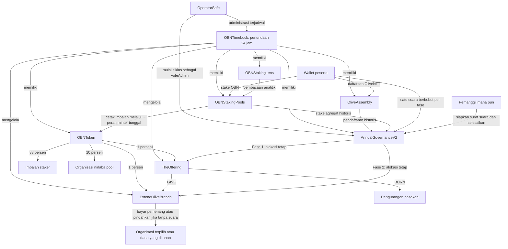

# Memberi Tanpa Pengorbanan: Jawaban Protokol atas Menurunnya Partisipasi Amal Massal

[English](THESIS.md) · [Tiếng Việt](THESIS.vi.md) · [한국어](THESIS.ko.md) · [日本語](THESIS.ja.md) · [简体中文](THESIS.zh-CN.md) · [हिन्दी](THESIS.hi.md) · [العربية](THESIS.ar.md) · [Русский](THESIS.ru.md) · [Deutsch](THESIS.de.md) · [Português](THESIS.pt.md) · [Español](THESIS.es.md) · **Bahasa Indonesia**

> Terjemahan ini disediakan semata-mata untuk kemudahan. Versi bahasa Inggris ([THESIS.md](THESIS.md)) adalah versi resmi; jika terdapat perbedaan, versi bahasa Inggris yang berlaku. Terjemahan ini dibuat dengan bantuan AI dari revisi `3c740d855` dan belum ditinjau oleh penerjemah profesional. Nama kontrak, nama fungsi, dan alamat tetap dalam bahasa Inggris.

**Tesis Olive Branch Network**

*Olive Branch Network — Base Mainnet*

*Juli 2026 — revisi tata kelola 14 Oktober 2026*

---

## Abstrak

Pemberian amal di Amerika Serikat menghadirkan paradoks: total dolar yang didonasikan mencapai rekor tertinggi hampir setiap tahun, sementara jumlah orang yang memberi terus menurun selama seperempat abad. Porsi rumah tangga Amerika yang memberikan kontribusi amal apa pun turun dari 66.2% pada tahun 2000 menjadi 49.6% pada tahun 2018, dan jumlah donatur menurun setiap tahun sejak 2021 meskipun total pendapatan tumbuh. Filantropi semakin terkonsentrasi pada kelas donatur yang lebih kecil dan lebih kaya, mengosongkan partisipasi massal yang menjadi sandaran legitimasi sipil sektor nirlaba.

Tesis ini berpendapat bahwa akar runtuhnya partisipasi bersifat struktural, bukan moral: dalam setiap bentuk uang historis — komoditas, fiat, dan digital awal — memberi bersifat *mengorbankan*. Donasi memindahkan pokok secara permanen dari donatur ke penerima, sehingga ambang partisipasi adalah surplus yang dapat dibelanjakan — rintangan yang tidak lagi dapat dilewati oleh makin banyak rumah tangga seiring keuntungan pendapatan riil terkonsentrasi di puncak distribusi. Uang yang dapat diprogram menghapus batasan ini untuk pertama kalinya dalam sejarah moneter. Karena kontrak pintar dapat memisahkan *kepemilikan aset* dari *pengarahan imbal hasil yang dihasilkan aset itu*, menjadi mungkin untuk merancang **memberi tanpa pengorbanan**: donatur mempertahankan pokoknya secara permanen sambil terus menyalurkan bagian produktivitasnya yang ditegakkan protokol ke manfaat publik yang dapat diverifikasi secara independen.

Protokol Olive Branch Network (OBN) disajikan sebagai implementasi referensi dari desain ini. Tesis ini (i) menempatkan OBN dalam sejarah panjang teknologi moneter; (ii) mendokumentasikan, dengan data empiris yang dikutip, penurunan partisipasi amal yang melatarbelakanginya; (iii) memformalkan lingkar umpan balik partisipasi–kunci protokol, tempat setiap peserta tambahan memindahkan token OBN dari float beredar ke escrow kontrak non-kustodial, sehingga mengontraksi pasokan efektif seiring tumbuhnya adopsi; dan (iv) memberikan deskripsi teknis lengkap setiap kontrak pintar inti — `OBNToken`, `OBNStakingPools`, `TheOffering`, `ExtendOliveBranch`, `AnnualGovernanceV2`, `OliveAssembly`, `OBNTimeLock`, `TeamVesting`, `OliveNFT`, dan `OBNStakingLens` — termasuk tata letak penyimpanan, invarian, struktur kontrol akses, dan mekanisme keamanan peningkatan, sebagaimana di-deploy di mainnet Base.

---

## Daftar Isi

1. [Pendahuluan](#bab-1--pendahuluan)
2. [Sejarah Uang: Dari Komoditas ke Keterprograman](#bab-2--sejarah-uang-dari-komoditas-ke-keterprograman)
3. [Penurunan Empiris Partisipasi Amal](#bab-3--penurunan-empiris-partisipasi-amal)
4. [Mekanisme Partisipasi–Kunci: Ekonomi Aliran Token OBN](#bab-4--mekanisme-partisipasikunci-ekonomi-aliran-token-obn)
5. [Kontrak Inti: Deskripsi Teknis Lengkap](#bab-5--kontrak-inti-deskripsi-teknis-lengkap)
6. [Arsitektur Keamanan dan Desain Kelembagaan](#bab-6--arsitektur-keamanan-dan-desain-kelembagaan)
7. [Keterbatasan, Ancaman terhadap Validitas, dan Pekerjaan Mendatang](#bab-7--keterbatasan-ancaman-terhadap-validitas-dan-pekerjaan-mendatang)
8. [Kesimpulan](#bab-8--kesimpulan)
9. [Referensi](#referensi)

---

## Bab 1 — Pendahuluan

### 1.1 Rumusan masalah

Dua tren jangka panjang membingkai karya ini. Pertama, *keluasan* pemberian amal sedang runtuh: fraksi rumah tangga AS yang menyumbangkan apa pun turun hampir tujuh belas poin persentase antara 2000 dan 2018 (Indiana University Lilly Family School of Philanthropy, 2021), dan data pasca-2020 menunjukkan penurunan itu makin cepat alih-alih stabil (Fundraising Effectiveness Project, 2025). Kedua, *kedalaman* pemberian makin terkonsentrasi: total dolar mencapai rekor tertinggi — $592.50 billion pada 2024 (Giving USA, 2025) — karena pemberian lebih besar dari donatur yang lebih sedikit dan lebih kaya menggantikan jutaan donatur kecil yang telah keluar.

Penjelasan standar — menurunnya religiositas, stagnasi upah, ketidakpercayaan generasional terhadap lembaga — menggambarkan fenomena ini tetapi tidak menyelesaikannya, karena semuanya bermuara pada batasan struktural yang sama: **memberi, sebagaimana terbentuk secara historis, adalah pelepasan pokok secara permanen.** Rumah tangga hanya berpartisipasi dalam filantropi ketika melewati ambang "Saya memiliki cukup surplus untuk menanggung kerugian ini." Seiring surplus riil yang dapat dibelanjakan terkonsentrasi di puncak distribusi pendapatan, partisipasi ikut terkonsentrasi.

### 1.2 Pernyataan tesis

Tesis ini mempertahankan tiga klaim:

1. **Klaim historis.** Setiap teknologi moneter sebelumnya — dari elektrum Lidia hingga liabilitas Federal Reserve dan mata uang kripto generasi pertama yang digunakan sebagai sekadar instrumen pembawa — menjadikan pelepasan pokok sebagai *satu-satunya* primitif yang tersedia untuk memberi. Uang yang dapat diprogram adalah bentuk moneter pertama yang *kepemilikan* dan *pengarahan imbal hasil*-nya dapat dipisahkan di tingkat uang itu sendiri, bukan melalui perantara tepercaya (dana abadi, trust, dana yang disarankan donatur) yang terutama dapat diakses orang kaya.

2. **Klaim empiris.** Partisipasi amal massal mengalami penurunan sekuler, dan penurunan itu terkonsentrasi tepat pada kelompok donatur kecil yang paling terikat oleh ambang pengorbanan. Klaim ini didukung oleh data panel (Philanthropy Panel Study), data transaksi seluruh sektor (Fundraising Effectiveness Project), dan estimasi makro (Giving USA), yang ditinjau dalam Bab 3.

3. **Klaim mekanisme.** Protokol yang (a) memungkinkan peserta melakukan staking token tanpa melepaskannya, (b) menyalurkan porsi tetap emisi protokol ke organisasi nirlaba terverifikasi, dan (c) mengunci pokok yang di-stake dalam escrow non-kustodial, menghasilkan umpan balik partisipasi–pasokan: setiap peserta marginal menarik token dari float beredar, sehingga — dengan permintaan dan kebijakan emisi tetap — partisipasi yang lebih luas secara mekanis memperketat pasokan efektif. Bab 4 memformalkan hal ini dan menyatakan asumsinya secara jujur, termasuk kekuatan penyeimbang dari emisi imbalan.

### 1.3 Kontribusi

- Sintesis sejarah moneter yang berorientasi pada satu poros: *apa yang dapat ditegakkan oleh uang itu sendiri* (Bab 2).
- Catatan empiris terkonsolidasi dan berkutipan tentang penurunan partisipasi amal AS, 2000–2025 (Bab 3).
- Model aliran token formal dari ekonomi staking OBN, termasuk identitas float beredar, kondisi keseimbangan emisi/kunci, dan penyerap bakar yang dikendalikan tata kelola (Bab 4).
- Spesifikasi tertulis lengkap pertama dari rangkaian kontrak inti OBN sebagaimana di-deploy di Base dan divalidasi dalam lingkungan uji fork mainnet, yang mencakup setiap variabel status, fungsi, peristiwa, invarian, dan jalur peningkatan (Bab 5), beserta arsitektur keamanan dan kelembagaannya (Bab 6).

### 1.4 Protokol dalam satu paragraf

Olive Branch Network adalah token ERC-20 (`OBN`) di Base dengan sistem staking berupa pool per organisasi nirlaba. Peserta menyetor OBN ke pool organisasi nirlaba yang ingin didukungnya. Setoran tidak pernah dibelanjakan, ditransfer ke organisasi nirlaba, atau dipertaruhkan terhadap kerugian kepada protokol; setoran dapat ditarik kapan saja (kecuali posisi bootstrap yang dikunci secara eksplisit). Selama di-stake, protokol mencetak emisi berbasis waktu atas stake dan membagi setiap imbalan yang direalisasikan menjadi empat bagian saat klaim: **88% untuk staker, 10% untuk organisasi nirlaba pool, 1% untuk brankas bersama (`TheOffering`), dan 1% untuk brankas distribusi (`ExtendOliveBranch`).** Nasib alokasi brankas bersama yang dicatat pada awal siklus — bakar atau beri — diputuskan setiap tahun melalui pemungutan suara dua fase oleh wallet dengan OliveNFT terdaftar, berbobot akar kuadrat stake snapshot (`AnnualGovernance`), yang fase keduanya mengarahkan alokasi siklus tetap brankas distribusi ke organisasi nirlaba pilihan komunitas. Desain ini mewujudkan Pasal I Piagam: *"memungkinkan seseorang mempertahankan kepemilikan asetnya sambil terus mengarahkan sebagian nilai yang dihasilkan aset tersebut ke manfaat publik yang akuntabel secara independen"* (Piagam OBN, Pasal I).

---

## Bab 2 — Sejarah Uang: Dari Komoditas ke Keterprograman

Tujuan bab ini bukan antikuarian. Setiap tahap dalam sejarah uang dibaca melalui satu pertanyaan: *apa yang dapat ditegakkan oleh uang itu sendiri, dan apa yang harus didelegasikan kepada lembaga tepercaya?* Jawabannya menentukan bentuk pemberian apa yang mungkin pada setiap tahap.

### 2.1 Sebelum koin: hadiah, utang, dan mitos barter

Teori populer tentang asal-usul uang — barter yang merepotkan secara spontan digantikan oleh alat tukar — berasal dari Adam Smith (1776) dan diformalkan oleh Menger (1892), yang memodelkan uang sebagai konvergensi yang muncul pada komoditas yang paling *mudah dijual*, serta oleh Jevons (1875), yang menamai gesekan yang diselesaikannya sebagai "kebetulan ganda keinginan." Model teori pencarian modern (Kiyotaki & Wright, 1989) mempertahankan logika ini, dan Kocherlakota (1998) menyaring implikasi terdalamnya: uang secara teknologi setara dengan *ingatan* masyarakat tentang siapa yang telah berkontribusi apa — "uang adalah ingatan."

Namun catatan antropologis tidak mendukung ekonomi barter murni sebagai pendahulu uang. Humphrey (1985) menyimpulkan bahwa "tidak ada contoh ekonomi barter, murni dan sederhana, yang pernah dijelaskan, apalagi munculnya uang darinya." Graeber (2011) mengumpulkan bukti etnografis dan Mesopotamia bahwa *kredit dan kewajiban mendahului koin ribuan tahun*: pembukuan kuil dan istana di Sumeria (sekitar 3000 SM) mencatat utang dalam perak dan jelai jauh sebelum ada yang mengedarkan perak sebagai uang tunai. Teori kredit tentang uang (Mitchell-Innes, 1913) dan teori negara (Knapp, 1905/1924) — uang sebagai utang yang dapat dialihkan, dan uang sebagai apa yang diterima negara untuk pembayaran pajak — menangkap lapisan yang lebih tua ini.

Dua pengamatan penting untuk uraian berikutnya. Pertama, "uang" paling awal sudah merupakan *teknologi akuntansi* — sebuah buku besar — dan token fisiknya bersifat sekunder. Kedua, dalam ekonomi hadiah dan kewajiban, memberi merupakan unsur pembentuk keanggotaan sosial, bukan tindakan diskresioner membuang surplus (Mauss, 1925). Penyempitan pemberian menjadi transfer surplus sukarela adalah produk bentuk moneter yang lebih kemudian, bukan konstanta manusia.

### 2.2 Koin: uang sebagai instrumen pembawa berdaulat (sekitar 640 SM – 1000 M)

Koin terstandar muncul di Lidia pada abad ketujuh SM — keping elektrum yang dicap negara — dan menyebar dengan kecepatan mengejutkan melalui polis Yunani, Persia, India (*karshapana* berlubang), dan Tiongkok Negara-Negara Berperang (Davies, 2002; Schaps, 2004). Inovasi koin adalah *verifikasi sekilas*: cap penguasa meniadakan masalah pengujian, sehingga nilai dapat dipindahkan antarorang asing tanpa kepercayaan atau catatan.

Namun perhatikan apa yang ditegakkan teknologi ini dan apa yang tidak dapat dilakukannya. Koin menegakkan *finalitas pembawa*: siapa pun yang memegangnya, memilikinya secara mutlak. Koin tidak dapat menyandikan syarat, aliran, pembagian, atau pengembalian. Akibatnya, satu-satunya primitif pemberian yang didukung koin adalah transfer langsung koin — pengorbanan pokok murni. Apa pun yang lebih canggih (dana abadi kuil, *alimenta* Romawi, *waqf* Islam, kapel chantry abad pertengahan) mengharuskan uang dibungkus dalam *lembaga hukum* yang dikelola manusia tepercaya. Pemberian yang diarahkan imbal hasil memang ada — wakaf justru merupakan aset yang pendapatannya terus diarahkan ke manfaat publik sementara pokoknya tidak dapat dialihkan (Kuran, 2001) — tetapi hanya tersedia bagi mereka yang cukup kaya untuk membentuk lembaga di sekitar aset mereka.

### 2.3 Kertas, perbankan, dan suprastruktur kredit (1000–1971)

Tiongkok Dinasti Song menerbitkan uang kertas negara pertama (*jiaozi*, diresmikan 1024 M), menemukan penerbitan uang kertas yang dapat dikonversi sekaligus, dalam dua abad, penerbitan berlebih yang inflasioner (Von Glahn, 1996). Di Eropa, urutannya melalui wesel, tanda terima tukang emas, Bank of England (1694), dan standar emas abad kesembilan belas — tatanan moneter yang jumlah uangnya didisiplinkan oleh konvertibilitas tetapi alat edar sesungguhnya sebagian besar adalah *kredit* bank (Ferguson, 2008; Eichengreen, 1996). Sistem Bretton Woods (1944) mempertahankan jangkar emas dalam jarak satu langkah; penangguhannya oleh Amerika Serikat pada 15 Agustus 1971 ("guncangan Nixon") menuntaskan transisi ke fiat murni: uang sebagai liabilitas negara tanpa jaminan, dinilai melalui dekret, penerimaan pajak, dan ekspektasi jaringan — chartalisme Knapp terwujud sepenuhnya (Eichengreen, 1996).

Bagi pemberian, era fiat-perbankan mengubah skala, bukan struktur. Rezim pengurangan pajak amal (di AS, sejak 1917) menyubsidi pengorbanan; yayasan, trust sisa amal, dan dana yang disarankan donatur mengindustrialisasi pola wakaf — *kepemilikan dipertahankan atau dilindungi, imbal hasil diarahkan* — tetapi masing-masing memerlukan pembentukan hukum, jumlah minimum, dan penasihat. Asimetri struktural tetap ada: **orang kaya memberi dari imbal hasil; semua orang lainnya memberi dari pokok.** Bab 3 mendokumentasikan hasil yang dapat diprediksi itu.

### 2.4 Penyelesaian digital dan fiat elektronik (1971–2008)

Antara guncangan Nixon dan 2008, uang mengalami dematerialisasi secara operasional — Fedwire, SWIFT (1973), jaringan kartu, dan pembayaran internet menjadikan sebagian besar uang entri basis data bank — tanpa mengubah logikanya. Fiat elektronik tetap merupakan surat utang yang aturannya ditegakkan perantara teregulasi. Chaum (1983) menunjukkan kriptografi dapat menciptakan uang tunai pembawa digital, tetapi DigiCash miliknya memusatkan penerbitan dan gagal secara komersial; "b-money" Dai (1998) dan "bit gold" Szabo (digagas akhir 1990-an, diterbitkan 2005) membuat sketsa penerbitan terdesentralisasi tanpa menyelesaikan pembelanjaan ganda.

### 2.5 Bitcoin: kelangkaan tanpa penguasa (2008)

Nakamoto (2008) menyelesaikan masalah pembelanjaan ganda tanpa pihak tepercaya dengan menggabungkan konsensus proof-of-work atas buku besar publik dengan jadwal penerbitan tetap. Kontribusi Bitcoin bagi sejarah moneter sangat tepat: **kelangkaan digital dan penyelesaian final yang ditegakkan protokol, bukan lembaga.** Untuk pertama kalinya, *aturan uang* — terutama kurva pasokannya — menjadi sifat uang itu sendiri.

Namun skrip Bitcoin sengaja membatasi ekspresivitas. Sebagai uang, Bitcoin tetap dekat dengan koin: instrumen pembawa dengan pasokan keras. Memberi dalam Bitcoin tetap merupakan pelepasan pokok.

### 2.6 Ethereum dan uang yang dapat diprogram (2015– )

Buterin (2014) menggeneralisasi blockchain menjadi mesin status Turing-complete. Dengan Ethereum — dan rantai EVM seperti Base, tempat OBN di-deploy — uang menjadi *dapat diprogram*: logika apa pun dieksekusi dengan finalitas yang sama seperti pembayaran itu sendiri. Standar ERC-20 (Vogelsteller & Buterin, 2015) menjadikan nilai yang ditokenisasi sebagai primitif yang dapat dikomposisikan; ERC-4626, sistem staking, dan tata kelola on-chain (misalnya pola Governor milik Compound) menunjukkan bahwa **kustodi, imbal hasil, pemungutan suara, dan pencairan semuanya dapat menjadi sifat protokol.**

Inilah engsel argumen historis. Pola wakaf/dana abadi — pokok tidak dapat dialihkan, hak manfaat diarahkan ke manfaat publik — memerlukan lembaga tepercaya selama seribu tahun dan karena itu merupakan instrumen orang kaya. Kontrak pintar menerapkan pola yang sama untuk pemegang apa pun dengan ukuran apa pun, dengan:

- **escrow non-kustodial** ("pokok dana abadi" dipegang oleh kode yang tidak dapat diubah, bukan wali amanat);
- **penunjukan berkelanjutan yang dapat dicabut** (peserta dapat mengalihkan atau menarik kapan saja — keterpisahan Pasal III Piagam);
- **pembagian yang ditegakkan protokol** (pembagian 88/10/1/1 di OBN adalah aritmetika dalam `_mintSlices`, bukan diskresi wali amanat);
- **pencatatan yang dapat diverifikasi** (setiap kontribusi adalah peristiwa on-chain, memenuhi Pasal VI Piagam).

Dalam pembacaan ini, sejarah uang adalah sejarah internalisasi bertahap ke dalam uang itu sendiri atas fungsi yang dahulu didelegasikan kepada lembaga: verifikasi (koin), pencatatan (perbankan), kelangkaan (Bitcoin), dan akhirnya *struktur fidusia* (uang yang dapat diprogram). OBN adalah penerapan tahap akhir ini pada fungsi moneter tertua — hadiah.

---

## Bab 3 — Penurunan Empiris Partisipasi Amal

Bab ini menetapkan premis kedua dengan data yang telah diterbitkan: **jumlah orang yang memberi terus menurun, secara persisten dan di setiap sumber data utama, bahkan ketika total dolar meningkat.**

### 3.1 Penurunan partisipasi jangka panjang (Philanthropy Panel Study, 2000–2018)

Bukti longitudinal paling ketat berasal dari *Philanthropy Panel Study* milik Indiana University Lilly Family School of Philanthropy, panel yang mewakili secara nasional lebih dari 9,000 rumah tangga AS yang pemberiannya dilacak dua tahunan.

- Pada **2000, 66.2% rumah tangga AS** memberikan kontribusi amal.
- Pada **2018, hanya 49.6%** — pertama kalinya tercatat kurang dari separuh rumah tangga Amerika memberi, turun hampir 17 poin persentase (Lilly Family School of Philanthropy, 2021).
- Pemberian keagamaan turun dari **46% rumah tangga (2000–2004) menjadi 29% (2018)**; pemberian sekuler turun dari dataran 55–57% (2000–2008) menjadi **42% pada 2018** (Lilly Family School of Philanthropy, 2021).
- Analisis lanjutan menemukan penurunan itu **makin cepat selama tahun pertama pandemi COVID-19** (Lilly Family School of Philanthropy, *The Giving Environment*, 2022; NonProfit PRO, 2022), dan partisipasi turun di semua kelompok ras dan etnis (The NonProfit Times, 2023).

Laporan *Giving Environment* dari sekolah tersebut mengaitkan penurunan sebagian dengan pendapatan yang turun dan stagnan pada rumah tangga berpendapatan menengah dan rendah serta bergesernya norma afiliasi keagamaan (Lilly Family School of Philanthropy, 2022) — keduanya merupakan ekspresi ambang pengorbanan: rumah tangga memberi ketika mampu kehilangan uang itu, dan makin sedikit yang mampu.

### 3.2 Jumlah donatur terus turun setelah 2018 (Fundraising Effectiveness Project, 2021–2025)

Fundraising Effectiveness Project (FEP), yang mengagregasi data transaksi pemberian aktual di ribuan organisasi nirlaba, memperpanjang catatan melampaui studi panel dan menunjukkan penurunan masih berlangsung:

- Jumlah donatur menurun **setiap tahun sejak 2021** (AFP/FEP, 2026).
- Dari 2023 ke 2024, jumlah donatur turun **4.5% dari tahun ke tahun**, dengan penurunan yang *makin cepat* dibanding tahun-tahun sebelumnya (laporan FEP Q4 2024; GlobeNewswire, 2025).
- Pada **2025, jumlah donatur turun lagi sekitar 3.6%**, bahkan ketika total dolar amal tumbuh 5.0% — pertumbuhan pendapatan terkuat dalam lima tahun, yang dicapai dengan lebih sedikit pemberi (AFP/FEP, 2026).
- Penyusutan terkonsentrasi di ujung kecil: donatur **$1–$100 — lebih dari separuh semua donatur — menurun 8.8% pada 2024 dan 11.1% dari tahun ke tahun pada Q1 2025** (FEP; NonProfit PRO, 2025).
- Retensi donatur keseluruhan berkisar di **43%**, dan retensi donatur baru jauh lebih rendah, artinya sebagian besar pemberi pertama kali tidak pernah memberi lagi (FEP, 2025–2026).

Pembingkaian FEP sendiri tepat merupakan tesis konsentrasi: kenaikan pendapatan "terkonsentrasi pada pemberian yang lebih besar," dengan "penurunan berkelanjutan pada total jumlah donatur" (AFP, 2025).

### 3.3 Dolar naik, donatur turun (Giving USA, 2024–2025)

Giving USA, estimasi makro filantropi AS yang paling lama berjalan, melengkapi paradoks ini:

- Total pemberian mencapai **$592.50 billion pada 2024**, rekor dalam dolar berlaku, naik 6.3% secara nominal dan 3.3% setelah disesuaikan inflasi (Giving USA 2025).
- Total pemberian naik lagi menjadi sekitar **$617.2 billion pada 2025** (Giving USA 2026; Give.org, 2026).
- Tetapi **porsi pemberian individu dari total turun dari sekitar 80% pada 1986–1990 menjadi 66% pada 2024 dan 64% pada 2025**, seiring yayasan, warisan, dan perusahaan — wahana kekayaan terakumulasi — mengisi kekurangan (Giving USA 2026; Give.org, 2026; Stelter, 2026).

### 3.4 Sintesis: ambang pengorbanan

Melalui tiga metodologi independen — panel rumah tangga (PPS), agregasi transaksi (FEP), dan estimasi makro (Giving USA) — muncul gambaran yang sama:

| Indikator | Dulu | Kini | Arah |
|---|---|---|---|
| Rumah tangga yang memberi apa pun (PPS) | 66.2% (2000) | 49.6% (2018) | ↓ 16.6 pts |
| Rumah tangga yang memberi untuk agama (PPS) | 46% (2000–04) | 29% (2018) | ↓ 17 pts |
| Jumlah donatur, tahun ke tahun (FEP) | — | −4.5% (2024), −3.6% (2025) | ↓ makin cepat |
| Donatur kecil $1–$100 (FEP) | 50–57% dari semua donatur | −8.8% hingga −11.1% tahun ke tahun | ↓ kelompok paling tajam |
| Porsi individu dari total pemberian (Giving USA) | ~80% (1986–90) | 64% (2025) | ↓ 16 pts |
| Total dolar (Giving USA) | — | $592.5B (2024), $617.2B (2025) | ↑ rekor tertinggi |

Sektor ini sedang direkapitalisasi dari atas sementara basis partisipatifnya terkikis. Inilah tepatnya yang diprediksi jika memberi memerlukan surplus dan surplus telah terkonsentrasi. Masalah *pendanaan* sektor nirlaba sedang diselesaikan oleh orang kaya; masalah *partisipasinya* — fungsi sipil, demokratis, dan pemberi legitimasi dari jutaan pemberian kecil — sama sekali tidak terselesaikan, karena tidak ada instrumen yang memungkinkan rumah tangga tidak kaya memberi terus-menerus tanpa kerugian.

Bab 4 menjelaskan instrumen semacam itu.

---

## Bab 4 — Mekanisme Partisipasi–Kunci: Ekonomi Aliran Token OBN

Bab ini memformalkan inti ekonomi protokol: **partisipasi mengunci pasokan.** Setiap klaim berlandaskan kode kontrak tertentu yang dijelaskan sepenuhnya dalam Bab 5; di sini kami memperlakukan sistem sebagai mesin aliran token.

### 4.1 Alokasi genesis dan cadangan saat ini

Tabel berikut mencatat mint genesis historis, bukan cadangan yang belum dibelanjakan saat ini. `OBNToken.initialize` mencetak seluruh pasokan awal tepat satu kali, dalam proporsi tetap (OBNToken.sol):

| Alokasi | Porsi | Tujuan |
|---|---|---|
| Likuiditas | 40% | Likuiditas DEX agar token dapat diperoleh |
| Airdrop | 30% | Menyemai distribusi awal yang luas |
| Dana amal | 10% | Bootstrap posisi pool nirlaba (terkunci permanen — §4.4) |
| Perbendaharaan | 10% | Operasi protokol (alokasi genesis satu kali; tidak ada aliran emisi yang mengalir ke sana) |
| Vesting tim | 10% | Terkunci waktu di `TeamVesting` (cliff 4 bulan, linear 20 bulan) |

Tidak ada mint lebih lanjut kecuali oleh minter tunggal yang ditetapkan sekali — kontrak staking — sehingga *semua* pertumbuhan pasokan pasca-genesis adalah emisi staking.

Cadangan Benih Nirlaba memiliki total alokasi **300M OBN**, dengan **50M OBN** disimpan terpisah untuk kebutuhan protokol. Kepemilikan perbendaharaan dan airdrop digabungkan ke dalam alokasi benih. Pada saat itu, 11M OBN telah mendanai 11 benih nirlaba, menyisakan 289M OBN untuk 289 benih tambahan masing-masing 1M OBN.

Ini adalah realokasi kepemilikan yang ada, bukan mint baru atau perubahan pada initializer yang telah di-deploy.

### 4.2 Identitas float beredar

Definisikan pada waktu *t*:

- **S(t)** — total pasokan: pasokan genesis ditambah emisi kumulatif dikurangi pembakaran kumulatif.
- **K(t)** — token yang dipegang kontrak staking: jumlah semua saldo `userAmount` (hanya pokok; imbalan dicetak langsung ke penerima, tidak pernah dikumpulkan).
- **V(t)** — token yang masih terkunci di `TeamVesting`.
- **G(t)** — token yang terakumulasi di dua brankas tata kelola (`TheOffering` dan `ExtendOliveBranch`) menunggu siklus tahunan.
- **B(t)** — token kumulatif yang dibakar (melalui `TheOffering.burn` dan `ERC20Burnable.burn` sukarela apa pun).

Maka **float beredar** — pasokan yang benar-benar tersedia untuk diperdagangkan — adalah:

> **F(t) = S(t) − K(t) − V(t) − G(t)**   dengan   **S(t) = S₀ + E(t) − B(t)**

dengan E(t) sebagai emisi bruto kumulatif. Klaim mekanisme adalah pernyataan tentang ∂F/∂(partisipasi): **setiap deposit memindahkan token dari F ke K satu banding satu** (`_depositCore` mengeksekusi `safeTransferFrom(msg.sender, address(this), amount)`), dan token tetap di K sampai peserta itu memilih menarik. Protokol tidak pernah meminjamkan, merehipotekasi, atau membelanjakan K; tidak ada slashing dan tidak ada klaim protokol atas pokok. K adalah escrow lembam.

### 4.3 Kebijakan emisi: menurun dan proporsional terhadap partisipasi

Emisi *bukan* keran tetap. `_sumRewardAcrossPhases` mengakru imbalan per pool sebagai `poolStake × bps × Δt / (10000 × 365 days)` — yaitu **persentase tahunan dari apa yang benar-benar di-stake**, dengan jadwal menurun:

| Tahun sejak deployment | Tingkat emisi tahunan (atas saldo yang di-stake) |
|---|---|
| 0–2 | 10.00% |
| 2–4 | 7.50% |
| 4–6 | 5.00% |
| 6–8 | 2.50% |
| 8–10 | 1.25% |
| 10+ | Cadangan 3.00% (`FALLBACK_EMISSION_BPS`), hingga tata kelola mengubah melalui `addPhase` |

Dua konsekuensi mengikuti. Pertama, **emisi berskala dengan K, bukan S**: token yang tidak di-stake tidak menghasilkan apa pun. Kedua, karena imbalan hanya dicetak pada *peristiwa klaim* (deposit, penarikan, klaim), imbalan yang belum diklaim hanyalah entri akuntansi (`accRewardPerShare × balance − rewardDebt`) — belum ada sebagai token sampai direalisasikan.

### 4.4 Pembagian empat arah dan penyerapnya

Pada setiap realisasi, `_mintSlices` membagi imbalan bruto tertunda:

- **88% → staker.** Imbal hasil peserta. Baru dicetak, masuk ke F (atau di-stake ulang).
- **10% → wallet organisasi nirlaba pool.** Hadiah. Berkelanjutan, ditegakkan protokol, proporsional terhadap stake dan waktu peserta. Inilah *Kontribusi* Pasal VII Piagam, dan tidak mengorbankan pokok staker — hanya sebagian imbal hasil yang tidak akan ada tanpa protokol.
- **1% → `TheOffering`** (brankas bersama). Terakumulasi sepanjang tahun; setiap siklus tata kelola tahunan memilih untuk **membakar** alokasi yang dicatat pada awal siklus (penyerap deflasi, mengurangi S) atau **memberikannya** (mentransfer ke `ExtendOliveBranch`).
- **1% → `ExtendOliveBranch`** (brankas distribusi). Terakumulasi sepanjang tahun; suara Fase 2 setiap siklus tata kelola tahunan mengarahkan alokasi tetap siklus itu ke satu organisasi nirlaba daftar putih pilihan komunitas (atau memindahkannya jika tidak ada yang memilih).

Perhatikan bahwa **tidak ada aliran emisi yang mengalir ke perbendaharaan**: kedua irisan sisanya mengisi brankas yang dikendalikan tata kelola. Hingga disposisi tahunannya, kedua aliran berada dalam escrow brankas (G pada §4.2) — di luar float yang dapat diperdagangkan.

Selain itu, alokasi genesis dana amal 10% ditempatkan melalui `charityFundBootstrap`/`depositForWithLock`, yang melakukan staking token *atas nama wallet milik setiap organisasi nirlaba* dengan `lockedAmount` sama dengan deposit — **kunci permanen** (kunci hanya dapat bertambah, tidak pernah berkurang). Karena itu posisi bootstrap berkontribusi pada K selamanya, menjamin setiap pool memiliki aliran imbalan dasar bagi organisasi nirlabanya, dan tidak pernah dapat dijual massal.

### 4.5 Lingkar umpan balik partisipasi–kunci

Rangkai bagian-bagiannya. Misalkan *n* jumlah peserta aktif dan *k̄* stake rata-rata. Maka K = n·k̄ (ditambah kunci bootstrap), dan:

1. **Adopsi memperketat float.** Setiap peserta baru mengubah token float menjadi pokok dalam escrow: ΔF = −Δstake. Dengan permintaan tetap, float yang dapat diperdagangkan yang menyusut menaikkan harga keseimbangan pasar — hasil standar penawaran–permintaan, dan analog on-chain dari "penyusutan float" yang lama diamati dalam ekonomi proof-of-stake dengan rasio staking tinggi yang mengurangi pasokan likuid.
2. **Imbal hasil menghargai kesabaran, dan 88% imbal hasil dapat digabungkan.** Staker yang men-stake ulang bagian 88% mereka memindahkan token yang baru dicetak langsung kembali ke K, makin memperketat F.
3. **Aliran hadiah mendanai legitimasi dunia nyata.** Aliran nirlaba 10% memberi lembaga eksternal alasan yang tahan lama untuk mempromosikan partisipasi, yang merekrut lebih banyak peserta — satu-satunya saluran pemasaran yang sendirinya merupakan tindakan amal.
4. **Tata kelola dapat mengubah brankas bersama menjadi deflasi murni.** Hasil BURN pada Fase 1 menghancurkan alokasi bersama yang dicatat pada awal siklus, langsung mengurangi S. Perhatikan bahwa default-nya sengaja deflasioner: *tanpa partisipasi → BURN* (GIVE harus *benar-benar* melebihi BURN).
5. **Kelayakan suara memerlukan partisipasi pada snapshot.** V2 menggabungkan status NFT terdaftar dengan setidaknya 1 OBN stake agregat dengan checkpoint, lalu menerapkan bobot akar kuadrat. Tata kelola memberi alasan untuk di-stake sebelum setiap siklus dimulai; tata kelola tidak mengharuskan tetap di-stake setelahnya atau menetapkan kunci berkelanjutan selama pemungutan suara (§5.5).

Lingkarnya: **lebih banyak peserta → lebih banyak token terkunci → float lebih kecil dan opsi bakar kumulatif lebih besar → dukungan harga lebih baik → nilai imbal hasil dan nilai hadiah per token lebih tinggi → perekrutan lebih kuat → lebih banyak peserta.**

### 4.6 Akuntansi jujur: penyeimbang emisi

Mekanisme ini memiliki kekuatan yang berlawanan. Emisi bersifat inflasioner: pada tingkat awal 10%, S tumbuh sebanding dengan K. Apakah float bersih *menyusut* bergantung pada aliran yang terealisasi. Dengan mendiferensialkan identitas float, aliran emisi yang masuk ke float adalah:

> **dF/dt ≈ e·K·[0.88·(1−r) + 0.10 + 0.02·(1−β)·δ] − dK/dt**

dengan *e* tingkat emisi saat ini, *r* fraksi imbalan staker yang di-stake ulang, *β* fraksi aliran brankas yang akhirnya dibakar pada Fase 1, dan *δ* ≤ 1 faktor jeda yang mencerminkan bahwa dua aliran brankas 1% masuk ke float hanya setelah siklus tahunan mendistribusikannya (jumlah yang dibakar tidak pernah masuk; pemindahan menunda masuknya lebih jauh). Float berkontraksi (dF/dt < 0) setiap kali **staking baru bersih melampaui porsi emisi yang tidak di-stake ulang**. Fitur struktural mendorong ke arah itu — jadwal emisi menurun 10% → 1.25% sementara adopsi diharapkan tumbuh; penerima nirlaba adalah penjual yang digerakkan misi tetapi arus masuknya hanya 10% emisi; default bakar menghapus aliran bersama secara permanen; kunci bootstrap tidak pernah keluar — tetapi kondisi ini empiris, tidak dijamin. Karena itu klaim yang dipertahankan di sini dibatasi secara tepat: *protokol direkayasa agar pertumbuhan partisipasi secara mekanis mengontraksi float dan menciptakan kondisi yang mendukung harga token, ceteris paribus; protokol tidak dan tidak dapat menjamin kenaikan harga, yang juga bergantung pada permintaan eksogen.*

### 4.7 Memberi tanpa pengorbanan, dinyatakan kembali

Desain ekonomi ini langsung menyelesaikan masalah Bab 3. Ambang partisipasi bukan lagi "surplus yang mampu saya relakan" melainkan "modal yang bersedia saya parkir." Rumah tangga yang tidak pernah bisa menyumbang $500 dapat melakukan staking $500, tetap memilikinya, menariknya saat darurat, dan sementara itu terus mengarahkan 10% imbal hasil yang dihasilkan stake-nya — kontribusi nyata yang ditegakkan protokol dan dicatat secara publik — ke organisasi nirlaba terverifikasi. Memberi menjadi *keputusan alokasi aset*, bukan *pengorbanan konsumsi*. Itulah jawaban desain atas runtuhnya partisipasi: bukan mendesak orang memberi lebih banyak, melainkan menghapus alasan struktural mengapa mereka berhenti.

---

## Bab 5 — Kontrak Inti: Deskripsi Teknis Lengkap

Semua kontrak menargetkan Solidity ^0.8.28, dibangun di atas OpenZeppelin v5, dan di-deploy di Base. Kontrak yang dapat ditingkatkan menggunakan pola UUPS (`_authorizeUpgrade` dibatasi untuk pemilik, yaitu `OBNTimeLock`). Bab ini menjelaskan setiap kontrak dalam rangkaian: tujuan, penyimpanan, fungsi, peristiwa, invarian, dan interaksi.

### 5.1 `OBNToken` — basis moneter (OBNToken.sol)

**Pewarisan.** `Initializable`, `IOBNMintable`, `ERC20Upgradeable`, `ERC20PermitUpgradeable` (persetujuan tanpa gas EIP-2612), `ERC20VotesUpgradeable` (delegasi dengan checkpoint), `ERC20BurnableUpgradeable`, `OwnableUpgradeable`, `UUPSUpgradeable`.

**Identitas.** Nama "Olive Branch Network", simbol "OBN".

**Penyimpanan.** Satu variabel kustom — `address public minter` — ditambah `uint256[100] __gap` yang mencadangkan ruang peningkatan.

**Inisialisasi.** `initialize(initialOwner, initialSupply, liquidityAddress, airdropAddress, charityAddress, treasuryAddress, teamVestingAddress)` berjalan sekali (modifier initializer; konstruktor memanggil `_disableInitializers()` sehingga implementasi itu sendiri tidak pernah dapat diinisialisasi). Setelah pemeriksaan alamat nol dan pasokan bukan nol, fungsi ini mencetak seluruh distribusi: 30% airdrop, 40% likuiditas, 10% amal, 10% perbendaharaan, 10% vesting tim (§4.1).

**Mekanisme minter.** `setMinterOnce(addr)` — hanya pemilik, memerlukan `minter == address(0)`: minter dapat ditetapkan **tepat sekali** selama masa pakai implementasi (hanya peningkatan UUPS penuh yang dapat mengubahnya). `mint(to, amount)` memerlukan `msg.sender == minter`. Dalam deployment, minter adalah proxy `OBNStakingPools`; karena itu *semua pasokan masa depan adalah emisi staking*. `isMinter(addr)` adalah tampilan praktis.

**Penimpaan.** OZ v5 merutekan semua perubahan saldo melalui `_update`, sehingga satu penimpaan merekonsiliasi `ERC20Upgradeable` dan `ERC20VotesUpgradeable` (checkpoint suara melacak transfer secara otomatis). `nonces()` ditimpa untuk merekonsiliasi `ERC20PermitUpgradeable` dengan `NoncesUpgradeable`.

**Sifat keamanan.** Tanpa jeda, tanpa daftar hitam, tanpa pajak transfer: token netral secara maksimal. Pembakaran tersedia bagi pemegang mana pun melalui `ERC20Burnable` — hook yang digunakan `TheOffering` untuk menghancurkan aliran bersama.

### 5.2 `OBNStakingPools` — mesin (StakingPoolsV931.sol; string versi "9.3.1")

Kontrak staking adalah kontrak terbesar dan paling menentukan dalam sistem: satu-satunya minter OBN, kustodian semua pokok yang di-stake (K pada §4.2), dan oracle kekuatan suara untuk tata kelola. Kontrak ini berjalan di balik proxy UUPS pada alamat yang stabil.

#### 5.2.1 Konstanta — pembagian yang tidak dapat diubah

```solidity
STAKER_BPS = 8800; CHARITY_BPS = 1000; CHARITY_FUND_BPS = 100; TREASURY_BPS = 100;
TOTAL_BPS = 10000; FALLBACK_EMISSION_BPS = 300;
```

Pembagian 88/10/1/1 adalah `constant` — dikompilasi ke dalam bytecode, tidak dapat diubah tanpa peningkatan implementasi penuh melalui timelock. Dua irisan 100-bps dicetak ke alamat yang disimpan dalam variabel penyimpanan `treasury` dan `charityFund`; **dalam konfigurasi yang di-deploy, variabel tersebut masing-masing berisi `TheOffering` (0xc75B…E341) dan `ExtendOliveBranch` (0xE1Bb…6d8B)** — pengenalnya bersifat historis, dan penerima operasional kedua aliran 1% adalah dua brankas tata kelola (§5.3, §5.4). `FALLBACK_EMISSION_BPS` adalah batas bawah permanen 3% yang berlaku setelah jadwal fase yang ditentukan habis (§4.3).

#### 5.2.2 Tata letak penyimpanan

Terurut menurut slot dan kritis untuk peningkatan (kontrak mendokumentasikan peta slotnya; celah penutupnya adalah `uint256[93]`; status auto-claim bulanan berada di luar peta ini, dalam penyimpanan ber-namespace ERC-7201 di `obn.storage.MonthlyAutoClaim`):

- **Konfigurasi:** `stakingToken` (token OBN sebagai `IOBNMintable`), `treasury` (→ TheOffering), `charityFund` (→ ExtendOliveBranch), `version` (string, "9.3.1").
- **Jadwal emisi:** `Phase[] phases`, masing-masing `{start, end, bps}` dalam timestamp.
- **Pool:** `PoolInfo[] poolInfo`, masing-masing `{charityWallet, totalStaked}` — satu pool per organisasi nirlaba.
- **Pembukuan pengguna:** `userAmount[pid][user]`, `userRewardDebt[pid][user]` — pola akumulator/utang imbalan (§5.2.3).
- **Akumulator:** `accRewardPerShare[pid]` (skala 1e12), `lastRewardTime[pid]`.
- **Global:** `globalTotalStaked`.
- **Kunci:** `lockedAmount[pid][user]` — buku besar kunci permanen (§4.4).
- **Statistik:** `totalClaimedByUser`, `totalDepositedByUser`, `totalWithdrawnByUser`, total per pool untuk deposit/penarikan/charity tercetak, `uniqueStakersByPool`, `uniqueStakersGlobal`, `activePoolCount[user]`, `stakedSince[user]`, `cumulativeStakeSeconds[user]` (bertahan setelah unstake penuh — catatan masa keikutsertaan permanen).
- **Siklus hidup:** `poolRemoved[pid]` (deposit dinonaktifkan), `poolFullyRemoved[pid]` (dicoret dari surat suara tata kelola — hanya ditetapkan oleh `removePool`, tidak pernah oleh `shutdownPool`).
- **Pelacakan kontribusi:** `charityContributedByUserInPool[pid][user]` dan `totalCharityContributedByUser[user]` — pemberian seumur hidup yang dapat diatribusikan pada setiap peserta, *Catatan* on-chain Pasal VI Piagam.
- **Infrastruktur tata kelola (slot 28–30):** `charityFundOperator` + `_migrationExecuted` + `upgradeBlock` (dikemas dalam satu slot), `totalStakedByUser[user]` (total berjalan lintas pool), dan `_stakeCheckpoints[user]` (`Checkpoints.Trace208` — riwayat kekuatan suara). `poolFullyRemoved`, yang tercantum di Siklus hidup di atas, menempati slot 31.

#### 5.2.3 Model pembukuan

OBN menggunakan skema akumulator/utang imbalan dengan satu variasi menentukan: **akumulator melacak imbalan BRUTO.** Pada setiap sentuhan pool, `_accruePool` menghitung emisi bruto sejak `lastRewardTime` melalui `_sumRewardAcrossPhases` — yang menelusuri jadwal fase segmen demi segmen, menangani batas fase secara tepat dengan `Math.mulDiv(poolStake, bps × duration, 10000 × 365 days)`, dan menerapkan tingkat cadangan 3% pada interval apa pun setelah fase terakhir yang ditentukan — lalu melipatnya ke `accRewardPerShare[pid] += grossReward × 1e12 / totalStaked`. Bruto tertunda pengguna kemudian adalah:

> `pending = userAmount × accRewardPerShare / 1e12 − userRewardDebt`

Pembagian menjadi 88/10/1/1 hanya terjadi saat realisasi di dalam `_mintSlices`, yang mengikuti checks-effects-interactions secara ketat: semua statistik diperbarui *sebelum* empat panggilan `mint` eksternal. Tidak ada yang dicetak untuk pool dengan stake nol (akrual kembali lebih awal dan hanya memajukan jam), dan imbalan tidak pernah berada di kontrak — langsung dari mint ke penerima akhir. Wrapper publik `sumRewardAcrossPhases` menyediakan penelusuran fase bagi Lens hanya-baca (§5.9).

#### 5.2.4 Fungsi untuk pengguna

- **`deposit(pid, amount)`** — staking ke pool. Memerlukan pool yang valid dan tidak ditutup. Efek: mengakru pool; mendaftarkan staker unik (per pool dan global, dengan `stakedSince` memulai jam masa keikutsertaan pada 0→1 pool); menambah `userAmount`, `poolInfo.totalStaked`, `globalTotalStaked`, statistik deposit; mengatur ulang utang imbalan; menambahkan checkpoint `(block.number, totalStakedByUser)`; lalu `safeTransferFrom` pokok masuk dan `_mintSlices` imbalan tertunda apa pun. Deposit *merealisasikan* imbalan tertunda sebagai efek samping.
- **`depositFor(pid, amount, beneficiary)`** — pendanaan pihak ketiga atas stake alamat lain (pemberian gaya penggajian, hadiah partisipasi).
- **`depositWithPermit(...)`** — persetujuan+stake dalam satu transaksi melalui EIP-2612.
- **`withdraw(pid, amount)`** — keluar. Menegakkan `amount ≤ userAmount − lockedAmount` (saldo *tidak terkunci*); memperbarui semua saldo, checkpoint, dan hook (`_afterWithdrawBalanceHooks` membatasi kunci ke saldo baru, menghapus penanda staker aktif pada nol, dan pada keluarnya pool terakhir mencatat sesi ke `cumulativeStakeSeconds` serta mengurangi `uniqueStakersGlobal`); mengembalikan pokok; merealisasikan imbalan tertunda melalui pembagian 88/10/1/1 yang sama. **Tanpa masa tunggu, tanpa penalti, tanpa biaya** — keterpisahan Pasal III menuntut keluar tanpa gesekan.
- **`claim(pid)` / `claimFor(pid, user)` / `claimMultiple(pids)`** — merealisasikan imbalan tanpa menyentuh pokok. `claimFor` hanya untuk pemilik kontrak (di balik timelock) dan hanya dapat mengirim imbalan kepada penerima sahnya (mencetak *ke `user`*, bukan ke pemanggil). Klaim terjadwal menggunakan jalur terpisah `autoClaimFor` berbasis persetujuan yang ditambahkan pada V9.3.1 (Whitepaper §3.2.1); jalur ini tidak menggabungkan imbalan.
- **Rangkaian tampilan:** `pendingRewards`, `getPoolInfo`, `getUserStakeValue`, `unlockedBalance`, `poolLength`, `isGloballyStaked`, `stakeElapsed`, `currentRewardsPerSecond` (analitik yang lebih berat berada di Lens — §5.9).

#### 5.2.5 Bootstrap dana amal dan pembekuan self-stake

`charityFundBootstrap(pid, amount, beneficiary)` / `depositForWithLock(...)` — hanya dapat dipanggil oleh `charityFund` atau `charityFundOperator` (Safe operasional), hanya untuk wallet amal milik pool itu sendiri, dan dirutekan melalui `_enforceCharitySelfStakePolicy`, yang mengizinkan **tepat satu** deposit bootstrap terkunci per lembaga amal pool: wallet amal harus bersaldo nol, pemanggil harus berwenang, dan deposit harus terkunci. Semua self-stake lain oleh organisasi nirlaba pool ditolak ("charity self-stake disabled"). Alasan: organisasi nirlaba yang melakukan staking ke pool sendiri akan mengembalikan irisan amal 10% kepada dirinya, menggabungkannya menjadi roda gila bobot tata kelola; pembekuan membatasi posisi organisasi nirlaba pada satu bootstrap transparan yang terkunci permanen.

`setLockedAmount(pid, user, amount)` — charityFund atau operator (operator dibatasi pada alamat amal pool) **hanya dapat menambah** kunci, tidak pernah mengurangi, dan tidak pernah melebihi saldo pengguna. Kunci bersifat satu arah secara konstruksi.

#### 5.2.6 Fungsi administratif (semua di balik `onlyOwner` milik timelock)

- **`addPool(charityWallet)`** — membuat pool untuk organisasi nirlaba; menginisialisasi jam akrualnya.
- **`shutdownPool(pid)`** — memblokir deposit *baru*; klaim dan penarikan tetap berjalan sehingga pengguna selalu dapat keluar. Pool yang ditutup tetap memenuhi syarat untuk surat suara tata kelola.
- **`removePool(pid)`** — hanya ketika `totalStaked == 0`; mengeluarkan akrual charity lama, menetapkan `poolFullyRemoved` (mencoret organisasi nirlaba dari surat suara mendatang), dan mengarahkan ulang wallet amal pool ke alamat `treasury` (TheOffering) agar mint sisa tidak pernah tersangkut di address(0).
- **Penutupan pool** — Ketika sebuah organisasi nirlaba keluar, pool-nya ditutup: stake baru diblokir, sementara staker yang ada tetap dapat menarik stake dan mengklaim, dan stake yang tersisa terus menghasilkan imbalan dengan pembagian 88/10/1/1 seperti biasa. Sebelum pool dihapus, setiap staker yang tersisa dikeluarkan secara paksa: `forceExitUserToSelf` mengembalikan setiap stake, beserta imbalan tertunda, ke dompet staker itu sendiri dan tidak dapat mengirimkannya ke tempat lain. Stake benih terkunci milik organisasi nirlaba dikembalikan ke Cadangan Benih Nirlaba. Baru setelah itu, ketika tidak ada lagi yang di-stake, pool dihapus.
- **`updateCharityWallet(pid, newWallet)`** — merotasi wallet organisasi nirlaba yang disusupi atau dimigrasikan.
- **`migrateBootstrap(pid, old, new)`** — memindahkan seluruh posisi bootstrap (saldo, utang imbalan, kunci) antar alamat organisasi nirlaba secara atomik, meneruskan checkpoint kekuatan suara melalui kedua sisi, dengan bukti on-chain bahwa imbalan tertunda dipertahankan dalam 1 wei (`pendingAfter ≥ pendingBefore && pendingAfter ≤ pendingBefore + 1`).
- **`addPhase(start, end, bps)`** — menambahkan fase emisi; harus bersambung dengan yang terakhir. Ini juga merupakan tuas tata kelola atas tingkat cadangan 3%.
- **`forceExitUserToSelf(pid, user, claimRewards)`** — darurat: mengembalikan seluruh pokok pengguna *kepada pengguna itu sendiri* (tidak pernah kepada admin), secara opsional merealisasikan imbalan, mengabaikan kunci. Admin tidak dapat menyita; hanya dapat memaksa pengembalian.
- **`sweep(token, amount)`** — memulihkan ERC-20 yang salah kirim ke alamat `treasury`, **secara eksplisit mengecualikan token staking** ("Cannot sweep staking token") agar admin tidak pernah dapat menyentuh K.
- **`migrateV93(newTreasury, newCharityFund, newOperator)`** — fungsi penyambungan satu kali, dieksekusi secara atomik bersama deployment implementasi melalui `upgradeToAndCall` lewat timelock. Fungsi ini menetapkan `treasury` → TheOffering, `charityFund` → ExtendOliveBranch, dan `charityFundOperator` → Safe operasional; mencatat `upgradeBlock` sebagai jangkar genesis untuk checkpoint kekuatan suara; dan menonaktifkan dirinya secara permanen (`_migrationExecuted`). Peningkatan V9.3.1 menambahkan `initializeV931(executor)`, reinitializer satu kali yang terpisah, yang menetapkan `version` ke "9.3.1" dan executor auto-claim; setelah itu `setAutoClaimExecutor(executor)` dapat mengubah executor tersebut, dan alamat nol menjeda otomatisasi.
- **`upgradeTo(newImpl, data)` / `setVersion`** — jalur peningkatan UUPS yang kompatibel dengan penjadwalan timelock.

#### 5.2.7 Kekuatan suara dengan checkpoint

Saldo yang di-stake *dapat dikueri per snapshot* sehingga tata kelola dapat membobot suara pada blok lampau yang tetap alih-alih memercayai saldo saat ini (yang akan mengundang serangan flash-stake):

- Setiap deposit, penarikan, dan migrasi bootstrap menambahkan `(block.number, totalStakedByUser)` ke `Checkpoints.Trace208` per pengguna.
- **Bootstrap genesis:** staker yang posisinya mendahului sistem checkpoint tidak memiliki entri riwayat. Tiga jalur pelengkap menginisialisasi mereka pada `upgradeBlock`: `_initializeCheckpointIfNeeded` (otomatis, pada interaksi pengguna berikutnya, sebelum perubahan saldo apa pun); `bootstrapCheckpoint(user)` (tanpa izin — siapa pun dapat menginisialisasi siapa pun); dan `batchBootstrap(users[])` (seremoni massal tanpa izin). `AnnualGovernance` juga menginisialisasi pemilih secara malas pada upaya suara pertama mereka (§5.5).
- **`getPastVotingPower(user, blockNumber)`** — pencarian biner (`upperLookup`) atas total stake pengguna pada blok lampau mana pun; **`checkpointCount(user)`** menunjukkan status inisialisasi.
- Antarmuka ini mengembalikan **OBN agregat mentah yang di-stake pada snapshot**, bukan bobot suara akhir V2. AnnualGovernanceV2 terlebih dahulu memeriksa pendaftaran OliveAssembly historis dan minimum 1 OBN, lalu menerapkan bobot akar kuadrat (§5.5). Saldo wallet yang tidak di-stake dan delegasi ERC20Votes tidak memberikan kekuatan suara tahunan. Siklus historis sebelum pemungutan suara NFT mempertahankan bobot linear aslinya.

### 5.3 `TheOffering` — brankas bersama (TheOffering.sol)

Brankas yang sengaja minimal dan **tidak dapat ditingkatkan**, yang menerima 1% dari semua emisi staking OBN sepanjang tahun. Tidak menangani ETH; hanya dua peran:

- `timelockOwner` (tidak dapat diubah, ditetapkan saat konstruksi) — dapat memanggil `setGovernance(addr)` (address(0) menjeda tata kelola) dan `emergencySweep(token, to)` (pemulihan seluruh saldo ERC-20, penimpaan sebelum distribusi).
- `governance` (proxy `AnnualGovernance`) — dapat memanggil tepat dua fungsi, keduanya setelah pemungutan suara: **`burn(amount)`** (memanggil `ERC20Burnable.burn` milik OBN, menghancurkan pasokan) atau **`sendToExtend(amount)`** (transfer SafeERC20 ke `ExtendOliveBranch`).

Urutan deployment penting dan didokumentasikan dalam kontrak: `ExtendOliveBranch` lebih dahulu (alamatnya immutable di sini), tata kelola dihubungkan kemudian. Kontrak memegang aliran bersama yang terakumulasi selama setahun dan tidak melakukan hal lain — permukaan serangan berupa dua fungsi yang dijaga.

### 5.4 `ExtendOliveBranch` — brankas distribusi (ExtendOliveBranch.sol)

Brankas kedua yang tidak dapat ditingkatkan, menerima 1% miliknya dari semua emisi staking ditambah transfer hasil GIVE apa pun dari `TheOffering`. Penyimpanan: `obn` dan `timelockOwner` yang tidak dapat diubah; `governance` yang dapat diubah; `mapping(address => bool) approvedNonprofit` — **daftar putih** yang menerapkan Pasal IV Piagam (legitimasi penerima harus diverifikasi secara independen, bukan dinyatakan sendiri).

Dua jalur distribusi, sengaja asimetris:

- **`distribute(nonprofit, amount)`** — timelockOwner atau governance; *menegakkan daftar putih*. Saluran manual/pra-tata kelola/darurat.
- **`distributeFromGovernance(nonprofit, amount)`** — hanya governance; **daftar putih sengaja dihilangkan** pada jalur distribusi ini. V2 memvalidasi setiap penerima terhadap daftar putih saat batch surat suaranya diproses, lalu mempertahankan keanggotaan itu selama siklus. Pencabutan daftar putih kemudian tidak dapat menghapus penerima yang telah diterima atau membatalkan penerima terpilih saat pembayaran. Timelock mempertahankan `emergencySweep`; menarik dana yang dicadangkan dapat mencegah penyelesaian sampai kekurangan diisi ulang.

Admin: `setApprovedNonprofit(addr, bool)`, `setGovernance(addr)`, `emergencySweep(token, to)` — semuanya khusus timelock.

### 5.5 `AnnualGovernanceV2` — tata kelola tahunan (AnnualGovernanceV2.sol)

Bagian ini menjelaskan AnnualGovernanceV2, implementasi aktif di balik proxy AnnualGovernance yang ada sejak peningkatannya pada 7 Oktober 2026 (blok Base 52283807). Kontrak yang aktif belum menjalani audit keamanan oleh pihak ketiga; tinjauan tim sendiri sebelumnya di `governance-operations` menjelaskan versi sebelumnya, bukan deployment yang aktif.

#### 5.5.1 Apa yang diputuskan komunitas

Tata kelola tahunan mengarahkan dua aliran emisi bersama 1%. Pada Fase 1, peserta memilih apakah membakar alokasi TheOffering atau memberikannya ke ExtendOliveBranch. Pada Fase 2, mereka memilih satu organisasi nirlaba yang memenuhi syarat untuk menerima alokasi ExtendOliveBranch siklus itu. Kedua fase berjalan bahkan ketika Fase 1 memilih BURN. Pemungutan suara ini tidak mengubah imbalan staker 88%, tidak mengalihkan bagian nirlaba 10% khusus pool, tidak membelanjakan pokok pengguna, dan tidak menyetujui peningkatan protokol sembarang.

OperatorSafe, bertindak sebagai `voteAdmin`, memulai siklus secara langsung. Pemilik tetap Timelock, dan orientasi serta konfigurasi organisasi nirlaba tetap dikendalikan melaluinya. Istilah *tahunan* menggambarkan irama operasional yang dimaksud: kontrak menegakkan dua jendela pemungutan suara 30 hari dan mencegah siklus tumpang tindih, tetapi tidak menjadwalkan siklus secara otomatis atau mengharuskan jarak satu tahun antarmulai. Seseorang harus mengirim setiap transaksi persiapan dan penyelesaian.

#### 5.5.2 Pendaftaran dan kekuatan suara

Pemilih menggunakan wallet yang sama untuk melakukan staking OBN dan mendaftarkan satu OliveNFT di OliveAssembly. Setelah menyetujui proxy Assembly untuk mentransfer NFT, wallet memanggil `deposit(tokenId)`. Assembly memegang NFT dan membuat checkpoint pendaftaran wallet; memegang NFT di luar Assembly tidak cukup. Pendaftaran bertahan lintas siklus hingga penarikan, dan mendaftarkan NFT tambahan dalam wallet yang sama tidak diizinkan. Staking dan pendaftaran NFT adalah tindakan terpisah dan tidak saling menggantikan.

Untuk siklus yang dimulai pada blok `B`, kedua fase menggunakan pendaftaran dan saldo agregat yang di-stake pada akhir blok `B - 1`. Wallet terdaftar dengan setidaknya 1 OBN yang di-stake memenuhi syarat. Deposit atau pendaftaran pada blok `B` atau setelahnya tidak menambah hak siklus itu. Penarikan stake atau NFT kemudian tidak menghapus hak yang telah dicatat snapshot. Karena itu mekanisme ini mengukur partisipasi pada titik tertentu, bukan memberlakukan kunci stake atau NFT selama 60 hari.

Untuk wallet yang memenuhi syarat, kekuatan suara dalam unit yang mudah dibaca kira-kira adalah akar kuadrat OBN yang di-stake. Untuk jumlah stake 18 desimal `s`, perhitungan tepat kontrak adalah `floor(sqrt(s)) * 10^9`, dikembalikan dalam unit kekuatan suara 18 desimal. Kekuatan bernilai nol di bawah minimum atau tanpa pendaftaran snapshot.

| Stake agregat pada snapshot | Unit kekuatan suara, jika terdaftar |
|---|---:|
| Kurang dari 1 OBN | 0 |
| 1 OBN | 1 |
| 100 OBN | 10 |
| 10,000 OBN | 100 |

Ini mengurangi keunggulan stake terkonsentrasi: menaikkan stake seratus kali lipat menaikkan bobot sepuluh kali lipat. Ini tidak menetapkan satu orang satu suara. Seseorang dapat mengendalikan banyak wallet dan memperoleh banyak NFT; membagi stake di antara wallet yang memenuhi syarat dapat meningkatkan gabungan bobot akar kuadrat. Pendaftaran NFT adalah gerbang kelayakan, bukan bukti identitas manusia yang unik.

Setiap wallet yang memenuhi syarat dapat mengirim satu suara per fase menggunakan `castOfferingVote(cycleId, burn)` dan `castNonprofitVote(cycleId, nonprofit)`. Suara tidak dapat direvisi melalui endpoint ini. Pemilih Fase 2 tidak perlu telah memilih pada Fase 1. Stake menentukan bobot di semua pool, sehingga pemilih dapat memilih organisasi nirlaba mana pun pada surat suara, bukan hanya pool tempat wallet itu melakukan staking. Tidak ada kuorum kehadiran atau mekanisme delegasi pada endpoint pemungutan suara tahunan ini.

#### 5.5.3 Siklus hidup siklus dan persiapan surat suara

| Langkah | Siapa bertindak | Perilaku kontrak |
|---|---|---|
| Mendaftar dan staking | Peserta | Menetapkan pendaftaran NFT dan stake sebelum snapshot |
| Memulai Fase 1 | Safe voteAdmin | Memanggil `startAnnualCycle(2592000, 2592000)`; mencatat snapshot dan membuka pemungutan suara 30 hari |
| Menyiapkan sisa surat suara | Pemanggil mana pun | Memanggil `prepareBallot(cycleId, maxPools)` atau `executeCurrentCycle()` dalam batch terbatas |
| Memilih BURN atau GIVE | Wallet yang memenuhi syarat | Masing-masing mengirim satu suara Fase 1 berbobot |
| Menyelesaikan Fase 1 | Pemanggil mana pun | Setelah tenggat dan persiapan selesai, mengeksekusi hasil dan membuka Fase 2 |
| Memilih organisasi nirlaba | Wallet yang memenuhi syarat | Masing-masing mengirim satu suara Fase 2 berbobot selama jendela penuh 30 harinya |
| Menyelesaikan Fase 2 | Pemanggil mana pun | Membayar alokasi tetap pemenang atau mencatat pemindahan jika tidak ada suara |

Memulai mensyaratkan Assembly terikat ke tata kelola, setidaknya satu pendaftaran pada snapshot, riwayat pool tidak kosong, dan siklus sebelumnya selesai atau dibatalkan. Jumlah wallet terdaftar tidak menjamin ada wallet yang memenuhi ambang staking. Kedua argumen durasi harus tepat 2,592,000 detik. Tindakan mulai Safe tidak memerlukan operasi Timelock baru atau tindakan Safe kedua untuk membuka Fase 2.

**Snapshot dan dana.** Transaksi mulai menetapkan kelayakan pemilih dan stake agregat pada blok sebelumnya serta mencatat kedua alokasi dana. Satu OliveNFT harus terdaftar di OliveAssembly dan stake agregat harus setidaknya 1 OBN. Kekuatan berbobot akar kuadrat. Kedua fase menggunakan snapshot yang sama; menarik kemudian tidak menghapus hak siklus itu. Penerimaan dana kemudian menjadi milik siklus berikutnya, kecuali alokasi GIVE Offering siklus ini.

**Persiapan surat suara.** Mulai membekukan panjang riwayat pool, membuka Fase 1, dan memproses 100 ID pool pertama. Panggilan keeper tanpa izin memproses batch tambahan paling banyak 100 ID selama Fase 1. Ini adalah batas kerja per transaksi, bukan batas keanggotaan. Penghapusan duplikat menggunakan mapping, mempertahankan urutan PID pertama yang memenuhi syarat. Pool aktif dan yang ditutup tetap memenuhi syarat kecuali sepenuhnya dihapus. Tidak diperlukan interaksi mulai tambahan dari Safe atau Timelock.

**Waktu konfigurasi.** Snapshot pemilih dan dana ditetapkan saat mulai, tetapi kontrak staking tidak menyediakan konfigurasi nirlaba historis. Status penghapusan dan wallet setiap pool, serta persetujuan penerima baru, dibaca saat batch itu dieksekusi. Penerima yang sudah ditambahkan tidak dapat diubah selama siklus; ID pool yang ditambahkan kemudian dikecualikan. Karena itu perubahan Timelock selama persiapan dapat memengaruhi pool yang belum diproses. Penerima yang tidak disetujui membuat batch dibatalkan secara atomik; Timelock harus memperbaiki konfigurasi atau membatalkan siklus. Persetujuan yang dicabut setelah diterima tidak menghapus anggota surat suara itu. Hindari perubahan konfigurasi nirlaba saat persiapan masih tertunda.

**Eksekusi.** Suara Fase 1 dapat diberikan saat surat suara nirlaba disiapkan. Fase 1 tidak dapat dieksekusi sampai persiapan selesai dan tenggatnya berlalu. Dispatcher memajukan batch tertunda sebelum mengeksekusi fase. Surat suara akhir yang kosong tidak dapat merampungkan persiapan; pemilik dapat membatalkan sebelum eksekusi Fase 1. GIVE harus benar-benar melebihi BURN; seri dan tanpa partisipasi hanya membakar alokasi Offering tetap. Fase 2 kemudian dibuka selama 30 hari penuh sejak eksekusi aktual. Setiap suara nirlaba memperbarui pemimpin dengan kerja konstan, dengan seri diberikan kepada posisi surat suara paling awal. Penyelesaian hanya membayar alokasi siklus tetap kepada pemimpin itu, atau memindahkannya ketika tidak ada suara. Baik persiapan maupun penyelesaian tidak memindai seluruh surat suara dalam satu transaksi yang mengubah status.

Misalnya, jika tenggat Fase 1 berlalu pada hari 30 tetapi diselesaikan pada hari 34, Fase 2 ditutup pada hari 64. Suara Fase 1 berhenti pada tenggat asli; eksekusi yang tertunda tidak memperpanjang pemungutan suara itu. `executeCurrentCycle()` memajukan satu batch atau satu penyelesaian per panggilan, sehingga menyelesaikan batch persiapan terakhir mungkin memerlukan panggilan berikutnya untuk menyelesaikan Fase 1. Model eksekusi tanpa izin memungkinkan pemanggil yang bersedia melakukan pekerjaan ini; model ini tidak menjamin ada layanan keeper yang berjalan.

#### 5.5.4 Alokasi tetap dan aturan hasil

Misalkan `O` adalah saldo OBN TheOffering dan `E` adalah saldo ExtendOliveBranch dalam transaksi mulai. Fase 1 membakar `O` kecuali total berbobot GIVE benar-benar melebihi BURN. Karena itu seri atau tanpa suara Fase 1 diselesaikan menjadi BURN. Jika GIVE menang, `O` berpindah ke ExtendOliveBranch. Alokasi Fase 2 adalah `E` untuk BURN atau `E + O` untuk GIVE. Penerimaan berikutnya dikecualikan dan tetap tersedia untuk siklus mendatang.

Misalnya, dengan 1,000 OBN di TheOffering dan 2,000 OBN di ExtendOliveBranch saat mulai, GIVE membuat 3,000 OBN tersedia untuk Fase 2. Jika ExtendOliveBranch kemudian menerima 200 OBN lagi, 200 itu tidak ditambahkan ke pembayaran saat ini. Dengan BURN, 1,000 OBN dihancurkan dan Fase 2 mengalokasikan 2,000 OBN. Tanpa suara Fase 2, alokasinya tetap di brankas untuk siklus mendatang; BURN yang sudah dieksekusi pada Fase 1 tidak dibatalkan.

Fase 2 memilih total berbobot tertinggi, dengan seri diselesaikan oleh posisi surat suara paling awal, yang ditentukan oleh pemrosesan ID pool menaik dan penghapusan duplikat penerima. Ini adalah alokasi satu penerima, bukan distribusi proporsional di antara semua calon. Dana tetap di brankas yang ada: snapshot adalah cadangan akuntansi, bukan escrow terpisah. Penarikan administratif dapat menciptakan kekurangan; penyelesaian dibatalkan alih-alih membayar alokasi yang dikurangi dan dapat dicoba lagi setelah diisi ulang.

#### 5.5.5 Kewenangan, kompatibilitas, dan verifikasi

| Pihak | Kewenangan dalam desain saat ini |
|---|---|
| Pemilih terdaftar yang memenuhi syarat | Memutuskan dua hasil alokasi tahunan menggunakan bobot snapshot |
| Safe voteAdmin | Memulai siklus; tidak dapat mengganti surat suara dengan daftar pilihan sendiri atau mengesampingkan penghitungan melalui fungsi mulai |
| Pemanggil mana pun | Menyiapkan batch surat suara deterministik dan mengeksekusi hasil setelah syaratnya terpenuhi |
| Pemilik Timelock | Mengubah voteAdmin, mengelola konfigurasi nirlaba dan administrasi brankas, membatalkan sebelum penyelesaian Fase 1, dan mengotorisasi peningkatan yang diizinkan |

Pemilih tahunan tidak memperoleh kekuasaan administratif Timelock. Governance dan Assembly memblokir peningkatan mereka sendiri selama siklus aktif, tetapi dependensi staking, token, dan brankas mempertahankan asumsi kepercayaan administratifnya. Siklus tidak dapat dibatalkan melalui `cancelCycle` setelah Fase 1 dieksekusi; pembatasan ini tidak menghapus kekuasaan darurat brankas atau menjamin penyelesaian tanpa gangguan.

**Kompatibilitas dan pembacaan.** Bidang Cycle yang ada dan slot tingkat atas tetap di tempatnya; bidang Cycle baru ditambahkan di akhir. Nilai maxBallotSize lama dan setter-nya tetap ada untuk kompatibilitas ABI/penyimpanan tetapi tidak membatasi keanggotaan. Indeks pool bersifat saran tidak digunakan untuk membangun surat suara. getCyclePreparation menunjukkan kemajuan; getBallotPage membaca hingga 100 anggota per panggilan. Untuk siklus besar, peristiwa lama CycleStarted hanya mencakup batch awal; pengindeks harus menggunakan peristiwa BallotBatchPrepared atau pembacaan berhalaman untuk surat suara lengkap. Frontend menunggu penyelesaian sebelum menampilkan surat suara Fase 2 dan membaca halaman pada satu blok.

**Kepercayaan dan batas praktis.** Tidak adanya batas keras keanggotaan tidak berarti throughput tak terbatas: persiapan memerlukan lebih banyak transaksi keeper seiring bertambahnya riwayat. Bootstrap staking lama dan cadangan stake langsung masih dapat memindai riwayat pool. Kekuasaan peningkatan Timelock/dependensi tetap harus dipercaya. Pembatalan hanya tersedia sebelum Fase 1 dieksekusi; peningkatan governance dan Assembly tetap diblokir sepanjang siklus aktif, termasuk persiapan.

Pembaca dapat memverifikasi siklus hidup melalui `getCycleSummary`, `getCyclePreparation`, `getCycleFundSnapshot`, `getPhase2Allocation`, `getCycleParticipation`, dan `getPhase2Result`. Gunakan `getVotingPowerForCycle` untuk hak wallet khusus siklus; `getCurrentVoterInfo` menjelaskan pendaftaran dan stake saat ini dan dapat berbeda dari snapshot siklus. Staker lama mungkin memerlukan bootstrap checkpoint, yang dicoba otomatis oleh endpoint suara. Tampilan kekuatan staking dan Lens menunjukkan stake mentah dan tidak boleh ditampilkan sebagai bobot suara akhir V2. Siklus historis tidak dibobot ulang secara surut, dan penanda analitik lama membedakan catatan historis yang tidak tersedia dari hasil nol yang sebenarnya.

#### 5.5.6 Kustodi dan penarikan OliveAssembly

OliveAssembly adalah proxy UUPS terpisah milik Timelock untuk koleksi OliveNFT yang ada. Kontrak ini mencatat satu NFT yang disetor per wallet, penyetornya, checkpoint pendaftaran historis, dan jumlah wallet terdaftar historis. Kontrak ini terikat sekali ke proxy tata kelola dan memerlukan kepemilikan yang kompatibel serta konfigurasi timbal balik. Otorisasi peningkatannya memeriksa bahwa tata kelola sedang menganggur.

Penyetor dapat memanggil `withdraw()` untuk menerima NFT mereka atau `withdrawTo(recipient)` untuk memilih penerima. `withdrawExpected(tokenId, recipient)` juga memverifikasi bahwa token terdaftar adalah token yang ingin ditarik penyetor. Tidak ada periode kunci dan tidak ada jalur penarikan administratif untuk NFT terdaftar. Penarikan mengubah snapshot pendaftaran mendatang tanpa menulis ulang yang lampau. Safe transfer yang tidak diminta dibatalkan; transfer ERC-721 biasa tidak mendaftarkan pemilih dan mungkin memerlukan pemulihan Timelock dengan referensi riwayat transfer. Karena itu pendaftaran harus menggunakan `deposit`, bukan transfer NFT langsung.

Referensi deployment adalah proxy AnnualGovernance `0x1135d5fEA8098b09b4ED3AFbfFDc7B248359D270`, implementasi V2-nya `0x000a76f74b47498D6a9A593F9Cb7cfB71d975437`, dan proxy OliveAssembly `0xE1ba5a8bC457E60FC2377B1837a40FF85da1578c`. Pengguna berinteraksi dengan proxy. Men-deploy atau meningkatkan kontrak ini tidak dengan sendirinya memulai siklus pemungutan suara.

### 5.6 `OBNTimeLock` — penundaan konstitusional (OBNTimeLock.sol)

Subkelas sederhana dari `TimelockController(minDelay, proposers, executors, admin)` milik OpenZeppelin, di-deploy dengan penundaan minimum 24 jam. Kontrak ini memiliki setiap kontrak yang dapat ditingkatkan (token, staking, governance, lens, dan Assembly) dan memegang peran `timelockOwner` di kedua brankas. Kesederhanaannya adalah intinya: semua kompleksitas berada dalam implementasi OZ yang teruji, dan tindakan yang dikendalikan pemilik yang tercantum di sini — peningkatan, administrasi pool, perubahan daftar putih, penyambungan tata kelola, sapuan darurat — harus dijadwalkan secara publik dan melewati pengawasan sehari penuh sebelum eksekusi. Memulai siklus adalah izin voteAdmin yang terpisah; persiapan dan penyelesaian tanpa izin. Tindakan tersebut tidak memerlukan operasi Timelock 24 jam yang baru.

### 5.7 `TeamVesting` — orang dalam yang selaras (TeamVesting.sol)

Brankas `Ownable` yang tidak dapat ditingkatkan untuk alokasi tim 10%. Tidak dapat diubah: `token`, `start`. Konstanta: `CLIFF = 4 × 30 days`, `DURATION = 20 × 30 days` setelah cliff. `vestedAmount()` menghitung vesting linear atas `(balance + released)` sehingga matematikanya tahan terhadap tambahan; `release()` (tanpa izin) mengikuti CEI (efek, peristiwa, lalu transfer) dan membayar `teamWallet`. Pembantu UI (`claimableNow`, `timeUntilCliff`, `timeUntilNextRelease`, `nextReleaseTimestamp`) menyediakan model detak harian yang mudah di atas jadwal linear berkelanjutan. `updateTeamWallet` hanya untuk pemilik; `rescueERC20` secara eksplisit mengecualikan token vesting. Karena itu orang dalam tidak dapat mengakses token tim apa pun selama empat bulan dan baru mencapai vesting penuh pada bulan 24 — menyelaraskan tim dengan jadwal emisi multi-tahun, bukan pergerakan harga masa peluncuran.

### 5.8 `OliveNFT` — artefak budaya (OliveNFT.sol)

Koleksi ERC-721Enumerable yang tidak menyimpan OBN dan tidak memberikan imbal hasil staking. Sejak AnnualGovernanceV2, menyetor satu OliveNFT di OliveAssembly memenuhi persyaratan pendaftaran untuk pemungutan suara tahunan; bobot suara tetap berasal dari stake snapshot, bukan jumlah NFT (§5.5). Sekadar memegang NFT tidak memberikan kelayakan suara tahunan. `MAX_SUPPLY = 20,000` dan `MINT_PRICE = 0.005 ether` adalah konstanta. Mekanisme penting:

- **Satu per wallet pada satu waktu** (`enforceOnePerAddress`, dapat diubah): `mint()` mencetak tepat satu token, membatalkan dengan `AlreadyHolding()` jika wallet sudah memegang satu — sikap distribusi anti-paus yang mengutamakan keluasan, mencerminkan etos partisipasi protokol.
- **Keadilan commit–reveal:** pemilik meng-commit `keccak256(seed)` sebelum penjualan (`commitMetadataSeed`), dan hanya dapat mengungkap praimage yang tepat (`revealMetadata`), membuat penetapan sifat terbukti telah dikomitmenkan tanpa keacakan on-chain atau variabel blok yang dapat dimanipulasi.
- **Penyebaran Feistel:** jenis metadata (N kelompok yang jumlahnya harus tepat 20,000; dapat dibekukan melalui `freezeTypeCounts`) dipetakan ke ID token melalui permutasi Feistel 4 putaran, 16 bit yang diberi seed terungkap, dengan cycle-walking (`_scatterIndex` menerapkan ulang permutasi sampai citra berada di bawah `MAX_SUPPLY` — dijamin berhenti karena siklus permutasi terbatas). Ini menyebarkan kelangkaan secara merata di seluruh urutan mint, sehingga pencetak berurutan tidak dapat mengincar rentang langka.
- `tokenURI` mengembalikan placeholder sebelum pengungkapan; setelahnya, `baseURI + typeIndex + ".json"`. ETH salah kirim ditolak dengan membatalkan `receive`/`fallback`; `withdraw` menggunakan `Address.sendValue` dengan peristiwa dipancarkan sebelum panggilan eksternal.

### 5.9 `OBNStakingLens` — bidang analitik hanya-baca (OBNStakingLens.sol)

Kontrak **tampilan murni** yang dapat ditingkatkan UUPS dan dimiliki timelock, tidak menyimpan dana dan tidak memiliki hak istimewa: slot penyimpanan tunggalnya menunjuk ke *proxy* staking (alamat stabil lintas peningkatan). Kontrak ini menyediakan rangkaian analitik lengkap untuk frontend — `getUserStats`, `getUserPoolView`, `getPoolStats`, `listPoolsBasic`, `pendingRewards[Multiple]`, `getPoolAPR`, `getGlobalStats`, `currentRewardsPerSecond`, `pendingCharityFor` — dengan menghitung ulang proyeksi akumulator langsung melalui wrapper publik `sumRewardAcrossPhases` milik kontrak staking, dan menambahkan `getVotingPower(user, snapshotBlock)` untuk stake historis mentah. Antarmuka tata kelola tahunan harus menggunakan `getVotingPowerForCycle` milik V2 untuk bobot suara akar kuadrat yang digerbangi NFT. Prinsip arsitekturnya adalah pemisahan bidang: *jalur tulis dan kustodi tetap minimal dan lambat berubah di mesin; iterasi baca/UX terjadi di kontrak yang dapat ditingkatkan bebas karena tidak dapat mencuri apa pun.*

### 5.10 Topologi interaksi



---

## Bab 6 — Arsitektur Keamanan dan Desain Kelembagaan

### 6.1 Pertahanan tingkat kode

- **Checks-effects-interactions di setiap tempat penting:** `_mintSlices` memperbarui semua statistik sebelum mencetak; `TeamVesting.release` memperbarui `released` sebelum mentransfer; `OliveNFT.withdraw` memancarkan peristiwa sebelum mengirim.
- **Pengaman reentrancy** pada setiap jalur pengguna yang mengubah status dalam staking dan pencetakan NFT.
- **SafeERC20** untuk semua pergerakan token; `Math.mulDiv` untuk semua aritmetika proporsional (hasil kali antara lebar penuh, tanpa tebing overflow/presisi).
- **Minimalisasi kustodi:** imbalan dicetak langsung ke penerima akhir; kontrak staking hanya menyimpan pokok, dan `sweep` admin secara eksplisit tidak dapat menyentuh token staking.
- **Ratchet satu arah:** minter token ditetapkan sekali; kunci hanya bertambah; `migrateV93` menonaktifkan diri; jumlah jenis dibekukan; commit–reveal sekali pakai.
- **Pemungutan suara dengan snapshot sebelum mulai** (blok − 1) ditambah stake dengan checkpoint dan pendaftaran NFT mencegah perubahan kelayakan pada blok yang sama ikut dihitung; setiap wallet memberikan paling banyak satu suara berbobot per fase, dengan peristiwa yang dicatat. Ini tidak menetapkan identitas orang unik atau mencegah semua peminjaman melintasi snapshot.
- **Disiplin peningkatan:** UUPS dengan `_disableInitializers()` di setiap konstruktor; peta penyimpanan terdokumentasi dan pembukuan celah; larangan on-chain atas peningkatan governance atau OliveAssembly di tengah siklus.

### 6.2 Pertahanan kelembagaan

Piagam berfungsi sebagai konstitusi sistem, dan kontrak menerapkan pasal-pasalnya hampir klausul demi klausul: persetujuan dan keterbatalan (`withdraw` tanpa penalti), keterpisahan kepemilikan dan pengarahan imbal hasil (staking itu sendiri), akuntabilitas penerima (daftar putih dan validasi surat suara), tata kelola aliran bersama (siklus dua fase dengan default deflasioner), dan keterverifikasian (permukaan peristiwa dan statistik, termasuk pelacakan kontribusi seumur hidup per pengguna). Kewenangan sengaja dipecah: timelock dapat mengelola tetapi tidak menyita (`forceExitUserToSelf` membayar *pengguna*); admin suara dapat memulai siklus tetapi tidak memutuskannya; tata kelola dapat memindahkan aliran bersama tetapi hanya melalui dua jalur yang telah diotorisasi; dan setelah Fase 1 dieksekusi, tidak seorang pun — bahkan timelock — dapat membatalkan siklus melalui `cancelCycle`. Kekuasaan darurat brankas dan peningkatan dependensi tetap menjadi asumsi kepercayaan terpisah, sebagaimana dirinci dalam §5.5.5.

---

## Bab 7 — Keterbatasan, Ancaman terhadap Validitas, dan Pekerjaan Mendatang

1. **Klaim dukungan harga bersifat bersyarat.** Seperti diturunkan dalam §4.6, kontraksi float mensyaratkan arus masuk staking bersih melampaui emisi yang tidak di-stake ulang. Guncangan permintaan eksogen, kedalaman pool likuiditas, dan tekanan jual organisasi nirlaba atas aliran 10% semuanya berada di luar kendali protokol. Tesis ini mengklaim *mekanisme*, bukan imbal hasil.
2. **Pemberian yang didanai emisi mewarisi risiko harga token.** Nilai riil aliran nirlaba bergantung pada pasar OBN. Penurunan harga berkepanjangan menyusutkan aliran hadiah bahkan ketika emisi nominal berlanjut. Diversifikasi perbendaharaan organisasi nirlaba adalah kebutuhan off-chain yang tidak dapat ditegakkan protokol.
3. **Konsentrasi stake dan partisipasi banyak wallet.** Bobot akar kuadrat V2 mengurangi pengaruh stake terkonsentrasi dibanding bobot linear, tetapi tidak menghilangkan keunggulan kekayaan. Membagi stake di antara banyak wallet, masing-masing dengan NFT terdaftar, dapat meningkatkan gabungan bobot. Pendaftaran bukan verifikasi orang unik; checkpoint mencegah manipulasi stake pada blok yang sama tetapi tidak setiap bentuk stake pinjaman atau partisipasi terkoordinasi. Desain identitas, delegasi, kuorum, dan berbasis masa keikutsertaan tetap menjadi pekerjaan mendatang yang mungkin, bukan jaminan yang telah di-deploy.
4. **Sentralisasi daftar putih.** Verifikasi organisasi nirlaba saat ini mengalir melalui pemilik timelock. Pasal IV Piagam menuntut keterverifikasian *independen*; registri atestasi terdesentralisasi (lihat CDR registri manfaat publik kanonis proyek) adalah penerus yang dimaksud.
5. **Generalisasi empiris.** Data partisipasi berpusat pada AS; teori ambang pengorbanan harus diuji terhadap panel partisipasi pemberian di ekonomi lain, dan pada akhirnya terhadap data kohort on-chain milik OBN sendiri — protokol ini, antara lain, adalah eksperimen alami tentang apakah menghapus kehilangan pokok meningkatkan partisipasi.
6. **Sikap regulasi.** Analisis dalam Bab 4 bersifat ekonomi, bukan pendapat hukum sekuritas; distribusi dan pemasaran token harus dievaluasi berdasarkan hukum yang berlaku secara terpisah dari tesis ini.

---

## Bab 8 — Kesimpulan

Uang selalu merupakan teknologi penegakan; pertanyaan di setiap zaman adalah janji mana yang dapat ditegakkannya tanpa lembaga tepercaya di baliknya. Koin menegakkan nilai pembawa, perbankan menegakkan buku besar, Bitcoin menegakkan kelangkaan — dan uang yang dapat diprogram menegakkan *struktur fidusia*, memadatkan pola dana abadi berusia seribu tahun menjadi primitif tanpa izin yang dapat dipegang rumah tangga mana pun.

Pemadatan itu tiba pada momen sejarah yang tepat ketika dibutuhkan. Datanya tidak ambigu: partisipasi pemberian di Amerika turun dari dua pertiga rumah tangga menjadi kurang dari separuh dalam satu generasi, jumlah donatur menurun setiap tahun sementara dolar rekor terkonsentrasi di tangan yang makin sedikit, dan donatur kecil — tulang punggung sipil sektor ini — adalah kelompok yang paling cepat menghilang. Penyebab yang dipertahankan di sini bersifat struktural: memberi selalu menuntut pengorbanan pokok, dan populasi yang mampu menanggung pengorbanan itu telah menyempit.

Olive Branch Network menjawab dengan mekanisme, bukan seruan. Peserta melakukan staking dan mempertahankan modalnya; protokol mencetak emisi yang menurun dan proporsional terhadap partisipasi serta membagi setiap imbalan yang direalisasikan secara tak terbatalkan 88/10/1/1 di antara staker, organisasi nirlaba terpilih, dan dua brankas tata kelola; aliran bersama dibakar secara default kecuali komunitas secara tegas memilih menjadikannya hadiah; dan setiap peserta tambahan memperketat float beredar dengan memindahkan pokok ke escrow lembam — sehingga tindakan bergabung sekaligus merupakan tindakan memberi dan tindakan kontraksi pasokan. Kontrak yang ditentukan dalam Bab 5 menerapkan hal ini dengan arsitektur keamanan bertema *ratchet satu arah*: minter yang ditetapkan sekali, kunci yang hanya tumbuh, suara yang tidak dapat dibatalkan setelah eksekusi, dan admin yang dapat mengembalikan dana kepada pengguna tetapi tidak pernah mengambilnya.

Klaim terdalam tesis ini adalah yang paling sederhana: kedermawanan tidak seharusnya menuntut pengorbanan, dan untuk pertama kalinya dalam sejarah uang, hal itu tidak perlu terjadi.

---

## Referensi

### Sejarah dan teori moneter

- Buterin, V. (2014). *Ethereum: A Next-Generation Smart Contract and Decentralized Application Platform.* Ethereum whitepaper.
- Chaum, D. (1983). "Blind Signatures for Untraceable Payments." *Advances in Cryptology: Proceedings of Crypto 82.*
- Davies, G. (2002). *A History of Money: From Ancient Times to the Present Day.* University of Wales Press.
- Eichengreen, B. (1996). *Globalizing Capital: A History of the International Monetary System.* Princeton University Press.
- Ferguson, N. (2008). *The Ascent of Money: A Financial History of the World.* Penguin.
- Graeber, D. (2011). *Debt: The First 5,000 Years.* Melville House.
- Humphrey, C. (1985). "Barter and Economic Disintegration." *Man*, 20(1), 48–72.
- Jevons, W. S. (1875). *Money and the Mechanism of Exchange.* D. Appleton & Co.
- Kiyotaki, N., & Wright, R. (1989). "On Money as a Medium of Exchange." *Journal of Political Economy*, 97(4), 927–954.
- Knapp, G. F. (1924 [1905]). *The State Theory of Money.* Macmillan.
- Kocherlakota, N. (1998). "Money is Memory." *Journal of Economic Theory*, 81(2), 232–251.
- Kuran, T. (2001). "The Provision of Public Goods under Islamic Law: Origins, Impact, and Limitations of the Waqf System." *Law & Society Review*, 35(4), 841–898.
- Mauss, M. (1925). *The Gift: Forms and Functions of Exchange in Archaic Societies.*
- Menger, C. (1892). "On the Origin of Money." *Economic Journal*, 2(6), 239–255.
- Mitchell-Innes, A. (1913). "What is Money?" *Banking Law Journal*, May 1913.
- Nakamoto, S. (2008). *Bitcoin: A Peer-to-Peer Electronic Cash System.*
- Schaps, D. (2004). *The Invention of Coinage and the Monetization of Ancient Greece.* University of Michigan Press.
- Smith, A. (1776). *An Inquiry into the Nature and Causes of the Wealth of Nations.*
- Vogelsteller, F., & Buterin, V. (2015). *EIP-20: Token Standard.*
- Von Glahn, R. (1996). *Fountain of Fortune: Money and Monetary Policy in China, 1000–1700.* University of California Press.

### Data partisipasi amal (sumber daring)

- Indiana University Lilly Family School of Philanthropy (2021). ["Latest data shows new low in share of Americans who donated to charity."](https://philanthropy.indianapolis.iu.edu/news-events/news/_news/2021/latest-data-shows-new-low-in-share-of-americans-who-donated-to-charity.html)
- Indiana University Lilly Family School of Philanthropy (2022). [*The Giving Environment: Understanding How Donors…*](https://scholarworks.indianapolis.iu.edu/server/api/core/bitstreams/9631fc6a-945b-4d25-b6dd-06bd0bcf233e/content)
- Newsweek (2021). ["Number of Americans Giving to Charities Declined to 49.6 Percent, Study Shows."](https://www.newsweek.com/number-americans-giving-charities-declines-42-percent-study-shows-1613539)
- NonProfit PRO (2022). ["Study: Drop in Share of Americans Who Give to Charity Accelerated in First Year of Pandemic."](https://www.nonprofitpro.com/article/study-drop-in-share-of-americans-who-give-to-charity-accelerated-in-first-year-of-pandemic/)
- The NonProfit Times (2023). ["Philanthropy Rates Dropped Across Racial, Ethnic Groups: Report."](https://thenonprofittimes.com/npt_articles/philanthropy-rates-dropped-across-racial-ethnic-groups-report/)
- The Chronicle of Philanthropy. ["In Search of … America's Missing Donors."](https://www.philanthropy.com/news/in-search-of-americas-missing-donors/)
- Stanford Social Innovation Review. ["Collapse of Grassroots Giving Threatens Social Innovation."](https://ssir.org/articles/entry/grassroots-giving-collapse-social-innovation-threat)
- Philanthropy Roundtable. ["What to Make of New Insights into Pre-Pandemic Giving."](https://www.philanthropyroundtable.org/what-to-make-of-new-insights-into-pre-pandemic-giving/)
- Giving USA (2025). ["U.S. charitable giving grew to $592.50 billion in 2024, lifted by stock market gains."](https://givingusa.org/giving-usa-2025-u-s-charitable-giving-grew-to-592-50-billion-in-2024-lifted-by-stock-market-gains/)
- Give.org / BBB Wise Giving Alliance (2026). ["As America Nears 250, Giving USA 2026 Highlights Changing Giving Trends."](https://give.org/news/giving-usa-2026-charitable-giving-trends)
- NonProfit PRO (2026). ["Bequests Lift Giving USA 2026 Total Past $600B."](https://www.nonprofitpro.com/article/giving-usa-2026-bequests-do-the-heavy-lifting-as-total-giving-tops-600b/)
- Candid (2025). ["Key takeaways from Giving USA on 2025 philanthropy trends."](https://candid.org/blogs/philanthropy-trends-giving-usa/)
- Stelter (2026). ["Beyond the Record High: What Giving USA 2026 Numbers Reveal."](https://blog.stelter.com/2026/06/23/beyond-the-record-high-what-giving-usa-2026-numbers-reveal-and-what-comes-next/)
- Association of Fundraising Professionals / Fundraising Effectiveness Project (2025). ["FEP Data for Q1 2025 Shows Increases in Dollars Raised, but Declining Numbers of Donors."](https://afpglobal.org/news/fundraising-effectiveness-project-data-q1-2025-shows-increases-dollars-raised-declining)
- GlobeNewswire (2025). ["FEP Data for Q4 2024 highlights the growing role of high-dollar donors."](https://www.globenewswire.com/news-release/2025/04/25/3068473/0/en/Fundraising-Effectiveness-Project-Data-for-Q4-2024-highlights-the-growing-role-of-high-dollar-donors-in-driving-fundraising-performance-across-the-sector.html)
- Association of Fundraising Professionals / FEP (2026). ["FEP Reports Strongest Revenue Growth in Five Years, Even as Fewer Donors Give."](https://afpglobal.org/news/fundraising-effectiveness-project-reports-strongest-revenue-growth-five-years-even-fewer)
- NonProfit PRO (2025). ["FEP Q3 Report: Nonprofits Continue to Rely on Fewer Donors."](https://www.nonprofitpro.com/article/nonprofits-continue-to-rely-on-fewer-donors-to-fund-their-missions-per-latest-fep-data/)
- Nonprofit Quarterly. ["Donor Base Continues to Decline, FEP Report Says."](https://nonprofitquarterly.org/donor-base-continues-to-decline-fep-report-says/)
- National Philanthropic Trust. ["Charitable Giving Statistics."](https://www.nptrust.org/philanthropic-resources/charitable-giving-statistics/)

### Sumber protokol

- Whitepaper OBN — [WHITEPAPER.md](WHITEPAPER.id.md)
- Kontrak inti — [`obn-project/contracts/`](obn-project/contracts/): `OBNToken.sol`, `StakingPoolsV931.sol`, `MonthlyAutoClaimUpgradeable.sol`, `TheOffering.sol`, `ExtendOliveBranch.sol`, `AnnualGovernanceV2.sol`, `OliveAssembly.sol`, `OBNTimeLock.sol`, `TeamVesting.sol`, `OliveNFT.sol`, `OBNStakingLens.sol`
- Piagam OBN v0.1 dan *The Philosophy of Olive Branch Network* — dokumen tata kelola protokol

---

*Awalnya disusun pada Juli 2026. Bagian tata kelola direvisi pada 14 Oktober 2026 berdasarkan kode sumber AnnualGovernanceV2 dan OliveAssembly serta catatan repositori tentang aktivasi 7 Oktober (blok Base 52283807, chain ID 8453). Revisi ini mendokumentasikan perilaku kontrak, bukan status terkini suatu siklus pemungutan suara tertentu.*
