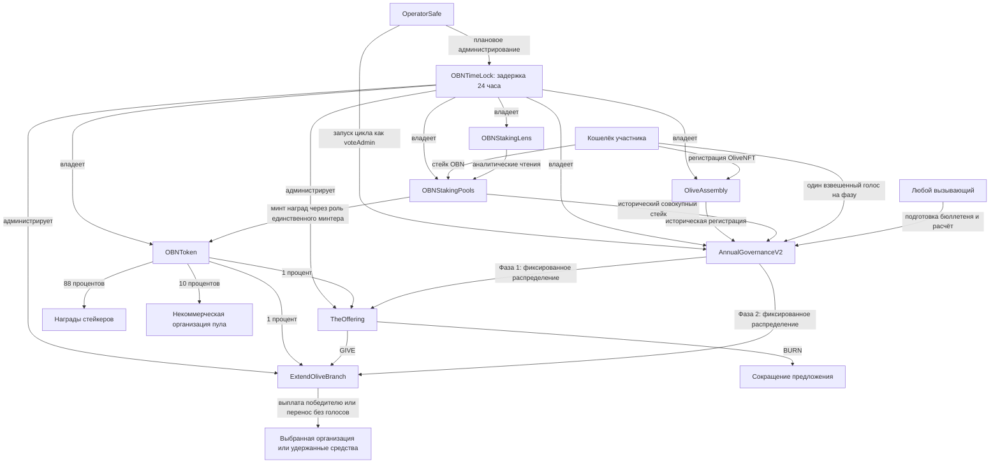

# Дарение без жертвы: протокольный ответ на упадок массового благотворительного участия

[English](THESIS.md) · [Tiếng Việt](THESIS.vi.md) · [한국어](THESIS.ko.md) · [日本語](THESIS.ja.md) · [简体中文](THESIS.zh-CN.md) · [हिन्दी](THESIS.hi.md) · [العربية](THESIS.ar.md) · **Русский** · [Deutsch](THESIS.de.md) · [Português](THESIS.pt.md) · [Español](THESIS.es.md) · [Bahasa Indonesia](THESIS.id.md)

> Этот перевод предоставлен для удобства. Официальной является английская версия ([THESIS.md](THESIS.md)); при любых расхождениях преимущество имеет английская версия. Перевод выполнен с помощью ИИ на основе редакции `3c740d855` и ещё не проверен профессиональным переводчиком. Названия контрактов и функций, а также адреса приведены на английском языке.

**Тезис Olive Branch Network**

*Olive Branch Network — Base Mainnet*

*Июль 2026 года — редакция управления от 14 октября 2026 года*

---

## Аннотация

Благотворительность в Соединённых Штатах представляет собой парадокс: общая сумма пожертвований почти каждый год достигает рекордных значений, а число тех, кто вообще жертвует, снижается уже четверть века. Доля американских домохозяйств, сделавших хоть какое-то благотворительное пожертвование, упала с 66.2% в 2000 году до 49.6% в 2018 году, а число доноров снижается ежегодно с 2021 года даже при росте общего дохода. Филантропия концентрируется в меньшем и более состоятельном классе доноров, опустошая массовое участие, на котором держится гражданская легитимность некоммерческого сектора.

В этом тезисе утверждается, что корень обвала участия структурный, а не моральный: при каждой исторической форме денег — товарной, фиатной и ранней цифровой — дарение является *жертвенным*. Пожертвование навсегда передаёт основную сумму от донора получателю, поэтому порогом участия становится располагаемый излишек — планка, которую всё большая доля домохозяйств уже не может преодолеть, поскольку прирост реальных доходов концентрируется на вершине распределения. Программируемые деньги впервые в денежной истории устраняют это ограничение. Поскольку смарт-контракт может отделить *владение активом* от *направления доходности, которую этот актив создаёт*, становится возможным спроектировать **дарение без жертвы**: донор навсегда сохраняет основную сумму, непрерывно направляя обеспечиваемую протоколом долю её продуктивности на независимо проверяемое общественное благо.

Протокол Olive Branch Network (OBN) представлен как эталонная реализация этого дизайна. Тезис (i) помещает OBN в долгую историю денежных технологий; (ii) документирует с помощью цитируемых эмпирических данных упадок благотворительного участия, который служит его мотивом; (iii) формализует петлю обратной связи участия и блокировки в протоколе, где каждый дополнительный участник переводит токены OBN из обращающегося объёма в некастодиальный контрактный эскроу, сокращая эффективное предложение по мере роста принятия; и (iv) даёт полное техническое описание каждого основного смарт-контракта — `OBNToken`, `OBNStakingPools`, `TheOffering`, `ExtendOliveBranch`, `AnnualGovernanceV2`, `OliveAssembly`, `OBNTimeLock`, `TeamVesting`, `OliveNFT` и `OBNStakingLens` — включая раскладку хранилища, инварианты, структуру контроля доступа и механику безопасного обновления в том виде, как они развёрнуты в основной сети Base.

---

## Содержание

1. [Введение](#глава-1--введение)
2. [История денег: от товара к программируемости](#глава-2--история-денег-от-товара-к-программируемости)
3. [Эмпирический упадок благотворительного участия](#глава-3--эмпирический-упадок-благотворительного-участия)
4. [Механизм участия и блокировки: экономика потоков токена OBN](#глава-4--механизм-участия-и-блокировки-экономика-потоков-токена-obn)
5. [Основные контракты: полное техническое описание](#глава-5--основные-контракты-полное-техническое-описание)
6. [Архитектура безопасности и институциональный дизайн](#глава-6--архитектура-безопасности-и-институциональный-дизайн)
7. [Ограничения, угрозы валидности и будущая работа](#глава-7--ограничения-угрозы-валидности-и-будущая-работа)
8. [Заключение](#глава-8--заключение)
9. [Источники](#источники)

---

## Глава 1 — Введение

### 1.1 Постановка проблемы

Рамки этой работы задают две долгосрочные тенденции. Во-первых, рушится *широта* благотворительности: доля домохозяйств США, жертвующих хоть что-то, упала почти на семнадцать процентных пунктов между 2000 и 2018 годами (Indiana University Lilly Family School of Philanthropy, 2021), а данные после 2020 года показывают, что снижение ускоряется, а не стабилизируется (Fundraising Effectiveness Project, 2025). Во-вторых, *глубина* дарения концентрируется: общая сумма достигает рекордов — $592.50 billion в 2024 году (Giving USA, 2025) — потому что более крупные пожертвования от меньшего числа более состоятельных доноров заменяют миллионы ушедших мелких доноров.

Стандартные объяснения — снижение религиозности, стагнация зарплат, недоверие поколений к институтам — описывают явление, но не разрешают его, поскольку все они сводятся к одному структурному ограничению: **дарение, как оно исторически сложилось, — это безвозвратное отчуждение основной суммы.** Домохозяйство участвует в филантропии, только когда преодолевает порог «у меня достаточно излишка, чтобы позволить себе эту потерю». По мере концентрации реального располагаемого излишка на вершине распределения доходов вместе с ним концентрировалось и участие.

### 1.2 Формулировка тезиса

Этот тезис защищает три утверждения:

1. **Историческое утверждение.** Каждая предшествующая денежная технология — от лидийского электрума до обязательств Федеральной резервной системы и криптовалют первого поколения, используемых как простые инструменты на предъявителя — делает отчуждение основной суммы *единственным* доступным примитивом дарения. Программируемые деньги — первая денежная форма, в которой *владение* и *направление доходности* разделимы на уровне самих денег, а не через доверенных посредников (эндаументы, трасты, фонды под управлением доноров), доступных главным образом богатым.

2. **Эмпирическое утверждение.** Массовое благотворительное участие находится в вековом упадке, и этот упадок сосредоточен именно в когорте мелких доноров, для которых порог жертвы наиболее жёсток. Это утверждение опирается на панельные данные (Philanthropy Panel Study), транзакционные данные всего сектора (Fundraising Effectiveness Project) и макрооценки (Giving USA), рассмотренные в главе 3.

3. **Утверждение о механизме.** Протокол, который (a) позволяет участникам стейкать токен, не отказываясь от него, (b) направляет фиксированную долю эмиссии протокола проверенным некоммерческим организациям и (c) блокирует застейканную основную сумму в некастодиальном эскроу, создаёт обратную связь между участием и предложением: каждый предельный участник изымает токены из обращающегося объёма, так что — при неизменных спросе и политике эмиссии — более широкое участие механически сжимает эффективное предложение. Глава 4 формализует это и честно излагает предположения, включая противодействующую силу эмиссии наград.

### 1.3 Вклад работы

- Синтез денежной истории вокруг единственной оси: *что могут обеспечить сами деньги* (глава 2).
- Сводная цитируемая эмпирическая запись упадка благотворительного участия в США, 2000–2025 (глава 3).
- Формальная модель потоков токена в экономике стейкинга OBN, включая тождество обращающегося объёма, условие баланса эмиссии/блокировки и контролируемый управлением механизм поглощения через сжигание (глава 4).
- Первая полная письменная спецификация набора основных контрактов OBN в том виде, как он развёрнут в Base и проверен в тестовой среде на форке основной сети, охватывающая каждую переменную состояния, функцию, событие, инвариант и путь обновления (глава 5), вместе с его архитектурой безопасности и институциональной архитектурой (глава 6).

### 1.4 Протокол в одном абзаце

Olive Branch Network — это токен ERC-20 (`OBN`) в Base с системой стейкинга из пулов для отдельных некоммерческих организаций. Участник вносит OBN в пул некоммерческой организации, которую хочет поддержать. Депозит никогда не расходуется, не передаётся некоммерческой организации и не подвергается риску потери в пользу протокола; его можно вывести в любое время (кроме явно заблокированных начальных позиций). Пока токены застейканы, протокол минтит зависящую от времени эмиссию на стейк и при получении делит каждую реализованную награду на четыре части: **88% стейкеру, 10% некоммерческой организации пула, 1% общему хранилищу (`TheOffering`) и 1% хранилищу распределения (`ExtendOliveBranch`).** Судьба распределения общего хранилища, зафиксированного в начале цикла, — сжечь или передать — решается ежегодно двухфазным голосованием кошельков с зарегистрированным OliveNFT, с весом по квадратному корню из стейка на снимке (`AnnualGovernance`), вторая фаза которого направляет фиксированное распределение цикла из хранилища распределения выбранной сообществом некоммерческой организации. Этот дизайн реализует статью I Хартии: *«сделать возможным для человека сохранять владение своими активами, непрерывно направляя часть создаваемой этими активами ценности на независимо подотчётное общественное благо»* (Хартия OBN, ст. I).

---

## Глава 2 — История денег: от товара к программируемости

Цель этой главы не антикварная. Каждый этап истории денег читается через один вопрос: *что могут обеспечить сами деньги, а что должно быть делегировано доверенным институтам?* Ответ определяет, какие формы дарения возможны на каждом этапе.

### 2.1 До чеканки: дар, долг и миф о бартере

Народная теория происхождения денег — неудобный бартер стихийно уступает место средству обмена — восходит к Adam Smith (1776) и была формализована Menger (1892), моделировавшим деньги как стихийное схождение к наиболее *ходовому* товару, и Jevons (1875), назвавшим решаемые ими трения «двойным совпадением потребностей». Современные поисковые модели (Kiyotaki & Wright, 1989) сохраняют эту логику, а Kocherlakota (1998) выделил её глубочайшее следствие: деньги технологически эквивалентны общественной *памяти* о том, кто что внёс, — «деньги — это память».

Однако антропологические данные не подтверждают чистую бартерную экономику как предшественницу денег. Humphrey (1985) заключила, что «ни один пример бартерной экономики в чистом виде никогда не был описан, не говоря уже о возникновении из неё денег». Graeber (2011) собрал этнографические и месопотамские свидетельства того, что *кредит и обязательство предшествуют монете на тысячелетия*: храмовая и дворцовая бухгалтерия Шумера (ок. 3000 до н.э.) выражала долги в серебре и ячмене задолго до того, как кто-либо стал использовать серебро как наличные. Кредитная теория денег (Mitchell-Innes, 1913) и государственная теория (Knapp, 1905/1924) — деньги как передаваемый долг и деньги как то, что государство принимает в уплату налогов — улавливают этот более древний слой.

Для дальнейшего важны два наблюдения. Во-первых, самые ранние «деньги» уже были *учётной технологией* — реестром, а их физические знаки были вторичны. Во-вторых, в экономиках дара и обязательства дарение было составной частью социального членства, а не дискреционным распоряжением излишком (Mauss, 1925). Сведение дарения к добровольной передаче излишка — порождение более поздних денежных форм, а не человеческая константа.

### 2.2 Чеканка: деньги как суверенный инструмент на предъявителя (ок. 640 до н.э. – 1000 н.э.)

Стандартизированная чеканка появляется в Лидии в седьмом веке до н.э. — куски электрума с государственным клеймом — и с поразительной быстротой распространяется по греческим полисам, Персии, Индии (пробитые *karshapana*) и Китаю периода Сражающихся царств (Davies, 2002; Schaps, 2004). Новшество монеты — *проверка с одного взгляда*: клеймо суверена снимает проблему пробирного анализа, делая ценность передаваемой между незнакомцами без доверия и записи.

Но заметьте, что эта технология обеспечивает и чего не может. Монета обеспечивает *окончательность предъявителя*: кто её держит, тот абсолютно ею владеет. Она не может кодировать условия, потоки, разделения или возвраты. Следовательно, единственный примитив дарения, поддерживаемый чеканкой, — это прямая передача монеты, чистая жертва основной суммой. Всё более сложное (храмовые эндаументы, римские *alimenta*, исламский *waqf*, средневековая шантри) требовало обернуть деньги в *правовой институт*, управляемый доверенными людьми. Дарение с направлением доходности существовало — вакф как раз и есть актив, доход от которого навечно направлен на общественное благо при неотчуждаемости основы (Kuran, 2001), — но было доступно лишь тем, кто достаточно богат, чтобы создать институт вокруг своих активов.

### 2.3 Бумага, банки и кредитная надстройка (1000–1971)

Китай эпохи Сун выпустил первые государственные бумажные деньги (*jiaozi*, оформлены в 1024 н.э.), открыв и выпуск конвертируемых билетов, и — в течение двух веков — инфляционную чрезмерную эмиссию (Von Glahn, 1996). В Европе последовательность прошла через переводные векселя, расписки ювелиров, Банк Англии (1694) и золотой стандарт девятнадцатого века — денежный порядок, в котором денежная масса дисциплинировалась конвертируемостью, но фактическим средством обращения был преимущественно банковский *кредит* (Ferguson, 2008; Eichengreen, 1996). Бреттон-Вудская система (1944) сохранила золотой якорь на расстоянии одного шага; её приостановка Соединёнными Штатами 15 августа 1971 года («шок Никсона») завершила переход к чистому фиату: деньги как необеспеченное обязательство государства, ценность которых определяется указом, приёмом в уплату налогов и сетевыми ожиданиями, — хартализм Knapp реализован полностью (Eichengreen, 1996).

Для дарения эпоха фиата и банков изменила масштаб, но не структуру. Режимы благотворительных вычетов (в США с 1917 года) субсидировали жертву; фонд, благотворительный траст с остаточным доходом и фонд под управлением донора индустриализировали паттерн вакфа — *владение сохранено или защищено, доходность направлена* — но каждый требует юридического оформления, минимальных сумм и консультантов. Структурная асимметрия сохранялась: **богатые дают из доходности; все остальные — из основной суммы.** Глава 3 документирует предсказуемый результат.

### 2.4 Цифровые расчёты и электронный фиат (1971–2008)

Между шоком Никсона и 2008 годом деньги операционно дематериализовались — Fedwire, SWIFT (1973), карточные сети и интернет-платежи превратили большую часть денег в записи банковских баз данных — без изменения их логики. Электронный фиат по-прежнему остаётся долговой распиской, правила которой обеспечивают регулируемые посредники. Chaum (1983) показал, что криптография может создать цифровую наличность на предъявителя, но его DigiCash централизовал выпуск и потерпел коммерческую неудачу; «b-money» Dai (1998) и «bit gold» Szabo (задуман в конце 1990-х, опубликован в 2005) наметили децентрализованный выпуск, не решив проблему двойной траты.

### 2.5 Bitcoin: дефицит без суверена (2008)

Nakamoto (2008) решил проблему двойной траты без доверенной стороны, объединив консенсус proof-of-work в публичном реестре с фиксированным графиком выпуска. Вклад Bitcoin в денежную историю точен: **цифровой дефицит и окончательные расчёты, обеспечиваемые протоколом, а не институтом.** Впервые *правила денег* — прежде всего их кривая предложения — стали свойствами самих денег.

Однако скрипт Bitcoin намеренно ограничивает выразительность. Как деньги он остаётся близок к монете: инструмент на предъявителя с жёстким предложением. Дарение в Bitcoin всё ещё является отчуждением основной суммы.

### 2.6 Ethereum и программируемые деньги (2015– )

Buterin (2014) обобщил блокчейн до тьюринг-полной машины состояний. С Ethereum — и EVM-сетями вроде Base, где развёрнут OBN — деньги становятся *программируемыми*: произвольная логика исполняется с той же окончательностью, что и сам платёж. Стандарт ERC-20 (Vogelsteller & Buterin, 2015) сделал токенизированную ценность компонуемым примитивом; ERC-4626, системы стейкинга и ончейн-управление (например, паттерн Governor от Compound) показали, что **хранение, доходность, голосование и выплаты могут быть свойствами протокола.**

Это стержень исторического аргумента. Паттерн вакфа/эндаумента — основа неотчуждаема, узуфрукт направлен на общественное благо — тысячу лет требовал доверенного института и потому был инструментом богатых. Смарт-контракт реализует тот же паттерн для любого держателя любого размера, с:

- **некастодиальным эскроу** («основу эндаумента» держит неизменяемый код, а не доверительный управляющий);
- **непрерывным, отзывным назначением** (участник может перенаправить или вывести средства в любое время — разделимость по статье III Хартии);
- **обеспечиваемым протоколом разделением** (деление 88/10/1/1 в OBN — это арифметика в `_mintSlices`, а не усмотрение управляющего);
- **проверяемой записью** (каждый вклад — ончейн-событие, что удовлетворяет статье VI Хартии).

В таком прочтении история денег — это история постепенного встраивания в сами деньги функций, некогда делегированных институтам: проверка (чеканка), запись (банки), дефицит (Bitcoin) и, наконец, *фидуциарная структура* (программируемые деньги). OBN — применение этого последнего этапа к самой древней денежной функции — дару.

---

## Глава 3 — Эмпирический упадок благотворительного участия

Эта глава устанавливает вторую посылку на основе опубликованных данных: **число дарящих падает — устойчиво и во всех основных источниках данных — даже при росте общей суммы в долларах.**

### 3.1 Долгосрочный упадок участия (Philanthropy Panel Study, 2000–2018)

Самые строгие лонгитюдные данные даёт *Philanthropy Panel Study* школы Indiana University Lilly Family School of Philanthropy — общенационально репрезентативная панель из более чем 9,000 домохозяйств США, чьё дарение отслеживается раз в два года.

- В **2000 году 66.2% домохозяйств США** сделали благотворительный вклад.
- К **2018 году лишь 49.6%** — впервые за историю наблюдений дарили менее половины американских домохозяйств, снижение почти на 17 процентных пунктов (Lilly Family School of Philanthropy, 2021).
- Религиозное дарение упало с **46% домохозяйств (2000–2004) до 29% (2018)**; светское — с плато 55–57% (2000–2008) до **42% в 2018 году** (Lilly Family School of Philanthropy, 2021).
- Последующий анализ показал, что снижение **ускорилось в первый год пандемии COVID-19** (Lilly Family School of Philanthropy, *The Giving Environment*, 2022; NonProfit PRO, 2022), а участие упало во всех расовых и этнических группах (The NonProfit Times, 2023).

Отчёт школы *Giving Environment* частично объясняет снижение падением и стагнацией доходов домохозяйств со средним и низким доходом и меняющимися нормами религиозной принадлежности (Lilly Family School of Philanthropy, 2022) — и то, и другое является выражением порога жертвы: домохозяйства дают, когда могут позволить себе потерять деньги, а таких становится меньше.

### 3.2 Число доноров продолжает падать после 2018 года (Fundraising Effectiveness Project, 2021–2025)

Fundraising Effectiveness Project (FEP), который агрегирует фактические транзакционные данные о пожертвованиях тысяч некоммерческих организаций, продолжает запись за пределами панельных исследований и показывает, что снижение продолжается:

- Число доноров снижается **каждый год с 2021 года** (AFP/FEP, 2026).
- С 2023 по 2024 год число доноров упало на **4.5% в годовом выражении**, причём снижение *ускорилось* по сравнению с предыдущими годами (отчёт FEP Q4 2024; GlobeNewswire, 2025).
- В **2025 году число доноров упало ещё примерно на 3.6%**, даже при росте общей суммы благотворительных долларов на 5.0% — самый сильный рост дохода за пять лет, достигнутый меньшим числом дарителей (AFP/FEP, 2026).
- Отток сосредоточен в малом сегменте: доноры, дающие **$1–$100 — более половины всех доноров — сократились на 8.8% в 2024 году и на 11.1% в годовом выражении в Q1 2025** (FEP; NonProfit PRO, 2025).
- Общее удержание доноров держится около **43%**, а удержание новых доноров намного ниже: большинство впервые дающих больше никогда не дают (FEP, 2025–2026).

Собственная формулировка FEP — в точности тезис о концентрации: рост дохода «сосредоточен в более крупных пожертвованиях» при «продолжающемся снижении общего числа доноров» (AFP, 2025).

### 3.3 Доллары вверх, доноры вниз (Giving USA, 2024–2025)

Giving USA, самая давняя макрооценка американской филантропии, завершает парадокс:

- Общий объём пожертвований достиг **$592.50 billion в 2024 году**, рекорд в текущих долларах, рост на 6.3% номинально и 3.3% с поправкой на инфляцию (Giving USA 2025).
- Общий объём снова вырос до примерно **$617.2 billion в 2025 году** (Giving USA 2026; Give.org, 2026).
- Но **доля индивидуальных пожертвований в общем объёме упала примерно с 80% в 1986–1990 годах до 66% в 2024 году и 64% в 2025 году**, поскольку фонды, завещания и корпорации — инструменты накопленного богатства — восполняют разницу (Giving USA 2026; Give.org, 2026; Stelter, 2026).

### 3.4 Синтез: порог жертвы

В трёх независимых методологиях — панель домохозяйств (PPS), агрегация транзакций (FEP) и макрооценка (Giving USA) — складывается одна и та же картина:

| Показатель | Тогда | Сейчас | Направление |
|---|---|---|---|
| Домохозяйства, дающие хоть что-то (PPS) | 66.2% (2000) | 49.6% (2018) | ↓ 16.6 pts |
| Домохозяйства, дающие на религию (PPS) | 46% (2000–04) | 29% (2018) | ↓ 17 pts |
| Число доноров, год к году (FEP) | — | −4.5% (2024), −3.6% (2025) | ↓ ускоряется |
| Мелкие доноры $1–$100 (FEP) | 50–57% всех доноров | −8.8% до −11.1% год к году | ↓ самая резкая когорта |
| Доля частных лиц в общем объёме (Giving USA) | ~80% (1986–90) | 64% (2025) | ↓ 16 pts |
| Общая сумма в долларах (Giving USA) | — | $592.5B (2024), $617.2B (2025) | ↑ рекордные значения |

Сектор рекапитализируется сверху, пока его основа участия размывается. Именно этого следует ожидать, если дарение требует излишка, а излишек сконцентрировался. Проблему *финансирования* некоммерческого сектора решают богатые; проблема *участия* — гражданская, демократическая, легитимирующая функция миллионов небольших пожертвований — не решается вовсе, потому что нет инструмента, позволяющего небогатому домохозяйству давать непрерывно и без потерь.

Глава 4 описывает такой инструмент.

---

## Глава 4 — Механизм участия и блокировки: экономика потоков токена OBN

Эта глава формализует экономическое ядро протокола: **участие блокирует предложение.** Каждое утверждение опирается на конкретный код контрактов, полностью описанный в главе 5; здесь мы рассматриваем систему как машину потоков токена.

### 4.1 Генезисные распределения и текущие резервы

Следующая таблица фиксирует исторический генезисный минт, а не текущие неизрасходованные резервы. `OBNToken.initialize` заминтил всё начальное предложение ровно один раз в фиксированных пропорциях (OBNToken.sol):

| Распределение | Доля | Назначение |
|---|---|---|
| Ликвидность | 40% | Ликвидность DEX, чтобы токен можно было приобрести |
| Аирдроп | 30% | Посев широкого начального распределения |
| Благотворительный фонд | 10% | Начальный запуск позиций некоммерческих пулов (навсегда заблокированы — §4.4) |
| Казна | 10% | Операции протокола (однократное генезисное распределение; потоки эмиссии в неё не поступают) |
| Вестинг команды | 10% | Блокировка по времени в `TeamVesting` (клифф 4 месяца, линейно 20 месяцев) |

Дальнейший минт невозможен, кроме как единственным, однократно заданным минтером — контрактом стейкинга, поэтому *весь* рост предложения после генезиса — это эмиссия стейкинга.

Некоммерческий посевной резерв имеет общее распределение **300M OBN**, а **50M OBN** хранятся отдельно для нужд протокола. Запасы казны и аирдропа были объединены в посевное распределение. К тому моменту 11M OBN уже профинансировали 11 некоммерческих посевных позиций, оставив 289M OBN на 289 дополнительных позиций по 1M OBN каждая.

Это перераспределение существующих запасов, а не новый минт и не изменение развёрнутого инициализатора.

### 4.2 Тождество обращающегося объёма

Определим в момент *t*:

- **S(t)** — общее предложение: генезисное предложение плюс совокупная эмиссия минус совокупное сжигание.
- **K(t)** — токены в контракте стейкинга: сумма всех балансов `userAmount` (только основная сумма; награды минтятся прямо получателям и никогда не объединяются).
- **V(t)** — токены, всё ещё заблокированные в `TeamVesting`.
- **G(t)** — токены, накопленные в двух хранилищах управления (`TheOffering` и `ExtendOliveBranch`) в ожидании годового цикла.
- **B(t)** — совокупно сожжённые токены (через `TheOffering.burn` и любой добровольный `ERC20Burnable.burn`).

Тогда **обращающийся объём** — предложение, реально доступное для торговли, — равен:

> **F(t) = S(t) − K(t) − V(t) − G(t)**   при   **S(t) = S₀ + E(t) − B(t)**

где E(t) — совокупная валовая эмиссия. Утверждение о механизме — это утверждение о ∂F/∂(участие): **каждый депозит переводит токены из F в K один к одному** (`_depositCore` выполняет `safeTransferFrom(msg.sender, address(this), amount)`), и токены остаются в K, пока именно этот участник не решит их вывести. Протокол никогда не кредитует, не перезакладывает и не расходует K; нет слэшинга и нет притязаний протокола на основную сумму. K — инертный эскроу.

### 4.3 Политика эмиссии: убывающая и пропорциональная участию

Эмиссия — *не* постоянный кран. `_sumRewardAcrossPhases` начисляет награды по пулам как `poolStake × bps × Δt / (10000 × 365 days)` — то есть **годовой процент от реально застейканного** по убывающему графику:

| Годы с развёртывания | Годовая ставка эмиссии (на застейканный баланс) |
|---|---|
| 0–2 | 10.00% |
| 2–4 | 7.50% |
| 4–6 | 5.00% |
| 6–8 | 2.50% |
| 8–10 | 1.25% |
| 10+ | 3.00% резервная ставка (`FALLBACK_EMISSION_BPS`), пока управление не изменит её через `addPhase` |

Из этого следуют два вывода. Во-первых, **эмиссия масштабируется с K, а не с S**: незастейканные токены ничего не создают. Во-вторых, поскольку награды минтятся только при *событиях получения* (депозит, вывод, получение), незабранные награды — лишь учётная запись (`accRewardPerShare × balance − rewardDebt`): они не существуют как токены до реализации.

### 4.4 Разделение на четыре части и механизмы поглощения

При каждой реализации `_mintSlices` делит валовую ожидающую награду:

- **88% → стейкеру.** Доходность участника. Заново заминчены, поступают в F (или перестейкиваются).
- **10% → кошельку некоммерческой организации пула.** Дар. Непрерывный, обеспечиваемый протоколом, пропорциональный стейку и времени участника. Это *Вклад* по статье VII Хартии, и он не стоит стейкеру основной суммы — лишь доли доходности, которой без протокола не существовало бы.
- **1% → `TheOffering`** (общее хранилище). Накапливается весь год; каждый годовой цикл управления голосует за то, чтобы **сжечь** распределение, зафиксированное в начале цикла (дефляционный механизм поглощения, уменьшает S), или **передать** его (перевод в `ExtendOliveBranch`).
- **1% → `ExtendOliveBranch`** (хранилище распределения). Накапливается весь год; голосование Фазы 2 каждого годового цикла направляет фиксированное распределение этого цикла одной выбранной сообществом некоммерческой организации из белого списка (или переносит его, если никто не голосует).

Обратите внимание: **ни один поток эмиссии не идёт в казну**: оба остаточных среза поступают в хранилища под контролем управления. До годового распоряжения оба потока находятся в эскроу хранилищ (G в §4.2) — вне торгуемого объёма.

Кроме того, 10%-е генезисное распределение благотворительного фонда размещается через `charityFundBootstrap`/`depositForWithLock`, что стейкает токены *от имени собственного кошелька каждой некоммерческой организации* с `lockedAmount`, равным депозиту, — это **постоянная блокировка** (блокировки могут только увеличиваться, но не уменьшаться). Поэтому начальные позиции навсегда вносят вклад в K, гарантируют каждому пулу базовый поток наград для его некоммерческой организации и не могут быть распроданы.

### 4.5 Петля обратной связи участия и блокировки

Соберём части. Пусть *n* — число активных участников, а *k̄* — средний стейк. Тогда K = n·k̄ (плюс начальные блокировки), и:

1. **Принятие сжимает объём.** Каждый новый участник превращает токены из обращения в основную сумму в эскроу: ΔF = −Δstake. При неизменном спросе сокращение торгуемого объёма повышает рыночную равновесную цену — стандартный результат спроса и предложения и ончейн-аналог давно наблюдаемого «сокращения объёма» в экономиках proof-of-stake, где высокие доли стейкинга уменьшают ликвидное предложение.
2. **Доходность вознаграждает терпение, и 88% доходности можно реинвестировать.** Стейкеры, перестейкивающие свою долю 88%, возвращают заново заминченные токены прямо в K, дополнительно сжимая F.
3. **Поток даров финансирует легитимность в реальном мире.** Некоммерческий поток в 10% даёт внешним институтам устойчивую причину продвигать участие, что привлекает больше участников, — единственный маркетинговый канал, который сам является актом благотворительности.
4. **Управление может превратить общее хранилище в чистую дефляцию.** Результат BURN на Фазе 1 уничтожает распределение общего хранилища, зафиксированное в начале цикла, напрямую уменьшая S. Обратите внимание, что значение по умолчанию намеренно дефляционно: *нулевое участие → BURN* (GIVE должен *строго* превысить BURN).
5. **Право голоса требует участия на момент снимка.** V2 сочетает статус зарегистрированного NFT с не менее чем 1 OBN совокупного стейка с чекпоинтами, затем применяет вес квадратного корня. Управление даёт причину быть в стейке до начала каждого цикла; оно не требует оставаться в стейке после этого и не устанавливает непрерывную блокировку на время голосования (§5.5).

Петля: **больше участников → больше заблокированных токенов → меньше обращающийся объём и больше совокупная опция сжигания → лучше ценовая поддержка → выше ценность доходности и дара на токен → сильнее привлечение → больше участников.**

### 4.6 Честный учёт: противовес эмиссии

У механизма есть противодействующая сила. Эмиссия инфляционна: при начальной ставке 10% S растёт пропорционально K. *Сокращается* ли чистый объём, зависит от реализованных потоков. Дифференцируя тождество объёма, получаем поток эмиссии, входящий в объём:

> **dF/dt ≈ e·K·[0.88·(1−r) + 0.10 + 0.02·(1−β)·δ] − dK/dt**

где *e* — текущая ставка эмиссии, *r* — доля перестейканных наград стейкеров, *β* — доля потоков хранилищ, в конечном счёте сожжённых на Фазе 1, а *δ* ≤ 1 — коэффициент запаздывания, отражающий, что два потока хранилищ по 1% входят в объём только после распределения годовым циклом (сожжённые суммы не входят никогда; переносы ещё больше откладывают вход). Объём сокращается (dF/dt < 0), когда **чистый новый стейкинг опережает неперестейканную часть эмиссии**. Структурные особенности толкают в этом направлении — график эмиссии убывает 10% → 1.25%, тогда как принятие должно расти; некоммерческие получатели — продавцы, движимые миссией, но их приток составляет лишь 10% эмиссии; сжигание по умолчанию навсегда убирает общее хранилище; начальные блокировки никогда не выходят, — но это условие эмпирическое и не гарантировано. Поэтому защищаемое здесь утверждение точно ограничено: *протокол спроектирован так, что при прочих равных рост участия механически сокращает объём и создаёт условия, поддерживающие цену токена; он не гарантирует и не может гарантировать рост цены, который зависит также от внешнего спроса.*

### 4.7 Дарение без жертвы, ещё раз

Экономический дизайн напрямую решает проблему главы 3. Порог участия больше не «излишек, потерю которого я могу себе позволить», а «капитал, который я готов разместить». Домохозяйство, которое никогда не смогло бы пожертвовать $500, может застейкать $500, сохранить их, вывести в чрезвычайной ситуации и при этом непрерывно направлять 10% создаваемой стейком доходности — реальные, обеспеченные протоколом, публично записанные вклады — проверенной некоммерческой организации. Дарение становится *решением о распределении активов*, а не *потребительской жертвой*. Таков ответ дизайна на обвал участия: не призывать людей давать больше, а устранить структурную причину, по которой они перестали.

---

## Глава 5 — Основные контракты: полное техническое описание

Все контракты ориентированы на Solidity ^0.8.28, построены на OpenZeppelin v5 и развёрнуты в Base. Обновляемые контракты используют паттерн UUPS (`_authorizeUpgrade` ограничена владельцем, которым является `OBNTimeLock`). В этой главе описан каждый контракт набора: назначение, хранилище, функции, события, инварианты и взаимодействия.

### 5.1 `OBNToken` — денежная база (OBNToken.sol)

**Наследование.** `Initializable`, `IOBNMintable`, `ERC20Upgradeable`, `ERC20PermitUpgradeable` (разрешения без газа EIP-2612), `ERC20VotesUpgradeable` (делегирование с чекпоинтами), `ERC20BurnableUpgradeable`, `OwnableUpgradeable`, `UUPSUpgradeable`.

**Идентификация.** Имя "Olive Branch Network", символ "OBN".

**Хранилище.** Единственная собственная переменная — `address public minter` — плюс `uint256[100] __gap`, резервирующий запас для обновлений.

**Инициализация.** `initialize(initialOwner, initialSupply, liquidityAddress, airdropAddress, charityAddress, treasuryAddress, teamVestingAddress)` выполняется один раз (модификатор initializer; конструктор вызывает `_disableInitializers()`, поэтому саму реализацию никогда нельзя инициализировать). После проверок нулевого адреса и ненулевого предложения она минтит всё распределение: 30% аирдроп, 40% ликвидность, 10% благотворительность, 10% казна, 10% вестинг команды (§4.1).

**Механика минтера.** `setMinterOnce(addr)` — только владелец, требует `minter == address(0)`: минтера можно задать **ровно один раз** за время жизни реализации (изменить его может только полное обновление UUPS). `mint(to, amount)` требует `msg.sender == minter`. При развёртывании минтером является прокси `OBNStakingPools`; поэтому *всё будущее предложение — это эмиссия стейкинга*. `isMinter(addr)` — вспомогательное представление.

**Переопределения.** OZ v5 направляет все изменения баланса через `_update`, поэтому одно переопределение согласует `ERC20Upgradeable` и `ERC20VotesUpgradeable` (чекпоинты голосов автоматически отслеживают переводы). `nonces()` переопределена для согласования `ERC20PermitUpgradeable` с `NoncesUpgradeable`.

**Свойства безопасности.** Нет паузы, чёрного списка и налога на переводы: токен максимально нейтрален. Сжигание доступно любому держателю через `ERC20Burnable` — хук, которым `TheOffering` уничтожает общее хранилище.

### 5.2 `OBNStakingPools` — двигатель (StakingPoolsV931.sol; строка версии "9.3.1")

Контракт стейкинга — самый большой и самый значимый контракт системы: он единственный минтер OBN, хранитель всей застейканной основной суммы (K в §4.2) и оракул силы голоса для управления. Он работает за прокси UUPS со стабильным адресом.

#### 5.2.1 Константы — неизменяемое разделение

```solidity
STAKER_BPS = 8800; CHARITY_BPS = 1000; CHARITY_FUND_BPS = 100; TREASURY_BPS = 100;
TOTAL_BPS = 10000; FALLBACK_EMISSION_BPS = 300;
```

Разделение 88/10/1/1 — это `constant`: оно скомпилировано в байткод и не меняется без полного обновления реализации через timelock. Два среза по 100 bps минтятся на адреса из переменных хранилища `treasury` и `charityFund`; **в развёрнутой конфигурации эти переменные содержат `TheOffering` (0xc75B…E341) и `ExtendOliveBranch` (0xE1Bb…6d8B) соответственно** — идентификаторы исторические, а фактические получатели обоих потоков по 1% — два хранилища управления (§5.3, §5.4). `FALLBACK_EMISSION_BPS` — постоянный минимум 3%, применяемый после исчерпания заданного графика фаз (§4.3).

#### 5.2.2 Раскладка хранилища

Упорядочена по слотам и критична для обновлений (контракт документирует свою карту слотов; завершающий зазор — `uint256[93]`; состояние ежемесячного автополучения наград находится вне этой карты, в именованном хранилище ERC-7201 `obn.storage.MonthlyAutoClaim`):

- **Конфигурация:** `stakingToken` (токен OBN как `IOBNMintable`), `treasury` (→ TheOffering), `charityFund` (→ ExtendOliveBranch), `version` (строка, "9.3.1").
- **График эмиссии:** `Phase[] phases`, каждая `{start, end, bps}` во временных метках.
- **Пулы:** `PoolInfo[] poolInfo`, каждый `{charityWallet, totalStaked}` — один пул на некоммерческую организацию.
- **Учёт пользователей:** `userAmount[pid][user]`, `userRewardDebt[pid][user]` — паттерн аккумулятора и долга по наградам (§5.2.3).
- **Аккумуляторы:** `accRewardPerShare[pid]` (масштаб 1e12), `lastRewardTime[pid]`.
- **Глобальное:** `globalTotalStaked`.
- **Блокировки:** `lockedAmount[pid][user]` — реестр постоянных блокировок (§4.4).
- **Статистика:** `totalClaimedByUser`, `totalDepositedByUser`, `totalWithdrawnByUser`, итоги депозитов/выводов/заминченного charity по пулам, `uniqueStakersByPool`, `uniqueStakersGlobal`, `activePoolCount[user]`, `stakedSince[user]`, `cumulativeStakeSeconds[user]` (сохраняется после полного вывода из стейкинга — постоянная запись стажа).
- **Жизненный цикл:** `poolRemoved[pid]` (депозиты отключены), `poolFullyRemoved[pid]` (исключён из бюллетеней управления — устанавливается только `removePool`, никогда `shutdownPool`).
- **Отслеживание вклада:** `charityContributedByUserInPool[pid][user]` и `totalCharityContributedByUser[user]` — пожизненное дарение, относящееся к каждому участнику, ончейн-*Запись* по статье VI Хартии.
- **Инфраструктура управления (слоты 28–30):** `charityFundOperator` + `_migrationExecuted` + `upgradeBlock` (упакованы в один слот), `totalStakedByUser[user]` (текущий итог по пулам) и `_stakeCheckpoints[user]` (`Checkpoints.Trace208` — история силы голоса). `poolFullyRemoved`, указанный выше в разделе «Жизненный цикл», занимает слот 31.

#### 5.2.3 Модель учёта

OBN использует схему аккумулятора и долга по наградам с решающим отличием: **аккумулятор отслеживает награды БРУТТО.** При любом обращении к пулу `_accruePool` вычисляет валовую эмиссию с `lastRewardTime` через `_sumRewardAcrossPhases`, которая проходит график фаз по сегментам, точно обрабатывая границы фаз с помощью `Math.mulDiv(poolStake, bps × duration, 10000 × 365 days)` и применяя резервную ставку 3% к любому интервалу за последней заданной фазой, и добавляет её в `accRewardPerShare[pid] += grossReward × 1e12 / totalStaked`. Ожидающий брутто пользователя тогда равен:

> `pending = userAmount × accRewardPerShare / 1e12 − userRewardDebt`

Разделение на 88/10/1/1 происходит только при реализации внутри `_mintSlices`, которая строго следует checks-effects-interactions: вся статистика обновляется *до* четырёх внешних вызовов `mint`. Для пула с нулевым стейком ничего не минтится (начисление выходит досрочно и лишь продвигает часы), а награды никогда не лежат в контракте — они идут прямо от минта к конечному получателю. Публичная обёртка `sumRewardAcrossPhases` открывает проход по фазам для Lens только для чтения (§5.9).

#### 5.2.4 Функции для пользователей

- **`deposit(pid, amount)`** — застейкать в пул. Требует действительного незакрытого пула. Эффекты: начисление по пулу; регистрация уникального стейкера (по пулу и глобально, `stakedSince` запускает часы стажа при переходе 0→1 пул); увеличение `userAmount`, `poolInfo.totalStaked`, `globalTotalStaked`, статистики депозитов; сброс долга по наградам; запись чекпоинта `(block.number, totalStakedByUser)`; затем `safeTransferFrom` основной суммы и `_mintSlices` любой ожидающей награды. Депозит как побочный эффект *реализует* ожидающие награды.
- **`depositFor(pid, amount, beneficiary)`** — финансирование третьей стороной стейка другого адреса (дарение в стиле зарплатных удержаний, подарки участия).
- **`depositWithPermit(...)`** — разрешение+стейк одной транзакцией через EIP-2612.
- **`withdraw(pid, amount)`** — выход. Требует `amount ≤ userAmount − lockedAmount` (*незаблокированный* баланс); обновляет все балансы, чекпоинты и хуки (`_afterWithdrawBalanceHooks` ограничивает блокировки новым балансом, очищает флаги активного стейкера при нуле, а при выходе из последнего пула записывает сессию в `cumulativeStakeSeconds` и уменьшает `uniqueStakersGlobal`); возвращает основную сумму; реализует ожидающие награды через то же разделение 88/10/1/1. **Нет ожидания, штрафа и комиссии** — разделимость по статье III требует выхода без трения.
- **`claim(pid)` / `claimFor(pid, user)` / `claimMultiple(pids)`** — реализуют награды, не затрагивая основную сумму. `claimFor` доступна только владельцу контракта (за timelock) и может отправлять награды только их законному получателю (минт идёт *на `user`*, а не вызывающему). Плановое получение использует отдельный путь `autoClaimFor`, основанный на согласии и добавленный в V9.3.1 (Whitepaper §3.2.1); этот путь не реинвестирует награды.
- **Набор представлений:** `pendingRewards`, `getPoolInfo`, `getUserStakeValue`, `unlockedBalance`, `poolLength`, `isGloballyStaked`, `stakeElapsed`, `currentRewardsPerSecond` (более тяжёлая аналитика находится в Lens — §5.9).

#### 5.2.5 Начальный запуск благотворительного фонда и заморозка самостейкинга

`charityFundBootstrap(pid, amount, beneficiary)` / `depositForWithLock(...)` — вызываются только `charityFund` или `charityFundOperator` (операционный Safe), только для собственного благотворительного кошелька пула и проходят через `_enforceCharitySelfStakePolicy`, которая допускает **ровно один** заблокированный начальный депозит на благотворительную организацию пула: баланс благотворительного кошелька должен быть нулевым, вызывающий — уполномоченным, а депозит — заблокированным. Весь прочий самостейкинг некоммерческой организации пула отклоняется ("charity self-stake disabled"). Обоснование: некоммерческая организация, стейкающая в собственный пул, возвращала бы себе 10%-й благотворительный срез, раскручивая маховик веса в управлении; заморозка ограничивает позиции некоммерческих организаций одной прозрачной, навсегда заблокированной начальной позицией.

`setLockedAmount(pid, user, amount)` — charityFund или оператор (оператор ограничен адресами благотворительных организаций пулов) могут **только увеличивать** блокировки, никогда не уменьшать и никогда не превышать баланс пользователя. Блокировки по построению односторонние.

#### 5.2.6 Административные функции (все за принадлежащим timelock `onlyOwner`)

- **`addPool(charityWallet)`** — создаёт пул для некоммерческой организации; инициализирует часы начисления.
- **`shutdownPool(pid)`** — блокирует *новые* депозиты; получение и вывод продолжаются, так что пользователи всегда могут выйти. Закрытые пулы остаются правомочными для бюллетеня управления.
- **`removePool(pid)`** — только при `totalStaked == 0`; отправляет устаревшие начисления charity, устанавливает `poolFullyRemoved` (исключая некоммерческую организацию из будущих бюллетеней) и перенаправляет благотворительный кошелёк пула на адрес `treasury` (TheOffering), чтобы остаточный минт не мог застрять на address(0).
- **Закрытие пула** — Когда некоммерческая организация уходит, её пул закрывается: новые стейки блокируются, а действующие стейкеры по-прежнему могут выводить стейк и получать награды, и оставшиеся стейки продолжают приносить награды с обычным делением 88/10/1/1. Перед удалением пула выполняется принудительный выход каждого оставшегося стейкера: `forceExitUserToSelf` возвращает каждый стейк вместе с ожидающими наградами на собственный кошелёк стейкера и не может отправить его никуда больше. Заблокированный посевной стейк организации возвращается в Некоммерческий посевной резерв. Только после этого, когда в пуле ничего не осталось, пул удаляется.
- **`updateCharityWallet(pid, newWallet)`** — заменяет скомпрометированный или мигрированный кошелёк некоммерческой организации.
- **`migrateBootstrap(pid, old, new)`** — атомарно перемещает всю начальную позицию (баланс, долг по наградам, блокировку) между адресами некоммерческих организаций, проводя чекпоинты силы голоса через обе стороны, с ончейн-доказательством сохранения ожидающих наград в пределах 1 wei (`pendingAfter ≥ pendingBefore && pendingAfter ≤ pendingBefore + 1`).
- **`addPhase(start, end, bps)`** — добавляет фазы эмиссии; они должны непрерывно примыкать к последней. Это также рычаг управления над резервной ставкой 3%.
- **`forceExitUserToSelf(pid, user, claimRewards)`** — аварийная: возвращает всю основную сумму пользователя *самому пользователю* (никогда администратору), при необходимости реализуя награды и игнорируя блокировки. Администратор не может конфисковать; может только принудительно вернуть.
- **`sweep(token, amount)`** — возвращает случайно попавшие ERC-20 на адрес `treasury`, **явно исключая токен стейкинга** ("Cannot sweep staking token"), чтобы администратор никогда не мог коснуться K.
- **`migrateV93(newTreasury, newCharityFund, newOperator)`** — однократная функция подключения, исполненная атомарно с развёртыванием реализации через `upgradeToAndCall` посредством timelock. Она установила `treasury` → TheOffering, `charityFund` → ExtendOliveBranch и `charityFundOperator` → операционный Safe; записала `upgradeBlock` как генезисную опору для чекпоинтов силы голоса; и навсегда отключила себя (`_migrationExecuted`). Обновление V9.3.1 добавило `initializeV931(executor)` — отдельный однократный reinitializer, который установил `version` в "9.3.1" и задал executor автоматического получения наград; позднее `setAutoClaimExecutor(executor)` может сменить этого executor, а нулевой адрес приостанавливает автоматизацию.
- **`upgradeTo(newImpl, data)` / `setVersion`** — путь обновления UUPS, совместимый с планированием через timelock.

#### 5.2.7 Сила голоса с чекпоинтами

Застейканные балансы *можно запрашивать по снимку*, поэтому управление может взвешивать голоса на фиксированном прошлом блоке, а не доверять текущим балансам (что открывало бы дорогу атакам flash-stake):

- Каждый депозит, вывод и миграция начальной позиции записывает `(block.number, totalStakedByUser)` в `Checkpoints.Trace208` пользователя.
- **Генезисная инициализация:** у стейкеров, чьи позиции старше системы чекпоинтов, нет записей истории. Три взаимодополняющих пути инициализируют их на `upgradeBlock`: `_initializeCheckpointIfNeeded` (автоматически, при следующем взаимодействии пользователя, до изменения баланса); `bootstrapCheckpoint(user)` (без разрешений — любой может инициализировать любого); и `batchBootstrap(users[])` (массовая церемония без разрешений). `AnnualGovernance` также лениво инициализирует голосующих при первой попытке голосования (§5.5).
- **`getPastVotingPower(user, blockNumber)`** — бинарный поиск (`upperLookup`) суммарного стейка пользователя на любом прошлом блоке; **`checkpointCount(user)`** показывает статус инициализации.
- Этот интерфейс возвращает **необработанный совокупный застейканный OBN на снимке**, а не итоговый вес голоса V2. AnnualGovernanceV2 сначала проверяет историческую регистрацию в OliveAssembly и минимум 1 OBN, затем применяет вес квадратного корня (§5.5). Незастейканные балансы кошельков и делегирование ERC20Votes не дают годовой силы голоса. Исторические циклы до голосования с NFT сохраняют первоначальный линейный вес.

### 5.3 `TheOffering` — общее хранилище (TheOffering.sol)

Намеренно минимальное **необновляемое** хранилище, получающее 1% всей эмиссии стейкинга OBN в течение года. Без работы с ETH; всего две роли:

- `timelockOwner` (неизменяемый, задаётся при создании) — может вызывать `setGovernance(addr)` (address(0) приостанавливает управление) и `emergencySweep(token, to)` (возврат всего баланса ERC-20, переопределение до распределения).
- `governance` (прокси `AnnualGovernance`) — может вызывать ровно две функции, обе после голосования: **`burn(amount)`** (вызывает `ERC20Burnable.burn` токена OBN, уничтожая предложение) или **`sendToExtend(amount)`** (перевод SafeERC20 в `ExtendOliveBranch`).

Порядок развёртывания важен и задокументирован в контракте: сначала `ExtendOliveBranch` (его адрес здесь immutable), управление подключается позже. Контракт хранит накопленное за год общее достояние и больше ничего не делает — поверхность атаки из двух защищённых функций.

### 5.4 `ExtendOliveBranch` — хранилище распределения (ExtendOliveBranch.sol)

Второе необновляемое хранилище, получающее собственный 1% всей эмиссии стейкинга плюс любые переводы по результату GIVE из `TheOffering`. Хранилище: неизменяемые `obn` и `timelockOwner`; изменяемый `governance`; `mapping(address => bool) approvedNonprofit` — **белый список**, реализующий статью IV Хартии (легитимность получателя должна быть независимо проверена, а не заявлена им самим).

Два пути распределения, намеренно асимметричные:

- **`distribute(nonprofit, amount)`** — timelockOwner или governance; *белый список обеспечивается*. Ручной/доуправленческий/аварийный канал.
- **`distributeFromGovernance(nonprofit, amount)`** — только governance; на этом пути распределения **белый список намеренно опущен**. V2 проверяет каждого получателя по белому списку при обработке его пакета бюллетеня, затем сохраняет этот состав на весь цикл. Последующий отзыв из белого списка не может удалить принятого получателя или сделать недействительным выбранного получателя при выплате. Timelock сохраняет `emergencySweep`; вывод зарезервированных средств может помешать расчёту, пока нехватка не будет восполнена.

Администрирование: `setApprovedNonprofit(addr, bool)`, `setGovernance(addr)`, `emergencySweep(token, to)` — всё только для timelock.

### 5.5 `AnnualGovernanceV2` — годовое управление (AnnualGovernanceV2.sol)

В этом разделе описан AnnualGovernanceV2 — действующая реализация за существующим прокси AnnualGovernance с момента обновления 7 октября 2026 года (блок Base 52283807). Действующие контракты не проходили сторонний аудит безопасности; прежние собственные проверки команды в `governance-operations` описывают более ранние версии, а не действующее развёртывание.

#### 5.5.1 Что решает сообщество

Годовое управление направляет два общих потока эмиссии по 1%. На Фазе 1 участники выбирают, сжечь ли распределение TheOffering или передать его в ExtendOliveBranch. На Фазе 2 они выбирают одну правомочную некоммерческую организацию для получения распределения цикла из ExtendOliveBranch. Обе фазы проходят, даже если Фаза 1 выбирает BURN. Эти голосования не меняют 88% наград стейкеров, не перенаправляют 10%-ю некоммерческую долю конкретного пула, не расходуют основную сумму пользователей и не одобряют произвольные обновления протокола.

OperatorSafe в роли `voteAdmin` запускает цикл напрямую. Владельцем остаётся Timelock, и через него по-прежнему контролируются подключение и конфигурация некоммерческих организаций. Термин *годовой* описывает предполагаемый операционный ритм: контракт обеспечивает два 30-дневных окна голосования и предотвращает перекрытие циклов, но не планирует цикл автоматически и не требует годового интервала между запусками. Кто-то должен отправлять каждую транзакцию подготовки и расчёта.

#### 5.5.2 Регистрация и сила голоса

Голосующий использует один и тот же кошелёк для стейкинга OBN и регистрации одного OliveNFT в OliveAssembly. Разрешив прокси Assembly перевести NFT, кошелёк вызывает `deposit(tokenId)`. Assembly хранит NFT и создаёт чекпоинт регистрации кошелька; владения NFT вне Assembly недостаточно. Регистрация сохраняется между циклами до вывода, а регистрация дополнительных NFT в том же кошельке не допускается. Стейкинг и регистрация NFT — отдельные действия, и ни одно не заменяет другое.

Для цикла, начинающегося в блоке `B`, обе фазы используют регистрацию и совокупный застейканный баланс на конец блока `B - 1`. Правомочен зарегистрированный кошелёк с не менее чем 1 застейканным OBN. Депозиты или регистрация в блоке `B` или позже не увеличивают право этого цикла. Более поздние выводы стейка или NFT не отменяют право, зафиксированное снимком. Таким образом, механизм измеряет участие в определённый момент, а не навязывает 60-дневную блокировку стейка или NFT.

Для правомочных кошельков сила голоса в понятных единицах примерно равна квадратному корню из застейканных OBN. Для суммы стейка `s` с 18 десятичными знаками точный расчёт контракта — `floor(sqrt(s)) * 10^9`, возвращаемый в единицах силы голоса с 18 десятичными знаками. Сила равна нулю ниже минимума или без регистрации на снимке.

| Совокупный стейк на снимке | Единицы силы голоса при регистрации |
|---|---:|
| Менее 1 OBN | 0 |
| 1 OBN | 1 |
| 100 OBN | 10 |
| 10,000 OBN | 100 |

Это уменьшает преимущество концентрированного стейка: увеличение стейка в сто раз увеличивает вес в десять раз. Это не устанавливает принцип «один человек — один голос». Человек может контролировать несколько кошельков и приобретать несколько NFT; разделение стейка между правомочными кошельками может увеличить совокупный квадратно-корневой вес. Регистрация NFT — это шлюз правомочности, а не доказательство уникальной личности человека.

Каждый правомочный кошелёк может отправить один голос на фазу с помощью `castOfferingVote(cycleId, burn)` и `castNonprofitVote(cycleId, nonprofit)`. Через эти конечные точки голоса нельзя изменить. Голосующий на Фазе 2 не обязан голосовать на Фазе 1. Стейк определяет вес по всем пулам, поэтому голосующий может выбрать любую некоммерческую организацию из бюллетеня, а не только пул, в котором стейкает этот кошелёк. В этих конечных точках годового голосования нет кворума явки или механизма делегирования.

#### 5.5.3 Жизненный цикл цикла и подготовка бюллетеня

| Шаг | Кто действует | Поведение контракта |
|---|---|---|
| Регистрация и стейк | Участник | Устанавливает регистрацию NFT и стейк до снимка |
| Запуск Фазы 1 | Safe voteAdmin | Вызывает `startAnnualCycle(2592000, 2592000)`; фиксирует снимки и открывает 30-дневное голосование |
| Подготовка остатка бюллетеня | Любой вызывающий | Вызывает `prepareBallot(cycleId, maxPools)` или `executeCurrentCycle()` ограниченными пакетами |
| Голосование BURN или GIVE | Правомочные кошельки | Каждый отправляет один взвешенный голос Фазы 1 |
| Расчёт Фазы 1 | Любой вызывающий | После срока и завершённой подготовки исполняет результат и открывает Фазу 2 |
| Голосование за некоммерческую организацию | Правомочные кошельки | Каждый отправляет один взвешенный голос Фазы 2 в течение полного 30-дневного окна |
| Расчёт Фазы 2 | Любой вызывающий | Выплачивает фиксированное распределение победителю или записывает перенос, если голосов не было |

Для запуска необходимо, чтобы Assembly был привязан к управлению, на снимке была хотя бы одна регистрация, история пулов была непустой, а любой предыдущий цикл был завершён или отменён. Число зарегистрированных кошельков не гарантирует, что какой-либо кошелёк соответствует порогу стейкинга. Оба аргумента длительности должны быть ровно 2,592,000 секунд. Действие запуска Safe не требует новой операции Timelock или второго действия Safe для открытия Фазы 2.

**Снимок и средства.** Стартовая транзакция фиксирует право голоса и совокупный стейк на предыдущем блоке и оба распределения фондов. Один OliveNFT должен быть зарегистрирован в OliveAssembly, а совокупный стейк должен составлять не менее 1 OBN. Сила взвешена квадратным корнем. Обе фазы используют один снимок; последующий вывод не отменяет право этого цикла. Более поздние поступления средств относятся к следующему циклу, кроме распределения Offering GIVE этого цикла.

**Подготовка бюллетеня.** Запуск замораживает длину истории пулов, открывает Фазу 1 и обрабатывает первые 100 идентификаторов пулов. Вызовы кипера без разрешений обрабатывают дополнительные пакеты не более чем из 100 идентификаторов во время Фазы 1. Это ограничение работы на транзакцию, а не ограничение состава. Устранение дубликатов использует отображение, сохраняя порядок первого правомочного PID. Активные и закрытые пулы остаются правомочными, если не удалены полностью. Дополнительных стартовых взаимодействий Safe или Timelock не требуется.

**Сроки конфигурации.** Снимки голосующих и средств фиксируются при запуске, но контракт стейкинга не предоставляет исторической конфигурации некоммерческих организаций. Статус удаления и кошелёк каждого пула, а также одобрение нового получателя считываются при исполнении этого пакета. Уже добавленные получатели неизменны на протяжении цикла; добавленные позже идентификаторы пулов исключаются. Поэтому изменения Timelock во время подготовки могут затронуть необработанные пулы. Неодобренный получатель атомарно откатывает пакет; Timelock должен исправить конфигурацию или отменить цикл. Отзыв одобрения после принятия не удаляет этого участника бюллетеня. Избегайте изменений конфигурации некоммерческих организаций, пока подготовка не завершена.

**Исполнение.** Голоса Фазы 1 можно отдавать, пока готовится некоммерческий бюллетень. Фазу 1 нельзя исполнить, пока подготовка не завершена и не истёк её срок. Диспетчер продвигает ожидающие пакеты перед исполнением фазы. Пустой итоговый бюллетень не может завершить подготовку; владелец может отменить до исполнения Фазы 1. GIVE должен строго превысить BURN; ничьи и нулевое участие сжигают только фиксированное распределение Offering. Затем Фаза 2 открывается на полные 30 дней с фактического исполнения. Каждый голос за некоммерческую организацию обновляет лидера за постоянное количество работы, при ничьей преимущество у самой ранней позиции в бюллетене. Расчёт выплачивает лидеру только фиксированное распределение цикла или переносит его, если голосов не было. Ни подготовка, ни расчёт не сканируют весь бюллетень в одной изменяющей состояние транзакции.

Например, если срок Фазы 1 истекает на день 30, но расчёт происходит на день 34, Фаза 2 закрывается на день 64. Голоса Фазы 1 прекращаются в исходный срок; задержка исполнения не продлевает это голосование. `executeCurrentCycle()` продвигает один пакет или один расчёт за вызов, поэтому после завершения последнего пакета подготовки может потребоваться ещё один вызов для расчёта Фазы 1. Модель исполнения без разрешений позволяет любому желающему вызывающему выполнить эту работу; она не гарантирует работу сервиса кипера.

#### 5.5.4 Фиксированные распределения и правила результата

Пусть `O` — баланс OBN в TheOffering, а `E` — баланс ExtendOliveBranch в стартовой транзакции. Фаза 1 сжигает `O`, если только взвешенный итог GIVE не превышает строго BURN. Поэтому ничья или отсутствие голосов Фазы 1 приводит к BURN. Если побеждает GIVE, `O` переходит в ExtendOliveBranch. Распределение Фазы 2 равно `E` при BURN или `E + O` при GIVE. Последующие поступления исключаются и остаются для будущего цикла.

Например, при 1,000 OBN в TheOffering и 2,000 OBN в ExtendOliveBranch на старте GIVE делает доступными 3,000 OBN для Фазы 2. Если ExtendOliveBranch позже получает ещё 200 OBN, эти 200 не добавляются к текущей выплате. При BURN 1,000 OBN уничтожаются, а Фаза 2 распределяет 2,000 OBN. Без голосов Фазы 2 её распределение остаётся в хранилище для будущего цикла; BURN, уже исполненный на Фазе 1, не отменяется.

Фаза 2 выбирает наибольший взвешенный итог, ничьи разрешаются самой ранней позицией в бюллетене, определяемой обработкой идентификаторов пулов по возрастанию и устранением дубликатов получателей. Это распределение одному получателю, а не пропорциональное распределение между всеми кандидатами. Средства остаются в существующих хранилищах: снимок — это учётный резерв, а не отдельный эскроу. Административные выводы могут создать нехватку; расчёт откатывается, а не выплачивает уменьшенное распределение, и может быть повторён после восполнения.

#### 5.5.5 Полномочия, совместимость и проверка

| Участник | Полномочия в текущем дизайне |
|---|---|
| Зарегистрированные правомочные голосующие | Определяют два результата годового распределения с весом снимка |
| Safe voteAdmin | Запускает циклы; не может заменить бюллетени вручную подобранным списком или переопределить подсчёт через функцию запуска |
| Любой вызывающий | Готовит детерминированные пакеты бюллетеня и исполняет результаты при выполнении условий |
| Владелец Timelock | Меняет voteAdmin, управляет конфигурацией некоммерческих организаций и администрированием хранилищ, отменяет до расчёта Фазы 1 и разрешает допустимые обновления |

Годовые голосующие не получают административных полномочий Timelock. Governance и Assembly блокируют собственные обновления во время активных циклов, но зависимости стейкинга, токена и хранилищ сохраняют свои административные предположения о доверии. Цикл нельзя отменить через `cancelCycle` после исполнения Фазы 1; это ограничение не устраняет аварийные полномочия хранилищ и не гарантирует непрерывный расчёт.

**Совместимость и чтения.** Существующие поля Cycle и слоты верхнего уровня остаются на месте; новые поля Cycle добавляются в конец. Старое значение maxBallotSize и сеттер сохранены для совместимости ABI/хранилища, но не ограничивают состав. Рекомендательный индекс пулов не используется для построения бюллетеней. getCyclePreparation показывает ход работы; getBallotPage читает до 100 участников за вызов. Для больших циклов устаревшее событие CycleStarted включает только начальный пакет; индексаторы должны использовать события BallotBatchPrepared или постраничные чтения для полного бюллетеня. Фронтенд ждёт завершения перед показом бюллетеня Фазы 2 и читает страницы на одном блоке.

**Доверие и практические ограничения.** Отсутствие жёсткого ограничения состава не означает бесконечную пропускную способность: по мере роста истории подготовка требует больше транзакций кипера. Устаревшая инициализация стейкинга и живые резервные пути стейка всё ещё могут сканировать историю пулов. Полномочия по обновлению Timelock/зависимостей остаются доверенными. Отмена доступна только до исполнения Фазы 1; обновления governance и Assembly остаются заблокированными на протяжении активных циклов, включая подготовку.

Читатели могут проверить жизненный цикл через `getCycleSummary`, `getCyclePreparation`, `getCycleFundSnapshot`, `getPhase2Allocation`, `getCycleParticipation` и `getPhase2Result`. Используйте `getVotingPowerForCycle` для права кошелька в конкретном цикле; `getCurrentVoterInfo` описывает текущие регистрацию и стейк и может отличаться от снимка цикла. Устаревшим стейкерам может потребоваться инициализация чекпоинтов, которую конечные точки голосования пытаются выполнить автоматически. Представления силы в стейкинге и Lens показывают необработанный стейк и не должны отображаться как итоговый вес голоса V2. Исторические циклы не перевзвешиваются задним числом, а устаревшие аналитические флаги отличают недоступные исторические записи от подлинных нулевых результатов.

#### 5.5.6 Хранение в OliveAssembly и вывод

OliveAssembly — отдельный принадлежащий Timelock прокси UUPS для существующей коллекции OliveNFT. Он записывает один внесённый NFT на кошелёк, его вкладчика, исторические чекпоинты регистрации и исторические счётчики зарегистрированных кошельков. Он один раз привязывается к прокси управления и требует совместимого владения и взаимной конфигурации. Его разрешение на обновление проверяет, что управление простаивает.

Вкладчики могут вызвать `withdraw()`, чтобы получить свой NFT, или `withdrawTo(recipient)`, чтобы выбрать получателя. `withdrawExpected(tokenId, recipient)` дополнительно проверяет, что зарегистрированный токен — именно тот, который вкладчик намеревался вывести. Для зарегистрированных NFT нет периода блокировки и нет административного пути вывода. Вывод меняет будущие снимки регистрации, не переписывая прошлые. Незапрошенные safe transfer откатываются; обычные переводы ERC-721 не регистрируют голосующего и могут потребовать восстановления через Timelock со ссылкой на историю переводов. Поэтому для регистрации следует использовать `deposit`, а не прямой перевод NFT.

Ссылки на развёртывание: прокси AnnualGovernance `0x1135d5fEA8098b09b4ED3AFbfFDc7B248359D270`, его реализация V2 `0x000a76f74b47498D6a9A593F9Cb7cfB71d975437` и прокси OliveAssembly `0xE1ba5a8bC457E60FC2377B1837a40FF85da1578c`. Пользователи взаимодействуют с прокси. Развёртывание или обновление этих контрактов само по себе не запускает цикл голосования.

### 5.6 `OBNTimeLock` — конституционная задержка (OBNTimeLock.sol)

Простой подкласс `TimelockController(minDelay, proposers, executors, admin)` от OpenZeppelin, развёрнутый с минимальной задержкой 24 часа. Он владеет каждым обновляемым контрактом (token, staking, governance, lens и Assembly) и выполняет роль `timelockOwner` в обоих хранилищах. В его краткости и суть: вся сложность находится в проверенной реализации OZ, а перечисленные здесь действия под контролем владельца — обновления, администрирование пулов, изменения белого списка, подключение управления, аварийные изъятия — должны быть публично запланированы и выдержать целые сутки проверки перед исполнением. Запуск цикла — отдельное разрешение voteAdmin; подготовка и расчёт не требуют разрешений. Эти действия не требуют новой 24-часовой операции Timelock.

### 5.7 `TeamVesting` — согласованные инсайдеры (TeamVesting.sol)

Необновляемое хранилище `Ownable` для 10%-го распределения команды. Неизменяемые: `token`, `start`. Константы: `CLIFF = 4 × 30 days`, `DURATION = 20 × 30 days` после клиффа. `vestedAmount()` вычисляет линейный вестинг по `(balance + released)`, поэтому математика устойчива к пополнениям; `release()` (без разрешений) следует CEI (эффекты, событие, затем перевод) и платит на `teamWallet`. Вспомогательные функции интерфейса (`claimableNow`, `timeUntilCliff`, `timeUntilNextRelease`, `nextReleaseTimestamp`) предоставляют удобную модель ежедневных шагов поверх непрерывного линейного графика. `updateTeamWallet` — только для владельца; `rescueERC20` явно исключает токен вестинга. Поэтому инсайдеры не могут получить доступ ни к каким токенам команды в течение четырёх месяцев и достигают полного вестинга только на 24-м месяце — это согласует команду с многолетним графиком эмиссии, а не с динамикой цены в момент запуска.

### 5.8 `OliveNFT` — культурный артефакт (OliveNFT.sol)

Коллекция ERC-721Enumerable, которая не хранит OBN и не даёт доходности стейкинга. Начиная с AnnualGovernanceV2 внесение одного OliveNFT в OliveAssembly выполняет требование регистрации для годового голосования; вес голоса по-прежнему определяется стейком на снимке, а не количеством NFT (§5.5). Простое владение NFT не даёт права на годовое голосование. `MAX_SUPPLY = 20,000` и `MINT_PRICE = 0.005 ether` — константы. Примечательные механизмы:

- **По одному на кошелёк одновременно** (`enforceOnePerAddress`, переключаемо): `mint()` минтит ровно один токен и откатывается с `AlreadyHolding()`, если кошелёк уже держит один, — противокитовая позиция распределения с приоритетом широты, отражающая этику участия протокола.
- **Честность commit–reveal:** владелец фиксирует `keccak256(seed)` до продажи (`commitMetadataSeed`) и может раскрыть только точный прообраз (`revealMetadata`), что делает назначение признаков доказуемо заранее зафиксированным без ончейн-случайности или манипулируемых переменных блока.
- **Рассеивание Фейстеля:** типы метаданных (N корзин, сумма которых должна быть ровно 20,000; можно заморозить через `freezeTypeCounts`) отображаются на идентификаторы токенов через 4-раундовую 16-битную перестановку Фейстеля, засеянную раскрытым сидом, с cycle-walking (`_scatterIndex` повторно применяет перестановку, пока образ не окажется ниже `MAX_SUPPLY` — завершение гарантировано, поскольку циклы перестановки конечны). Это равномерно рассеивает редкость по порядку минта, так что последовательные минтеры не могут целиться в редкие диапазоны.
- `tokenURI` возвращает заглушку до раскрытия; после раскрытия — `baseURI + typeIndex + ".json"`. Случайный ETH отклоняется откатом `receive`/`fallback`; `withdraw` использует `Address.sendValue`, испуская событие до внешнего вызова.

### 5.9 `OBNStakingLens` — аналитическая плоскость только для чтения (OBNStakingLens.sol)

Обновляемый через UUPS, принадлежащий timelock контракт **чистого просмотра**, не хранящий средств и не имеющий привилегий: его единственный слот хранилища указывает на *прокси* стейкинга (адрес стабилен при обновлениях). Он предоставляет полный аналитический набор для фронтендов — `getUserStats`, `getUserPoolView`, `getPoolStats`, `listPoolsBasic`, `pendingRewards[Multiple]`, `getPoolAPR`, `getGlobalStats`, `currentRewardsPerSecond`, `pendingCharityFor` — пересчитывая живые проекции аккумулятора через публичную обёртку `sumRewardAcrossPhases` контракта стейкинга, и добавляет `getVotingPower(user, snapshotBlock)` для необработанного исторического стейка. Интерфейсы годового управления должны использовать `getVotingPowerForCycle` из V2 для квадратно-корневого веса голоса с NFT-шлюзом. Архитектурный принцип — разделение плоскостей: *пути записи и хранение остаются минимальными и медленно меняющимися в двигателе; итерации чтения/UX происходят в контракте, который можно свободно обновлять, потому что он ничего не может украсть.*

### 5.10 Топология взаимодействий



---

## Глава 6 — Архитектура безопасности и институциональный дизайн

### 6.1 Защита на уровне кода

- **Checks-effects-interactions везде, где это важно:** `_mintSlices` обновляет всю статистику перед минтом; `TeamVesting.release` обновляет `released` перед переводом; `OliveNFT.withdraw` испускает событие перед отправкой.
- **Защита от реентерабельности** на каждом изменяющем состояние пользовательском пути в стейкинге и минте NFT.
- **SafeERC20** для всех перемещений токенов; `Math.mulDiv` для всей пропорциональной арифметики (промежуточные произведения полной ширины, без обрывов переполнения или точности).
- **Минимизация хранения:** награды минтятся прямо конечным получателям; контракт стейкинга держит только основную сумму, а административный `sweep` явно не может коснуться токена стейкинга.
- **Односторонние храповики:** минтер токена задаётся один раз; блокировки только растут; `migrateV93` отключает себя; счётчики типов замораживаются; commit–reveal одноразовый.
- **Голосование по снимку до запуска** (блок − 1) вместе со стейком с чекпоинтами и регистрацией NFT не позволяют учитывать изменения права в том же блоке; каждый кошелёк отдаёт не более одного взвешенного голоса на фазу, с записанными событиями. Это не устанавливает личность уникального человека и не предотвращает всякое заимствование через снимок.
- **Дисциплина обновлений:** UUPS с `_disableInitializers()` в каждом конструкторе; задокументированные карты хранилища и учёт зазоров; ончейн-запрет на обновление governance или OliveAssembly в середине цикла.

### 6.2 Институциональная защита

Хартия действует как конституция системы, а контракты реализуют её статьи почти пункт за пунктом: согласие и отзывность (`withdraw` без штрафа), разделимость владения и направления доходности (сам стейкинг), подотчётность получателей (белый список и проверка бюллетеня), управление общим достоянием (двухфазный цикл с дефляционными значениями по умолчанию) и проверяемость (поверхность событий и статистики, включая отслеживание пожизненного вклада каждого пользователя). Полномочия намеренно раздроблены: timelock может администрировать, но не конфисковать (`forceExitUserToSelf` платит *пользователю*); администратор голосования может запускать циклы, но не решать их исход; управление может перемещать общее достояние, но только по двум заранее разрешённым путям; а после исполнения Фазы 1 никто — даже timelock — не может отменить цикл через `cancelCycle`. Аварийные полномочия хранилищ и обновления зависимостей остаются отдельными предположениями о доверии, как подробно описано в §5.5.5.

---

## Глава 7 — Ограничения, угрозы валидности и будущая работа

1. **Утверждение о ценовой поддержке условно.** Как выведено в §4.6, сокращение объёма требует, чтобы чистый приток стейкинга опережал неперестейканную эмиссию. Внешние шоки спроса, глубина пулов ликвидности и давление продаж некоммерческих организаций на поток 10% находятся вне контроля протокола. Этот тезис утверждает *механизм*, а не доходность.
2. **Дарение, финансируемое эмиссией, наследует риск цены токена.** Реальная ценность некоммерческого потока зависит от рынка OBN. Длительное снижение цены сокращает поток даров, даже если номинальная эмиссия продолжается. Диверсификация казны некоммерческих организаций — офчейн-необходимость, которую протокол не может обеспечить.
3. **Концентрация стейка и участие несколькими кошельками.** Вес квадратного корня в V2 снижает влияние концентрированного стейка по сравнению с линейным весом, но не устраняет преимущества богатства. Разделение стейка между несколькими кошельками, каждый с зарегистрированным NFT, может увеличить совокупный вес. Регистрация — не проверка уникальности человека; чекпоинты предотвращают манипуляции стейком в том же блоке, но не всякую форму заимствованного стейка или скоординированного участия. Дизайны с идентичностью, делегированием, кворумом и стажем остаются возможной будущей работой, а не развёрнутыми гарантиями.
4. **Централизация белого списка.** Проверка некоммерческих организаций сейчас проходит через владельца timelock. Статья IV Хартии требует *независимой* проверяемости; децентрализованный реестр аттестаций (см. CDR канонического реестра общественного блага проекта) — предполагаемый преемник.
5. **Эмпирическое обобщение.** Данные об участии сосредоточены на США; теорию порога жертвы следует проверить на панелях участия в дарении других экономик и в конечном счёте на собственных ончейн-данных когорт OBN — протокол, помимо прочего, является естественным экспериментом о том, повышает ли устранение потери основной суммы участие.
6. **Регуляторная позиция.** Анализ в главе 4 является экономическим, а не заключением по законодательству о ценных бумагах; распространение и маркетинг токена должны оцениваться по применимому праву независимо от этого тезиса.

---

## Глава 8 — Заключение

Деньги всегда были технологией принуждения; вопрос каждой эпохи — какие обещания они могут обеспечить без стоящего за ними доверенного института. Чеканка обеспечивала ценность на предъявителя, банки — реестры, Bitcoin — дефицит, а программируемые деньги обеспечивают *фидуциарную структуру*, сжимая тысячелетний паттерн эндаумента в примитив без разрешений, которым может владеть любое домохозяйство.

Это сжатие приходит именно в тот исторический момент, когда оно необходимо. Данные однозначны: участие американцев в дарении за одно поколение упало с двух третей домохозяйств до менее чем половины, число доноров снижается каждый год, тогда как рекордные суммы концентрируются во всё меньшем числе рук, а мелкий донор — гражданская опора сектора — исчезает быстрее всех. Защищаемая здесь причина структурна: дарение всегда требовало жертвы основной суммой, а круг тех, кто может позволить себе эту жертву, сузился.

Olive Branch Network отвечает механизмом, а не призывом. Участник стейкает и сохраняет свой капитал; протокол минтит убывающую, пропорциональную участию эмиссию и безвозвратно делит каждую реализованную награду 88/10/1/1 между стейкером, выбранной некоммерческой организацией и двумя хранилищами управления; общее достояние по умолчанию сжигается, если сообщество прямо не проголосует превратить его в дар; и каждый дополнительный участник сжимает обращающийся объём, перемещая основную сумму в инертный эскроу — поэтому акт присоединения одновременно является актом дарения и актом сокращения предложения. Контракты, определённые в главе 5, реализуют это с помощью архитектуры безопасности, тема которой — *односторонний храповик*: минтеры, задаваемые один раз, блокировки, которые только растут, голоса, которые нельзя отменить после исполнения, и администратор, который может вернуть средства пользователям, но никогда не может их забрать.

Самое глубокое утверждение этого тезиса — самое простое: щедрость не должна требовать жертвы, и впервые в истории денег она может её не требовать.

---

## Источники

### Денежная история и теория

- Buterin, V. (2014). *Ethereum: A Next-Generation Smart Contract and Decentralized Application Platform.* Ethereum whitepaper.
- Chaum, D. (1983). "Blind Signatures for Untraceable Payments." *Advances in Cryptology: Proceedings of Crypto 82.*
- Davies, G. (2002). *A History of Money: From Ancient Times to the Present Day.* University of Wales Press.
- Eichengreen, B. (1996). *Globalizing Capital: A History of the International Monetary System.* Princeton University Press.
- Ferguson, N. (2008). *The Ascent of Money: A Financial History of the World.* Penguin.
- Graeber, D. (2011). *Debt: The First 5,000 Years.* Melville House.
- Humphrey, C. (1985). "Barter and Economic Disintegration." *Man*, 20(1), 48–72.
- Jevons, W. S. (1875). *Money and the Mechanism of Exchange.* D. Appleton & Co.
- Kiyotaki, N., & Wright, R. (1989). "On Money as a Medium of Exchange." *Journal of Political Economy*, 97(4), 927–954.
- Knapp, G. F. (1924 [1905]). *The State Theory of Money.* Macmillan.
- Kocherlakota, N. (1998). "Money is Memory." *Journal of Economic Theory*, 81(2), 232–251.
- Kuran, T. (2001). "The Provision of Public Goods under Islamic Law: Origins, Impact, and Limitations of the Waqf System." *Law & Society Review*, 35(4), 841–898.
- Mauss, M. (1925). *The Gift: Forms and Functions of Exchange in Archaic Societies.*
- Menger, C. (1892). "On the Origin of Money." *Economic Journal*, 2(6), 239–255.
- Mitchell-Innes, A. (1913). "What is Money?" *Banking Law Journal*, May 1913.
- Nakamoto, S. (2008). *Bitcoin: A Peer-to-Peer Electronic Cash System.*
- Schaps, D. (2004). *The Invention of Coinage and the Monetization of Ancient Greece.* University of Michigan Press.
- Smith, A. (1776). *An Inquiry into the Nature and Causes of the Wealth of Nations.*
- Vogelsteller, F., & Buterin, V. (2015). *EIP-20: Token Standard.*
- Von Glahn, R. (1996). *Fountain of Fortune: Money and Monetary Policy in China, 1000–1700.* University of California Press.

### Данные о благотворительном участии (онлайн-источники)

- Indiana University Lilly Family School of Philanthropy (2021). ["Latest data shows new low in share of Americans who donated to charity."](https://philanthropy.indianapolis.iu.edu/news-events/news/_news/2021/latest-data-shows-new-low-in-share-of-americans-who-donated-to-charity.html)
- Indiana University Lilly Family School of Philanthropy (2022). [*The Giving Environment: Understanding How Donors…*](https://scholarworks.indianapolis.iu.edu/server/api/core/bitstreams/9631fc6a-945b-4d25-b6dd-06bd0bcf233e/content)
- Newsweek (2021). ["Number of Americans Giving to Charities Declined to 49.6 Percent, Study Shows."](https://www.newsweek.com/number-americans-giving-charities-declines-42-percent-study-shows-1613539)
- NonProfit PRO (2022). ["Study: Drop in Share of Americans Who Give to Charity Accelerated in First Year of Pandemic."](https://www.nonprofitpro.com/article/study-drop-in-share-of-americans-who-give-to-charity-accelerated-in-first-year-of-pandemic/)
- The NonProfit Times (2023). ["Philanthropy Rates Dropped Across Racial, Ethnic Groups: Report."](https://thenonprofittimes.com/npt_articles/philanthropy-rates-dropped-across-racial-ethnic-groups-report/)
- The Chronicle of Philanthropy. ["In Search of … America's Missing Donors."](https://www.philanthropy.com/news/in-search-of-americas-missing-donors/)
- Stanford Social Innovation Review. ["Collapse of Grassroots Giving Threatens Social Innovation."](https://ssir.org/articles/entry/grassroots-giving-collapse-social-innovation-threat)
- Philanthropy Roundtable. ["What to Make of New Insights into Pre-Pandemic Giving."](https://www.philanthropyroundtable.org/what-to-make-of-new-insights-into-pre-pandemic-giving/)
- Giving USA (2025). ["U.S. charitable giving grew to $592.50 billion in 2024, lifted by stock market gains."](https://givingusa.org/giving-usa-2025-u-s-charitable-giving-grew-to-592-50-billion-in-2024-lifted-by-stock-market-gains/)
- Give.org / BBB Wise Giving Alliance (2026). ["As America Nears 250, Giving USA 2026 Highlights Changing Giving Trends."](https://give.org/news/giving-usa-2026-charitable-giving-trends)
- NonProfit PRO (2026). ["Bequests Lift Giving USA 2026 Total Past $600B."](https://www.nonprofitpro.com/article/giving-usa-2026-bequests-do-the-heavy-lifting-as-total-giving-tops-600b/)
- Candid (2025). ["Key takeaways from Giving USA on 2025 philanthropy trends."](https://candid.org/blogs/philanthropy-trends-giving-usa/)
- Stelter (2026). ["Beyond the Record High: What Giving USA 2026 Numbers Reveal."](https://blog.stelter.com/2026/06/23/beyond-the-record-high-what-giving-usa-2026-numbers-reveal-and-what-comes-next/)
- Association of Fundraising Professionals / Fundraising Effectiveness Project (2025). ["FEP Data for Q1 2025 Shows Increases in Dollars Raised, but Declining Numbers of Donors."](https://afpglobal.org/news/fundraising-effectiveness-project-data-q1-2025-shows-increases-dollars-raised-declining)
- GlobeNewswire (2025). ["FEP Data for Q4 2024 highlights the growing role of high-dollar donors."](https://www.globenewswire.com/news-release/2025/04/25/3068473/0/en/Fundraising-Effectiveness-Project-Data-for-Q4-2024-highlights-the-growing-role-of-high-dollar-donors-in-driving-fundraising-performance-across-the-sector.html)
- Association of Fundraising Professionals / FEP (2026). ["FEP Reports Strongest Revenue Growth in Five Years, Even as Fewer Donors Give."](https://afpglobal.org/news/fundraising-effectiveness-project-reports-strongest-revenue-growth-five-years-even-fewer)
- NonProfit PRO (2025). ["FEP Q3 Report: Nonprofits Continue to Rely on Fewer Donors."](https://www.nonprofitpro.com/article/nonprofits-continue-to-rely-on-fewer-donors-to-fund-their-missions-per-latest-fep-data/)
- Nonprofit Quarterly. ["Donor Base Continues to Decline, FEP Report Says."](https://nonprofitquarterly.org/donor-base-continues-to-decline-fep-report-says/)
- National Philanthropic Trust. ["Charitable Giving Statistics."](https://www.nptrust.org/philanthropic-resources/charitable-giving-statistics/)

### Источники протокола

- Whitepaper OBN — [WHITEPAPER.md](WHITEPAPER.ru.md)
- Основные контракты — [`obn-project/contracts/`](obn-project/contracts/): `OBNToken.sol`, `StakingPoolsV931.sol`, `MonthlyAutoClaimUpgradeable.sol`, `TheOffering.sol`, `ExtendOliveBranch.sol`, `AnnualGovernanceV2.sol`, `OliveAssembly.sol`, `OBNTimeLock.sol`, `TeamVesting.sol`, `OliveNFT.sol`, `OBNStakingLens.sol`
- Хартия OBN v0.1 и *The Philosophy of Olive Branch Network* — документы управления протоколом

---

*Первоначально подготовлено в июле 2026 года. Разделы об управлении пересмотрены 14 октября 2026 года на основе исходного кода AnnualGovernanceV2 и OliveAssembly и записей репозитория об активации 7 октября (блок Base 52283807, chain ID 8453). Эта редакция документирует поведение контрактов, а не текущий статус отдельного цикла голосования.*
