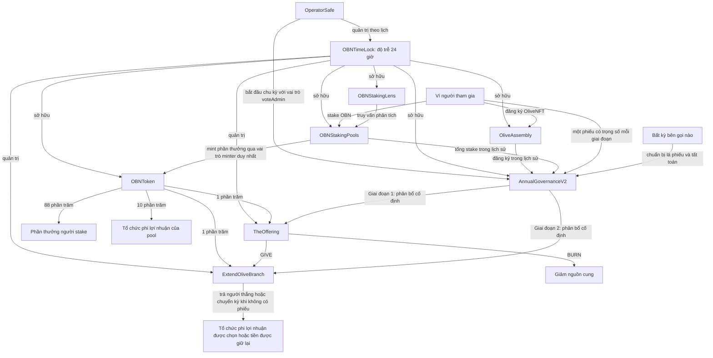

# Cho đi không hy sinh: Lời giải ở cấp giao thức cho sự suy giảm của việc tham gia từ thiện đại chúng

[English](THESIS.md) · **Tiếng Việt** · [한국어](THESIS.ko.md) · [日本語](THESIS.ja.md) · [简体中文](THESIS.zh-CN.md) · [हिन्दी](THESIS.hi.md) · [العربية](THESIS.ar.md) · [Русский](THESIS.ru.md) · [Deutsch](THESIS.de.md) · [Português](THESIS.pt.md) · [Español](THESIS.es.md) · [Bahasa Indonesia](THESIS.id.md)

> Bản dịch này chỉ nhằm mục đích tiện tham khảo. Bản tiếng Anh ([THESIS.md](THESIS.md)) là bản có giá trị chính thức; nếu có khác biệt, bản tiếng Anh được ưu tiên áp dụng. Bản dịch được thực hiện với sự hỗ trợ của AI từ phiên bản `3c740d855` và chưa được dịch giả chuyên nghiệp rà soát. Tên hợp đồng, tên hàm và địa chỉ được giữ nguyên bằng tiếng Anh.

**Luận văn của Olive Branch Network**

*Olive Branch Network — Base Mainnet*

*Tháng 7 năm 2026 — bản sửa đổi về quản trị ngày 14 tháng 10 năm 2026*

---

## Tóm tắt

Hoạt động từ thiện tại Hoa Kỳ cho thấy một nghịch lý: tổng số tiền quyên góp đạt mức cao kỷ lục gần như mỗi năm, trong khi số người cho đi lại giảm dần suốt một phần tư thế kỷ. Tỷ lệ hộ gia đình Mỹ có bất kỳ khoản đóng góp từ thiện nào đã giảm từ 66.2% năm 2000 xuống 49.6% năm 2018, và số lượng nhà tài trợ đã giảm mỗi năm kể từ 2021 dù tổng doanh thu vẫn tăng. Hoạt động thiện nguyện đang tập trung vào một nhóm nhà tài trợ nhỏ hơn và giàu có hơn, làm xói mòn sự tham gia đại chúng vốn là nền tảng cho tính chính danh công dân của khu vực phi lợi nhuận.

Luận văn này lập luận rằng gốc rễ của sự sụt giảm tham gia mang tính cấu trúc chứ không phải đạo đức: dưới mọi hình thức tiền tệ trong lịch sử — hàng hóa, pháp định và kỹ thuật số thời kỳ đầu — việc cho đi đều mang tính *hy sinh*. Một khoản quyên góp chuyển vĩnh viễn vốn gốc từ người cho sang người nhận, nên ngưỡng tham gia là phần thặng dư có thể chi dùng — một rào cản mà ngày càng nhiều hộ gia đình không còn vượt qua được khi thu nhập thực tăng thêm tập trung ở nhóm trên cùng của phân phối. Lần đầu tiên trong lịch sử tiền tệ, tiền có thể lập trình loại bỏ ràng buộc này. Vì hợp đồng thông minh có thể tách *quyền sở hữu tài sản* khỏi *quyền định hướng lợi suất mà tài sản đó tạo ra*, nên có thể thiết kế **cho đi không hy sinh**: người cho vĩnh viễn giữ lại vốn gốc của mình trong khi liên tục chuyển một phần năng suất của nó, theo sự thực thi của giao thức, đến lợi ích công có thể được xác minh độc lập.

Giao thức Olive Branch Network (OBN) được trình bày như một bản triển khai tham chiếu của thiết kế này. Luận văn (i) đặt OBN trong lịch sử lâu dài của công nghệ tiền tệ; (ii) ghi nhận, bằng dữ liệu thực nghiệm có trích dẫn, sự suy giảm tham gia từ thiện vốn là động lực của nó; (iii) hình thức hóa vòng phản hồi tham gia–khóa của giao thức, trong đó mỗi người tham gia bổ sung chuyển token OBN ra khỏi lượng lưu hành tự do vào ký quỹ hợp đồng phi lưu ký, làm thu hẹp nguồn cung hiệu dụng khi mức độ chấp nhận tăng lên; và (iv) cung cấp mô tả kỹ thuật đầy đủ về từng hợp đồng thông minh cốt lõi — `OBNToken`, `OBNStakingPools`, `TheOffering`, `ExtendOliveBranch`, `AnnualGovernanceV2`, `OliveAssembly`, `OBNTimeLock`, `TeamVesting`, `OliveNFT` và `OBNStakingLens` — bao gồm bố cục lưu trữ, các bất biến, cấu trúc kiểm soát truy cập và cơ chế an toàn khi nâng cấp, như đã triển khai trên Base mainnet.

---

## Mục lục

1. [Giới thiệu](#chương-1--giới-thiệu)
2. [Lịch sử tiền tệ: Từ hàng hóa đến khả năng lập trình](#chương-2--lịch-sử-tiền-tệ-từ-hàng-hóa-đến-khả-năng-lập-trình)
3. [Sự suy giảm thực nghiệm của việc tham gia từ thiện](#chương-3--sự-suy-giảm-thực-nghiệm-của-việc-tham-gia-từ-thiện)
4. [Cơ chế tham gia–khóa: Kinh tế dòng token của OBN](#chương-4--cơ-chế-tham-giakhóa-kinh-tế-dòng-token-của-obn)
5. [Các hợp đồng cốt lõi: Mô tả kỹ thuật đầy đủ](#chương-5--các-hợp-đồng-cốt-lõi-mô-tả-kỹ-thuật-đầy-đủ)
6. [Kiến trúc bảo mật và thiết kế thể chế](#chương-6--kiến-trúc-bảo-mật-và-thiết-kế-thể-chế)
7. [Hạn chế, các mối đe dọa đối với tính hợp lệ và công việc tương lai](#chương-7--hạn-chế-các-mối-đe-dọa-đối-với-tính-hợp-lệ-và-công-việc-tương-lai)
8. [Kết luận](#chương-8--kết-luận)
9. [Tài liệu tham khảo](#tài-liệu-tham-khảo)

---

## Chương 1 — Giới thiệu

### 1.1 Phát biểu vấn đề

Hai xu hướng dài hạn định hình công trình này. Thứ nhất, *bề rộng* của hoạt động từ thiện đang sụp đổ: tỷ lệ hộ gia đình Hoa Kỳ có bất kỳ khoản quyên góp nào đã giảm gần mười bảy điểm phần trăm trong giai đoạn 2000 đến 2018 (Indiana University Lilly Family School of Philanthropy, 2021), và dữ liệu sau 2020 cho thấy sự suy giảm đang tăng tốc thay vì ổn định (Fundraising Effectiveness Project, 2025). Thứ hai, *chiều sâu* của hoạt động từ thiện đang tập trung lại: tổng số tiền đạt mức cao kỷ lục — $592.50 tỷ năm 2024 (Giving USA, 2025) — vì các khoản tặng lớn hơn từ những nhà tài trợ ít hơn, giàu có hơn thay thế cho hàng triệu nhà tài trợ nhỏ đã rời đi.

Các lời giải thích tiêu chuẩn — tín ngưỡng tôn giáo suy giảm, tiền lương trì trệ, sự thiếu tin tưởng thế hệ vào các thể chế — mô tả hiện tượng nhưng không giải quyết được nó, vì tất cả đều quy về cùng một ràng buộc cấu trúc: **việc cho đi, như đã được hình thành trong lịch sử, là sự chuyển nhượng vĩnh viễn vốn gốc.** Một hộ gia đình chỉ tham gia từ thiện khi vượt qua ngưỡng "Tôi có đủ thặng dư để chấp nhận mất khoản này." Khi thặng dư khả dụng thực tế tập trung ở nhóm thu nhập cao nhất, sự tham gia cũng tập trung theo.

### 1.2 Luận đề

Luận văn này bảo vệ ba tuyên bố:

1. **Tuyên bố lịch sử.** Mọi công nghệ tiền tệ trước đây — từ electrum xứ Lydia đến các khoản nợ của Cục Dự trữ Liên bang và các đồng tiền mã hóa thế hệ đầu được dùng chỉ như công cụ vô danh — đều khiến việc chuyển nhượng vốn gốc trở thành nguyên thủy *duy nhất* có sẵn để cho đi. Tiền có thể lập trình là hình thái tiền tệ đầu tiên trong đó *quyền sở hữu* và *quyền định hướng lợi suất* có thể tách rời ngay ở cấp độ của chính đồng tiền, thay vì thông qua các trung gian đáng tin cậy (quỹ hiến tặng, quỹ tín thác, quỹ do nhà tài trợ tư vấn) chủ yếu chỉ người giàu mới tiếp cận được.

2. **Tuyên bố thực nghiệm.** Sự tham gia từ thiện đại chúng đang suy giảm dài hạn, và sự suy giảm tập trung chính xác vào nhóm nhà tài trợ nhỏ, những người chịu tác động mạnh nhất của ngưỡng hy sinh. Tuyên bố này được hỗ trợ bởi dữ liệu bảng được thu thập có hệ thống (Philanthropy Panel Study), dữ liệu giao dịch toàn ngành (Fundraising Effectiveness Project) và các ước tính vĩ mô (Giving USA), được xem xét trong Chương 3.

3. **Tuyên bố cơ chế.** Một giao thức (a) cho phép người tham gia stake token mà không từ bỏ nó, (b) chuyển một phần cố định của phát thải giao thức đến các tổ chức phi lợi nhuận đã được xác minh, và (c) khóa vốn gốc đã stake trong ký quỹ phi lưu ký, sẽ tạo ra phản hồi tham gia–nguồn cung: mỗi người tham gia biên loại bỏ token khỏi lượng lưu hành tự do, nên — khi giữ nguyên nhu cầu và chính sách phát thải — sự tham gia rộng hơn sẽ thắt chặt nguồn cung hiệu dụng một cách cơ học. Chương 4 hình thức hóa điều này và trung thực nêu các giả định, bao gồm cả lực đối trọng từ phát thải phần thưởng.

### 1.3 Đóng góp của công trình

- Một tổng hợp lịch sử tiền tệ xoay quanh một trục duy nhất: *chính đồng tiền có thể thực thi điều gì* (Chương 2).
- Một hồ sơ thực nghiệm được hợp nhất và có trích dẫn về sự suy giảm tham gia từ thiện tại Hoa Kỳ, 2000–2025 (Chương 3).
- Một mô hình dòng token chính thức của nền kinh tế staking OBN, bao gồm đồng nhất thức lượng lưu hành tự do, điều kiện cân bằng phát thải/khóa và cơ chế hấp thụ đốt do quản trị kiểm soát (Chương 4).
- Đặc tả bằng văn bản hoàn chỉnh đầu tiên của bộ hợp đồng cốt lõi OBN như đã triển khai trên Base và được xác thực trong môi trường kiểm thử mainnet-fork, bao gồm mọi biến trạng thái, hàm, sự kiện, bất biến và lộ trình nâng cấp (Chương 5), cùng với kiến trúc bảo mật và thể chế của nó (Chương 6).

### 1.4 Giao thức trong một đoạn văn

Olive Branch Network là một token ERC-20 (`OBN`) trên Base với hệ thống staking gồm các pool theo từng tổ chức phi lợi nhuận. Người tham gia nạp OBN vào pool của tổ chức phi lợi nhuận mà họ muốn hỗ trợ. Khoản nạp không bao giờ bị chi tiêu, chuyển cho tổ chức phi lợi nhuận hoặc có nguy cơ mất vào giao thức; nó có thể được rút bất cứ lúc nào (trừ các vị thế bootstrap bị khóa rõ ràng). Trong khi được stake, giao thức mint phát thải theo thời gian dựa trên khoản stake và chia mỗi phần thưởng đã thực hiện thành bốn phần khi nhận thưởng: **88% cho người stake, 10% cho tổ chức phi lợi nhuận của pool, 1% cho kho chung (`TheOffering`) và 1% cho kho phân phối (`ExtendOliveBranch`).** Số phận của khoản phân bổ trong kho chung được ghi nhận khi chu kỳ bắt đầu — đốt hay tặng — được quyết định hằng năm bằng một cuộc bỏ phiếu hai giai đoạn của các ví có OliveNFT đã đăng ký, với trọng số là căn bậc hai của lượng stake tại snapshot (`AnnualGovernance`), trong đó giai đoạn thứ hai hướng khoản phân bổ cố định theo chu kỳ của kho phân phối đến một tổ chức phi lợi nhuận do cộng đồng chọn. Thiết kế này hiện thực hóa Điều I của Hiến chương: *"làm cho một người có thể giữ quyền sở hữu tài sản của mình trong khi liên tục hướng một phần giá trị mà các tài sản đó tạo ra đến lợi ích công có trách nhiệm giải trình độc lập"* (Hiến chương OBN, Điều I).

---

## Chương 2 — Lịch sử tiền tệ: Từ hàng hóa đến khả năng lập trình

Mục đích của chương này không phải là hoài cổ. Mỗi giai đoạn trong lịch sử tiền tệ được đọc dưới góc nhìn của một câu hỏi: *chính đồng tiền có thể thực thi điều gì, và điều gì phải được ủy thác cho các thể chế đáng tin cậy?* Câu trả lời quyết định những hình thức cho đi nào khả thi ở mỗi giai đoạn.

### 2.1 Trước khi có tiền đúc: quà tặng, nợ và huyền thoại về hàng đổi hàng

Lý thuyết dân gian về nguồn gốc tiền tệ — hàng đổi hàng bất tiện tự phát nhường chỗ cho một phương tiện trao đổi — bắt nguồn từ Adam Smith (1776) và được hình thức hóa bởi Menger (1892), người mô hình hóa tiền như sự hội tụ tự phát vào loại hàng hóa *dễ bán* nhất, và Jevons (1875), người đặt tên cho những ma sát mà nó giải quyết là "sự trùng hợp kép về nhu cầu." Các mô hình lý thuyết tìm kiếm hiện đại (Kiyotaki & Wright, 1989) giữ nguyên logic này, và Kocherlakota (1998) đúc kết hàm ý sâu sắc nhất của nó: về mặt công nghệ, tiền tương đương với một *ký ức* xã hội về việc ai đã đóng góp điều gì — "tiền là ký ức."

Tuy nhiên, các ghi chép nhân học không ủng hộ các nền kinh tế hàng đổi hàng thuần túy như tiền thân của tiền tệ. Humphrey (1985) kết luận rằng "chưa từng có một ví dụ nào về nền kinh tế hàng đổi hàng thuần túy được mô tả, càng không có sự xuất hiện của tiền tệ từ đó." Graeber (2011) tập hợp các bằng chứng dân tộc học và Lưỡng Hà cho thấy *tín dụng và nghĩa vụ có trước tiền đúc hàng thiên niên kỷ*: việc ghi sổ của đền thờ và cung điện ở Sumer (khoảng 3000 TCN) đã định danh nợ bằng bạc và lúa mạch rất lâu trước khi có ai đó lưu hành bạc như tiền mặt. Lý thuyết tín dụng về tiền tệ (Mitchell-Innes, 1913) và lý thuyết nhà nước (Knapp, 1905/1924) — tiền như nợ có thể chuyển nhượng, và tiền như thứ nhà nước chấp nhận để thanh toán thuế — nắm bắt tầng lớp cổ xưa hơn này.

Hai nhận xét quan trọng đối với những gì tiếp theo. Thứ nhất, "tiền" sớm nhất đã là một *công nghệ kế toán* — một sổ cái — và các token vật lý của nó chỉ là thứ yếu. Thứ hai, trong các nền kinh tế quà tặng và nghĩa vụ, việc cho đi cấu thành tư cách thành viên xã hội chứ không phải là hành động tùy ý xử lý phần thặng dư (Mauss, 1925). Việc thu hẹp sự cho đi thành chuyển giao thặng dư tự nguyện là sản phẩm của các hình thức tiền tệ về sau, không phải một hằng số của con người.

### 2.2 Tiền đúc: tiền như công cụ vô danh của chủ quyền (khoảng 640 TCN – 1000 CN)

Tiền đúc tiêu chuẩn xuất hiện ở Lydia vào thế kỷ thứ bảy TCN — những mảnh electrum được nhà nước đóng dấu — và lan truyền với tốc độ đáng kinh ngạc qua các thành bang Hy Lạp, Ba Tư, Ấn Độ (*karshapana* đục lỗ) và Trung Quốc thời Chiến Quốc (Davies, 2002; Schaps, 2004). Sáng kiến của đồng xu là *xác minh chỉ bằng một cái nhìn*: con dấu của chủ quyền xóa bỏ vấn đề kiểm định, khiến giá trị có thể chuyển giao giữa những người xa lạ mà không cần tin cậy hay ghi chép.

Nhưng hãy lưu ý công nghệ này thực thi được gì và không thể làm gì. Đồng xu thực thi *tính chung cuộc của người nắm giữ*: ai giữ nó thì sở hữu nó, một cách tuyệt đối. Nó không thể mã hóa điều kiện, dòng chảy, phần chia hay sự hoàn trả. Do đó, nguyên thủy cho đi duy nhất mà tiền đúc hỗ trợ là chuyển giao trực tiếp đồng xu — sự hy sinh vốn gốc thuần túy. Bất cứ điều gì phức tạp hơn (các quỹ hiến tặng của đền thờ, *alimenta* của La Mã, *waqf* của Hồi giáo, chantry thời trung cổ) đều đòi hỏi bọc tiền trong một *thể chế pháp lý* do những con người đáng tin cậy quản lý. Việc cho đi theo định hướng lợi suất đã tồn tại — waqf chính xác là một tài sản mà thu nhập của nó được hướng vĩnh viễn đến lợi ích công trong khi phần gốc không thể chuyển nhượng (Kuran, 2001) — nhưng chỉ dành cho những người đủ giàu để thiết lập một thể chế xung quanh tài sản của mình.

### 2.3 Tiền giấy, ngân hàng và kiến trúc thượng tầng tín dụng (1000–1971)

Trung Quốc thời nhà Tống đã phát hành tiền giấy nhà nước đầu tiên (*jiaozi*, chính thức hóa năm 1024 CN), khám phá cả việc phát hành tiền giấy có thể chuyển đổi lẫn, trong vòng hai thế kỷ, tình trạng phát hành quá mức gây lạm phát (Von Glahn, 1996). Ở châu Âu, trình tự này đi qua hối phiếu, biên nhận của thợ kim hoàn, Ngân hàng Anh (1694) và chế độ bản vị vàng thế kỷ XIX — một trật tự tiền tệ trong đó cung tiền được kỷ luật bởi khả năng chuyển đổi nhưng phương tiện lưu thông thực tế phần lớn là *tín dụng* ngân hàng (Ferguson, 2008; Eichengreen, 1996). Hệ thống Bretton Woods (1944) giữ một mỏ neo vàng ở cách một bước; việc Hoa Kỳ đình chỉ nó vào ngày 15 tháng 8 năm 1971 ("cú sốc Nixon") đã hoàn tất quá trình chuyển sang tiền pháp định thuần túy: tiền như một khoản nợ không được bảo chứng của nhà nước, có giá trị nhờ sắc lệnh, sự chấp nhận thanh toán thuế và kỳ vọng của mạng lưới — thuyết hiến định tiền tệ (chartalism) của Knapp được hiện thực hóa trọn vẹn (Eichengreen, 1996).

Đối với việc cho đi, kỷ nguyên ngân hàng pháp định đã thay đổi quy mô nhưng không thay đổi cấu trúc. Các chế độ khấu trừ từ thiện (tại Hoa Kỳ, từ năm 1917) trợ cấp cho sự hy sinh; quỹ từ thiện, quỹ tín thác còn lại từ thiện và quỹ do nhà tài trợ tư vấn đã công nghiệp hóa mô hình waqf — *quyền sở hữu được giữ lại hoặc che chắn, lợi suất được định hướng* — nhưng mỗi hình thức đều đòi hỏi thành lập pháp lý, mức tối thiểu và cố vấn. Sự bất đối xứng cấu trúc vẫn tồn tại: **người giàu cho đi từ lợi suất; những người còn lại cho đi từ vốn gốc.** Chương 3 ghi nhận kết quả có thể dự đoán được.

### 2.4 Thanh toán kỹ thuật số và tiền pháp định điện tử (1971–2008)

Từ cú sốc Nixon đến năm 2008, tiền đã phi vật chất hóa về mặt vận hành — Fedwire, SWIFT (1973), mạng lưới thẻ và thanh toán internet biến phần lớn tiền thành các mục trong cơ sở dữ liệu ngân hàng — mà không thay đổi logic của nó. Tiền pháp định điện tử vẫn là một giấy nợ với các quy tắc do các trung gian được quản lý thực thi. Chaum (1983) cho thấy mật mã có thể tạo ra tiền mặt vô danh kỹ thuật số, nhưng DigiCash của ông tập trung việc phát hành và thất bại về thương mại; "b-money" của Dai (1998) và "bit gold" của Szabo (hình thành vào cuối những năm 1990, công bố năm 2005) đã phác thảo việc phát hành phi tập trung mà chưa giải quyết được chi tiêu kép.

### 2.5 Bitcoin: khan hiếm không cần chủ quyền (2008)

Nakamoto (2008) đã giải quyết vấn đề chi tiêu kép mà không cần bên thứ ba đáng tin cậy bằng cách kết hợp đồng thuận proof-of-work trên một sổ cái công khai với lịch trình phát hành cố định. Đóng góp của Bitcoin cho lịch sử tiền tệ rất rõ ràng: **sự khan hiếm kỹ thuật số và thanh toán chung cuộc được thực thi bởi giao thức thay vì bởi thể chế.** Lần đầu tiên, *các quy tắc của tiền* — trước hết là đường cung của nó — trở thành thuộc tính của chính đồng tiền.

Tuy nhiên, script của Bitcoin cố ý hạn chế khả năng biểu đạt. Về mặt tiền tệ, nó vẫn gần với đồng xu: một công cụ vô danh với nguồn cung cứng. Việc cho đi bằng Bitcoin vẫn là sự chuyển nhượng vốn gốc.

### 2.6 Ethereum và tiền có thể lập trình (2015– )

Buterin (2014) đã tổng quát hóa blockchain thành một máy trạng thái Turing-complete. Với Ethereum — và các chuỗi EVM như Base, nơi OBN được triển khai — tiền trở nên *có thể lập trình*: logic tùy ý được thực thi với cùng tính chung cuộc như chính khoản thanh toán. Tiêu chuẩn ERC-20 (Vogelsteller & Buterin, 2015) biến giá trị được token hóa thành một nguyên thủy có thể kết hợp; ERC-4626, các hệ thống staking và quản trị on-chain (ví dụ: mô hình Governor của Compound) đã chứng minh rằng **lưu ký, lợi suất, biểu quyết và giải ngân đều có thể là thuộc tính của giao thức.**

Đây là bản lề của lập luận lịch sử. Mô hình waqf/quỹ hiến tặng — phần gốc không thể chuyển nhượng, quyền hưởng lợi được hướng đến lợi ích công — đã cần một thể chế đáng tin cậy suốt một nghìn năm và do đó là công cụ của người giàu. Một hợp đồng thông minh hiện thực hóa cùng mô hình này cho bất kỳ người nắm giữ nào ở mọi quy mô, với:

- **ký quỹ phi lưu ký** ("phần gốc của quỹ hiến tặng" được giữ bởi mã bất biến, không phải bởi người được ủy thác);
- **chỉ định liên tục, có thể thu hồi** (người tham gia có thể chuyển hướng hoặc rút bất cứ lúc nào — tính tách biệt theo Điều III của Hiến chương);
- **tỷ lệ chia do giao thức thực thi** (phép chia 88/10/1/1 trong OBN là số học trong `_mintSlices`, không phải sự tùy ý của người được ủy thác);
- **ghi nhận có thể xác minh** (mọi đóng góp đều là một sự kiện on-chain, đáp ứng Điều VI của Hiến chương).

Theo cách đọc này, lịch sử tiền tệ là lịch sử của việc dần nội hóa vào chính đồng tiền các chức năng từng được ủy thác cho các thể chế: xác minh (tiền đúc), ghi chép (ngân hàng), khan hiếm (Bitcoin) và cuối cùng là *cấu trúc ủy thác* (tiền có thể lập trình). OBN là một ứng dụng của giai đoạn cuối cùng này vào chức năng tiền tệ lâu đời nhất — món quà.

---

## Chương 3 — Sự suy giảm thực nghiệm của việc tham gia từ thiện

Chương này thiết lập tiền đề thứ hai bằng dữ liệu đã công bố: **số người cho đi đang giảm, một cách dai dẳng và trên mọi nguồn dữ liệu chính, ngay cả khi tổng số tiền tăng lên.**

### 3.1 Sự suy giảm tham gia dài hạn (Philanthropy Panel Study, 2000–2018)

Bằng chứng theo chiều dọc chặt chẽ nhất đến từ *Philanthropy Panel Study* của Indiana University Lilly Family School of Philanthropy, một bảng mang tính đại diện toàn quốc gồm hơn 9,000 hộ gia đình Hoa Kỳ có hoạt động cho đi được theo dõi hai năm một lần.

- Năm **2000, 66.2% hộ gia đình Hoa Kỳ** có đóng góp từ thiện.
- Đến **2018, chỉ còn 49.6%** — lần đầu tiên trong hồ sơ, dưới một nửa số hộ gia đình Mỹ cho đi, giảm gần 17 điểm phần trăm (Lilly Family School of Philanthropy, 2021).
- Việc cho đi cho tôn giáo giảm từ **46% hộ gia đình (2000–2004) xuống 29% (2018)**; việc cho đi thế tục giảm từ mức ổn định 55–57% (2000–2008) xuống **42% năm 2018** (Lilly Family School of Philanthropy, 2021).
- Phân tích tiếp theo cho thấy sự suy giảm **tăng tốc trong năm đầu tiên của đại dịch COVID-19** (Lilly Family School of Philanthropy, *The Giving Environment*, 2022; NonProfit PRO, 2022), và sự tham gia giảm ở mọi nhóm chủng tộc và dân tộc (The NonProfit Times, 2023).

Báo cáo *Giving Environment* của trường quy một phần sự suy giảm cho thu nhập giảm và trì trệ ở các hộ gia đình thu nhập trung bình và thấp, cũng như sự thay đổi chuẩn mực về tôn giáo (Lilly Family School of Philanthropy, 2022) — cả hai đều là biểu hiện của ngưỡng hy sinh: các hộ gia đình cho đi khi họ có thể chấp nhận mất số tiền đó, và ngày càng ít người làm được.

### 3.2 Số nhà tài trợ tiếp tục giảm sau 2018 (Fundraising Effectiveness Project, 2021–2025)

Fundraising Effectiveness Project (FEP), dự án tổng hợp dữ liệu giao dịch quà tặng thực tế trên hàng nghìn tổ chức phi lợi nhuận, mở rộng hồ sơ vượt ra ngoài các nghiên cứu bảng và cho thấy sự suy giảm vẫn đang tiếp diễn:

- Số nhà tài trợ đã giảm **mỗi năm kể từ 2021** (AFP/FEP, 2026).
- Từ 2023 đến 2024, số nhà tài trợ giảm **4.5% so với cùng kỳ năm trước**, với sự suy giảm *tăng tốc* so với các năm trước (báo cáo FEP Q4 2024; GlobeNewswire, 2025).
- Năm **2025, số nhà tài trợ giảm thêm khoảng 3.6%**, dù tổng số tiền từ thiện tăng 5.0% — mức tăng doanh thu mạnh nhất trong năm năm, đạt được với ít người cho đi hơn (AFP/FEP, 2026).
- Sự hao hụt tập trung ở nhóm nhỏ: những nhà tài trợ cho **$1–$100 — chiếm hơn một nửa tổng số nhà tài trợ — giảm 8.8% năm 2024 và 11.1% so với cùng kỳ năm trước trong Q1 2025** (FEP; NonProfit PRO, 2025).
- Tỷ lệ giữ chân nhà tài trợ nói chung dao động quanh **43%**, và tỷ lệ giữ chân nhà tài trợ mới thấp hơn nhiều, nghĩa là hầu hết những người cho lần đầu không bao giờ cho lại (FEP, 2025–2026).

Chính cách trình bày của FEP phản ánh đúng luận điểm về sự tập trung: mức tăng doanh thu "tập trung ở các khoản tặng lớn hơn," cùng với "sự suy giảm liên tục về tổng số nhà tài trợ" (AFP, 2025).

### 3.3 Tiền tăng, nhà tài trợ giảm (Giving USA, 2024–2025)

Giving USA, ước tính vĩ mô lâu đời nhất về hoạt động từ thiện của Hoa Kỳ, hoàn thiện nghịch lý này:

- Tổng số tiền cho đi đạt **$592.50 tỷ năm 2024**, mức kỷ lục tính theo đô la hiện hành, tăng 6.3% danh nghĩa và 3.3% sau điều chỉnh lạm phát (Giving USA 2025).
- Tổng số tiền cho đi lại tăng lên mức ước tính **$617.2 tỷ năm 2025** (Giving USA 2026; Give.org, 2026).
- Nhưng **tỷ trọng cho đi của cá nhân trong tổng số giảm từ khoảng 80% vào 1986–1990 xuống 66% năm 2024 và 64% năm 2025**, khi các quỹ, di tặng và doanh nghiệp — những phương tiện của của cải tích lũy — bù vào khoảng trống (Giving USA 2026; Give.org, 2026; Stelter, 2026).

### 3.4 Tổng hợp: ngưỡng hy sinh

Trên ba phương pháp độc lập — bảng hộ gia đình (PPS), tổng hợp giao dịch (FEP) và ước tính vĩ mô (Giving USA) — cùng một bức tranh hiện ra:

| Chỉ số | Trước đây | Hiện nay | Xu hướng |
|---|---|---|---|
| Hộ gia đình có cho đi (PPS) | 66.2% (2000) | 49.6% (2018) | ↓ 16.6 điểm |
| Hộ gia đình cho đi cho tôn giáo (PPS) | 46% (2000–04) | 29% (2018) | ↓ 17 điểm |
| Số nhà tài trợ, so với năm trước (FEP) | — | −4.5% (2024), −3.6% (2025) | ↓ đang tăng tốc |
| Nhà tài trợ nhỏ $1–$100 (FEP) | 50–57% tổng số nhà tài trợ | −8.8% đến −11.1% so với năm trước | ↓ nhóm giảm mạnh nhất |
| Tỷ trọng của cá nhân trong tổng số cho đi (Giving USA) | ~80% (1986–90) | 64% (2025) | ↓ 16 điểm |
| Tổng số tiền (Giving USA) | — | $592.5B (2024), $617.2B (2025) | ↑ cao kỷ lục |

Khu vực này đang được tái cấp vốn từ phía trên trong khi nền tảng tham gia của nó bị xói mòn. Đây chính xác là điều người ta dự đoán nếu việc cho đi đòi hỏi thặng dư và thặng dư đã tập trung lại. Vấn đề *tài trợ* của khu vực phi lợi nhuận đang được người giàu giải quyết; vấn đề *tham gia* của nó — chức năng công dân, dân chủ và tạo tính chính danh của hàng triệu khoản tặng nhỏ — hoàn toàn chưa được giải quyết, vì chưa có công cụ nào cho phép một hộ gia đình không giàu có cho đi liên tục mà không bị mất mát.

Chương 4 mô tả một công cụ như vậy.

---

## Chương 4 — Cơ chế tham gia–khóa: Kinh tế dòng token của OBN

Chương này hình thức hóa lõi kinh tế của giao thức: **sự tham gia khóa nguồn cung.** Mọi tuyên bố đều dựa trên mã hợp đồng cụ thể được mô tả đầy đủ trong Chương 5; ở đây chúng ta xem hệ thống như một cỗ máy dòng token.

### 4.1 Phân bổ genesis và dự trữ hiện tại

Bảng sau ghi lại đợt mint genesis trong lịch sử, không phải dự trữ chưa sử dụng hiện tại. `OBNToken.initialize` đã mint toàn bộ nguồn cung ban đầu đúng một lần, theo tỷ lệ cố định (OBNToken.sol):

| Phân bổ | Tỷ trọng | Mục đích |
|---|---|---|
| Thanh khoản | 40% | Thanh khoản DEX để có thể mua được token |
| Airdrop | 30% | Gieo mầm phân phối ban đầu rộng rãi |
| Quỹ từ thiện | 10% | Bootstrap các vị thế pool phi lợi nhuận (khóa vĩnh viễn — §4.4) |
| Ngân quỹ | 10% | Vận hành giao thức (khoản phân bổ genesis một lần; không có dòng phát thải nào chảy vào đây) |
| Vesting đội ngũ | 10% | Khóa theo thời gian trong `TeamVesting` (cliff 4 tháng, tuyến tính 20 tháng) |

Không thể mint thêm ngoại trừ bởi minter duy nhất được đặt một lần — hợp đồng staking — nên *toàn bộ* sự tăng trưởng nguồn cung sau genesis đều là phát thải staking.

Quỹ dự trữ hạt giống phi lợi nhuận có tổng phân bổ là **300M OBN**, với **50M OBN** được giữ riêng cho nhu cầu của giao thức. Các khoản nắm giữ của ngân quỹ và airdrop đã được hợp nhất vào khoản phân bổ hạt giống. Tại thời điểm đó, 11M OBN đã tài trợ cho 11 hạt giống phi lợi nhuận, còn lại 289M OBN cho 289 hạt giống bổ sung với mức 1M OBN mỗi hạt giống.

Đây là việc tái phân bổ các khoản nắm giữ hiện có, không phải một đợt mint mới hay thay đổi đối với initializer đã triển khai.

### 4.2 Đồng nhất thức lượng lưu hành tự do

Định nghĩa tại thời điểm *t*:

- **S(t)** — tổng nguồn cung: nguồn cung genesis cộng phát thải tích lũy trừ lượng đốt tích lũy.
- **K(t)** — token do hợp đồng staking nắm giữ: tổng tất cả số dư `userAmount` (chỉ vốn gốc; phần thưởng được mint trực tiếp cho người nhận, không bao giờ được gộp).
- **V(t)** — token vẫn đang bị khóa trong `TeamVesting`.
- **G(t)** — token tích lũy trong hai kho quản trị (`TheOffering` và `ExtendOliveBranch`) chờ chu kỳ hằng năm.
- **B(t)** — tổng token đã đốt tích lũy (qua `TheOffering.burn` và bất kỳ `ERC20Burnable.burn` tự nguyện nào).

Khi đó, **lượng lưu hành tự do** — nguồn cung thực sự có thể giao dịch — là:

> **F(t) = S(t) − K(t) − V(t) − G(t)**   với   **S(t) = S₀ + E(t) − B(t)**

trong đó E(t) là tổng phát thải gộp tích lũy. Tuyên bố cơ chế là một phát biểu về ∂F/∂(sự tham gia): **mỗi khoản nạp chuyển token từ F sang K theo tỷ lệ một đổi một** (`_depositCore` thực thi `safeTransferFrom(msg.sender, address(this), amount)`), và token ở lại trong K cho đến khi chính người tham gia đó chọn rút. Giao thức không bao giờ cho vay, tái thế chấp hay chi tiêu K; không có slashing và không có quyền yêu cầu của giao thức đối với vốn gốc. K là ký quỹ trơ.

### 4.3 Chính sách phát thải: giảm dần và tỷ lệ với sự tham gia

Phát thải *không phải* là một vòi cố định. `_sumRewardAcrossPhases` tích lũy phần thưởng theo từng pool là `poolStake × bps × Δt / (10000 × 365 days)` — tức là một **tỷ lệ phần trăm năm hóa của lượng thực sự được stake**, theo lịch trình giảm dần:

| Số năm kể từ khi triển khai | Tỷ lệ phát thải hằng năm (trên số dư đã stake) |
|---|---|
| 0–2 | 10.00% |
| 2–4 | 7.50% |
| 4–6 | 5.00% |
| 6–8 | 2.50% |
| 8–10 | 1.25% |
| 10+ | 3.00% dự phòng (`FALLBACK_EMISSION_BPS`), cho đến khi quản trị sửa đổi qua `addPhase` |

Hai hệ quả theo sau. Thứ nhất, **phát thải tỷ lệ với K, không phải với S**: token không được stake không tạo ra gì. Thứ hai, vì phần thưởng chỉ được mint tại *các sự kiện nhận thưởng* (nạp, rút, nhận thưởng), phần thưởng chưa nhận chỉ là một bút toán kế toán (`accRewardPerShare × balance − rewardDebt`) — chúng không tồn tại dưới dạng token cho đến khi được thực hiện.

### 4.4 Tỷ lệ chia bốn phần và các cơ chế hấp thụ

Tại mỗi lần thực hiện, `_mintSlices` chia phần thưởng gộp đang chờ:

- **88% → người stake.** Lợi suất của người tham gia. Mới được mint, đi vào F (hoặc được stake lại).
- **10% → ví phi lợi nhuận của pool.** Món quà. Liên tục, do giao thức thực thi, tỷ lệ với khoản stake và thời gian của người tham gia. Đây là *Đóng góp* theo Điều VII của Hiến chương, và nó không làm người stake mất vốn gốc — chỉ là một phần lợi suất vốn sẽ không tồn tại nếu không có giao thức.
- **1% → `TheOffering`** (kho chung). Tích lũy suốt năm; mỗi chu kỳ quản trị hằng năm bỏ phiếu để **đốt** khoản phân bổ được ghi nhận khi chu kỳ bắt đầu (cơ chế hấp thụ giảm phát, giảm S) hoặc **tặng** (chuyển đến `ExtendOliveBranch`).
- **1% → `ExtendOliveBranch`** (kho phân phối). Tích lũy suốt năm; phiếu Giai đoạn 2 của mỗi chu kỳ quản trị hằng năm hướng khoản phân bổ cố định của chu kỳ đó đến một tổ chức phi lợi nhuận trong danh sách trắng do cộng đồng chọn (hoặc chuyển sang kỳ sau nếu không ai bỏ phiếu).

Lưu ý rằng **không có dòng phát thải nào chảy vào ngân quỹ**: cả hai phần còn lại đều cấp cho các kho do quản trị kiểm soát. Cho đến khi được xử lý hằng năm, cả hai dòng đều nằm trong ký quỹ của kho (G ở §4.2) — bên ngoài lượng lưu hành có thể giao dịch.

Ngoài ra, khoản phân bổ genesis 10% của quỹ từ thiện được triển khai thông qua `charityFundBootstrap`/`depositForWithLock`, stake token *thay mặt cho chính ví của mỗi tổ chức phi lợi nhuận* với `lockedAmount` được đặt bằng khoản nạp — một **khóa vĩnh viễn** (khóa chỉ có thể tăng, không bao giờ giảm). Do đó, các vị thế bootstrap đóng góp vào K mãi mãi, đảm bảo mỗi pool có dòng phần thưởng cơ sở cho tổ chức phi lợi nhuận của mình và không bao giờ có thể bị bán tháo.

### 4.5 Vòng phản hồi tham gia–khóa

Ghép các phần lại với nhau. Gọi *n* là số người tham gia đang hoạt động và *k̄* là lượng stake trung bình. Khi đó K = n·k̄ (cộng các khóa bootstrap), và:

1. **Sự chấp nhận thắt chặt lượng lưu hành.** Mỗi người tham gia mới chuyển token lưu hành thành vốn gốc được ký quỹ: ΔF = −Δstake. Khi nhu cầu không đổi, lượng lưu hành có thể giao dịch thu hẹp sẽ nâng giá thanh toán bù trừ của thị trường — kết quả cung–cầu tiêu chuẩn, và là phiên bản on-chain của hiện tượng "thu hẹp lượng lưu hành" từ lâu được quan sát trong các nền kinh tế proof-of-stake, nơi tỷ lệ staking cao làm giảm nguồn cung thanh khoản.
2. **Lợi suất thưởng cho sự kiên nhẫn, và 88% lợi suất có thể được tái đầu tư.** Những người stake lại phần 88% của mình đưa token mới mint trở lại thẳng K, tiếp tục thắt chặt F.
3. **Dòng quà tặng tài trợ cho tính chính danh ngoài đời thực.** Dòng 10% cho tổ chức phi lợi nhuận mang lại cho các thể chế bên ngoài một lý do bền vững để khuyến khích tham gia, từ đó thu hút thêm người tham gia — kênh tiếp thị duy nhất mà bản thân nó là một hành động từ thiện.
4. **Quản trị có thể chuyển kho chung thành giảm phát thuần túy.** Kết quả BURN trong Giai đoạn 1 phá hủy khoản phân bổ của kho chung được ghi nhận khi chu kỳ bắt đầu, trực tiếp giảm S. Lưu ý rằng mặc định cố ý mang tính giảm phát: *không có người tham gia → BURN* (GIVE phải *lớn hơn hẳn* BURN).
5. **Điều kiện biểu quyết yêu cầu tham gia tại snapshot.** V2 kết hợp trạng thái NFT đã đăng ký với ít nhất 1 OBN tổng lượng stake có checkpoint, sau đó áp dụng trọng số căn bậc hai. Quản trị đưa ra lý do để stake trước khi mỗi chu kỳ bắt đầu; nó không yêu cầu tiếp tục stake sau đó hoặc thiết lập một khóa liên tục trong suốt cuộc bỏ phiếu (§5.5).

Vòng lặp: **nhiều người tham gia hơn → nhiều token bị khóa hơn → lượng lưu hành nhỏ hơn và quyền chọn đốt tích lũy lớn hơn → hỗ trợ giá được cải thiện → giá trị lợi suất và giá trị quà tặng trên mỗi token cao hơn → thu hút mạnh hơn → nhiều người tham gia hơn.**

### 4.6 Kế toán trung thực: đối trọng phát thải

Cơ chế này có một lực đối nghịch. Phát thải mang tính lạm phát: ở mức ban đầu 10%, S tăng theo tỷ lệ với K. Việc lượng lưu hành ròng có *thu hẹp* hay không phụ thuộc vào các dòng thực tế. Lấy vi phân đồng nhất thức lượng lưu hành, dòng phát thải đi vào lượng lưu hành là:

> **dF/dt ≈ e·K·[0.88·(1−r) + 0.10 + 0.02·(1−β)·δ] − dK/dt**

trong đó *e* là tỷ lệ phát thải hiện tại, *r* là tỷ lệ phần thưởng của người stake được stake lại, *β* là tỷ lệ các dòng kho cuối cùng bị đốt trong Giai đoạn 1, và *δ* ≤ 1 là hệ số trễ phản ánh việc hai dòng kho 1% chỉ đi vào lượng lưu hành sau khi chu kỳ hằng năm phân phối chúng (lượng đã đốt không bao giờ đi vào; việc chuyển kỳ hoãn thêm thời điểm đi vào). Lượng lưu hành thu hẹp (dF/dt < 0) bất cứ khi nào **lượng stake mới ròng vượt quá phần phát thải không được stake lại**. Các đặc điểm cấu trúc đẩy theo hướng đó — lịch trình phát thải giảm dần 10% → 1.25% trong khi mức chấp nhận được kỳ vọng sẽ tăng; những người nhận phi lợi nhuận là người bán vì sứ mệnh nhưng dòng vào của họ chỉ bằng 10% phát thải; mặc định đốt loại bỏ vĩnh viễn kho chung; các khóa bootstrap không bao giờ rời đi — nhưng điều kiện này mang tính thực nghiệm, không được bảo đảm. Do đó, tuyên bố được bảo vệ ở đây có giới hạn chính xác: *giao thức được thiết kế để tăng trưởng tham gia thu hẹp lượng lưu hành một cách cơ học và tạo ra các điều kiện hỗ trợ giá token, trong điều kiện các yếu tố khác không đổi; nó không và không thể bảo đảm giá tăng, vốn cũng phụ thuộc vào nhu cầu ngoại sinh.*

### 4.7 Cho đi không hy sinh, phát biểu lại

Thiết kế kinh tế giải quyết trực tiếp vấn đề của Chương 3. Ngưỡng tham gia không còn là "khoản thặng dư tôi có thể chấp nhận mất" mà là "số vốn tôi sẵn sàng gửi lại." Hộ gia đình không bao giờ có thể quyên góp $500 có thể stake $500, giữ nguyên, rút ra khi khẩn cấp, và trong lúc đó liên tục hướng 10% lợi suất mà khoản stake tạo ra — những đóng góp thực, do giao thức thực thi, được ghi nhận công khai — đến một tổ chức phi lợi nhuận đã được xác minh. Việc cho đi trở thành một *quyết định phân bổ tài sản* thay vì một *sự hy sinh tiêu dùng*. Đó là câu trả lời của thiết kế cho sự sụp đổ tham gia: không phải khuyên nhủ mọi người cho nhiều hơn, mà là loại bỏ lý do cấu trúc khiến họ ngừng cho đi.

---

## Chương 5 — Các hợp đồng cốt lõi: Mô tả kỹ thuật đầy đủ

Tất cả hợp đồng nhắm đến Solidity ^0.8.28, xây dựng trên OpenZeppelin v5 và được triển khai trên Base. Các hợp đồng có thể nâng cấp dùng mô hình UUPS (`_authorizeUpgrade` giới hạn cho chủ sở hữu, tức là `OBNTimeLock`). Chương này mô tả từng hợp đồng trong bộ: mục đích, lưu trữ, hàm, sự kiện, bất biến và các tương tác.

### 5.1 `OBNToken` — nền tảng tiền tệ (OBNToken.sol)

**Kế thừa.** `Initializable`, `IOBNMintable`, `ERC20Upgradeable`, `ERC20PermitUpgradeable` (phê duyệt không tốn gas theo EIP-2612), `ERC20VotesUpgradeable` (ủy quyền có checkpoint), `ERC20BurnableUpgradeable`, `OwnableUpgradeable`, `UUPSUpgradeable`.

**Định danh.** Tên "Olive Branch Network", ký hiệu "OBN".

**Lưu trữ.** Một biến tùy chỉnh duy nhất — `address public minter` — cùng với `uint256[100] __gap` dự trữ khoảng trống cho nâng cấp.

**Khởi tạo.** `initialize(initialOwner, initialSupply, liquidityAddress, airdropAddress, charityAddress, treasuryAddress, teamVestingAddress)` chạy một lần (modifier initializer; constructor gọi `_disableInitializers()` để bản thân implementation không bao giờ có thể được khởi tạo). Sau khi kiểm tra địa chỉ không và nguồn cung khác không, nó mint toàn bộ phân phối: 30% airdrop, 40% thanh khoản, 10% từ thiện, 10% ngân quỹ, 10% vesting đội ngũ (§4.1).

**Cơ chế minter.** `setMinterOnce(addr)` — chỉ chủ sở hữu, yêu cầu `minter == address(0)`: minter chỉ có thể được đặt **đúng một lần** trong toàn bộ vòng đời của implementation (chỉ một nâng cấp UUPS đầy đủ mới có thể thay đổi nó). `mint(to, amount)` yêu cầu `msg.sender == minter`. Trong triển khai, minter là proxy `OBNStakingPools`; do đó *toàn bộ nguồn cung tương lai đều là phát thải staking*. `isMinter(addr)` là một chế độ xem tiện ích.

**Ghi đè.** OZ v5 định tuyến mọi thay đổi số dư qua `_update`, nên một lần ghi đè duy nhất dung hòa `ERC20Upgradeable` và `ERC20VotesUpgradeable` (các checkpoint phiếu bầu tự động theo dõi giao dịch chuyển). `nonces()` được ghi đè để dung hòa `ERC20PermitUpgradeable` với `NoncesUpgradeable`.

**Thuộc tính bảo mật.** Không thể tạm dừng, không có danh sách đen, không có thuế chuyển: token hoàn toàn trung lập. Bất kỳ người nắm giữ nào cũng có thể đốt qua `ERC20Burnable` — hook mà `TheOffering` dùng để phá hủy kho chung.

### 5.2 `OBNStakingPools` — động cơ (StakingPoolsV931.sol; chuỗi phiên bản "9.3.1")

Hợp đồng staking là hợp đồng lớn nhất và quan trọng nhất trong hệ thống: đây là minter OBN duy nhất, bên lưu ký toàn bộ vốn gốc đã stake (K ở §4.2) và là oracle quyền biểu quyết cho quản trị. Nó chạy phía sau một proxy UUPS tại một địa chỉ ổn định.

#### 5.2.1 Hằng số — tỷ lệ chia bất biến

```solidity
STAKER_BPS = 8800; CHARITY_BPS = 1000; CHARITY_FUND_BPS = 100; TREASURY_BPS = 100;
TOTAL_BPS = 10000; FALLBACK_EMISSION_BPS = 300;
```

Tỷ lệ chia 88/10/1/1 là `constant` — được biên dịch vào bytecode, không thể thay đổi nếu không có nâng cấp implementation đầy đủ qua timelock. Hai phần 100-bps được mint đến các địa chỉ lưu trong các biến lưu trữ `treasury` và `charityFund`; **trong cấu hình đã triển khai, các biến đó lần lượt giữ `TheOffering` (0xc75B…E341) và `ExtendOliveBranch` (0xE1Bb…6d8B)** — các định danh mang tính lịch sử, và người nhận thực tế của cả hai dòng 1% là hai kho quản trị (§5.3, §5.4). `FALLBACK_EMISSION_BPS` là mức sàn vĩnh viễn 3% được áp dụng sau khi lịch trình giai đoạn đã xác định kết thúc (§4.3).

#### 5.2.2 Bố cục lưu trữ

Theo thứ tự slot và có ý nghĩa sống còn với nâng cấp (hợp đồng ghi lại bản đồ slot của nó; gap ở cuối là `uint256[93]`; trạng thái tự động nhận thưởng hằng tháng nằm ngoài bản đồ này, trong lưu trữ không gian tên ERC-7201 tại `obn.storage.MonthlyAutoClaim`):

- **Cấu hình:** `stakingToken` (token OBN dưới dạng `IOBNMintable`), `treasury` (→ TheOffering), `charityFund` (→ ExtendOliveBranch), `version` (chuỗi, "9.3.1").
- **Lịch trình phát thải:** `Phase[] phases`, mỗi phần tử `{start, end, bps}` theo timestamp.
- **Pool:** `PoolInfo[] poolInfo`, mỗi phần tử `{charityWallet, totalStaked}` — mỗi tổ chức phi lợi nhuận một pool.
- **Kế toán người dùng:** `userAmount[pid][user]`, `userRewardDebt[pid][user]` — mô hình bộ tích lũy/reward-debt (§5.2.3).
- **Bộ tích lũy:** `accRewardPerShare[pid]` (tỷ lệ 1e12), `lastRewardTime[pid]`.
- **Toàn cục:** `globalTotalStaked`.
- **Khóa:** `lockedAmount[pid][user]` — sổ cái khóa vĩnh viễn (§4.4).
- **Thống kê:** `totalClaimedByUser`, `totalDepositedByUser`, `totalWithdrawnByUser`, tổng nạp/rút/charity đã mint theo từng pool, `uniqueStakersByPool`, `uniqueStakersGlobal`, `activePoolCount[user]`, `stakedSince[user]`, `cumulativeStakeSeconds[user]` (được giữ lại qua các lần hủy stake hoàn toàn — một hồ sơ thâm niên vĩnh viễn).
- **Vòng đời:** `poolRemoved[pid]` (vô hiệu hóa nạp), `poolFullyRemoved[pid]` (gạch khỏi lá phiếu quản trị — chỉ được đặt bởi `removePool`, không bao giờ bởi `shutdownPool`).
- **Theo dõi đóng góp:** `charityContributedByUserInPool[pid][user]` và `totalCharityContributedByUser[user]` — tổng đóng góp trọn đời có thể quy cho từng người tham gia, *Bản ghi* on-chain theo Điều VI của Hiến chương.
- **Hạ tầng quản trị (slot 28–30):** `charityFundOperator` + `_migrationExecuted` + `upgradeBlock` (đóng gói trong một slot), `totalStakedByUser[user]` (tổng chạy trên các pool) và `_stakeCheckpoints[user]` (`Checkpoints.Trace208` — lịch sử quyền biểu quyết). `poolFullyRemoved`, được liệt kê trong Vòng đời ở trên, chiếm slot 31.

#### 5.2.3 Mô hình kế toán

OBN dùng lược đồ bộ tích lũy/reward-debt với một biến thể quyết định: **bộ tích lũy theo dõi phần thưởng GỘP.** Trong mỗi lần chạm vào pool, `_accruePool` tính phát thải gộp kể từ `lastRewardTime` thông qua `_sumRewardAcrossPhases` — hàm đi qua lịch trình giai đoạn theo từng đoạn, xử lý chính xác các ranh giới giai đoạn bằng `Math.mulDiv(poolStake, bps × duration, 10000 × 365 days)` và áp dụng tỷ lệ dự phòng 3% cho mọi khoảng vượt quá giai đoạn đã xác định cuối cùng — rồi gộp vào `accRewardPerShare[pid] += grossReward × 1e12 / totalStaked`. Khi đó, lượng gộp đang chờ của một người dùng là:

> `pending = userAmount × accRewardPerShare / 1e12 − userRewardDebt`

Việc chia thành 88/10/1/1 chỉ diễn ra khi thực hiện bên trong `_mintSlices`, tuân thủ nghiêm ngặt checks-effects-interactions: mọi thống kê được cập nhật *trước* bốn lệnh gọi `mint` bên ngoài. Không có gì được mint cho pool có lượng stake bằng không (việc tích lũy trả về sớm và chỉ tiến đồng hồ), và phần thưởng không bao giờ nằm trong hợp đồng — chúng đi thẳng từ mint đến người nhận cuối cùng. Một wrapper công khai `sumRewardAcrossPhases` cung cấp phép duyệt giai đoạn cho Lens chỉ đọc (§5.9).

#### 5.2.4 Các hàm dành cho người dùng

- **`deposit(pid, amount)`** — stake vào một pool. Yêu cầu một pool hợp lệ, chưa đóng. Tác động: tích lũy pool; đăng ký người stake duy nhất (theo pool và toàn cục, với `stakedSince` bắt đầu đồng hồ thâm niên khi chuyển từ 0→1 pool); tăng `userAmount`, `poolInfo.totalStaked`, `globalTotalStaked`, thống kê nạp; đặt lại reward debt; đẩy một checkpoint `(block.number, totalStakedByUser)`; sau đó `safeTransferFrom` vốn gốc vào và `_mintSlices` mọi phần thưởng đang chờ. Việc nạp sẽ *thực hiện* phần thưởng đang chờ như một tác dụng phụ.
- **`depositFor(pid, amount, beneficiary)`** — bên thứ ba tài trợ khoản stake của địa chỉ khác (cho đi kiểu trừ lương, quà tặng sự tham gia).
- **`depositWithPermit(...)`** — phê duyệt+stake trong một giao dịch qua EIP-2612.
- **`withdraw(pid, amount)`** — thoát. Thực thi `amount ≤ userAmount − lockedAmount` (số dư *chưa khóa*); cập nhật mọi số dư, checkpoint và hook (`_afterWithdrawBalanceHooks` giới hạn khóa theo số dư mới, xóa cờ người stake đang hoạt động khi về không, và khi rời pool cuối cùng thì ghi phiên vào `cumulativeStakeSeconds` và giảm `uniqueStakersGlobal`); chuyển vốn gốc trở lại; thực hiện phần thưởng đang chờ qua cùng tỷ lệ 88/10/1/1. **Không có thời gian chờ, không phạt, không phí** — tính tách biệt theo Điều III đòi hỏi thoát ra không ma sát.
- **`claim(pid)` / `claimFor(pid, user)` / `claimMultiple(pids)`** — thực hiện phần thưởng mà không chạm vào vốn gốc. `claimFor` chỉ dành cho chủ sở hữu (đứng sau timelock) và chỉ có thể gửi phần thưởng cho người sở hữu hợp pháp (nó mint *cho `user`*, không phải cho bên gọi). Việc nhận thưởng theo lịch dùng đường `autoClaimFor` riêng, dựa trên sự đồng ý, được bổ sung trong V9.3.1 (Sách trắng §3.2.1); đường này không tái đầu tư phần thưởng.
- **Bộ chế độ xem:** `pendingRewards`, `getPoolInfo`, `getUserStakeValue`, `unlockedBalance`, `poolLength`, `isGloballyStaked`, `stakeElapsed`, `currentRewardsPerSecond` (các phân tích nặng hơn nằm trong Lens — §5.9).

#### 5.2.5 Bootstrap quỹ từ thiện và việc đóng băng tự stake

`charityFundBootstrap(pid, amount, beneficiary)` / `depositForWithLock(...)` — chỉ `charityFund` hoặc `charityFundOperator` (một Safe vận hành) mới có thể gọi, chỉ cho chính ví từ thiện của pool, và được định tuyến qua `_enforceCharitySelfStakePolicy`, cho phép **đúng một** khoản nạp bootstrap bị khóa cho mỗi tổ chức từ thiện của pool: ví từ thiện phải có số dư bằng không, bên gọi phải được ủy quyền và khoản nạp phải bị khóa. Mọi hình thức tự stake khác của tổ chức phi lợi nhuận trong pool đều bị từ chối ("charity self-stake disabled"). Lý do: một tổ chức phi lợi nhuận stake vào chính pool của mình sẽ chuyển phần từ thiện 10% trở lại cho chính nó, tạo thành vòng quay gia tăng trọng số quản trị; việc đóng băng giới hạn vị thế của tổ chức phi lợi nhuận trong một khoản bootstrap minh bạch duy nhất, bị khóa vĩnh viễn.

`setLockedAmount(pid, user, amount)` — charityFund hoặc operator (operator chỉ giới hạn cho địa chỉ từ thiện của pool) **chỉ có thể tăng** khóa, không bao giờ giảm, và không bao giờ vượt quá số dư của người dùng. Theo cấu trúc, khóa chỉ đi một chiều.

#### 5.2.6 Các hàm quản trị (tất cả đều phía sau `onlyOwner` do timelock sở hữu)

- **`addPool(charityWallet)`** — tạo pool cho một tổ chức phi lợi nhuận; khởi tạo đồng hồ tích lũy của nó.
- **`shutdownPool(pid)`** — chặn các khoản nạp *mới*; việc nhận thưởng và rút vẫn tiếp tục để người dùng luôn có thể thoát. Các pool đã đóng vẫn đủ điều kiện trên lá phiếu quản trị.
- **`removePool(pid)`** — chỉ khi `totalStaked == 0`; xóa các khoản charity tích lũy cũ, đặt `poolFullyRemoved` (gạch tổ chức phi lợi nhuận khỏi các lá phiếu tương lai) và trỏ lại ví từ thiện của pool về địa chỉ `treasury` (TheOffering) để mọi khoản mint còn sót không bao giờ bị mắc kẹt tại address(0).
- **Đóng một pool** — Khi một tổ chức phi lợi nhuận rời đi, pool của tổ chức đó bị đóng: các khoản stake mới bị chặn, trong khi những người đang stake vẫn có thể rút stake và nhận thưởng, và các khoản stake còn lại tiếp tục sinh thưởng theo tỷ lệ chia thông thường 88/10/1/1. Trước khi pool bị xóa, mọi người stake còn lại đều được cưỡng chế thoát: `forceExitUserToSelf` trả từng khoản stake, cùng phần thưởng đang chờ, về ví của chính người stake đó và không thể gửi đi nơi nào khác. Khoản stake hạt giống bị khóa của tổ chức được trả về Quỹ dự trữ hạt giống phi lợi nhuận. Chỉ khi đó, khi không còn gì được stake, pool mới bị xóa.
- **`updateCharityWallet(pid, newWallet)`** — luân chuyển ví phi lợi nhuận bị xâm phạm hoặc đã di chuyển.
- **`migrateBootstrap(pid, old, new)`** — di chuyển toàn bộ vị thế bootstrap (số dư, reward debt, khóa) giữa các địa chỉ phi lợi nhuận một cách nguyên tử, xuyên suốt các checkpoint quyền biểu quyết ở cả hai phía, kèm bằng chứng on-chain rằng phần thưởng đang chờ được bảo toàn trong phạm vi 1 wei (`pendingAfter ≥ pendingBefore && pendingAfter ≤ pendingBefore + 1`).
- **`addPhase(start, end, bps)`** — bổ sung các giai đoạn phát thải; phải liên tiếp với giai đoạn cuối. Đây cũng là đòn bẩy của quản trị đối với tỷ lệ dự phòng 3%.
- **`forceExitUserToSelf(pid, user, claimRewards)`** — khẩn cấp: trả toàn bộ vốn gốc của người dùng *về chính người dùng đó* (không bao giờ về quản trị viên), tùy chọn thực hiện phần thưởng, bỏ qua khóa. Quản trị viên không thể tịch thu; chỉ có thể buộc hoàn trả.
- **`sweep(token, amount)`** — thu hồi các ERC-20 bị gửi nhầm về địa chỉ `treasury`, **loại trừ rõ ràng token staking** ("Cannot sweep staking token") để quản trị viên không bao giờ có thể chạm vào K.
- **`migrateV93(newTreasury, newCharityFund, newOperator)`** — hàm kết nối một lần, được thực thi nguyên tử cùng với việc triển khai implementation qua `upgradeToAndCall` thông qua timelock. Nó đặt `treasury` → TheOffering, `charityFund` → ExtendOliveBranch và `charityFundOperator` → Safe vận hành; ghi `upgradeBlock` làm mốc genesis cho các checkpoint quyền biểu quyết; và tự vô hiệu hóa vĩnh viễn (`_migrationExecuted`). Bản nâng cấp V9.3.1 đã thêm `initializeV931(executor)`, một reinitializer một lần riêng biệt, đặt `version` thành "9.3.1" và đặt executor tự động nhận thưởng; sau đó `setAutoClaimExecutor(executor)` có thể thay đổi executor này, và địa chỉ không sẽ tạm dừng tự động hóa.
- **`upgradeTo(newImpl, data)` / `setVersion`** — lộ trình nâng cấp UUPS tương thích với việc lên lịch qua timelock.

#### 5.2.7 Quyền biểu quyết có checkpoint

Số dư đã stake *có thể truy vấn theo snapshot* để quản trị có thể tính trọng số phiếu tại một khối cố định trong quá khứ thay vì tin vào số dư hiện tại (điều sẽ tạo điều kiện cho các cuộc tấn công flash-stake):

- Mỗi lần nạp, rút và di chuyển bootstrap đều đẩy `(block.number, totalStakedByUser)` vào `Checkpoints.Trace208` của từng người dùng.
- **Bootstrap genesis:** những người stake có vị thế trước khi có hệ thống checkpoint không có mục lịch sử. Ba đường bổ sung khởi tạo họ tại `upgradeBlock`: `_initializeCheckpointIfNeeded` (tự động, vào lần tương tác tiếp theo của người dùng, trước mọi thay đổi số dư); `bootstrapCheckpoint(user)` (không cần cấp phép — bất kỳ ai cũng có thể khởi tạo cho bất kỳ ai); và `batchBootstrap(users[])` (nghi thức hàng loạt không cần cấp phép). `AnnualGovernance` cũng bootstrap lười cho cử tri trong lần đầu họ cố gắng bỏ phiếu (§5.5).
- **`getPastVotingPower(user, blockNumber)`** — tra cứu nhị phân (`upperLookup`) tổng lượng stake của người dùng tại bất kỳ khối nào trong quá khứ; **`checkpointCount(user)`** cho biết trạng thái khởi tạo.
- Giao diện này trả về **tổng OBN đã stake ở dạng thô tại snapshot**, không phải trọng số phiếu V2 cuối cùng. Trước tiên, AnnualGovernanceV2 kiểm tra việc đăng ký OliveAssembly trong lịch sử và mức tối thiểu 1 OBN, sau đó áp dụng trọng số căn bậc hai (§5.5). Số dư ví chưa stake và việc ủy quyền ERC20Votes không mang lại quyền biểu quyết hằng năm. Các chu kỳ lịch sử trước khi có biểu quyết bằng NFT giữ nguyên trọng số tuyến tính ban đầu.

### 5.3 `TheOffering` — kho chung (TheOffering.sol)

Một kho cố ý tối giản, **không thể nâng cấp**, nhận 1% của tất cả phát thải staking OBN trong suốt năm. Không xử lý ETH; chỉ có hai vai trò:

- `timelockOwner` (bất biến, đặt khi xây dựng) — có thể `setGovernance(addr)` (address(0) tạm dừng quản trị) và `emergencySweep(token, to)` (thu hồi toàn bộ số dư ERC-20, biện pháp ghi đè trước khi phân phối).
- `governance` (proxy `AnnualGovernance`) — có thể gọi đúng hai hàm, cả hai đều sau bỏ phiếu: **`burn(amount)`** (gọi `ERC20Burnable.burn` của OBN, phá hủy nguồn cung) hoặc **`sendToExtend(amount)`** (chuyển SafeERC20 đến `ExtendOliveBranch`).

Thứ tự triển khai rất quan trọng và được ghi lại trong hợp đồng: `ExtendOliveBranch` trước (địa chỉ của nó là một immutable ở đây), kết nối quản trị sau. Hợp đồng giữ kho chung tích lũy trong năm và không làm gì khác — bề mặt tấn công chỉ gồm hai hàm được bảo vệ.

### 5.4 `ExtendOliveBranch` — kho phân phối (ExtendOliveBranch.sol)

Kho thứ hai không thể nâng cấp, nhận phần 1% riêng của tất cả phát thải staking cùng với mọi khoản chuyển theo kết quả GIVE từ `TheOffering`. Lưu trữ: `obn` và `timelockOwner` bất biến; `governance` có thể thay đổi; `mapping(address => bool) approvedNonprofit` — **danh sách trắng** hiện thực hóa Điều IV của Hiến chương (tính chính danh của người nhận phải được xác minh độc lập, không phải tự tuyên bố).

Hai đường phân phối, được cố ý thiết kế bất đối xứng:

- **`distribute(nonprofit, amount)`** — timelockOwner hoặc governance; *có thực thi danh sách trắng*. Kênh thủ công/trước quản trị/khẩn cấp.
- **`distributeFromGovernance(nonprofit, amount)`** — chỉ governance; **cố ý bỏ qua danh sách trắng** trên đường phân phối này. V2 xác thực từng người nhận theo danh sách trắng khi lô lá phiếu của họ được xử lý, rồi giữ nguyên thành viên đó trong suốt chu kỳ. Việc thu hồi danh sách trắng sau đó không thể loại bỏ người nhận đã được chấp nhận hoặc làm vô hiệu người nhận được chọn khi thanh toán. Timelock giữ lại `emergencySweep`; việc rút các khoản đã dự trữ có thể ngăn tất toán cho đến khi khoản thiếu hụt được bù đắp.

Quản trị: `setApprovedNonprofit(addr, bool)`, `setGovernance(addr)`, `emergencySweep(token, to)` — tất cả chỉ dành cho timelock.

### 5.5 `AnnualGovernanceV2` — quản trị hằng năm (AnnualGovernanceV2.sol)

Mục này mô tả AnnualGovernanceV2, bản triển khai đang hoạt động phía sau proxy AnnualGovernance hiện có kể từ đợt nâng cấp ngày 7 tháng 10 năm 2026 (khối Base 52283807). Các hợp đồng đang hoạt động chưa được bên thứ ba kiểm toán bảo mật; các đợt rà soát trước đây của chính nhóm trong `governance-operations` mô tả các phiên bản trước, không phải bản triển khai đang hoạt động.

#### 5.5.1 Cộng đồng quyết định điều gì

Quản trị hằng năm điều hướng hai dòng phát thải chung 1%. Trong Giai đoạn 1, người tham gia chọn đốt khoản phân bổ của TheOffering hay tặng nó cho ExtendOliveBranch. Trong Giai đoạn 2, họ chọn một tổ chức phi lợi nhuận đủ điều kiện để nhận khoản phân bổ ExtendOliveBranch của chu kỳ. Cả hai giai đoạn đều diễn ra ngay cả khi Giai đoạn 1 chọn BURN. Các cuộc bỏ phiếu này không thay đổi phần thưởng 88% của người stake, không chuyển hướng phần 10% riêng của tổ chức phi lợi nhuận theo pool, không chi tiêu vốn gốc của người dùng và không phê duyệt các nâng cấp giao thức tùy ý.

OperatorSafe, với vai trò `voteAdmin`, trực tiếp khởi động một chu kỳ. Chủ sở hữu vẫn là Timelock, và việc tiếp nhận cùng cấu hình tổ chức phi lợi nhuận vẫn được kiểm soát qua đó. Thuật ngữ *hằng năm* mô tả nhịp vận hành dự kiến: hợp đồng thực thi hai cửa sổ bỏ phiếu 30 ngày và ngăn các chu kỳ chồng chéo, nhưng không tự động lên lịch chu kỳ hay yêu cầu khoảng cách một năm giữa các lần bắt đầu. Phải có người gửi từng giao dịch chuẩn bị và tất toán.

#### 5.5.2 Đăng ký và quyền biểu quyết

Cử tri dùng cùng một ví để stake OBN và đăng ký một OliveNFT trong OliveAssembly. Sau khi phê duyệt cho proxy Assembly chuyển NFT, ví gọi `deposit(tokenId)`. Assembly giữ NFT và tạo checkpoint cho việc đăng ký của ví; chỉ nắm giữ NFT bên ngoài Assembly là không đủ. Việc đăng ký duy trì qua các chu kỳ cho đến khi rút, và không được phép đăng ký thêm NFT trong cùng một ví. Staking và đăng ký NFT là hai hành động riêng biệt và không thể thay thế cho nhau.

Với chu kỳ bắt đầu tại khối `B`, cả hai giai đoạn dùng việc đăng ký và tổng số dư đã stake tại cuối khối `B - 1`. Ví đã đăng ký với ít nhất 1 OBN đã stake là đủ điều kiện. Khoản nạp hoặc đăng ký tại khối `B` trở đi không làm tăng quyền của chu kỳ đó. Việc rút stake hoặc NFT sau đó không loại bỏ quyền đã được snapshot ghi nhận. Do đó, cơ chế đo lường sự tham gia tại một thời điểm xác định, thay vì áp đặt khóa stake hoặc NFT trong 60 ngày.

Với các ví đủ điều kiện, quyền biểu quyết theo đơn vị dễ đọc xấp xỉ căn bậc hai của lượng OBN đã stake. Với lượng stake `s` có 18 chữ số thập phân, phép tính chính xác của hợp đồng là `floor(sqrt(s)) * 10^9`, được trả về theo đơn vị quyền biểu quyết 18 chữ số thập phân. Quyền bằng không nếu dưới mức tối thiểu hoặc không có đăng ký tại snapshot.

| Tổng lượng stake tại snapshot | Đơn vị quyền biểu quyết, nếu đã đăng ký |
|---|---:|
| Dưới 1 OBN | 0 |
| 1 OBN | 1 |
| 100 OBN | 10 |
| 10,000 OBN | 100 |

Điều này làm giảm lợi thế của stake tập trung: tăng stake gấp trăm lần sẽ tăng trọng số gấp mười lần. Nó không thiết lập nguyên tắc mỗi người một phiếu. Một người có thể kiểm soát nhiều ví và có được nhiều NFT; việc chia stake cho các ví đủ điều kiện có thể làm tăng tổng trọng số căn bậc hai. Đăng ký NFT là một cổng điều kiện, không phải bằng chứng về danh tính con người duy nhất.

Mỗi ví đủ điều kiện có thể gửi một phiếu cho mỗi giai đoạn bằng `castOfferingVote(cycleId, burn)` và `castNonprofitVote(cycleId, nonprofit)`. Không thể sửa phiếu qua các endpoint này. Cử tri Giai đoạn 2 không nhất thiết phải bỏ phiếu ở Giai đoạn 1. Lượng stake xác định trọng số trên tất cả các pool, nên cử tri có thể chọn bất kỳ tổ chức phi lợi nhuận nào trên lá phiếu, không chỉ pool mà ví đó đang stake. Các endpoint bỏ phiếu hằng năm này không có quorum về tỷ lệ tham gia hay cơ chế ủy quyền.

#### 5.5.3 Vòng đời chu kỳ và chuẩn bị lá phiếu

| Bước | Ai thực hiện | Hành vi của hợp đồng |
|---|---|---|
| Đăng ký và stake | Người tham gia | Thiết lập đăng ký NFT và lượng stake trước snapshot |
| Bắt đầu Giai đoạn 1 | Safe voteAdmin | Gọi `startAnnualCycle(2592000, 2592000)`; ghi nhận snapshot và mở cuộc bỏ phiếu 30 ngày |
| Chuẩn bị phần lá phiếu còn lại | Bất kỳ bên gọi nào | Gọi `prepareBallot(cycleId, maxPools)` hoặc `executeCurrentCycle()` theo các lô có giới hạn |
| Bỏ phiếu BURN hoặc GIVE | Các ví đủ điều kiện | Mỗi ví gửi một phiếu Giai đoạn 1 có trọng số |
| Tất toán Giai đoạn 1 | Bất kỳ bên gọi nào | Sau hạn chót và khi đã hoàn tất chuẩn bị, thực thi kết quả và mở Giai đoạn 2 |
| Bỏ phiếu cho một tổ chức phi lợi nhuận | Các ví đủ điều kiện | Mỗi ví gửi một phiếu Giai đoạn 2 có trọng số trong cửa sổ đầy đủ 30 ngày |
| Tất toán Giai đoạn 2 | Bất kỳ bên gọi nào | Trả khoản phân bổ cố định của bên thắng hoặc ghi nhận chuyển kỳ nếu không có phiếu |

Việc bắt đầu yêu cầu Assembly đã được gắn với quản trị, có ít nhất một đăng ký tại snapshot, lịch sử pool không rỗng và mọi chu kỳ trước đều đã hoàn tất hoặc bị hủy. Số lượng ví đã đăng ký không đảm bảo ví nào đạt ngưỡng staking. Cả hai đối số thời lượng phải chính xác là 2,592,000 giây. Hành động bắt đầu của Safe không yêu cầu một thao tác Timelock mới hay hành động Safe thứ hai để mở Giai đoạn 2.

**Snapshot và tiền.** Giao dịch bắt đầu cố định điều kiện tham gia của cử tri và tổng lượng stake tại khối trước, đồng thời ghi nhận cả hai khoản phân bổ quỹ. Một OliveNFT phải đã được đăng ký trong OliveAssembly và tổng lượng stake phải ít nhất 1 OBN. Quyền có trọng số căn bậc hai. Cả hai giai đoạn dùng cùng một snapshot; việc rút sau đó không xóa quyền của chu kỳ đó. Các khoản tiền nhận sau đó thuộc về chu kỳ tiếp theo, ngoại trừ khoản phân bổ GIVE của Offering trong chu kỳ này.

**Chuẩn bị lá phiếu.** Việc bắt đầu cố định độ dài lịch sử pool, mở Giai đoạn 1 và xử lý 100 ID pool đầu tiên. Các lệnh gọi keeper không cần cấp phép xử lý thêm các lô tối đa 100 ID trong Giai đoạn 1. Đây là giới hạn công việc cho mỗi giao dịch, không phải giới hạn thành viên. Việc loại trùng dùng một mapping, giữ thứ tự của PID đủ điều kiện đầu tiên. Các pool đang hoạt động và đã đóng vẫn đủ điều kiện trừ khi bị xóa hoàn toàn. Không cần thêm tương tác khởi động nào từ Safe hay Timelock.

**Thời điểm cấu hình.** Snapshot cử tri và quỹ được cố định khi bắt đầu, nhưng hợp đồng staking không cung cấp cấu hình phi lợi nhuận trong lịch sử. Trạng thái xóa và ví của mỗi pool, cùng sự phê duyệt của người nhận mới, được đọc khi lô đó thực thi. Những người nhận đã được thêm là bất biến trong chu kỳ; các ID pool được thêm sau đó bị loại trừ. Do đó, các thay đổi Timelock trong lúc chuẩn bị có thể ảnh hưởng đến các pool chưa được xử lý. Người nhận chưa được phê duyệt khiến lô bị revert một cách nguyên tử; Timelock phải sửa cấu hình hoặc hủy chu kỳ. Việc thu hồi phê duyệt sau khi được chấp nhận không loại bỏ thành viên lá phiếu đó. Tránh thay đổi cấu hình phi lợi nhuận khi việc chuẩn bị đang chờ.

**Thực thi.** Phiếu Giai đoạn 1 có thể được bỏ trong khi lá phiếu phi lợi nhuận đang được chuẩn bị. Giai đoạn 1 không thể thực thi cho đến khi việc chuẩn bị hoàn tất và hạn chót đã qua. Bộ điều phối tiến hành các lô đang chờ trước khi thực thi giai đoạn. Lá phiếu cuối cùng trống không thể hoàn tất việc chuẩn bị; chủ sở hữu có thể hủy trước khi Giai đoạn 1 thực thi. GIVE phải lớn hơn hẳn BURN; hòa và không có người tham gia chỉ đốt khoản phân bổ Offering cố định. Sau đó, Giai đoạn 2 mở trong đầy đủ 30 ngày kể từ thời điểm thực thi thực tế. Mỗi phiếu cho tổ chức phi lợi nhuận cập nhật người dẫn đầu với công việc hằng số, khi hòa thì phần thắng thuộc về vị trí sớm nhất trên lá phiếu. Việc tất toán chỉ trả khoản phân bổ cố định của chu kỳ cho người dẫn đầu đó, hoặc chuyển sang kỳ sau nếu không có phiếu nào. Cả việc chuẩn bị lẫn tất toán đều không quét toàn bộ lá phiếu trong một giao dịch thay đổi trạng thái.

Ví dụ, nếu hạn chót Giai đoạn 1 qua vào ngày 30 nhưng được tất toán vào ngày 34, Giai đoạn 2 đóng vào ngày 64. Phiếu Giai đoạn 1 dừng tại hạn chót ban đầu; việc thực thi trễ không kéo dài cuộc bỏ phiếu đó. `executeCurrentCycle()` tiến một lô hoặc một lần tất toán cho mỗi lần gọi, nên việc hoàn tất lô chuẩn bị cuối cùng có thể cần một lần gọi tiếp theo để tất toán Giai đoạn 1. Mô hình thực thi không cần cấp phép cho phép bất kỳ bên gọi sẵn lòng nào thực hiện công việc này; nó không đảm bảo có dịch vụ keeper đang chạy.

#### 5.5.4 Các khoản phân bổ cố định và quy tắc kết quả

Gọi `O` là số dư OBN của TheOffering và `E` là số dư của ExtendOliveBranch trong giao dịch bắt đầu. Giai đoạn 1 đốt `O` trừ khi tổng có trọng số của GIVE lớn hơn hẳn BURN. Do đó, hòa hoặc không có phiếu Giai đoạn 1 sẽ dẫn đến BURN. Nếu GIVE thắng, `O` chuyển đến ExtendOliveBranch. Khoản phân bổ của Giai đoạn 2 là `E` với BURN hoặc `E + O` với GIVE. Các khoản nhận sau đó bị loại trừ và vẫn sẵn có cho chu kỳ tương lai.

Ví dụ, với 1,000 OBN trong TheOffering và 2,000 OBN trong ExtendOliveBranch lúc bắt đầu, GIVE làm cho 3,000 OBN khả dụng cho Giai đoạn 2. Nếu ExtendOliveBranch sau đó nhận thêm 200 OBN, 200 này không được cộng vào khoản thanh toán hiện tại. Với BURN, 1,000 OBN bị phá hủy và Giai đoạn 2 phân bổ 2,000 OBN. Nếu không có phiếu Giai đoạn 2, khoản phân bổ của nó ở lại trong kho cho chu kỳ tương lai; BURN đã thực thi ở Giai đoạn 1 không bị đảo ngược.

Giai đoạn 2 chọn tổng có trọng số cao nhất, khi hòa thì giải quyết theo vị trí sớm nhất trên lá phiếu, được xác định bởi việc xử lý ID pool tăng dần và loại trùng người nhận. Đây là phân bổ cho một người nhận duy nhất, không phải phân phối theo tỷ lệ cho tất cả ứng viên. Tiền vẫn nằm trong các kho hiện có: snapshot là một khoản dự trữ về mặt kế toán, không phải ký quỹ riêng. Các lần rút quản trị có thể tạo ra thiếu hụt; việc tất toán sẽ revert thay vì trả khoản phân bổ giảm và có thể được thử lại sau khi bù đắp.

#### 5.5.5 Thẩm quyền, khả năng tương thích và xác minh

| Bên tham gia | Thẩm quyền trong thiết kế hiện tại |
|---|---|
| Cử tri đủ điều kiện đã đăng ký | Quyết định hai kết quả phân bổ hằng năm bằng trọng số snapshot |
| Safe voteAdmin | Khởi động chu kỳ; không thể thay lá phiếu bằng danh sách tự chọn hoặc ghi đè kết quả kiểm phiếu qua hàm khởi động |
| Bất kỳ bên gọi nào | Chuẩn bị các lô lá phiếu xác định và thực thi kết quả khi đủ điều kiện |
| Chủ sở hữu Timelock | Thay đổi voteAdmin, quản lý cấu hình phi lợi nhuận và quản trị kho, hủy trước khi tất toán Giai đoạn 1 và cho phép các nâng cấp được phép |

Cử tri hằng năm không có được quyền quản trị của Timelock. Governance và Assembly chặn nâng cấp của chính chúng trong các chu kỳ đang hoạt động, nhưng các phụ thuộc staking, token và kho vẫn giữ các giả định tin cậy quản trị của chúng. Không thể hủy chu kỳ qua `cancelCycle` sau khi Giai đoạn 1 thực thi; hạn chế này không loại bỏ quyền khẩn cấp của kho hoặc đảm bảo tất toán không gián đoạn.

**Khả năng tương thích và truy vấn.** Các trường Cycle hiện có và các slot cấp cao nhất vẫn giữ nguyên; các trường Cycle mới được thêm vào cuối. Giá trị maxBallotSize cũ và setter vẫn được giữ để tương thích ABI/lưu trữ nhưng không ràng buộc thành viên. Chỉ mục pool mang tính tư vấn không được dùng để xây dựng lá phiếu. getCyclePreparation hiển thị tiến độ; getBallotPage đọc tối đa 100 thành viên mỗi lần gọi. Với các chu kỳ lớn, sự kiện CycleStarted cũ chỉ bao gồm lô ban đầu; các bộ lập chỉ mục phải dùng sự kiện BallotBatchPrepared hoặc truy vấn phân trang để có lá phiếu đầy đủ. Frontend chờ hoàn tất trước khi hiển thị lá phiếu Giai đoạn 2 và đọc các trang tại một khối.

**Giới hạn về tin cậy và thực tiễn.** Không có giới hạn cứng về thành viên không có nghĩa là thông lượng vô hạn: việc chuẩn bị đòi hỏi nhiều giao dịch keeper hơn khi lịch sử tăng lên. Việc bootstrap staking cũ và các phương án dự phòng stake trực tiếp vẫn có thể quét lịch sử pool. Quyền nâng cấp của Timelock/các phụ thuộc vẫn được tin cậy. Việc hủy chỉ khả dụng trước khi Giai đoạn 1 thực thi; các nâng cấp của governance và Assembly vẫn bị chặn trong suốt các chu kỳ đang hoạt động, kể cả giai đoạn chuẩn bị.

Người đọc có thể xác minh vòng đời qua `getCycleSummary`, `getCyclePreparation`, `getCycleFundSnapshot`, `getPhase2Allocation`, `getCycleParticipation` và `getPhase2Result`. Hãy dùng `getVotingPowerForCycle` để biết quyền của một ví theo từng chu kỳ; `getCurrentVoterInfo` mô tả đăng ký và lượng stake hiện tại và có thể khác với snapshot của chu kỳ. Những người stake cũ có thể cần bootstrap checkpoint, việc mà các endpoint bỏ phiếu sẽ tự động thử. Các chế độ xem quyền của staking và Lens cung cấp lượng stake thô và không được hiển thị như trọng số phiếu V2 cuối cùng. Các chu kỳ lịch sử không được tính lại trọng số hồi tố, và các cờ phân tích cũ phân biệt hồ sơ lịch sử không khả dụng với kết quả thực sự bằng không.

#### 5.5.6 Lưu giữ và rút trong OliveAssembly

OliveAssembly là một proxy UUPS riêng do Timelock sở hữu cho bộ sưu tập OliveNFT hiện có. Nó ghi lại một NFT đã gửi cho mỗi ví, người gửi, các checkpoint đăng ký trong lịch sử và số lượng ví đã đăng ký trong lịch sử. Nó gắn một lần với proxy quản trị và yêu cầu quyền sở hữu tương thích cùng cấu hình tương hỗ. Việc cho phép nâng cấp của nó kiểm tra rằng quản trị đang rảnh.

Người gửi có thể gọi `withdraw()` để nhận lại NFT hoặc `withdrawTo(recipient)` để chọn người nhận. `withdrawExpected(tokenId, recipient)` còn xác minh token đã đăng ký chính là token mà người gửi muốn rút. Không có thời gian khóa và không có đường rút quản trị cho các NFT đã đăng ký. Việc rút thay đổi các snapshot đăng ký tương lai mà không viết lại các snapshot trong quá khứ. Các safe transfer không được yêu cầu sẽ bị revert; các lần chuyển ERC-721 thông thường không đăng ký cử tri và có thể cần Timelock khôi phục kèm tham chiếu lịch sử chuyển. Do đó, việc đăng ký nên dùng `deposit`, không phải chuyển NFT trực tiếp.

Các tham chiếu triển khai là proxy AnnualGovernance `0x1135d5fEA8098b09b4ED3AFbfFDc7B248359D270`, implementation V2 của nó `0x000a76f74b47498D6a9A593F9Cb7cfB71d975437` và proxy OliveAssembly `0xE1ba5a8bC457E60FC2377B1837a40FF85da1578c`. Người dùng tương tác với các proxy. Việc triển khai hoặc nâng cấp các hợp đồng này không tự khởi động một chu kỳ bỏ phiếu.

### 5.6 `OBNTimeLock` — độ trễ hiến định (OBNTimeLock.sol)

Một lớp con tối giản của `TimelockController(minDelay, proposers, executors, admin)` từ OpenZeppelin, được triển khai với độ trễ tối thiểu 24 giờ. Nó sở hữu mọi hợp đồng có thể nâng cấp (token, staking, governance, lens và Assembly) và giữ vai trò `timelockOwner` trong cả hai kho. Sự ngắn gọn chính là điểm mấu chốt: toàn bộ sự phức tạp nằm trong bản triển khai OZ đã được kiểm chứng qua thực chiến, và các hành động do chủ sở hữu kiểm soát được liệt kê ở đây — nâng cấp, quản trị pool, thay đổi danh sách trắng, kết nối quản trị, thu hồi khẩn cấp — phải được lên lịch công khai và trải qua trọn một ngày giám sát trước khi thực thi. Khởi động chu kỳ là một quyền voteAdmin riêng; chuẩn bị và tất toán không cần cấp phép. Những hành động đó không yêu cầu một thao tác Timelock 24 giờ mới.

### 5.7 `TeamVesting` — người nội bộ được gắn kết (TeamVesting.sol)

Kho `Ownable` không thể nâng cấp cho khoản phân bổ 10% của đội ngũ. Immutable: `token`, `start`. Hằng số: `CLIFF = 4 × 30 days`, `DURATION = 20 × 30 days` sau cliff. `vestedAmount()` tính vesting tuyến tính trên `(balance + released)` để phép toán vững vàng trước các khoản nạp thêm; `release()` (không cần cấp phép) tuân theo CEI (tác động, sự kiện, rồi chuyển) và trả cho `teamWallet`. Các hàm hỗ trợ giao diện (`claimableNow`, `timeUntilCliff`, `timeUntilNextRelease`, `nextReleaseTimestamp`) cung cấp mô hình tick hằng ngày dễ dùng trên lịch trình tuyến tính liên tục. `updateTeamWallet` chỉ dành cho chủ sở hữu; `rescueERC20` loại trừ rõ ràng token đang vesting. Do đó, người nội bộ không thể tiếp cận bất kỳ token đội ngũ nào trong bốn tháng và chỉ đạt vesting đầy đủ ở tháng 24 — gắn đội ngũ với lịch trình phát thải nhiều năm thay vì biến động giá trong thời gian ra mắt.

### 5.8 `OliveNFT` — hiện vật văn hóa (OliveNFT.sol)

Một bộ sưu tập ERC-721Enumerable không giữ OBN và không mang lại lợi suất staking. Kể từ AnnualGovernanceV2, việc gửi một OliveNFT vào OliveAssembly đáp ứng yêu cầu đăng ký để bỏ phiếu hằng năm; trọng số phiếu vẫn đến từ lượng stake tại snapshot, không phải số lượng NFT (§5.5). Chỉ nắm giữ NFT không mang lại điều kiện bỏ phiếu hằng năm. `MAX_SUPPLY = 20,000` và `MINT_PRICE = 0.005 ether` là hằng số. Các cơ chế đáng chú ý:

- **Mỗi ví một token tại một thời điểm** (`enforceOnePerAddress`, có thể bật/tắt): `mint()` mint đúng một token, revert với `AlreadyHolding()` nếu ví đã giữ một token — một tư thế phân phối chống cá voi, ưu tiên bề rộng, phản ánh tinh thần tham gia của giao thức.
- **Công bằng commit–reveal:** chủ sở hữu cam kết `keccak256(seed)` trước khi bán (`commitMetadataSeed`) và chỉ có thể tiết lộ đúng tiền ảnh (`revealMetadata`), khiến việc gán thuộc tính được cam kết trước một cách có thể chứng minh mà không cần tính ngẫu nhiên on-chain hay các biến khối có thể thao túng.
- **Phân tán Feistel:** các loại metadata (N nhóm có số lượng phải cộng lại đúng 20,000; có thể đóng băng qua `freezeTypeCounts`) ánh xạ đến ID token thông qua hoán vị Feistel 4 vòng, 16 bit, được gieo bằng seed đã tiết lộ, với cycle-walking (`_scatterIndex` áp dụng lại hoán vị cho đến khi ảnh nằm dưới `MAX_SUPPLY` — đảm bảo kết thúc vì các chu trình hoán vị là hữu hạn). Điều này phân tán độ hiếm đồng đều theo thứ tự mint, nên những người mint tuần tự không thể săn các nhóm hiếm.
- `tokenURI` trả về placeholder trước khi tiết lộ; sau khi tiết lộ, `baseURI + typeIndex + ".json"`. ETH gửi nhầm bị từ chối bằng cách revert `receive`/`fallback`; `withdraw` dùng `Address.sendValue` với sự kiện được phát trước lệnh gọi bên ngoài.

### 5.9 `OBNStakingLens` — mặt phẳng phân tích chỉ đọc (OBNStakingLens.sol)

Một hợp đồng **chỉ xem thuần túy**, có thể nâng cấp UUPS, do timelock sở hữu, không giữ tiền và không có đặc quyền: slot lưu trữ duy nhất của nó trỏ đến *proxy* staking (địa chỉ ổn định qua các lần nâng cấp). Nó cung cấp đầy đủ bộ phân tích cho frontend — `getUserStats`, `getUserPoolView`, `getPoolStats`, `listPoolsBasic`, `pendingRewards[Multiple]`, `getPoolAPR`, `getGlobalStats`, `currentRewardsPerSecond`, `pendingCharityFor` — bằng cách tính lại các dự phóng bộ tích lũy trực tiếp thông qua wrapper công khai `sumRewardAcrossPhases` của hợp đồng staking, và bổ sung `getVotingPower(user, snapshotBlock)` cho lượng stake lịch sử ở dạng thô. Các giao diện quản trị hằng năm phải dùng `getVotingPowerForCycle` của V2 để có trọng số phiếu căn bậc hai với cổng NFT. Nguyên tắc kiến trúc là tách biệt các mặt phẳng: *đường ghi và lưu ký giữ ở mức tối giản, ít thay đổi trong động cơ; việc lặp lại đọc/trải nghiệm người dùng diễn ra trong một hợp đồng có thể nâng cấp thoải mái vì nó không thể đánh cắp gì.*

### 5.10 Sơ đồ tương tác



---

## Chương 6 — Kiến trúc bảo mật và thiết kế thể chế

### 6.1 Phòng thủ ở cấp mã

- **Checks-effects-interactions ở mọi nơi quan trọng:** `_mintSlices` cập nhật mọi thống kê trước khi mint; `TeamVesting.release` cập nhật `released` trước khi chuyển; `OliveNFT.withdraw` phát sự kiện trước khi gửi.
- **Bảo vệ reentrancy** trên mọi đường người dùng thay đổi trạng thái trong staking và mint NFT.
- **SafeERC20** cho mọi chuyển động token; `Math.mulDiv` cho mọi phép tính tỷ lệ (tích trung gian đầy đủ độ rộng, không có điểm gãy về tràn số hay độ chính xác).
- **Tối thiểu hóa lưu ký:** phần thưởng được mint trực tiếp đến người nhận cuối cùng; hợp đồng staking chỉ giữ vốn gốc, và `sweep` của quản trị viên rõ ràng không thể chạm vào token staking.
- **Cơ chế một chiều:** minter token chỉ đặt một lần; khóa chỉ tăng; `migrateV93` tự vô hiệu hóa; số lượng loại bị đóng băng; commit–reveal chỉ dùng một lần.
- **Bỏ phiếu theo snapshot trước khi bắt đầu** (khối − 1) cùng với stake có checkpoint và đăng ký NFT ngăn các thay đổi điều kiện trong cùng khối được tính; mỗi ví bỏ tối đa một phiếu có trọng số cho mỗi giai đoạn, với các sự kiện được ghi lại. Điều này không thiết lập danh tính người duy nhất hoặc ngăn mọi hình thức vay mượn qua snapshot.
- **Kỷ luật nâng cấp:** UUPS với `_disableInitializers()` trong mọi constructor; bản đồ lưu trữ được ghi lại và kế toán gap; lệnh cấm on-chain đối với việc nâng cấp governance hoặc OliveAssembly giữa chu kỳ.

### 6.2 Phòng thủ thể chế

Hiến chương đóng vai trò hiến pháp của hệ thống, và các hợp đồng hiện thực hóa các điều khoản của nó gần như từng khoản: sự đồng ý và khả năng thu hồi (`withdraw` không phạt), tính tách biệt giữa quyền sở hữu và quyền định hướng lợi suất (chính staking), trách nhiệm giải trình của người nhận (danh sách trắng và xác thực lá phiếu), quản trị kho chung (chu kỳ hai giai đoạn với mặc định giảm phát) và khả năng xác minh (bề mặt sự kiện và thống kê, bao gồm theo dõi đóng góp trọn đời theo từng người dùng). Thẩm quyền được cố ý phân tán: timelock có thể quản trị nhưng không thể tịch thu (`forceExitUserToSelf` trả cho *người dùng*); quản trị viên bỏ phiếu có thể khởi động chu kỳ nhưng không thể quyết định chúng; quản trị có thể di chuyển kho chung nhưng chỉ dọc theo hai đường đã được cho phép trước; và một khi Giai đoạn 1 thực thi, không ai — kể cả timelock — có thể hủy chu kỳ qua `cancelCycle`. Quyền khẩn cấp của kho và các nâng cấp phụ thuộc vẫn là những giả định tin cậy riêng biệt, như được trình bày chi tiết trong §5.5.5.

---

## Chương 7 — Hạn chế, các mối đe dọa đối với tính hợp lệ và công việc tương lai

1. **Tuyên bố hỗ trợ giá mang tính có điều kiện.** Như đã suy ra ở §4.6, việc thu hẹp lượng lưu hành đòi hỏi dòng stake ròng vượt quá phần phát thải không được stake lại. Các cú sốc nhu cầu ngoại sinh, độ sâu của pool thanh khoản và áp lực bán từ tổ chức phi lợi nhuận đối với dòng 10% đều nằm ngoài tầm kiểm soát của giao thức. Luận văn này tuyên bố về một *cơ chế*, không phải một khoản lợi nhuận.
2. **Việc cho đi được tài trợ bằng phát thải thừa hưởng rủi ro giá token.** Giá trị thực của dòng phi lợi nhuận phụ thuộc vào thị trường OBN. Giá giảm kéo dài sẽ thu hẹp dòng quà tặng ngay cả khi phát thải danh nghĩa vẫn tiếp tục. Đa dạng hóa ngân quỹ của tổ chức phi lợi nhuận là nhu cầu ngoài chuỗi mà giao thức không thể thực thi.
3. **Sự tập trung stake và tham gia nhiều ví.** Trọng số căn bậc hai của V2 làm giảm ảnh hưởng của stake tập trung so với trọng số tuyến tính, nhưng không loại bỏ lợi thế của sự giàu có. Việc chia stake cho nhiều ví, mỗi ví có một NFT đã đăng ký, có thể làm tăng tổng trọng số. Đăng ký không phải là xác minh người duy nhất; checkpoint ngăn thao túng stake trong cùng khối nhưng không ngăn mọi hình thức stake vay mượn hay tham gia phối hợp. Các thiết kế về danh tính, ủy quyền, quorum và thâm niên vẫn là công việc tương lai khả thi chứ không phải bảo đảm đã triển khai.
4. **Tập trung hóa danh sách trắng.** Việc xác minh tổ chức phi lợi nhuận hiện đi qua chủ sở hữu timelock. Điều IV của Hiến chương đòi hỏi khả năng xác minh *độc lập*; một sổ đăng ký chứng thực phi tập trung (xem các CDR về sổ đăng ký lợi ích công chuẩn của dự án) là phương án kế thừa dự kiến.
5. **Khái quát hóa thực nghiệm.** Dữ liệu tham gia chủ yếu của Hoa Kỳ; lý thuyết ngưỡng hy sinh cần được kiểm định với các bảng dữ liệu về tham gia cho đi ở những nền kinh tế khác, và cuối cùng với dữ liệu nhóm on-chain của chính OBN — giao thức, trong số nhiều điều khác, là một thử nghiệm tự nhiên về việc liệu loại bỏ mất mát vốn gốc có làm tăng sự tham gia hay không.
6. **Tư thế pháp lý.** Phân tích trong Chương 4 mang tính kinh tế, không phải một ý kiến về luật chứng khoán; việc phân phối và tiếp thị token phải được đánh giá theo luật áp dụng một cách độc lập với luận văn này.

---

## Chương 8 — Kết luận

Tiền luôn là một công nghệ thực thi; câu hỏi của mỗi thời đại là nó có thể thực thi những lời hứa nào mà không cần một thể chế đáng tin cậy đứng sau. Tiền đúc thực thi giá trị vô danh, ngân hàng thực thi sổ cái, Bitcoin thực thi sự khan hiếm — và tiền có thể lập trình thực thi *cấu trúc ủy thác*, thu gọn mô hình quỹ hiến tặng hàng nghìn năm tuổi thành một nguyên thủy không cần cấp phép mà bất kỳ hộ gia đình nào cũng có thể nắm giữ.

Sự thu gọn đó đến đúng vào thời điểm lịch sử cần nó. Dữ liệu không hề mơ hồ: sự tham gia cho đi của người Mỹ đã giảm từ hai phần ba số hộ gia đình xuống dưới một nửa trong một thế hệ, số nhà tài trợ giảm mỗi năm trong khi số tiền kỷ lục tập trung vào ngày càng ít bàn tay, và nhà tài trợ nhỏ — xương sống công dân của khu vực này — là nhóm biến mất nhanh nhất. Nguyên nhân được bảo vệ ở đây mang tính cấu trúc: việc cho đi luôn đòi hỏi hy sinh vốn gốc, và nhóm dân số đủ khả năng chịu sự hy sinh đó đã thu hẹp.

Olive Branch Network trả lời bằng một cơ chế thay vì một lời khuyên nhủ. Người tham gia stake và giữ vốn của mình; giao thức mint phát thải giảm dần, tỷ lệ với sự tham gia và chia không thể đảo ngược mỗi phần thưởng đã thực hiện theo 88/10/1/1 giữa người stake, tổ chức phi lợi nhuận được chọn và hai kho quản trị; kho chung bị đốt theo mặc định trừ khi cộng đồng chủ động bỏ phiếu biến nó thành quà tặng; và mỗi người tham gia bổ sung thắt chặt lượng lưu hành bằng cách chuyển vốn gốc vào ký quỹ trơ — nên hành động tham gia đồng thời là hành động cho đi và hành động thu hẹp nguồn cung. Các hợp đồng được đặc tả trong Chương 5 hiện thực hóa điều này bằng một kiến trúc bảo mật có chủ đề là *cơ chế một chiều*: minter đặt một lần, khóa chỉ tăng, phiếu bầu không thể hủy sau khi thực thi và quản trị viên có thể trả tiền cho người dùng nhưng không bao giờ lấy đi.

Tuyên bố sâu sắc nhất của luận văn này cũng là tuyên bố đơn giản nhất: lòng rộng lượng không nên đòi hỏi sự hy sinh, và lần đầu tiên trong lịch sử tiền tệ, nó không cần phải như vậy.

---

## Tài liệu tham khảo

### Lịch sử và lý thuyết tiền tệ

- Buterin, V. (2014). *Ethereum: A Next-Generation Smart Contract and Decentralized Application Platform.* Ethereum whitepaper.
- Chaum, D. (1983). "Blind Signatures for Untraceable Payments." *Advances in Cryptology: Proceedings of Crypto 82.*
- Davies, G. (2002). *A History of Money: From Ancient Times to the Present Day.* University of Wales Press.
- Eichengreen, B. (1996). *Globalizing Capital: A History of the International Monetary System.* Princeton University Press.
- Ferguson, N. (2008). *The Ascent of Money: A Financial History of the World.* Penguin.
- Graeber, D. (2011). *Debt: The First 5,000 Years.* Melville House.
- Humphrey, C. (1985). "Barter and Economic Disintegration." *Man*, 20(1), 48–72.
- Jevons, W. S. (1875). *Money and the Mechanism of Exchange.* D. Appleton & Co.
- Kiyotaki, N., & Wright, R. (1989). "On Money as a Medium of Exchange." *Journal of Political Economy*, 97(4), 927–954.
- Knapp, G. F. (1924 [1905]). *The State Theory of Money.* Macmillan.
- Kocherlakota, N. (1998). "Money is Memory." *Journal of Economic Theory*, 81(2), 232–251.
- Kuran, T. (2001). "The Provision of Public Goods under Islamic Law: Origins, Impact, and Limitations of the Waqf System." *Law & Society Review*, 35(4), 841–898.
- Mauss, M. (1925). *The Gift: Forms and Functions of Exchange in Archaic Societies.*
- Menger, C. (1892). "On the Origin of Money." *Economic Journal*, 2(6), 239–255.
- Mitchell-Innes, A. (1913). "What is Money?" *Banking Law Journal*, May 1913.
- Nakamoto, S. (2008). *Bitcoin: A Peer-to-Peer Electronic Cash System.*
- Schaps, D. (2004). *The Invention of Coinage and the Monetization of Ancient Greece.* University of Michigan Press.
- Smith, A. (1776). *An Inquiry into the Nature and Causes of the Wealth of Nations.*
- Vogelsteller, F., & Buterin, V. (2015). *EIP-20: Token Standard.*
- Von Glahn, R. (1996). *Fountain of Fortune: Money and Monetary Policy in China, 1000–1700.* University of California Press.

### Dữ liệu về tham gia từ thiện (nguồn trực tuyến)

- Indiana University Lilly Family School of Philanthropy (2021). ["Latest data shows new low in share of Americans who donated to charity."](https://philanthropy.indianapolis.iu.edu/news-events/news/_news/2021/latest-data-shows-new-low-in-share-of-americans-who-donated-to-charity.html)
- Indiana University Lilly Family School of Philanthropy (2022). [*The Giving Environment: Understanding How Donors…*](https://scholarworks.indianapolis.iu.edu/server/api/core/bitstreams/9631fc6a-945b-4d25-b6dd-06bd0bcf233e/content)
- Newsweek (2021). ["Number of Americans Giving to Charities Declined to 49.6 Percent, Study Shows."](https://www.newsweek.com/number-americans-giving-charities-declines-42-percent-study-shows-1613539)
- NonProfit PRO (2022). ["Study: Drop in Share of Americans Who Give to Charity Accelerated in First Year of Pandemic."](https://www.nonprofitpro.com/article/study-drop-in-share-of-americans-who-give-to-charity-accelerated-in-first-year-of-pandemic/)
- The NonProfit Times (2023). ["Philanthropy Rates Dropped Across Racial, Ethnic Groups: Report."](https://thenonprofittimes.com/npt_articles/philanthropy-rates-dropped-across-racial-ethnic-groups-report/)
- The Chronicle of Philanthropy. ["In Search of … America's Missing Donors."](https://www.philanthropy.com/news/in-search-of-americas-missing-donors/)
- Stanford Social Innovation Review. ["Collapse of Grassroots Giving Threatens Social Innovation."](https://ssir.org/articles/entry/grassroots-giving-collapse-social-innovation-threat)
- Philanthropy Roundtable. ["What to Make of New Insights into Pre-Pandemic Giving."](https://www.philanthropyroundtable.org/what-to-make-of-new-insights-into-pre-pandemic-giving/)
- Giving USA (2025). ["U.S. charitable giving grew to $592.50 billion in 2024, lifted by stock market gains."](https://givingusa.org/giving-usa-2025-u-s-charitable-giving-grew-to-592-50-billion-in-2024-lifted-by-stock-market-gains/)
- Give.org / BBB Wise Giving Alliance (2026). ["As America Nears 250, Giving USA 2026 Highlights Changing Giving Trends."](https://give.org/news/giving-usa-2026-charitable-giving-trends)
- NonProfit PRO (2026). ["Bequests Lift Giving USA 2026 Total Past $600B."](https://www.nonprofitpro.com/article/giving-usa-2026-bequests-do-the-heavy-lifting-as-total-giving-tops-600b/)
- Candid (2025). ["Key takeaways from Giving USA on 2025 philanthropy trends."](https://candid.org/blogs/philanthropy-trends-giving-usa/)
- Stelter (2026). ["Beyond the Record High: What Giving USA 2026 Numbers Reveal."](https://blog.stelter.com/2026/06/23/beyond-the-record-high-what-giving-usa-2026-numbers-reveal-and-what-comes-next/)
- Association of Fundraising Professionals / Fundraising Effectiveness Project (2025). ["FEP Data for Q1 2025 Shows Increases in Dollars Raised, but Declining Numbers of Donors."](https://afpglobal.org/news/fundraising-effectiveness-project-data-q1-2025-shows-increases-dollars-raised-declining)
- GlobeNewswire (2025). ["FEP Data for Q4 2024 highlights the growing role of high-dollar donors."](https://www.globenewswire.com/news-release/2025/04/25/3068473/0/en/Fundraising-Effectiveness-Project-Data-for-Q4-2024-highlights-the-growing-role-of-high-dollar-donors-in-driving-fundraising-performance-across-the-sector.html)
- Association of Fundraising Professionals / FEP (2026). ["FEP Reports Strongest Revenue Growth in Five Years, Even as Fewer Donors Give."](https://afpglobal.org/news/fundraising-effectiveness-project-reports-strongest-revenue-growth-five-years-even-fewer)
- NonProfit PRO (2025). ["FEP Q3 Report: Nonprofits Continue to Rely on Fewer Donors."](https://www.nonprofitpro.com/article/nonprofits-continue-to-rely-on-fewer-donors-to-fund-their-missions-per-latest-fep-data/)
- Nonprofit Quarterly. ["Donor Base Continues to Decline, FEP Report Says."](https://nonprofitquarterly.org/donor-base-continues-to-decline-fep-report-says/)
- National Philanthropic Trust. ["Charitable Giving Statistics."](https://www.nptrust.org/philanthropic-resources/charitable-giving-statistics/)

### Nguồn của giao thức

- Sách trắng OBN — [WHITEPAPER.md](WHITEPAPER.vi.md)
- Các hợp đồng cốt lõi — [`obn-project/contracts/`](obn-project/contracts/): `OBNToken.sol`, `StakingPoolsV931.sol`, `MonthlyAutoClaimUpgradeable.sol`, `TheOffering.sol`, `ExtendOliveBranch.sol`, `AnnualGovernanceV2.sol`, `OliveAssembly.sol`, `OBNTimeLock.sol`, `TeamVesting.sol`, `OliveNFT.sol`, `OBNStakingLens.sol`
- Hiến chương OBN v0.1 và *The Philosophy of Olive Branch Network* — các tài liệu quản trị của giao thức

---

*Ban đầu được soạn vào tháng 7 năm 2026. Các phần về quản trị được sửa đổi ngày 14 tháng 10 năm 2026 dựa trên mã nguồn AnnualGovernanceV2 và OliveAssembly cùng hồ sơ kho mã nguồn về đợt kích hoạt ngày 7 tháng 10 (khối Base 52283807, chain ID 8453). Bản sửa đổi này ghi lại hành vi của hợp đồng, không phải trạng thái hiện tại của một chu kỳ bỏ phiếu cụ thể.*
