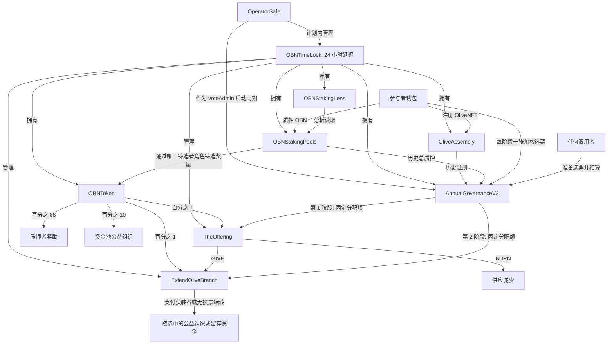

# 非牺牲式捐赠:协议层面对大众慈善参与衰退的回答

[English](THESIS.md) · [Tiếng Việt](THESIS.vi.md) · [한국어](THESIS.ko.md) · [日本語](THESIS.ja.md) · **简体中文** · [हिन्दी](THESIS.hi.md) · [العربية](THESIS.ar.md) · [Русский](THESIS.ru.md) · [Deutsch](THESIS.de.md) · [Português](THESIS.pt.md) · [Español](THESIS.es.md) · [Bahasa Indonesia](THESIS.id.md)

> 本译文仅为方便阅读而提供。英文版([THESIS.md](THESIS.md))为权威版本;如有差异,以英文版为准。本译文基于修订版本 `3c740d855`,在 AI 协助下完成,尚未经过专业译者审校。合约名称、函数名称和地址均保留英文原文。

**Olive Branch Network 论文**

*Olive Branch Network — Base Mainnet*

*2026 年 7 月 — 2026 年 10 月 14 日治理修订*

---

## 摘要

美国的慈善捐赠呈现出一个悖论:捐赠总额几乎每年都创下历史新高,而捐赠人数却在四分之一个世纪里持续下降。有任何慈善捐赠行为的美国家庭比例从 2000 年的 66.2% 降至 2018 年的 49.6%,自 2021 年以来,即使总收入增长,捐赠者人数仍逐年下降。慈善事业正向规模更小、更富有的捐赠者阶层集中,掏空了公益部门公民正当性所依赖的大众参与。

本论文认为,参与崩塌的根源是结构性的,而非道德性的:在历史上每一种货币形式下 — 商品货币、法定货币和早期数字货币 — 捐赠都是*牺牲性*的。捐赠将本金从捐赠者永久转移给接收者,因此参与的门槛是可支配盈余 — 随着实际收入增长集中于收入分布的顶端,越来越多的家庭已无法跨过这道门槛。可编程货币在货币史上首次消除了这一约束。由于智能合约能够将*资产的所有权*与*该资产所产生收益的导向*分离,因此可以设计出**非牺牲式捐赠**:捐赠者永久保留本金,同时将其生产力中由协议强制执行的份额持续输送给可独立验证的公共利益。

Olive Branch Network(OBN)协议作为这一设计的参考实现予以介绍。本论文(i)将 OBN 置于货币技术的漫长历史之中;(ii)以有引证的实证数据记录推动其产生的慈善参与衰退;(iii)形式化协议的参与–锁定反馈回路,在该回路中,每增加一名参与者,就会把 OBN 代币从流通浮筹转入非托管式合约锁仓,随着采用率增长而收缩有效供应;并且(iv)对每一份核心智能合约 — `OBNToken`、`OBNStakingPools`、`TheOffering`、`ExtendOliveBranch`、`AnnualGovernanceV2`、`OliveAssembly`、`OBNTimeLock`、`TeamVesting`、`OliveNFT` 和 `OBNStakingLens` — 提供完整的技术描述,包括其部署于 Base 主网时的存储布局、不变量、访问控制结构和升级安全机制。

---

## 目录

1. [引言](#第-1-章--引言)
2. [货币史:从商品到可编程性](#第-2-章--货币史从商品到可编程性)
3. [慈善参与的实证衰退](#第-3-章--慈善参与的实证衰退)
4. [参与–锁定机制:OBN 的代币流经济学](#第-4-章--参与锁定机制obn-的代币流经济学)
5. [核心合约:完整的技术描述](#第-5-章--核心合约完整的技术描述)
6. [安全架构与制度设计](#第-6-章--安全架构与制度设计)
7. [局限、效度威胁与未来工作](#第-7-章--局限效度威胁与未来工作)
8. [结论](#第-8-章--结论)
9. [参考文献](#参考文献)

---

## 第 1 章 — 引言

### 1.1 问题陈述

两个长期趋势构成了本研究的框架。第一,慈善捐赠的*广度*正在崩塌:有任何捐赠行为的美国家庭比例在 2000 年至 2018 年间下降了近十七个百分点(Indiana University Lilly Family School of Philanthropy, 2021),2020 年后的数据显示,这一下降在加速而非企稳(Fundraising Effectiveness Project, 2025)。第二,捐赠的*深度*正在集中:总额达到历史新高 — 2024 年为 $592.50 billion(Giving USA, 2025) — 是因为来自更少、更富有捐赠者的更大额捐赠,取代了已退出的数百万小额捐赠者。

宗教信仰减弱、工资停滞、代际对机构的不信任等标准解释描述了这一现象,却未能解决它,因为它们都可归结为同一个结构性约束:**历史形成的捐赠,是对本金的永久让渡。** 只有当家庭跨过"我有足够的盈余承受这笔损失"这一门槛时,才会参与慈善。随着实际可支配盈余向收入分布顶端集中,参与也随之集中。

### 1.2 论点陈述

本论文为三项主张辩护:

1. **历史主张。** 此前的每一种货币技术 — 从吕底亚的琥珀金,到美联储的负债,再到仅作为不记名工具使用的第一代加密货币 — 都使本金让渡成为捐赠*唯一*可用的基本单元。可编程货币是第一种能在货币本身层面分离*所有权*与*收益导向*的货币形式,而不必通过主要由富人使用的可信中介(捐赠基金、信托、捐赠者建议基金)。

2. **实证主张。** 大众慈善参与正处于长期衰退之中,而这一衰退恰恰集中在牺牲门槛约束最紧的小额捐赠者群体。此主张得到面板数据(Philanthropy Panel Study)、全行业交易数据(Fundraising Effectiveness Project)和宏观估算(Giving USA)的支持,详见第 3 章。

3. **机制主张。** 一种协议如果(a)让参与者无需放弃代币即可质押,(b)将协议释放的固定份额输送给经验证的公益组织,并且(c)将质押本金锁定在非托管式锁仓中,就会产生参与–供应反馈:每一位边际参与者都会从流通浮筹中移除代币,因此 — 在需求和释放政策不变的情况下 — 更广泛的参与会机械地收紧有效供应。第 4 章将此形式化,并坦诚陈述其假设,包括奖励释放这一抵消力量。

### 1.3 贡献

- 围绕单一轴线综合货币史:*货币本身能够强制执行什么*(第 2 章)。
- 整合且有引证的美国慈善参与衰退实证记录,2000–2025 年(第 3 章)。
- OBN 质押经济的正式代币流模型,包括流通浮筹恒等式、释放/锁定平衡条件和由治理控制的销毁消耗机制(第 4 章)。
- 首份完整的书面规范,涵盖部署于 Base 并在主网分叉测试环境中验证的 OBN 核心合约套件,包括每个状态变量、函数、事件、不变量和升级路径(第 5 章),以及其安全和制度架构(第 6 章)。

### 1.4 一段话了解协议

Olive Branch Network 是 Base 上的 ERC-20 代币(`OBN`),其质押系统由各公益组织的资金池组成。参与者将 OBN 存入其希望支持的公益组织的资金池。存款绝不会被花费、转移给公益组织或面临损失给协议的风险;它可以随时提取(明确锁定的引导头寸除外)。在质押期间,协议按时间针对质押铸造释放,并在领取时将每笔已实现奖励分成四份:**88% 归质押者,10% 归资金池的公益组织,1% 归公共金库(`TheOffering`),1% 归分配金库(`ExtendOliveBranch`)。** 公共金库在周期开始时确定的分配额的命运 — 销毁或捐赠 — 由已注册 OliveNFT 的钱包通过一次两阶段、按快照质押量平方根加权的投票(`AnnualGovernance`)每年决定,其第二阶段将分配金库的固定周期分配额导向由社区选择的公益组织。该设计实现了宪章第 I 条:*"使一个人能够保留其资产的所有权,同时持续将这些资产所产生价值的一部分导向可独立问责的公共利益"*(OBN 宪章,第 I 条)。

---

## 第 2 章 — 货币史:从商品到可编程性

本章的目的不是考古。货币史的每个阶段都依据一个问题来解读:*货币本身能够强制执行什么,什么又必须委托给可信机构?* 这个答案决定了每个阶段可能出现哪些形式的捐赠。

### 2.1 铸币之前:礼物、债务与物物交换的神话

关于货币起源的通俗理论 — 不便的物物交换自发让位于交换媒介 — 源于 Adam Smith(1776),并由 Menger(1892)和 Jevons(1875)形式化:前者将货币建模为向最*易售*商品的自发收敛,后者将其解决的摩擦命名为"需求的双重巧合"。现代搜索理论模型(Kiyotaki & Wright, 1989)延续了这一逻辑,Kocherlakota(1998)提炼出其最深刻的含义:货币在技术上等同于社会对谁贡献了什么的*记忆* — "货币即记忆"。

然而人类学记录并不支持纯粹的物物交换经济是货币的前身。Humphrey(1985)总结道,"从未有人描述过纯粹的物物交换经济的例子,更不用说货币从中产生的例子。" Graeber(2011)汇集民族志和美索不达米亚的证据表明,*信用和义务比铸币早数千年*:苏美尔(约公元前 3000 年)的神庙和宫廷账簿早在有人将白银作为现金流通之前,就以白银和大麦计价债务。货币的信用理论(Mitchell-Innes, 1913)和国家理论(Knapp, 1905/1924) — 货币是可转让的债务,以及货币是国家接受用于缴税之物 — 捕捉了这一更古老的层面。

有两点观察对后文十分重要。第一,最早的"货币"已经是一种*会计技术* — 账本 — 其实物代币是次要的。第二,在礼物与义务经济中,捐赠构成社会成员身份,而非对盈余的酌情处置(Mauss, 1925)。将捐赠简化为自愿的盈余转移,是后来货币形式的产物,而非人类的常量。

### 2.2 铸币:作为主权不记名工具的货币(约公元前 640 年 – 公元 1000 年)

标准化铸币出现于公元前七世纪的吕底亚 — 由国家压印的琥珀金片 — 并以惊人的速度传遍希腊城邦、波斯、印度(打孔的 *karshapana*)和战国时期的中国(Davies, 2002; Schaps, 2004)。铸币的创新是*一眼验证*:主权印记消解了鉴定问题,使价值可以在陌生人之间转移,无需信任或记录。

但请注意这项技术能强制执行什么、不能做什么。铸币强制执行*持有即最终*:谁持有,谁就绝对拥有。它无法编码条件、流、分配或归复。因此,铸币所支持的唯一捐赠基本单元就是彻底转移铸币 — 纯粹牺牲本金。任何更复杂的形式(神庙捐赠基金、罗马的 *alimenta*、伊斯兰的 *waqf*、中世纪的小礼拜堂基金)都需要将货币包裹在由可信之人管理的*法律机构*之中。收益导向的捐赠是存在的 — 瓦克夫正是这样一种资产,其收入被永久导向公共利益,而本金不可让渡(Kuran, 2001) — 但只有富有到能围绕其资产建立机构的人才能使用。

### 2.3 纸币、银行与信用上层建筑(1000–1971)

宋代中国发行了第一种国家纸币(*jiaozi*,于公元 1024 年正式化),既发现了可兑换票据的发行,也在两个世纪内发现了通胀性的超发(Von Glahn, 1996)。在欧洲,这一序列经历了汇票、金匠收据、英格兰银行(1694)和十九世纪的金本位制 — 在这一货币秩序中,货币供应受可兑换性约束,但实际流通媒介绝大部分是银行*信用*(Ferguson, 2008; Eichengreen, 1996)。布雷顿森林体系(1944)保留了一层之隔的黄金锚;美国于 1971 年 8 月 15 日将其中止("尼克松冲击"),完成了向纯法定货币的过渡:货币成为国家无背书的负债,其价值由法令、缴税接受度和网络预期决定 — 克纳普的国定货币论得到完全实现(Eichengreen, 1996)。

就捐赠而言,法定货币与银行时代改变了规模,却没有改变结构。慈善扣除制度(在美国始于 1917 年)补贴了牺牲;基金会、慈善剩余信托和捐赠者建议基金将瓦克夫模式工业化 — *所有权得以保留或庇护,收益得以导向* — 但每一种都需要法律设立、最低门槛和顾问。结构性不对称依然存在:**富人从收益中捐赠;其他人从本金中捐赠。** 第 3 章记录了可预见的结果。

### 2.4 数字结算与电子法币(1971–2008)

从尼克松冲击到 2008 年,货币在操作上去物质化 — Fedwire、SWIFT(1973)、卡网络和互联网支付使大多数货币成为银行数据库中的条目 — 但其逻辑没有改变。电子法币仍是一张由受监管中介强制执行规则的借据。Chaum(1983)证明密码学可以创造数字不记名现金,但他的 DigiCash 将发行中心化并在商业上失败;Dai 的 "b-money"(1998)和 Szabo 的 "bit gold"(构想于 1990 年代末,发表于 2005 年)勾勒了去中心化发行,却未解决双花问题。

### 2.5 比特币:无需主权的稀缺性(2008)

Nakamoto(2008)通过将公开账本上的工作量证明共识与固定发行计划相结合,在没有可信方的情况下解决了双花问题。比特币对货币史的贡献十分明确:**由协议而非机构强制执行的数字稀缺性和最终结算。** *货币的规则* — 尤其是其供应曲线 — 首次成为货币本身的属性。

然而比特币的脚本有意限制表达能力。作为货币,它仍接近铸币:一种供应固定的不记名工具。用比特币捐赠仍然是本金让渡。

### 2.6 以太坊与可编程货币(2015– )

Buterin(2014)将区块链推广为图灵完备的状态机。有了以太坊 — 以及 OBN 所部署的 Base 这样的 EVM 链 — 货币变得*可编程*:任意逻辑都能以与支付本身相同的最终性执行。ERC-20 标准(Vogelsteller & Buterin, 2015)使代币化价值成为可组合的基本单元;ERC-4626、质押系统和链上治理(例如 Compound 的 Governor 模式)证明了**托管、收益、投票和支付都可以成为协议属性。**

这是历史论证的转折点。瓦克夫/捐赠基金模式 — 本金不可让渡,用益权导向公共利益 — 一千年来都需要可信机构,因此是富人的工具。智能合约为任何规模的任何持有者实现同样的模式,并具备:

- **非托管式锁仓**("捐赠基金本金"由不可变代码而非受托人持有);
- **持续、可撤销的指定**(参与者可随时改变导向或提取 — 宪章第 III 条的可分离性);
- **协议强制执行的分配**(OBN 中 88/10/1/1 的分配是 `_mintSlices` 中的算术,而非受托人的酌情决定);
- **可验证的记录**(每一笔贡献都是链上事件,满足宪章第 VI 条)。

依此解读,货币史就是将曾委托给机构的功能逐步内化到货币本身的历史:验证(铸币)、记录(银行)、稀缺性(比特币),以及最后的*信托结构*(可编程货币)。OBN 是将这最后阶段应用于最古老的货币功能 — 礼物。

---

## 第 3 章 — 慈善参与的实证衰退

本章以已发表数据确立第二个前提:**捐赠的人数正在持续下降,而且在所有主要数据来源中都是如此,即使总金额在上升。**

### 3.1 长期参与衰退(Philanthropy Panel Study,2000–2018)

最严谨的纵向证据来自 Indiana University Lilly Family School of Philanthropy 的 *Philanthropy Panel Study*,这是一个具有全国代表性的面板,每两年追踪 9,000 多个美国家庭的捐赠情况。

- 在 **2000 年,66.2% 的美国家庭**作出了慈善捐赠。
- 到 **2018 年,只有 49.6%** 这样做 — 这是有记录以来首次不足一半的美国家庭捐赠,下降了近 17 个百分点(Lilly Family School of Philanthropy, 2021)。
- 宗教捐赠从**家庭的 46%(2000–2004)降至 29%(2018)**;世俗捐赠从 55–57% 的平台期(2000–2008)降至 **2018 年的 42%**(Lilly Family School of Philanthropy, 2021)。
- 后续分析发现,这一下降**在 COVID-19 大流行的第一年加速**(Lilly Family School of Philanthropy, *The Giving Environment*, 2022; NonProfit PRO, 2022),并且所有种族和族裔群体的参与率都有所下降(The NonProfit Times, 2023)。

该学院的 *Giving Environment* 报告将这一下降部分归因于中低收入家庭收入下降和停滞,以及围绕宗教归属的规范变化(Lilly Family School of Philanthropy, 2022) — 两者都是牺牲门槛的体现:家庭只有在能承受失去这笔钱时才会捐赠,而能做到的家庭越来越少。

### 3.2 2018 年后捐赠者人数继续下降(Fundraising Effectiveness Project,2021–2025)

汇总数千家公益组织实际捐赠交易数据的 Fundraising Effectiveness Project(FEP),将记录延伸到面板研究之后,并显示下降仍在继续:

- 捐赠者人数**自 2021 年以来每年**下降(AFP/FEP, 2026)。
- 从 2023 年到 2024 年,捐赠者人数**同比下降 4.5%**,下降幅度相对前几年*加速*(FEP Q4 2024 报告; GlobeNewswire, 2025)。
- **2025 年,捐赠者人数估计又下降 3.6%**,而慈善总金额增长 5.0% — 这是五年来最强劲的收入增长,却是由更少的捐赠者实现的(AFP/FEP, 2026)。
- 流失集中在小额端:捐赠 **$1–$100 的捐赠者 — 占全部捐赠者一半以上 — 在 2024 年下降 8.8%,在 2025 年第 1 季度同比下降 11.1%**(FEP; NonProfit PRO, 2025)。
- 整体捐赠者留存率徘徊在 **43%** 左右,新捐赠者留存率低得多,这意味着大多数首次捐赠者再也不会捐赠(FEP, 2025–2026)。

FEP 自身的表述恰恰就是集中化论点:收入增长"集中于更大额的捐赠",并伴随"捐赠者总数的持续下降"(AFP, 2025)。

### 3.3 金额上升,捐赠者下降(Giving USA,2024–2025)

Giving USA 是对美国慈善事业持续时间最长的宏观估算,它补全了这一悖论:

- 捐赠总额在 **2024 年达到 $592.50 billion**,创现价美元纪录,名义增长 6.3%,通胀调整后增长 3.3%(Giving USA 2025)。
- 捐赠总额在 2025 年再次上升至估计 **$617.2 billion**(Giving USA 2026; Give.org, 2026)。
- 但**个人捐赠占总额的比例从 1986–1990 年的约 80% 降至 2024 年的 66% 和 2025 年的 64%**,基金会、遗赠和企业 — 累积财富的载体 — 填补了缺口(Giving USA 2026; Give.org, 2026; Stelter, 2026)。

### 3.4 综合:牺牲门槛

三种独立的方法 — 家庭面板(PPS)、交易汇总(FEP)和宏观估算(Giving USA) — 呈现出同样的图景:

| 指标 | 过去 | 现在 | 方向 |
|---|---|---|---|
| 有任何捐赠的家庭(PPS) | 66.2% (2000) | 49.6% (2018) | ↓ 16.6 pts |
| 向宗教捐赠的家庭(PPS) | 46% (2000–04) | 29% (2018) | ↓ 17 pts |
| 捐赠者人数,同比(FEP) | — | −4.5% (2024), −3.6% (2025) | ↓ 加速 |
| 小额捐赠者 $1–$100(FEP) | 占全部捐赠者的 50–57% | 同比 −8.8% 至 −11.1% | ↓ 降幅最大的群体 |
| 个人占捐赠总额比例(Giving USA) | ~80% (1986–90) | 64% (2025) | ↓ 16 pts |
| 总金额(Giving USA) | — | $592.5B (2024), $617.2B (2025) | ↑ 历史新高 |

这一部门正从顶端获得再资本化,而其参与基础却在被侵蚀。如果捐赠需要盈余而盈余已经集中,这恰恰是可以预料的结果。公益部门的*资金*问题正由富人解决;其*参与*问题 — 数百万小额捐赠所具有的公民、民主和赋予正当性的功能 — 根本没有得到解决,因为不存在让非富裕家庭能持续捐赠而不受损失的工具。

第 4 章将描述这样一种工具。

---

## 第 4 章 — 参与–锁定机制:OBN 的代币流经济学

本章将协议的经济核心形式化:**参与锁定供应。** 每项主张都基于第 5 章完整描述的具体合约代码;此处我们将系统视为一台代币流机器。

### 4.1 创世分配与当前储备

下表记录历史创世铸造,而不是当前未使用的储备。`OBNToken.initialize` 按固定比例一次性铸造了全部初始供应量(OBNToken.sol):

| 分配 | 份额 | 用途 |
|---|---|---|
| 流动性 | 40% | DEX 流动性,使代币可被获取 |
| 空投 | 30% | 播种广泛的初始分发 |
| 慈善基金 | 10% | 引导公益资金池头寸(永久锁定 — §4.4) |
| 金库 | 10% | 协议运营(一次性创世分配;没有释放流流入) |
| 团队归属 | 10% | 在 `TeamVesting` 中按时间锁定(4 个月悬崖期,20 个月线性) |

除了一次性设定的唯一铸造者 — 质押合约 — 之外,不可能再铸造,因此创世后的*所有*供应增长都是质押释放。

公益种子储备的总分配额为 **300M OBN**,另有 **50M OBN** 单独持有以满足协议需求。金库和空投持仓已整合到种子分配中。当时已有 11M OBN 资助了 11 个公益种子,剩余 289M OBN 用于另外 289 个种子,每个 1M OBN。

这是对现有持仓的重新分配,不是新的铸造,也不是对已部署初始化器的更改。

### 4.2 流通浮筹恒等式

在时刻 *t* 定义:

- **S(t)** — 总供应量:创世供应量加累计释放减累计销毁。
- **K(t)** — 质押合约持有的代币:所有 `userAmount` 余额之和(仅本金;奖励直接铸造给接收方,从不汇集)。
- **V(t)** — 仍锁定在 `TeamVesting` 中的代币。
- **G(t)** — 在两个治理金库(`TheOffering` 和 `ExtendOliveBranch`)中累积、等待年度周期的代币。
- **B(t)** — 累计销毁的代币(通过 `TheOffering.burn` 和任何自愿的 `ERC20Burnable.burn`)。

那么**流通浮筹** — 实际可交易的供应量 — 为:

> **F(t) = S(t) − K(t) − V(t) − G(t)**   其中   **S(t) = S₀ + E(t) − B(t)**

其中 E(t) 是累计总释放。机制主张是关于 ∂F/∂(参与) 的陈述:**每笔存款都将代币从 F 一比一地转入 K**(`_depositCore` 执行 `safeTransferFrom(msg.sender, address(this), amount)`),代币留在 K 中,直到该参与者选择提取。协议绝不借出、再抵押或花费 K;没有罚没,协议对本金也没有索取权。K 是惰性锁仓。

### 4.3 释放政策:递减且与参与成比例

释放*不是*固定的水龙头。`_sumRewardAcrossPhases` 按资金池将奖励累计为 `poolStake × bps × Δt / (10000 × 365 days)` — 即按递减计划的**实际质押量的年化百分比**:

| 部署后年数 | 年释放率(按质押余额) |
|---|---|
| 0–2 | 10.00% |
| 2–4 | 7.50% |
| 4–6 | 5.00% |
| 6–8 | 2.50% |
| 8–10 | 1.25% |
| 10+ | 3.00% 兜底(`FALLBACK_EMISSION_BPS`),直到治理通过 `addPhase` 修改 |

由此产生两个结果。第一,**释放随 K 而非 S 变化**:未质押的代币不产生任何东西。第二,由于奖励只在*领取事件*(存入、提取、领取)时铸造,未领取的奖励仅是一个会计条目(`accRewardPerShare × balance − rewardDebt`) — 在实现之前它们并不以代币形式存在。

### 4.4 四方分配及其消耗机制

每次实现时,`_mintSlices` 分割待领总奖励:

- **88% → 质押者。** 参与者的收益。新铸造,进入 F(或被再质押)。
- **10% → 资金池的公益钱包。** 礼物。持续、由协议强制执行、与参与者的质押和时间成比例。这是宪章第 VII 条的*贡献*,它不会让质押者损失本金 — 只是一部分没有协议就不会存在的收益。
- **1% → `TheOffering`**(公共金库)。全年累积;每个年度治理周期投票决定将周期开始时确定的分配额**销毁**(通缩性消耗,减少 S)或**捐赠**(转入 `ExtendOliveBranch`)。
- **1% → `ExtendOliveBranch`**(分配金库)。全年累积;每个年度治理周期的第 2 阶段投票将该周期的固定分配额导向一个由社区选择、在白名单上的公益组织(如无人投票则结转)。

请注意,**没有释放流流向金库**:剩余两份都进入由治理控制的金库。在年度处置之前,两条流都留在金库锁仓中(§4.2 的 G) — 处于可交易浮筹之外。

此外,10% 的慈善基金创世分配通过 `charityFundBootstrap`/`depositForWithLock` 部署,*代表每个公益组织自己的钱包*质押代币,并将 `lockedAmount` 设为等于存款 — 这是**永久锁定**(锁定只能增加,绝不减少)。因此,引导头寸永远计入 K,保证每个资金池都有流向其公益组织的基础奖励流,并且永远不会被抛售。

### 4.5 参与–锁定反馈回路

把各部分组合起来。设 *n* 为活跃参与者数量,*k̄* 为平均质押量。则 K = n·k̄(加上引导锁定),并且:

1. **采用收紧浮筹。** 每位新参与者都将浮筹代币转化为锁仓本金:ΔF = −Δstake。在需求不变时,可交易浮筹的缩小会提高市场出清价格 — 这是标准的供需结果,也是权益证明经济中长期观察到的"浮筹收缩"的链上对应物,在这些经济中,高质押率会减少流动供应。
2. **收益奖励耐心,88% 的收益可以复投。** 将其 88% 份额再质押的质押者把新铸造的代币直接送回 K,进一步收紧 F。
3. **礼物流为现实世界的正当性提供资金。** 10% 的公益流给外部机构一个持久的理由来推广参与,从而招募更多参与者 — 这是唯一本身就是慈善行为的营销渠道。
4. **治理可以将公共金库转化为纯粹的通缩。** 第 1 阶段的 BURN 结果摧毁周期开始时确定的公共金库分配额,直接减少 S。请注意,默认值是有意通缩的:*零参与 → BURN*(GIVE 必须*严格*超过 BURN)。
5. **投票资格要求在快照时参与。** V2 将已注册 NFT 状态与至少 1 OBN 的带检查点总质押相结合,然后应用平方根权重。治理提供了在每个周期开始前质押的理由;它不要求之后继续质押,也不会在投票期间建立持续锁定(§5.5)。

回路:**更多参与者 → 更多代币被锁定 → 更小的浮筹和更大的累计销毁选项 → 更好的价格支撑 → 更高的每枚代币收益价值和礼物价值 → 更强的招募力 → 更多参与者。**

### 4.6 诚实的核算:释放的抵消力量

该机制存在一种反向力量。释放具有通胀性:在初始 10% 的比率下,S 与 K 成比例增长。净浮筹是否*缩小*取决于实际流量。对浮筹恒等式求导,进入浮筹的释放流为:

> **dF/dt ≈ e·K·[0.88·(1−r) + 0.10 + 0.02·(1−β)·δ] − dK/dt**

其中 *e* 是当前释放率,*r* 是再质押的质押者奖励比例,*β* 是第 1 阶段最终被销毁的金库流比例,*δ* ≤ 1 是滞后系数,反映两条 1% 金库流只有在年度周期分配后才进入浮筹(被销毁的数额永不进入;结转则进一步推迟进入)。只要**净新增质押超过未再质押的释放部分**,浮筹就会收缩(dF/dt < 0)。结构特征推动朝这一方向发展 — 释放计划从 10% → 1.25% 递减,而采用率预期增长;公益接收方是使命驱动的卖方,但其流入仅为释放的 10%;销毁默认值永久移除公共金库;引导锁定永不退出 — 但这一条件是经验性的,并非有保证。因此,此处辩护的主张有精确的边界:*在其他条件不变的情况下,协议被设计为使参与增长机械地收缩浮筹并创造支撑代币价格的条件;它不能也无法保证价格上涨,因为价格上涨还取决于外生需求。*

### 4.7 重述非牺牲式捐赠

这一经济设计直接解决了第 3 章的问题。参与门槛不再是"我能承受失去的盈余",而是"我愿意存放的资本"。从未能捐出 $500 的家庭可以质押 $500,保留它,在紧急时提取,同时持续将其质押所产生收益的 10% — 真实、由协议强制执行、公开记录的贡献 — 导向经验证的公益组织。捐赠成为一种*资产配置决策*,而不是*消费牺牲*。这就是该设计对参与崩塌的回答:不是劝说人们多捐,而是消除他们停止捐赠的结构性原因。

---

## 第 5 章 — 核心合约:完整的技术描述

所有合约以 Solidity ^0.8.28 为目标,基于 OpenZeppelin v5 构建,并部署在 Base 上。可升级合约使用 UUPS 模式(`_authorizeUpgrade` 限于所有者,即 `OBNTimeLock`)。本章描述套件中的每份合约:用途、存储、函数、事件、不变量和交互。

### 5.1 `OBNToken` — 货币基础 (OBNToken.sol)

**继承。** `Initializable`、`IOBNMintable`、`ERC20Upgradeable`、`ERC20PermitUpgradeable`(EIP-2612 无 Gas 授权)、`ERC20VotesUpgradeable`(带检查点的委托)、`ERC20BurnableUpgradeable`、`OwnableUpgradeable`、`UUPSUpgradeable`。

**标识。** 名称 "Olive Branch Network",符号 "OBN"。

**存储。** 单一自定义变量 `address public minter`,加上预留升级空间的 `uint256[100] __gap`。

**初始化。** `initialize(initialOwner, initialSupply, liquidityAddress, airdropAddress, charityAddress, treasuryAddress, teamVestingAddress)` 运行一次(initializer 修饰符;构造函数调用 `_disableInitializers()`,因此实现本身永远无法被初始化)。在零地址和非零供应量检查之后,它铸造全部分配:30% 空投、40% 流动性、10% 慈善、10% 金库、10% 团队归属(§4.1)。

**铸造者机制。** `setMinterOnce(addr)` — 仅所有者,要求 `minter == address(0)`:在实现的生命周期内,铸造者**恰好只能设置一次**(只有完整的 UUPS 升级才能更改)。`mint(to, amount)` 要求 `msg.sender == minter`。部署时铸造者是 `OBNStakingPools` 代理;因此*所有未来供应都是质押释放*。`isMinter(addr)` 是一个便利视图。

**重写。** OZ v5 将所有余额变动路由到 `_update`,因此单次重写即可协调 `ERC20Upgradeable` 和 `ERC20VotesUpgradeable`(投票检查点自动跟踪转账)。`nonces()` 被重写以协调 `ERC20PermitUpgradeable` 与 `NoncesUpgradeable`。

**安全属性。** 不可暂停、无黑名单、无转账税:代币保持最大中立。任何持有者都可通过 `ERC20Burnable` 销毁 — 这是 `TheOffering` 用来摧毁公共金库的钩子。

### 5.2 `OBNStakingPools` — 引擎 (StakingPoolsV931.sol;版本字符串 "9.3.1")

质押合约是系统中最大、最关键的合约:它是唯一的 OBN 铸造者、所有质押本金(§4.2 的 K)的托管方,也是治理的投票权预言机。它运行在一个地址稳定的 UUPS 代理之后。

#### 5.2.1 常量 — 不可变的分配

```solidity
STAKER_BPS = 8800; CHARITY_BPS = 1000; CHARITY_FUND_BPS = 100; TREASURY_BPS = 100;
TOTAL_BPS = 10000; FALLBACK_EMISSION_BPS = 300;
```

88/10/1/1 分配是 `constant` — 编译进字节码,如不通过 timelock 进行完整实现升级则无法更改。两份 100-bps 份额铸造到 `treasury` 和 `charityFund` 存储变量所持地址;**在已部署配置中,这些变量分别持有 `TheOffering` (0xc75B…E341) 和 `ExtendOliveBranch` (0xE1Bb…6d8B)** — 标识符是历史遗留的,两条 1% 流的实际接收方是两个治理金库(§5.3、§5.4)。`FALLBACK_EMISSION_BPS` 是在定义的阶段计划结束后适用的 3% 永久下限(§4.3)。

#### 5.2.2 存储布局

按槽位排序且对升级至关重要(合约记录了其槽位映射;末尾间隙为 `uint256[93]`;每月自动领取的状态位于此映射之外的 ERC-7201 命名空间存储 `obn.storage.MonthlyAutoClaim` 中):

- **配置:** `stakingToken`(作为 `IOBNMintable` 的 OBN 代币)、`treasury`(→ TheOffering)、`charityFund`(→ ExtendOliveBranch)、`version`(字符串,"9.3.1")。
- **释放计划:** `Phase[] phases`,每项为以时间戳表示的 `{start, end, bps}`。
- **资金池:** `PoolInfo[] poolInfo`,每项为 `{charityWallet, totalStaked}` — 每个公益组织一个资金池。
- **用户核算:** `userAmount[pid][user]`、`userRewardDebt[pid][user]` — 累积器/奖励债务模式(§5.2.3)。
- **累积器:** `accRewardPerShare[pid]`(按 1e12 缩放)、`lastRewardTime[pid]`。
- **全局:** `globalTotalStaked`。
- **锁定:** `lockedAmount[pid][user]` — 永久锁定账本(§4.4)。
- **统计:** `totalClaimedByUser`、`totalDepositedByUser`、`totalWithdrawnByUser`、按资金池的存入/提取/已铸造 charity 总额、`uniqueStakersByPool`、`uniqueStakersGlobal`、`activePoolCount[user]`、`stakedSince[user]`、`cumulativeStakeSeconds[user]`(完全解除质押后仍保留 — 永久的任期记录)。
- **生命周期:** `poolRemoved[pid]`(禁用存入)、`poolFullyRemoved[pid]`(从治理选票中除名 — 仅由 `removePool` 设置,绝不由 `shutdownPool` 设置)。
- **贡献追踪:** `charityContributedByUserInPool[pid][user]` 和 `totalCharityContributedByUser[user]` — 每位参与者可归属的终身捐赠,即宪章第 VI 条的链上*记录*。
- **治理管道(槽位 28–30):** `charityFundOperator` + `_migrationExecuted` + `upgradeBlock`(打包在一个槽位)、`totalStakedByUser[user]`(跨资金池累计)和 `_stakeCheckpoints[user]`(`Checkpoints.Trace208` — 投票权历史)。上文生命周期中列出的 `poolFullyRemoved` 占用槽位 31。

#### 5.2.3 核算模型

OBN 使用累积器/奖励债务方案,并有一个决定性的变化:**累积器追踪总额(GROSS)奖励。** 每次触及资金池时,`_accruePool` 通过 `_sumRewardAcrossPhases` 计算自 `lastRewardTime` 以来的总释放 — 它逐段遍历阶段计划,用 `Math.mulDiv(poolStake, bps × duration, 10000 × 365 days)` 精确处理阶段边界,并对超出最后定义阶段的任何区间应用 3% 兜底比率 — 再将其并入 `accRewardPerShare[pid] += grossReward × 1e12 / totalStaked`。用户的待领总额则为:

> `pending = userAmount × accRewardPerShare / 1e12 − userRewardDebt`

拆分为 88/10/1/1 仅在 `_mintSlices` 内实现时发生,严格遵循 checks-effects-interactions:所有统计都在四次外部 `mint` 调用*之前*更新。质押为零的资金池不会铸造任何东西(累计提前返回,只推进时钟),奖励也绝不停留在合约中 — 它们直接从铸造到达最终接收方。公开的 `sumRewardAcrossPhases` 包装器为只读 Lens 提供阶段遍历(§5.9)。

#### 5.2.4 面向用户的函数

- **`deposit(pid, amount)`** — 质押到资金池。要求资金池有效且未关闭。效果:累计资金池;注册唯一质押者(按资金池和全局,`stakedSince` 在 0→1 个资金池时启动任期时钟);增加 `userAmount`、`poolInfo.totalStaked`、`globalTotalStaked` 和存入统计;重置奖励债务;推送 `(block.number, totalStakedByUser)` 检查点;然后 `safeTransferFrom` 转入本金并对任何待领奖励执行 `_mintSlices`。存入的副作用是*实现*待领奖励。
- **`depositFor(pid, amount, beneficiary)`** — 第三方资助另一地址的质押(工资式捐赠、参与礼物)。
- **`depositWithPermit(...)`** — 通过 EIP-2612 在单笔交易中完成授权+质押。
- **`withdraw(pid, amount)`** — 退出。强制 `amount ≤ userAmount − lockedAmount`(*未锁定*余额);更新所有余额、检查点和钩子(`_afterWithdrawBalanceHooks` 将锁定限制到新余额,在归零时清除活跃质押者标记,并在退出最后一个资金池时将本次时段计入 `cumulativeStakeSeconds` 并减少 `uniqueStakersGlobal`);转回本金;通过相同的 88/10/1/1 分配实现待领奖励。**无冷却期、无罚金、无费用** — 第 III 条的可分离性要求无摩擦退出。
- **`claim(pid)` / `claimFor(pid, user)` / `claimMultiple(pids)`** — 在不触及本金的情况下实现奖励。`claimFor` 仅限所有者调用(位于 timelock 之后),且只能将奖励发送给其合法持有人(铸造*给 `user`*,而非调用者)。定期领取使用 V9.3.1 新增的、基于同意的独立路径 `autoClaimFor`(白皮书 §3.2.1),该路径不会复投奖励。
- **视图套件:** `pendingRewards`、`getPoolInfo`、`getUserStakeValue`、`unlockedBalance`、`poolLength`、`isGloballyStaked`、`stakeElapsed`、`currentRewardsPerSecond`(更重的分析位于 Lens — §5.9)。

#### 5.2.5 慈善基金引导与自质押冻结

`charityFundBootstrap(pid, amount, beneficiary)` / `depositForWithLock(...)` — 只能由 `charityFund` 或 `charityFundOperator`(运营 Safe)调用,只能用于资金池自己的慈善钱包,并通过 `_enforceCharitySelfStakePolicy` 路由,该策略允许每个资金池慈善组织**恰好一笔**锁定的引导存款:慈善钱包余额必须为零,调用者必须获得授权,存款必须被锁定。资金池公益组织的所有其他自质押都会被拒绝("charity self-stake disabled")。理由:公益组织质押到自己的资金池会把 10% 慈善份额送回自身,形成治理权重的飞轮;冻结将公益组织头寸限制为一个透明、永久锁定的引导头寸。

`setLockedAmount(pid, user, amount)` — charityFund 或运营者(运营者仅限于资金池慈善地址)**只能增加**锁定,绝不能减少,也绝不能超过用户余额。根据构造,锁定是单向的。

#### 5.2.6 管理函数(全部位于 timelock 拥有的 `onlyOwner` 之后)

- **`addPool(charityWallet)`** — 为公益组织创建资金池;初始化其累计时钟。
- **`shutdownPool(pid)`** — 阻止*新的*存入;领取和提取继续进行,因此用户始终可以退出。已关闭的资金池仍有资格进入治理选票。
- **`removePool(pid)`** — 仅当 `totalStaked == 0` 时;转出遗留 charity 累积,设置 `poolFullyRemoved`(将公益组织从未来选票中除名),并将资金池的慈善钱包重新指向 `treasury` 地址(TheOffering),使任何残余铸造都不会滞留在 address(0)。
- **`updateCharityWallet(pid, newWallet)`** — 轮换遭泄露或已迁移的公益钱包。
- **`migrateBootstrap(pid, old, new)`** — 在公益地址之间原子移动整个引导头寸(余额、奖励债务、锁定),贯通双方的投票权检查点,并在链上证明待领奖励保留在 1 wei 以内(`pendingAfter ≥ pendingBefore && pendingAfter ≤ pendingBefore + 1`)。
- **`addPhase(start, end, bps)`** — 追加释放阶段;必须与最后阶段连续。这也是治理影响 3% 兜底比率的杠杆。
- **`forceExitUserToSelf(pid, user, claimRewards)`** — 紧急:将用户的全部本金退还给*用户本人*(绝不给管理员),可选择实现奖励,无视锁定。管理员不能没收;只能强制退还。
- **`sweep(token, amount)`** — 将误入的 ERC-20 取回到 `treasury` 地址,**明确排除质押代币**("Cannot sweep staking token"),使管理员永远无法触及 K。
- **`migrateV93(newTreasury, newCharityFund, newOperator)`** — 一次性连接函数,通过 timelock 的 `upgradeToAndCall` 与实现部署原子执行。它设置 `treasury` → TheOffering、`charityFund` → ExtendOliveBranch、`charityFundOperator` → 运营 Safe;记录 `upgradeBlock` 作为投票权检查点的创世锚点;并永久禁用自身(`_migrationExecuted`)。V9.3.1 升级新增了 `initializeV931(executor)`,这是一个独立的一次性 reinitializer,它将 `version` 设为 "9.3.1" 并设置自动领取 executor;此后可通过 `setAutoClaimExecutor(executor)` 更改该 executor,零地址则暂停自动化。
- **`upgradeTo(newImpl, data)` / `setVersion`** — 与 timelock 调度兼容的 UUPS 升级路径。

#### 5.2.7 带检查点的投票权

质押余额*可按快照查询*,因此治理可以在固定的过去区块计算投票权重,而不是信任当前余额(后者会招致闪电质押攻击):

- 每次存入、提取和引导迁移都会将 `(block.number, totalStakedByUser)` 推入每位用户的 `Checkpoints.Trace208`。
- **创世引导:** 持仓早于检查点系统的质押者没有历史条目。三条互补路径在 `upgradeBlock` 对其进行初始化:`_initializeCheckpointIfNeeded`(自动,在用户下次交互时、任何余额变动之前);`bootstrapCheckpoint(user)`(无需许可 — 任何人都可以初始化任何人);以及 `batchBootstrap(users[])`(无需许可的批量仪式)。`AnnualGovernance` 也会在投票者首次尝试投票时延迟引导(§5.5)。
- **`getPastVotingPower(user, blockNumber)`** — 二分查找(`upperLookup`)用户在任意过去区块的质押总额;**`checkpointCount(user)`** 显示初始化状态。
- 此接口返回**快照时的原始总质押 OBN**,而不是最终的 V2 投票权重。AnnualGovernanceV2 首先检查历史 OliveAssembly 注册和 1 OBN 最低要求,然后应用平方根权重(§5.5)。未质押的钱包余额和 ERC20Votes 委托不提供年度投票权。NFT 投票之前的历史周期保留其原有的线性权重。

### 5.3 `TheOffering` — 公共金库 (TheOffering.sol)

一个有意精简、**不可升级**的金库,全年接收所有 OBN 质押释放的 1%。不处理 ETH;只有两个角色:

- `timelockOwner`(不可变,构造时设定) — 可调用 `setGovernance(addr)`(address(0) 暂停治理)和 `emergencySweep(token, to)`(全额 ERC-20 取回,分配前的覆盖手段)。
- `governance`(`AnnualGovernance` 代理) — 恰好可调用两个函数,均在投票后:**`burn(amount)`**(调用 OBN 的 `ERC20Burnable.burn`,摧毁供应)或 **`sendToExtend(amount)`**(通过 SafeERC20 转账到 `ExtendOliveBranch`)。

部署顺序很重要,并记录在合约中:先部署 `ExtendOliveBranch`(其地址在此为 immutable),之后连接治理。合约持有当年累积的公共资金,除此之外不做任何事 — 攻击面只有两个受保护的函数。

### 5.4 `ExtendOliveBranch` — 分配金库 (ExtendOliveBranch.sol)

第二个不可升级金库,接收所有质押释放中属于自己的 1%,以及来自 `TheOffering` 的任何 GIVE 结果转账。存储:不可变的 `obn` 和 `timelockOwner`;可变的 `governance`;`mapping(address => bool) approvedNonprofit` — 实现宪章第 IV 条的**白名单**(接收方的正当性必须经独立验证,而非自行声明)。

两条有意不对称的分配路径:

- **`distribute(nonprofit, amount)`** — timelockOwner 或 governance;*强制执行白名单*。手动/治理前/紧急通道。
- **`distributeFromGovernance(nonprofit, amount)`** — 仅 governance;此分配路径**有意省略白名单**。V2 在处理选票批次时依据白名单验证每个接收方,然后在该周期内保持该成员资格。之后的白名单撤销不能移除已纳入的接收方,也不能使被选中的接收方在付款时失效。Timelock 保留 `emergencySweep`;提取已预留资金可能阻止结算,直至差额得到补足。

管理:`setApprovedNonprofit(addr, bool)`、`setGovernance(addr)`、`emergencySweep(token, to)` — 全部仅限 timelock。

### 5.5 `AnnualGovernanceV2` — 年度治理 (AnnualGovernanceV2.sol)

本节描述 AnnualGovernanceV2,这是自 2026 年 10 月 7 日(Base 区块 52283807)升级以来位于现有 AnnualGovernance 代理之后的上线实现。历史审计报告描述的是早期实现,并非当前的部署规范。

#### 5.5.1 社区决定什么

年度治理引导两条共有的 1% 释放流。在第 1 阶段,参与者选择销毁 TheOffering 的分配额或将其捐赠给 ExtendOliveBranch。在第 2 阶段,他们选择一个符合资格的公益组织接收该周期的 ExtendOliveBranch 分配额。即使第 1 阶段选择 BURN,两个阶段也都会运行。这些投票不会改变 88% 的质押者奖励,不会改变 10% 特定资金池公益份额的去向,不会花费用户本金,也不会批准任意的协议升级。

OperatorSafe 作为 `voteAdmin` 直接启动周期。所有者仍是 Timelock,公益组织的入驻和配置仍通过它控制。*年度*一词描述的是预期的运营节奏:合约强制执行两个 30 天投票窗口并防止周期重叠,但不会自动安排周期,也不要求两次启动之间间隔一年。每笔准备和结算交易都必须有人提交。

#### 5.5.2 注册与投票权

投票者使用同一钱包质押 OBN 并在 OliveAssembly 中注册一枚 OliveNFT。在授权 Assembly 代理转移 NFT 后,钱包调用 `deposit(tokenId)`。Assembly 持有 NFT 并为钱包的注册设置检查点;仅在 Assembly 之外持有 NFT 是不够的。注册跨周期持续有效,直至提取,且不允许在同一钱包注册额外的 NFT。质押和 NFT 注册是两个独立操作,二者不可相互替代。

对于在区块 `B` 开始的周期,两个阶段都使用区块 `B - 1` 结束时的注册情况和总质押余额。已注册且质押至少 1 OBN 的钱包符合资格。在区块 `B` 或之后的存入或注册不会增加该周期的权利。之后提取质押或 NFT 不会移除快照已确定的权利。因此,该机制衡量的是某一确定时点的参与,而不是施加 60 天的质押或 NFT 锁定。

对于符合资格的钱包,以人类可读单位表示的投票权约为质押 OBN 的平方根。对于 18 位小数的质押数额 `s`,合约的精确计算为 `floor(sqrt(s)) * 10^9`,以 18 位小数的投票权单位返回。低于最低要求或快照时未注册时,投票权为零。

| 快照时的总质押 | 投票权单位(如已注册) |
|---|---:|
| 少于 1 OBN | 0 |
| 1 OBN | 1 |
| 100 OBN | 10 |
| 10,000 OBN | 100 |

这降低了集中质押的优势:质押增加一百倍,权重增加十倍。这并未确立一人一票。一个人可以控制多个钱包并获得多枚 NFT;将质押分散到多个合格钱包可以增加合计的平方根权重。NFT 注册是资格门槛,而不是唯一人类身份的证明。

每个合格钱包可使用 `castOfferingVote(cycleId, burn)` 和 `castNonprofitVote(cycleId, nonprofit)` 在每个阶段提交一票。无法通过这些端点修改投票。第 2 阶段投票者不必在第 1 阶段投票。质押决定跨所有资金池的权重,因此投票者可以选择选票上的任何公益组织,而不只是该钱包质押的资金池。这些年度投票端点没有投票率法定人数或委托机制。

#### 5.5.3 周期生命周期与选票准备

| 步骤 | 执行者 | 合约行为 |
|---|---|---|
| 注册并质押 | 参与者 | 在快照之前确立 NFT 注册和质押 |
| 启动第 1 阶段 | voteAdmin Safe | 调用 `startAnnualCycle(2592000, 2592000)`;确定快照并开启 30 天投票 |
| 准备剩余选票 | 任何调用者 | 以有界批次调用 `prepareBallot(cycleId, maxPools)` 或 `executeCurrentCycle()` |
| 投票 BURN 或 GIVE | 合格钱包 | 各提交一张加权的第 1 阶段选票 |
| 结算第 1 阶段 | 任何调用者 | 截止日期过后且准备完成时,执行结果并开启第 2 阶段 |
| 为公益组织投票 | 合格钱包 | 在完整的 30 天窗口内各提交一张加权的第 2 阶段选票 |
| 结算第 2 阶段 | 任何调用者 | 支付获胜者的固定分配额,或在无投票时记录结转 |

启动要求 Assembly 已绑定到治理、快照时至少有一项注册、资金池历史非空,且任何先前周期已完成或取消。已注册钱包数量并不保证有任何钱包达到质押门槛。两个时长参数都必须恰好为 2,592,000 秒。Safe 的启动操作不需要新的 Timelock 操作或第二次 Safe 操作来开启第 2 阶段。

**快照与资金。** 启动交易固定前一区块的投票者资格和总质押,并确定两笔资金分配额。必须已在 OliveAssembly 中注册一枚 OliveNFT,且总质押至少为 1 OBN。投票权按平方根加权。两个阶段使用同一快照;之后提取不会抹去该周期的权利。之后收到的资金属于下一周期,本周期 Offering 的 GIVE 分配额除外。

**选票准备。** 启动会冻结资金池历史长度,开启第 1 阶段并处理前 100 个资金池 ID。无需许可的 keeper 调用在第 1 阶段处理最多 100 个 ID 的额外批次。这是每笔交易的工作量限制,而不是成员资格限制。去重使用映射,保留第一个符合条件 PID 的顺序。活跃和已关闭的资金池在未完全移除前仍符合条件。无需额外的 Safe 或 Timelock 启动交互。

**配置时序。** 投票者和资金快照在启动时固定,但质押合约不提供历史公益配置。每个资金池的移除状态和钱包,以及新接收方的批准,都在该批次执行时读取。已加入的接收方在周期内不可变;之后添加的资金池 ID 被排除。因此,准备期间的 Timelock 变更可能影响尚未处理的资金池。未获批准的接收方会使批次原子回滚;Timelock 必须修复配置或取消周期。纳入后撤销批准不会移除该选票成员。准备待完成时应避免更改公益配置。

**执行。** 在准备公益选票期间可以投第 1 阶段的票。第 1 阶段在准备完成且截止日期过去之前不能执行。调度器在执行阶段之前先推进待处理批次。空的最终选票不能完成准备;所有者可在第 1 阶段执行前取消。GIVE 必须严格超过 BURN;平票和零参与只会销毁固定的 Offering 分配额。第 2 阶段随后从实际执行起开放完整的 30 天。每张公益选票以恒定工作量更新领先者,平票时归于选票上最靠前的位置。结算只向该领先者支付固定周期分配额,或在没有投票时结转。准备和结算都不会在一笔状态变更交易中扫描整个选票。

例如,如果第 1 阶段的截止日期在第 30 天过去,但在第 34 天结算,则第 2 阶段在第 64 天结束。第 1 阶段投票在原截止日期停止;延迟执行不会延长该投票。`executeCurrentCycle()` 每次调用推进一个批次或一次结算,因此完成最后一个准备批次后可能需要后续调用才能结算第 1 阶段。无需许可的执行模型允许任何愿意的调用者完成这项工作;它并不保证有 keeper 服务在运行。

#### 5.5.4 固定分配额与结果规则

设 `O` 为启动交易中 TheOffering 的 OBN 余额,`E` 为 ExtendOliveBranch 的余额。除非 GIVE 的加权票数严格超过 BURN,否则第 1 阶段销毁 `O`。因此平票或第 1 阶段没有投票都判定为 BURN。如果 GIVE 获胜,`O` 转入 ExtendOliveBranch。第 2 阶段的分配额在 BURN 时为 `E`,在 GIVE 时为 `E + O`。之后收到的资金被排除,留给未来周期。

例如,启动时 TheOffering 有 1,000 OBN,ExtendOliveBranch 有 2,000 OBN,GIVE 使第 2 阶段可用 3,000 OBN。如果 ExtendOliveBranch 之后又收到 200 OBN,这 200 不会计入当前支付。若 BURN,则 1,000 OBN 被摧毁,第 2 阶段分配 2,000 OBN。如果第 2 阶段没有投票,其分配额留在金库供未来周期使用;第 1 阶段已执行的 BURN 不会撤销。

第 2 阶段选择加权票数最高者,平票由选票上最靠前的位置决定,该位置由升序资金池 ID 处理和接收方去重确定。这是单一接收方分配,而不是在所有候选者之间按比例分配。资金保留在现有金库中:快照是会计预留,而不是单独托管。管理性提取可能造成差额;结算会回滚而不是支付减少的分配额,并可在补足后重试。

#### 5.5.5 权限、兼容性与验证

| 参与方 | 当前设计中的权限 |
|---|---|
| 已注册的合格投票者 | 使用快照权重决定两项年度分配结果 |
| voteAdmin Safe | 启动周期;不能通过启动函数用手选名单替换选票或推翻计票 |
| 任何调用者 | 准备确定性的选票批次,并在条件满足时执行结果 |
| Timelock 所有者 | 更改 voteAdmin,管理公益配置和金库行政,在第 1 阶段结算前取消,并授权允许的升级 |

年度投票者不会获得 Timelock 的管理权力。Governance 和 Assembly 在活跃周期内阻止自身升级,但质押、代币和金库依赖项保留其管理信任假设。第 1 阶段执行后不能通过 `cancelCycle` 取消周期;此限制不会移除金库的紧急权力,也不保证结算不中断。

**兼容性与读取。** 现有 Cycle 字段和顶层槽位保持不变;新的 Cycle 字段追加在后。旧的 maxBallotSize 值和 setter 为 ABI/存储兼容而保留,但不限制成员资格。建议性的资金池索引不用于构建选票。getCyclePreparation 展示进度;getBallotPage 每次调用最多读取 100 个成员。对于大型周期,遗留的 CycleStarted 事件仅包含初始批次;索引器必须使用 BallotBatchPrepared 事件或分页读取以获得完整选票。前端在展示第 2 阶段选票之前等待完成,并在同一区块读取各页。

**信任与实际限制。** 没有硬性成员上限并不意味着无限吞吐量:随着历史增长,准备需要更多 keeper 交易。遗留的质押引导和实时质押兜底仍可能扫描资金池历史。Timelock/依赖项的升级权力仍需被信任。取消仅在第 1 阶段执行前可用;governance 和 Assembly 的升级在整个活跃周期内(包括准备阶段)保持被阻止。

读者可以通过 `getCycleSummary`、`getCyclePreparation`、`getCycleFundSnapshot`、`getPhase2Allocation`、`getCycleParticipation` 和 `getPhase2Result` 验证生命周期。使用 `getVotingPowerForCycle` 了解钱包在特定周期的权利;`getCurrentVoterInfo` 描述当前注册和质押,可能与周期快照不同。遗留质押者可能需要检查点引导,投票端点会自动尝试。质押和 Lens 的权力视图展示原始质押,不得显示为最终的 V2 投票权重。历史周期不会被追溯重新加权,遗留分析标记用于区分不可用的历史记录和真正的零结果。

#### 5.5.6 OliveAssembly 托管与提取

OliveAssembly 是一个单独的、由 Timelock 拥有的 UUPS 代理,用于现有的 OliveNFT 系列。它记录每个钱包存入的一枚 NFT、其存入者、历史注册检查点和历史注册钱包数量。它一次性绑定到治理代理,并要求兼容的所有权和互惠配置。其升级授权会检查治理处于空闲状态。

存入者可调用 `withdraw()` 收回 NFT,或调用 `withdrawTo(recipient)` 选择接收者。`withdrawExpected(tokenId, recipient)` 还会验证已注册代币正是存入者想要提取的代币。已注册的 NFT 没有锁定期,也没有管理员提取路径。提取会改变未来的注册快照,而不会改写过去的快照。主动发来的 safe transfer 会回滚;普通 ERC-721 转账不会注册投票者,可能需要 Timelock 依据转账历史记录进行恢复。因此,注册应使用 `deposit`,而不是直接转移 NFT。

部署引用为 AnnualGovernance 代理 `0x1135d5fEA8098b09b4ED3AFbfFDc7B248359D270`、其 V2 实现 `0x000a76f74b47498D6a9A593F9Cb7cfB71d975437` 和 OliveAssembly 代理 `0xE1ba5a8bC457E60FC2377B1837a40FF85da1578c`。用户与代理交互。部署或升级这些合约本身不会启动投票周期。

### 5.6 `OBNTimeLock` — 宪制性延迟 (OBNTimeLock.sol)

OpenZeppelin `TimelockController(minDelay, proposers, executors, admin)` 的简单子类,以 24 小时最短延迟部署。它拥有每一份可升级合约(token、staking、governance、lens 和 Assembly),并在两个金库中担任 `timelockOwner` 角色。它的简洁正是关键所在:所有复杂性都在久经考验的 OZ 实现中,此处列出的由所有者控制的操作 — 升级、资金池管理、白名单变更、治理连接、紧急取回 — 必须公开排期,并在执行前经受整整一天的审视。周期启动是单独的 voteAdmin 权限;准备和结算无需许可。这些操作不需要新的 24 小时 Timelock 操作。

### 5.7 `TeamVesting` — 利益一致的内部人 (TeamVesting.sol)

用于 10% 团队分配的不可升级 `Ownable` 金库。不可变量:`token`、`start`。常量:悬崖期后 `CLIFF = 4 × 30 days`、`DURATION = 20 × 30 days`。`vestedAmount()` 基于 `(balance + released)` 计算线性归属,因此计算对追加存入保持稳健;`release()`(无需许可)遵循 CEI(效果、事件,然后转账)并支付给 `teamWallet`。UI 辅助函数(`claimableNow`、`timeUntilCliff`、`timeUntilNextRelease`、`nextReleaseTimestamp`)在连续线性计划之上提供友好的每日刻度模型。`updateTeamWallet` 仅限所有者;`rescueERC20` 明确排除归属代币。因此,内部人在四个月内无法取用任何团队代币,到第 24 个月才完全归属 — 使团队与多年释放计划保持一致,而不是上线窗口的价格波动。

### 5.8 `OliveNFT` — 文化制品 (OliveNFT.sol)

一个不持有 OBN 也不提供质押收益的 ERC-721Enumerable 系列。自 AnnualGovernanceV2 起,将一枚 OliveNFT 存入 OliveAssembly 可满足年度投票的注册要求;投票权重仍来自快照质押,而不是 NFT 数量(§5.5)。仅持有 NFT 并不赋予年度投票资格。`MAX_SUPPLY = 20,000` 和 `MINT_PRICE = 0.005 ether` 是常量。值得注意的机制:

- **每个钱包同时持有一枚**(`enforceOnePerAddress`,可切换):`mint()` 恰好铸造一枚代币,如果钱包已持有一枚则以 `AlreadyHolding()` 回滚 — 一种防巨鲸、优先广度的分发姿态,呼应协议的参与精神。
- **提交–揭示公平性:** 所有者在销售前提交 `keccak256(seed)`(`commitMetadataSeed`),且只能揭示完全相同的原像(`revealMetadata`),从而在没有链上随机数或可操纵区块变量的情况下,使属性分配可证明为预先承诺。
- **Feistel 打散:** 元数据类型(N 个桶,其数量之和必须恰好为 20,000;可通过 `freezeTypeCounts` 冻结)通过以揭示种子为种子的 4 轮 16 位 Feistel 置换映射到代币 ID,并使用 cycle-walking(`_scatterIndex` 重新应用置换,直到像落在 `MAX_SUPPLY` 以下 — 由于置换循环有限,保证终止)。这将稀有度均匀打散到铸造顺序中,使顺序铸造者无法狙击稀有区段。
- `tokenURI` 在揭示前返回占位符;揭示后返回 `baseURI + typeIndex + ".json"`。误入的 ETH 通过回滚 `receive`/`fallback` 被拒绝;`withdraw` 使用 `Address.sendValue`,并在外部调用之前发出事件。

### 5.9 `OBNStakingLens` — 只读分析平面 (OBNStakingLens.sol)

一个 UUPS 可升级、由 timelock 拥有的**纯视图**合约,不持有资金也没有特权:其唯一的存储槽指向质押*代理*(地址在升级中保持稳定)。它通过质押合约公开的 `sumRewardAcrossPhases` 包装器重新计算实时累积器预测,为前端提供完整的分析套件 — `getUserStats`、`getUserPoolView`、`getPoolStats`、`listPoolsBasic`、`pendingRewards[Multiple]`、`getPoolAPR`、`getGlobalStats`、`currentRewardsPerSecond`、`pendingCharityFor` — 并增加用于原始历史质押的 `getVotingPower(user, snapshotBlock)`。年度治理接口必须使用 V2 的 `getVotingPowerForCycle` 来获得受 NFT 门控的平方根投票权重。架构原则是平面分离:*写入路径和托管在引擎中保持精简且变化缓慢;读取/UX 迭代发生在一个可以自由升级的合约中,因为它什么也偷不走。*

### 5.10 交互拓扑



---

## 第 6 章 — 安全架构与制度设计

### 6.1 代码层面的防御

- **在所有关键之处应用 checks-effects-interactions:** `_mintSlices` 在铸造前更新所有统计;`TeamVesting.release` 在转账前更新 `released`;`OliveNFT.withdraw` 在发送前发出事件。
- **重入防护**覆盖质押和 NFT 铸造中每条改变状态的用户路径。
- 所有代币流转使用 **SafeERC20**;所有比例运算使用 `Math.mulDiv`(全宽中间乘积,无溢出或精度悬崖)。
- **托管最小化:** 奖励直接铸造给最终接收方;质押合约只持有本金,管理员的 `sweep` 明确不能触及质押代币。
- **单向棘轮:** 代币铸造者仅设置一次;锁定只增不减;`migrateV93` 自行禁用;类型数量冻结;提交–揭示一次性完成。
- **启动前快照投票**(区块 − 1)加上带检查点的质押和 NFT 注册,防止同区块的资格变更被计入;每个钱包每阶段最多投一张加权选票,并有事件记录。这并未确立唯一人身份,也不能防止所有跨快照的借入。
- **升级纪律:** 每个构造函数中都有 `_disableInitializers()` 的 UUPS;有文档记录的存储映射和间隙核算;链上禁止在周期中升级 governance 或 OliveAssembly。

### 6.2 制度性防御

宪章发挥系统宪法的作用,合约几乎逐条实现其条款:同意与可撤销性(无罚金的 `withdraw`)、所有权与收益导向的可分离性(质押本身)、接收方问责(白名单和选票验证)、公共资金治理(带通缩默认值的两阶段周期)以及可验证性(事件和统计接口,包括按用户的终身贡献追踪)。权力被有意分散:timelock 可以管理但不能没收(`forceExitUserToSelf` 支付给*用户*);投票管理员可以启动周期但不能决定结果;治理可以移动公共资金,但只能沿两条预先授权的路径;一旦第 1 阶段执行,任何人 — 即使是 timelock — 都不能通过 `cancelCycle` 取消周期。金库紧急权力和依赖项升级仍是单独的信任假设,详见 §5.5.5。

---

## 第 7 章 — 局限、效度威胁与未来工作

1. **价格支撑主张是有条件的。** 如 §4.6 所推导,浮筹收缩要求净质押流入超过未再质押的释放。外生需求冲击、流动性池深度以及公益组织对 10% 流的抛压都在协议控制之外。本论文主张的是一种*机制*,而不是回报。
2. **由释放资助的捐赠继承了代币价格风险。** 公益流的实际价值取决于 OBN 市场。即使名义释放继续,长期价格下跌也会缩减礼物流。公益组织金库的多元化是协议无法强制执行的链下必要事项。
3. **质押集中与多钱包参与。** 与线性权重相比,V2 的平方根权重降低了集中质押的影响,但并未消除财富优势。将质押分散到多个各自拥有已注册 NFT 的钱包可以增加合计权重。注册不是唯一人验证;检查点可防止同区块质押操纵,但不能防止所有形式的借入质押或协同参与。身份、委托、法定人数和基于任期的设计仍是可能的未来工作,而不是已部署的保证。
4. **白名单中心化。** 公益组织验证目前经由 timelock 所有者。宪章第 IV 条要求*独立*可验证性;去中心化证明登记册(参见项目的规范公共利益登记册 CDR)是预期的后继方案。
5. **实证推广。** 参与数据以美国为中心;牺牲门槛理论应在其他经济体的捐赠参与面板中接受检验,并最终在 OBN 自身的链上群组数据中接受检验 — 除其他外,该协议也是一项关于消除本金损失是否提高参与的自然实验。
6. **监管立场。** 第 4 章的分析是经济性的,不是证券法意见;代币分发和营销必须独立于本论文依据适用法律进行评估。

---

## 第 8 章 — 结论

货币一直是一种强制执行技术;每个时代的问题都是,在没有可信机构背书的情况下,它能强制执行哪些承诺。铸币强制执行不记名价值,银行强制执行账本,比特币强制执行稀缺性 — 而可编程货币强制执行*信托结构*,将有千年历史的捐赠基金模式压缩成任何家庭都能持有的无需许可的基本单元。

这种压缩恰好在最需要它的历史时刻到来。数据毫不含糊:美国的捐赠参与在一代人之内从三分之二的家庭降至不足一半,捐赠者人数逐年下降,而创纪录的金额集中在越来越少的人手中,小额捐赠者 — 这一部门的公民脊梁 — 是消失最快的群体。此处辩护的原因是结构性的:捐赠始终要求牺牲本金,而能够承受这种牺牲的人群已经缩小。

Olive Branch Network 以机制而不是劝诫作答。参与者质押并保留资本;协议铸造递减的、与参与成比例的释放,并将每笔已实现奖励按 88/10/1/1 不可撤销地分配给质押者、所选公益组织和两个治理金库;公共金库默认销毁,除非社区主动投票将其变为礼物;每增加一位参与者,就通过将本金移入惰性锁仓来收紧流通浮筹 — 因此加入的行为同时也是捐赠的行为和收缩供应的行为。第 5 章规定的合约通过以*单向棘轮*为主题的安全架构实现这一点:一次性设定的铸造者、只增不减的锁定、执行后不可取消的投票,以及能把资金退还给用户却永远无法拿走的管理员。

本论文最深刻的主张也是最简单的:慷慨不应要求牺牲,而在货币史上第一次,它不必如此。

---

## 参考文献

### 货币史与货币理论

- Buterin, V. (2014). *Ethereum: A Next-Generation Smart Contract and Decentralized Application Platform.* Ethereum whitepaper.
- Chaum, D. (1983). "Blind Signatures for Untraceable Payments." *Advances in Cryptology: Proceedings of Crypto 82.*
- Davies, G. (2002). *A History of Money: From Ancient Times to the Present Day.* University of Wales Press.
- Eichengreen, B. (1996). *Globalizing Capital: A History of the International Monetary System.* Princeton University Press.
- Ferguson, N. (2008). *The Ascent of Money: A Financial History of the World.* Penguin.
- Graeber, D. (2011). *Debt: The First 5,000 Years.* Melville House.
- Humphrey, C. (1985). "Barter and Economic Disintegration." *Man*, 20(1), 48–72.
- Jevons, W. S. (1875). *Money and the Mechanism of Exchange.* D. Appleton & Co.
- Kiyotaki, N., & Wright, R. (1989). "On Money as a Medium of Exchange." *Journal of Political Economy*, 97(4), 927–954.
- Knapp, G. F. (1924 [1905]). *The State Theory of Money.* Macmillan.
- Kocherlakota, N. (1998). "Money is Memory." *Journal of Economic Theory*, 81(2), 232–251.
- Kuran, T. (2001). "The Provision of Public Goods under Islamic Law: Origins, Impact, and Limitations of the Waqf System." *Law & Society Review*, 35(4), 841–898.
- Mauss, M. (1925). *The Gift: Forms and Functions of Exchange in Archaic Societies.*
- Menger, C. (1892). "On the Origin of Money." *Economic Journal*, 2(6), 239–255.
- Mitchell-Innes, A. (1913). "What is Money?" *Banking Law Journal*, May 1913.
- Nakamoto, S. (2008). *Bitcoin: A Peer-to-Peer Electronic Cash System.*
- Schaps, D. (2004). *The Invention of Coinage and the Monetization of Ancient Greece.* University of Michigan Press.
- Smith, A. (1776). *An Inquiry into the Nature and Causes of the Wealth of Nations.*
- Vogelsteller, F., & Buterin, V. (2015). *EIP-20: Token Standard.*
- Von Glahn, R. (1996). *Fountain of Fortune: Money and Monetary Policy in China, 1000–1700.* University of California Press.

### 慈善参与数据(在线来源)

- Indiana University Lilly Family School of Philanthropy (2021). ["Latest data shows new low in share of Americans who donated to charity."](https://philanthropy.indianapolis.iu.edu/news-events/news/_news/2021/latest-data-shows-new-low-in-share-of-americans-who-donated-to-charity.html)
- Indiana University Lilly Family School of Philanthropy (2022). [*The Giving Environment: Understanding How Donors…*](https://scholarworks.indianapolis.iu.edu/server/api/core/bitstreams/9631fc6a-945b-4d25-b6dd-06bd0bcf233e/content)
- Newsweek (2021). ["Number of Americans Giving to Charities Declined to 49.6 Percent, Study Shows."](https://www.newsweek.com/number-americans-giving-charities-declines-42-percent-study-shows-1613539)
- NonProfit PRO (2022). ["Study: Drop in Share of Americans Who Give to Charity Accelerated in First Year of Pandemic."](https://www.nonprofitpro.com/article/study-drop-in-share-of-americans-who-give-to-charity-accelerated-in-first-year-of-pandemic/)
- The NonProfit Times (2023). ["Philanthropy Rates Dropped Across Racial, Ethnic Groups: Report."](https://thenonprofittimes.com/npt_articles/philanthropy-rates-dropped-across-racial-ethnic-groups-report/)
- The Chronicle of Philanthropy. ["In Search of … America's Missing Donors."](https://www.philanthropy.com/news/in-search-of-americas-missing-donors/)
- Stanford Social Innovation Review. ["Collapse of Grassroots Giving Threatens Social Innovation."](https://ssir.org/articles/entry/grassroots-giving-collapse-social-innovation-threat)
- Philanthropy Roundtable. ["What to Make of New Insights into Pre-Pandemic Giving."](https://www.philanthropyroundtable.org/what-to-make-of-new-insights-into-pre-pandemic-giving/)
- Giving USA (2025). ["U.S. charitable giving grew to $592.50 billion in 2024, lifted by stock market gains."](https://givingusa.org/giving-usa-2025-u-s-charitable-giving-grew-to-592-50-billion-in-2024-lifted-by-stock-market-gains/)
- Give.org / BBB Wise Giving Alliance (2026). ["As America Nears 250, Giving USA 2026 Highlights Changing Giving Trends."](https://give.org/news/giving-usa-2026-charitable-giving-trends)
- NonProfit PRO (2026). ["Bequests Lift Giving USA 2026 Total Past $600B."](https://www.nonprofitpro.com/article/giving-usa-2026-bequests-do-the-heavy-lifting-as-total-giving-tops-600b/)
- Candid (2025). ["Key takeaways from Giving USA on 2025 philanthropy trends."](https://candid.org/blogs/philanthropy-trends-giving-usa/)
- Stelter (2026). ["Beyond the Record High: What Giving USA 2026 Numbers Reveal."](https://blog.stelter.com/2026/06/23/beyond-the-record-high-what-giving-usa-2026-numbers-reveal-and-what-comes-next/)
- Association of Fundraising Professionals / Fundraising Effectiveness Project (2025). ["FEP Data for Q1 2025 Shows Increases in Dollars Raised, but Declining Numbers of Donors."](https://afpglobal.org/news/fundraising-effectiveness-project-data-q1-2025-shows-increases-dollars-raised-declining)
- GlobeNewswire (2025). ["FEP Data for Q4 2024 highlights the growing role of high-dollar donors."](https://www.globenewswire.com/news-release/2025/04/25/3068473/0/en/Fundraising-Effectiveness-Project-Data-for-Q4-2024-highlights-the-growing-role-of-high-dollar-donors-in-driving-fundraising-performance-across-the-sector.html)
- Association of Fundraising Professionals / FEP (2026). ["FEP Reports Strongest Revenue Growth in Five Years, Even as Fewer Donors Give."](https://afpglobal.org/news/fundraising-effectiveness-project-reports-strongest-revenue-growth-five-years-even-fewer)
- NonProfit PRO (2025). ["FEP Q3 Report: Nonprofits Continue to Rely on Fewer Donors."](https://www.nonprofitpro.com/article/nonprofits-continue-to-rely-on-fewer-donors-to-fund-their-missions-per-latest-fep-data/)
- Nonprofit Quarterly. ["Donor Base Continues to Decline, FEP Report Says."](https://nonprofitquarterly.org/donor-base-continues-to-decline-fep-report-says/)
- National Philanthropic Trust. ["Charitable Giving Statistics."](https://www.nptrust.org/philanthropic-resources/charitable-giving-statistics/)

### 协议来源

- OBN 白皮书 — [WHITEPAPER.md](WHITEPAPER.zh-CN.md)
- 核心合约 — [`obn-project/contracts/`](obn-project/contracts/):`OBNToken.sol`、`StakingPoolsV931.sol`、`MonthlyAutoClaimUpgradeable.sol`、`TheOffering.sol`、`ExtendOliveBranch.sol`、`AnnualGovernanceV2.sol`、`OliveAssembly.sol`、`OBNTimeLock.sol`、`TeamVesting.sol`、`OliveNFT.sol`、`OBNStakingLens.sol`
- OBN 宪章 v0.1 和 *The Philosophy of Olive Branch Network* — 协议治理文件

---

*最初于 2026 年 7 月编写。治理部分于 2026 年 10 月 14 日依据 AnnualGovernanceV2 和 OliveAssembly 源代码以及关于 10 月 7 日激活(Base 区块 52283807,链 ID 8453)的代码库记录进行修订。本次修订记录的是合约行为,而不是某个投票周期的当前状态。*
