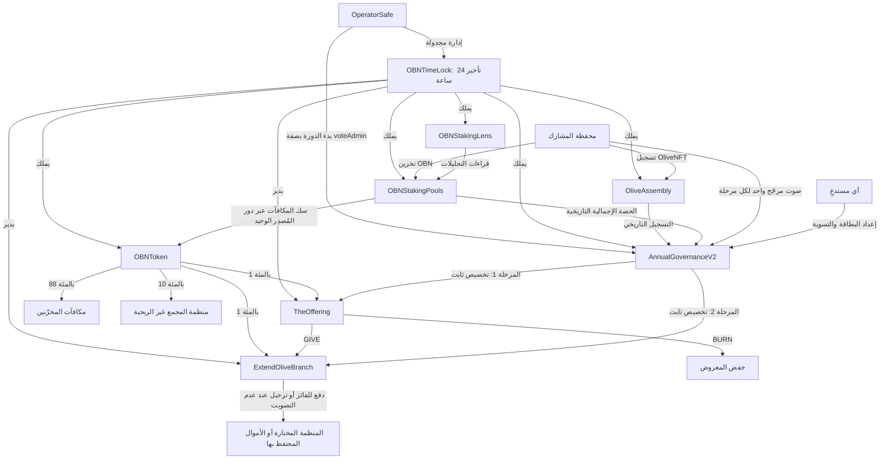

<div dir="rtl">

# العطاء بلا تضحية: إجابة بروتوكولية على تراجع المشاركة الخيرية الجماهيرية

[English](../THESIS.md) · [Tiếng Việt](THESIS.vi.md) · [한국어](THESIS.ko.md) · [日本語](THESIS.ja.md) · [简体中文](THESIS.zh-CN.md) · [हिन्दी](THESIS.hi.md) · **العربية** · [Русский](THESIS.ru.md) · [Deutsch](THESIS.de.md) · [Português](THESIS.pt.md) · [Español](THESIS.es.md) · [Bahasa Indonesia](THESIS.id.md)

> تُقدَّم هذه الترجمة للتيسير فقط. النسخة الإنجليزية ([THESIS.md](../THESIS.md)) هي النسخة المعتمدة، وعند وجود أي اختلاف تكون الأولوية للنسخة الإنجليزية. أُعدَّت هذه الترجمة بمساعدة الذكاء الاصطناعي انطلاقًا من المراجعة `3c740d855`، ولم يراجعها مترجم محترف بعد. تبقى أسماء العقود والدوال والعناوين باللغة الإنجليزية.

**أطروحة Olive Branch Network**

*Olive Branch Network — Base Mainnet*

*يوليو 2026 — مراجعة الحوكمة في 14 أكتوبر 2026*

---

## الملخص

يطرح العطاء الخيري في الولايات المتحدة مفارقة: يبلغ إجمالي التبرعات مستويات قياسية في كل عام تقريبًا، بينما يتراجع عدد من يتبرعون أصلًا منذ ربع قرن. انخفضت نسبة الأسر الأمريكية التي قدمت أي مساهمة خيرية من 66.2% في عام 2000 إلى 49.6% في عام 2018، وتراجعت أعداد المتبرعين كل عام منذ 2021 رغم نمو إجمالي الإيرادات. تتركز الأعمال الخيرية في طبقة أصغر وأكثر ثراءً من المتبرعين، مما يفرغ المشاركة الجماهيرية التي تقوم عليها الشرعية المدنية للقطاع غير الربحي.

تحاجج هذه الأطروحة بأن جذر انهيار المشاركة هيكلي لا أخلاقي: ففي ظل كل شكل تاريخي من أشكال المال — السلعي والإلزامي والرقمي المبكر — يكون العطاء *تضحويًا*. ينقل التبرع رأس المال نهائيًا من المتبرع إلى المستلم، فتصبح عتبة المشاركة هي الفائض القابل للتصرف — وهو حاجز لم تعد نسبة متزايدة من الأسر قادرة على تجاوزه مع تركز مكاسب الدخل الحقيقي في قمة التوزيع. يزيل المال القابل للبرمجة هذا القيد لأول مرة في التاريخ النقدي. ولأن العقد الذكي يستطيع فصل *ملكية الأصل* عن *توجيه العائد الذي يولّده ذلك الأصل*، يصبح من الممكن تصميم **عطاء بلا تضحية**: يحتفظ المتبرع برأس ماله بشكل دائم بينما يوجّه باستمرار حصة يفرضها البروتوكول من إنتاجيته إلى منفعة عامة يمكن التحقق منها باستقلال.

يُقدَّم بروتوكول Olive Branch Network (OBN) بوصفه تنفيذًا مرجعيًا لهذا التصميم. تقوم الأطروحة بما يلي: (i) تضع OBN ضمن التاريخ الطويل للتقنية النقدية؛ (ii) توثّق، ببيانات تجريبية موثقة، تراجع المشاركة الخيرية الذي يحفزه؛ (iii) تصوغ حلقة التغذية الراجعة بين المشاركة والقفل في البروتوكول، حيث ينقل كل مشارك إضافي رموز OBN من الكمية المتداولة إلى ضمان تعاقدي غير وصائي، فينكمش المعروض الفعلي مع نمو الاعتماد؛ (iv) تقدم وصفًا تقنيًا كاملًا لكل عقد ذكي أساسي — `OBNToken` و`OBNStakingPools` و`TheOffering` و`ExtendOliveBranch` و`AnnualGovernanceV2` و`OliveAssembly` و`OBNTimeLock` و`TeamVesting` و`OliveNFT` و`OBNStakingLens` — بما في ذلك مخططات التخزين والثوابت وهيكل التحكم في الوصول وآليات أمان الترقية، كما هي منشورة على شبكة Base الرئيسية.

---

## جدول المحتويات

1. [المقدمة](#الفصل-1--المقدمة)
2. [تاريخ المال: من السلعة إلى قابلية البرمجة](#الفصل-2--تاريخ-المال-من-السلعة-إلى-قابلية-البرمجة)
3. [التراجع التجريبي للمشاركة الخيرية](#الفصل-3--التراجع-التجريبي-للمشاركة-الخيرية)
4. [آلية المشاركة والقفل: اقتصاديات تدفق رموز OBN](#الفصل-4--آلية-المشاركة-والقفل-اقتصاديات-تدفق-رموز-obn)
5. [العقود الأساسية: وصف تقني كامل](#الفصل-5--العقود-الأساسية-وصف-تقني-كامل)
6. [البنية الأمنية والتصميم المؤسسي](#الفصل-6--البنية-الأمنية-والتصميم-المؤسسي)
7. [الحدود وتهديدات الصلاحية والعمل المستقبلي](#الفصل-7--الحدود-وتهديدات-الصلاحية-والعمل-المستقبلي)
8. [الخاتمة](#الفصل-8--الخاتمة)
9. [المراجع](#المراجع)

---

## الفصل 1 — المقدمة

### 1.1 بيان المشكلة

يؤطر هذا العمل اتجاهان طويلا الأمد. أولًا، ينهار *اتساع* العطاء الخيري: انخفضت نسبة الأسر الأمريكية التي تتبرع بأي شيء بنحو سبع عشرة نقطة مئوية بين 2000 و2018 (Indiana University Lilly Family School of Philanthropy, 2021)، وتُظهر بيانات ما بعد 2020 أن التراجع يتسارع بدلًا من أن يستقر (Fundraising Effectiveness Project, 2025). ثانيًا، يتركز *عمق* العطاء: يبلغ الإجمالي مستويات قياسية — $592.50 billion في 2024 (Giving USA, 2025) — لأن هدايا أكبر من متبرعين أقل وأكثر ثراءً تحل محل ملايين صغار المتبرعين الذين خرجوا.

تصف التفسيرات المعتادة — تراجع التدين، وركود الأجور، وعدم الثقة الجيلية في المؤسسات — الظاهرة لكنها لا تحلها، لأنها جميعًا تعود إلى القيد الهيكلي نفسه: **العطاء، كما تكوّن تاريخيًا، هو تخلٍّ دائم عن رأس المال.** لا تشارك الأسرة في العمل الخيري إلا عندما تتجاوز عتبة "لدي فائض يكفي لتحمل الخسارة". ومع تركز الفائض الحقيقي القابل للتصرف في قمة توزيع الدخل، تركزت المشاركة معه.

### 1.2 بيان الأطروحة

تدافع هذه الأطروحة عن ثلاثة ادعاءات:

1. **الادعاء التاريخي.** كل تقنية نقدية سابقة — من الإلكتروم الليدي إلى التزامات الاحتياطي الفيدرالي إلى العملات المشفرة من الجيل الأول المستخدمة كأدوات لحاملها — تجعل التخلي عن رأس المال العنصر الأولي *الوحيد* المتاح للعطاء. والمال القابل للبرمجة هو أول شكل نقدي تكون فيه *الملكية* و*توجيه العائد* قابلين للفصل على مستوى المال نفسه، لا عبر وسطاء موثوقين (الأوقاف، والصناديق الائتمانية، والصناديق الموجهة من المتبرع) لا يصل إليها في الغالب إلا الأثرياء.

2. **الادعاء التجريبي.** تشهد المشاركة الخيرية الجماهيرية تراجعًا طويل الأمد، ويتركز هذا التراجع تحديدًا في فئة صغار المتبرعين الذين تضغط عليهم عتبة التضحية أكثر من غيرهم. تدعم هذا الادعاء بيانات لوحية (Philanthropy Panel Study)، وبيانات معاملات على مستوى القطاع (Fundraising Effectiveness Project)، وتقديرات كلية (Giving USA)، تُستعرض في الفصل 3.

3. **ادعاء الآلية.** إن بروتوكولًا (a) يتيح للمشاركين تخزين الرمز دون التخلي عنه، و(b) يوجّه حصة ثابتة من انبعاثات البروتوكول إلى منظمات غير ربحية متحقق منها، و(c) يقفل رأس المال المخزّن في ضمان غير وصائي، ينتج تغذية راجعة بين المشاركة والمعروض: يزيل كل مشارك هامشي رموزًا من الكمية المتداولة، بحيث — مع ثبات الطلب وسياسة الانبعاث — تشدّ المشاركة الأوسع المعروض الفعلي ميكانيكيًا. يصوغ الفصل 4 ذلك ويعرض افتراضاته بأمانة، بما في ذلك القوة المعاكسة لانبعاثات المكافآت.

### 1.3 الإسهامات

- توليفة للتاريخ النقدي حول محور واحد: *ما الذي يستطيع المال نفسه فرضه* (الفصل 2).
- سجل تجريبي موحد وموثق لتراجع المشاركة الخيرية الأمريكية، 2000–2025 (الفصل 3).
- نموذج رسمي لتدفق الرموز في اقتصاد تخزين OBN، يشمل متطابقة الكمية المتداولة، وشرط توازن الانبعاث/القفل، ومصرف الحرق الذي تتحكم فيه الحوكمة (الفصل 4).
- أول مواصفة مكتوبة كاملة لمجموعة عقود OBN الأساسية كما نُشرت على Base وجرى التحقق منها في بيئة اختبار متفرعة من الشبكة الرئيسية، تغطي كل متغير حالة ودالة وحدث وثابت ومسار ترقية (الفصل 5)، إلى جانب بنيتها الأمنية والمؤسسية (الفصل 6).

### 1.4 البروتوكول في فقرة واحدة

Olive Branch Network رمز ERC-20 (`OBN`) على Base مع نظام تخزين من مجمعات لكل منظمة غير ربحية. يودع المشارك OBN في مجمع المنظمة غير الربحية التي يرغب في دعمها. لا يُنفق الإيداع أبدًا ولا يُنقل إلى المنظمة غير الربحية ولا يتعرض لخطر الخسارة لصالح البروتوكول؛ ويمكن سحبه في أي وقت (باستثناء مراكز الإقلاع المقفلة صراحة). أثناء التخزين، يسك البروتوكول انبعاثات زمنية مقابل الحصة ويقسم كل مكافأة محققة إلى أربعة أقسام عند المطالبة: **88% للمخزّن، و10% للمنظمة غير الربحية للمجمع، و1% لخزنة المشاعات (`TheOffering`)، و1% لخزنة التوزيع (`ExtendOliveBranch`).** يتحدد مصير تخصيص خزنة المشاعات المثبّت عند بداية الدورة — الحرق أو العطاء — سنويًا عبر تصويت من مرحلتين (`AnnualGovernance`) تشارك فيه المحافظ ذات OliveNFT المسجل، ويُرجَّح بالجذر التربيعي لحصة اللقطة، وتوجّه مرحلته الثانية التخصيص الثابت للدورة من خزنة التوزيع إلى منظمة غير ربحية يختارها المجتمع. يجسد التصميم المادة I من الميثاق: *"جعل من الممكن للشخص أن يحافظ على ملكية أصوله بينما يوجّه باستمرار جزءًا من القيمة التي تولّدها تلك الأصول نحو منفعة عامة خاضعة للمساءلة باستقلال"* (ميثاق OBN، المادة I).

---

## الفصل 2 — تاريخ المال: من السلعة إلى قابلية البرمجة

ليس الغرض من هذا الفصل الولع بالقديم. فكل مرحلة في تاريخ المال تُقرأ في ضوء سؤال واحد: *ما الذي يستطيع المال نفسه فرضه، وما الذي يجب تفويضه إلى مؤسسات موثوقة؟* وتحدد الإجابة أشكال العطاء الممكنة في كل مرحلة.

### 2.1 قبل السك: الهدية والدين وأسطورة المقايضة

تعود النظرية الشعبية لأصول النقد — أن المقايضة غير المريحة أفسحت المجال تلقائيًا لوسيط تبادل — إلى Adam Smith (1776)، وصاغها رسميًا Menger (1892) الذي نمذج المال بوصفه تقاربًا ناشئًا على السلعة الأكثر *قابلية للبيع*، وJevons (1875) الذي سمّى الاحتكاكات التي يحلها "التطابق المزدوج للرغبات". تحافظ نماذج البحث الحديثة (Kiyotaki & Wright, 1989) على هذا المنطق، وقد استخلص Kocherlakota (1998) أعمق دلالاته: المال مكافئ تقنيًا لـ *ذاكرة* مجتمعية لمن ساهم بماذا — "المال ذاكرة".

ومع ذلك لا يدعم السجل الأنثروبولوجي اقتصادات المقايضة الخالصة بوصفها سلف المال. خلصت Humphrey (1985) إلى أنه "لم يوصف قط أي مثال لاقتصاد مقايضة خالص وبسيط، فضلًا عن نشوء المال منه". وحشد Graeber (2011) الأدلة الإثنوغرافية وأدلة بلاد الرافدين على أن *الائتمان والالتزام يسبقان العملة بآلاف السنين*: فقد قيّمت دفاتر المعابد والقصور في سومر (نحو 3000 ق.م) الديون بالفضة والشعير قبل زمن طويل من تداول أي شخص للفضة كنقد. وتلتقط النظرية الائتمانية للمال (Mitchell-Innes, 1913) ونظرية الدولة (Knapp, 1905/1924) — المال كدين قابل للتحويل، والمال كما تقبله الدولة لسداد الضرائب — هذه الطبقة الأقدم.

تكتسب ملاحظتان أهمية لما يلي. أولًا، كان "المال" الأقدم *تقنية محاسبية* بالفعل — دفتر حسابات — وكانت رموزه المادية ثانوية. ثانيًا، في اقتصادات الهدية والالتزام، كان العطاء مكوِّنًا للانتماء الاجتماعي لا فعلًا تقديريًا للتصرف في الفائض (Mauss, 1925). إن اختزال العطاء إلى نقل طوعي للفائض نتاج لأشكال نقدية لاحقة، وليس ثابتًا إنسانيًا.

### 2.2 السك: المال كأداة سيادية لحاملها (نحو 640 ق.م – 1000 م)

يظهر السك الموحد في ليديا في القرن السابع قبل الميلاد — قطع إلكتروم تختمها الدولة — وينتشر بسرعة مذهلة عبر المدن اليونانية وفارس والهند (*karshapana* المثقبة) والصين في عصر الممالك المتحاربة (Davies, 2002; Schaps, 2004). ابتكار العملة هو *التحقق بنظرة واحدة*: يحل الختم السيادي مشكلة الفحص، فيجعل القيمة قابلة للتحويل بين الغرباء دون ثقة أو سجل.

لكن لاحظ ما تفرضه التقنية وما لا تستطيعه. تفرض العملة *نهائية الحامل*: من يحملها يملكها ملكية مطلقة. ولا يمكنها ترميز الشروط أو التدفقات أو التقسيمات أو العودة. وبالتالي فإن العنصر الأولي الوحيد للعطاء الذي يدعمه السك هو النقل الصريح للعملة — تضحية خالصة برأس المال. وكل ما هو أكثر تطورًا (أوقاف المعابد، و*alimenta* الرومانية، و*waqf* الإسلامي، والكنائس الوقفية في العصور الوسطى) تطلب تغليف المال في *مؤسسة قانونية* يديرها بشر موثوقون. كان العطاء الموجّه بالعائد موجودًا — فالوقف تحديدًا أصل يُوجَّه دخله إلى المنفعة العامة بشكل دائم بينما يبقى أصله غير قابل للتصرف (Kuran, 2001) — لكنه لم يكن متاحًا إلا لمن هم أثرياء بما يكفي لإنشاء مؤسسة حول أصولهم.

### 2.3 الورق والمصارف والبنية الفوقية للائتمان (1000–1971)

أصدرت الصين في عهد سونغ أول نقد ورقي حكومي (*jiaozi*، جرى إضفاء الطابع الرسمي عليه عام 1024 م)، فاكتشفت كلًا من إصدار الأوراق القابلة للتحويل، وخلال قرنين، الإفراط التضخمي في الإصدار (Von Glahn, 1996). وفي أوروبا، مر التسلسل عبر الكمبيالات وإيصالات الصاغة وبنك إنجلترا (1694) ومعيار الذهب في القرن التاسع عشر — وهو نظام نقدي انضبط فيه عرض النقود بقابلية التحويل بينما كان الوسيط المتداول الفعلي هو *ائتمان* المصارف في الغالب (Ferguson, 2008; Eichengreen, 1996). حافظ نظام بريتون وودز (1944) على مرساة ذهبية على مسافة واحدة؛ وأكمل تعليقه من قبل الولايات المتحدة في 15 أغسطس 1971 ("صدمة نيكسون") الانتقال إلى النقد الإلزامي الخالص: المال كالتزام غير مغطى على الدولة، تتحدد قيمته بالمرسوم وقبول الضرائب وتوقعات الشبكة — وتحققت نظرية Knapp الشارتالية بالكامل (Eichengreen, 1996).

بالنسبة إلى العطاء، غيّر عصر النقد الإلزامي والمصارف الحجم لا البنية. دعمت أنظمة الخصم الخيري (في الولايات المتحدة منذ 1917) التضحية؛ وحوّلت المؤسسات الخيرية وصناديق الباقي الخيرية والصناديق الموجهة من المتبرع نمط الوقف — *الملكية محتفظ بها أو محمية، والعائد موجّه* — إلى صناعة، لكن كلًا منها يتطلب تأسيسًا قانونيًا وحدودًا دنيا ومستشارين. واستمر عدم التماثل الهيكلي: **يتبرع الأثرياء من العائد؛ ويتبرع الآخرون جميعًا من رأس المال.** يوثق الفصل 3 النتيجة المتوقعة.

### 2.4 التسوية الرقمية والنقد الإلزامي الإلكتروني (1971–2008)

بين صدمة نيكسون و2008، فقد المال طابعه المادي تشغيليًا — جعلت Fedwire وSWIFT (1973) وشبكات البطاقات ومدفوعات الإنترنت معظم المال قيودًا في قواعد بيانات المصارف — دون تغيير منطقه. يبقى النقد الإلزامي الإلكتروني سند دين تفرض قواعده جهات وسيطة منظمة. أظهر Chaum (1983) أن التشفير يمكنه إنشاء نقد رقمي لحامله، لكن DigiCash الخاص به مركز الإصدار وفشل تجاريًا؛ وأوجز "b-money" لـ Dai (1998) و"bit gold" لـ Szabo (تصوّره أواخر التسعينيات، ونشره 2005) إصدارًا لامركزيًا دون حل مشكلة الإنفاق المزدوج.

### 2.5 بيتكوين: ندرة بلا سيادة (2008)

حل Nakamoto (2008) مشكلة الإنفاق المزدوج دون طرف موثوق بالجمع بين إجماع إثبات العمل على دفتر عام وجدول إصدار ثابت. إسهام بيتكوين في التاريخ النقدي دقيق: **ندرة رقمية وتسوية نهائية يفرضهما البروتوكول لا المؤسسة.** ولأول مرة أصبحت *قواعد المال* — وفي مقدمتها منحنى عرضه — خصائص للمال نفسه.

ومع ذلك يقيّد نص بيتكوين البرمجي قدرته التعبيرية عمدًا. وبوصفه مالًا، يبقى قريبًا من العملة: أداة لحاملها بمعروض صلب. والعطاء ببيتكوين يبقى تخليًا عن رأس المال.

### 2.6 إيثريوم والمال القابل للبرمجة (2015– )

عمّم Buterin (2014) سلسلة الكتل إلى آلة حالة كاملة وفق تورينغ. مع إيثريوم — وسلاسل EVM مثل Base، حيث يُنشر OBN — يصبح المال *قابلًا للبرمجة*: يُنفَّذ أي منطق بالنهائية نفسها التي للدفع. جعل معيار ERC-20 (Vogelsteller & Buterin, 2015) القيمة المرمّزة عنصرًا أوليًا قابلًا للتركيب؛ وأظهرت ERC-4626 وأنظمة التخزين والحوكمة على السلسلة (مثل نمط Governor في Compound) أن **الحفظ والعائد والتصويت والصرف يمكن أن تكون جميعها خصائص للبروتوكول.**

هذه هي نقطة ارتكاز الحجة التاريخية. احتاج نمط الوقف/الوقفية — الأصل غير قابل للتصرف، والانتفاع موجّه إلى المنفعة العامة — إلى مؤسسة موثوقة طوال ألف عام، ولذلك كان أداة للأثرياء. ينفذ العقد الذكي النمط نفسه لأي حامل بأي حجم، مع:

- **ضمان غير وصائي** ("أصل الوقفية" تحتفظ به شيفرة غير قابلة للتغيير، لا وصي);
- **تعيين مستمر قابل للإلغاء** (يمكن للمشارك إعادة التوجيه أو السحب في أي وقت — قابلية الفصل في المادة III من الميثاق);
- **تقسيمات يفرضها البروتوكول** (التقسيم 88/10/1/1 في OBN حساب في `_mintSlices`، لا تقدير وصي);
- **تسجيل قابل للتحقق** (كل مساهمة حدث على السلسلة، بما يلبي المادة VI من الميثاق).

وفق هذه القراءة، تاريخ المال هو تاريخ إدخال وظائف كانت مفوضة إلى المؤسسات تدريجيًا في المال نفسه: التحقق (السك)، والسجل (المصارف)، والندرة (بيتكوين)، وأخيرًا *البنية الائتمانية* (المال القابل للبرمجة). OBN تطبيق للمرحلة الأخيرة على أقدم وظيفة نقدية على الإطلاق — الهدية.

---

## الفصل 3 — التراجع التجريبي للمشاركة الخيرية

يثبت هذا الفصل المقدمة الثانية ببيانات منشورة: **عدد من يعطون يتراجع، باستمرار وعبر كل مصدر بيانات رئيسي، حتى مع ارتفاع إجمالي الدولارات.**

### 3.1 تراجع المشاركة طويل الأمد (Philanthropy Panel Study، 2000–2018)

يأتي أكثر الأدلة الطولية صرامة من *Philanthropy Panel Study* في Indiana University Lilly Family School of Philanthropy، وهي لوحة تمثيلية على المستوى الوطني لأكثر من 9,000 أسرة أمريكية يُتتبَّع عطاؤها كل سنتين.

- في **عام 2000، قدمت 66.2% من الأسر الأمريكية** مساهمة خيرية.
- وبحلول **عام 2018، لم يفعل ذلك سوى 49.6%** — وهي المرة الأولى المسجلة التي يتبرع فيها أقل من نصف الأسر الأمريكية، وانخفاض يقارب 17 نقطة مئوية (Lilly Family School of Philanthropy, 2021).
- تراجع العطاء الديني من **46% من الأسر (2000–2004) إلى 29% (2018)**؛ وتراجع العطاء غير الديني من مستوى 55–57% (2000–2008) إلى **42% في 2018** (Lilly Family School of Philanthropy, 2021).
- وجدت تحليلات لاحقة أن التراجع **تسارع خلال السنة الأولى من جائحة COVID-19** (Lilly Family School of Philanthropy, *The Giving Environment*, 2022; NonProfit PRO, 2022)، وأن المشاركة انخفضت لدى جميع الفئات العرقية والإثنية (The NonProfit Times, 2023).

ينسب تقرير *Giving Environment* الصادر عن الكلية التراجع جزئيًا إلى انخفاض وركود دخول الأسر المتوسطة والمنخفضة الدخل وإلى تغير الأعراف المتعلقة بالانتماء الديني (Lilly Family School of Philanthropy, 2022) — وكلاهما تعبير عن عتبة التضحية: تعطي الأسر عندما تستطيع تحمل خسارة المال، ويقل عدد من يستطيعون ذلك.

### 3.2 استمرار تراجع أعداد المتبرعين بعد 2018 (Fundraising Effectiveness Project، 2021–2025)

يوسّع Fundraising Effectiveness Project (FEP)، الذي يجمع بيانات معاملات التبرع الفعلية عبر آلاف المنظمات غير الربحية، السجل إلى ما بعد الدراسات اللوحية ويُظهر أن التراجع مستمر:

- انخفضت أعداد المتبرعين **كل عام منذ 2021** (AFP/FEP, 2026).
- من 2023 إلى 2024، انخفض عدد المتبرعين **4.5% على أساس سنوي**، مع *تسارع* التراجع مقارنة بالسنوات السابقة (تقرير FEP Q4 2024; GlobeNewswire, 2025).
- في **2025، انخفضت أعداد المتبرعين بنحو 3.6% أخرى**، حتى مع نمو إجمالي الدولارات الخيرية 5.0% — وهو أقوى نمو في الإيرادات منذ خمس سنوات، تحقق بعدد أقل من المتبرعين (AFP/FEP, 2026).
- يتركز التسرب في الطرف الصغير: انخفض المتبرعون بمبالغ **$1–$100 — الذين يشكلون أكثر من نصف جميع المتبرعين — بنسبة 8.8% في 2024 و11.1% على أساس سنوي في الربع الأول من 2025** (FEP; NonProfit PRO, 2025).
- يدور معدل الاحتفاظ العام بالمتبرعين حول **43%**، ومعدل الاحتفاظ بالمتبرعين الجدد أقل بكثير، مما يعني أن معظم من يتبرعون لأول مرة لا يتبرعون مرة أخرى أبدًا (FEP, 2025–2026).

إن صياغة FEP نفسها هي بالضبط أطروحة التركز: مكاسب الإيرادات "متركزة في الهدايا الأكبر"، مع "تراجعات مستمرة في إجمالي أعداد المتبرعين" (AFP, 2025).

### 3.3 الدولارات ترتفع والمتبرعون ينخفضون (Giving USA، 2024–2025)

يكمل Giving USA، أطول تقدير كلي مستمر للعمل الخيري الأمريكي، هذه المفارقة:

- بلغ إجمالي العطاء **$592.50 billion في 2024**، وهو رقم قياسي بالدولار الجاري، بزيادة 6.3% اسميًا و3.3% بعد التعديل وفق التضخم (Giving USA 2025).
- ارتفع إجمالي العطاء مرة أخرى إلى ما يقدر بـ **$617.2 billion في 2025** (Giving USA 2026; Give.org, 2026).
- لكن **انخفضت حصة العطاء الفردي من الإجمالي من نحو 80% في 1986–1990 إلى 66% في 2024 و64% في 2025**، بينما تعوّض المؤسسات والوصايا والشركات — أدوات الثروة المتراكمة — النقص (Giving USA 2026; Give.org, 2026; Stelter, 2026).

### 3.4 التوليف: عتبة التضحية

عبر ثلاث منهجيات مستقلة — لوحة الأسر (PPS)، وتجميع المعاملات (FEP)، والتقدير الكلي (Giving USA) — تظهر الصورة نفسها:

| المؤشر | آنذاك | الآن | الاتجاه |
|---|---|---|---|
| الأسر التي تعطي أي شيء (PPS) | 66.2% (2000) | 49.6% (2018) | ↓ 16.6 pts |
| الأسر التي تعطي للدين (PPS) | 46% (2000–04) | 29% (2018) | ↓ 17 pts |
| عدد المتبرعين، سنويًا (FEP) | — | −4.5% (2024), −3.6% (2025) | ↓ متسارع |
| صغار المتبرعين $1–$100 (FEP) | 50–57% من جميع المتبرعين | من −8.8% إلى −11.1% سنويًا | ↓ الفئة الأشد |
| حصة الأفراد من إجمالي العطاء (Giving USA) | ~80% (1986–90) | 64% (2025) | ↓ 16 pts |
| إجمالي الدولارات (Giving USA) | — | $592.5B (2024), $617.2B (2025) | ↑ مستويات قياسية |

يُعاد رسملة القطاع من القمة بينما تتآكل قاعدته التشاركية. وهذا بالضبط ما يتوقعه المرء إذا كان العطاء يتطلب فائضًا وكان الفائض قد تركز. يحل الأثرياء مشكلة *التمويل* في القطاع غير الربحي؛ أما مشكلة *المشاركة* — الوظيفة المدنية والديمقراطية والمشرعنة لملايين الهدايا الصغيرة — فلا تُحل إطلاقًا، لأنه لا توجد أداة تتيح لأسرة غير ثرية أن تعطي باستمرار دون خسارة.

يصف الفصل 4 مثل هذه الأداة.

---

## الفصل 4 — آلية المشاركة والقفل: اقتصاديات تدفق رموز OBN

يصوغ هذا الفصل الجوهر الاقتصادي للبروتوكول: **المشاركة تقفل المعروض.** يستند كل ادعاء إلى شيفرة عقد محددة موصوفة بالكامل في الفصل 5؛ وهنا نتعامل مع النظام بوصفه آلة لتدفق الرموز.

### 4.1 التخصيصات التكوينية والاحتياطيات الحالية

يسجل الجدول التالي السك التكويني التاريخي، لا الاحتياطيات غير المنفقة الحالية. سك `OBNToken.initialize` المعروض الأولي بأكمله مرة واحدة بالضبط، بنسب ثابتة (OBNToken.sol):

| التخصيص | الحصة | الغرض |
|---|---|---|
| السيولة | 40% | سيولة DEX كي يمكن الحصول على الرمز |
| الإسقاط الجوي | 30% | بذر توزيع أولي واسع |
| الصندوق الخيري | 10% | إقلاع مراكز المجمعات غير الربحية (مقفلة بشكل دائم — §4.4) |
| الخزانة | 10% | عمليات البروتوكول (تخصيص تكويني لمرة واحدة؛ لا يتدفق إليها أي تيار انبعاث) |
| استحقاق الفريق | 10% | مقفل زمنيًا في `TeamVesting` (فترة انتظار 4 أشهر، خطي 20 شهرًا) |

لا يمكن أي سك إضافي إلا من المُصدِر الوحيد المعيّن مرة واحدة — عقد التخزين — لذا فإن *كل* نمو المعروض بعد التكوين هو انبعاثات تخزين.

يبلغ إجمالي تخصيص احتياطي البذور غير الربحية **300M OBN**، مع الاحتفاظ بـ **50M OBN** بشكل منفصل لاحتياجات البروتوكول. جرى دمج حيازات الخزانة والإسقاط الجوي في تخصيص البذور. وعند تلك النقطة كان 11M OBN قد موّل بالفعل 11 بذرة غير ربحية، مما ترك 289M OBN لـ 289 بذرة إضافية بقيمة 1M OBN لكل منها.

هذه إعادة تخصيص لحيازات قائمة، وليست سكًا جديدًا أو تغييرًا في المُهيِّئ المنشور.

### 4.2 متطابقة الكمية المتداولة

نعرّف عند الزمن *t*:

- **S(t)** — إجمالي المعروض: المعروض التكويني مضافًا إليه الانبعاثات التراكمية ومطروحًا منه الحرق التراكمي.
- **K(t)** — الرموز التي يحتفظ بها عقد التخزين: مجموع جميع أرصدة `userAmount` (رأس المال فقط؛ تُسك المكافآت مباشرة للمستلمين ولا تُجمع أبدًا).
- **V(t)** — الرموز التي لا تزال مقفلة في `TeamVesting`.
- **G(t)** — الرموز المتراكمة في خزنتي الحوكمة (`TheOffering` و`ExtendOliveBranch`) بانتظار الدورة السنوية.
- **B(t)** — الرموز المحروقة تراكميًا (عبر `TheOffering.burn` وأي `ERC20Burnable.burn` طوعي).

عندئذ تكون **الكمية المتداولة** — المعروض المتاح فعليًا للتداول — هي:

> **F(t) = S(t) − K(t) − V(t) − G(t)**   حيث   **S(t) = S₀ + E(t) − B(t)**

حيث E(t) إجمالي الانبعاثات التراكمية. ادعاء الآلية هو عبارة عن ∂F/∂(المشاركة): **ينقل كل إيداع الرموز من F إلى K واحدًا مقابل واحد** (تنفذ `_depositCore` الدالة `safeTransferFrom(msg.sender, address(this), amount)`)، وتبقى الرموز في K حتى يختار ذلك المشارك تحديدًا السحب. لا يُقرض البروتوكول K ولا يعيد رهنها ولا ينفقها أبدًا؛ لا يوجد خفض (slashing) ولا مطالبة للبروتوكول على رأس المال. K ضمان خامل.

### 4.3 سياسة الانبعاث: متناقصة ومتناسبة مع المشاركة

الانبعاثات *ليست* صنبورًا ثابتًا. تراكم `_sumRewardAcrossPhases` المكافآت لكل مجمع على النحو `poolStake × bps × Δt / (10000 × 365 days)` — أي **نسبة مئوية سنوية مما هو مخزّن فعليًا**، وفق جدول متناقص:

| السنوات منذ النشر | معدل الانبعاث السنوي (على الرصيد المخزّن) |
|---|---|
| 0–2 | 10.00% |
| 2–4 | 7.50% |
| 4–6 | 5.00% |
| 6–8 | 2.50% |
| 8–10 | 1.25% |
| 10+ | 3.00% بديل (`FALLBACK_EMISSION_BPS`)، حتى تعدّله الحوكمة عبر `addPhase` |

تترتب نتيجتان. أولًا، **تتناسب الانبعاثات مع K لا مع S**: لا تولّد الرموز غير المخزّنة شيئًا. ثانيًا، لأن المكافآت لا تُسك إلا عند *أحداث المطالبة* (الإيداع، السحب، المطالبة)، فإن المكافآت غير المطالب بها مجرد قيد محاسبي (`accRewardPerShare × balance − rewardDebt`) — ولا توجد كرموز حتى تتحقق.

### 4.4 التقسيم الرباعي ومصارفه

عند كل تحقيق، تقسم `_mintSlices` إجمالي المكافأة المعلقة:

- **88% → المخزّن.** عائد المشارك. يُسك حديثًا ويدخل F (أو يُعاد تخزينه).
- **10% → محفظة المنظمة غير الربحية للمجمع.** الهدية. مستمرة، يفرضها البروتوكول، ومتناسبة مع حصة المشارك والزمن. هذه هي *المساهمة* في المادة VII من الميثاق، ولا تكلف المخزّن أي رأس مال — بل حصة فقط من عائد ما كان ليوجد لولا البروتوكول.
- **1% → `TheOffering`** (خزنة المشاعات). تتراكم طوال العام؛ وتصوّت كل دورة حوكمة سنوية على **حرق** التخصيص المثبّت عند بداية الدورة (مصرف انكماشي، يخفض S) أو **إعطائه** (نقله إلى `ExtendOliveBranch`).
- **1% → `ExtendOliveBranch`** (خزنة التوزيع). تتراكم طوال العام؛ ويوجّه تصويت المرحلة 2 في كل دورة حوكمة سنوية التخصيص الثابت لتلك الدورة إلى منظمة غير ربحية واحدة في القائمة البيضاء يختارها المجتمع (أو يُرحَّل إذا لم يصوّت أحد).

لاحظ أن **أي تيار انبعاث لا يتدفق إلى الخزانة**: فالحصتان المتبقيتان تغذيان خزنتين تتحكم فيهما الحوكمة. وحتى التصرف السنوي فيهما، يبقى كلا التيارين في ضمان الخزنة (G في §4.2) — خارج الكمية القابلة للتداول.

إضافة إلى ذلك، يُنشر التخصيص التكويني البالغ 10% للصندوق الخيري عبر `charityFundBootstrap`/`depositForWithLock`، الذي يخزّن الرموز *نيابة عن محفظة كل منظمة غير ربحية نفسها* مع تعيين `lockedAmount` مساويًا للإيداع — وهو **قفل دائم** (يمكن زيادة الأقفال فقط، ولا يمكن تخفيضها مطلقًا). لذلك تساهم مراكز الإقلاع في K إلى الأبد، وتضمن لكل مجمع تيار مكافآت أساسيًا لمنظمته غير الربحية، ولا يمكن بيعها مطلقًا.

### 4.5 حلقة التغذية الراجعة بين المشاركة والقفل

لنجمع الأجزاء. ليكن *n* عدد المشاركين النشطين و*k̄* متوسط الحصة. عندئذ K = n·k̄ (مضافًا إليها أقفال الإقلاع)، و:

1. **الاعتماد يشدّ الكمية المتداولة.** يحوّل كل مشارك جديد الرموز المتداولة إلى رأس مال مضمون: ΔF = −Δstake. مع ثبات الطلب، يرفع انكماش الكمية القابلة للتداول سعر توازن السوق — وهي نتيجة العرض والطلب القياسية، والنظير على السلسلة لـ "انكماش الكمية المتداولة" الملاحظ منذ زمن في اقتصادات إثبات الحصة حيث تقلل نسب التخزين المرتفعة المعروض السائل.
2. **يكافئ العائد الصبر، ويمكن إعادة استثمار 88% من العائد.** ينقل المخزّنون الذين يعيدون تخزين حصتهم البالغة 88% الرموز المسكوكة حديثًا مباشرة إلى K، مما يشدّ F أكثر.
3. **يموّل تيار الهدية الشرعية في العالم الحقيقي.** يمنح تيار 10% غير الربحي المؤسسات الخارجية سببًا دائمًا لتعزيز المشاركة، مما يجذب مزيدًا من المشاركين — وهي قناة التسويق الوحيدة التي تُعد بحد ذاتها عملًا خيريًا.
4. **يمكن للحوكمة تحويل المشاعات إلى انكماش خالص.** تدمر نتيجة BURN في المرحلة 1 تخصيص المشاعات المثبّت عند بداية الدورة، فتخفض S مباشرة. لاحظ أن الافتراضي انكماشي عمدًا: *انعدام المشاركة → BURN* (يجب أن يتجاوز GIVE قيمة BURN *تجاوزًا صارمًا*).
5. **تتطلب أهلية التصويت المشاركة عند اللقطة.** يجمع V2 بين حالة NFT المسجل وما لا يقل عن 1 OBN من الحصة الإجمالية ذات نقاط التحقق، ثم يطبق وزن الجذر التربيعي. توفر الحوكمة سببًا للتخزين قبل بدء كل دورة؛ لكنها لا تتطلب البقاء مخزّنًا بعد ذلك ولا تنشئ قفلًا مستمرًا طوال التصويت (§5.5).

الحلقة: **مشاركون أكثر → رموز مقفلة أكثر → كمية متداولة أصغر وخيار حرق تراكمي أكبر → دعم سعري أفضل → قيمة عائد وقيمة هدية أعلى لكل رمز → استقطاب أقوى → مشاركون أكثر.**

### 4.6 محاسبة أمينة: ثقل الانبعاثات المعاكس

للآلية قوة معاكسة. الانبعاثات تضخمية: عند المعدل الأولي 10%، ينمو S بما يتناسب مع K. ويتوقف *انكماش* صافي الكمية المتداولة على التدفقات المحققة. باشتقاق متطابقة الكمية المتداولة، يكون تدفق الانبعاث الداخل إلى الكمية المتداولة:

> **dF/dt ≈ e·K·[0.88·(1−r) + 0.10 + 0.02·(1−β)·δ] − dK/dt**

حيث *e* معدل الانبعاث الحالي، و*r* نسبة مكافآت المخزّنين المعاد تخزينها، و*β* نسبة تيارات الخزنتين التي تُحرق في النهاية في المرحلة 1، و*δ* ≤ 1 عامل تأخير يعكس أن تياري الخزنتين البالغين 1% لا يدخلان الكمية المتداولة إلا بعد توزيعهما في الدورة السنوية (المبالغ المحروقة لا تدخل أبدًا؛ ويؤجل الترحيل الدخول أكثر). تنكمش الكمية المتداولة (dF/dt < 0) كلما **تجاوز صافي التخزين الجديد الجزء غير المعاد تخزينه من الانبعاثات**. تدفع السمات الهيكلية في هذا الاتجاه — يتناقص جدول الانبعاث 10% → 1.25% بينما يُراد للاعتماد أن ينمو؛ والمستلمون غير الربحيين بائعون تحركهم الرسالة لكن تدفقهم الداخل لا يتجاوز 10% من الانبعاثات؛ ويزيل الحرق الافتراضي المشاعات نهائيًا؛ ولا تخرج أقفال الإقلاع أبدًا — لكن الشرط تجريبي وليس مضمونًا. لذلك فإن الادعاء المدافع عنه هنا محدود بدقة: *صُمّم البروتوكول بحيث يؤدي نمو المشاركة إلى انكماش ميكانيكي للكمية المتداولة وخلق ظروف تدعم سعر الرمز، مع بقاء العوامل الأخرى ثابتة؛ ولا يضمن ولا يستطيع أن يضمن ارتفاع السعر، الذي يعتمد أيضًا على طلب خارجي.*

### 4.7 العطاء بلا تضحية، بصياغة جديدة

يحل التصميم الاقتصادي مشكلة الفصل 3 مباشرة. لم تعد عتبة المشاركة "الفائض الذي يمكنني تحمل خسارته" بل "رأس المال الذي أرغب في إيداعه". يمكن للأسرة التي لم تستطع قط التبرع بـ $500 أن تخزّن $500، وتحتفظ بها، وتسحبها في حالة طارئة، وأن توجّه في الأثناء باستمرار 10% من العائد الذي تولّده حصتها — مساهمات حقيقية يفرضها البروتوكول وتُسجَّل علنًا — إلى منظمة غير ربحية متحقق منها. يصبح العطاء *قرارًا لتخصيص الأصول* لا *تضحية استهلاكية*. تلك هي إجابة التصميم على انهيار المشاركة: ليس حثّ الناس على إعطاء المزيد، بل إزالة السبب الهيكلي الذي جعلهم يتوقفون.

---

## الفصل 5 — العقود الأساسية: وصف تقني كامل

تستهدف جميع العقود Solidity ^0.8.28، وتُبنى على OpenZeppelin v5، وتُنشر على Base. تستخدم العقود القابلة للترقية نمط UUPS (`_authorizeUpgrade` مقصورة على المالك، وهو `OBNTimeLock`). يصف هذا الفصل كل عقد في المجموعة: الغرض، والتخزين، والدوال، والأحداث، والثوابت، والتفاعلات.

### 5.1 `OBNToken` — القاعدة النقدية (OBNToken.sol)

**الوراثة.** `Initializable` و`IOBNMintable` و`ERC20Upgradeable` و`ERC20PermitUpgradeable` (موافقات EIP-2612 بلا غاز) و`ERC20VotesUpgradeable` (تفويض بنقاط تحقق) و`ERC20BurnableUpgradeable` و`OwnableUpgradeable` و`UUPSUpgradeable`.

**الهوية.** الاسم "Olive Branch Network"، والرمز "OBN".

**التخزين.** متغير مخصص واحد — `address public minter` — إضافة إلى `uint256[100] __gap` الذي يحجز مساحة للترقية.

**التهيئة.** تعمل `initialize(initialOwner, initialSupply, liquidityAddress, airdropAddress, charityAddress, treasuryAddress, teamVestingAddress)` مرة واحدة (معدّل initializer؛ يستدعي المُنشئ `_disableInitializers()` بحيث لا يمكن تهيئة التنفيذ نفسه أبدًا). بعد فحوص العنوان الصفري والمعروض غير الصفري، تسك التوزيع الكامل: 30% إسقاط جوي، و40% سيولة، و10% خيري، و10% خزانة، و10% استحقاق الفريق (§4.1).

**آليات المُصدِر.** `setMinterOnce(addr)` — للمالك فقط، وتتطلب `minter == address(0)`: يمكن تعيين المُصدِر **مرة واحدة بالضبط** طوال عمر التنفيذ (لا يغيره إلا ترقية UUPS كاملة). تتطلب `mint(to, amount)` أن يكون `msg.sender == minter`. في النشر، المُصدِر هو وكيل `OBNStakingPools`؛ ولذلك *كل المعروض المستقبلي انبعاثات تخزين*. `isMinter(addr)` طريقة عرض مساعدة.

**التجاوزات.** يوجّه OZ v5 جميع تغييرات الرصيد عبر `_update`، لذا يوفّق تجاوز واحد بين `ERC20Upgradeable` و`ERC20VotesUpgradeable` (تتتبع نقاط تحقق الأصوات التحويلات تلقائيًا). وتُتجاوز `nonces()` للتوفيق بين `ERC20PermitUpgradeable` و`NoncesUpgradeable`.

**خصائص الأمان.** لا إيقاف مؤقت، ولا قائمة سوداء، ولا ضريبة تحويل: الرمز محايد إلى أقصى حد. الحرق متاح لأي حامل عبر `ERC20Burnable` — وهو الخطاف الذي يستخدمه `TheOffering` لتدمير المشاعات.

### 5.2 `OBNStakingPools` — المحرك (StakingPoolsV931.sol؛ سلسلة الإصدار "9.3.1")

عقد التخزين هو العقد الأكبر والأكثر أهمية في النظام: فهو مُصدِر OBN الوحيد، والوصي على كل رأس المال المخزّن (K في §4.2)، وأوراكل قوة التصويت للحوكمة. يعمل خلف وكيل UUPS على عنوان ثابت.

#### 5.2.1 الثوابت — التقسيم غير القابل للتغيير

```solidity
STAKER_BPS = 8800; CHARITY_BPS = 1000; CHARITY_FUND_BPS = 100; TREASURY_BPS = 100;
TOTAL_BPS = 10000; FALLBACK_EMISSION_BPS = 300;
```

التقسيم 88/10/1/1 هو `constant` — مُجمَّع في الشيفرة الثنائية، ولا يمكن تغييره دون ترقية تنفيذ كاملة عبر timelock. تُسك الحصتان البالغتان 100-bps إلى العنوانين المحفوظين في متغيري التخزين `treasury` و`charityFund`؛ **في التكوين المنشور يحتفظ هذان المتغيران بـ `TheOffering` (0xc75B…E341) و`ExtendOliveBranch` (0xE1Bb…6d8B) على التوالي** — المعرّفات تاريخية، والمستلمان الفعليان لتياري 1% هما خزنتا الحوكمة (§5.3، §5.4). `FALLBACK_EMISSION_BPS` هو الحد الأدنى الدائم البالغ 3% المطبق بعد انتهاء جدول المراحل المحدد (§4.3).

#### 5.2.2 مخطط التخزين

مرتب حسب الخانات وحرج للترقية (يوثّق العقد خريطة خاناته؛ الفراغ الختامي هو `uint256[93]`؛ وتقع حالة المطالبة التلقائية الشهرية خارج هذه الخريطة في تخزين ERC-7201 ذي نطاق الأسماء عند `obn.storage.MonthlyAutoClaim`):

- **الإعدادات:** `stakingToken` (رمز OBN بوصفه `IOBNMintable`)، و`treasury` (→ TheOffering)، و`charityFund` (→ ExtendOliveBranch)، و`version` (سلسلة، "9.3.1").
- **جدول الانبعاث:** `Phase[] phases`، كل منها `{start, end, bps}` بالطوابع الزمنية.
- **المجمعات:** `PoolInfo[] poolInfo`، كل منها `{charityWallet, totalStaked}` — مجمع واحد لكل منظمة غير ربحية.
- **محاسبة المستخدم:** `userAmount[pid][user]` و`userRewardDebt[pid][user]` — نمط المراكم/دين المكافآت (§5.2.3).
- **المراكمات:** `accRewardPerShare[pid]` (بمقياس 1e12) و`lastRewardTime[pid]`.
- **عام:** `globalTotalStaked`.
- **الأقفال:** `lockedAmount[pid][user]` — دفتر الأقفال الدائمة (§4.4).
- **الإحصاءات:** `totalClaimedByUser` و`totalDepositedByUser` و`totalWithdrawnByUser`، ومجاميع الإيداع/السحب/charity المسكوك لكل مجمع، و`uniqueStakersByPool` و`uniqueStakersGlobal` و`activePoolCount[user]` و`stakedSince[user]` و`cumulativeStakeSeconds[user]` (تستمر بعد إلغاء التخزين الكامل — سجل دائم للأقدمية).
- **دورة الحياة:** `poolRemoved[pid]` (الإيداعات معطلة)، و`poolFullyRemoved[pid]` (مشطوب من بطاقات الحوكمة — لا تعيّنه إلا `removePool`، ولا تعيّنه `shutdownPool` أبدًا).
- **تتبّع المساهمة:** `charityContributedByUserInPool[pid][user]` و`totalCharityContributedByUser[user]` — عطاء كل مشارك المنسوب إليه مدى الحياة، وهو *السجل* على السلسلة وفق المادة VI من الميثاق.
- **توصيلات الحوكمة (الخانات 28–30):** `charityFundOperator` + `_migrationExecuted` + `upgradeBlock` (معبأة في خانة واحدة)، و`totalStakedByUser[user]` (مجموع جارٍ عبر المجمعات)، و`_stakeCheckpoints[user]` (`Checkpoints.Trace208` — تاريخ قوة التصويت). يشغل `poolFullyRemoved`، المذكور ضمن دورة الحياة أعلاه، الخانة 31.

#### 5.2.3 نموذج المحاسبة

يستخدم OBN مخطط المراكم/دين المكافآت مع تغيير حاسم: **يتتبع المراكم المكافآت الإجمالية (GROSS).** عند أي لمسة للمجمع، تحسب `_accruePool` إجمالي الانبعاث منذ `lastRewardTime` عبر `_sumRewardAcrossPhases` — التي تمشي في جدول المراحل مقطعًا مقطعًا، وتعالج حدود المراحل بدقة عبر `Math.mulDiv(poolStake, bps × duration, 10000 × 365 days)`، وتطبق المعدل البديل 3% على أي فترة تتجاوز آخر مرحلة محددة — وتدمجه في `accRewardPerShare[pid] += grossReward × 1e12 / totalStaked`. عندئذ يكون إجمالي المعلق للمستخدم:

> `pending = userAmount × accRewardPerShare / 1e12 − userRewardDebt`

لا يحدث التقسيم إلى 88/10/1/1 إلا عند التحقيق داخل `_mintSlices`، التي تتبع checks-effects-interactions بصرامة: تُحدَّث جميع الإحصاءات *قبل* استدعاءات `mint` الخارجية الأربعة. لا يُسك شيء لمجمع حصته صفر (يعود التراكم مبكرًا ويقدّم الساعة فقط)، ولا تبقى المكافآت في العقد أبدًا — بل تنتقل مباشرة من السك إلى المستلم النهائي. يتيح الغلاف العام `sumRewardAcrossPhases` المشي عبر المراحل لـ Lens للقراءة فقط (§5.9).

#### 5.2.4 الدوال الموجهة للمستخدم

- **`deposit(pid, amount)`** — التخزين في مجمع. يتطلب مجمعًا صالحًا غير موقوف. الآثار: مراكمة المجمع؛ تسجيل مخزّن فريد (لكل مجمع وعالميًا، مع بدء `stakedSince` ساعة الأقدمية عند 0→1 مجمع)؛ زيادة `userAmount` و`poolInfo.totalStaked` و`globalTotalStaked` وإحصاءات الإيداع؛ إعادة ضبط دين المكافآت؛ دفع نقطة تحقق `(block.number, totalStakedByUser)`؛ ثم `safeTransferFrom` لرأس المال و`_mintSlices` لأي مكافأة معلقة. يؤدي الإيداع إلى *تحقيق* المكافآت المعلقة كأثر جانبي.
- **`depositFor(pid, amount, beneficiary)`** — تمويل طرف ثالث لحصة عنوان آخر (عطاء بنمط الرواتب، وهدايا المشاركة).
- **`depositWithPermit(...)`** — موافقة+تخزين في معاملة واحدة عبر EIP-2612.
- **`withdraw(pid, amount)`** — الخروج. تفرض `amount ≤ userAmount − lockedAmount` (الرصيد *غير المقفل*)؛ وتحدّث جميع الأرصدة ونقاط التحقق والخطافات (تقيّد `_afterWithdrawBalanceHooks` الأقفال بالرصيد الجديد، وتمسح أعلام المخزّن النشط عند الصفر، وعند الخروج من آخر مجمع تودع الجلسة في `cumulativeStakeSeconds` وتخفض `uniqueStakersGlobal`)؛ وتعيد رأس المال؛ وتحقق المكافآت المعلقة عبر التقسيم نفسه 88/10/1/1. **لا فترة تهدئة ولا غرامة ولا رسوم** — تتطلب قابلية الفصل في المادة III خروجًا بلا احتكاك.
- **`claim(pid)` / `claimFor(pid, user)` / `claimMultiple(pids)`** — تحقيق المكافآت دون المساس برأس المال. `claimFor` لمالك العقد فقط (خلف timelock) ولا ترسل المكافآت إلا إلى صاحبها الشرعي (تسك *إلى `user`*، لا إلى المستدعي). وتستخدم المطالبات المجدولة مسار `autoClaimFor` المنفصل القائم على الموافقة والمضاف في V9.3.1 (الورقة البيضاء §3.2.1)؛ ولا يعيد هذا المسار استثمار المكافآت.
- **مجموعة طرق العرض:** `pendingRewards` و`getPoolInfo` و`getUserStakeValue` و`unlockedBalance` و`poolLength` و`isGloballyStaked` و`stakeElapsed` و`currentRewardsPerSecond` (التحليلات الأثقل موجودة في Lens — §5.9).

#### 5.2.5 إقلاع الصندوق الخيري وتجميد التخزين الذاتي

`charityFundBootstrap(pid, amount, beneficiary)` / `depositForWithLock(...)` — لا يمكن استدعاؤهما إلا من `charityFund` أو `charityFundOperator` (Safe تشغيلية)، ولا تكونان إلا للمحفظة الخيرية للمجمع نفسه، وتمران عبر `_enforceCharitySelfStakePolicy`، التي تسمح بإيداع إقلاع مقفل **واحد بالضبط** لكل جهة خيرية في مجمع: يجب أن يكون رصيد المحفظة الخيرية صفرًا، وأن يكون المستدعي مخوّلًا، وأن يكون الإيداع مقفلًا. ويُرفض كل تخزين ذاتي آخر من منظمة المجمع غير الربحية ("charity self-stake disabled"). المبرر: أن المنظمة غير الربحية التي تخزّن في مجمعها ستعيد الحصة الخيرية البالغة 10% إلى نفسها، فتتراكم في دولاب لوزن الحوكمة؛ ويحصر التجميد مراكز المنظمات غير الربحية في إقلاع واحد شفاف ومقفل بشكل دائم.

`setLockedAmount(pid, user, amount)` — يمكن لـ charityFund أو المشغّل (المشغّل مقصور على عناوين المجمعات الخيرية) **زيادة** الأقفال فقط، ولا يمكن تخفيضها أبدًا، ولا تجاوز رصيد المستخدم أبدًا. الأقفال أحادية الاتجاه بحكم البناء.

#### 5.2.6 الدوال الإدارية (جميعها خلف `onlyOwner` المملوك لـ timelock)

- **`addPool(charityWallet)`** — إنشاء مجمع لمنظمة غير ربحية؛ وتهيئة ساعة مراكمته.
- **`shutdownPool(pid)`** — تمنع الإيداعات *الجديدة*؛ وتستمر المطالبات والسحوبات كي يتمكن المستخدمون من الخروج دائمًا. تبقى المجمعات الموقوفة مؤهلة لبطاقة الحوكمة.
- **`removePool(pid)`** — فقط عندما يكون `totalStaked == 0`؛ تحوّل تراكمات charity القديمة، وتعيّن `poolFullyRemoved` (بشطب المنظمة غير الربحية من البطاقات المستقبلية)، وتعيد توجيه المحفظة الخيرية للمجمع إلى عنوان `treasury` (TheOffering) كي لا يعلق أي سك متبقٍ عند address(0).
- **إغلاق مجمع** — عندما تغادر منظمة غير ربحية، يُوقَف مجمعها: تُمنع الحصص الجديدة، بينما يبقى بإمكان أصحاب الحصص الحاليين سحب حصصهم والمطالبة بمكافآتهم، وتستمر الحصص المتبقية في كسب المكافآت وفق التقسيم المعتاد 88/10/1/1. قبل إزالة المجمع، يُنفَّذ خروج إجباري لكل صاحب حصة متبقٍّ: تعيد `forceExitUserToSelf` كل حصة، مع المكافآت المعلقة، إلى محفظة صاحبها نفسه ولا يمكنها إرسالها إلى أي مكان آخر. وتُعاد حصة البذرة المقفلة الخاصة بالمنظمة إلى احتياطي البذور غير الربحية. وعندها فقط، حين لا تبقى أي حصة، يُزال المجمع.
- **`updateCharityWallet(pid, newWallet)`** — تدوير محفظة منظمة غير ربحية مخترقة أو مرحّلة.
- **`migrateBootstrap(pid, old, new)`** — نقل مركز إقلاع كامل (الرصيد، ودين المكافآت، والقفل) بين عناوين المنظمات غير الربحية ذريًا، مع تمرير نقاط تحقق قوة التصويت عبر الجانبين، وبرهان على السلسلة بأن المكافآت المعلقة محفوظة ضمن 1 wei (`pendingAfter ≥ pendingBefore && pendingAfter ≤ pendingBefore + 1`).
- **`addPhase(start, end, bps)`** — إلحاق مراحل انبعاث؛ ويجب أن تكون متصلة بالأخيرة. وهذه أيضًا رافعة الحوكمة على المعدل البديل 3%.
- **`forceExitUserToSelf(pid, user, claimRewards)`** — طارئة: تعيد كامل رأس مال المستخدم *إلى المستخدم نفسه* (لا إلى المسؤول أبدًا)، مع تحقيق المكافآت اختياريًا، متجاهلة الأقفال. لا يستطيع المسؤول المصادرة؛ بل الإعادة القسرية فقط.
- **`sweep(token, amount)`** — استرداد رموز ERC-20 الواصلة بالخطأ إلى عنوان `treasury`، **مع استبعاد رمز التخزين صراحة** ("Cannot sweep staking token") كي لا يستطيع المسؤول المساس بـ K أبدًا.
- **`migrateV93(newTreasury, newCharityFund, newOperator)`** — دالة التوصيل لمرة واحدة، نُفذت ذريًا مع نشر التنفيذ عبر `upgradeToAndCall` من خلال timelock. عيّنت `treasury` → TheOffering و`charityFund` → ExtendOliveBranch و`charityFundOperator` → Safe التشغيلية؛ وسجلت `upgradeBlock` بوصفه مرساة التكوين لنقاط تحقق قوة التصويت؛ وعطّلت نفسها نهائيًا (`_migrationExecuted`). أضافت ترقية V9.3.1 الدالة `initializeV931(executor)`، وهي reinitializer منفصل لمرة واحدة عيّن `version` على "9.3.1" وحدد executor المطالبة التلقائية؛ ويمكن لاحقًا تغيير هذا executor عبر `setAutoClaimExecutor(executor)`، ويوقف العنوان الصفري الأتمتة.
- **`upgradeTo(newImpl, data)` / `setVersion`** — مسار ترقية UUPS متوافق مع جدولة timelock.

#### 5.2.7 قوة التصويت بنقاط التحقق

يمكن *الاستعلام عن الأرصدة المخزّنة باللقطات* كي تتمكن الحوكمة من ترجيح الأصوات عند كتلة سابقة ثابتة بدلًا من الوثوق بالأرصدة الحالية (مما قد يستدعي هجمات التخزين الخاطف):

- يدفع كل إيداع وسحب وترحيل إقلاع `(block.number, totalStakedByUser)` إلى `Checkpoints.Trace208` لكل مستخدم.
- **إقلاع التكوين:** ليس للمخزّنين الذين تسبق مراكزهم نظام نقاط التحقق أي مدخلات تاريخية. تهيئهم ثلاثة مسارات متكاملة عند `upgradeBlock`: `_initializeCheckpointIfNeeded` (تلقائيًا عند التفاعل التالي للمستخدم، قبل أي تغيير في الرصيد)؛ و`bootstrapCheckpoint(user)` (غير مقيدة بإذن — يمكن لأي شخص تهيئة أي شخص)؛ و`batchBootstrap(users[])` (مراسم جماعية غير مقيدة بإذن). ويهيئ `AnnualGovernance` الناخبين أيضًا بشكل كسول عند أول محاولة تصويت (§5.5).
- **`getPastVotingPower(user, blockNumber)`** — بحث ثنائي (`upperLookup`) عن إجمالي مخزّن المستخدم عند أي كتلة سابقة؛ وتكشف **`checkpointCount(user)`** حالة التهيئة.
- تعيد هذه الواجهة **إجمالي OBN المخزّن الخام عند اللقطة**، لا وزن تصويت V2 النهائي. يتحقق AnnualGovernanceV2 أولًا من تسجيل OliveAssembly التاريخي والحد الأدنى 1 OBN، ثم يطبق وزن الجذر التربيعي (§5.5). لا توفر أرصدة المحافظ غير المخزّنة وتفويض ERC20Votes قوة تصويت سنوية. وتحتفظ الدورات التاريخية السابقة لتصويت NFT بوزنها الخطي الأصلي.

### 5.3 `TheOffering` — خزنة المشاعات (TheOffering.sol)

خزنة **غير قابلة للترقية** ومقتضبة عمدًا، تتلقى حصة 1% من جميع انبعاثات تخزين OBN طوال العام. لا تتعامل مع ETH؛ ولها دوران فقط:

- `timelockOwner` (غير قابل للتغيير، يُعيَّن عند الإنشاء) — يمكنه `setGovernance(addr)` (address(0) توقف الحوكمة) و`emergencySweep(token, to)` (استرداد كامل رصيد ERC-20، وهو التجاوز قبل التوزيع).
- `governance` (وكيل `AnnualGovernance`) — يمكنه استدعاء دالتين بالضبط، كلتاهما بعد التصويت: **`burn(amount)`** (تستدعي `ERC20Burnable.burn` الخاصة بـ OBN فتدمر المعروض) أو **`sendToExtend(amount)`** (تحويل SafeERC20 إلى `ExtendOliveBranch`).

ترتيب النشر مهم وموثق داخل العقد: `ExtendOliveBranch` أولًا (عنوانها immutable هنا)، وتُوصل الحوكمة لاحقًا. يحتفظ العقد بمشاعات العام المتراكمة ولا يفعل شيئًا آخر — سطح هجوم من دالتين محميتين.

### 5.4 `ExtendOliveBranch` — خزنة التوزيع (ExtendOliveBranch.sol)

الخزنة الثانية غير القابلة للترقية، تتلقى حصتها الخاصة البالغة 1% من جميع انبعاثات التخزين إضافة إلى أي تحويلات ناتجة عن GIVE من `TheOffering`. التخزين: `obn` و`timelockOwner` غير قابلين للتغيير؛ و`governance` قابل للتغيير؛ و`mapping(address => bool) approvedNonprofit` — **القائمة البيضاء** التي تنفذ المادة IV من الميثاق (يجب التحقق من شرعية المستلم باستقلال، لا الإعلان الذاتي عنها).

مساران للتوزيع، غير متماثلين عمدًا:

- **`distribute(nonprofit, amount)`** — timelockOwner أو governance؛ *تفرض القائمة البيضاء*. قناة يدوية/ما قبل الحوكمة/طارئة.
- **`distributeFromGovernance(nonprofit, amount)`** — governance فقط؛ **القائمة البيضاء محذوفة عمدًا** على مسار التوزيع هذا. يتحقق V2 من كل مستلم مقابل القائمة البيضاء عند معالجة دفعة بطاقته، ثم يحافظ على تلك العضوية طوال الدورة. لا يمكن لإلغاء لاحق من القائمة البيضاء إزالة مستلم مقبول أو إبطال المستلم المختار عند الدفع. يحتفظ Timelock بـ `emergencySweep`؛ وقد يمنع سحب الأموال المحجوزة التسوية حتى تعويض العجز.

الإدارة: `setApprovedNonprofit(addr, bool)` و`setGovernance(addr)` و`emergencySweep(token, to)` — جميعها لـ timelock فقط.

### 5.5 `AnnualGovernanceV2` — الحوكمة السنوية (AnnualGovernanceV2.sol)

يصف هذا القسم AnnualGovernanceV2، التنفيذ العامل خلف وكيل AnnualGovernance الحالي منذ ترقيته في 7 أكتوبر 2026 (كتلة Base رقم 52283807). لم تخضع العقود العاملة لتدقيق أمني من طرف ثالث؛ وتصف المراجعات السابقة التي أجراها الفريق بنفسه في `governance-operations` إصدارات سابقة، لا النشر العامل.

#### 5.5.1 ما يقرره المجتمع

توجّه الحوكمة السنوية تياري الانبعاث المشتركين البالغين 1%. في المرحلة 1، يختار المشاركون حرق تخصيص TheOffering أو إعطاءه إلى ExtendOliveBranch. وفي المرحلة 2، يختارون منظمة غير ربحية مؤهلة واحدة لتلقي تخصيص ExtendOliveBranch للدورة. تجري المرحلتان حتى عندما تختار المرحلة 1 BURN. لا تغيّر هذه الأصوات مكافأة المخزّن البالغة 88%، ولا تعيد توجيه الحصة غير الربحية الخاصة بالمجمع البالغة 10%، ولا تنفق رأس مال المستخدمين، ولا توافق على ترقيات بروتوكول عشوائية.

تبدأ OperatorSafe، بصفتها `voteAdmin`، الدورة مباشرة. يبقى المالك هو Timelock، ويظل انضمام المنظمات غير الربحية وإعداداتها خاضعين لتحكمه. يصف مصطلح *السنوية* الإيقاع التشغيلي المقصود: يفرض العقد نافذتي تصويت من 30 يومًا ويمنع تداخل الدورات، لكنه لا يجدول دورة تلقائيًا ولا يتطلب فاصل سنة بين البدايات. يجب أن يقدم شخص ما كل معاملة إعداد وتسوية.

#### 5.5.2 التسجيل وقوة التصويت

يستخدم الناخب المحفظة نفسها لتخزين OBN وتسجيل OliveNFT واحد في OliveAssembly. بعد الموافقة على أن ينقل وكيل Assembly رمز NFT، تستدعي المحفظة `deposit(tokenId)`. يحتفظ Assembly بالرمز ويسجل نقطة تحقق لتسجيل المحفظة؛ ولا يكفي الاحتفاظ بالرمز خارج Assembly. يستمر التسجيل عبر الدورات حتى السحب، ولا يُسمح بتسجيل رموز NFT إضافية في المحفظة نفسها. التخزين وتسجيل NFT إجراءان منفصلان ولا يحل أحدهما محل الآخر.

لدورة تبدأ في الكتلة `B`، تستخدم المرحلتان التسجيل والرصيد المخزّن الإجمالي في نهاية الكتلة `B - 1`. تكون المحفظة المسجلة التي خزّنت 1 OBN على الأقل مؤهلة. لا تزيد الإيداعات أو التسجيلات في الكتلة `B` أو بعدها استحقاق تلك الدورة. ولا تزيل السحوبات اللاحقة للحصة أو NFT الاستحقاق الذي ثبّتته اللقطة. لذلك تقيس الآلية المشاركة عند نقطة محددة، بدلًا من فرض قفل حصة أو NFT لمدة 60 يومًا.

بالنسبة إلى المحافظ المؤهلة، تكون قوة التصويت بالوحدات المقروءة قريبة من الجذر التربيعي لـ OBN المخزّن. لمبلغ حصة بـ 18 خانة عشرية `s`، يكون الحساب الدقيق للعقد `floor(sqrt(s)) * 10^9`، ويُعاد بوحدات قوة تصويت من 18 خانة عشرية. تكون القوة صفرًا دون الحد الأدنى أو دون تسجيل في اللقطة.

| الحصة الإجمالية عند اللقطة | وحدات قوة التصويت، إذا كان مسجلًا |
|---|---:|
| أقل من 1 OBN | 0 |
| 1 OBN | 1 |
| 100 OBN | 10 |
| 10,000 OBN | 100 |

يقلل هذا من ميزة الحصة المركزة: زيادة الحصة مئة ضعف تزيد الوزن عشرة أضعاف. وهو لا يرسّي مبدأ صوت واحد لكل شخص. يمكن لشخص واحد التحكم في عدة محافظ والحصول على عدة رموز NFT؛ وقد يؤدي تقسيم الحصة بين محافظ مؤهلة إلى زيادة الوزن المجمع بالجذر التربيعي. تسجيل NFT بوابة أهلية، وليس دليلًا على هوية بشرية فريدة.

يمكن لكل محفظة مؤهلة تقديم صوت واحد لكل مرحلة باستخدام `castOfferingVote(cycleId, burn)` و`castNonprofitVote(cycleId, nonprofit)`. لا يمكن تعديل الأصوات عبر نقاط النهاية هذه. لا يلزم أن يكون ناخب المرحلة 2 قد صوّت في المرحلة 1. تحدد الحصة الوزن عبر جميع المجمعات، لذا يمكن للناخب اختيار أي منظمة غير ربحية في البطاقة، لا المجمع الذي تخزّن فيه تلك المحفظة فقط. لا يوجد نصاب إقبال أو آلية تفويض في نقاط نهاية التصويت السنوي هذه.

#### 5.5.3 دورة حياة الدورة وإعداد البطاقة

| الخطوة | من يتصرف | سلوك العقد |
|---|---|---|
| التسجيل والتخزين | المشارك | يثبت تسجيل NFT والحصة قبل اللقطة |
| بدء المرحلة 1 | Safe الخاصة بـ voteAdmin | تستدعي `startAnnualCycle(2592000, 2592000)`؛ تثبّت اللقطات وتفتح تصويتًا لمدة 30 يومًا |
| إعداد بقية البطاقة | أي مستدعٍ | يستدعي `prepareBallot(cycleId, maxPools)` أو `executeCurrentCycle()` على دفعات محدودة |
| التصويت بـ BURN أو GIVE | المحافظ المؤهلة | تقدم كل منها صوتًا مرجّحًا واحدًا في المرحلة 1 |
| تسوية المرحلة 1 | أي مستدعٍ | بعد الموعد النهائي واكتمال الإعداد، ينفذ النتيجة ويفتح المرحلة 2 |
| التصويت لمنظمة غير ربحية | المحافظ المؤهلة | تقدم كل منها صوتًا مرجّحًا واحدًا في المرحلة 2 خلال نافذتها الكاملة البالغة 30 يومًا |
| تسوية المرحلة 2 | أي مستدعٍ | يدفع تخصيص الفائز الثابت أو يسجل الترحيل إذا لم تكن هناك أصوات |

يتطلب البدء أن يكون Assembly مرتبطًا بالحوكمة، ووجود تسجيل واحد على الأقل عند اللقطة، وسجل مجمعات غير فارغ، وأن تكون أي دورة سابقة مكتملة أو ملغاة. لا يضمن عدد المحافظ المسجلة أن أي محفظة تستوفي عتبة التخزين. يجب أن يكون وسيطا المدة 2,592,000 ثانية بالضبط. لا يتطلب إجراء البدء من Safe عملية Timelock جديدة أو إجراء Safe ثانيًا لفتح المرحلة 2.

**اللقطة والأموال.** تثبّت معاملة البدء أهلية الناخبين والحصة الإجمالية عند الكتلة السابقة وتحدد تخصيصي الصندوقين. يجب أن يكون OliveNFT واحد مسجلًا في OliveAssembly وأن تكون الحصة الإجمالية 1 OBN على الأقل. القوة مرجّحة بالجذر التربيعي. تستخدم المرحلتان اللقطة نفسها؛ ولا يمحو السحب اللاحق استحقاق تلك الدورة. تعود مقبوضات الأموال اللاحقة إلى الدورة التالية، باستثناء تخصيص GIVE من Offering لهذه الدورة.

**إعداد البطاقة.** يجمّد البدء طول سجل المجمعات، ويفتح المرحلة 1، ويعالج أول 100 معرّف مجمع. تعالج استدعاءات المشغلين غير المقيدة بإذن دفعات إضافية من 100 معرّف كحد أقصى أثناء المرحلة 1. هذا حد عمل لكل معاملة، وليس حدًا للعضوية. تستخدم إزالة التكرار تعيينًا (mapping) يحافظ على ترتيب أول PID مؤهل. تبقى المجمعات النشطة والموقوفة مؤهلة ما لم تُزل بالكامل. لا يلزم أي تفاعل بدء إضافي من Safe أو Timelock.

**توقيت الإعدادات.** تُثبَّت لقطات الناخبين والأموال عند البدء، لكن عقد التخزين لا يوفر إعدادات تاريخية للمنظمات غير الربحية. تُقرأ حالة إزالة كل مجمع ومحفظته، واعتماد كل مستلم جديد، عند تنفيذ تلك الدفعة. يكون المستلمون المضافون بالفعل غير قابلين للتغيير طوال الدورة؛ وتُستبعد معرّفات المجمعات المضافة لاحقًا. لذلك قد تؤثر تغييرات Timelock أثناء الإعداد في المجمعات غير المعالجة. يؤدي المستلم غير المعتمد إلى إرجاع الدفعة ذريًا؛ ويجب على Timelock إصلاح الإعدادات أو إلغاء الدورة. لا يزيل إلغاء الاعتماد بعد القبول عضو البطاقة ذاك. تجنب تغييرات إعدادات المنظمات غير الربحية أثناء الإعداد المعلق.

**التنفيذ.** يمكن الإدلاء بأصوات المرحلة 1 أثناء إعداد البطاقة غير الربحية. لا يمكن تنفيذ المرحلة 1 حتى يكتمل الإعداد وينقضي موعدها النهائي. يقدّم الموزّع الدفعات المعلقة قبل تنفيذ المرحلة. لا يمكن لبطاقة نهائية فارغة إتمام الإعداد؛ ويمكن للمالك الإلغاء قبل تنفيذ المرحلة 1. يجب أن يتجاوز GIVE قيمة BURN تجاوزًا صارمًا؛ ولا يحرق التعادل وانعدام المشاركة إلا تخصيص Offering الثابت. ثم تُفتح المرحلة 2 لمدة 30 يومًا كاملة من التنفيذ الفعلي. يحدّث كل صوت لمنظمة غير ربحية المتصدر بعمل ثابت، ويؤول التعادل إلى أسبق موقع في البطاقة. لا تدفع التسوية إلا تخصيص الدورة الثابت لذلك المتصدر، أو ترحّله عند عدم الإدلاء بأصوات. لا يفحص الإعداد ولا التسوية البطاقة بأكملها في معاملة واحدة مغيّرة للحالة.

على سبيل المثال، إذا انقضى الموعد النهائي للمرحلة 1 في اليوم 30 لكنها سُوّيت في اليوم 34، تُغلق المرحلة 2 في اليوم 64. تتوقف أصوات المرحلة 1 عند الموعد النهائي الأصلي؛ ولا يمدد التنفيذ المتأخر ذلك التصويت. تقدّم `executeCurrentCycle()` دفعة واحدة أو تسوية واحدة لكل استدعاء، لذا قد يتطلب إكمال آخر دفعة إعداد استدعاءً لاحقًا لتسوية المرحلة 1. يتيح نموذج التنفيذ غير المقيد بإذن لأي مستدعٍ راغب أداء هذا العمل؛ لكنه لا يضمن أن خدمة مشغّل تعمل.

#### 5.5.4 التخصيصات الثابتة وقواعد النتائج

ليكن `O` رصيد OBN في TheOffering و`E` رصيد ExtendOliveBranch في معاملة البدء. تحرق المرحلة 1 `O` ما لم يتجاوز المجموع المرجّح لـ GIVE قيمة BURN تجاوزًا صارمًا. لذلك يُحسم التعادل أو انعدام أصوات المرحلة 1 لصالح BURN. إذا فاز GIVE، ينتقل `O` إلى ExtendOliveBranch. يكون تخصيص المرحلة 2 هو `E` عند BURN أو `E + O` عند GIVE. تُستبعد المقبوضات اللاحقة وتبقى متاحة لدورة مستقبلية.

على سبيل المثال، مع 1,000 OBN في TheOffering و2,000 OBN في ExtendOliveBranch عند البدء، يتيح GIVE مبلغ 3,000 OBN للمرحلة 2. وإذا تلقى ExtendOliveBranch لاحقًا 200 OBN أخرى، فلا تُضاف تلك الـ 200 إلى الدفعة الحالية. مع BURN، تُدمَّر 1,000 OBN وتخصص المرحلة 2 مبلغ 2,000 OBN. ودون أصوات في المرحلة 2، يبقى تخصيصها في الخزنة لدورة مستقبلية؛ ولا يُلغى BURN المنفذ بالفعل في المرحلة 1.

تختار المرحلة 2 أعلى مجموع مرجّح، ويُحسم التعادل بأسبق موقع في البطاقة، الذي تحدده معالجة معرّفات المجمعات تصاعديًا وإزالة تكرار المستلمين. إنه تخصيص لمستلم واحد، وليس توزيعًا تناسبيًا بين جميع المرشحين. تبقى الأموال في الخزائن الحالية: اللقطة حجز محاسبي، وليست ضمانًا منفصلًا. يمكن أن تخلق السحوبات الإدارية عجزًا؛ وتُرجَع التسوية بدلًا من دفع تخصيص مخفض، ويمكن إعادة المحاولة بعد التعويض.

#### 5.5.5 السلطة والتوافق والتحقق

| الجهة | السلطة في التصميم الحالي |
|---|---|
| الناخبون المؤهلون المسجلون | يقررون نتيجتي التخصيص السنوي باستخدام وزن اللقطة |
| Safe الخاصة بـ voteAdmin | تبدأ الدورات؛ ولا يمكنها استبدال البطاقات بقائمة منتقاة أو تجاوز الفرز عبر دالة البدء |
| أي مستدعٍ | يعدّ دفعات بطاقة حتمية وينفذ النتائج عند استيفاء شروطها |
| مالك Timelock | يغيّر voteAdmin، ويدير إعدادات المنظمات غير الربحية وإدارة الخزائن، ويلغي قبل تسوية المرحلة 1، ويفوّض الترقيات المسموح بها |

لا يكتسب الناخبون السنويون صلاحيات Timelock الإدارية. يحظر Governance وAssembly ترقياتهما أثناء الدورات النشطة، لكن تبعيات التخزين والرمز والخزائن تحتفظ بافتراضات الثقة الإدارية الخاصة بها. لا يمكن إلغاء الدورة عبر `cancelCycle` بعد تنفيذ المرحلة 1؛ ولا يزيل هذا القيد صلاحيات الطوارئ للخزائن ولا يضمن تسوية دون انقطاع.

**التوافق والقراءات.** تبقى حقول Cycle الحالية والخانات العليا في مكانها؛ وتُلحق حقول Cycle الجديدة. تبقى قيمة maxBallotSize القديمة ومُعيّنها من أجل توافق ABI/التخزين لكنهما لا يقيّدان العضوية. لا يُستخدم فهرس المجمعات الاستشاري لبناء البطاقات. تكشف getCyclePreparation التقدم؛ وتقرأ getBallotPage ما يصل إلى 100 عضو لكل استدعاء. في الدورات الكبيرة، لا يتضمن حدث CycleStarted القديم إلا الدفعة الأولية؛ ويجب على المفهرسين استخدام أحداث BallotBatchPrepared أو القراءات المرقمة للحصول على البطاقة الكاملة. تنتظر الواجهة الأمامية الاكتمال قبل عرض بطاقة المرحلة 2 وتقرأ الصفحات عند كتلة واحدة.

**الثقة والحدود العملية.** لا يعني غياب حد صارم للعضوية إنتاجية لا نهائية: يتطلب الإعداد مزيدًا من معاملات المشغلين مع نمو السجل. قد يفحص إقلاع التخزين القديم والبدائل الحية للحصة سجل المجمعات. وتبقى صلاحيات ترقية Timelock/التبعيات موضع ثقة. لا يتاح الإلغاء إلا قبل تنفيذ المرحلة 1؛ وتبقى ترقيات governance وAssembly محظورة طوال الدورات النشطة، بما في ذلك الإعداد.

يمكن للقراء التحقق من دورة الحياة عبر `getCycleSummary` و`getCyclePreparation` و`getCycleFundSnapshot` و`getPhase2Allocation` و`getCycleParticipation` و`getPhase2Result`. استخدم `getVotingPowerForCycle` لمعرفة استحقاق المحفظة الخاص بالدورة؛ وتصف `getCurrentVoterInfo` التسجيل والحصة الحاليين وقد تختلف عن لقطة الدورة. قد يحتاج المخزّنون القدامى إلى إقلاع نقاط التحقق، وهو ما تحاوله نقاط نهاية التصويت تلقائيًا. تكشف طرق عرض القوة في التخزين وLens الحصة الخام ويجب ألا تُعرض بوصفها وزن تصويت V2 النهائي. لا يُعاد ترجيح الدورات التاريخية بأثر رجعي، وتميز أعلام التحليلات القديمة السجلات التاريخية غير المتاحة عن النتائج الصفرية الحقيقية.

#### 5.5.6 حفظ OliveAssembly والسحب

OliveAssembly وكيل UUPS منفصل مملوك لـ Timelock لمجموعة OliveNFT الحالية. يسجل NFT مودعًا واحدًا لكل محفظة، ومودعه، ونقاط تحقق التسجيل التاريخية، وأعداد المحافظ المسجلة التاريخية. يرتبط مرة واحدة بوكيل الحوكمة ويتطلب ملكية متوافقة وإعدادًا متبادلًا. ويتحقق تفويض ترقيته من أن الحوكمة خاملة.

يمكن للمودعين استدعاء `withdraw()` لتلقي رمز NFT الخاص بهم أو `withdrawTo(recipient)` لاختيار مستلم. وتتحقق `withdrawExpected(tokenId, recipient)` كذلك من أن الرمز المسجل هو الذي قصد المودع سحبه. لا توجد فترة قفل ولا مسار سحب إداري لرموز NFT المسجلة. يغيّر السحب لقطات التسجيل المستقبلية دون إعادة كتابة الماضية. تُرجَع عمليات safe transfer غير المطلوبة؛ ولا تسجل تحويلات ERC-721 العادية ناخبًا وقد تتطلب استردادًا عبر Timelock مع مرجع لتاريخ التحويل. لذلك ينبغي أن يستخدم التسجيل `deposit`، لا تحويل NFT مباشرًا.

مراجع النشر هي وكيل AnnualGovernance `0x1135d5fEA8098b09b4ED3AFbfFDc7B248359D270`، وتنفيذه V2 `0x000a76f74b47498D6a9A593F9Cb7cfB71d975437`، ووكيل OliveAssembly `0xE1ba5a8bC457E60FC2377B1837a40FF85da1578c`. يتفاعل المستخدمون مع الوكلاء. لا يبدأ نشر هذه العقود أو ترقيتها بحد ذاته دورة تصويت.

### 5.6 `OBNTimeLock` — التأخير الدستوري (OBNTimeLock.sol)

فئة فرعية بسيطة من `TimelockController(minDelay, proposers, executors, admin)` في OpenZeppelin، منشورة بحد أدنى للتأخير 24 ساعة. تملك كل عقد قابل للترقية (token وstaking وgovernance وlens وAssembly) وتشغل دور `timelockOwner` في الخزنتين. إيجازها هو المغزى: فكل التعقيد موجود في تنفيذ OZ المجرب، ويجب أن تُجدول الإجراءات التي يتحكم فيها المالك والمذكورة هنا — الترقيات، وإدارة المجمعات، وتغييرات القائمة البيضاء، وتوصيل الحوكمة، والاستردادات الطارئة — علنًا وأن تجتاز يومًا كاملًا من التدقيق قبل التنفيذ. بدء الدورات إذن منفصل لـ voteAdmin؛ أما الإعداد والتسوية فغير مقيدين بإذن. ولا تتطلب تلك الإجراءات عملية Timelock جديدة من 24 ساعة.

### 5.7 `TeamVesting` — مطّلعون متوائمون (TeamVesting.sol)

خزنة `Ownable` غير قابلة للترقية لتخصيص الفريق البالغ 10%. غير القابل للتغيير: `token` و`start`. الثوابت: `CLIFF = 4 × 30 days` و`DURATION = 20 × 30 days` بعد فترة الانتظار. تحسب `vestedAmount()` الاستحقاق الخطي على `(balance + released)` بحيث تصمد الرياضيات أمام الإضافات؛ وتتبع `release()` (غير المقيدة بإذن) نمط CEI (الآثار، ثم الحدث، ثم التحويل) وتدفع إلى `teamWallet`. تكشف دوال الواجهة المساعدة (`claimableNow` و`timeUntilCliff` و`timeUntilNextRelease` و`nextReleaseTimestamp`) نموذجًا يوميًا مبسطًا فوق الجدول الخطي المستمر. `updateTeamWallet` للمالك فقط؛ وتستبعد `rescueERC20` الرمز الخاضع للاستحقاق صراحة. لذلك لا يستطيع المطّلعون الوصول إلى أي رموز للفريق لمدة أربعة أشهر ولا يبلغون الاستحقاق الكامل إلا في الشهر 24 — مما يوائم الفريق مع جدول الانبعاث متعدد السنوات لا مع حركة السعر في فترة الإطلاق.

### 5.8 `OliveNFT` — الأثر الثقافي (OliveNFT.sol)

مجموعة ERC-721Enumerable لا تحتفظ بـ OBN ولا تمنح عائد تخزين. منذ AnnualGovernanceV2، يلبي إيداع OliveNFT واحد في OliveAssembly متطلب التسجيل للتصويت السنوي؛ ويبقى وزن التصويت آتيًا من حصة اللقطة، لا من كمية NFT (§5.5). مجرد الاحتفاظ بـ NFT لا يمنح أهلية التصويت السنوي. `MAX_SUPPLY = 20,000` و`MINT_PRICE = 0.005 ether` ثابتان. آليات جديرة بالذكر:

- **واحد لكل محفظة في الوقت نفسه** (`enforceOnePerAddress`، قابل للتبديل): تسك `mint()` رمزًا واحدًا بالضبط، وتُرجع مع `AlreadyHolding()` إذا كانت المحفظة تحتفظ بواحد — وهو موقف توزيعي مناهض للحيتان ويفضّل الاتساع، يعكس روح المشاركة في البروتوكول.
- **عدالة الالتزام والكشف:** يلتزم المالك بـ `keccak256(seed)` قبل البيع (`commitMetadataSeed`)، ولا يمكنه كشف إلا الصورة الأصلية الدقيقة (`revealMetadata`)، مما يجعل تعيين السمات ملتزمًا به مسبقًا بشكل قابل للإثبات دون عشوائية على السلسلة أو متغيرات كتل قابلة للتلاعب.
- **تبعثر Feistel:** تُربط أنواع البيانات الوصفية (N من الدلاء يجب أن يبلغ مجموعها 20,000 بالضبط؛ قابلة للتجميد عبر `freezeTypeCounts`) بمعرّفات الرموز عبر تبديل Feistel من 4 جولات و16 بت مبذور بالبذرة المكشوفة، مع cycle-walking (تعيد `_scatterIndex` تطبيق التبديل حتى تقع الصورة دون `MAX_SUPPLY` — والانتهاء مضمون لأن دورات التبديل منتهية). يبعثر هذا الندرة بانتظام عبر ترتيب السك، فلا يستطيع المسكون المتتابعون اقتناص الشرائح النادرة.
- تعيد `tokenURI` عنصرًا نائبًا قبل الكشف؛ وبعده `baseURI + typeIndex + ".json"`. يُرفض ETH الواصل بالخطأ بإرجاع `receive`/`fallback`؛ وتستخدم `withdraw` الدالة `Address.sendValue` مع إطلاق الحدث قبل الاستدعاء الخارجي.

### 5.9 `OBNStakingLens` — مستوى التحليلات للقراءة فقط (OBNStakingLens.sol)

عقد **عرض خالص** قابل للترقية عبر UUPS ومملوك لـ timelock، لا يحتفظ بأموال ولا يملك امتيازات: تشير خانة تخزينه الوحيدة إلى *وكيل* التخزين (عنوانه ثابت عبر الترقيات). يوفر مجموعة التحليلات الكاملة للواجهات الأمامية — `getUserStats` و`getUserPoolView` و`getPoolStats` و`listPoolsBasic` و`pendingRewards[Multiple]` و`getPoolAPR` و`getGlobalStats` و`currentRewardsPerSecond` و`pendingCharityFor` — بإعادة حساب إسقاطات المراكم الحية عبر الغلاف العام `sumRewardAcrossPhases` في عقد التخزين، ويضيف `getVotingPower(user, snapshotBlock)` للحصة التاريخية الخام. يجب أن تستخدم واجهات الحوكمة السنوية `getVotingPowerForCycle` في V2 للحصول على وزن تصويت بالجذر التربيعي مقيد بـ NFT. المبدأ المعماري هو فصل المستويات: *تبقى مسارات الكتابة والحفظ في حدها الأدنى وبطيئة التغير في المحرك؛ ويحدث تكرار القراءة/تجربة الاستخدام في عقد يمكن ترقيته بحرية لأنه لا يستطيع سرقة شيء.*

### 5.10 طوبولوجيا التفاعل



---

## الفصل 6 — البنية الأمنية والتصميم المؤسسي

### 6.1 الدفاعات على مستوى الشيفرة

- **checks-effects-interactions في كل موضع مهم:** تحدّث `_mintSlices` جميع الإحصاءات قبل السك؛ وتحدّث `TeamVesting.release` قيمة `released` قبل التحويل؛ وتطلق `OliveNFT.withdraw` الحدث قبل الإرسال.
- **حواجز إعادة الدخول** على كل مسار مستخدم يغيّر الحالة في التخزين وسك NFT.
- **SafeERC20** لكل حركة رموز؛ و`Math.mulDiv` لكل حساب تناسبي (نواتج وسيطة كاملة العرض، دون منحدرات فيض/دقة).
- **تقليل الحفظ:** تُسك المكافآت مباشرة للمستلمين النهائيين؛ ولا يحتفظ عقد التخزين إلا برأس المال، ولا يمكن لـ `sweep` الخاصة بالمسؤول المساس برمز التخزين صراحة.
- **مسننات أحادية الاتجاه:** يُعيَّن مُصدِر الرمز مرة واحدة؛ وتزداد الأقفال فقط؛ وتعطّل `migrateV93` نفسها؛ وتتجمد أعداد الأنواع؛ والالتزام والكشف لمرة واحدة.
- **التصويت بلقطة ما قبل البدء** (الكتلة − 1) إضافة إلى الحصة ذات نقاط التحقق وتسجيل NFT يمنعان احتساب تغييرات الأهلية في الكتلة نفسها؛ وتدلي كل محفظة بصوت مرجّح واحد كحد أقصى لكل مرحلة، مع أحداث مسجلة. لا يثبت هذا هوية شخص فريد ولا يمنع كل اقتراض عبر اللقطة.
- **انضباط الترقية:** UUPS مع `_disableInitializers()` في كل مُنشئ؛ وخرائط تخزين موثقة ومحاسبة للفراغات؛ وحظر على السلسلة لترقية governance أو OliveAssembly أثناء الدورة.

### 6.2 الدفاعات المؤسسية

يعمل الميثاق بوصفه دستور النظام، وتنفذ العقود مواده بندًا بندًا تقريبًا: الموافقة وقابلية الإلغاء (`withdraw` دون غرامة)، وقابلية فصل الملكية عن توجيه العائد (التخزين نفسه)، ومساءلة المستلم (القائمة البيضاء والتحقق من البطاقة)، وحوكمة المشاعات (الدورة ذات المرحلتين بافتراضات انكماشية)، وقابلية التحقق (سطح الأحداث والإحصاءات، بما في ذلك تتبّع المساهمة مدى الحياة لكل مستخدم). السلطة مجزأة عمدًا: يمكن لـ timelock الإدارة لا المصادرة (`forceExitUserToSelf` تدفع إلى *المستخدم*)؛ ويمكن لمسؤول التصويت بدء الدورات لا تقريرها؛ ويمكن للحوكمة تحريك المشاعات لكن عبر مسارين مصرّح بهما مسبقًا فقط؛ وبمجرد تنفيذ المرحلة 1، لا يستطيع أحد — ولا حتى timelock — إلغاء الدورة عبر `cancelCycle`. وتبقى صلاحيات الطوارئ للخزائن وترقيات التبعيات افتراضات ثقة منفصلة، كما هو مفصل في §5.5.5.

---

## الفصل 7 — الحدود وتهديدات الصلاحية والعمل المستقبلي

1. **ادعاء دعم السعر مشروط.** كما اشتُق في §4.6، يتطلب انكماش الكمية المتداولة أن يتجاوز صافي تدفق التخزين الانبعاثات غير المعاد تخزينها. وتقع صدمات الطلب الخارجية وعمق مجمعات السيولة وضغط البيع من المنظمات غير الربحية على تيار 10% جميعها خارج سيطرة البروتوكول. تدعي هذه الأطروحة *آلية*، لا عائدًا.
2. **يرث العطاء الممول بالانبعاثات مخاطر سعر الرمز.** تعتمد القيمة الحقيقية للتيار غير الربحي على سوق OBN. يقلص هبوط سعري مطول تيار الهدية حتى مع استمرار الانبعاثات الاسمية. وتنويع خزائن المنظمات غير الربحية ضرورة خارج السلسلة لا يستطيع البروتوكول فرضها.
3. **تركز الحصص والمشاركة بمحافظ متعددة.** يقلل وزن الجذر التربيعي في V2 تأثير الحصة المركزة مقارنة بالوزن الخطي، لكنه لا يزيل مزايا الثروة. قد يؤدي تقسيم الحصة بين عدة محافظ، لكل منها NFT مسجل، إلى زيادة الوزن المجمع. التسجيل ليس تحققًا من شخص فريد؛ وتمنع نقاط التحقق التلاعب بالحصة في الكتلة نفسها لكنها لا تمنع كل شكل من الحصص المقترضة أو المشاركة المنسقة. وتبقى تصاميم الهوية والتفويض والنصاب والأقدمية عملًا مستقبليًا ممكنًا لا ضمانات منشورة.
4. **مركزية القائمة البيضاء.** يمر التحقق من المنظمات غير الربحية حاليًا عبر مالك timelock. تتطلب المادة IV من الميثاق قابلية تحقق *مستقلة*؛ ويُعد سجل إثبات لامركزي (راجع CDR الخاصة بسجل المنفعة العامة المرجعي للمشروع) الخلف المقصود.
5. **التعميم التجريبي.** بيانات المشاركة متمحورة حول الولايات المتحدة؛ وينبغي اختبار نظرية عتبة التضحية مقابل لوحات مشاركة العطاء في اقتصادات أخرى، وفي النهاية مقابل بيانات الأتراب على السلسلة الخاصة بـ OBN نفسه — فالبروتوكول، من بين أمور أخرى، تجربة طبيعية حول ما إذا كانت إزالة خسارة رأس المال ترفع المشاركة.
6. **الموقف التنظيمي.** التحليل في الفصل 4 اقتصادي، وليس رأيًا في قانون الأوراق المالية؛ ويجب تقييم توزيع الرمز وتسويقه وفق القانون المعمول به بشكل مستقل عن هذه الأطروحة.

---

## الفصل 8 — الخاتمة

لطالما كان المال تقنية إنفاذ؛ والسؤال في كل عصر هو أي الوعود يستطيع إنفاذها دون مؤسسة موثوقة تقف خلفها. أنفذ السك القيمة لحاملها، وأنفذت المصارف الدفاتر، وأنفذ بيتكوين الندرة — وينفذ المال القابل للبرمجة *البنية الائتمانية*، فيختزل نمط الوقفية الألفي إلى عنصر أولي غير مقيد بإذن يمكن لأي أسرة امتلاكه.

يصل هذا الاختزال في اللحظة التاريخية المحددة التي يُحتاج إليه فيها. البيانات لا لبس فيها: انخفضت مشاركة العطاء الأمريكية من ثلثي الأسر إلى أقل من النصف في جيل واحد، وتتراجع أعداد المتبرعين كل عام بينما تتركز الدولارات القياسية في أيدٍ تتناقص باستمرار، والمتبرع الصغير — العمود الفقري المدني للقطاع — هو الفئة الأسرع اختفاءً. والسبب المدافع عنه هنا هيكلي: لطالما طلب العطاء التضحية برأس المال، وقد ضاقت الشريحة السكانية القادرة على تحمل تلك التضحية.

يجيب Olive Branch Network بآلية لا بموعظة. يخزّن المشارك ويحتفظ برأس ماله؛ ويسك البروتوكول انبعاثات متناقصة ومتناسبة مع المشاركة ويقسم كل مكافأة محققة تقسيمًا لا رجعة فيه 88/10/1/1 بين المخزّن والمنظمة غير الربحية المختارة وخزنتي الحوكمة؛ وتُحرق المشاعات افتراضيًا ما لم يصوّت المجتمع إيجابيًا على جعلها هدية؛ ويشدّ كل مشارك إضافي الكمية المتداولة بنقل رأس المال إلى ضمان خامل — فيكون فعل الانضمام في آن واحد فعل عطاء وفعل انكماش للمعروض. تنفذ العقود المحددة في الفصل 5 ذلك ببنية أمنية موضوعها *المسنن أحادي الاتجاه*: مُصدِرون يُعيَّنون مرة واحدة، وأقفال تنمو فقط، وأصوات لا يمكن إلغاؤها بعد التنفيذ، ومسؤول يمكنه إعادة الأموال إلى المستخدمين لكن لا يمكنه أخذها أبدًا.

أعمق ادعاء في هذه الأطروحة هو أبسطها: لا ينبغي أن يتطلب الكرم التضحية، ولأول مرة في تاريخ المال، لم يعد ذلك لازمًا.

---

## المراجع

### التاريخ النقدي ونظريته

- Buterin, V. (2014). *Ethereum: A Next-Generation Smart Contract and Decentralized Application Platform.* Ethereum whitepaper.
- Chaum, D. (1983). "Blind Signatures for Untraceable Payments." *Advances in Cryptology: Proceedings of Crypto 82.*
- Davies, G. (2002). *A History of Money: From Ancient Times to the Present Day.* University of Wales Press.
- Eichengreen, B. (1996). *Globalizing Capital: A History of the International Monetary System.* Princeton University Press.
- Ferguson, N. (2008). *The Ascent of Money: A Financial History of the World.* Penguin.
- Graeber, D. (2011). *Debt: The First 5,000 Years.* Melville House.
- Humphrey, C. (1985). "Barter and Economic Disintegration." *Man*, 20(1), 48–72.
- Jevons, W. S. (1875). *Money and the Mechanism of Exchange.* D. Appleton & Co.
- Kiyotaki, N., & Wright, R. (1989). "On Money as a Medium of Exchange." *Journal of Political Economy*, 97(4), 927–954.
- Knapp, G. F. (1924 [1905]). *The State Theory of Money.* Macmillan.
- Kocherlakota, N. (1998). "Money is Memory." *Journal of Economic Theory*, 81(2), 232–251.
- Kuran, T. (2001). "The Provision of Public Goods under Islamic Law: Origins, Impact, and Limitations of the Waqf System." *Law & Society Review*, 35(4), 841–898.
- Mauss, M. (1925). *The Gift: Forms and Functions of Exchange in Archaic Societies.*
- Menger, C. (1892). "On the Origin of Money." *Economic Journal*, 2(6), 239–255.
- Mitchell-Innes, A. (1913). "What is Money?" *Banking Law Journal*, May 1913.
- Nakamoto, S. (2008). *Bitcoin: A Peer-to-Peer Electronic Cash System.*
- Schaps, D. (2004). *The Invention of Coinage and the Monetization of Ancient Greece.* University of Michigan Press.
- Smith, A. (1776). *An Inquiry into the Nature and Causes of the Wealth of Nations.*
- Vogelsteller, F., & Buterin, V. (2015). *EIP-20: Token Standard.*
- Von Glahn, R. (1996). *Fountain of Fortune: Money and Monetary Policy in China, 1000–1700.* University of California Press.

### بيانات المشاركة الخيرية (مصادر على الإنترنت)

- Indiana University Lilly Family School of Philanthropy (2021). ["Latest data shows new low in share of Americans who donated to charity."](https://philanthropy.indianapolis.iu.edu/news-events/news/_news/2021/latest-data-shows-new-low-in-share-of-americans-who-donated-to-charity.html)
- Indiana University Lilly Family School of Philanthropy (2022). [*The Giving Environment: Understanding How Donors…*](https://scholarworks.indianapolis.iu.edu/server/api/core/bitstreams/9631fc6a-945b-4d25-b6dd-06bd0bcf233e/content)
- Newsweek (2021). ["Number of Americans Giving to Charities Declined to 49.6 Percent, Study Shows."](https://www.newsweek.com/number-americans-giving-charities-declines-42-percent-study-shows-1613539)
- NonProfit PRO (2022). ["Study: Drop in Share of Americans Who Give to Charity Accelerated in First Year of Pandemic."](https://www.nonprofitpro.com/article/study-drop-in-share-of-americans-who-give-to-charity-accelerated-in-first-year-of-pandemic/)
- The NonProfit Times (2023). ["Philanthropy Rates Dropped Across Racial, Ethnic Groups: Report."](https://thenonprofittimes.com/npt_articles/philanthropy-rates-dropped-across-racial-ethnic-groups-report/)
- The Chronicle of Philanthropy. ["In Search of … America's Missing Donors."](https://www.philanthropy.com/news/in-search-of-americas-missing-donors/)
- Stanford Social Innovation Review. ["Collapse of Grassroots Giving Threatens Social Innovation."](https://ssir.org/articles/entry/grassroots-giving-collapse-social-innovation-threat)
- Philanthropy Roundtable. ["What to Make of New Insights into Pre-Pandemic Giving."](https://www.philanthropyroundtable.org/what-to-make-of-new-insights-into-pre-pandemic-giving/)
- Giving USA (2025). ["U.S. charitable giving grew to $592.50 billion in 2024, lifted by stock market gains."](https://givingusa.org/giving-usa-2025-u-s-charitable-giving-grew-to-592-50-billion-in-2024-lifted-by-stock-market-gains/)
- Give.org / BBB Wise Giving Alliance (2026). ["As America Nears 250, Giving USA 2026 Highlights Changing Giving Trends."](https://give.org/news/giving-usa-2026-charitable-giving-trends)
- NonProfit PRO (2026). ["Bequests Lift Giving USA 2026 Total Past $600B."](https://www.nonprofitpro.com/article/giving-usa-2026-bequests-do-the-heavy-lifting-as-total-giving-tops-600b/)
- Candid (2025). ["Key takeaways from Giving USA on 2025 philanthropy trends."](https://candid.org/blogs/philanthropy-trends-giving-usa/)
- Stelter (2026). ["Beyond the Record High: What Giving USA 2026 Numbers Reveal."](https://blog.stelter.com/2026/06/23/beyond-the-record-high-what-giving-usa-2026-numbers-reveal-and-what-comes-next/)
- Association of Fundraising Professionals / Fundraising Effectiveness Project (2025). ["FEP Data for Q1 2025 Shows Increases in Dollars Raised, but Declining Numbers of Donors."](https://afpglobal.org/news/fundraising-effectiveness-project-data-q1-2025-shows-increases-dollars-raised-declining)
- GlobeNewswire (2025). ["FEP Data for Q4 2024 highlights the growing role of high-dollar donors."](https://www.globenewswire.com/news-release/2025/04/25/3068473/0/en/Fundraising-Effectiveness-Project-Data-for-Q4-2024-highlights-the-growing-role-of-high-dollar-donors-in-driving-fundraising-performance-across-the-sector.html)
- Association of Fundraising Professionals / FEP (2026). ["FEP Reports Strongest Revenue Growth in Five Years, Even as Fewer Donors Give."](https://afpglobal.org/news/fundraising-effectiveness-project-reports-strongest-revenue-growth-five-years-even-fewer)
- NonProfit PRO (2025). ["FEP Q3 Report: Nonprofits Continue to Rely on Fewer Donors."](https://www.nonprofitpro.com/article/nonprofits-continue-to-rely-on-fewer-donors-to-fund-their-missions-per-latest-fep-data/)
- Nonprofit Quarterly. ["Donor Base Continues to Decline, FEP Report Says."](https://nonprofitquarterly.org/donor-base-continues-to-decline-fep-report-says/)
- National Philanthropic Trust. ["Charitable Giving Statistics."](https://www.nptrust.org/philanthropic-resources/charitable-giving-statistics/)

### مصادر البروتوكول

- الورقة البيضاء لـ OBN — [WHITEPAPER.md](WHITEPAPER.ar.md)
- العقود الأساسية — [`obn-project/contracts/`](../obn-project/contracts/): `OBNToken.sol`، `StakingPoolsV931.sol`، `MonthlyAutoClaimUpgradeable.sol`، `TheOffering.sol`، `ExtendOliveBranch.sol`، `AnnualGovernanceV2.sol`، `OliveAssembly.sol`، `OBNTimeLock.sol`، `TeamVesting.sol`، `OliveNFT.sol`، `OBNStakingLens.sol`
- ميثاق OBN v0.1 و*The Philosophy of Olive Branch Network* — وثائق حوكمة البروتوكول

---

*أُعدّت في الأصل في يوليو 2026. رُوجعت أقسام الحوكمة في 14 أكتوبر 2026 استنادًا إلى الشيفرة المصدرية لـ AnnualGovernanceV2 وOliveAssembly وسجلات المستودع لتفعيل 7 أكتوبر (كتلة Base رقم 52283807، معرّف السلسلة 8453). توثق هذه المراجعة سلوك العقد، لا الحالة الراهنة لدورة تصويت بعينها.*

</div>
