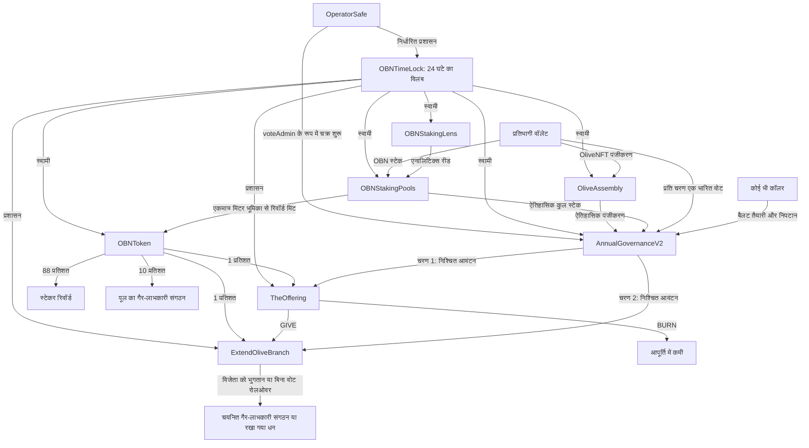

# बिना त्याग का दान: जन-स्तरीय परोपकारी भागीदारी के पतन का प्रोटोकॉल-आधारित उत्तर

[English](../THESIS.md) · [Tiếng Việt](THESIS.vi.md) · [한국어](THESIS.ko.md) · [日本語](THESIS.ja.md) · [简体中文](THESIS.zh-CN.md) · **हिन्दी** · [العربية](THESIS.ar.md) · [Русский](THESIS.ru.md) · [Deutsch](THESIS.de.md) · [Português](THESIS.pt.md) · [Español](THESIS.es.md) · [Bahasa Indonesia](THESIS.id.md)

> यह अनुवाद केवल सुविधा के लिए उपलब्ध कराया गया है। अंग्रेज़ी संस्करण ([THESIS.md](../THESIS.md)) ही आधिकारिक है; किसी भी अंतर की स्थिति में अंग्रेज़ी संस्करण मान्य होगा। यह अनुवाद संशोधन `3c740d855` से AI की सहायता से तैयार किया गया है और किसी पेशेवर अनुवादक ने अभी इसकी समीक्षा नहीं की है। कॉन्ट्रैक्ट के नाम, फ़ंक्शन के नाम और पते अंग्रेज़ी में ही रखे गए हैं।

**Olive Branch Network थीसिस**

*Olive Branch Network — Base Mainnet*

*जुलाई 2026 — गवर्नेंस संशोधन 14 अक्टूबर 2026*

---

## सार

संयुक्त राज्य अमेरिका में परोपकारी दान एक विरोधाभास प्रस्तुत करता है: दान की कुल राशि लगभग हर वर्ष रिकॉर्ड ऊँचाई पर पहुँचती है, जबकि दान देने वालों की संख्या एक चौथाई सदी से घट रही है। कोई भी परोपकारी योगदान करने वाले अमेरिकी परिवारों का हिस्सा 2000 में 66.2% से घटकर 2018 में 49.6% रह गया, और 2021 के बाद से दाताओं की संख्या हर वर्ष घटी है, भले ही कुल राजस्व बढ़ा हो। परोपकार एक छोटे, अधिक धनी दाता वर्ग में सिमट रहा है, जिससे वह जन-भागीदारी खोखली हो रही है जिस पर गैर-लाभकारी क्षेत्र की नागरिक वैधता टिकी है।

यह थीसिस तर्क देती है कि भागीदारी के पतन की जड़ संरचनात्मक है, नैतिक नहीं: धन के हर ऐतिहासिक रूप में — वस्तु, फ़िएट और प्रारंभिक डिजिटल — दान *त्यागपूर्ण* है। दान मूलधन को दाता से प्राप्तकर्ता को स्थायी रूप से हस्तांतरित करता है, इसलिए भागीदारी की सीमा प्रयोज्य अधिशेष है — ऐसी बाधा जिसे परिवारों का बढ़ता हिस्सा अब पार नहीं कर पाता क्योंकि वास्तविक आय वृद्धि वितरण के शीर्ष पर केंद्रित हो रही है। प्रोग्राम योग्य धन मौद्रिक इतिहास में पहली बार इस बाध्यता को हटाता है। चूँकि स्मार्ट कॉन्ट्रैक्ट *परिसंपत्ति के स्वामित्व* को *उस परिसंपत्ति से उत्पन्न यील्ड की दिशा* से अलग कर सकता है, इसलिए **बिना त्याग का दान** डिज़ाइन करना संभव हो जाता है: दाता अपना मूलधन स्थायी रूप से अपने पास रखता है और उसकी उत्पादकता का प्रोटोकॉल-प्रवर्तित हिस्सा निरंतर स्वतंत्र रूप से सत्यापन योग्य लोक-हित की ओर भेजता है।

Olive Branch Network (OBN) प्रोटोकॉल को इस डिज़ाइन के संदर्भ कार्यान्वयन के रूप में प्रस्तुत किया गया है। यह थीसिस (i) OBN को मौद्रिक प्रौद्योगिकी के लंबे इतिहास में स्थापित करती है; (ii) उद्धृत अनुभवजन्य आँकड़ों के साथ उस परोपकारी भागीदारी के पतन को दर्ज करती है जो इसकी प्रेरणा है; (iii) प्रोटोकॉल के भागीदारी–लॉक फ़ीडबैक लूप को औपचारिक रूप देती है, जिसमें हर अतिरिक्त प्रतिभागी OBN टोकन को परिसंचारी फ़्लोट से गैर-कस्टोडियल कॉन्ट्रैक्ट एस्क्रो में ले जाता है, जिससे अपनाने के बढ़ने पर प्रभावी आपूर्ति सिकुड़ती है; और (iv) हर मूल स्मार्ट कॉन्ट्रैक्ट — `OBNToken`, `OBNStakingPools`, `TheOffering`, `ExtendOliveBranch`, `AnnualGovernanceV2`, `OliveAssembly`, `OBNTimeLock`, `TeamVesting`, `OliveNFT` और `OBNStakingLens` — का पूर्ण तकनीकी विवरण देती है, जिसमें Base मेननेट पर डिप्लॉय किए गए रूप में स्टोरेज लेआउट, अपरिवर्तनीय नियम, अभिगम-नियंत्रण संरचना और अपग्रेड-सुरक्षा तंत्र शामिल हैं।

---

## विषय-सूची

1. [परिचय](#अध्याय-1--परिचय)
2. [धन का इतिहास: वस्तु से प्रोग्राम योग्यता तक](#अध्याय-2--धन-का-इतिहास-वस्तु-से-प्रोग्राम-योग्यता-तक)
3. [परोपकारी भागीदारी का अनुभवजन्य पतन](#अध्याय-3--परोपकारी-भागीदारी-का-अनुभवजन्य-पतन)
4. [भागीदारी–लॉक तंत्र: OBN का टोकन-प्रवाह अर्थशास्त्र](#अध्याय-4--भागीदारीलॉक-तंत्र-obn-का-टोकन-प्रवाह-अर्थशास्त्र)
5. [मूल कॉन्ट्रैक्ट: पूर्ण तकनीकी विवरण](#अध्याय-5--मूल-कॉन्ट्रैक्ट-पूर्ण-तकनीकी-विवरण)
6. [सुरक्षा वास्तुकला और संस्थागत डिज़ाइन](#अध्याय-6--सुरक्षा-वास्तुकला-और-संस्थागत-डिज़ाइन)
7. [सीमाएँ, वैधता के ख़तरे और भावी कार्य](#अध्याय-7--सीमाएँ-वैधता-के-ख़तरे-और-भावी-कार्य)
8. [निष्कर्ष](#अध्याय-8--निष्कर्ष)
9. [संदर्भ](#संदर्भ)

---

## अध्याय 1 — परिचय

### 1.1 समस्या कथन

दो दीर्घकालिक प्रवृत्तियाँ इस कार्य का ढाँचा बनाती हैं। पहली, परोपकारी दान की *व्यापकता* ढह रही है: कुछ भी दान करने वाले अमेरिकी परिवारों का अंश 2000 और 2018 के बीच लगभग सत्रह प्रतिशत अंक गिरा (Indiana University Lilly Family School of Philanthropy, 2021), और 2020 के बाद के आँकड़े दिखाते हैं कि गिरावट स्थिर होने के बजाय तेज़ हो रही है (Fundraising Effectiveness Project, 2025)। दूसरी, दान की *गहराई* केंद्रित हो रही है: कुल राशि रिकॉर्ड ऊँचाई पर है — 2024 में $592.50 billion (Giving USA, 2025) — क्योंकि कम और अधिक धनी दाताओं के बड़े दान उन लाखों छोटे दाताओं की जगह ले रहे हैं जो बाहर हो चुके हैं।

मानक व्याख्याएँ — घटती धार्मिकता, वेतन ठहराव, संस्थाओं के प्रति पीढ़ीगत अविश्वास — इस घटना का वर्णन करती हैं, पर इसे हल नहीं करतीं, क्योंकि वे सभी एक ही संरचनात्मक बाध्यता पर आ टिकती हैं: **ऐतिहासिक रूप से गठित दान मूलधन का स्थायी हस्तांतरण है।** कोई परिवार परोपकार में तभी भाग लेता है जब वह "मेरे पास यह हानि वहन करने लायक़ अधिशेष है" की सीमा पार करता है। जैसे-जैसे वास्तविक प्रयोज्य अधिशेष आय वितरण के शीर्ष पर केंद्रित हुआ, भागीदारी भी उसके साथ केंद्रित हुई।

### 1.2 थीसिस कथन

यह थीसिस तीन दावों का बचाव करती है:

1. **ऐतिहासिक दावा।** हर पूर्व मौद्रिक प्रौद्योगिकी — लिडियन इलेक्ट्रम से लेकर फ़ेडरल रिज़र्व की देनदारियों और केवल धारक उपकरण के रूप में प्रयुक्त पहली पीढ़ी की क्रिप्टोकरेंसी तक — मूलधन के हस्तांतरण को दान के लिए उपलब्ध *एकमात्र* मूल तत्व बनाती है। प्रोग्राम योग्य धन पहला मौद्रिक रूप है जिसमें *स्वामित्व* और *यील्ड-दिशा* धन के अपने स्तर पर ही अलग किए जा सकते हैं, न कि मुख्यतः धनिकों के लिए सुलभ विश्वसनीय मध्यस्थों (एंडोमेंट, ट्रस्ट, दाता-सलाहित कोष) के माध्यम से।

2. **अनुभवजन्य दावा।** जन-स्तरीय परोपकारी भागीदारी दीर्घकालिक गिरावट में है, और यह गिरावट ठीक उस छोटे दाता समूह में केंद्रित है जिस पर त्याग की सीमा सबसे कड़ी लागू होती है। इस दावे को पैनल डेटा (Philanthropy Panel Study), क्षेत्र-व्यापी लेन-देन डेटा (Fundraising Effectiveness Project) और समष्टि अनुमानों (Giving USA) का समर्थन प्राप्त है, जिनकी समीक्षा अध्याय 3 में की गई है।

3. **तंत्र दावा।** ऐसा प्रोटोकॉल जो (a) प्रतिभागियों को टोकन छोड़े बिना स्टेक करने दे, (b) प्रोटोकॉल एमिशन का निश्चित हिस्सा सत्यापित गैर-लाभकारी संगठनों तक पहुँचाए, और (c) स्टेक किए गए मूलधन को गैर-कस्टोडियल एस्क्रो में लॉक करे, वह भागीदारी–आपूर्ति फ़ीडबैक उत्पन्न करता है: प्रत्येक सीमांत प्रतिभागी परिसंचारी फ़्लोट से टोकन हटाता है, इसलिए — माँग और एमिशन नीति को स्थिर मानते हुए — व्यापक भागीदारी प्रभावी आपूर्ति को यांत्रिक रूप से कसती है। अध्याय 4 इसे औपचारिक रूप देता है और रिवॉर्ड एमिशन की प्रतिकारी शक्ति सहित इसकी मान्यताओं को ईमानदारी से बताता है।

### 1.3 योगदान

- एक ही अक्ष पर केंद्रित मौद्रिक इतिहास का संश्लेषण: *धन स्वयं क्या लागू कर सकता है* (अध्याय 2)।
- अमेरिकी परोपकारी भागीदारी के पतन का समेकित, उद्धृत अनुभवजन्य रिकॉर्ड, 2000–2025 (अध्याय 3)।
- OBN स्टेकिंग अर्थव्यवस्था का औपचारिक टोकन-प्रवाह मॉडल, जिसमें परिसंचारी-फ़्लोट सर्वसमिका, एमिशन/लॉक संतुलन शर्त और गवर्नेंस-नियंत्रित बर्न सिंक शामिल हैं (अध्याय 4)।
- Base पर डिप्लॉय और मेननेट-फ़ोर्क परीक्षण वातावरण में सत्यापित OBN मूल कॉन्ट्रैक्ट समूह का पहला पूर्ण लिखित विनिर्देश, जिसमें हर स्थिति चर, फ़ंक्शन, इवेंट, अपरिवर्तनीय नियम और अपग्रेड मार्ग शामिल हैं (अध्याय 5), साथ ही इसकी सुरक्षा और संस्थागत वास्तुकला (अध्याय 6)।

### 1.4 एक अनुच्छेद में प्रोटोकॉल

Olive Branch Network, Base पर एक ERC-20 टोकन (`OBN`) है, जिसकी स्टेकिंग प्रणाली में प्रति-गैर-लाभकारी पूल हैं। प्रतिभागी उस गैर-लाभकारी संगठन के पूल में OBN जमा करता है जिसका वह समर्थन करना चाहता है। जमा न तो कभी ख़र्च होती है, न गैर-लाभकारी संगठन को हस्तांतरित होती है, न प्रोटोकॉल के हाथों हानि के जोखिम में पड़ती है; इसे किसी भी समय निकाला जा सकता है (स्पष्ट रूप से लॉक बूटस्ट्रैप पोज़िशन को छोड़कर)। स्टेक रहने के दौरान प्रोटोकॉल स्टेक पर समय-आधारित एमिशन मिंट करता है और क्लेम के समय हर प्राप्त रिवॉर्ड को चार भागों में बाँटता है: **88% स्टेकर को, 10% पूल के गैर-लाभकारी संगठन को, 1% साझा वॉल्ट (`TheOffering`) को और 1% वितरण वॉल्ट (`ExtendOliveBranch`) को।** चक्र के आरंभ में दर्ज साझा वॉल्ट के आवंटन का भाग्य — बर्न या दान — पंजीकृत OliveNFT वाले वॉलेट के दो-चरणीय वोट (`AnnualGovernance`) से वार्षिक रूप से तय होता है, जिसमें भार स्नैपशॉट स्टेक का वर्गमूल होता है; इसका दूसरा चरण वितरण वॉल्ट के निश्चित चक्र आवंटन को समुदाय द्वारा चुने गए गैर-लाभकारी संगठन की ओर भेजता है। यह डिज़ाइन चार्टर के अनुच्छेद I को साकार करता है: *"किसी व्यक्ति के लिए यह संभव बनाना कि वह अपनी परिसंपत्तियों का स्वामित्व बनाए रखते हुए उन परिसंपत्तियों से उत्पन्न मूल्य का एक हिस्सा निरंतर स्वतंत्र रूप से जवाबदेह लोक-हित की ओर निर्देशित करे"* (OBN चार्टर, अनु. I)।

---

## अध्याय 2 — धन का इतिहास: वस्तु से प्रोग्राम योग्यता तक

इस अध्याय का उद्देश्य पुरातात्विक नहीं है। धन के इतिहास के प्रत्येक चरण को एक प्रश्न के आलोक में पढ़ा गया है: *धन स्वयं क्या लागू कर सकता है, और क्या विश्वसनीय संस्थाओं को सौंपना पड़ता है?* उत्तर तय करता है कि प्रत्येक चरण में दान के कौन-से रूप संभव हैं।

### 2.1 सिक्कों से पहले: उपहार, ऋण और वस्तु-विनिमय का मिथक

मौद्रिक उत्पत्ति का लोक सिद्धांत — असुविधाजनक वस्तु-विनिमय का स्वतः विनिमय माध्यम को रास्ता देना — Adam Smith (1776) से आता है और इसे Menger (1892) ने औपचारिक रूप दिया, जिन्होंने धन को सबसे *विक्रेय* वस्तु पर स्वतः उभरते अभिसरण के रूप में प्रतिरूपित किया, और Jevons (1875) ने, जिन्होंने इसके हल किए जाने वाले घर्षण को "इच्छाओं का दोहरा संयोग" नाम दिया। आधुनिक खोज-सैद्धांतिक मॉडल (Kiyotaki & Wright, 1989) इस तर्क को बनाए रखते हैं, और Kocherlakota (1998) ने इसका सबसे गहरा निहितार्थ निकाला: धन तकनीकी रूप से इस सामाजिक *स्मृति* के समतुल्य है कि किसने क्या योगदान दिया — "धन स्मृति है।"

फिर भी मानवशास्त्रीय अभिलेख धन के पूर्ववर्ती के रूप में शुद्ध वस्तु-विनिमय अर्थव्यवस्थाओं का समर्थन नहीं करता। Humphrey (1985) ने निष्कर्ष निकाला कि "शुद्ध और सरल वस्तु-विनिमय अर्थव्यवस्था का कोई उदाहरण कभी वर्णित नहीं हुआ, उससे धन के उद्भव की तो बात ही क्या।" Graeber (2011) ने नृवंशविज्ञान और मेसोपोटामिया के प्रमाण जुटाए कि *ऋण और दायित्व सिक्कों से सहस्राब्दियों पहले के हैं*: सुमेर (लगभग 3000 ईसा पूर्व) के मंदिर और महल की बहीखाता पद्धति ने चाँदी को नकद के रूप में चलाने से बहुत पहले ऋणों को चाँदी और जौ में अंकित किया। धन का ऋण सिद्धांत (Mitchell-Innes, 1913) और राज्य सिद्धांत (Knapp, 1905/1924) — हस्तांतरणीय ऋण के रूप में धन, और वह धन जिसे राज्य कर भुगतान में स्वीकार करता है — इस पुरानी परत को पकड़ते हैं।

आगे के लिए दो अवलोकन महत्वपूर्ण हैं। पहला, सबसे प्रारंभिक "धन" पहले से ही एक *लेखांकन प्रौद्योगिकी* — बहीखाता — था, और उसके भौतिक टोकन गौण थे। दूसरा, उपहार और दायित्व की अर्थव्यवस्थाओं में दान अधिशेष के विवेकाधीन निपटान का कार्य नहीं, बल्कि सामाजिक सदस्यता का घटक था (Mauss, 1925)। दान को स्वैच्छिक अधिशेष-हस्तांतरण तक सीमित करना बाद के मौद्रिक रूपों की देन है, कोई मानवीय स्थिरांक नहीं।

### 2.2 सिक्के: संप्रभु धारक उपकरण के रूप में धन (लगभग 640 ईसा पूर्व – 1000 ईस्वी)

मानकीकृत सिक्के ईसा पूर्व सातवीं शताब्दी में लिडिया में प्रकट होते हैं — राज्य द्वारा मुद्रांकित इलेक्ट्रम के टुकड़े — और चौंकाने वाली गति से यूनानी पोलिस, फ़ारस, भारत (आहत *karshapana*) और वारिंग-स्टेट्स चीन में फैलते हैं (Davies, 2002; Schaps, 2004)। सिक्के का नवाचार *एक नज़र में सत्यापन* है: संप्रभु मुहर परख की समस्या को समेट देती है और अजनबियों के बीच बिना भरोसे या रिकॉर्ड के मूल्य हस्तांतरणीय बनाती है।

लेकिन ध्यान दें कि यह प्रौद्योगिकी क्या लागू करती है और क्या नहीं कर सकती। सिक्का *धारक अंतिमता* लागू करता है: जो इसे रखता है, वह पूर्णतः इसका स्वामी है। यह शर्तें, धाराएँ, विभाजन या प्रत्यावर्तन कूटबद्ध नहीं कर सकता। अतः सिक्का जिस एकमात्र दान के मूल तत्व का समर्थन करता है वह सिक्के का सीधा हस्तांतरण है — मूलधन का शुद्ध त्याग। कुछ भी अधिक परिष्कृत (मंदिर एंडोमेंट, रोमन *alimenta*, इस्लामी *waqf*, मध्ययुगीन चैंट्री) के लिए धन को विश्वसनीय मनुष्यों द्वारा संचालित *कानूनी संस्था* में लपेटना पड़ता था। यील्ड-निर्देशित दान मौजूद था — वक़्फ़ ठीक ऐसी परिसंपत्ति है जिसकी आय स्थायी रूप से लोक-हित की ओर निर्देशित होती है जबकि मूल अहस्तांतरणीय होता है (Kuran, 2001) — पर वह केवल उन लोगों को उपलब्ध था जो अपनी परिसंपत्तियों के इर्द-गिर्द संस्था खड़ी करने लायक़ धनी थे।

### 2.3 काग़ज़, बैंकिंग और ऋण का अधिरचना (1000–1971)

सोंग राजवंश के चीन ने पहला राज्य काग़ज़ी धन (*jiaozi*, 1024 ईस्वी में औपचारिक) जारी किया, जिससे परिवर्तनीय नोट जारी करना और दो शताब्दियों के भीतर मुद्रास्फीतिकारी अति-निर्गम दोनों की खोज हुई (Von Glahn, 1996)। यूरोप में यह क्रम विनिमय पत्रों, सुनारों की रसीदों, बैंक ऑफ़ इंग्लैंड (1694) और उन्नीसवीं सदी के स्वर्ण मानक से गुज़रा — ऐसी मौद्रिक व्यवस्था जिसमें धन आपूर्ति परिवर्तनीयता से अनुशासित थी, पर वास्तविक परिसंचारी माध्यम अधिकतर बैंक *ऋण* था (Ferguson, 2008; Eichengreen, 1996)। ब्रेटन वुड्स प्रणाली (1944) ने एक दूरी पर स्वर्ण लंगर बनाए रखा; 15 अगस्त 1971 को संयुक्त राज्य द्वारा इसके निलंबन ("निक्सन शॉक") ने शुद्ध फ़िएट की ओर संक्रमण पूरा किया: राज्य की असमर्थित देनदारी के रूप में धन, जिसका मूल्य आदेश, कर-स्वीकृति और नेटवर्क अपेक्षा से तय होता है — Knapp का चार्टलवाद पूर्णतः साकार (Eichengreen, 1996)।

दान के लिए फ़िएट-बैंकिंग युग ने पैमाना बदला, संरचना नहीं। परोपकारी कटौती व्यवस्थाओं (अमेरिका में 1917 से) ने त्याग पर सब्सिडी दी; फ़ाउंडेशन, परोपकारी अवशेष ट्रस्ट और दाता-सलाहित कोष ने वक़्फ़ पैटर्न — *स्वामित्व बना या सुरक्षित, यील्ड निर्देशित* — का औद्योगीकरण किया, पर प्रत्येक के लिए कानूनी गठन, न्यूनतम राशि और सलाहकार चाहिए। संरचनात्मक असमानता बनी रही: **धनी लोग यील्ड से दान देते हैं; बाकी सब मूलधन से।** अध्याय 3 इसका पूर्वानुमेय परिणाम दर्ज करता है।

### 2.4 डिजिटल निपटान और इलेक्ट्रॉनिक फ़िएट (1971–2008)

निक्सन शॉक और 2008 के बीच धन का परिचालन रूप से अभौतिकीकरण हुआ — Fedwire, SWIFT (1973), कार्ड नेटवर्क और इंटरनेट भुगतान ने अधिकांश धन को बैंक-डेटाबेस प्रविष्टियाँ बना दिया — पर उसका तर्क नहीं बदला। इलेक्ट्रॉनिक फ़िएट अब भी एक IOU है जिसके नियम विनियमित मध्यस्थ लागू करते हैं। Chaum (1983) ने दिखाया कि क्रिप्टोग्राफ़ी डिजिटल धारक नकदी बना सकती है, पर उसके DigiCash ने निर्गम को केंद्रीकृत किया और व्यावसायिक रूप से विफल रहा; Dai के "b-money" (1998) और Szabo के "bit gold" (1990 के दशक के अंत में परिकल्पित, 2005 में प्रकाशित) ने दोहरे ख़र्च को हल किए बिना विकेंद्रीकृत निर्गम की रूपरेखा दी।

### 2.5 बिटकॉइन: संप्रभु के बिना दुर्लभता (2008)

Nakamoto (2008) ने सार्वजनिक बहीखाते पर प्रूफ़-ऑफ़-वर्क सहमति को निश्चित निर्गम शेड्यूल के साथ जोड़कर विश्वसनीय पक्ष के बिना दोहरे ख़र्च की समस्या हल की। मौद्रिक इतिहास में बिटकॉइन का योगदान सटीक है: **संस्था के बजाय प्रोटोकॉल द्वारा लागू डिजिटल दुर्लभता और अंतिम निपटान।** पहली बार *धन के नियम* — सबसे बढ़कर उसकी आपूर्ति वक्र — स्वयं धन के गुण बने।

फिर भी बिटकॉइन की स्क्रिप्ट जानबूझकर अभिव्यक्ति को सीमित करती है। धन के रूप में यह सिक्के के निकट रहता है: कठोर आपूर्ति वाला धारक उपकरण। बिटकॉइन में दान अब भी मूलधन का हस्तांतरण है।

### 2.6 एथेरियम और प्रोग्राम योग्य धन (2015– )

Buterin (2014) ने ब्लॉकचेन को ट्यूरिंग-पूर्ण स्थिति मशीन के रूप में सामान्यीकृत किया। एथेरियम — और Base जैसी EVM चेनों, जहाँ OBN डिप्लॉय होता है — के साथ धन *प्रोग्राम योग्य* बनता है: मनमाना तर्क भुगतान जैसी ही अंतिमता से निष्पादित होता है। ERC-20 मानक (Vogelsteller & Buterin, 2015) ने टोकनीकृत मूल्य को संयोज्य मूल तत्व बनाया; ERC-4626, स्टेकिंग प्रणालियों और ऑन-चेन गवर्नेंस (जैसे, Compound का Governor पैटर्न) ने दिखाया कि **अभिरक्षा, यील्ड, वोटिंग और भुगतान सभी प्रोटोकॉल के गुण हो सकते हैं।**

यह ऐतिहासिक तर्क की धुरी है। वक़्फ़/एंडोमेंट पैटर्न — मूल अहस्तांतरणीय, उपभोग का अधिकार लोक-हित की ओर निर्देशित — को एक हज़ार वर्षों तक विश्वसनीय संस्था की ज़रूरत रही और इसलिए वह धनिकों का उपकरण था। स्मार्ट कॉन्ट्रैक्ट वही पैटर्न किसी भी आकार के किसी भी धारक के लिए लागू करता है, इन विशेषताओं के साथ:

- **गैर-कस्टोडियल एस्क्रो** ("एंडोमेंट का मूल" ट्रस्टी नहीं, अपरिवर्तनीय कोड रखता है);
- **निरंतर, प्रतिसंहरणीय निर्देश** (प्रतिभागी किसी भी समय दिशा बदल या निकाल सकता है — चार्टर के अनुच्छेद III की पृथक्करणीयता);
- **प्रोटोकॉल-प्रवर्तित विभाजन** (OBN में 88/10/1/1 विभाजन `_mintSlices` का अंकगणित है, ट्रस्टी का विवेक नहीं);
- **सत्यापन योग्य रिकॉर्डिंग** (हर योगदान एक ऑन-चेन इवेंट है, जो चार्टर के अनुच्छेद VI को संतुष्ट करता है)।

इस पठन में धन का इतिहास उन कार्यों को धन में ही क्रमशः समाहित करने का इतिहास है जो कभी संस्थाओं को सौंपे जाते थे: सत्यापन (सिक्के), रिकॉर्ड (बैंकिंग), दुर्लभता (बिटकॉइन) और अंततः *न्यासीय संरचना* (प्रोग्राम योग्य धन)। OBN इस अंतिम चरण का धन के सबसे पुराने कार्य — उपहार — पर अनुप्रयोग है।

---

## अध्याय 3 — परोपकारी भागीदारी का अनुभवजन्य पतन

यह अध्याय प्रकाशित आँकड़ों से दूसरा आधार स्थापित करता है: **दान देने वालों की संख्या लगातार और हर प्रमुख डेटा स्रोत में घट रही है, भले ही कुल राशि बढ़ रही हो।**

### 3.1 दीर्घकालिक भागीदारी का पतन (Philanthropy Panel Study, 2000–2018)

सबसे कठोर अनुदैर्ध्य प्रमाण Indiana University Lilly Family School of Philanthropy की *Philanthropy Panel Study* से आता है, जो 9,000 से अधिक अमेरिकी परिवारों का राष्ट्रीय रूप से प्रतिनिधि पैनल है, जिनके दान को द्विवार्षिक रूप से ट्रैक किया जाता है।

- **2000 में 66.2% अमेरिकी परिवारों** ने परोपकारी योगदान किया।
- **2018 तक केवल 49.6%** ने किया — रिकॉर्ड में पहली बार आधे से कम अमेरिकी परिवारों ने दान दिया, और लगभग 17 प्रतिशत अंकों की गिरावट आई (Lilly Family School of Philanthropy, 2021)।
- धार्मिक दान **46% परिवारों (2000–2004) से घटकर 29% (2018)** रह गया; धर्मनिरपेक्ष दान 55–57% के स्तर (2000–2008) से गिरकर **2018 में 42%** पर आ गया (Lilly Family School of Philanthropy, 2021)।
- अनुवर्ती विश्लेषण में पाया गया कि यह गिरावट **COVID-19 महामारी के पहले वर्ष में तेज़ हुई** (Lilly Family School of Philanthropy, *The Giving Environment*, 2022; NonProfit PRO, 2022), और भागीदारी सभी नस्लीय और जातीय समूहों में गिरी (The NonProfit Times, 2023)।

स्कूल की *Giving Environment* रिपोर्ट गिरावट का आंशिक कारण मध्यम और निम्न आय वाले परिवारों की घटती और ठहरी आय तथा धार्मिक संबद्धता से जुड़े बदलते मानदंडों को बताती है (Lilly Family School of Philanthropy, 2022) — ये दोनों त्याग की सीमा की अभिव्यक्तियाँ हैं: परिवार तब दान देते हैं जब वे पैसा खोने का वहन कर सकते हैं, और ऐसे कम होते जा रहे हैं।

### 3.2 2018 के बाद भी दाताओं की संख्या घटती रही (Fundraising Effectiveness Project, 2021–2025)

Fundraising Effectiveness Project (FEP), जो हज़ारों गैर-लाभकारी संगठनों के वास्तविक दान-लेन-देन डेटा को एकत्र करता है, रिकॉर्ड को पैनल अध्ययनों से आगे बढ़ाता है और दिखाता है कि गिरावट जारी है:

- दाताओं की संख्या **2021 से हर वर्ष** घटी है (AFP/FEP, 2026)।
- 2023 से 2024 तक दाताओं की संख्या **वर्ष-दर-वर्ष 4.5%** गिरी, और गिरावट पिछले वर्षों की तुलना में *तेज़* हुई (FEP Q4 2024 रिपोर्ट; GlobeNewswire, 2025)।
- **2025 में दाताओं की संख्या अनुमानतः 3.6% और गिरी**, जबकि कुल परोपकारी राशि 5.0% बढ़ी — पाँच वर्षों की सबसे मज़बूत राजस्व वृद्धि, कम दाताओं के साथ हासिल (AFP/FEP, 2026)।
- क्षरण छोटे सिरे पर केंद्रित है: **$1–$100 देने वाले दाता — जो सभी दाताओं के आधे से अधिक हैं — 2024 में 8.8% और Q1 2025 में वर्ष-दर-वर्ष 11.1% घटे** (FEP; NonProfit PRO, 2025)।
- कुल दाता प्रतिधारण लगभग **43%** के आसपास है, और नए दाताओं का प्रतिधारण कहीं कम है, यानी अधिकांश पहली बार के दाता फिर कभी दान नहीं देते (FEP, 2025–2026)।

FEP की अपनी प्रस्तुति ठीक यही संकेंद्रण थीसिस है: राजस्व वृद्धि "बड़े दानों में केंद्रित" है, साथ में "कुल दाता संख्या में निरंतर गिरावट" (AFP, 2025)।

### 3.3 राशि ऊपर, दाता नीचे (Giving USA, 2024–2025)

अमेरिकी परोपकार का सबसे लंबे समय से चलने वाला समष्टि अनुमान Giving USA इस विरोधाभास को पूरा करता है:

- कुल दान **2024 में $592.50 billion** तक पहुँचा, जो वर्तमान डॉलर में रिकॉर्ड है, नाममात्र रूप से 6.3% और मुद्रास्फीति-समायोजित रूप से 3.3% अधिक (Giving USA 2025)।
- कुल दान 2025 में फिर बढ़कर अनुमानित **$617.2 billion** हुआ (Giving USA 2026; Give.org, 2026)।
- लेकिन **कुल में व्यक्तिगत दान का हिस्सा 1986–1990 में लगभग 80% से घटकर 2024 में 66% और 2025 में 64% रह गया**, क्योंकि फ़ाउंडेशन, वसीयतें और निगम — संचित धन के माध्यम — कमी पूरी करते हैं (Giving USA 2026; Give.org, 2026; Stelter, 2026)।

### 3.4 संश्लेषण: त्याग की सीमा

तीन स्वतंत्र पद्धतियों — परिवार पैनल (PPS), लेन-देन एकत्रीकरण (FEP) और समष्टि अनुमान (Giving USA) — से एक ही चित्र उभरता है:

| संकेतक | तब | अब | दिशा |
|---|---|---|---|
| कुछ भी दान देने वाले परिवार (PPS) | 66.2% (2000) | 49.6% (2018) | ↓ 16.6 pts |
| धर्म को दान देने वाले परिवार (PPS) | 46% (2000–04) | 29% (2018) | ↓ 17 pts |
| दाता संख्या, वर्ष-दर-वर्ष (FEP) | — | −4.5% (2024), −3.6% (2025) | ↓ तेज़ होती |
| छोटे दाता $1–$100 (FEP) | सभी दाताओं के 50–57% | वर्ष-दर-वर्ष −8.8% से −11.1% | ↓ सबसे तीखा समूह |
| कुल दान में व्यक्तियों का हिस्सा (Giving USA) | ~80% (1986–90) | 64% (2025) | ↓ 16 pts |
| कुल राशि (Giving USA) | — | $592.5B (2024), $617.2B (2025) | ↑ रिकॉर्ड ऊँचाई |

क्षेत्र ऊपर से पुनर्पूंजीकृत हो रहा है जबकि उसका सहभागी आधार क्षीण हो रहा है। यदि दान के लिए अधिशेष चाहिए और अधिशेष केंद्रित हो गया है, तो ठीक यही अपेक्षित है। गैर-लाभकारी क्षेत्र की *फंडिंग* समस्या धनी हल कर रहे हैं; उसकी *भागीदारी* समस्या — लाखों छोटे दानों का नागरिक, लोकतांत्रिक, वैधता देने वाला कार्य — बिल्कुल हल नहीं हो रही, क्योंकि ऐसा कोई उपकरण नहीं जो ग़ैर-धनी परिवार को बिना हानि के निरंतर दान देने दे।

अध्याय 4 ऐसे ही उपकरण का वर्णन करता है।

---

## अध्याय 4 — भागीदारी–लॉक तंत्र: OBN का टोकन-प्रवाह अर्थशास्त्र

यह अध्याय प्रोटोकॉल के आर्थिक केंद्र को औपचारिक रूप देता है: **भागीदारी आपूर्ति को लॉक करती है।** हर दावा अध्याय 5 में पूर्णतः वर्णित विशिष्ट कॉन्ट्रैक्ट कोड पर आधारित है; यहाँ हम प्रणाली को टोकन-प्रवाह मशीन मानते हैं।

### 4.1 जेनेसिस आवंटन और वर्तमान रिज़र्व

निम्न तालिका ऐतिहासिक जेनेसिस मिंट को दर्ज करती है, वर्तमान अव्ययित रिज़र्व को नहीं। `OBNToken.initialize` ने पूरी प्रारंभिक आपूर्ति ठीक एक बार, निश्चित अनुपातों में मिंट की (OBNToken.sol):

| आवंटन | हिस्सा | उद्देश्य |
|---|---|---|
| तरलता | 40% | DEX तरलता ताकि टोकन प्राप्त किया जा सके |
| एयरड्रॉप | 30% | व्यापक प्रारंभिक वितरण का बीजारोपण |
| चैरिटी कोष | 10% | गैर-लाभकारी पूल पोज़िशन का बूटस्ट्रैप (स्थायी रूप से लॉक — §4.4) |
| ट्रेज़री | 10% | प्रोटोकॉल संचालन (एक बार का जेनेसिस आवंटन; कोई एमिशन धारा इसमें नहीं आती) |
| टीम वेस्टिंग | 10% | `TeamVesting` में समय-लॉक (4 महीने का क्लिफ़, 20 महीने रैखिक) |

एक बार सेट होने वाले एकल मिंटर — स्टेकिंग कॉन्ट्रैक्ट — के अलावा आगे कोई मिंटिंग संभव नहीं, इसलिए जेनेसिस के बाद की *सारी* आपूर्ति वृद्धि स्टेकिंग एमिशन है।

गैर-लाभकारी सीड रिज़र्व का कुल आवंटन **300M OBN** है, जिसमें **50M OBN** प्रोटोकॉल आवश्यकताओं के लिए अलग रखे गए हैं। ट्रेज़री और एयरड्रॉप होल्डिंग्स को सीड आवंटन में समेकित किया गया। उस समय तक 11M OBN 11 गैर-लाभकारी सीड को वित्तपोषित कर चुके थे, जिससे 1M OBN प्रत्येक पर 289 अतिरिक्त सीड के लिए 289M OBN शेष रहे।

यह मौजूदा होल्डिंग्स का पुनः आवंटन है, कोई नया मिंट या डिप्लॉय किए गए initializer में बदलाव नहीं।

### 4.2 परिसंचारी-फ़्लोट सर्वसमिका

समय *t* पर परिभाषित करें:

- **S(t)** — कुल आपूर्ति: जेनेसिस आपूर्ति + संचयी एमिशन − संचयी बर्न।
- **K(t)** — स्टेकिंग कॉन्ट्रैक्ट के पास टोकन: सभी `userAmount` शेष का योग (केवल मूलधन; रिवॉर्ड सीधे प्राप्तकर्ताओं को मिंट होते हैं, कभी पूल नहीं होते)।
- **V(t)** — `TeamVesting` में अभी भी लॉक टोकन।
- **G(t)** — वार्षिक चक्र की प्रतीक्षा में दो गवर्नेंस वॉल्ट (`TheOffering` और `ExtendOliveBranch`) में संचित टोकन।
- **B(t)** — संचयी बर्न किए गए टोकन (`TheOffering.burn` और किसी भी स्वैच्छिक `ERC20Burnable.burn` के माध्यम से)।

तब **परिसंचारी फ़्लोट** — वास्तव में व्यापार के लिए उपलब्ध आपूर्ति — है:

> **F(t) = S(t) − K(t) − V(t) − G(t)**   जहाँ   **S(t) = S₀ + E(t) − B(t)**

जहाँ E(t) संचयी सकल एमिशन है। तंत्र दावा ∂F/∂(भागीदारी) के बारे में कथन है: **हर जमा टोकन को F से K में एक-के-बदले-एक ले जाती है** (`_depositCore` `safeTransferFrom(msg.sender, address(this), amount)` निष्पादित करता है), और टोकन तब तक K में रहते हैं जब तक वही प्रतिभागी निकालना न चुने। प्रोटोकॉल K को कभी उधार नहीं देता, पुनः गिरवी नहीं रखता या ख़र्च नहीं करता; कोई स्लैशिंग नहीं और मूलधन पर प्रोटोकॉल का कोई दावा नहीं। K निष्क्रिय एस्क्रो है।

### 4.3 एमिशन नीति: घटती और भागीदारी-आनुपातिक

एमिशन कोई निश्चित नल *नहीं* है। `_sumRewardAcrossPhases` प्रति पूल रिवॉर्ड को `poolStake × bps × Δt / (10000 × 365 days)` के रूप में संचित करता है — यानी घटते शेड्यूल पर **वास्तव में स्टेक की गई राशि का वार्षिकीकृत प्रतिशत**:

| डिप्लॉयमेंट के बाद के वर्ष | वार्षिक एमिशन दर (स्टेक शेष पर) |
|---|---|
| 0–2 | 10.00% |
| 2–4 | 7.50% |
| 4–6 | 5.00% |
| 6–8 | 2.50% |
| 8–10 | 1.25% |
| 10+ | 3.00% फ़ॉलबैक (`FALLBACK_EMISSION_BPS`), जब तक गवर्नेंस `addPhase` से संशोधन न करे |

दो परिणाम निकलते हैं। पहला, **एमिशन K के साथ बढ़ते हैं, S के साथ नहीं**: बिना स्टेक वाले टोकन कुछ उत्पन्न नहीं करते। दूसरा, चूँकि रिवॉर्ड केवल *क्लेम इवेंट* (जमा, निकासी, क्लेम) पर मिंट होते हैं, बिना क्लेम रिवॉर्ड केवल लेखा प्रविष्टि हैं (`accRewardPerShare × balance − rewardDebt`) — प्राप्त होने तक वे टोकन के रूप में मौजूद नहीं होते।

### 4.4 चार-भागीय विभाजन और उसके सिंक

हर प्राप्ति पर `_mintSlices` सकल लंबित रिवॉर्ड को बाँटता है:

- **88% → स्टेकर।** प्रतिभागी की यील्ड। नई मिंट, F में प्रवेश करती है (या पुनः स्टेक होती है)।
- **10% → पूल का गैर-लाभकारी वॉलेट।** उपहार। निरंतर, प्रोटोकॉल-प्रवर्तित, प्रतिभागी के स्टेक और समय के अनुपात में। यह चार्टर अनुच्छेद VII का *योगदान* है, और इसमें स्टेकर का कोई मूलधन नहीं जाता — केवल यील्ड का वह हिस्सा जो प्रोटोकॉल के बिना मौजूद ही न होता।
- **1% → `TheOffering`** (साझा वॉल्ट)। पूरे वर्ष संचित; प्रत्येक वार्षिक गवर्नेंस चक्र, आरंभ में दर्ज आवंटन को **बर्न** करने (अपस्फीतिकारी सिंक, S घटाता है) या **देने** (`ExtendOliveBranch` को स्थानांतरित) पर वोट करता है।
- **1% → `ExtendOliveBranch`** (वितरण वॉल्ट)। पूरे वर्ष संचित; प्रत्येक वार्षिक गवर्नेंस चक्र का चरण 2 वोट उस चक्र के निश्चित आवंटन को एक समुदाय-चयनित, व्हाइटलिस्टेड गैर-लाभकारी संगठन को निर्देशित करता है (या कोई वोट न करे तो आगे ले जाता है)।

ध्यान दें कि **कोई एमिशन धारा ट्रेज़री में नहीं जाती**: दोनों अवशिष्ट हिस्से गवर्नेंस-नियंत्रित वॉल्ट में जाते हैं। वार्षिक निपटान तक दोनों धाराएँ वॉल्ट एस्क्रो (§4.2 में G) में रहती हैं — व्यापार योग्य फ़्लोट से बाहर।

इसके अतिरिक्त, 10% चैरिटी-कोष जेनेसिस आवंटन `charityFundBootstrap`/`depositForWithLock` के माध्यम से लगाया जाता है, जो `lockedAmount` को जमा के बराबर सेट करते हुए *प्रत्येक गैर-लाभकारी संगठन के अपने वॉलेट की ओर से* टोकन स्टेक करता है — यह **स्थायी लॉक** है (लॉक केवल बढ़ सकते हैं, कभी घट नहीं सकते)। इसलिए बूटस्ट्रैप पोज़िशन सदा K में योगदान देती हैं, हर पूल को उसके गैर-लाभकारी संगठन के लिए आधार रिवॉर्ड धारा की गारंटी देती हैं और कभी बेची नहीं जा सकतीं।

### 4.5 भागीदारी–लॉक फ़ीडबैक लूप

टुकड़ों को जोड़ें। मान लें *n* सक्रिय प्रतिभागियों की संख्या है और *k̄* औसत स्टेक। तब K = n·k̄ (साथ में बूटस्ट्रैप लॉक), और:

1. **अपनाना फ़्लोट को कसता है।** हर नया प्रतिभागी फ़्लोट टोकन को एस्क्रो मूलधन में बदलता है: ΔF = −Δstake। माँग स्थिर रहने पर सिकुड़ता व्यापार योग्य फ़्लोट बाज़ार-समाशोधन मूल्य बढ़ाता है — मानक आपूर्ति–माँग परिणाम, और प्रूफ़-ऑफ़-स्टेक अर्थव्यवस्थाओं में लंबे समय से देखे गए "फ़्लोट सिकुड़न" का ऑन-चेन समरूप, जहाँ ऊँचे स्टेकिंग अनुपात तरल आपूर्ति घटाते हैं।
2. **यील्ड धैर्य को पुरस्कृत करती है, और यील्ड का 88% कंपाउंड हो सकता है।** अपना 88% हिस्सा पुनः स्टेक करने वाले स्टेकर नए मिंट टोकन को सीधे K में लौटाते हैं, जिससे F और कसता है।
3. **उपहार धारा वास्तविक दुनिया की वैधता को वित्तपोषित करती है।** 10% गैर-लाभकारी धारा बाहरी संस्थाओं को भागीदारी को बढ़ावा देने का स्थायी कारण देती है, जो और प्रतिभागियों को जोड़ता है — एकमात्र विपणन माध्यम जो स्वयं एक परोपकारी कार्य है।
4. **गवर्नेंस साझा वॉल्ट को शुद्ध अपस्फीति में बदल सकता है।** चरण 1 में BURN परिणाम चक्र के आरंभ में दर्ज साझा वॉल्ट के आवंटन को नष्ट करता है और S को सीधे घटाता है। ध्यान दें कि डिफ़ॉल्ट जानबूझकर अपस्फीतिकारी है: *शून्य भागीदारी → BURN* (GIVE को BURN से *सख्ती से* अधिक होना चाहिए)।
5. **वोटिंग पात्रता के लिए स्नैपशॉट पर भागीदारी आवश्यक है।** V2 पंजीकृत NFT स्थिति को कम से कम 1 OBN के चेकपॉइंट वाले कुल स्टेक के साथ जोड़ता है, फिर वर्गमूल भार लागू करता है। गवर्नेंस प्रत्येक चक्र शुरू होने से पहले स्टेक होने का कारण देता है; वह बाद में स्टेक रहने की माँग नहीं करता और न ही वोट के दौरान निरंतर लॉक स्थापित करता है (§5.5)।

लूप: **अधिक प्रतिभागी → अधिक टोकन लॉक → छोटा फ़्लोट और बड़ा संचयी बर्न विकल्प → बेहतर मूल्य समर्थन → प्रति टोकन अधिक यील्ड मूल्य और उपहार मूल्य → मज़बूत भर्ती → अधिक प्रतिभागी।**

### 4.6 ईमानदार लेखांकन: एमिशन का प्रतिभार

इस तंत्र में एक विरोधी शक्ति है। एमिशन मुद्रास्फीतिकारी हैं: प्रारंभिक 10% दर पर S, K के अनुपात में बढ़ता है। शुद्ध फ़्लोट *सिकुड़ता* है या नहीं, यह वास्तविक प्रवाहों पर निर्भर है। फ़्लोट सर्वसमिका का अवकलन करने पर फ़्लोट में प्रवेश करने वाला एमिशन प्रवाह है:

> **dF/dt ≈ e·K·[0.88·(1−r) + 0.10 + 0.02·(1−β)·δ] − dK/dt**

जहाँ *e* वर्तमान एमिशन दर है, *r* पुनः स्टेक किए गए स्टेकर रिवॉर्ड का अंश, *β* चरण 1 में अंततः बर्न होने वाली वॉल्ट धाराओं का अंश, और *δ* ≤ 1 एक विलंब कारक है, जो दर्शाता है कि दो 1% वॉल्ट धाराएँ वार्षिक चक्र के वितरण के बाद ही फ़्लोट में आती हैं (बर्न राशि कभी नहीं आती; रोलओवर प्रवेश को और टालते हैं)। फ़्लोट तब सिकुड़ता है (dF/dt < 0) जब **शुद्ध नया स्टेक एमिशन के पुनः स्टेक न हुए हिस्से से अधिक हो**। संरचनात्मक विशेषताएँ उस दिशा में धकेलती हैं — एमिशन शेड्यूल 10% → 1.25% घटता है जबकि अपनाने के बढ़ने की अपेक्षा है; गैर-लाभकारी प्राप्तकर्ता मिशन-प्रेरित विक्रेता हैं पर उनका अंतर्वाह एमिशन का केवल 10% है; बर्न डिफ़ॉल्ट साझा हिस्से को स्थायी रूप से हटाता है; बूटस्ट्रैप लॉक कभी बाहर नहीं निकलते — पर यह शर्त अनुभवजन्य है, गारंटीशुदा नहीं। इसलिए यहाँ बचाव किया गया दावा सटीक रूप से सीमित है: *प्रोटोकॉल इस तरह बनाया गया है कि अन्य बातें समान रहने पर भागीदारी वृद्धि फ़्लोट को यांत्रिक रूप से सिकोड़े और टोकन मूल्य का समर्थन करने वाली स्थितियाँ बनाए; यह मूल्य वृद्धि की गारंटी नहीं देता और न दे सकता है, जो बाह्य माँग पर भी निर्भर है।*

### 4.7 बिना त्याग का दान, पुनः कथित

आर्थिक डिज़ाइन अध्याय 3 की समस्या को सीधे हल करता है। भागीदारी की सीमा अब "वह अधिशेष जिसे मैं खो सकता हूँ" नहीं, बल्कि "वह पूँजी जिसे मैं रखने को तैयार हूँ" है। जो परिवार कभी $500 दान नहीं कर सकता था, वह $500 स्टेक कर सकता है, उसे अपने पास रख सकता है, आपात स्थिति में निकाल सकता है, और इस बीच अपने स्टेक से उत्पन्न यील्ड का 10% — वास्तविक, प्रोटोकॉल-प्रवर्तित, सार्वजनिक रूप से दर्ज योगदान — निरंतर एक सत्यापित गैर-लाभकारी संगठन की ओर भेज सकता है। दान *उपभोग का त्याग* नहीं, बल्कि *परिसंपत्ति आवंटन का निर्णय* बन जाता है। भागीदारी के पतन का यही डिज़ाइन का उत्तर है: लोगों को अधिक देने का उपदेश देना नहीं, बल्कि उस संरचनात्मक कारण को हटाना जिससे उन्होंने देना बंद किया।

---

## अध्याय 5 — मूल कॉन्ट्रैक्ट: पूर्ण तकनीकी विवरण

सभी कॉन्ट्रैक्ट Solidity ^0.8.28 को लक्षित करते हैं, OpenZeppelin v5 पर बने हैं और Base पर डिप्लॉय हैं। अपग्रेड योग्य कॉन्ट्रैक्ट UUPS पैटर्न का उपयोग करते हैं (`_authorizeUpgrade` स्वामी, यानी `OBNTimeLock`, तक सीमित)। यह अध्याय समूह के हर कॉन्ट्रैक्ट का वर्णन करता है: उद्देश्य, स्टोरेज, फ़ंक्शन, इवेंट, अपरिवर्तनीय नियम और अंतःक्रियाएँ।

### 5.1 `OBNToken` — मौद्रिक आधार (OBNToken.sol)

**वंशानुक्रम।** `Initializable`, `IOBNMintable`, `ERC20Upgradeable`, `ERC20PermitUpgradeable` (EIP-2612 गैसलेस अनुमोदन), `ERC20VotesUpgradeable` (चेकपॉइंट वाला प्रत्यायोजन), `ERC20BurnableUpgradeable`, `OwnableUpgradeable`, `UUPSUpgradeable`।

**पहचान।** नाम "Olive Branch Network", प्रतीक "OBN"।

**स्टोरेज।** एक कस्टम चर — `address public minter` — और अपग्रेड की गुंजाइश के लिए `uint256[100] __gap`।

**आरंभीकरण।** `initialize(initialOwner, initialSupply, liquidityAddress, airdropAddress, charityAddress, treasuryAddress, teamVestingAddress)` एक बार चलता है (initializer मॉडिफ़ायर; कंस्ट्रक्टर `_disableInitializers()` कॉल करता है ताकि कार्यान्वयन स्वयं कभी आरंभ न हो सके)। शून्य-पता और शून्येतर-आपूर्ति जाँच के बाद यह पूरा वितरण मिंट करता है: 30% एयरड्रॉप, 40% तरलता, 10% चैरिटी, 10% ट्रेज़री, 10% टीम वेस्टिंग (§4.1)।

**मिंटर तंत्र।** `setMinterOnce(addr)` — केवल-स्वामी, `minter == address(0)` आवश्यक: कार्यान्वयन के जीवनकाल में मिंटर **ठीक एक बार** सेट हो सकता है (केवल पूर्ण UUPS अपग्रेड इसे बदल सकता है)। `mint(to, amount)` के लिए `msg.sender == minter` आवश्यक है। डिप्लॉयमेंट में मिंटर `OBNStakingPools` प्रॉक्सी है; इसलिए *सारी भावी आपूर्ति स्टेकिंग एमिशन है*। `isMinter(addr)` एक सुविधा व्यू है।

**ओवरराइड।** OZ v5 सभी शेष परिवर्तनों को `_update` से गुज़ारता है, इसलिए एक ही ओवरराइड `ERC20Upgradeable` और `ERC20VotesUpgradeable` का सामंजस्य करता है (वोट चेकपॉइंट ट्रांसफ़र को स्वतः ट्रैक करते हैं)। `nonces()` को `ERC20PermitUpgradeable` और `NoncesUpgradeable` के सामंजस्य के लिए ओवरराइड किया गया है।

**सुरक्षा गुण।** कोई विराम नहीं, कोई ब्लैकलिस्ट नहीं, कोई ट्रांसफ़र कर नहीं: टोकन अधिकतम तटस्थ है। बर्न `ERC20Burnable` के माध्यम से किसी भी धारक के लिए उपलब्ध है — वही हुक जिससे `TheOffering` साझा हिस्से को नष्ट करता है।

### 5.2 `OBNStakingPools` — इंजन (StakingPoolsV931.sol; संस्करण स्ट्रिंग "9.3.1")

स्टेकिंग कॉन्ट्रैक्ट प्रणाली का सबसे बड़ा और सबसे महत्वपूर्ण कॉन्ट्रैक्ट है: यह OBN का एकमात्र मिंटर, सभी स्टेक मूलधन (§4.2 में K) का कस्टोडियन और गवर्नेंस के लिए वोटिंग-शक्ति ओरेकल है। यह एक स्थिर पते पर UUPS प्रॉक्सी के पीछे चलता है।

#### 5.2.1 स्थिरांक — अपरिवर्तनीय विभाजन

```solidity
STAKER_BPS = 8800; CHARITY_BPS = 1000; CHARITY_FUND_BPS = 100; TREASURY_BPS = 100;
TOTAL_BPS = 10000; FALLBACK_EMISSION_BPS = 300;
```

88/10/1/1 विभाजन `constant` है — बाइटकोड में कंपाइल, timelock के माध्यम से पूर्ण कार्यान्वयन अपग्रेड के बिना अपरिवर्तनीय। दो 100-bps हिस्से `treasury` और `charityFund` स्टोरेज चरों में रखे पतों पर मिंट होते हैं; **डिप्लॉय कॉन्फ़िगरेशन में ये चर क्रमशः `TheOffering` (0xc75B…E341) और `ExtendOliveBranch` (0xE1Bb…6d8B) रखते हैं** — पहचानकर्ता ऐतिहासिक हैं, और दोनों 1% धाराओं के वास्तविक प्राप्तकर्ता दो गवर्नेंस वॉल्ट हैं (§5.3, §5.4)। `FALLBACK_EMISSION_BPS` परिभाषित चरण शेड्यूल समाप्त होने के बाद लागू 3% स्थायी न्यूनतम है (§4.3)।

#### 5.2.2 स्टोरेज लेआउट

स्लॉट-क्रमित और अपग्रेड के लिए महत्वपूर्ण (कॉन्ट्रैक्ट अपना स्लॉट मैप दर्ज करता है; अंतिम गैप `uint256[93]`; मासिक ऑटो-क्लेम स्थिति इस मैप के बाहर ERC-7201 नेमस्पेस स्टोरेज `obn.storage.MonthlyAutoClaim` में रहती है):

- **कॉन्फ़िग:** `stakingToken` (`IOBNMintable` के रूप में OBN टोकन), `treasury` (→ TheOffering), `charityFund` (→ ExtendOliveBranch), `version` (स्ट्रिंग, "9.3.1")।
- **एमिशन शेड्यूल:** `Phase[] phases`, प्रत्येक टाइमस्टैम्प में `{start, end, bps}`।
- **पूल:** `PoolInfo[] poolInfo`, प्रत्येक `{charityWallet, totalStaked}` — प्रति गैर-लाभकारी संगठन एक पूल।
- **उपयोगकर्ता लेखांकन:** `userAmount[pid][user]`, `userRewardDebt[pid][user]` — एक्यूमुलेटर/रिवॉर्ड-ऋण पैटर्न (§5.2.3)।
- **एक्यूमुलेटर:** `accRewardPerShare[pid]` (1e12 स्केल), `lastRewardTime[pid]`।
- **वैश्विक:** `globalTotalStaked`।
- **लॉक:** `lockedAmount[pid][user]` — स्थायी-लॉक बहीखाता (§4.4)।
- **आँकड़े:** `totalClaimedByUser`, `totalDepositedByUser`, `totalWithdrawnByUser`, प्रति-पूल जमा/निकासी/मिंट charity योग, `uniqueStakersByPool`, `uniqueStakersGlobal`, `activePoolCount[user]`, `stakedSince[user]`, `cumulativeStakeSeconds[user]` (पूर्ण अनस्टेक के बाद भी बना रहता है — स्थायी कार्यकाल रिकॉर्ड)।
- **जीवनचक्र:** `poolRemoved[pid]` (जमा अक्षम), `poolFullyRemoved[pid]` (गवर्नेंस बैलट से हटाया गया — केवल `removePool` से सेट, कभी `shutdownPool` से नहीं)।
- **योगदान ट्रैकिंग:** `charityContributedByUserInPool[pid][user]` और `totalCharityContributedByUser[user]` — प्रत्येक प्रतिभागी का आजीवन जोड़ने योग्य दान, चार्टर अनुच्छेद VI का ऑन-चेन *रिकॉर्ड*।
- **गवर्नेंस पाइपलाइन (स्लॉट 28–30):** `charityFundOperator` + `_migrationExecuted` + `upgradeBlock` (एक स्लॉट में पैक), `totalStakedByUser[user]` (क्रॉस-पूल चालू योग) और `_stakeCheckpoints[user]` (`Checkpoints.Trace208` — वोटिंग-शक्ति इतिहास)। ऊपर जीवनचक्र में सूचीबद्ध `poolFullyRemoved` स्लॉट 31 में है।

#### 5.2.3 लेखांकन मॉडल

OBN एक निर्णायक बदलाव के साथ एक्यूमुलेटर/रिवॉर्ड-ऋण योजना का उपयोग करता है: **एक्यूमुलेटर सकल (GROSS) रिवॉर्ड ट्रैक करता है।** पूल के प्रत्येक स्पर्श पर `_accruePool` `_sumRewardAcrossPhases` के माध्यम से `lastRewardTime` के बाद का सकल एमिशन निकालता है — जो चरण शेड्यूल पर खंड दर खंड चलता है, `Math.mulDiv(poolStake, bps × duration, 10000 × 365 days)` से चरण सीमाओं को सटीक रूप से संभालता है और अंतिम परिभाषित चरण के बाद के किसी भी अंतराल पर 3% फ़ॉलबैक दर लागू करता है — और उसे `accRewardPerShare[pid] += grossReward × 1e12 / totalStaked` में मिलाता है। तब उपयोगकर्ता का लंबित सकल है:

> `pending = userAmount × accRewardPerShare / 1e12 − userRewardDebt`

88/10/1/1 में विभाजन केवल `_mintSlices` के भीतर प्राप्ति पर होता है, जो सख्त checks-effects-interactions का पालन करता है: सभी आँकड़े चार बाहरी `mint` कॉल से *पहले* अपडेट होते हैं। शून्य स्टेक वाले पूल के लिए कुछ मिंट नहीं होता (संचय जल्दी लौटता है और केवल घड़ी बढ़ाता है), और रिवॉर्ड कभी कॉन्ट्रैक्ट में नहीं रहते — वे मिंट से सीधे अंतिम प्राप्तकर्ता तक जाते हैं। सार्वजनिक `sumRewardAcrossPhases` रैपर केवल-पठन Lens के लिए चरण-भ्रमण उपलब्ध कराता है (§5.9)।

#### 5.2.4 उपयोगकर्ता-उन्मुख फ़ंक्शन

- **`deposit(pid, amount)`** — पूल में स्टेक करें। वैध, शटडाउन न हुआ पूल आवश्यक। प्रभाव: पूल संचय; अद्वितीय स्टेकर पंजीकरण (प्रति-पूल और वैश्विक, `stakedSince` 0→1 पूल पर कार्यकाल घड़ी शुरू करता है); `userAmount`, `poolInfo.totalStaked`, `globalTotalStaked`, जमा आँकड़ों में वृद्धि; रिवॉर्ड ऋण रीसेट; `(block.number, totalStakedByUser)` चेकपॉइंट पुश; फिर मूलधन का `safeTransferFrom` और किसी भी लंबित रिवॉर्ड का `_mintSlices`। जमा करना दुष्प्रभाव के रूप में लंबित रिवॉर्ड को *प्राप्त* करता है।
- **`depositFor(pid, amount, beneficiary)`** — किसी अन्य पते के स्टेक का तृतीय-पक्ष वित्तपोषण (पेरोल-शैली दान, भागीदारी का उपहार)।
- **`depositWithPermit(...)`** — EIP-2612 के माध्यम से एक लेन-देन में अनुमोदन+स्टेक।
- **`withdraw(pid, amount)`** — निकास। `amount ≤ userAmount − lockedAmount` (*अनलॉक* शेष) लागू करता है; सभी शेष, चेकपॉइंट और हुक अपडेट करता है (`_afterWithdrawBalanceHooks` लॉक को नए शेष तक सीमित करता है, शून्य पर सक्रिय-स्टेकर फ़्लैग साफ़ करता है, और अंतिम पूल निकास पर सत्र को `cumulativeStakeSeconds` में जोड़कर `uniqueStakersGlobal` घटाता है); मूलधन लौटाता है; उसी 88/10/1/1 विभाजन से लंबित रिवॉर्ड प्राप्त करता है। **कोई कूलडाउन नहीं, कोई दंड नहीं, कोई शुल्क नहीं** — अनुच्छेद III की पृथक्करणीयता घर्षणरहित निकास की माँग करती है।
- **`claim(pid)` / `claimFor(pid, user)` / `claimMultiple(pids)`** — मूलधन छुए बिना रिवॉर्ड प्राप्त करते हैं। `claimFor` केवल-स्वामी है (timelock के पीछे) और रिवॉर्ड केवल उनके वैध हकदार को भेज सकता है (यह कॉलर को नहीं, *`user` को* मिंट करता है)। निर्धारित क्लेम V9.3.1 में जोड़े गए अलग, सहमति-आधारित `autoClaimFor` मार्ग का उपयोग करते हैं (व्हाइटपेपर §3.2.1); यह मार्ग रिवॉर्ड को कंपाउंड नहीं करता।
- **व्यू समूह:** `pendingRewards`, `getPoolInfo`, `getUserStakeValue`, `unlockedBalance`, `poolLength`, `isGloballyStaked`, `stakeElapsed`, `currentRewardsPerSecond` (भारी एनालिटिक्स Lens में हैं — §5.9)।

#### 5.2.5 चैरिटी-कोष बूटस्ट्रैप और स्व-स्टेक रोक

`charityFundBootstrap(pid, amount, beneficiary)` / `depositForWithLock(...)` — केवल `charityFund` या `charityFundOperator` (परिचालन Safe) द्वारा कॉल योग्य, केवल पूल के अपने चैरिटी वॉलेट के लिए, और `_enforceCharitySelfStakePolicy` से होकर, जो प्रति पूल चैरिटी **ठीक एक** लॉक बूटस्ट्रैप जमा की अनुमति देता है: चैरिटी वॉलेट का शेष शून्य होना चाहिए, कॉलर अधिकृत होना चाहिए और जमा लॉक होनी चाहिए। पूल के गैर-लाभकारी संगठन की अन्य सभी स्व-स्टेकिंग अस्वीकृत होती है ("charity self-stake disabled")। तर्क: अपने ही पूल में स्टेक करने वाला गैर-लाभकारी संगठन 10% चैरिटी हिस्से को अपने पास लौटाएगा, जो गवर्नेंस-भार के फ़्लाईव्हील में कंपाउंड होगा; यह रोक गैर-लाभकारी पोज़िशन को एक पारदर्शी, स्थायी रूप से लॉक बूटस्ट्रैप तक सीमित करती है।

`setLockedAmount(pid, user, amount)` — charityFund या ऑपरेटर (ऑपरेटर पूल-चैरिटी पतों तक सीमित) लॉक को **केवल बढ़ा** सकते हैं, कभी घटा नहीं सकते, और उपयोगकर्ता के शेष से ऊपर नहीं ले जा सकते। लॉक संरचना से ही एकतरफ़ा हैं।

#### 5.2.6 प्रशासनिक फ़ंक्शन (सभी timelock-स्वामित्व वाले `onlyOwner` के पीछे)

- **`addPool(charityWallet)`** — गैर-लाभकारी संगठन के लिए पूल बनाता है; उसकी संचय घड़ी आरंभ करता है।
- **`shutdownPool(pid)`** — *नई* जमा रोकता है; क्लेम और निकासी जारी रहती हैं ताकि उपयोगकर्ता सदा बाहर निकल सकें। शटडाउन पूल गवर्नेंस-बैलट के लिए पात्र रहते हैं।
- **`removePool(pid)`** — केवल जब `totalStaked == 0`; पुराने charity संचय को बाहर भेजता है, `poolFullyRemoved` सेट करता है (गैर-लाभकारी संगठन को भावी बैलट से हटाता है), और पूल के चैरिटी वॉलेट को `treasury` पते (TheOffering) पर पुनः इंगित करता है ताकि कोई अवशिष्ट मिंट address(0) पर न फँसे।
- **पूल बंद करना** — जब कोई गैर-लाभकारी संस्था प्रोटोकॉल छोड़ती है, तो उसका पूल शटडाउन कर दिया जाता है: नए स्टेक रोक दिए जाते हैं, जबकि मौजूदा स्टेकर अब भी अनस्टेक और क्लेम कर सकते हैं, और बचे हुए स्टेक सामान्य 88/10/1/1 बँटवारे के अनुसार रिवॉर्ड कमाते रहते हैं। पूल हटाने से पहले हर बचे हुए स्टेकर का फ़ोर्स-एग्ज़िट किया जाता है: `forceExitUserToSelf` हर स्टेक को, लंबित रिवॉर्ड के साथ, उसी स्टेकर के अपने वॉलेट में लौटाता है और उसे कहीं और नहीं भेज सकता। संस्था का लॉक किया हुआ सीड स्टेक गैर-लाभकारी सीड रिज़र्व में लौटा दिया जाता है। उसके बाद ही, जब कुछ भी स्टेक नहीं बचता, पूल हटाया जाता है।
- **`updateCharityWallet(pid, newWallet)`** — समझौता हुए या माइग्रेट हुए गैर-लाभकारी वॉलेट को बदलता है।
- **`migrateBootstrap(pid, old, new)`** — पूरी बूटस्ट्रैप पोज़िशन (शेष, रिवॉर्ड ऋण, लॉक) को गैर-लाभकारी पतों के बीच परमाणु रूप से ले जाता है, दोनों पक्षों के वोटिंग-शक्ति चेकपॉइंट जोड़ता है, और ऑन-चेन प्रमाण देता है कि लंबित रिवॉर्ड 1 wei के भीतर संरक्षित हैं (`pendingAfter ≥ pendingBefore && pendingAfter ≤ pendingBefore + 1`)।
- **`addPhase(start, end, bps)`** — एमिशन चरण जोड़ता है; अंतिम चरण से सटा होना चाहिए। यह 3% फ़ॉलबैक दर पर गवर्नेंस का लीवर भी है।
- **`forceExitUserToSelf(pid, user, claimRewards)`** — आपातकालीन: उपयोगकर्ता का पूरा मूलधन *उपयोगकर्ता को ही* लौटाता है (एडमिन को कभी नहीं), वैकल्पिक रूप से रिवॉर्ड प्राप्त करता है, लॉक की अनदेखी करता है। एडमिन ज़ब्त नहीं कर सकता; केवल बलपूर्वक लौटा सकता है।
- **`sweep(token, amount)`** — भटके ERC-20 को `treasury` पते पर वापस लाता है, **स्टेकिंग टोकन को स्पष्ट रूप से बाहर रखते हुए** ("Cannot sweep staking token") ताकि एडमिन कभी K को न छू सके।
- **`migrateV93(newTreasury, newCharityFund, newOperator)`** — एक बार का वायरिंग फ़ंक्शन, जो timelock के माध्यम से `upgradeToAndCall` द्वारा कार्यान्वयन डिप्लॉयमेंट के साथ परमाणु रूप से निष्पादित हुआ। इसने `treasury` → TheOffering, `charityFund` → ExtendOliveBranch और `charityFundOperator` → परिचालन Safe सेट किया; वोटिंग-शक्ति चेकपॉइंट के जेनेसिस आधार के रूप में `upgradeBlock` दर्ज किया; और स्वयं को स्थायी रूप से अक्षम किया (`_migrationExecuted`)। V9.3.1 अपग्रेड ने `initializeV931(executor)` जोड़ा, जो एक अलग एक बार का reinitializer है; इसने `version` को "9.3.1" पर और ऑटो-क्लेम executor को सेट किया। बाद में `setAutoClaimExecutor(executor)` इस executor को बदल सकता है, और शून्य पता ऑटोमेशन रोकता है।
- **`upgradeTo(newImpl, data)` / `setVersion`** — timelock शेड्यूलिंग के अनुकूल UUPS अपग्रेड मार्ग।

#### 5.2.7 चेकपॉइंट वाली वोटिंग शक्ति

स्टेक शेष *स्नैपशॉट से पूछे जा सकते हैं*, ताकि गवर्नेंस वर्तमान शेष पर भरोसा करने (जो फ़्लैश-स्टेक हमलों को बुलाता) के बजाय एक निश्चित पिछले ब्लॉक पर वोटों का भार तय कर सके:

- हर जमा, निकासी और बूटस्ट्रैप माइग्रेशन `(block.number, totalStakedByUser)` को प्रति-उपयोगकर्ता `Checkpoints.Trace208` में पुश करता है।
- **जेनेसिस बूटस्ट्रैप:** जिन स्टेकर्स की पोज़िशन चेकपॉइंट प्रणाली से पुरानी हैं, उनकी इतिहास प्रविष्टियाँ नहीं हैं। तीन पूरक मार्ग उन्हें `upgradeBlock` पर आरंभ करते हैं: `_initializeCheckpointIfNeeded` (स्वचालित, उपयोगकर्ता की अगली अंतःक्रिया पर, किसी भी शेष परिवर्तन से पहले); `bootstrapCheckpoint(user)` (बिना अनुमति — कोई भी किसी को भी आरंभ कर सकता है); और `batchBootstrap(users[])` (बिना अनुमति बल्क समारोह)। `AnnualGovernance` भी मतदाताओं को उनके पहले वोट प्रयास पर आलसी रूप से बूटस्ट्रैप करता है (§5.5)।
- **`getPastVotingPower(user, blockNumber)`** — किसी भी पिछले ब्लॉक पर उपयोगकर्ता के स्टेक योग का बाइनरी-सर्च लुकअप (`upperLookup`); **`checkpointCount(user)`** आरंभीकरण स्थिति दिखाता है।
- यह इंटरफ़ेस **स्नैपशॉट पर कच्चा कुल स्टेक OBN** लौटाता है, अंतिम V2 वोट भार नहीं। AnnualGovernanceV2 पहले ऐतिहासिक OliveAssembly पंजीकरण और 1 OBN न्यूनतम की जाँच करता है, फिर वर्गमूल भार लागू करता है (§5.5)। बिना स्टेक वॉलेट शेष और ERC20Votes प्रत्यायोजन वार्षिक वोटिंग शक्ति नहीं देते। NFT वोटिंग से पहले के ऐतिहासिक चक्र अपना मूल रैखिक भार बनाए रखते हैं।

### 5.3 `TheOffering` — साझा वॉल्ट (TheOffering.sol)

जानबूझकर न्यूनतम, **अपग्रेड योग्य नहीं** वॉल्ट, जो पूरे वर्ष सभी OBN स्टेकिंग एमिशन का 1% प्राप्त करता है। कोई ETH प्रबंधन नहीं; केवल दो भूमिकाएँ:

- `timelockOwner` (अपरिवर्तनीय, निर्माण पर सेट) — `setGovernance(addr)` (address(0) गवर्नेंस रोकता है) और `emergencySweep(token, to)` (पूर्ण-शेष ERC-20 वसूली, वितरण-पूर्व ओवरराइड) कर सकता है।
- `governance` (`AnnualGovernance` प्रॉक्सी) — ठीक दो फ़ंक्शन कॉल कर सकता है, दोनों वोट के बाद: **`burn(amount)`** (OBN का `ERC20Burnable.burn` चलाकर आपूर्ति नष्ट करता है) या **`sendToExtend(amount)`** (`ExtendOliveBranch` को SafeERC20 ट्रांसफ़र)।

डिप्लॉयमेंट क्रम महत्वपूर्ण है और कॉन्ट्रैक्ट में दर्ज है: पहले `ExtendOliveBranch` (इसका पता यहाँ immutable है), बाद में गवर्नेंस जोड़ा जाता है। कॉन्ट्रैक्ट वर्ष का संचित साझा हिस्सा रखता है और कुछ नहीं करता — दो संरक्षित फ़ंक्शन की आक्रमण सतह।

### 5.4 `ExtendOliveBranch` — वितरण वॉल्ट (ExtendOliveBranch.sol)

दूसरा अपग्रेड योग्य नहीं वॉल्ट, जो सभी स्टेकिंग एमिशन का अपना 1% और `TheOffering` से कोई भी GIVE-परिणाम ट्रांसफ़र प्राप्त करता है। स्टोरेज: अपरिवर्तनीय `obn` और `timelockOwner`; परिवर्तनीय `governance`; `mapping(address => bool) approvedNonprofit` — चार्टर अनुच्छेद IV को लागू करने वाली **व्हाइटलिस्ट** (प्राप्तकर्ता की वैधता स्वतंत्र रूप से सत्यापित होनी चाहिए, स्व-घोषित नहीं)।

दो वितरण मार्ग, जानबूझकर असममित:

- **`distribute(nonprofit, amount)`** — timelockOwner या governance; *व्हाइटलिस्ट लागू*। मैनुअल/गवर्नेंस-पूर्व/आपातकालीन चैनल।
- **`distributeFromGovernance(nonprofit, amount)`** — केवल governance; इस वितरण मार्ग पर **व्हाइटलिस्ट जानबूझकर छोड़ी गई**। V2 प्रत्येक प्राप्तकर्ता को उसका बैलट बैच संसाधित होते समय व्हाइटलिस्ट से सत्यापित करता है, फिर चक्र के लिए उस सदस्यता को बनाए रखता है। बाद में व्हाइटलिस्ट रद्द होने से न तो शामिल प्राप्तकर्ता हट सकता है और न ही भुगतान के समय चयनित प्राप्तकर्ता अमान्य हो सकता है। Timelock `emergencySweep` बनाए रखता है; आरक्षित धन निकालने से कमी पूरी होने तक निपटान रुक सकता है।

एडमिन: `setApprovedNonprofit(addr, bool)`, `setGovernance(addr)`, `emergencySweep(token, to)` — सभी केवल-timelock।

### 5.5 `AnnualGovernanceV2` — वार्षिक गवर्नेंस (AnnualGovernanceV2.sol)

यह खंड AnnualGovernanceV2 का वर्णन करता है, जो 7 अक्टूबर 2026 (Base ब्लॉक 52283807) के अपग्रेड के बाद से मौजूदा AnnualGovernance प्रॉक्सी के पीछे सक्रिय कार्यान्वयन है। सक्रिय कॉन्ट्रैक्ट्स का किसी तीसरे पक्ष से सुरक्षा ऑडिट नहीं हुआ है; `governance-operations` में टीम की अपनी पिछली समीक्षाएँ पहले के संस्करणों का वर्णन करती हैं, सक्रिय डिप्लॉयमेंट का नहीं।

#### 5.5.1 समुदाय क्या तय करता है

वार्षिक गवर्नेंस दो साझा 1% एमिशन धाराओं को निर्देशित करता है। चरण 1 में प्रतिभागी चुनते हैं कि TheOffering का आवंटन बर्न करना है या ExtendOliveBranch को देना है। चरण 2 में वे चक्र का ExtendOliveBranch आवंटन पाने के लिए एक पात्र गैर-लाभकारी संगठन चुनते हैं। चरण 1 में BURN चुने जाने पर भी दोनों चरण चलते हैं। ये वोट 88% स्टेकर रिवॉर्ड नहीं बदलते, 10% पूल-विशिष्ट गैर-लाभकारी हिस्से को पुनर्निर्देशित नहीं करते, उपयोगकर्ताओं का मूलधन ख़र्च नहीं करते और मनमाने प्रोटोकॉल अपग्रेड को मंज़ूरी नहीं देते।

OperatorSafe `voteAdmin` के रूप में सीधे चक्र शुरू करता है। स्वामी Timelock ही रहता है, और गैर-लाभकारी ऑनबोर्डिंग व कॉन्फ़िगरेशन उसी के माध्यम से नियंत्रित रहते हैं। *वार्षिक* शब्द इच्छित परिचालन लय का वर्णन करता है: कॉन्ट्रैक्ट दो 30-दिवसीय वोटिंग अवधियाँ लागू करता है और चक्रों के ओवरलैप को रोकता है, पर चक्र को स्वतः निर्धारित नहीं करता और न ही शुरुआतों के बीच एक वर्ष का अंतराल माँगता है। प्रत्येक तैयारी और निपटान लेन-देन किसी को जमा करना होता है।

#### 5.5.2 पंजीकरण और वोटिंग शक्ति

मतदाता एक ही वॉलेट से OBN स्टेक करता है और OliveAssembly में एक OliveNFT पंजीकृत करता है। Assembly प्रॉक्सी को NFT स्थानांतरित करने की अनुमति देने के बाद वॉलेट `deposit(tokenId)` कॉल करता है। Assembly NFT रखता है और वॉलेट के पंजीकरण का चेकपॉइंट करता है; Assembly के बाहर NFT रखना पर्याप्त नहीं है। पंजीकरण निकासी तक चक्रों में बना रहता है, और उसी वॉलेट में अतिरिक्त NFT पंजीकृत करना अनुमत नहीं है। स्टेकिंग और NFT पंजीकरण अलग क्रियाएँ हैं और कोई भी दूसरे का स्थान नहीं लेती।

ब्लॉक `B` में शुरू होने वाले चक्र के लिए दोनों चरण ब्लॉक `B - 1` के अंत का पंजीकरण और कुल स्टेक शेष उपयोग करते हैं। कम से कम 1 OBN स्टेक वाला पंजीकृत वॉलेट पात्र है। ब्लॉक `B` या उसके बाद की जमा या पंजीकरण उस चक्र का अधिकार नहीं बढ़ाते। बाद में स्टेक या NFT की निकासी स्नैपशॉट में दर्ज अधिकार नहीं हटाती। इसलिए यह तंत्र 60 दिन का स्टेक या NFT लॉक थोपने के बजाय एक परिभाषित बिंदु पर भागीदारी मापता है।

पात्र वॉलेट के लिए मानव-पठनीय इकाइयों में वोटिंग शक्ति स्टेक OBN के वर्गमूल के लगभग बराबर है। 18-दशमलव स्टेक राशि `s` के लिए कॉन्ट्रैक्ट की सटीक गणना `floor(sqrt(s)) * 10^9` है, जो 18-दशमलव वोटिंग-शक्ति इकाइयों में लौटती है। न्यूनतम से कम या स्नैपशॉट पंजीकरण के बिना शक्ति शून्य है।

| स्नैपशॉट पर कुल स्टेक | वोटिंग-शक्ति इकाइयाँ, यदि पंजीकृत |
|---|---:|
| 1 OBN से कम | 0 |
| 1 OBN | 1 |
| 100 OBN | 10 |
| 10,000 OBN | 100 |

इससे केंद्रित स्टेक का लाभ घटता है: स्टेक सौ गुना बढ़ाने पर भार दस गुना बढ़ता है। यह एक-व्यक्ति-एक-वोट स्थापित नहीं करता। एक व्यक्ति कई वॉलेट नियंत्रित कर सकता है और कई NFT प्राप्त कर सकता है; पात्र वॉलेट में स्टेक बाँटने से संयुक्त वर्गमूल भार बढ़ सकता है। NFT पंजीकरण पात्रता का द्वार है, अद्वितीय मानवीय पहचान का प्रमाण नहीं।

प्रत्येक पात्र वॉलेट `castOfferingVote(cycleId, burn)` और `castNonprofitVote(cycleId, nonprofit)` से प्रति चरण एक वोट जमा कर सकता है। इन एंडपॉइंट से वोट संशोधित नहीं किए जा सकते। चरण 2 के मतदाता का चरण 1 में वोट देना आवश्यक नहीं। स्टेक सभी पूल में भार तय करता है, इसलिए मतदाता बैलट पर कोई भी गैर-लाभकारी संगठन चुन सकता है, केवल वह पूल नहीं जिसमें उस वॉलेट का स्टेक है। इन वार्षिक वोटिंग एंडपॉइंट में मतदान कोरम या प्रत्यायोजन तंत्र नहीं है।

#### 5.5.3 चक्र का जीवनचक्र और बैलट तैयारी

| चरण | कौन करता है | कॉन्ट्रैक्ट का व्यवहार |
|---|---|---|
| पंजीकरण और स्टेक | प्रतिभागी | स्नैपशॉट से पहले NFT पंजीकरण और स्टेक स्थापित करता है |
| चरण 1 शुरू करना | voteAdmin Safe | `startAnnualCycle(2592000, 2592000)` कॉल करता है; स्नैपशॉट दर्ज कर 30-दिवसीय वोट खोलता है |
| शेष बैलट तैयार करना | कोई भी कॉलर | सीमाबद्ध बैचों में `prepareBallot(cycleId, maxPools)` या `executeCurrentCycle()` कॉल करता है |
| BURN या GIVE पर वोट | पात्र वॉलेट | प्रत्येक एक भारित चरण 1 वोट जमा करता है |
| चरण 1 का निपटान | कोई भी कॉलर | समय-सीमा और पूरी तैयारी के बाद परिणाम निष्पादित कर चरण 2 खोलता है |
| गैर-लाभकारी संगठन के लिए वोट | पात्र वॉलेट | पूरे 30-दिवसीय अवधि में प्रत्येक एक भारित चरण 2 वोट जमा करता है |
| चरण 2 का निपटान | कोई भी कॉलर | विजेता का निश्चित आवंटन चुकाता है या वोट न होने पर रोलओवर दर्ज करता है |

शुरू करने के लिए आवश्यक है कि Assembly गवर्नेंस से बँधा हो, स्नैपशॉट पर कम से कम एक पंजीकरण हो, पूल इतिहास ख़ाली न हो, और कोई भी पिछला चक्र पूरा या रद्द हो। पंजीकृत वॉलेट की संख्या यह गारंटी नहीं देती कि कोई वॉलेट स्टेकिंग सीमा पूरी करता है। दोनों अवधि आर्ग्युमेंट ठीक 2,592,000 सेकंड होने चाहिए। Safe की शुरू करने की क्रिया के लिए चरण 2 खोलने हेतु नए Timelock संचालन या दूसरी Safe क्रिया की आवश्यकता नहीं।

**स्नैपशॉट और धन।** प्रारंभ लेन-देन पिछले ब्लॉक पर मतदाता पात्रता और कुल स्टेक स्थिर करता है और दोनों फ़ंड आवंटन दर्ज करता है। OliveAssembly में एक OliveNFT पंजीकृत होना और कुल स्टेक कम से कम 1 OBN होना आवश्यक है। शक्ति वर्गमूल-भारित है। दोनों चरण एक ही स्नैपशॉट का उपयोग करते हैं; बाद की निकासी उस चक्र का अधिकार नहीं मिटाती। बाद की फ़ंड प्राप्तियाँ अगले चक्र की होती हैं, इस चक्र के Offering GIVE आवंटन को छोड़कर।

**बैलट तैयारी।** शुरुआत पूल-इतिहास की लंबाई स्थिर करती है, चरण 1 खोलती है और पहले 100 पूल ID संसाधित करती है। बिना अनुमति कीपर कॉल चरण 1 के दौरान अधिकतम 100 ID के अतिरिक्त बैच संसाधित करती हैं। यह प्रति लेन-देन कार्य-सीमा है, सदस्यता सीमा नहीं। डुप्लिकेट हटाने में मैपिंग का उपयोग होता है, जो पहले पात्र PID का क्रम बनाए रखती है। सक्रिय और शटडाउन पूल पूरी तरह हटाए जाने तक पात्र रहते हैं। कोई अतिरिक्त Safe या Timelock प्रारंभ अंतःक्रिया आवश्यक नहीं।

**कॉन्फ़िगरेशन का समय।** मतदाता और फ़ंड स्नैपशॉट शुरुआत में स्थिर होते हैं, पर स्टेकिंग कॉन्ट्रैक्ट ऐतिहासिक गैर-लाभकारी कॉन्फ़िगरेशन नहीं देता। प्रत्येक पूल की हटाने की स्थिति और वॉलेट, तथा नए प्राप्तकर्ता का अनुमोदन, उस बैच के निष्पादन पर पढ़े जाते हैं। पहले से जोड़े गए प्राप्तकर्ता चक्र के लिए अपरिवर्तनीय हैं; बाद में जोड़े गए पूल ID बाहर रहते हैं। इसलिए तैयारी के दौरान Timelock बदलाव असंसाधित पूल को प्रभावित कर सकते हैं। अस्वीकृत प्राप्तकर्ता बैच को परमाणु रूप से रिवर्ट करता है; Timelock को कॉन्फ़िगरेशन सुधारना होगा या चक्र रद्द करना होगा। शामिल होने के बाद अनुमोदन रद्द होने से वह बैलट सदस्य नहीं हटता। तैयारी लंबित रहते गैर-लाभकारी कॉन्फ़िगरेशन बदलाव से बचें।

**निष्पादन।** गैर-लाभकारी बैलट तैयार होते समय चरण 1 के वोट डाले जा सकते हैं। चरण 1 तब तक निष्पादित नहीं हो सकता जब तक तैयारी पूरी न हो और उसकी समय-सीमा न बीत जाए। डिस्पैचर चरण निष्पादित करने से पहले लंबित बैचों को आगे बढ़ाता है। ख़ाली अंतिम बैलट तैयारी को अंतिम रूप नहीं दे सकता; स्वामी चरण 1 के निष्पादन से पहले रद्द कर सकता है। GIVE को BURN से सख्ती से अधिक होना चाहिए; टाई और शून्य भागीदारी केवल निश्चित Offering आवंटन को बर्न करते हैं। फिर चरण 2 वास्तविक निष्पादन से पूरे 30 दिन खुलता है। प्रत्येक गैर-लाभकारी वोट स्थिर कार्य में अग्रणी को अपडेट करता है, और टाई सबसे पहले बैलट स्थान को जाती है। निपटान उस अग्रणी को केवल निश्चित चक्र आवंटन चुकाता है, या कोई वोट न होने पर उसे आगे ले जाता है। न तैयारी और न निपटान एक स्थिति-परिवर्तनकारी लेन-देन में पूरा बैलट स्कैन करते हैं।

उदाहरण के लिए, यदि चरण 1 की समय-सीमा दिन 30 पर बीतती है पर निपटान दिन 34 पर होता है, तो चरण 2 दिन 64 पर बंद होता है। चरण 1 के वोट मूल समय-सीमा पर रुकते हैं; विलंबित निष्पादन उस वोट को नहीं बढ़ाता। `executeCurrentCycle()` प्रति कॉल एक बैच या एक निपटान आगे बढ़ाता है, इसलिए अंतिम तैयारी बैच पूरा करने के बाद चरण 1 के निपटान के लिए अगली कॉल आवश्यक हो सकती है। बिना अनुमति निष्पादन मॉडल किसी भी इच्छुक कॉलर को यह कार्य करने देता है; वह यह गारंटी नहीं देता कि कोई कीपर सेवा चल रही है।

#### 5.5.4 निश्चित आवंटन और परिणाम नियम

मान लें `O` प्रारंभ लेन-देन में TheOffering का OBN शेष है और `E` ExtendOliveBranch का शेष। चरण 1 `O` को बर्न करता है, जब तक GIVE का भारित योग BURN से सख्ती से अधिक न हो। इसलिए टाई या चरण 1 में कोई वोट न होने पर परिणाम BURN है। यदि GIVE जीतता है, `O` ExtendOliveBranch में जाता है। चरण 2 का आवंटन BURN पर `E` या GIVE पर `E + O` है। बाद की प्राप्तियाँ बाहर रहती हैं और भावी चक्र के लिए उपलब्ध रहती हैं।

उदाहरण के लिए, शुरुआत में TheOffering में 1,000 OBN और ExtendOliveBranch में 2,000 OBN होने पर GIVE चरण 2 के लिए 3,000 OBN उपलब्ध कराता है। यदि ExtendOliveBranch को बाद में 200 OBN और मिलते हैं, तो वे 200 वर्तमान भुगतान में नहीं जुड़ते। BURN पर 1,000 OBN नष्ट होते हैं और चरण 2 2,000 OBN आवंटित करता है। चरण 2 में कोई वोट न होने पर उसका आवंटन भावी चक्र के लिए वॉल्ट में रहता है; चरण 1 में पहले से निष्पादित BURN वापस नहीं होता।

चरण 2 सर्वोच्च भारित योग चुनता है, और टाई सबसे पहले बैलट स्थान से सुलझती है, जो बढ़ते पूल-ID संसाधन और प्राप्तकर्ता डुप्लिकेट हटाने से तय होता है। यह एकल-प्राप्तकर्ता आवंटन है, सभी नामितों में आनुपातिक वितरण नहीं। धन मौजूदा वॉल्ट में रहता है: स्नैपशॉट लेखांकन आरक्षण है, अलग एस्क्रो नहीं। प्रशासनिक निकासी कमी पैदा कर सकती है; निपटान घटा आवंटन चुकाने के बजाय रिवर्ट होता है और पूर्ति के बाद दोबारा आज़माया जा सकता है।

#### 5.5.5 प्राधिकार, संगतता और सत्यापन

| पक्ष | वर्तमान डिज़ाइन में प्राधिकार |
|---|---|
| पंजीकृत पात्र मतदाता | स्नैपशॉट भार से दो वार्षिक आवंटन परिणाम तय करते हैं |
| voteAdmin Safe | चक्र शुरू करता है; प्रारंभ फ़ंक्शन से बैलट को हाथ से चुनी सूची से नहीं बदल सकता या गणना को पलट नहीं सकता |
| कोई भी कॉलर | नियतात्मक बैलट बैच तैयार करता है और शर्तें पूरी होने पर परिणाम निष्पादित करता है |
| Timelock स्वामी | voteAdmin बदलता है, गैर-लाभकारी कॉन्फ़िगरेशन और वॉल्ट प्रशासन संभालता है, चरण 1 के निपटान से पहले रद्द करता है और अनुमत अपग्रेड को अधिकृत करता है |

वार्षिक मतदाताओं को Timelock की प्रशासनिक शक्तियाँ नहीं मिलतीं। Governance और Assembly सक्रिय चक्रों के दौरान अपने अपग्रेड रोकते हैं, पर स्टेकिंग, टोकन और वॉल्ट निर्भरताएँ अपनी प्रशासनिक विश्वास मान्यताएँ बनाए रखती हैं। चरण 1 के निष्पादन के बाद चक्र `cancelCycle` से रद्द नहीं हो सकता; यह प्रतिबंध वॉल्ट की आपातकालीन शक्तियाँ नहीं हटाता और न ही निर्बाध निपटान की गारंटी देता है।

**संगतता और रीड।** मौजूदा Cycle फ़ील्ड और शीर्ष-स्तरीय स्लॉट यथावत रहते हैं; नए Cycle फ़ील्ड जोड़े जाते हैं। पुराना maxBallotSize मान और सेटर ABI/स्टोरेज संगतता के लिए रहते हैं पर सदस्यता को बाधित नहीं करते। परामर्शी पूल इंडेक्स का उपयोग बैलट बनाने में नहीं होता। getCyclePreparation प्रगति दिखाता है; getBallotPage प्रति कॉल अधिकतम 100 सदस्य पढ़ता है। बड़े चक्रों के लिए पुराने CycleStarted इवेंट में केवल प्रारंभिक बैच होता है; पूरे बैलट के लिए इंडेक्सर को BallotBatchPrepared इवेंट या पृष्ठांकित रीड का उपयोग करना चाहिए। फ़्रंटएंड चरण 2 का बैलट दिखाने से पहले पूर्णता की प्रतीक्षा करता है और एक ब्लॉक पर पृष्ठ पढ़ता है।

**विश्वास और व्यावहारिक सीमाएँ।** कठोर सदस्यता सीमा न होने का अर्थ अनंत थ्रूपुट नहीं है: इतिहास बढ़ने पर तैयारी के लिए अधिक कीपर लेन-देन चाहिए। पुराना स्टेकिंग बूटस्ट्रैप और लाइव स्टेक फ़ॉलबैक अब भी पूल इतिहास स्कैन कर सकते हैं। Timelock/निर्भरता अपग्रेड शक्तियाँ विश्वसनीय बनी रहती हैं। रद्दीकरण केवल चरण 1 के निष्पादन से पहले उपलब्ध है; governance और Assembly अपग्रेड तैयारी सहित सक्रिय चक्रों के दौरान अवरुद्ध रहते हैं।

पाठक `getCycleSummary`, `getCyclePreparation`, `getCycleFundSnapshot`, `getPhase2Allocation`, `getCycleParticipation` और `getPhase2Result` से जीवनचक्र सत्यापित कर सकते हैं। वॉलेट के चक्र-विशिष्ट अधिकार के लिए `getVotingPowerForCycle` का उपयोग करें; `getCurrentVoterInfo` वर्तमान पंजीकरण और स्टेक बताता है और चक्र स्नैपशॉट से भिन्न हो सकता है। पुराने स्टेकर्स को चेकपॉइंट बूटस्ट्रैपिंग की आवश्यकता हो सकती है, जिसे वोट एंडपॉइंट स्वतः आज़माते हैं। स्टेकिंग और Lens के शक्ति व्यू कच्चा स्टेक दिखाते हैं और उन्हें अंतिम V2 वोट भार के रूप में नहीं दिखाना चाहिए। ऐतिहासिक चक्र पूर्वव्यापी रूप से पुनर्भारित नहीं होते, और पुराने एनालिटिक्स फ़्लैग अनुपलब्ध ऐतिहासिक रिकॉर्ड को वास्तविक शून्य परिणामों से अलग करते हैं।

#### 5.5.6 OliveAssembly अभिरक्षा और निकासी

OliveAssembly मौजूदा OliveNFT संग्रह के लिए अलग Timelock-स्वामित्व वाला UUPS प्रॉक्सी है। यह प्रति वॉलेट जमा एक NFT, उसके जमाकर्ता, ऐतिहासिक पंजीकरण चेकपॉइंट और ऐतिहासिक पंजीकृत-वॉलेट संख्या दर्ज करता है। यह गवर्नेंस प्रॉक्सी से एक बार बँधता है और संगत स्वामित्व तथा पारस्परिक कॉन्फ़िगरेशन की माँग करता है। इसकी अपग्रेड अनुमति जाँचती है कि गवर्नेंस निष्क्रिय है।

जमाकर्ता अपना NFT पाने के लिए `withdraw()` या प्राप्तकर्ता चुनने के लिए `withdrawTo(recipient)` कॉल कर सकते हैं। `withdrawExpected(tokenId, recipient)` अतिरिक्त रूप से सत्यापित करता है कि पंजीकृत टोकन वही है जिसे जमाकर्ता निकालना चाहता था। पंजीकृत NFT के लिए न कोई लॉक अवधि है और न प्रशासनिक निकासी मार्ग। निकासी भावी पंजीकरण स्नैपशॉट बदलती है, पिछले को फिर से नहीं लिखती। बिना माँगे आए safe ट्रांसफ़र रिवर्ट होते हैं; सामान्य ERC-721 ट्रांसफ़र मतदाता पंजीकृत नहीं करते और ट्रांसफ़र-इतिहास संदर्भ के साथ Timelock वसूली की आवश्यकता हो सकती है। इसलिए पंजीकरण के लिए सीधे NFT ट्रांसफ़र नहीं, बल्कि `deposit` का उपयोग करना चाहिए।

डिप्लॉयमेंट संदर्भ हैं AnnualGovernance प्रॉक्सी `0x1135d5fEA8098b09b4ED3AFbfFDc7B248359D270`, उसका V2 कार्यान्वयन `0x000a76f74b47498D6a9A593F9Cb7cfB71d975437` और OliveAssembly प्रॉक्सी `0xE1ba5a8bC457E60FC2377B1837a40FF85da1578c`। उपयोगकर्ता प्रॉक्सी से इंटरैक्ट करते हैं। इन कॉन्ट्रैक्ट को डिप्लॉय या अपग्रेड करना स्वयं वोटिंग चक्र शुरू नहीं करता।

### 5.6 `OBNTimeLock` — संवैधानिक विलंब (OBNTimeLock.sol)

OpenZeppelin के `TimelockController(minDelay, proposers, executors, admin)` का सरल उपवर्ग, 24-घंटे के न्यूनतम विलंब के साथ डिप्लॉय। यह हर अपग्रेड योग्य कॉन्ट्रैक्ट (token, staking, governance, lens और Assembly) का स्वामी है और दोनों वॉल्ट में `timelockOwner` भूमिका रखता है। इसकी संक्षिप्तता ही मूल बात है: सारी जटिलता परीक्षित OZ कार्यान्वयन में है, और यहाँ सूचीबद्ध स्वामी-नियंत्रित क्रियाएँ — अपग्रेड, पूल प्रशासन, व्हाइटलिस्ट बदलाव, गवर्नेंस वायरिंग, आपातकालीन स्वीप — सार्वजनिक रूप से निर्धारित होनी चाहिए और निष्पादन से पहले पूरे एक दिन की जाँच से गुज़रनी चाहिए। चक्र शुरू करना अलग voteAdmin अनुमति है; तैयारी और निपटान बिना अनुमति हैं। उन क्रियाओं के लिए नए 24-घंटे के Timelock संचालन की आवश्यकता नहीं।

### 5.7 `TeamVesting` — संरेखित अंदरूनी लोग (TeamVesting.sol)

10% टीम आवंटन के लिए अपग्रेड योग्य नहीं `Ownable` वॉल्ट। अपरिवर्तनीय: `token`, `start`। स्थिरांक: क्लिफ़ के बाद `CLIFF = 4 × 30 days`, `DURATION = 20 × 30 days`। `vestedAmount()` `(balance + released)` पर रैखिक वेस्टिंग निकालता है, जिससे गणित टॉप-अप के प्रति मज़बूत रहता है; `release()` (बिना अनुमति) CEI का पालन करता है (प्रभाव, इवेंट, फिर ट्रांसफ़र) और `teamWallet` को चुकाता है। UI सहायक (`claimableNow`, `timeUntilCliff`, `timeUntilNextRelease`, `nextReleaseTimestamp`) निरंतर रैखिक शेड्यूल पर सरल दैनिक-टिक मॉडल दिखाते हैं। `updateTeamWallet` केवल-स्वामी है; `rescueERC20` वेस्टेड टोकन को स्पष्ट रूप से बाहर रखता है। इसलिए अंदरूनी लोग चार महीने तक कोई टीम टोकन नहीं पा सकते और पूर्ण वेस्टिंग केवल महीने 24 पर होती है — इससे टीम लॉन्च-अवधि के मूल्य उतार-चढ़ाव के बजाय बहु-वर्षीय एमिशन शेड्यूल से संरेखित रहती है।

### 5.8 `OliveNFT` — सांस्कृतिक कलाकृति (OliveNFT.sol)

एक ERC-721Enumerable संग्रह जो न OBN रखता है और न स्टेकिंग यील्ड देता है। AnnualGovernanceV2 के बाद से OliveAssembly में एक OliveNFT जमा करना वार्षिक वोटिंग की पंजीकरण आवश्यकता पूरी करता है; वोटिंग भार अब भी NFT की मात्रा से नहीं, स्नैपशॉट स्टेक से आता है (§5.5)। केवल NFT रखने से वार्षिक वोटिंग पात्रता नहीं मिलती। `MAX_SUPPLY = 20,000` और `MINT_PRICE = 0.005 ether` स्थिरांक हैं। उल्लेखनीय तंत्र:

- **प्रति वॉलेट एक समय में एक** (`enforceOnePerAddress`, टॉगल योग्य): `mint()` ठीक एक टोकन मिंट करता है, और वॉलेट के पास पहले से एक होने पर `AlreadyHolding()` के साथ रिवर्ट करता है — प्रोटोकॉल की भागीदारी भावना को दर्शाती बड़े धारकों-रोधी, व्यापकता-प्रथम वितरण नीति।
- **कमिट–रिवील निष्पक्षता:** स्वामी बिक्री से पहले `keccak256(seed)` कमिट करता है (`commitMetadataSeed`) और केवल सटीक पूर्व-छवि प्रकट कर सकता है (`revealMetadata`), जिससे गुणों का आवंटन ऑन-चेन यादृच्छिकता या हेरफेर योग्य ब्लॉक चरों के बिना सिद्ध रूप से पूर्व-प्रतिबद्ध होता है।
- **Feistel बिखराव:** मेटाडेटा प्रकार (N बकेट जिनकी संख्या का योग ठीक 20,000 होना चाहिए; `freezeTypeCounts` से फ़्रीज़ योग्य) प्रकट सीड से सीड किए गए 4-राउंड, 16-बिट Feistel क्रमचय से टोकन ID पर मैप होते हैं, cycle-walking के साथ (`_scatterIndex` क्रमचय तब तक दोहराता है जब तक छवि `MAX_SUPPLY` से नीचे न आए — समाप्ति की गारंटी है क्योंकि क्रमचय चक्र सीमित हैं)। इससे दुर्लभता मिंट क्रम में समान रूप से बिखरती है, इसलिए क्रमिक मिंटर दुर्लभ बैंड को निशाना नहीं बना सकते।
- `tokenURI` प्रकटीकरण से पहले प्लेसहोल्डर लौटाता है; बाद में `baseURI + typeIndex + ".json"`। भटका ETH `receive`/`fallback` रिवर्ट करके अस्वीकार होता है; `withdraw` बाहरी कॉल से पहले इवेंट उत्सर्जित कर `Address.sendValue` का उपयोग करता है।

### 5.9 `OBNStakingLens` — केवल-पठन एनालिटिक्स तल (OBNStakingLens.sol)

UUPS-अपग्रेड योग्य, timelock-स्वामित्व वाला **शुद्ध व्यू** कॉन्ट्रैक्ट जो न धन रखता है और न कोई विशेषाधिकार: इसका एकल स्टोरेज स्लॉट स्टेकिंग *प्रॉक्सी* की ओर इंगित करता है (पता अपग्रेड में स्थिर)। यह स्टेकिंग कॉन्ट्रैक्ट के सार्वजनिक `sumRewardAcrossPhases` रैपर से लाइव एक्यूमुलेटर प्रक्षेपण पुनः गणना करके फ़्रंटएंड के लिए पूरा एनालिटिक्स समूह — `getUserStats`, `getUserPoolView`, `getPoolStats`, `listPoolsBasic`, `pendingRewards[Multiple]`, `getPoolAPR`, `getGlobalStats`, `currentRewardsPerSecond`, `pendingCharityFor` — देता है, और कच्चे ऐतिहासिक स्टेक के लिए `getVotingPower(user, snapshotBlock)` जोड़ता है। वार्षिक गवर्नेंस इंटरफ़ेस को NFT-द्वारित, वर्गमूल वोट भार के लिए V2 का `getVotingPowerForCycle` उपयोग करना चाहिए। वास्तु सिद्धांत तलों का पृथक्करण है: *राइट मार्ग और अभिरक्षा इंजन में न्यूनतम और धीरे बदलने वाले रहते हैं; रीड/UX पुनरावृत्ति ऐसे कॉन्ट्रैक्ट में होती है जिसे स्वतंत्र रूप से अपग्रेड किया जा सकता है क्योंकि वह कुछ चुरा नहीं सकता।*

### 5.10 अंतःक्रिया टोपोलॉजी



---

## अध्याय 6 — सुरक्षा वास्तुकला और संस्थागत डिज़ाइन

### 6.1 कोड-स्तरीय रक्षा

- **जहाँ भी ज़रूरी हो checks-effects-interactions:** `_mintSlices` मिंट से पहले सभी आँकड़े अपडेट करता है; `TeamVesting.release` ट्रांसफ़र से पहले `released` अपडेट करता है; `OliveNFT.withdraw` भेजने से पहले इवेंट उत्सर्जित करता है।
- **रीएंट्रेंसी गार्ड** स्टेकिंग और NFT मिंटिंग के हर स्थिति-परिवर्तनकारी उपयोगकर्ता मार्ग पर।
- सभी टोकन आवाजाही के लिए **SafeERC20**; सभी आनुपातिक अंकगणित के लिए `Math.mulDiv` (पूर्ण-चौड़ाई मध्यवर्ती गुणनफल, कोई ओवरफ़्लो/परिशुद्धता चट्टान नहीं)।
- **अभिरक्षा न्यूनीकरण:** रिवॉर्ड सीधे अंतिम प्राप्तकर्ताओं को मिंट होते हैं; स्टेकिंग कॉन्ट्रैक्ट केवल मूलधन रखता है, और एडमिन `sweep` स्पष्ट रूप से स्टेकिंग टोकन को नहीं छू सकता।
- **एकतरफ़ा रैचेट:** टोकन मिंटर एक बार सेट; लॉक केवल बढ़ते हैं; `migrateV93` स्वयं अक्षम; प्रकार संख्या फ़्रीज़; कमिट–रिवील एकल बार।
- **प्रारंभ-पूर्व स्नैपशॉट वोटिंग** (ब्लॉक − 1) और चेकपॉइंट वाला स्टेक व NFT पंजीकरण उसी ब्लॉक के पात्रता बदलावों की गिनती रोकते हैं; प्रत्येक वॉलेट दर्ज इवेंट के साथ प्रति चरण अधिकतम एक भारित वोट डालता है। यह अद्वितीय-व्यक्ति पहचान स्थापित नहीं करता और न स्नैपशॉट के पार हर उधारी को रोकता है।
- **अपग्रेड अनुशासन:** हर कंस्ट्रक्टर में `_disableInitializers()` के साथ UUPS; दर्ज स्टोरेज मैप और गैप लेखांकन; चक्र के बीच governance या OliveAssembly के अपग्रेड पर ऑन-चेन निषेध।

### 6.2 संस्थागत रक्षा

चार्टर प्रणाली के संविधान के रूप में कार्य करता है, और कॉन्ट्रैक्ट उसके अनुच्छेदों को लगभग खंड-दर-खंड लागू करते हैं: सहमति और प्रतिसंहरणीयता (बिना दंड का `withdraw`), स्वामित्व और यील्ड-दिशा की पृथक्करणीयता (स्वयं स्टेकिंग), प्राप्तकर्ता की जवाबदेही (व्हाइटलिस्ट और बैलट सत्यापन), साझा संपदा गवर्नेंस (अपस्फीतिकारी डिफ़ॉल्ट वाला दो-चरणीय चक्र) और सत्यापन योग्यता (इवेंट और आँकड़ों की सतह, जिसमें प्रति-उपयोगकर्ता आजीवन योगदान ट्रैकिंग शामिल है)। प्राधिकार जानबूझकर विखंडित है: timelock प्रशासन कर सकता है पर ज़ब्त नहीं (`forceExitUserToSelf` *उपयोगकर्ता* को चुकाता है); वोट एडमिन चक्र शुरू कर सकता है पर तय नहीं; गवर्नेंस साझा हिस्से को स्थानांतरित कर सकता है पर केवल दो पूर्व-अधिकृत मार्गों पर; और चरण 1 के निष्पादन के बाद कोई — timelock भी नहीं — `cancelCycle` से चक्र रद्द नहीं कर सकता। वॉल्ट की आपातकालीन शक्तियाँ और निर्भरता अपग्रेड अलग विश्वास मान्यताएँ बनी रहती हैं, जैसा §5.5.5 में विस्तृत है।

---

## अध्याय 7 — सीमाएँ, वैधता के ख़तरे और भावी कार्य

1. **मूल्य-समर्थन दावा सशर्त है।** जैसा §4.6 में व्युत्पन्न है, फ़्लोट सिकुड़न के लिए शुद्ध स्टेकिंग अंतर्वाह का पुनः स्टेक न हुए एमिशन से अधिक होना आवश्यक है। बाह्य माँग के झटके, तरलता-पूल की गहराई और 10% धारा पर गैर-लाभकारी बिक्री दबाव, सभी प्रोटोकॉल के नियंत्रण से बाहर हैं। यह थीसिस एक *तंत्र* का दावा करती है, प्रतिफल का नहीं।
2. **एमिशन-वित्तपोषित दान टोकन-मूल्य जोखिम विरासत में पाता है।** गैर-लाभकारी धारा का वास्तविक मूल्य OBN बाज़ार पर निर्भर है। लंबी मूल्य गिरावट उपहार धारा को सिकोड़ती है, भले ही नाममात्र एमिशन जारी रहें। गैर-लाभकारी ट्रेज़री का विविधीकरण एक ऑफ़-चेन आवश्यकता है जिसे प्रोटोकॉल लागू नहीं कर सकता।
3. **स्टेक संकेंद्रण और बहु-वॉलेट भागीदारी।** V2 का वर्गमूल भार रैखिक भार की तुलना में केंद्रित स्टेक का प्रभाव घटाता है, पर धन के लाभ नहीं मिटाता। पंजीकृत NFT वाले कई वॉलेट में स्टेक बाँटने से संयुक्त भार बढ़ सकता है। पंजीकरण अद्वितीय-व्यक्ति सत्यापन नहीं है; चेकपॉइंट उसी ब्लॉक के स्टेक हेरफेर को रोकते हैं, पर उधार के स्टेक या समन्वित भागीदारी के हर रूप को नहीं। पहचान, प्रत्यायोजन, कोरम और कार्यकाल-आधारित डिज़ाइन डिप्लॉय गारंटी के बजाय संभावित भावी कार्य बने हुए हैं।
4. **व्हाइटलिस्ट केंद्रीकरण।** गैर-लाभकारी सत्यापन वर्तमान में timelock स्वामी से होकर जाता है। चार्टर अनुच्छेद IV *स्वतंत्र* सत्यापन योग्यता की माँग करता है; विकेंद्रीकृत अभिप्रमाणन रजिस्ट्री (देखें परियोजना की मानक लोक-हित रजिस्ट्री CDR) इच्छित उत्तराधिकारी है।
5. **अनुभवजन्य सामान्यीकरण।** भागीदारी के आँकड़े अमेरिका-केंद्रित हैं; त्याग-सीमा सिद्धांत का परीक्षण अन्य अर्थव्यवस्थाओं के दान-भागीदारी पैनल और अंततः OBN के अपने ऑन-चेन समूह डेटा पर होना चाहिए — प्रोटोकॉल अन्य बातों के साथ इस पर एक प्राकृतिक प्रयोग है कि क्या मूलधन हानि हटाने से भागीदारी बढ़ती है।
6. **नियामक स्थिति।** अध्याय 4 का विश्लेषण आर्थिक है, प्रतिभूति-कानून राय नहीं; टोकन वितरण और विपणन का मूल्यांकन इस थीसिस से स्वतंत्र रूप से लागू कानून के तहत किया जाना चाहिए।

---

## अध्याय 8 — निष्कर्ष

धन सदैव एक प्रवर्तन प्रौद्योगिकी रहा है; हर युग में प्रश्न यह है कि वह किसी विश्वसनीय संस्था के बिना कौन-से वादे लागू कर सकता है। सिक्कों ने धारक मूल्य लागू किया, बैंकिंग ने बहीखाते, बिटकॉइन ने दुर्लभता — और प्रोग्राम योग्य धन *न्यासीय संरचना* लागू करता है, जो हज़ार साल पुराने एंडोमेंट पैटर्न को ऐसे बिना अनुमति वाले मूल तत्व में समेट देता है जिसे कोई भी परिवार रख सके।

यह समेटना ठीक उस ऐतिहासिक क्षण में आता है जब इसकी ज़रूरत है। आँकड़े असंदिग्ध हैं: अमेरिकी दान भागीदारी एक पीढ़ी में दो-तिहाई परिवारों से घटकर आधे से कम रह गई, दाताओं की संख्या हर वर्ष घटती है जबकि रिकॉर्ड राशि कम से कम हाथों में केंद्रित होती है, और छोटा दाता — इस क्षेत्र की नागरिक रीढ़ — सबसे तेज़ी से लुप्त होता समूह है। यहाँ बचाव किया गया कारण संरचनात्मक है: दान ने सदैव मूलधन के त्याग की माँग की है, और वह त्याग वहन कर सकने वाली आबादी सिकुड़ गई है।

Olive Branch Network उपदेश नहीं, तंत्र से उत्तर देता है। प्रतिभागी स्टेक करता है और अपनी पूँजी रखता है; प्रोटोकॉल घटते, भागीदारी-आनुपातिक एमिशन मिंट करता है और हर प्राप्त रिवॉर्ड को स्टेकर, चुने हुए गैर-लाभकारी संगठन और दो गवर्नेंस वॉल्ट के बीच अपरिवर्तनीय रूप से 88/10/1/1 में बाँटता है; साझा हिस्सा डिफ़ॉल्ट रूप से बर्न होता है जब तक समुदाय सक्रिय रूप से उसे उपहार बनाने का वोट न दे; और हर अतिरिक्त प्रतिभागी मूलधन को निष्क्रिय एस्क्रो में ले जाकर परिसंचारी फ़्लोट को कसता है — इसलिए जुड़ने का कार्य एक साथ दान का कार्य और आपूर्ति संकुचन का कार्य है। अध्याय 5 में निर्दिष्ट कॉन्ट्रैक्ट इसे ऐसी सुरक्षा वास्तुकला से लागू करते हैं जिसका विषय *एकतरफ़ा रैचेट* है: एक बार सेट होने वाले मिंटर, केवल बढ़ने वाले लॉक, निष्पादन के बाद रद्द न हो सकने वाले वोट, और ऐसा एडमिन जो उपयोगकर्ताओं को धन लौटा सकता है पर कभी ले नहीं सकता।

इस थीसिस का सबसे गहरा दावा सबसे सरल है: उदारता के लिए त्याग आवश्यक नहीं होना चाहिए, और धन के इतिहास में पहली बार, इसकी आवश्यकता नहीं रही।

---

## संदर्भ

### मौद्रिक इतिहास और सिद्धांत

- Buterin, V. (2014). *Ethereum: A Next-Generation Smart Contract and Decentralized Application Platform.* Ethereum whitepaper.
- Chaum, D. (1983). "Blind Signatures for Untraceable Payments." *Advances in Cryptology: Proceedings of Crypto 82.*
- Davies, G. (2002). *A History of Money: From Ancient Times to the Present Day.* University of Wales Press.
- Eichengreen, B. (1996). *Globalizing Capital: A History of the International Monetary System.* Princeton University Press.
- Ferguson, N. (2008). *The Ascent of Money: A Financial History of the World.* Penguin.
- Graeber, D. (2011). *Debt: The First 5,000 Years.* Melville House.
- Humphrey, C. (1985). "Barter and Economic Disintegration." *Man*, 20(1), 48–72.
- Jevons, W. S. (1875). *Money and the Mechanism of Exchange.* D. Appleton & Co.
- Kiyotaki, N., & Wright, R. (1989). "On Money as a Medium of Exchange." *Journal of Political Economy*, 97(4), 927–954.
- Knapp, G. F. (1924 [1905]). *The State Theory of Money.* Macmillan.
- Kocherlakota, N. (1998). "Money is Memory." *Journal of Economic Theory*, 81(2), 232–251.
- Kuran, T. (2001). "The Provision of Public Goods under Islamic Law: Origins, Impact, and Limitations of the Waqf System." *Law & Society Review*, 35(4), 841–898.
- Mauss, M. (1925). *The Gift: Forms and Functions of Exchange in Archaic Societies.*
- Menger, C. (1892). "On the Origin of Money." *Economic Journal*, 2(6), 239–255.
- Mitchell-Innes, A. (1913). "What is Money?" *Banking Law Journal*, May 1913.
- Nakamoto, S. (2008). *Bitcoin: A Peer-to-Peer Electronic Cash System.*
- Schaps, D. (2004). *The Invention of Coinage and the Monetization of Ancient Greece.* University of Michigan Press.
- Smith, A. (1776). *An Inquiry into the Nature and Causes of the Wealth of Nations.*
- Vogelsteller, F., & Buterin, V. (2015). *EIP-20: Token Standard.*
- Von Glahn, R. (1996). *Fountain of Fortune: Money and Monetary Policy in China, 1000–1700.* University of California Press.

### परोपकारी भागीदारी के आँकड़े (ऑनलाइन स्रोत)

- Indiana University Lilly Family School of Philanthropy (2021). ["Latest data shows new low in share of Americans who donated to charity."](https://philanthropy.indianapolis.iu.edu/news-events/news/_news/2021/latest-data-shows-new-low-in-share-of-americans-who-donated-to-charity.html)
- Indiana University Lilly Family School of Philanthropy (2022). [*The Giving Environment: Understanding How Donors…*](https://scholarworks.indianapolis.iu.edu/server/api/core/bitstreams/9631fc6a-945b-4d25-b6dd-06bd0bcf233e/content)
- Newsweek (2021). ["Number of Americans Giving to Charities Declined to 49.6 Percent, Study Shows."](https://www.newsweek.com/number-americans-giving-charities-declines-42-percent-study-shows-1613539)
- NonProfit PRO (2022). ["Study: Drop in Share of Americans Who Give to Charity Accelerated in First Year of Pandemic."](https://www.nonprofitpro.com/article/study-drop-in-share-of-americans-who-give-to-charity-accelerated-in-first-year-of-pandemic/)
- The NonProfit Times (2023). ["Philanthropy Rates Dropped Across Racial, Ethnic Groups: Report."](https://thenonprofittimes.com/npt_articles/philanthropy-rates-dropped-across-racial-ethnic-groups-report/)
- The Chronicle of Philanthropy. ["In Search of … America's Missing Donors."](https://www.philanthropy.com/news/in-search-of-americas-missing-donors/)
- Stanford Social Innovation Review. ["Collapse of Grassroots Giving Threatens Social Innovation."](https://ssir.org/articles/entry/grassroots-giving-collapse-social-innovation-threat)
- Philanthropy Roundtable. ["What to Make of New Insights into Pre-Pandemic Giving."](https://www.philanthropyroundtable.org/what-to-make-of-new-insights-into-pre-pandemic-giving/)
- Giving USA (2025). ["U.S. charitable giving grew to $592.50 billion in 2024, lifted by stock market gains."](https://givingusa.org/giving-usa-2025-u-s-charitable-giving-grew-to-592-50-billion-in-2024-lifted-by-stock-market-gains/)
- Give.org / BBB Wise Giving Alliance (2026). ["As America Nears 250, Giving USA 2026 Highlights Changing Giving Trends."](https://give.org/news/giving-usa-2026-charitable-giving-trends)
- NonProfit PRO (2026). ["Bequests Lift Giving USA 2026 Total Past $600B."](https://www.nonprofitpro.com/article/giving-usa-2026-bequests-do-the-heavy-lifting-as-total-giving-tops-600b/)
- Candid (2025). ["Key takeaways from Giving USA on 2025 philanthropy trends."](https://candid.org/blogs/philanthropy-trends-giving-usa/)
- Stelter (2026). ["Beyond the Record High: What Giving USA 2026 Numbers Reveal."](https://blog.stelter.com/2026/06/23/beyond-the-record-high-what-giving-usa-2026-numbers-reveal-and-what-comes-next/)
- Association of Fundraising Professionals / Fundraising Effectiveness Project (2025). ["FEP Data for Q1 2025 Shows Increases in Dollars Raised, but Declining Numbers of Donors."](https://afpglobal.org/news/fundraising-effectiveness-project-data-q1-2025-shows-increases-dollars-raised-declining)
- GlobeNewswire (2025). ["FEP Data for Q4 2024 highlights the growing role of high-dollar donors."](https://www.globenewswire.com/news-release/2025/04/25/3068473/0/en/Fundraising-Effectiveness-Project-Data-for-Q4-2024-highlights-the-growing-role-of-high-dollar-donors-in-driving-fundraising-performance-across-the-sector.html)
- Association of Fundraising Professionals / FEP (2026). ["FEP Reports Strongest Revenue Growth in Five Years, Even as Fewer Donors Give."](https://afpglobal.org/news/fundraising-effectiveness-project-reports-strongest-revenue-growth-five-years-even-fewer)
- NonProfit PRO (2025). ["FEP Q3 Report: Nonprofits Continue to Rely on Fewer Donors."](https://www.nonprofitpro.com/article/nonprofits-continue-to-rely-on-fewer-donors-to-fund-their-missions-per-latest-fep-data/)
- Nonprofit Quarterly. ["Donor Base Continues to Decline, FEP Report Says."](https://nonprofitquarterly.org/donor-base-continues-to-decline-fep-report-says/)
- National Philanthropic Trust. ["Charitable Giving Statistics."](https://www.nptrust.org/philanthropic-resources/charitable-giving-statistics/)

### प्रोटोकॉल स्रोत

- OBN व्हाइटपेपर — [WHITEPAPER.md](WHITEPAPER.hi.md)
- मूल कॉन्ट्रैक्ट — [`obn-project/contracts/`](../obn-project/contracts/): `OBNToken.sol`, `StakingPoolsV931.sol`, `MonthlyAutoClaimUpgradeable.sol`, `TheOffering.sol`, `ExtendOliveBranch.sol`, `AnnualGovernanceV2.sol`, `OliveAssembly.sol`, `OBNTimeLock.sol`, `TeamVesting.sol`, `OliveNFT.sol`, `OBNStakingLens.sol`
- OBN चार्टर v0.1 और *The Philosophy of Olive Branch Network* — प्रोटोकॉल गवर्नेंस दस्तावेज़

---

*मूल रूप से जुलाई 2026 में तैयार। गवर्नेंस खंड 14 अक्टूबर 2026 को AnnualGovernanceV2 और OliveAssembly के सोर्स कोड तथा 7 अक्टूबर के सक्रियण (Base ब्लॉक 52283807, चेन ID 8453) के रिपॉज़िटरी रिकॉर्ड के आधार पर संशोधित। यह संशोधन कॉन्ट्रैक्ट के व्यवहार को दर्ज करता है, किसी व्यक्तिगत वोटिंग चक्र की वर्तमान स्थिति को नहीं।*
