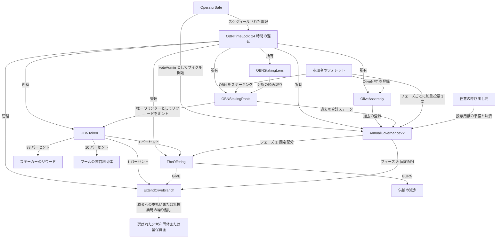

# 犠牲なき寄付:大衆的な慈善参加の衰退に対するプロトコルからの回答

[English](../THESIS.md) · [Tiếng Việt](THESIS.vi.md) · [한국어](THESIS.ko.md) · **日本語** · [简体中文](THESIS.zh-CN.md) · [हिन्दी](THESIS.hi.md) · [العربية](THESIS.ar.md) · [Русский](THESIS.ru.md) · [Deutsch](THESIS.de.md) · [Português](THESIS.pt.md) · [Español](THESIS.es.md) · [Bahasa Indonesia](THESIS.id.md)

> この翻訳は便宜上提供するものです。英語版([THESIS.md](../THESIS.md))が正本であり、両者に相違がある場合は英語版が優先します。この翻訳はリビジョン `3c740d855` をもとに AI の支援を受けて作成したもので、専門の翻訳者によるレビューはまだ受けていません。コントラクト名、関数名、アドレスは英語のまま記載しています。

**Olive Branch Network 論文**

*Olive Branch Network — Base Mainnet*

*2026年7月 — 2026年10月14日ガバナンス改訂*

---

## 要旨

米国の慈善寄付には逆説があります。寄付総額はほぼ毎年過去最高を更新する一方で、そもそも寄付をする人の数は四半世紀にわたって減り続けています。何らかの慈善寄付をした米国世帯の割合は 2000 年の 66.2% から 2018 年の 49.6% へと低下し、寄付者数は総収入が伸びる中でも 2021 年以降毎年減少しています。慈善活動はより少数で裕福な寄付者層に集中しつつあり、非営利セクターの市民的正統性を支える大衆的な参加を空洞化させています。

本論文は、参加の崩壊の根本原因は道徳的なものではなく構造的なものだと論じます。商品貨幣、法定通貨、初期のデジタル通貨という歴史上のあらゆる貨幣形態のもとで、寄付は*犠牲的*です。寄付は元本を寄付者から受取人へ永久に移転するため、参加の閾値は可処分余剰となります。実質所得の増加が分布の最上位に集中するにつれ、ますます多くの世帯が越えられなくなっている基準です。プログラム可能な貨幣は、貨幣史上初めてこの制約を取り除きます。スマートコントラクトは*資産の所有権*と*その資産が生む利回りの方向づけ*を分離できるため、**犠牲なき寄付**を設計できるようになります。寄付者は元本を永久に保持しながら、その生産性のうちプロトコルが強制する取り分を、独立して検証可能な公益へ継続的に届けます。

Olive Branch Network(OBN)プロトコルは、この設計の参照実装として提示されます。本論文は、(i) OBN を貨幣技術の長い歴史の中に位置づけ、(ii) その動機である慈善参加の衰退を出典付きの実証データで記録し、(iii) 参加者が増えるごとに OBN トークンが流通浮動分から非カストディアルなコントラクトエスクローへ移り、普及に伴って実効供給が収縮するプロトコルの参加–ロックのフィードバックループを定式化し、(iv) すべての中核スマートコントラクト — `OBNToken`、`OBNStakingPools`、`TheOffering`、`ExtendOliveBranch`、`AnnualGovernanceV2`、`OliveAssembly`、`OBNTimeLock`、`TeamVesting`、`OliveNFT`、`OBNStakingLens` — について、Base メインネットにデプロイされたとおりのストレージレイアウト、不変条件、アクセス制御構造、アップグレード安全機構を含む完全な技術的説明を提供します。

---

## 目次

1. [序論](#第1章--序論)
2. [貨幣の歴史:商品からプログラム可能性へ](#第2章--貨幣の歴史商品からプログラム可能性へ)
3. [慈善参加の実証的な衰退](#第3章--慈善参加の実証的な衰退)
4. [参加–ロックのメカニズム:OBN のトークンフロー経済学](#第4章--参加ロックのメカニズムobn-のトークンフロー経済学)
5. [中核コントラクト:完全な技術的説明](#第5章--中核コントラクト完全な技術的説明)
6. [セキュリティアーキテクチャと制度設計](#第6章--セキュリティアーキテクチャと制度設計)
7. [限界、妥当性への脅威、今後の課題](#第7章--限界妥当性への脅威今後の課題)
8. [結論](#第8章--結論)
9. [参考文献](#参考文献)

---

## 第1章 — 序論

### 1.1 問題の提示

2 つの長期的な傾向が本研究の枠組みを成します。第一に、慈善寄付の*広さ*が崩壊しつつあります。少しでも寄付をする米国世帯の割合は 2000 年から 2018 年の間に 17 パーセントポイント近く低下し(Indiana University Lilly Family School of Philanthropy, 2021)、2020 年以降のデータは減少が安定するどころか加速していることを示しています(Fundraising Effectiveness Project, 2025)。第二に、寄付の*深さ*は集中しつつあります。総額が過去最高の 2024 年 $592.50 billion(Giving USA, 2025)に達するのは、より少数で裕福な寄付者からのより大きな寄付が、離れていった何百万人もの小口寄付者に取って代わっているからです。

宗教性の低下、賃金の停滞、世代的な制度不信といった標準的な説明は、現象を描写はしても解決はしません。いずれも同じ構造的制約に帰着するからです。**歴史的に構成されてきた寄付とは、元本の永久的な譲渡です。** 世帯が慈善に参加するのは、「損失を負担できるだけの余剰がある」という閾値を超えたときだけです。実質的な可処分余剰が所得分布の最上位に集中するにつれ、参加もそれとともに集中しました。

### 1.2 論旨

本論文は 3 つの主張を擁護します。

1. **歴史的主張。** リディアのエレクトラムから連邦準備制度の負債、単なる無記名手段として使われる第一世代の暗号資産に至るまで、これまでのあらゆる貨幣技術は、元本の譲渡を寄付に使える*唯一の*基本要素にしています。プログラム可能な貨幣は、主に富裕層が利用できる信頼された仲介者(基金、信託、ドナー・アドバイズド・ファンド)を介さず、貨幣そのもののレベルで*所有権*と*利回りの方向づけ*を分離できる最初の貨幣形態です。

2. **実証的主張。** 大衆的な慈善参加は長期的に衰退しており、その衰退は犠牲の閾値が最も強く作用する小口寄付者層にまさに集中しています。この主張は、第 3 章で検討するパネルデータ(Philanthropy Panel Study)、セクター全体の取引データ(Fundraising Effectiveness Project)、マクロ推計(Giving USA)によって裏付けられます。

3. **メカニズムの主張。** (a) 参加者がトークンを手放さずにステーキングでき、(b) プロトコル発行分の固定割合を検証済みの非営利団体へ送り、(c) ステーキングされた元本を非カストディアルなエスクローにロックするプロトコルは、参加–供給のフィードバックを生みます。限界的な参加者が流通浮動分からトークンを取り除くため、需要と発行政策を一定とすれば、より広い参加が実効供給を機械的に引き締めます。第 4 章はこれを定式化し、報酬発行という相殺力を含めて前提を率直に述べます。

### 1.3 本論文の貢献

- 単一の軸、すなわち*貨幣そのものが何を強制できるか*に沿った貨幣史の統合(第 2 章)。
- 2000–2025 年の米国における慈善参加の衰退についての、統合された出典付き実証記録(第 3 章)。
- 流通浮動分の恒等式、発行/ロックの均衡条件、ガバナンスが制御するバーンのシンクを含む OBN ステーキング経済の公式なトークンフローモデル(第 4 章)。
- Base にデプロイされ、メインネットフォークのテスト環境で検証された OBN 中核コントラクト群についての初の完全な文書仕様で、すべての状態変数、関数、イベント、不変条件、アップグレード経路を網羅し(第 5 章)、そのセキュリティと制度のアーキテクチャも併せて扱います(第 6 章)。

### 1.4 一段落で見るプロトコル

Olive Branch Network は、非営利団体ごとのプールからなるステーキングシステムを備えた Base 上の ERC-20 トークン(`OBN`)です。参加者は、支援したい非営利団体のプールに OBN を入金します。入金は消費されず、非営利団体へ移転されず、プロトコルへの損失のリスクにもさらされません。(明示的にロックされたブートストラップポジションを除き)いつでも出金できます。ステーキング中、プロトコルはステークに対して時間ベースの発行分をミントし、実現したすべてのリワードを受け取り時に 4 分割します。**ステーカーに 88%、プールの非営利団体に 10%、共有保管庫(`TheOffering`)に 1%、分配保管庫(`ExtendOliveBranch`)に 1% です。** サイクル開始時に確定した共有保管庫の配分の行方(バーンか寄付か)は、OliveNFT を登録したウォレットによる、スナップショット時のステークの平方根で重み付けされた 2 フェーズの投票(`AnnualGovernance`)で毎年決定され、その第 2 フェーズは分配保管庫の固定サイクル配分をコミュニティが選んだ非営利団体へ向けます。この設計は憲章第 I 条を実現します。*「人が自らの資産の所有権を保ちながら、その資産が生む価値の一部を、独立して説明責任を負う公益へ継続的に向けることを可能にすること」*(OBN 憲章、第 I 条)。

---

## 第2章 — 貨幣の歴史:商品からプログラム可能性へ

この章の目的は好古趣味ではありません。貨幣史の各段階を一つの問いに照らして読みます。*貨幣そのものは何を強制でき、何を信頼された制度に委ねなければならないのか?* その答えが、各段階でどのような形の寄付が可能かを決定します。

### 2.1 鋳貨以前:贈与、負債、物々交換の神話

貨幣の起源についての通俗理論 — 不便な物々交換が交換媒体へと自然に道を譲ったとする理論 — は Adam Smith(1776)に由来し、貨幣を最も*売れやすい*商品への自生的な収束としてモデル化した Menger(1892)と、それが解決する摩擦を「欲求の二重の一致」と名付けた Jevons(1875)によって定式化されました。現代のサーチ理論モデル(Kiyotaki & Wright, 1989)はこの論理を保持し、Kocherlakota(1998)はその最も深い含意を凝縮しました。貨幣は技術的に、誰が何を貢献したかについての社会の*記憶*と等価である、すなわち「貨幣は記憶である」というものです。

しかし人類学的な記録は、純粋な物々交換経済を貨幣の前身とすることを支持しません。Humphrey(1985)は「純然たる物々交換経済の例は記述されたことがなく、ましてやそこからの貨幣の出現など存在しない」と結論づけました。Graeber(2011)は、*信用と義務が鋳貨に数千年先行する*という民族誌的およびメソポタミアの証拠を集めました。シュメール(紀元前 3000 年頃)の神殿と宮殿の帳簿は、誰かが銀を現金として流通させるはるか前に、負債を銀と大麦で表示していました。貨幣の信用理論(Mitchell-Innes, 1913)と国家理論(Knapp, 1905/1924) — 移転可能な負債としての貨幣、国家が納税に受け入れるものとしての貨幣 — は、このより古い層を捉えています。

以下の議論にとって重要な観察が 2 つあります。第一に、最初期の「貨幣」はすでに*会計技術*、すなわち帳簿であり、物理的なトークンは二次的なものでした。第二に、贈与と義務の経済において、寄付は余剰の裁量的な処分ではなく社会の成員資格を構成するものでした(Mauss, 1925)。寄付を自発的な余剰移転へ還元したのは後の貨幣形態の産物であり、人間の定数ではありません。

### 2.2 鋳貨:主権者の無記名手段としての貨幣(紀元前 640 年頃 – 紀元 1000 年)

標準化された鋳貨は紀元前 7 世紀のリディアに、国家が刻印したエレクトラム片として現れ、ギリシャのポリス、ペルシャ、インド(打刻された *karshapana*)、戦国時代の中国へと驚くべき速さで広がりました(Davies, 2002; Schaps, 2004)。鋳貨の革新は*一目での検証*です。主権者の刻印が鑑定の問題を解消し、信頼や記録なしに見知らぬ者同士で価値を移転できるようにします。

しかし、この技術が何を強制し何ができないかに注目してください。鋳貨は*無記名のファイナリティ*を強制します。持つ者が絶対的に所有します。条件、ストリーム、分割、復帰を符号化することはできません。したがって鋳貨が支える唯一の寄付の基本要素は鋳貨そのものの移転、すなわち元本の純粋な犠牲です。より高度なもの(神殿の基金、ローマの *alimenta*、イスラムの *waqf*、中世のチャントリー)はいずれも、信頼された人間が管理する*法的制度*で貨幣を包む必要がありました。利回りを方向づける寄付は存在しました。ワクフはまさに、元本は譲渡不能で収益が永続的に公益へ向けられる資産です(Kuran, 2001)。しかしそれは、自らの資産を中心に制度を構築できるほど裕福な人々にしか利用できませんでした。

### 2.3 紙幣、銀行、信用の上部構造(1000–1971)

宋代の中国は最初の国家紙幣(*jiaozi*、1024 年に公式化)を発行し、兌換紙幣の発行と、2 世紀のうちにインフレを招く過剰発行の両方を発見しました(Von Glahn, 1996)。ヨーロッパでは、為替手形、金細工師の預かり証、イングランド銀行(1694)、そして 19 世紀の金本位制へと続きます。この貨幣秩序では通貨供給は兌換性によって規律されましたが、実際の流通手段は圧倒的に銀行*信用*でした(Ferguson, 2008; Eichengreen, 1996)。ブレトンウッズ体制(1944)は一段階離れた金の錨を維持し、1971 年 8 月 15 日の米国による停止(「ニクソン・ショック」)が純粋な法定通貨への移行を完成させました。布告、納税の受け入れ、ネットワークの期待によって価値づけられる、国家の裏付けなき負債としての貨幣、すなわち Knapp の表券主義の完全な実現です(Eichengreen, 1996)。

寄付にとって、法定通貨と銀行の時代は規模を変えましたが構造は変えませんでした。慈善控除制度(米国では 1917 年以降)は犠牲に補助を与えました。財団、慈善残余信託、ドナー・アドバイズド・ファンドはワクフのパターン — *所有権は保持または保護され、利回りは方向づけられる* — を産業化しましたが、いずれも法的設立、最低額、アドバイザーを必要とします。構造的な非対称は続きました。**富裕層は利回りから寄付し、それ以外の人々は元本から寄付します。** 第 3 章はその予測可能な結果を記録します。

### 2.4 デジタル決済と電子法定通貨(1971–2008)

ニクソン・ショックから 2008 年までの間、貨幣は運用面で非物質化しました。Fedwire、SWIFT(1973)、カードネットワーク、インターネット決済によってほとんどの貨幣は銀行データベースの項目となりましたが、その論理は変わりませんでした。電子法定通貨は依然として、規制された仲介者がルールを強制する借用証書です。Chaum(1983)は暗号技術がデジタルな無記名現金を作り出せることを示しましたが、彼の DigiCash は発行を中央集権化し、商業的に失敗しました。Dai の「b-money」(1998)と Szabo の「bit gold」(1990 年代後半に構想、2005 年に公表)は、二重支払いを解決しないまま分散型発行を描きました。

### 2.5 ビットコイン:主権者なき希少性(2008)

Nakamoto(2008)は、公開台帳上のプルーフ・オブ・ワークのコンセンサスと固定された発行スケジュールを組み合わせ、信頼された当事者なしに二重支払い問題を解決しました。貨幣史に対するビットコインの貢献は明確です。**制度ではなくプロトコルによって強制されるデジタルな希少性と最終決済です。** 初めて、*貨幣のルール*、とりわけその供給曲線が貨幣そのものの属性となりました。

しかしビットコインのスクリプトは表現力を意図的に制限しています。貨幣としては、供給が固定された無記名手段として鋳貨に近いままです。ビットコインでの寄付も依然として元本の譲渡です。

### 2.6 イーサリアムとプログラム可能な貨幣(2015– )

Buterin(2014)はブロックチェーンをチューリング完全な状態機械へと一般化しました。イーサリアムと、OBN がデプロイされている Base のような EVM チェーンにより、貨幣は*プログラム可能*になります。任意のロジックが支払いそのものと同じファイナリティで実行されます。ERC-20 標準(Vogelsteller & Buterin, 2015)はトークン化された価値を組み合わせ可能な基本要素にし、ERC-4626、ステーキングシステム、オンチェーンガバナンス(例:Compound の Governor パターン)は、**カストディ、利回り、投票、支出のすべてがプロトコルの属性になり得ることを**実証しました。

これが歴史的議論の要です。ワクフ/基金のパターン — 元本は譲渡不能、用益は公益へ向けられる — は千年にわたり信頼された制度を必要とし、それゆえ富裕層の手段でした。スマートコントラクトは、あらゆる規模のあらゆる保有者に対して同じパターンを、次の要素とともに実装します。

- **非カストディアルなエスクロー**(「基金の元本」は受託者ではなく不変のコードが保持);
- **継続的で取り消し可能な指定**(参加者はいつでも向け先を変更または出金できる — 憲章第 III 条の分離可能性);
- **プロトコルが強制する分割**(OBN の 88/10/1/1 の分割は受託者の裁量ではなく `_mintSlices` の算術);
- **検証可能な記録**(すべての貢献はオンチェーンのイベントであり、憲章第 VI 条を満たす)。

この読み方によれば、貨幣の歴史とは、かつて制度に委ねられていた機能を貨幣そのものへ段階的に内部化してきた歴史です。検証(鋳貨)、記録(銀行)、希少性(ビットコイン)、そして最後に*受託構造*(プログラム可能な貨幣)です。OBN はこの最終段階を、貨幣の最も古い機能である贈与に応用したものです。

---

## 第3章 — 慈善参加の実証的な衰退

この章は公表データによって第二の前提を確立します。**ドル総額が増える一方で、寄付をする人の数は、あらゆる主要なデータ源において持続的に減少しています。**

### 3.1 長期的な参加の衰退(Philanthropy Panel Study、2000–2018)

最も厳密な縦断的証拠は、Indiana University Lilly Family School of Philanthropy の *Philanthropy Panel Study* から得られます。これは 9,000 を超える米国世帯の寄付を隔年で追跡する全国代表パネルです。

- **2000 年には米国世帯の 66.2%** が慈善寄付をしました。
- **2018 年には 49.6% のみ**となりました。米国世帯の半数未満しか寄付しなかったのは記録上初めてで、17 パーセントポイント近い低下です(Lilly Family School of Philanthropy, 2021)。
- 宗教への寄付は**世帯の 46%(2000–2004)から 29%(2018)へ**低下し、非宗教への寄付は 55–57% の横ばい(2000–2008)から **2018 年の 42%** へ低下しました(Lilly Family School of Philanthropy, 2021)。
- 追跡分析では、減少は **COVID-19 パンデミックの最初の年に加速し**(Lilly Family School of Philanthropy, *The Giving Environment*, 2022; NonProfit PRO, 2022)、参加はすべての人種・民族グループで低下したことがわかりました(The NonProfit Times, 2023)。

同校の *Giving Environment* 報告書は、減少の一因を中・低所得世帯の所得の低下と停滞、および宗教的所属に関する規範の変化に帰しています(Lilly Family School of Philanthropy, 2022)。どちらも犠牲の閾値の表れです。世帯はお金を失っても負担できるときに寄付し、そうできる世帯は減っています。

### 3.2 2018 年以降も減り続ける寄付者数(Fundraising Effectiveness Project、2021–2025)

数千の非営利団体にわたる実際の寄付取引データを集計する Fundraising Effectiveness Project(FEP)は、パネル研究を超えて記録を延長し、減少が進行中であることを示しています。

- 寄付者数は **2021 年以降毎年**減少しています(AFP/FEP, 2026)。
- 2023 年から 2024 年にかけて寄付者数は**前年比 4.5%** 減少し、減少は前年までと比べて*加速*しました(FEP Q4 2024 報告; GlobeNewswire, 2025)。
- **2025 年には寄付者数がさらに推定 3.6% 減少し**、一方で慈善ドル総額は 5.0% 増加しました。より少ない寄付者によって達成された、過去 5 年で最も力強い収入の伸びです(AFP/FEP, 2026)。
- 離脱は小口に集中しています。**全寄付者の半数以上を占める $1–$100 の寄付者は 2024 年に 8.8%、2025 年第 1 四半期に前年比 11.1% 減少しました**(FEP; NonProfit PRO, 2025)。
- 全体の寄付者維持率は **43%** 前後で、新規寄付者の維持率ははるかに低く、初めての寄付者のほとんどは二度と寄付しません(FEP, 2025–2026)。

FEP 自身の表現がまさに集中の論旨です。収入の増加は「より大きな寄付に集中」し、「総寄付者数の継続的な減少」を伴っています(AFP, 2025)。

### 3.3 ドルは増え、寄付者は減る(Giving USA、2024–2025)

米国の慈善活動について最も歴史の長いマクロ推計である Giving USA が、この逆説を完成させます。

- 寄付総額は **2024 年に $592.50 billion** に達し、名目ドルで過去最高となり、名目で 6.3%、インフレ調整後で 3.3% 増加しました(Giving USA 2025)。
- 寄付総額は 2025 年に推定 **$617.2 billion** へとさらに増加しました(Giving USA 2026; Give.org, 2026)。
- しかし**総額に占める個人寄付の割合は、1986–1990 年の約 80% から 2024 年の 66%、2025 年の 64% へ低下し**、蓄積された富の手段である財団、遺贈、企業がその穴を埋めています(Giving USA 2026; Give.org, 2026; Stelter, 2026)。

### 3.4 統合:犠牲の閾値

世帯パネル(PPS)、取引集計(FEP)、マクロ推計(Giving USA)という 3 つの独立した方法論から同じ姿が浮かび上がります。

| 指標 | 当時 | 現在 | 方向 |
|---|---|---|---|
| 少しでも寄付する世帯(PPS) | 66.2% (2000) | 49.6% (2018) | ↓ 16.6 pts |
| 宗教に寄付する世帯(PPS) | 46% (2000–04) | 29% (2018) | ↓ 17 pts |
| 寄付者数、前年比(FEP) | — | −4.5% (2024), −3.6% (2025) | ↓ 加速中 |
| 小口寄付者 $1–$100(FEP) | 全寄付者の 50–57% | 前年比 −8.8% ~ −11.1% | ↓ 最も急激な層 |
| 寄付総額に占める個人の割合(Giving USA) | ~80% (1986–90) | 64% (2025) | ↓ 16 pts |
| ドル総額(Giving USA) | — | $592.5B (2024), $617.2B (2025) | ↑ 過去最高 |

このセクターは上から資本増強される一方で、その参加基盤は侵食されています。寄付に余剰が必要で余剰が集中しているなら、まさに予測されることです。非営利セクターの*資金*問題は富裕層によって解決されつつありますが、その*参加*問題 — 何百万もの小口寄付が持つ市民的、民主的、正統性を与える機能 — はまったく解決されていません。裕福でない世帯が損失なしに継続的に寄付できる手段が存在しないからです。

第 4 章はそのような手段を説明します。

---

## 第4章 — 参加–ロックのメカニズム:OBN のトークンフロー経済学

この章はプロトコルの経済的な核心を定式化します。**参加が供給をロックします。** すべての主張は第 5 章で詳述する具体的なコントラクトコードに基づいており、ここではシステムをトークンフローの機械として扱います。

### 4.1 ジェネシス配分と現在の準備金

次の表は過去のジェネシスミントを記録したものであり、現在の未使用準備金ではありません。`OBNToken.initialize` は固定された比率で初期供給量全体を正確に 1 回ミントしました(OBNToken.sol)。

| 配分 | 割合 | 目的 |
|---|---|---|
| 流動性 | 40% | トークンを入手できるようにする DEX 流動性 |
| エアドロップ | 30% | 広範な初期分配のシーディング |
| 慈善基金 | 10% | 非営利プールポジションのブートストラップ(永久ロック — §4.4) |
| トレジャリー | 10% | プロトコル運営(1 回限りのジェネシス配分。発行の流れは一切流入しない) |
| チームベスティング | 10% | `TeamVesting` で時間ロック(4 か月のクリフ、20 か月の線形) |

一度だけ設定される単一のミンターであるステーキングコントラクト以外に追加のミントはできないため、ジェネシス後の供給増は*すべて*ステーキング発行です。

非営利シード準備金の総配分は **300M OBN** で、**50M OBN** はプロトコルの必要のために別途保有されます。トレジャリーとエアドロップの保有分はシード配分に統合されました。その時点で 11M OBN がすでに 11 の非営利シードに資金を提供しており、それぞれ 1M OBN で 289 の追加シードのために 289M OBN が残りました。

これは既存の保有分の再配分であり、新たなミントやデプロイ済みイニシャライザーの変更ではありません。

### 4.2 流通浮動分の恒等式

時点 *t* において次を定義します。

- **S(t)** — 総供給量:ジェネシス供給量に累積発行量を加え、累積バーン量を引いたもの。
- **K(t)** — ステーキングコントラクトが保有するトークン:すべての `userAmount` 残高の合計(元本のみ。リワードは受取人へ直接ミントされ、プールされることはない)。
- **V(t)** — `TeamVesting` にまだロックされているトークン。
- **G(t)** — 年次サイクルを待って 2 つのガバナンス保管庫(`TheOffering` と `ExtendOliveBranch`)に蓄積されたトークン。
- **B(t)** — 累積バーントークン(`TheOffering.burn` と任意の自発的な `ERC20Burnable.burn` による)。

すると、実際に取引可能な供給である**流通浮動分**は次のとおりです。

> **F(t) = S(t) − K(t) − V(t) − G(t)**   ただし   **S(t) = S₀ + E(t) − B(t)**

E(t) は累積総発行量です。メカニズムの主張は ∂F/∂(参加) についての言明です。**すべての入金はトークンを F から K へ 1 対 1 で移し**(`_depositCore` が `safeTransferFrom(msg.sender, address(this), amount)` を実行)、トークンはその参加者が出金を選ぶまで K にとどまります。プロトコルは K を貸し出さず、再担保に使わず、支出もしません。スラッシングはなく、元本に対するプロトコルの請求権もありません。K は不活性なエスクローです。

### 4.3 発行政策:逓減し、参加に比例

発行は固定された蛇口では*ありません*。`_sumRewardAcrossPhases` はプールごとのリワードを `poolStake × bps × Δt / (10000 × 365 days)` として累積します。すなわち、逓減するスケジュールに沿った**実際にステーキングされている量の年率パーセンテージ**です。

| デプロイからの経過年数 | 年間発行率(ステーキング残高に対して) |
|---|---|
| 0–2 | 10.00% |
| 2–4 | 7.50% |
| 4–6 | 5.00% |
| 6–8 | 2.50% |
| 8–10 | 1.25% |
| 10+ | 3.00% のフォールバック(`FALLBACK_EMISSION_BPS`)、ガバナンスが `addPhase` で修正するまで |

2 つの帰結が導かれます。第一に、**発行は S ではなく K に比例します**。ステーキングされていないトークンは何も生みません。第二に、リワードは*受け取りイベント*(入金、出金、受け取り)でのみミントされるため、未受け取りのリワードは単なる会計項目(`accRewardPerShare × balance − rewardDebt`)であり、実現するまでトークンとして存在しません。

### 4.4 4 分割とそのシンク

実現のたびに、`_mintSlices` は保留中の総リワードを分割します。

- **88% → ステーカー。** 参加者の利回り。新たにミントされ、F に入ります(または再ステーキングされます)。
- **10% → プールの非営利ウォレット。** 贈与。継続的で、プロトコルが強制し、参加者のステークと時間に比例します。これが憲章第 VII 条の*貢献*であり、ステーカーの元本は失われません。プロトコルがなければ存在しなかった利回りの一部のみです。
- **1% → `TheOffering`**(共有保管庫)。1 年を通じて蓄積され、各年次ガバナンスサイクルでサイクル開始時に確定した配分を**バーン**(デフレのシンク、S を減少)するか**寄付**(`ExtendOliveBranch` へ移転)するかを投票します。
- **1% → `ExtendOliveBranch`**(分配保管庫)。1 年を通じて蓄積され、各年次ガバナンスサイクルのフェーズ 2 投票がそのサイクルの固定配分をコミュニティが選んだホワイトリスト上の非営利団体 1 つへ向けます(誰も投票しなければ繰り越し)。

**トレジャリーへ流れる発行の流れはない**ことに注意してください。残りの 2 つの取り分はいずれもガバナンスが制御する保管庫に入ります。年次の処分まで、両方の流れは保管庫のエスクロー(§4.2 の G)にあり、取引可能な浮動分の外にあります。

さらに、慈善基金の 10% のジェネシス配分は `charityFundBootstrap`/`depositForWithLock` を通じて展開され、これは*各非営利団体自身のウォレットに代わって*、`lockedAmount` を入金額と等しく設定してトークンをステーキングします。これは**永久ロック**です(ロックは増加のみ可能で減少しません)。したがってブートストラップポジションは永遠に K に寄与し、すべてのプールにその非営利団体への基本リワードの流れを保証し、大量売却されることはありません。

### 4.5 参加–ロックのフィードバックループ

要素を組み合わせます。*n* をアクティブな参加者数、*k̄* を平均ステークとします。すると K = n·k̄ (ブートストラップロックを加算)であり、

1. **普及が浮動分を引き締めます。** 新しい参加者は浮動トークンをエスクローされた元本へ変えます。ΔF = −Δstake。需要が一定なら、取引可能な浮動分の縮小は市場清算価格を上昇させます。これは標準的な需給の結果であり、高いステーキング比率が流動的な供給を減らすプルーフ・オブ・ステーク経済で長く観察されてきた「浮動分の縮小」のオンチェーン版です。
2. **利回りは忍耐に報い、利回りの 88% は複利運用できます。** 88% の取り分を再ステーキングするステーカーは、新たにミントされたトークンをそのまま K へ戻し、F をさらに引き締めます。
3. **贈与の流れが現実世界の正統性に資金を提供します。** 10% の非営利の流れは外部機関に参加を促す持続的な理由を与え、それがさらなる参加者を呼び込みます。それ自体が慈善行為である唯一のマーケティングチャネルです。
4. **ガバナンスは共有保管庫を純粋なデフレへ転換できます。** フェーズ 1 の BURN の結果はサイクル開始時に確定した共有保管庫の配分を破壊し、S を直接減らします。デフォルトが意図的にデフレ的であることに注意してください。*参加ゼロ → BURN* (GIVE は BURN を*厳密に*上回らなければなりません)。
5. **投票資格にはスナップショット時の参加が必要です。** V2 は登録済み NFT の状態と、チェックポイントされた少なくとも 1 OBN の合計ステークを組み合わせ、平方根の重み付けを適用します。ガバナンスは各サイクル開始前にステーキングする理由を提供しますが、その後もステーキングを続けることを要求したり、投票期間を通じた継続的なロックを設けたりはしません(§5.5)。

ループ:**参加者の増加 → ロックされるトークンの増加 → 浮動分の縮小と累積バーンオプションの拡大 → 価格支持の改善 → トークンあたりの利回り価値と贈与価値の上昇 → 勧誘力の強化 → 参加者の増加。**

### 4.6 誠実な会計:発行の相殺力

このメカニズムには逆方向の力があります。発行はインフレ的です。当初の 10% の率では S は K に比例して増えます。正味の浮動分が*縮小*するかは実現したフローに依存します。浮動分の恒等式を微分すると、浮動分へ流入する発行フローは次のとおりです。

> **dF/dt ≈ e·K·[0.88·(1−r) + 0.10 + 0.02·(1−β)·δ] − dK/dt**

ここで *e* は現在の発行率、*r* は再ステーキングされるステーカーリワードの割合、*β* はフェーズ 1 で最終的にバーンされる保管庫の流れの割合、*δ* ≤ 1 は 2 つの 1% の保管庫の流れが年次サイクルで分配された後にのみ浮動分へ入ることを反映する遅延係数です(バーンされた分は決して入らず、繰り越しは流入をさらに遅らせます)。浮動分は、**正味の新規ステーキングが再ステーキングされない発行部分を上回る**ときに収縮します(dF/dt < 0)。構造的な特徴はその方向へ押します。普及の拡大を目指す一方で発行スケジュールは 10% → 1.25% へ逓減し、非営利の受取人はミッション主導の売り手ですがその流入は発行分の 10% にすぎず、バーンのデフォルトは共有分を永久に除去し、ブートストラップロックは決して出ていきません。しかしこの条件は実証的なものであり、保証されません。したがってここで擁護する主張は正確に限定されています。*プロトコルは、他の条件が等しければ、参加の拡大が浮動分を機械的に収縮させ、トークン価格を支える条件を生むように設計されています。外生的な需要にも左右される価格上昇を保証するものではなく、保証することもできません。*

### 4.7 犠牲なき寄付、改めて

経済設計は第 3 章の問題を直接解決します。参加の閾値はもはや「失っても構わない余剰」ではなく「預けておいてもよい資本」です。$500 を寄付することなど決してできなかった世帯も、$500 をステーキングし、保持し、緊急時には出金でき、その間ステークが生む利回りの 10% — プロトコルが強制し公開記録される本物の貢献 — を検証済みの非営利団体へ継続的に向けることができます。寄付は*消費の犠牲*ではなく*資産配分の決定*になります。これが参加の崩壊に対する設計の答えです。人々にもっと寄付するよう説くのではなく、人々が寄付をやめた構造的な理由を取り除くのです。

---

## 第5章 — 中核コントラクト:完全な技術的説明

すべてのコントラクトは Solidity ^0.8.28 を対象とし、OpenZeppelin v5 を基盤として Base にデプロイされています。アップグレード可能なコントラクトは UUPS パターン(`_authorizeUpgrade` をオーナー、すなわち `OBNTimeLock` に限定)を使用します。この章はスイート内の各コントラクトの目的、ストレージ、関数、イベント、不変条件、相互作用を説明します。

### 5.1 `OBNToken` — 貨幣の基盤 (OBNToken.sol)

**継承。** `Initializable`、`IOBNMintable`、`ERC20Upgradeable`、`ERC20PermitUpgradeable`(EIP-2612 のガスレス承認)、`ERC20VotesUpgradeable`(チェックポイント付き委任)、`ERC20BurnableUpgradeable`、`OwnableUpgradeable`、`UUPSUpgradeable`。

**識別。** 名前 "Olive Branch Network"、シンボル "OBN"。

**ストレージ。** 単一のカスタム変数 `address public minter` と、アップグレードの余地を確保する `uint256[100] __gap`。

**初期化。** `initialize(initialOwner, initialSupply, liquidityAddress, airdropAddress, charityAddress, treasuryAddress, teamVestingAddress)` は 1 回実行されます(initializer 修飾子。コンストラクタは `_disableInitializers()` を呼び出すため、実装自体は決して初期化できません)。ゼロアドレスと非ゼロ供給の確認後、全分配をミントします。エアドロップ 30%、流動性 40%、慈善 10%、トレジャリー 10%、チームベスティング 10% です(§4.1)。

**ミンターの仕組み。** `setMinterOnce(addr)` — オーナー専用、`minter == address(0)` が必要。ミンターは実装の存続期間中**正確に 1 回**だけ設定できます(変更できるのは完全な UUPS アップグレードのみ)。`mint(to, amount)` は `msg.sender == minter` を要求します。デプロイ時のミンターは `OBNStakingPools` プロキシであり、したがって*将来の供給はすべてステーキング発行です*。`isMinter(addr)` は便利なビューです。

**オーバーライド。** OZ v5 はすべての残高変更を `_update` 経由でルーティングするため、単一のオーバーライドが `ERC20Upgradeable` と `ERC20VotesUpgradeable` を調整します(投票チェックポイントは送金を自動的に追跡します)。`nonces()` は `ERC20PermitUpgradeable` と `NoncesUpgradeable` を調整するためにオーバーライドされます。

**セキュリティ特性。** 一時停止なし、ブラックリストなし、送金税なし。トークンは最大限に中立です。バーンは `ERC20Burnable` を通じて任意の保有者が利用でき、`TheOffering` が共有分を破壊するために使うフックです。

### 5.2 `OBNStakingPools` — エンジン (StakingPoolsV931.sol、バージョン文字列 "9.3.1")

ステーキングコントラクトはシステムで最大かつ最も重要なコントラクトです。唯一の OBN ミンターであり、すべてのステーキング元本(§4.2 の K)のカストディアンであり、ガバナンスの投票権オラクルです。安定したアドレスの UUPS プロキシの背後で動作します。

#### 5.2.1 定数 — 不変の分割

```solidity
STAKER_BPS = 8800; CHARITY_BPS = 1000; CHARITY_FUND_BPS = 100; TREASURY_BPS = 100;
TOTAL_BPS = 10000; FALLBACK_EMISSION_BPS = 300;
```

88/10/1/1 の分割は `constant` です。バイトコードにコンパイルされており、timelock を通じた完全な実装アップグレードなしには変更できません。2 つの 100-bps の取り分は `treasury` と `charityFund` のストレージ変数に保持されたアドレスへミントされます。**デプロイされた構成では、これらの変数はそれぞれ `TheOffering` (0xc75B…E341) と `ExtendOliveBranch` (0xE1Bb…6d8B) を保持します。** 識別子は歴史的なものであり、2 つの 1% の流れの実際の受取人は 2 つのガバナンス保管庫です(§5.3、§5.4)。`FALLBACK_EMISSION_BPS` は定義されたフェーズスケジュールの終了後に適用される 3% の恒久的な下限です(§4.3)。

#### 5.2.2 ストレージレイアウト

スロット順でアップグレードに決定的です(コントラクトはスロットマップを文書化しており、末尾のギャップは `uint256[93]` です。毎月の自動請求の状態はこのマップの外にある ERC-7201 名前空間ストレージ `obn.storage.MonthlyAutoClaim` にあります)。

- **構成:** `stakingToken`(`IOBNMintable` としての OBN トークン)、`treasury`(→ TheOffering)、`charityFund`(→ ExtendOliveBranch)、`version`(文字列、"9.3.1")。
- **発行スケジュール:** `Phase[] phases`、それぞれタイムスタンプの `{start, end, bps}`。
- **プール:** `PoolInfo[] poolInfo`、それぞれ `{charityWallet, totalStaked}` — 非営利団体ごとに 1 プール。
- **ユーザー会計:** `userAmount[pid][user]`、`userRewardDebt[pid][user]` — 累積器/リワード負債パターン(§5.2.3)。
- **累積器:** `accRewardPerShare[pid]`(1e12 スケール)、`lastRewardTime[pid]`。
- **グローバル:** `globalTotalStaked`。
- **ロック:** `lockedAmount[pid][user]` — 永久ロックの台帳(§4.4)。
- **統計:** `totalClaimedByUser`、`totalDepositedByUser`、`totalWithdrawnByUser`、プールごとの入金/出金/ミント済み charity の合計、`uniqueStakersByPool`、`uniqueStakersGlobal`、`activePoolCount[user]`、`stakedSince[user]`、`cumulativeStakeSeconds[user]`(完全なアンステーキング後も保持 — 恒久的な在籍記録)。
- **ライフサイクル:** `poolRemoved[pid]`(入金無効)、`poolFullyRemoved[pid]`(ガバナンスの投票用紙から削除 — `removePool` のみが設定し、`shutdownPool` は決して設定しない)。
- **貢献の追跡:** `charityContributedByUserInPool[pid][user]` と `totalCharityContributedByUser[user]` — 各参加者に帰属する生涯の寄付で、憲章第 VI 条のオンチェーンの*記録*。
- **ガバナンスの配管(スロット 28–30):** `charityFundOperator` + `_migrationExecuted` + `upgradeBlock`(1 スロットにパック)、`totalStakedByUser[user]`(プール横断の累計)、`_stakeCheckpoints[user]`(`Checkpoints.Trace208` — 投票権の履歴)。上記ライフサイクルに記載の `poolFullyRemoved` はスロット 31 を占めます。

#### 5.2.3 会計モデル

OBN は決定的な変更を加えた累積器/リワード負債方式を使用します。**累積器は総(GROSS)リワードを追跡します。** プールに触れるたびに、`_accruePool` は `_sumRewardAcrossPhases` を通じて `lastRewardTime` 以降の総発行量を計算します。これはフェーズスケジュールを区間ごとにたどり、`Math.mulDiv(poolStake, bps × duration, 10000 × 365 days)` でフェーズ境界を正確に処理し、最後に定義されたフェーズを超える区間には 3% のフォールバック率を適用します。そして `accRewardPerShare[pid] += grossReward × 1e12 / totalStaked` へ畳み込みます。するとユーザーの保留総額は次のとおりです。

> `pending = userAmount × accRewardPerShare / 1e12 − userRewardDebt`

88/10/1/1 への分割は `_mintSlices` 内で実現されるときにのみ行われ、厳格な checks-effects-interactions に従います。すべての統計は 4 回の外部 `mint` 呼び出しの*前に*更新されます。ステークがゼロのプールには何もミントされず(累積は早期リターンしてクロックを進めるだけ)、リワードはコントラクト内にとどまらず、ミントから最終受取人へ直行します。公開の `sumRewardAcrossPhases` ラッパーは読み取り専用の Lens のためにフェーズ走査を公開します(§5.9)。

#### 5.2.4 ユーザー向け関数

- **`deposit(pid, amount)`** — プールにステーキングします。有効でシャットダウンされていないプールが必要です。効果:プールの累積、ユニークステーカーの登録(プールごととグローバル、0→1 プールで `stakedSince` が在籍クロックを開始)、`userAmount`、`poolInfo.totalStaked`、`globalTotalStaked`、入金統計の増加、リワード負債のリセット、`(block.number, totalStakedByUser)` チェックポイントの追加。その後、元本を `safeTransferFrom` で受け取り、保留リワードを `_mintSlices` します。入金は副作用として保留リワードを*実現*します。
- **`depositFor(pid, amount, beneficiary)`** — 他のアドレスのステークへの第三者による資金提供(給与天引き型の寄付、参加の贈り物)。
- **`depositWithPermit(...)`** — EIP-2612 による単一トランザクションでの承認+ステーキング。
- **`withdraw(pid, amount)`** — 退出。`amount ≤ userAmount − lockedAmount`(*ロックされていない*残高)を強制し、すべての残高、チェックポイント、フックを更新します(`_afterWithdrawBalanceHooks` はロックを新しい残高に制限し、ゼロでアクティブステーカーフラグをクリアし、最後のプール退出時にセッションを `cumulativeStakeSeconds` に計上して `uniqueStakersGlobal` を減らします)。元本を返し、同じ 88/10/1/1 の分割で保留リワードを実現します。**クールダウンなし、ペナルティなし、手数料なし** — 第 III 条の分離可能性は摩擦のない退出を要求します。
- **`claim(pid)` / `claimFor(pid, user)` / `claimMultiple(pids)`** — 元本に触れずにリワードを実現します。`claimFor` はオーナー専用(timelock の背後)で、リワードを正当な所有者にのみ送ることができます(呼び出し元ではなく *`user` へ*ミント)。定期的な受け取りには V9.3.1 で追加された同意ベースの別経路 `autoClaimFor` を使用します(ホワイトペーパー §3.2.1)。この経路はリワードを複利運用しません。
- **ビュー群:** `pendingRewards`、`getPoolInfo`、`getUserStakeValue`、`unlockedBalance`、`poolLength`、`isGloballyStaked`、`stakeElapsed`、`currentRewardsPerSecond`(より重い分析は Lens にあります — §5.9)。

#### 5.2.5 慈善基金のブートストラップと自己ステーキングの凍結

`charityFundBootstrap(pid, amount, beneficiary)` / `depositForWithLock(...)` — `charityFund` または `charityFundOperator`(運営 Safe)のみが呼び出せ、プール自身の慈善ウォレットに対してのみ可能で、`_enforceCharitySelfStakePolicy` を経由します。これはプールの慈善団体ごとに**正確に 1 回**のロックされたブートストラップ入金を許可します。慈善ウォレットの残高はゼロでなければならず、呼び出し元は承認されていなければならず、入金はロックされなければなりません。プールの非営利団体によるその他の自己ステーキングはすべて拒否されます("charity self-stake disabled")。根拠:非営利団体が自身のプールにステーキングすると 10% の慈善分が自身へ戻り、ガバナンスの重みのフライホイールとして複利化します。凍結は非営利団体のポジションを、透明で永久ロックされた 1 つのブートストラップに限定します。

`setLockedAmount(pid, user, amount)` — charityFund またはオペレーター(オペレーターはプールの慈善アドレスに限定)はロックを**増やすことのみ**でき、減らすことはできず、ユーザーの残高を超えることもできません。ロックは構造上一方向です。

#### 5.2.6 管理関数(すべて timelock が所有する `onlyOwner` の背後)

- **`addPool(charityWallet)`** — 非営利団体のプールを作成し、累積クロックを初期化します。
- **`shutdownPool(pid)`** — *新規の*入金をブロックします。受け取りと出金は継続するため、ユーザーは常に退出できます。シャットダウンされたプールはガバナンスの投票用紙の対象のままです。
- **`removePool(pid)`** — `totalStaked == 0` の場合のみ。レガシーの charity の蓄積を送り出し、`poolFullyRemoved` を設定し(将来の投票用紙から非営利団体を削除)、残余のミントが address(0) に滞留しないようプールの慈善ウォレットを `treasury` アドレス(TheOffering)へ向け直します。
- **プールの閉鎖** — 非営利団体が離脱すると、そのプールはシャットダウンされます。新規のステークはブロックされますが、既存のステーカーは引き続きステーク解除と受け取りができ、残っているステークは通常の 88/10/1/1 の分配でリワードを生み続けます。プールを削除する前に、残っているすべてのステーカーを強制退出させます。`forceExitUserToSelf` は各ステークを保留リワードとともにそのステーカー本人のウォレットに返却し、それ以外の宛先には送れません。非営利団体のロックされたシードステークは非営利シード準備金に返却されます。その後、ステークが何も残っていない状態になって初めて、プールは削除されます。
- **`updateCharityWallet(pid, newWallet)`** — 侵害または移行された非営利ウォレットをローテーションします。
- **`migrateBootstrap(pid, old, new)`** — ブートストラップポジション全体(残高、リワード負債、ロック)を非営利アドレス間でアトミックに移動し、双方の投票権チェックポイントを引き継ぎ、保留リワードが 1 wei 以内で保持されることをオンチェーンで証明します(`pendingAfter ≥ pendingBefore && pendingAfter ≤ pendingBefore + 1`)。
- **`addPhase(start, end, bps)`** — 発行フェーズを追加します。最後のフェーズと連続している必要があります。これは 3% のフォールバック率に対するガバナンスのレバーでもあります。
- **`forceExitUserToSelf(pid, user, claimRewards)`** — 緊急:ユーザーの元本全額を*ユーザー本人へ*返します(管理者へは決して返しません)。任意でリワードを実現し、ロックを無視します。管理者は没収できず、強制返還のみが可能です。
- **`sweep(token, amount)`** — 誤って届いた ERC-20 を `treasury` アドレスへ回収します。**ステーキングトークンを明示的に除外**("Cannot sweep staking token")し、管理者が K に決して触れられないようにします。
- **`migrateV93(newTreasury, newCharityFund, newOperator)`** — timelock を通じた `upgradeToAndCall` により実装のデプロイとアトミックに実行された 1 回限りの接続関数です。`treasury` → TheOffering、`charityFund` → ExtendOliveBranch、`charityFundOperator` → 運営 Safe を設定し、投票権チェックポイントのジェネシスの基準として `upgradeBlock` を記録し、自身を恒久的に無効化しました(`_migrationExecuted`)。 V9.3.1 アップグレードでは、別個の 1 回限りの reinitializer である `initializeV931(executor)` が追加され、`version` を "9.3.1" に設定し、自動請求の executor を指定しました。その後は `setAutoClaimExecutor(executor)` でこの executor を変更でき、ゼロアドレスで自動化を一時停止します。
- **`upgradeTo(newImpl, data)` / `setVersion`** — timelock のスケジューリングと互換性のある UUPS アップグレード経路。

#### 5.2.7 チェックポイント付き投票権

ステーキング残高は*スナップショットで照会可能*であり、ガバナンスはフラッシュステーク攻撃を招く現在の残高を信頼せず、固定された過去のブロックで投票に重み付けできます。

- すべての入金、出金、ブートストラップ移行は `(block.number, totalStakedByUser)` をユーザーごとの `Checkpoints.Trace208` に追加します。
- **ジェネシスのブートストラップ:** チェックポイントシステム以前のポジションを持つステーカーには履歴項目がありません。3 つの補完的な経路がこれらを `upgradeBlock` で初期化します。`_initializeCheckpointIfNeeded`(自動、ユーザーの次回操作時、残高変更の前)、`bootstrapCheckpoint(user)`(パーミッションレス — 誰でも誰でも初期化可能)、`batchBootstrap(users[])`(パーミッションレスの一括セレモニー)です。`AnnualGovernance` も投票者の最初の投票試行時に遅延ブートストラップします(§5.5)。
- **`getPastVotingPower(user, blockNumber)`** — 任意の過去のブロックにおけるユーザーのステーキング合計の二分探索(`upperLookup`)による照会。**`checkpointCount(user)`** — 初期化状態を公開します。
- このインターフェースは最終的な V2 の投票の重みではなく、**スナップショット時の生の合計ステーキング OBN** を返します。AnnualGovernanceV2 はまず OliveAssembly の過去の登録と 1 OBN の最低額を確認し、次に平方根の重み付けを適用します(§5.5)。ステーキングされていないウォレット残高と ERC20Votes の委任は年次投票権を与えません。NFT 投票以前の過去のサイクルは当初の線形の重み付けを維持します。

### 5.3 `TheOffering` — 共有保管庫 (TheOffering.sol)

1 年を通じてすべての OBN ステーキング発行分の 1% を受け取る、意図的に最小限の**アップグレード不可**の保管庫です。ETH は扱わず、役割は 2 つだけです。

- `timelockOwner`(不変、構築時に設定) — `setGovernance(addr)`(address(0) でガバナンスを一時停止)と `emergencySweep(token, to)`(ERC-20 の全残高回収、分配前のオーバーライド)を呼び出せます。
- `governance`(`AnnualGovernance` プロキシ) — 投票後に正確に 2 つの関数を呼び出せます。**`burn(amount)`**(OBN の `ERC20Burnable.burn` を呼び出して供給を破壊)または **`sendToExtend(amount)`**(`ExtendOliveBranch` への SafeERC20 送金)。

デプロイの順序は重要で、コントラクト内に文書化されています。`ExtendOliveBranch` が先(そのアドレスはここでは immutable)、ガバナンスは後から接続します。コントラクトはその年の蓄積された共有分を保持するだけで他には何もしません。攻撃対象面は保護された 2 つの関数のみです。

### 5.4 `ExtendOliveBranch` — 分配保管庫 (ExtendOliveBranch.sol)

2 つ目のアップグレード不可の保管庫で、すべてのステーキング発行分の独自の 1% と、`TheOffering` からの GIVE の結果の移転を受け取ります。ストレージ:不変の `obn` と `timelockOwner`、可変の `governance`、`mapping(address => bool) approvedNonprofit` — 憲章第 IV 条を実装する**ホワイトリスト**です(受取人の正統性は自己申告ではなく独立して検証されなければなりません)。

意図的に非対称な 2 つの分配経路:

- **`distribute(nonprofit, amount)`** — timelockOwner または governance。*ホワイトリストを適用*。手動/ガバナンス以前/緊急のチャネル。
- **`distributeFromGovernance(nonprofit, amount)`** — governance のみ。この分配経路では**ホワイトリストを意図的に省略**します。V2 は投票用紙バッチの処理時に各受取人をホワイトリストと照合して検証し、そのメンバーをサイクルの間維持します。その後のホワイトリスト取り消しは、受け入れられた受取人を除去したり、支払い時に選ばれた受取人を無効にしたりできません。Timelock は `emergencySweep` を保持しており、予約された資金を引き出すと不足分が補充されるまで決済が妨げられる可能性があります。

管理:`setApprovedNonprofit(addr, bool)`、`setGovernance(addr)`、`emergencySweep(token, to)` — すべて timelock 専用。

### 5.5 `AnnualGovernanceV2` — 年次ガバナンス (AnnualGovernanceV2.sol)

このセクションは、2026 年 10 月 7 日(Base ブロック 52283807)のアップグレード以降、既存の AnnualGovernance プロキシの背後で稼働している実装である AnnualGovernanceV2 を説明します。稼働中のコントラクトは第三者によるセキュリティ監査を受けていません。`governance-operations` にあるチーム自身の過去のレビューは以前のバージョンを対象としたもので、稼働中のデプロイを説明するものではありません。

#### 5.5.1 コミュニティが決定すること

年次ガバナンスは 2 つの共有の 1% の発行の流れの向け先を決めます。フェーズ 1 では、参加者は TheOffering の配分をバーンするか ExtendOliveBranch に寄付するかを選びます。フェーズ 2 では、そのサイクルの ExtendOliveBranch の配分を受け取る適格な非営利団体を 1 つ選びます。フェーズ 1 で BURN が選ばれても両フェーズとも実施されます。これらの投票は、ステーカーの 88% のリワードを変更したり、プール固有の 10% の非営利の取り分を振り向けたり、ユーザーの元本を使ったり、任意のプロトコルアップグレードを承認したりしません。

OperatorSafe は `voteAdmin` としてサイクルを直接開始します。オーナーは引き続き Timelock であり、非営利団体のオンボーディングと設定はそれを通じて管理されます。*年次*という語は意図された運用の周期を表します。コントラクトは 2 つの 30 日間の投票期間を強制しサイクルの重複を防ぎますが、サイクルを自動的にスケジュールしたり開始の間に 1 年の間隔を要求したりはしません。各準備および決済のトランザクションは誰かが提出する必要があります。

#### 5.5.2 登録と投票権

投票者は同じウォレットで OBN をステーキングし、OliveAssembly に OliveNFT を 1 つ登録します。Assembly プロキシに NFT の移転を承認した後、ウォレットは `deposit(tokenId)` を呼び出します。Assembly は NFT を保管し、ウォレットの登録をチェックポイントします。Assembly の外で NFT を保有するだけでは不十分です。登録は出金するまでサイクルをまたいで維持され、同じウォレットに追加の NFT を登録することは許可されません。ステーキングと NFT 登録は別個の行動であり、どちらも他方の代わりにはなりません。

ブロック `B` で開始するサイクルでは、両フェーズはブロック `B - 1` の終わりの登録と合計ステーキング残高を使用します。少なくとも 1 OBN をステーキングした登録済みウォレットが適格です。ブロック `B` 以降の入金や登録はそのサイクルの権利を増やしません。後のステークや NFT の出金は、スナップショットで確定した権利を除去しません。したがってこのメカニズムは、60 日間のステークや NFT のロックを課すのではなく、定義された時点での参加を測定します。

適格なウォレットの場合、人間が読める単位の投票権はステーキングされた OBN の平方根におおよそ等しくなります。18 桁小数のステーク額 `s` に対する正確なコントラクトの計算は `floor(sqrt(s)) * 10^9` で、18 桁小数の投票権単位で返されます。最低額未満またはスナップショット登録がない場合、投票権はゼロです。

| スナップショット時の合計ステーク | 投票権単位(登録済みの場合) |
|---|---:|
| 1 OBN 未満 | 0 |
| 1 OBN | 1 |
| 100 OBN | 10 |
| 10,000 OBN | 100 |

これは集中したステークの優位を減らします。ステークを 100 倍にしても重みは 10 倍にとどまります。一人一票を確立するものではありません。一人が複数のウォレットを管理し複数の NFT を取得でき、適格なウォレットにステークを分割すると合計の平方根の重みが増える可能性があります。NFT 登録は資格のゲートであり、固有の人間のアイデンティティの証明ではありません。

各適格ウォレットは `castOfferingVote(cycleId, burn)` と `castNonprofitVote(cycleId, nonprofit)` を使ってフェーズごとに 1 票を投じられます。これらのエンドポイントで投票を修正することはできません。フェーズ 2 の投票者がフェーズ 1 に投票している必要はありません。ステークは全プールにわたって重みを決定するため、投票者はそのウォレットがステーキングしているプールだけでなく、投票用紙上の任意の非営利団体を選べます。これらの年次投票エンドポイントには投票率の定足数や委任の仕組みはありません。

#### 5.5.3 サイクルのライフサイクルと投票用紙の準備

| ステップ | 実行者 | コントラクトの動作 |
|---|---|---|
| 登録とステーキング | 参加者 | スナップショット前に NFT 登録とステークを確立 |
| フェーズ 1 の開始 | voteAdmin の Safe | `startAnnualCycle(2592000, 2592000)` を呼び出し、スナップショットを確定して 30 日間の投票を開始 |
| 残りの投票用紙の準備 | 任意の呼び出し元 | 上限のあるバッチで `prepareBallot(cycleId, maxPools)` または `executeCurrentCycle()` を呼び出す |
| BURN または GIVE に投票 | 適格ウォレット | それぞれ重み付けされたフェーズ 1 の投票を 1 票提出 |
| フェーズ 1 の決済 | 任意の呼び出し元 | 期限後に準備が完了していれば結果を実行しフェーズ 2 を開始 |
| 非営利団体に投票 | 適格ウォレット | 丸 30 日間の期間中にそれぞれ重み付けされたフェーズ 2 の投票を 1 票提出 |
| フェーズ 2 の決済 | 任意の呼び出し元 | 勝者の固定配分を支払うか、投票がなければ繰り越しを記録 |

開始には、Assembly がガバナンスにバインドされていること、スナップショットに少なくとも 1 件の登録があること、プール履歴が空でないこと、以前のサイクルが完了またはキャンセルされていることが必要です。登録ウォレット数は、いずれかのウォレットがステーキングの閾値を満たすことを保証しません。両方の期間引数は正確に 2,592,000 秒でなければなりません。Safe の開始操作には、フェーズ 2 を開くための新たな Timelock 操作や 2 回目の Safe 操作は必要ありません。

**スナップショットと資金。** 開始トランザクションは 1 つ前のブロックで投票者の資格と合計ステークを固定し、両方の資金配分を確定します。OliveNFT が OliveAssembly に 1 つ登録され、合計ステークが少なくとも 1 OBN である必要があります。投票権は平方根で重み付けされます。両フェーズは同じスナップショットを使用し、その後に出金してもそのサイクルの権利は消えません。後の資金受領は、今サイクルの Offering の GIVE 配分を除き次のサイクルに属します。

**投票用紙の準備。** 開始はプール履歴の長さを固定し、フェーズ 1 を開き、最初の 100 のプール ID を処理します。パーミッションレスのキーパー呼び出しがフェーズ 1 中に最大 100 ID の追加バッチを処理します。これはトランザクションごとの処理上限であり、メンバー数の制限ではありません。重複排除はマッピングを使用し、最初の適格 PID の順序を維持します。アクティブなプールとシャットダウンされたプールは完全に削除されない限り適格です。追加の Safe や Timelock の開始操作は必要ありません。

**設定のタイミング。** 投票者と資金のスナップショットは開始時に固定されますが、ステーキングコントラクトは過去の非営利団体の設定を提供しません。各プールの削除状態とウォレット、および新規受取人の承認は、そのバッチの実行時に読み取られます。すでに追加された受取人はサイクル中不変で、後から追加されたプール ID は除外されます。したがって準備中の Timelock の変更は未処理のプールに影響する可能性があります。未承認の受取人はバッチをアトミックにリバートさせ、Timelock は設定を修復するかサイクルをキャンセルしなければなりません。受け入れ後に承認が取り消されても、その投票用紙メンバーは除去されません。準備が保留中は非営利団体の設定変更を避けてください。

**実行。** 非営利の投票用紙の準備中にフェーズ 1 の投票を行えます。フェーズ 1 は準備が完了し期限が過ぎるまで実行できません。ディスパッチャーはフェーズを実行する前に保留中のバッチを進めます。空の最終投票用紙では準備を完了できず、オーナーはフェーズ 1 の実行前にキャンセルできます。GIVE は BURN を厳密に上回る必要があり、同数と参加ゼロは固定された Offering の配分のみをバーンします。その後フェーズ 2 が実際の実行から丸 30 日間開きます。各非営利投票は一定の処理量で首位を更新し、同数は投票用紙の最も早い位置に与えられます。決済はその首位に固定サイクル配分のみを支払うか、投票がなければ繰り越します。準備も決済も、1 回の状態変更トランザクションで投票用紙全体をスキャンしません。

例えば、フェーズ 1 の期限が 30 日目に過ぎても 34 日目に決済された場合、フェーズ 2 は 64 日目に閉じます。フェーズ 1 の投票は当初の期限で止まり、実行の遅延がその投票を延長することはありません。`executeCurrentCycle()` は呼び出しごとに 1 バッチまたは 1 決済を進めるため、最後の準備バッチの完了後にフェーズ 1 を決済するには後続の呼び出しが必要な場合があります。パーミッションレスの実行モデルは意欲のある呼び出し元なら誰でもこの作業を行えるようにしますが、キーパーサービスが稼働していることを保証するものではありません。

#### 5.5.4 固定配分と結果のルール

`O` を開始トランザクションにおける TheOffering の OBN 残高、`E` を ExtendOliveBranch の残高とします。フェーズ 1 は、GIVE の加重集計が BURN を厳密に上回らない限り `O` をバーンします。したがって同数またはフェーズ 1 の投票なしは BURN となります。GIVE が勝てば `O` は ExtendOliveBranch へ移ります。フェーズ 2 の配分は BURN の場合 `E`、GIVE の場合 `E + O` です。後の受領分は除外され、将来のサイクルのために残ります。

例えば開始時に TheOffering に 1,000 OBN、ExtendOliveBranch に 2,000 OBN ある場合、GIVE はフェーズ 2 に 3,000 OBN を利用可能にします。ExtendOliveBranch が後でさらに 200 OBN を受け取っても、その 200 は今回の支払いに加算されません。BURN の場合は 1,000 OBN が破壊され、フェーズ 2 は 2,000 OBN を配分します。フェーズ 2 の投票がなければ、配分は将来のサイクルのために保管庫に残り、フェーズ 1 で実行済みの BURN は取り消されません。

フェーズ 2 は最も高い加重集計を選び、同数は昇順のプール ID 処理と受取人の重複排除で決まる投票用紙の最も早い位置で解決されます。これは単一受取人への配分であり、全候補への比例分配ではありません。資金は既存の保管庫にとどまります。スナップショットは別個のエスクローではなく会計上の予約です。管理上の引き出しは不足を生む可能性があり、決済は減額した配分を支払わずにリバートし、補充後に再試行できます。

#### 5.5.5 権限、互換性、検証

| 主体 | 現在の設計における権限 |
|---|---|
| 登録済みの適格な投票者 | スナップショットの重みで 2 つの年次配分の結果を決定 |
| voteAdmin の Safe | サイクルを開始。開始関数で投票用紙を恣意的なリストに置き換えたり集計を覆したりはできない |
| 任意の呼び出し元 | 決定的な投票用紙バッチを準備し、条件が満たされれば結果を実行 |
| Timelock オーナー | voteAdmin の変更、非営利団体の設定と保管庫の管理、フェーズ 1 の決済前のキャンセル、許可されたアップグレードの承認 |

年次投票者が Timelock の管理権限を得ることはありません。Governance と Assembly はアクティブなサイクル中に自身のアップグレードをブロックしますが、ステーキング、トークン、保管庫の依存関係は管理上の信頼の前提を保持します。フェーズ 1 の実行後に `cancelCycle` でサイクルをキャンセルすることはできません。この制限は保管庫の緊急権限を除去したり、中断のない決済を保証したりするものではありません。

**互換性と読み取り。** 既存の Cycle フィールドとトップレベルのスロットはそのまま残り、新しい Cycle フィールドは末尾に追加されます。旧来の maxBallotSize の値とセッターは ABI/ストレージ互換性のために残りますが、メンバーを制約しません。助言的なプールインデックスは投票用紙の構築に使用されません。getCyclePreparation は進捗を公開し、getBallotPage は呼び出しごとに最大 100 メンバーを読み取ります。大きなサイクルでは、レガシーの CycleStarted イベントには最初のバッチのみが含まれるため、インデクサーは完全な投票用紙のために BallotBatchPrepared イベントまたはページ分割された読み取りを使用する必要があります。フロントエンドはフェーズ 2 の投票用紙を表示する前に完了を待ち、1 つのブロックでページを読み取ります。

**信頼と実務上の限界。** メンバーの厳格な上限がないことは無限のスループットを意味しません。履歴が増えるほど準備にはより多くのキーパートランザクションが必要です。レガシーのステーキングブートストラップとライブステークのフォールバックは依然としてプール履歴をスキャンする場合があります。Timelock/依存関係のアップグレード権限は引き続き信頼の対象です。キャンセルはフェーズ 1 の実行前のみ可能で、governance と Assembly のアップグレードは準備を含むアクティブなサイクル全体を通じてブロックされたままです。

読者は `getCycleSummary`、`getCyclePreparation`、`getCycleFundSnapshot`、`getPhase2Allocation`、`getCycleParticipation`、`getPhase2Result` を通じてライフサイクルを検証できます。ウォレットのサイクル固有の権利には `getVotingPowerForCycle` を使用してください。`getCurrentVoterInfo` は現在の登録とステークを表し、サイクルのスナップショットと異なる場合があります。レガシーのステーカーはチェックポイントのブートストラップが必要な場合があり、投票エンドポイントがこれを自動的に試みます。ステーキングと Lens のパワービューは生のステークを公開するものであり、最終的な V2 の投票の重みとして表示してはなりません。過去のサイクルが遡及的に再加重されることはなく、レガシーの分析フラグは利用できない過去の記録と本当のゼロの結果を区別します。

#### 5.5.6 OliveAssembly の保管と出金

OliveAssembly は既存の OliveNFT コレクションのための、Timelock が所有する別個の UUPS プロキシです。ウォレットごとに預け入れられた NFT 1 つ、その預け入れ者、過去の登録チェックポイント、過去の登録ウォレット数を記録します。ガバナンスプロキシに 1 回バインドし、互換性のある所有権と相互の設定を要求します。そのアップグレード承認はガバナンスがアイドル状態であることを確認します。

預け入れ者は `withdraw()` を呼び出して NFT を受け取るか、`withdrawTo(recipient)` で受取人を選ぶことができます。`withdrawExpected(tokenId, recipient)` はさらに、登録されたトークンが預け入れ者の出金しようとしたものであることを検証します。登録された NFT にロック期間も管理者による出金経路もありません。出金は過去のスナップショットを書き換えずに将来の登録スナップショットを変更します。要求されていない safe transfer はリバートし、通常の ERC-721 送金は投票者を登録せず、送金履歴の参照とともに Timelock による回収が必要になる場合があります。したがって登録には NFT の直接送金ではなく `deposit` を使用してください。

デプロイの参照先は、AnnualGovernance プロキシ `0x1135d5fEA8098b09b4ED3AFbfFDc7B248359D270`、その V2 実装 `0x000a76f74b47498D6a9A593F9Cb7cfB71d975437`、OliveAssembly プロキシ `0xE1ba5a8bC457E60FC2377B1837a40FF85da1578c` です。ユーザーはプロキシとやり取りします。これらのコントラクトのデプロイやアップグレード自体が投票サイクルを開始するわけではありません。

### 5.6 `OBNTimeLock` — 憲法的な遅延 (OBNTimeLock.sol)

OpenZeppelin の `TimelockController(minDelay, proposers, executors, admin)` の簡素なサブクラスで、24 時間の最小遅延でデプロイされています。すべてのアップグレード可能なコントラクト(token、staking、governance、lens、Assembly)を所有し、両方の保管庫で `timelockOwner` の役割を保持します。その簡潔さこそが要点です。すべての複雑さは実戦で鍛えられた OZ の実装にあり、ここに挙げるオーナー管理の行動 — アップグレード、プール管理、ホワイトリスト変更、ガバナンスの接続、緊急回収 — は公開でスケジュールされ、実行前に丸一日の精査を経なければなりません。サイクルの開始は別個の voteAdmin の権限であり、準備と決済はパーミッションレスです。これらの行動に新たな 24 時間の Timelock 操作は必要ありません。

### 5.7 `TeamVesting` — 利害が一致した内部者 (TeamVesting.sol)

10% のチーム配分のためのアップグレード不可の `Ownable` 保管庫です。不変値:`token`、`start`。定数:クリフ後の `CLIFF = 4 × 30 days`、`DURATION = 20 × 30 days`。`vestedAmount()` は `(balance + released)` に対して線形ベスティングを計算するため、追加入金に対しても計算が堅牢です。`release()`(パーミッションレス)は CEI(効果、イベント、その後送金)に従い `teamWallet` へ支払います。UI ヘルパー(`claimableNow`、`timeUntilCliff`、`timeUntilNextRelease`、`nextReleaseTimestamp`)は連続的な線形スケジュール上に親しみやすい日次ティックモデルを公開します。`updateTeamWallet` はオーナー専用で、`rescueERC20` はベスティング対象のトークンを明示的に除外します。したがって内部者は 4 か月間チームトークンに一切アクセスできず、24 か月目にようやく完全にベスティングされ、ローンチ時の価格変動ではなく複数年の発行スケジュールにチームを合わせます。

### 5.8 `OliveNFT` — 文化的な産物 (OliveNFT.sol)

OBN を保有せずステーキング利回りも与えない ERC-721Enumerable コレクションです。AnnualGovernanceV2 以降、OliveAssembly に OliveNFT を 1 つ預け入れると年次投票の登録要件を満たします。投票の重みは依然として NFT の数量ではなくスナップショット時のステークから得られます(§5.5)。NFT を単に保有するだけでは年次投票の資格は得られません。`MAX_SUPPLY = 20,000` と `MINT_PRICE = 0.005 ether` は定数です。注目すべき仕組み:

- **ウォレットごとに一度に 1 つ**(`enforceOnePerAddress`、切り替え可能):`mint()` は正確に 1 つのトークンをミントし、ウォレットがすでに 1 つ保有していれば `AlreadyHolding()` でリバートします。プロトコルの参加の精神を反映した、クジラ対策で広さを優先する分配姿勢です。
- **コミット–リビールの公平性:** オーナーは販売前に `keccak256(seed)` をコミットし(`commitMetadataSeed`)、正確な原像のみを公開できます(`revealMetadata`)。これによりオンチェーンの乱数や操作可能なブロック変数なしに、特性の割り当てが事前にコミットされたことを証明できます。
- **Feistel 拡散:** メタデータの種類(合計が正確に 20,000 でなければならない N 個のバケット、`freezeTypeCounts` で凍結可能)は、公開されたシードでシードされた 4 ラウンド、16 ビットの Feistel 置換を通じてトークン ID に対応し、cycle-walking を用います(`_scatterIndex` は像が `MAX_SUPPLY` を下回るまで置換を再適用し、置換の巡回は有限なので終了が保証されます)。これによりレアリティはミント順全体に均一に拡散し、順次ミントする人がレアな帯を狙い撃ちできません。
- `tokenURI` は公開前にはプレースホルダーを、公開後には `baseURI + typeIndex + ".json"` を返します。誤って届いた ETH は `receive`/`fallback` のリバートで拒否され、`withdraw` は外部呼び出しの前にイベントを発行して `Address.sendValue` を使用します。

### 5.9 `OBNStakingLens` — 読み取り専用の分析プレーン (OBNStakingLens.sol)

UUPS でアップグレード可能で timelock が所有する**純粋なビュー**コントラクトであり、資金を保有せず特権も持ちません。その単一のストレージスロットはステーキング*プロキシ*(アップグレードをまたいでアドレスは安定)を指します。ステーキングコントラクトの公開 `sumRewardAcrossPhases` ラッパーを通じてライブの累積器の予測を再計算することで、フロントエンド向けの完全な分析群 — `getUserStats`、`getUserPoolView`、`getPoolStats`、`listPoolsBasic`、`pendingRewards[Multiple]`、`getPoolAPR`、`getGlobalStats`、`currentRewardsPerSecond`、`pendingCharityFor` — を提供し、生の過去のステークのための `getVotingPower(user, snapshotBlock)` を追加します。年次ガバナンスのインターフェースは、NFT ゲート付きの平方根の投票の重みのために V2 の `getVotingPowerForCycle` を使用しなければなりません。アーキテクチャの原則はプレーンの分離です。*書き込み経路とカストディはエンジン内で最小限かつ緩やかな変更にとどめ、読み取り/UX の反復は、何も盗めないがゆえに自由にアップグレードできるコントラクトで行います。*

### 5.10 相互作用のトポロジー



---

## 第6章 — セキュリティアーキテクチャと制度設計

### 6.1 コードレベルの防御

- **重要な箇所すべてでの checks-effects-interactions:** `_mintSlices` はミントの前にすべての統計を更新し、`TeamVesting.release` は送金の前に `released` を更新し、`OliveNFT.withdraw` は送信の前にイベントを発行します。
- **リエントランシーガード**をステーキングと NFT ミントのすべての状態変更ユーザー経路に適用します。
- すべてのトークン移動に **SafeERC20**、すべての比例計算に `Math.mulDiv`(全幅の中間積、オーバーフローや精度の崖なし)。
- **カストディの最小化:** リワードは最終受取人へ直接ミントされ、ステーキングコントラクトは元本のみを保持し、管理者の `sweep` は明示的にステーキングトークンに触れられません。
- **一方向のラチェット:** トークンのミンターは 1 回限りの設定、ロックは増加のみ、`migrateV93` は自己無効化、種類数は凍結、コミット–リビールは 1 回限りです。
- **開始前スナップショット投票**(ブロック − 1)とチェックポイント付きステークおよび NFT 登録により、同一ブロックでの資格変更が集計されることを防ぎ、各ウォレットは記録されたイベントとともにフェーズごとに最大 1 票の加重投票を行います。これは固有の個人のアイデンティティを確立するものではなく、スナップショットをまたぐあらゆる借り入れを防ぐものでもありません。
- **アップグレードの規律:** すべてのコンストラクタに `_disableInitializers()` を持つ UUPS、文書化されたストレージマップとギャップの会計、サイクル中の governance または OliveAssembly のアップグレードのオンチェーンでの禁止。

### 6.2 制度的な防御

憲章はシステムの憲法として機能し、コントラクトはその条項をほぼ条項ごとに実装しています。同意と取り消し可能性(ペナルティなしの `withdraw`)、所有権と利回りの方向づけの分離可能性(ステーキングそのもの)、受取人の説明責任(ホワイトリストと投票用紙の検証)、共有分のガバナンス(デフレのデフォルトを持つ 2 フェーズのサイクル)、検証可能性(ユーザーごとの生涯貢献の追跡を含むイベントと統計の公開面)です。権限は意図的に分散されています。timelock は管理できても没収はできません(`forceExitUserToSelf` は*ユーザー*に支払います)。投票管理者はサイクルを開始できても決定はできません。ガバナンスは共有分を動かせても事前に承認された 2 つの経路に限られます。そしてフェーズ 1 が実行されると、timelock を含めて誰も `cancelCycle` でサイクルをキャンセルできません。§5.5.5 で詳述するとおり、保管庫の緊急権限と依存関係のアップグレードは別個の信頼の前提として残ります。

---

## 第7章 — 限界、妥当性への脅威、今後の課題

1. **価格支持の主張は条件付きです。** §4.6 で導いたとおり、浮動分の収縮には正味のステーキング流入が再ステーキングされない発行を上回る必要があります。外生的な需要ショック、流動性プールの深さ、10% の流れに対する非営利団体の売り圧は、すべてプロトコルの制御外にあります。本論文はリターンではなく*メカニズム*を主張します。
2. **発行で資金を得る寄付はトークン価格のリスクを受け継ぎます。** 非営利の流れの実質価値は OBN 市場に依存します。価格の長期的な下落は、名目の発行が続いていても贈与の流れを縮小させます。非営利団体のトレジャリーの分散はプロトコルが強制できないオフチェーンの必要事項です。
3. **ステークの集中と複数ウォレットでの参加。** V2 の平方根の重み付けは線形の重み付けに比べて集中したステークの影響を減らしますが、富の優位を除去するものではありません。それぞれ登録済み NFT を持つ複数のウォレットにステークを分割すると、合計の重みが増える可能性があります。登録は固有の個人の検証ではなく、チェックポイントは同一ブロックのステーク操作を防ぎますが、あらゆる形の借り入れステークや協調的な参加を防ぐものではありません。アイデンティティ、委任、定足数、在籍期間に基づく設計は、デプロイ済みの保証ではなく今後の可能な課題として残ります。
4. **ホワイトリストの中央集権化。** 非営利団体の検証は現在 timelock オーナーを経由します。憲章第 IV 条は*独立した*検証可能性を求めており、分散型の証明レジストリ(プロジェクトの標準的な公益レジストリ CDR を参照)が意図された後継です。
5. **実証の一般化。** 参加データは米国中心です。犠牲の閾値の理論は他の経済圏の寄付参加パネルと、最終的には OBN 自身のオンチェーンのコホートデータに対して検証されるべきです。プロトコルはとりわけ、元本の損失を除去すれば参加が増えるかどうかの自然実験です。
6. **規制上の立場。** 第 4 章の分析は経済的なものであり、証券法上の意見ではありません。トークンの分配とマーケティングは本論文とは独立に適用法の下で評価されなければなりません。

---

## 第8章 — 結論

貨幣は常に強制の技術でした。各時代の問いは、信頼された制度の裏付けなしにどの約束を強制できるかです。鋳貨は無記名の価値を、銀行は台帳を、ビットコインは希少性を強制しました。そしてプログラム可能な貨幣は*受託構造*を強制し、千年の歴史を持つ基金のパターンを、あらゆる世帯が保有できるパーミッションレスの基本要素へと凝縮します。

この凝縮は、それが必要とされるまさにその歴史的瞬間に到来します。データに曖昧さはありません。米国の寄付参加は一世代で世帯の 3 分の 2 から半数未満へ低下し、寄付者数は毎年減少する一方で記録的なドルはますます少数の手に集中し、セクターの市民的な背骨である小口寄付者が最も速く消えゆく層です。ここで擁護する原因は構造的なものです。寄付は常に元本の犠牲を要求してきましたが、その犠牲を負担できる人々は狭まってきました。

Olive Branch Network は説教ではなくメカニズムで答えます。参加者はステーキングして資本を保持します。プロトコルは逓減し参加に比例する発行分をミントし、実現したすべてのリワードをステーカー、選ばれた非営利団体、2 つのガバナンス保管庫に 88/10/1/1 で取り消し不能に分割します。共有分はコミュニティが積極的に贈与へ投票しない限りデフォルトでバーンされ、参加者が増えるごとに元本が不活性なエスクローへ移って流通浮動分を引き締めます。したがって参加する行為は同時に寄付する行為であり、供給を収縮させる行為でもあります。第 5 章で規定したコントラクトは、*一方向のラチェット*を主題とするセキュリティアーキテクチャでこれを実装します。一度だけ設定されるミンター、増えるだけのロック、実行後にキャンセルできない投票、そしてユーザーに資金を返すことはできても決して奪うことのできない管理者です。

本論文の最も深い主張は最も単純です。寛大さに犠牲が必要であってはならず、貨幣史上初めて、その必要はなくなりました。

---

## 参考文献

### 貨幣史と貨幣理論

- Buterin, V. (2014). *Ethereum: A Next-Generation Smart Contract and Decentralized Application Platform.* Ethereum whitepaper.
- Chaum, D. (1983). "Blind Signatures for Untraceable Payments." *Advances in Cryptology: Proceedings of Crypto 82.*
- Davies, G. (2002). *A History of Money: From Ancient Times to the Present Day.* University of Wales Press.
- Eichengreen, B. (1996). *Globalizing Capital: A History of the International Monetary System.* Princeton University Press.
- Ferguson, N. (2008). *The Ascent of Money: A Financial History of the World.* Penguin.
- Graeber, D. (2011). *Debt: The First 5,000 Years.* Melville House.
- Humphrey, C. (1985). "Barter and Economic Disintegration." *Man*, 20(1), 48–72.
- Jevons, W. S. (1875). *Money and the Mechanism of Exchange.* D. Appleton & Co.
- Kiyotaki, N., & Wright, R. (1989). "On Money as a Medium of Exchange." *Journal of Political Economy*, 97(4), 927–954.
- Knapp, G. F. (1924 [1905]). *The State Theory of Money.* Macmillan.
- Kocherlakota, N. (1998). "Money is Memory." *Journal of Economic Theory*, 81(2), 232–251.
- Kuran, T. (2001). "The Provision of Public Goods under Islamic Law: Origins, Impact, and Limitations of the Waqf System." *Law & Society Review*, 35(4), 841–898.
- Mauss, M. (1925). *The Gift: Forms and Functions of Exchange in Archaic Societies.*
- Menger, C. (1892). "On the Origin of Money." *Economic Journal*, 2(6), 239–255.
- Mitchell-Innes, A. (1913). "What is Money?" *Banking Law Journal*, May 1913.
- Nakamoto, S. (2008). *Bitcoin: A Peer-to-Peer Electronic Cash System.*
- Schaps, D. (2004). *The Invention of Coinage and the Monetization of Ancient Greece.* University of Michigan Press.
- Smith, A. (1776). *An Inquiry into the Nature and Causes of the Wealth of Nations.*
- Vogelsteller, F., & Buterin, V. (2015). *EIP-20: Token Standard.*
- Von Glahn, R. (1996). *Fountain of Fortune: Money and Monetary Policy in China, 1000–1700.* University of California Press.

### 慈善参加のデータ(オンライン資料)

- Indiana University Lilly Family School of Philanthropy (2021). ["Latest data shows new low in share of Americans who donated to charity."](https://philanthropy.indianapolis.iu.edu/news-events/news/_news/2021/latest-data-shows-new-low-in-share-of-americans-who-donated-to-charity.html)
- Indiana University Lilly Family School of Philanthropy (2022). [*The Giving Environment: Understanding How Donors…*](https://scholarworks.indianapolis.iu.edu/server/api/core/bitstreams/9631fc6a-945b-4d25-b6dd-06bd0bcf233e/content)
- Newsweek (2021). ["Number of Americans Giving to Charities Declined to 49.6 Percent, Study Shows."](https://www.newsweek.com/number-americans-giving-charities-declines-42-percent-study-shows-1613539)
- NonProfit PRO (2022). ["Study: Drop in Share of Americans Who Give to Charity Accelerated in First Year of Pandemic."](https://www.nonprofitpro.com/article/study-drop-in-share-of-americans-who-give-to-charity-accelerated-in-first-year-of-pandemic/)
- The NonProfit Times (2023). ["Philanthropy Rates Dropped Across Racial, Ethnic Groups: Report."](https://thenonprofittimes.com/npt_articles/philanthropy-rates-dropped-across-racial-ethnic-groups-report/)
- The Chronicle of Philanthropy. ["In Search of … America's Missing Donors."](https://www.philanthropy.com/news/in-search-of-americas-missing-donors/)
- Stanford Social Innovation Review. ["Collapse of Grassroots Giving Threatens Social Innovation."](https://ssir.org/articles/entry/grassroots-giving-collapse-social-innovation-threat)
- Philanthropy Roundtable. ["What to Make of New Insights into Pre-Pandemic Giving."](https://www.philanthropyroundtable.org/what-to-make-of-new-insights-into-pre-pandemic-giving/)
- Giving USA (2025). ["U.S. charitable giving grew to $592.50 billion in 2024, lifted by stock market gains."](https://givingusa.org/giving-usa-2025-u-s-charitable-giving-grew-to-592-50-billion-in-2024-lifted-by-stock-market-gains/)
- Give.org / BBB Wise Giving Alliance (2026). ["As America Nears 250, Giving USA 2026 Highlights Changing Giving Trends."](https://give.org/news/giving-usa-2026-charitable-giving-trends)
- NonProfit PRO (2026). ["Bequests Lift Giving USA 2026 Total Past $600B."](https://www.nonprofitpro.com/article/giving-usa-2026-bequests-do-the-heavy-lifting-as-total-giving-tops-600b/)
- Candid (2025). ["Key takeaways from Giving USA on 2025 philanthropy trends."](https://candid.org/blogs/philanthropy-trends-giving-usa/)
- Stelter (2026). ["Beyond the Record High: What Giving USA 2026 Numbers Reveal."](https://blog.stelter.com/2026/06/23/beyond-the-record-high-what-giving-usa-2026-numbers-reveal-and-what-comes-next/)
- Association of Fundraising Professionals / Fundraising Effectiveness Project (2025). ["FEP Data for Q1 2025 Shows Increases in Dollars Raised, but Declining Numbers of Donors."](https://afpglobal.org/news/fundraising-effectiveness-project-data-q1-2025-shows-increases-dollars-raised-declining)
- GlobeNewswire (2025). ["FEP Data for Q4 2024 highlights the growing role of high-dollar donors."](https://www.globenewswire.com/news-release/2025/04/25/3068473/0/en/Fundraising-Effectiveness-Project-Data-for-Q4-2024-highlights-the-growing-role-of-high-dollar-donors-in-driving-fundraising-performance-across-the-sector.html)
- Association of Fundraising Professionals / FEP (2026). ["FEP Reports Strongest Revenue Growth in Five Years, Even as Fewer Donors Give."](https://afpglobal.org/news/fundraising-effectiveness-project-reports-strongest-revenue-growth-five-years-even-fewer)
- NonProfit PRO (2025). ["FEP Q3 Report: Nonprofits Continue to Rely on Fewer Donors."](https://www.nonprofitpro.com/article/nonprofits-continue-to-rely-on-fewer-donors-to-fund-their-missions-per-latest-fep-data/)
- Nonprofit Quarterly. ["Donor Base Continues to Decline, FEP Report Says."](https://nonprofitquarterly.org/donor-base-continues-to-decline-fep-report-says/)
- National Philanthropic Trust. ["Charitable Giving Statistics."](https://www.nptrust.org/philanthropic-resources/charitable-giving-statistics/)

### プロトコルの資料

- OBN ホワイトペーパー — [WHITEPAPER.md](WHITEPAPER.ja.md)
- 中核コントラクト — [`obn-project/contracts/`](../obn-project/contracts/):`OBNToken.sol`、`StakingPoolsV931.sol`、`MonthlyAutoClaimUpgradeable.sol`、`TheOffering.sol`、`ExtendOliveBranch.sol`、`AnnualGovernanceV2.sol`、`OliveAssembly.sol`、`OBNTimeLock.sol`、`TeamVesting.sol`、`OliveNFT.sol`、`OBNStakingLens.sol`
- OBN 憲章 v0.1 および *The Philosophy of Olive Branch Network* — プロトコルのガバナンス文書

---

*当初 2026 年 7 月に作成。ガバナンスのセクションは 2026 年 10 月 14 日に、AnnualGovernanceV2 と OliveAssembly のソースコード、および 10 月 7 日の有効化(Base ブロック 52283807、チェーン ID 8453)に関するリポジトリの記録に基づいて改訂されました。この改訂はコントラクトの動作を文書化したものであり、個別の投票サイクルの現在の状態を示すものではありません。*
