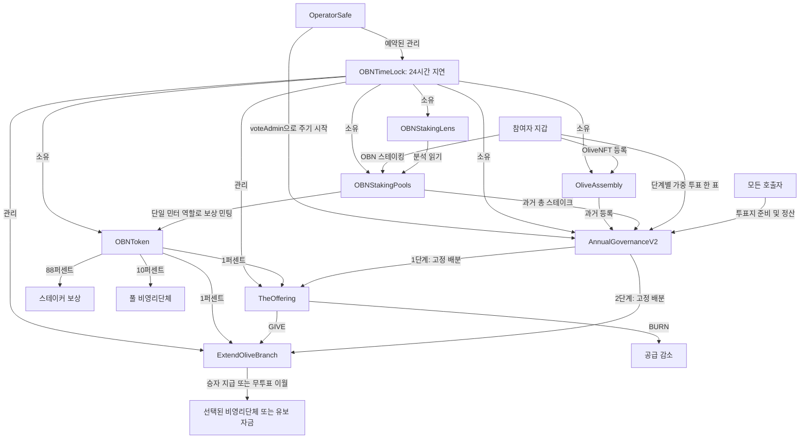

# 희생 없는 기부: 대중적 자선 참여의 감소에 대한 프로토콜의 해답

[English](../THESIS.md) · [Tiếng Việt](THESIS.vi.md) · **한국어** · [日本語](THESIS.ja.md) · [简体中文](THESIS.zh-CN.md) · [हिन्दी](THESIS.hi.md) · [العربية](THESIS.ar.md) · [Русский](THESIS.ru.md) · [Deutsch](THESIS.de.md) · [Português](THESIS.pt.md) · [Español](THESIS.es.md) · [Bahasa Indonesia](THESIS.id.md)

> 이 번역본은 편의를 위해 제공됩니다. 영어 원본([THESIS.md](../THESIS.md))이 공식 문서이며, 내용이 다를 경우 영어 원본이 우선합니다. 이 번역본은 리비전 `3c740d855`을 바탕으로 AI의 도움을 받아 작성되었으며 아직 전문 번역가의 검토를 거치지 않았습니다. 컨트랙트 이름, 함수 이름, 주소는 영어 그대로 표기합니다.

**Olive Branch Network 논문**

*Olive Branch Network — Base Mainnet*

*2026년 7월 — 2026년 10월 14일 거버넌스 개정*

---

## 초록

미국의 자선 기부에는 역설이 있습니다. 기부 총액은 거의 매년 사상 최고치를 기록하는 반면, 기부하는 사람의 수는 지난 25년 동안 줄어들고 있습니다. 어떤 형태로든 자선 기부를 한 미국 가구의 비율은 2000년 66.2%에서 2018년 49.6%로 떨어졌고, 기부자 수는 총수입이 늘어나는 와중에도 2021년 이후 매년 감소했습니다. 자선 활동은 더 작고 부유한 기부자층으로 집중되어, 비영리 부문의 시민적 정당성을 떠받치는 대중적 참여를 공동화하고 있습니다.

이 논문은 참여 붕괴의 근본 원인이 도덕적인 것이 아니라 구조적인 것이라고 주장합니다. 상품 화폐, 법정 화폐, 초기 디지털 화폐 등 역사상 모든 형태의 화폐에서 기부는 *희생적*입니다. 기부는 원금을 기부자에게서 수혜자에게로 영구히 이전하므로, 참여의 문턱은 처분 가능한 잉여가 됩니다. 실질 소득 증가가 분포의 최상위에 집중되면서 점점 더 많은 가구가 넘지 못하는 문턱입니다. 프로그래밍 가능한 화폐는 화폐 역사상 처음으로 이 제약을 제거합니다. 스마트 컨트랙트는 *자산의 소유권*과 *그 자산이 창출하는 수익의 방향 결정*을 분리할 수 있으므로, **희생 없는 기부**를 설계할 수 있게 됩니다. 기부자는 원금을 영구히 보유하면서, 그 생산성 가운데 프로토콜이 강제하는 몫을 독립적으로 검증 가능한 공익으로 지속적으로 보냅니다.

Olive Branch Network(OBN) 프로토콜은 이 설계의 참조 구현으로 제시됩니다. 이 논문은 (i) OBN을 화폐 기술의 오랜 역사 속에 위치시키고, (ii) 그 동기가 되는 자선 참여 감소를 인용된 실증 데이터로 기록하며, (iii) 참여자가 늘어날 때마다 OBN 토큰이 유통 물량에서 비수탁 컨트랙트 에스크로로 옮겨져 채택이 늘수록 실효 공급이 수축하는 프로토콜의 참여–잠금 피드백 루프를 정식화하고, (iv) 모든 핵심 스마트 컨트랙트 — `OBNToken`, `OBNStakingPools`, `TheOffering`, `ExtendOliveBranch`, `AnnualGovernanceV2`, `OliveAssembly`, `OBNTimeLock`, `TeamVesting`, `OliveNFT`, `OBNStakingLens` — 에 대해 Base 메인넷에 배포된 상태 그대로 저장소 레이아웃, 불변 조건, 접근 제어 구조, 업그레이드 안전 메커니즘을 포함한 완전한 기술 설명을 제공합니다.

---

## 목차

1. [서론](#제1장--서론)
2. [화폐의 역사: 상품에서 프로그래밍 가능성까지](#제2장--화폐의-역사-상품에서-프로그래밍-가능성까지)
3. [자선 참여의 실증적 감소](#제3장--자선-참여의-실증적-감소)
4. [참여–잠금 메커니즘: OBN의 토큰 흐름 경제학](#제4장--참여잠금-메커니즘-obn의-토큰-흐름-경제학)
5. [핵심 컨트랙트: 완전한 기술 설명](#제5장--핵심-컨트랙트-완전한-기술-설명)
6. [보안 아키텍처와 제도 설계](#제6장--보안-아키텍처와-제도-설계)
7. [한계, 타당성에 대한 위협, 향후 과제](#제7장--한계-타당성에-대한-위협-향후-과제)
8. [결론](#제8장--결론)
9. [참고 문헌](#참고-문헌)

---

## 제1장 — 서론

### 1.1 문제 제기

두 가지 장기 추세가 이 연구의 틀을 이룹니다. 첫째, 자선 기부의 *폭*이 붕괴하고 있습니다. 조금이라도 기부하는 미국 가구의 비율은 2000년에서 2018년 사이 거의 17퍼센트포인트 하락했고(Indiana University Lilly Family School of Philanthropy, 2021), 2020년 이후 데이터는 감소가 안정되기는커녕 가속되고 있음을 보여 줍니다(Fundraising Effectiveness Project, 2025). 둘째, 기부의 *깊이*는 집중되고 있습니다. 총액이 2024년 $592.50 billion(Giving USA, 2025)으로 사상 최고치에 이른 것은, 더 적고 더 부유한 기부자의 더 큰 기부가 떠나간 수백만 소액 기부자를 대체하고 있기 때문입니다.

종교성 감소, 임금 정체, 세대 간 제도 불신과 같은 표준적 설명은 현상을 묘사할 뿐 해결하지 못합니다. 모두 같은 구조적 제약으로 귀결되기 때문입니다. **역사적으로 구성된 기부란 원금의 영구적 양도입니다.** 가구는 "손실을 감당할 만큼 잉여가 있다"는 문턱을 넘을 때만 자선에 참여합니다. 실질 가처분 잉여가 소득 분포 최상위에 집중되면서 참여도 함께 집중되었습니다.

### 1.2 논지

이 논문은 세 가지 주장을 옹호합니다.

1. **역사적 주장.** 리디아의 호박금에서 연방준비제도의 부채, 단순한 무기명 수단으로 쓰인 1세대 암호화폐에 이르기까지 이전의 모든 화폐 기술은 원금 양도를 기부에 쓸 수 있는 *유일한* 기본 요소로 만듭니다. 프로그래밍 가능한 화폐는 주로 부유층이 이용하는 신뢰 기반 중개자(기금, 신탁, 기부자 조언 기금)를 거치지 않고 화폐 자체의 수준에서 *소유권*과 *수익 방향 결정*을 분리할 수 있는 최초의 화폐 형태입니다.

2. **실증적 주장.** 대중적 자선 참여는 장기적으로 감소하고 있으며, 그 감소는 희생의 문턱이 가장 강하게 작용하는 소액 기부자 집단에 정확히 집중되어 있습니다. 이 주장은 3장에서 검토하는 패널 데이터(Philanthropy Panel Study), 부문 전체의 거래 데이터(Fundraising Effectiveness Project), 거시 추정치(Giving USA)로 뒷받침됩니다.

3. **메커니즘 주장.** (a) 참여자가 토큰을 포기하지 않고 스테이킹할 수 있게 하고, (b) 프로토콜 발행량의 고정 몫을 검증된 비영리단체로 보내며, (c) 스테이킹된 원금을 비수탁 에스크로에 잠그는 프로토콜은 참여–공급 피드백을 만들어 냅니다. 한계 참여자가 유통 물량에서 토큰을 제거하므로, 수요와 발행 정책을 일정하게 두면 더 넓은 참여가 실효 공급을 기계적으로 조입니다. 4장은 이를 정식화하고 보상 발행이라는 상쇄력을 포함한 가정을 솔직하게 밝힙니다.

### 1.3 기여

- 단일 축, 즉 *화폐 자체가 무엇을 강제할 수 있는가*를 중심으로 한 화폐사 종합(2장).
- 2000–2025년 미국 자선 참여 감소에 대한 통합되고 인용된 실증 기록(3장).
- 유통 물량 항등식, 발행/잠금 균형 조건, 거버넌스가 제어하는 소각 흡수 장치를 포함한 OBN 스테이킹 경제의 공식 토큰 흐름 모델(4장).
- Base에 배포되어 메인넷 포크 테스트 환경에서 검증된 OBN 핵심 컨트랙트 전체에 대한 최초의 완전한 문서 사양으로, 모든 상태 변수, 함수, 이벤트, 불변 조건, 업그레이드 경로를 다루며(5장) 보안 및 제도 아키텍처도 함께 다룹니다(6장).

### 1.4 한 문단으로 보는 프로토콜

Olive Branch Network는 비영리단체별 풀로 구성된 스테이킹 시스템을 갖춘 Base상의 ERC-20 토큰(`OBN`)입니다. 참여자는 지원하려는 비영리단체의 풀에 OBN을 예치합니다. 예치금은 소비되거나 비영리단체로 이전되거나 프로토콜로 손실될 위험에 놓이지 않으며, (명시적으로 잠긴 부트스트랩 포지션을 제외하고) 언제든지 출금할 수 있습니다. 스테이킹되어 있는 동안 프로토콜은 스테이크에 대해 시간 기반 발행량을 민팅하고, 실현된 모든 보상을 수령 시 네 갈래로 나눕니다. **스테이커 88%, 풀의 비영리단체 10%, 공유 금고(`TheOffering`) 1%, 분배 금고(`ExtendOliveBranch`) 1%입니다.** 주기 시작 시 확정된 공유 금고 배분액의 운명, 즉 소각 또는 기부는 OliveNFT를 등록한 지갑들이 스냅샷 스테이크의 제곱근을 가중치로 하는 2단계 투표(`AnnualGovernance`)로 매년 결정되며, 그 두 번째 단계는 분배 금고의 고정 주기 배분액을 커뮤니티가 선택한 비영리단체로 보냅니다. 이 설계는 헌장 제1조를 실현합니다. *"사람이 자신의 자산 소유권을 유지하면서 그 자산이 창출하는 가치의 일부를 독립적으로 책임을 지는 공익으로 지속적으로 향하게 할 수 있도록 하는 것"* (OBN 헌장, 제I조).

---

## 제2장 — 화폐의 역사: 상품에서 프로그래밍 가능성까지

이 장의 목적은 호고적 관심이 아닙니다. 화폐사의 각 단계는 하나의 질문에 비추어 읽힙니다. *화폐 자체가 무엇을 강제할 수 있고, 무엇을 신뢰받는 제도에 위임해야 하는가?* 그 답이 각 단계에서 어떤 형태의 기부가 가능한지를 결정합니다.

### 2.1 주화 이전: 선물, 부채, 물물교환 신화

화폐 기원에 대한 통속 이론 — 불편한 물물교환이 자연스럽게 교환 매개체에 자리를 내주었다는 이론 — 은 Adam Smith(1776)에서 내려와, 화폐를 가장 *판매 가능한* 상품으로의 자생적 수렴으로 모형화한 Menger(1892)와, 그것이 해결하는 마찰을 "욕구의 이중 일치"라고 이름 붙인 Jevons(1875)가 정식화했습니다. 현대의 탐색 이론 모형(Kiyotaki & Wright, 1989)은 이 논리를 유지하며, Kocherlakota(1998)는 그 가장 깊은 함의를 압축했습니다. 화폐는 기술적으로 누가 무엇을 기여했는지에 대한 사회적 *기억*과 동등하다는 것, 즉 "화폐는 기억이다"입니다.

그러나 인류학적 기록은 순수한 물물교환 경제가 화폐의 전신이었다는 점을 뒷받침하지 않습니다. Humphrey(1985)는 "순수한 물물교환 경제의 사례는 묘사된 적이 없으며, 하물며 거기서 화폐가 출현한 사례도 없다"고 결론 내렸습니다. Graeber(2011)는 *신용과 의무가 주화보다 수천 년 앞선다*는 민족지적, 메소포타미아적 증거를 모았습니다. 수메르(기원전 3000년경)의 신전과 궁전 장부는 누군가 은을 현금으로 유통하기 훨씬 전에 부채를 은과 보리로 표시했습니다. 화폐의 신용 이론(Mitchell-Innes, 1913)과 국가 이론(Knapp, 1905/1924) — 이전 가능한 부채로서의 화폐와 국가가 세금 납부로 받아 주는 것으로서의 화폐 — 은 이 더 오래된 층을 포착합니다.

뒤에 이어질 논의에서 중요한 관찰이 두 가지 있습니다. 첫째, 가장 초기의 "화폐"는 이미 *회계 기술*, 즉 장부였으며 물리적 토큰은 부차적이었습니다. 둘째, 선물과 의무의 경제에서 기부는 잉여를 재량껏 처분하는 행위가 아니라 사회 구성원 자격을 이루는 요소였습니다(Mauss, 1925). 기부를 자발적인 잉여 이전으로 축소한 것은 후대 화폐 형태의 산물이지 인간의 불변 상수가 아닙니다.

### 2.2 주화: 주권의 무기명 수단으로서의 화폐(기원전 640년경 – 기원후 1000년)

표준화된 주화는 기원전 7세기 리디아에서 국가가 각인한 호박금 조각으로 등장해 그리스 폴리스, 페르시아, 인도(타인된 *karshapana*), 전국시대 중국으로 놀라운 속도로 퍼져 나갔습니다(Davies, 2002; Schaps, 2004). 주화의 혁신은 *한눈에 하는 검증*입니다. 주권자의 각인은 감정 문제를 해소하여 신뢰나 기록 없이도 낯선 사람들 사이에서 가치를 이전할 수 있게 합니다.

하지만 이 기술이 무엇을 강제하고 무엇을 할 수 없는지 주목하십시오. 주화는 *무기명 최종성*을 강제합니다. 쥐고 있는 사람이 절대적으로 소유합니다. 조건, 흐름, 분할, 환원을 인코딩할 수 없습니다. 따라서 주화가 지원하는 유일한 기부 기본 요소는 주화의 완전한 이전, 곧 원금의 순수한 희생입니다. 더 정교한 것(신전 기금, 로마의 *alimenta*, 이슬람의 *waqf*, 중세의 챈트리)은 모두 신뢰받는 사람들이 운영하는 *법적 제도*로 화폐를 감싸야 했습니다. 수익 지정 기부는 존재했습니다. 와크프는 정확히 원본은 양도할 수 없고 수입은 공익으로 영구히 향하는 자산입니다(Kuran, 2001). 그러나 자신의 자산을 중심으로 제도를 세울 만큼 부유한 사람들만 이용할 수 있었습니다.

### 2.3 지폐, 은행, 신용 상부구조(1000–1971)

송나라 중국은 최초의 국가 지폐(*jiaozi*, 1024년 공식화)를 발행하면서 태환 지폐 발행과, 두 세기 안에 인플레이션을 부르는 과다 발행을 모두 발견했습니다(Von Glahn, 1996). 유럽에서는 환어음, 금세공인 영수증, 영란은행(1694), 그리고 19세기 금본위제로 이어졌습니다. 이 화폐 질서에서 통화 공급은 태환으로 규율되었지만 실제 유통 수단은 압도적으로 은행 *신용*이었습니다(Ferguson, 2008; Eichengreen, 1996). 브레턴우즈 체제(1944)는 한 단계 떨어진 금 닻을 유지했고, 1971년 8월 15일 미국의 정지 조치("닉슨 쇼크")는 순수 법정 화폐로의 전환을 완성했습니다. 포고, 납세 수용, 네트워크 기대로 가치가 매겨지는 국가의 무담보 부채로서의 화폐, 곧 Knapp의 표권주의가 완전히 실현된 것입니다(Eichengreen, 1996).

기부에 있어 법정 화폐·은행 시대는 규모를 바꾸었지만 구조는 바꾸지 않았습니다. 자선 공제 제도(미국에서는 1917년부터)는 희생을 보조했습니다. 재단, 자선 잔여 신탁, 기부자 조언 기금은 와크프 패턴 — *소유권은 유지되거나 보호되고 수익은 지정된다* — 을 산업화했지만, 각각 법적 설립, 최소 금액, 자문가를 요구합니다. 구조적 비대칭은 지속되었습니다. **부유층은 수익에서 기부하고, 나머지는 원금에서 기부합니다.** 3장은 예측 가능한 결과를 기록합니다.

### 2.4 디지털 결제와 전자 법정 화폐(1971–2008)

닉슨 쇼크와 2008년 사이에 화폐는 운영상 비물질화되었습니다. Fedwire, SWIFT(1973), 카드 네트워크, 인터넷 결제가 대부분의 화폐를 은행 데이터베이스 항목으로 만들었지만 그 논리는 바뀌지 않았습니다. 전자 법정 화폐는 여전히 규제받는 중개자가 규칙을 강제하는 차용증입니다. Chaum(1983)은 암호학이 디지털 무기명 현금을 만들 수 있음을 보였지만, 그의 DigiCash는 발행을 중앙화했고 상업적으로 실패했습니다. Dai의 "b-money"(1998)와 Szabo의 "bit gold"(1990년대 후반 구상, 2005년 발표)는 이중 지불을 해결하지 못한 채 탈중앙 발행을 그려 냈습니다.

### 2.5 비트코인: 주권 없는 희소성(2008)

Nakamoto(2008)는 공개 원장에 대한 작업 증명 합의와 고정된 발행 일정을 결합하여 신뢰받는 당사자 없이 이중 지불 문제를 해결했습니다. 화폐사에 대한 비트코인의 기여는 명확합니다. **제도가 아닌 프로토콜이 강제하는 디지털 희소성과 최종 결제입니다.** 처음으로 *화폐의 규칙*, 무엇보다 공급 곡선이 화폐 자체의 속성이 되었습니다.

그러나 비트코인의 스크립트는 표현력을 의도적으로 제한합니다. 화폐로서 그것은 공급이 단단한 무기명 수단으로서 주화에 가깝게 남아 있습니다. 비트코인으로 하는 기부도 여전히 원금의 양도입니다.

### 2.6 이더리움과 프로그래밍 가능한 화폐(2015– )

Buterin(2014)은 블록체인을 튜링 완전한 상태 기계로 일반화했습니다. 이더리움과 OBN이 배포된 Base 같은 EVM 체인을 통해 화폐는 *프로그래밍 가능*해집니다. 임의의 로직이 결제 자체와 같은 최종성으로 실행됩니다. ERC-20 표준(Vogelsteller & Buterin, 2015)은 토큰화된 가치를 조합 가능한 기본 요소로 만들었고, ERC-4626, 스테이킹 시스템, 온체인 거버넌스(예: Compound의 Governor 패턴)는 **수탁, 수익, 투표, 지급이 모두 프로토콜의 속성이 될 수 있음을** 입증했습니다.

이것이 역사적 논증의 경첩입니다. 와크프/기금 패턴 — 원본은 양도 불가, 용익은 공익을 향함 — 은 천 년 동안 신뢰받는 제도를 필요로 했고 따라서 부자의 수단이었습니다. 스마트 컨트랙트는 규모와 상관없이 어떤 보유자에게도 동일한 패턴을 구현하며, 다음을 갖춥니다.

- **비수탁 에스크로**("기금 원본"은 수탁자가 아니라 불변 코드가 보유);
- **지속적이고 철회 가능한 지정**(참여자는 언제든 방향을 바꾸거나 출금할 수 있음 — 헌장 제III조의 분리 가능성);
- **프로토콜이 강제하는 분할**(OBN의 88/10/1/1 분할은 수탁자의 재량이 아니라 `_mintSlices`의 산술);
- **검증 가능한 기록**(모든 기여는 온체인 이벤트이며 헌장 제VI조를 충족).

이렇게 읽으면 화폐의 역사는 한때 제도에 위임되었던 기능을 화폐 자체로 점진적으로 내재화해 온 역사입니다. 검증(주화), 기록(은행), 희소성(비트코인), 그리고 마지막으로 *수탁 구조*(프로그래밍 가능한 화폐)입니다. OBN은 이 마지막 단계를 화폐의 가장 오래된 기능인 선물에 적용한 것입니다.

---

## 제3장 — 자선 참여의 실증적 감소

이 장은 공개된 데이터로 두 번째 전제를 입증합니다. **달러 총액이 늘어나는 와중에도, 기부하는 사람의 수는 모든 주요 데이터 원천에서 지속적으로 줄고 있습니다.**

### 3.1 장기 참여 감소(Philanthropy Panel Study, 2000–2018)

가장 엄밀한 종단 증거는 Indiana University Lilly Family School of Philanthropy의 *Philanthropy Panel Study*에서 나옵니다. 이는 9,000개가 넘는 미국 가구의 기부를 격년으로 추적하는 전국 대표 패널입니다.

- **2000년에는 미국 가구의 66.2%가** 자선 기부를 했습니다.
- **2018년에는 49.6%만** 기부했습니다. 기록상 처음으로 미국 가구의 절반 미만이 기부한 것이며, 거의 17퍼센트포인트 하락입니다(Lilly Family School of Philanthropy, 2021).
- 종교 기부는 **가구의 46%(2000–2004)에서 29%(2018)로** 줄었고, 비종교 기부는 55–57%의 정체기(2000–2008)에서 **2018년 42%로** 떨어졌습니다(Lilly Family School of Philanthropy, 2021).
- 후속 분석은 감소가 **COVID-19 팬데믹 첫해에 가속되었음을**(Lilly Family School of Philanthropy, *The Giving Environment*, 2022; NonProfit PRO, 2022), 그리고 참여가 모든 인종 및 민족 집단에서 감소했음을(The NonProfit Times, 2023) 발견했습니다.

이 학교의 *Giving Environment* 보고서는 감소의 일부를 중저소득 가구의 소득 하락과 정체, 종교적 소속에 대한 규범 변화에 돌립니다(Lilly Family School of Philanthropy, 2022). 둘 다 희생 문턱의 표현입니다. 가구는 돈을 잃어도 감당할 수 있을 때 기부하며, 그럴 수 있는 가구는 줄고 있습니다.

### 3.2 2018년 이후에도 계속 줄어드는 기부자 수(Fundraising Effectiveness Project, 2021–2025)

수천 개 비영리단체의 실제 기부 거래 데이터를 집계하는 Fundraising Effectiveness Project(FEP)는 패널 연구를 넘어 기록을 연장하며 감소가 진행 중임을 보여 줍니다.

- 기부자 수는 **2021년 이후 매년** 감소했습니다(AFP/FEP, 2026).
- 2023년에서 2024년 사이 기부자 수는 **전년 대비 4.5%** 줄었고, 감소는 전년들에 비해 *가속*되었습니다(FEP Q4 2024 보고서; GlobeNewswire, 2025).
- **2025년에는 기부자 수가 추정치로 3.6% 더 줄었으며**, 자선 달러 총액은 5.0% 늘었습니다. 더 적은 기부자로 달성한 5년 만의 가장 강한 수입 증가입니다(AFP/FEP, 2026).
- 이탈은 소액 쪽에 집중되어 있습니다. **전체 기부자의 절반 이상인 $1–$100 기부자는 2024년에 8.8%, 2025년 1분기에 전년 대비 11.1% 줄었습니다**(FEP; NonProfit PRO, 2025).
- 전체 기부자 유지율은 **43%** 안팎이고 신규 기부자 유지율은 훨씬 낮아, 처음 기부한 사람 대부분이 다시 기부하지 않습니다(FEP, 2025–2026).

FEP 스스로의 표현이 바로 집중 논제입니다. 수입 증가는 "더 큰 기부에 집중"되어 있고 "총 기부자 수는 지속적으로 감소"하고 있습니다(AFP, 2025).

### 3.3 달러는 늘고 기부자는 줄다(Giving USA, 2024–2025)

미국 자선에 대한 가장 오래된 거시 추정치인 Giving USA가 역설을 완성합니다.

- 총 기부액은 **2024년 $592.50 billion**에 도달하여 명목 달러 기준 기록을 세웠으며, 명목 6.3%, 인플레이션 조정 3.3% 증가했습니다(Giving USA 2025).
- 총 기부액은 2025년에 추정치 **$617.2 billion**으로 다시 늘었습니다(Giving USA 2026; Give.org, 2026).
- 그러나 **총액에서 개인 기부가 차지하는 비중은 1986–1990년 약 80%에서 2024년 66%, 2025년 64%로 떨어졌고**, 축적된 부의 수단인 재단, 유증, 기업이 그 공백을 메웁니다(Giving USA 2026; Give.org, 2026; Stelter, 2026).

### 3.4 종합: 희생의 문턱

세 가지 독립적 방법론 — 가구 패널(PPS), 거래 집계(FEP), 거시 추정(Giving USA) — 에서 같은 그림이 나타납니다.

| 지표 | 과거 | 현재 | 방향 |
|---|---|---|---|
| 조금이라도 기부하는 가구(PPS) | 66.2% (2000) | 49.6% (2018) | ↓ 16.6 pts |
| 종교에 기부하는 가구(PPS) | 46% (2000–04) | 29% (2018) | ↓ 17 pts |
| 기부자 수, 전년 대비(FEP) | — | −4.5% (2024), −3.6% (2025) | ↓ 가속 |
| 소액 기부자 $1–$100 (FEP) | 전체 기부자의 50–57% | 전년 대비 −8.8% ~ −11.1% | ↓ 가장 급격한 집단 |
| 총 기부액 중 개인 비중(Giving USA) | ~80% (1986–90) | 64% (2025) | ↓ 16 pts |
| 달러 총액(Giving USA) | — | $592.5B (2024), $617.2B (2025) | ↑ 사상 최고 |

이 부문은 위에서 재자본화되는 동안 참여 기반이 침식되고 있습니다. 기부에 잉여가 필요하고 잉여가 집중되었다면 정확히 예측할 수 있는 결과입니다. 비영리 부문의 *자금* 문제는 부유층이 해결하고 있지만, *참여* 문제 — 수백만 소액 기부의 시민적, 민주적, 정당화 기능 — 는 전혀 해결되지 않고 있습니다. 부유하지 않은 가구가 손실 없이 지속적으로 기부할 수 있게 하는 수단이 없기 때문입니다.

4장은 바로 그런 수단을 설명합니다.

---

## 제4장 — 참여–잠금 메커니즘: OBN의 토큰 흐름 경제학

이 장은 프로토콜의 경제적 핵심을 정식화합니다. **참여가 공급을 잠급니다.** 모든 주장은 5장에서 온전히 설명하는 구체적인 컨트랙트 코드에 근거하며, 여기서는 시스템을 토큰 흐름 기계로 다룹니다.

### 4.1 제네시스 배분과 현재 준비금

다음 표는 현재의 미사용 준비금이 아니라 과거의 제네시스 민팅을 기록합니다. `OBNToken.initialize`는 고정된 비율로 초기 공급량 전체를 정확히 한 번 민팅했습니다(OBNToken.sol).

| 배분 | 비중 | 목적 |
|---|---|---|
| 유동성 | 40% | 토큰을 획득할 수 있도록 하는 DEX 유동성 |
| 에어드롭 | 30% | 폭넓은 초기 분배 시딩 |
| 자선 기금 | 10% | 비영리 풀 포지션 부트스트랩(영구 잠금 — §4.4) |
| 트레저리 | 10% | 프로토콜 운영(1회성 제네시스 배분; 어떤 발행 흐름도 유입되지 않음) |
| 팀 베스팅 | 10% | `TeamVesting`에 시간 잠금(4개월 클리프, 20개월 선형) |

한 번만 설정되는 단일 민터인 스테이킹 컨트랙트 외에는 추가 민팅이 불가능하므로, 제네시스 이후의 공급 증가는 *전부* 스테이킹 발행입니다.

비영리 시드 준비금의 총 배분은 **300M OBN**이며, **50M OBN**은 프로토콜 필요를 위해 별도로 보유합니다. 트레저리와 에어드롭 보유분은 시드 배분으로 통합되었습니다. 그 시점에 11M OBN이 이미 11개 비영리 시드에 자금을 제공했으며, 각 1M OBN씩 289개의 추가 시드를 위한 289M OBN이 남았습니다.

이는 기존 보유분의 재배분이며, 새로운 민팅이나 배포된 이니셜라이저의 변경이 아닙니다.

### 4.2 유통 물량 항등식

시점 *t*에서 다음을 정의합니다.

- **S(t)** — 총공급량: 제네시스 공급량에 누적 발행량을 더하고 누적 소각량을 뺀 값.
- **K(t)** — 스테이킹 컨트랙트가 보유한 토큰: 모든 `userAmount` 잔액의 합(원금만; 보상은 수령자에게 직접 민팅되며 절대 풀링되지 않음).
- **V(t)** — `TeamVesting`에 아직 잠긴 토큰.
- **G(t)** — 연간 주기를 기다리며 두 거버넌스 금고(`TheOffering`과 `ExtendOliveBranch`)에 적립된 토큰.
- **B(t)** — 누적 소각 토큰(`TheOffering.burn`과 모든 자발적 `ERC20Burnable.burn`을 통해).

그러면 실제로 거래할 수 있는 공급량인 **유통 물량**은 다음과 같습니다.

> **F(t) = S(t) − K(t) − V(t) − G(t)**   여기서   **S(t) = S₀ + E(t) − B(t)**

E(t)는 누적 총 발행량입니다. 메커니즘 주장은 ∂F/∂(참여)에 관한 진술입니다. **모든 예치는 토큰을 F에서 K로 일대일로 옮기며**(`_depositCore`가 `safeTransferFrom(msg.sender, address(this), amount)`를 실행), 토큰은 해당 참여자가 출금을 선택할 때까지 K에 남습니다. 프로토콜은 K를 빌려주거나, 재담보로 쓰거나, 지출하지 않습니다. 슬래싱도 없고 원금에 대한 프로토콜의 청구권도 없습니다. K는 비활성 에스크로입니다.

### 4.3 발행 정책: 감소하며 참여에 비례

발행은 고정된 수도꼭지가 *아닙니다*. `_sumRewardAcrossPhases`는 풀별로 보상을 `poolStake × bps × Δt / (10000 × 365 days)`로 누적합니다. 즉, 감소하는 일정에 따른 **실제 스테이킹된 양의 연율 백분율**입니다.

| 배포 후 경과 연수 | 연간 발행률(스테이킹 잔액 기준) |
|---|---|
| 0–2 | 10.00% |
| 2–4 | 7.50% |
| 4–6 | 5.00% |
| 6–8 | 2.50% |
| 8–10 | 1.25% |
| 10+ | 3.00% 폴백(`FALLBACK_EMISSION_BPS`), 거버넌스가 `addPhase`로 수정할 때까지 |

두 가지 결과가 따릅니다. 첫째, **발행은 S가 아니라 K에 비례합니다**. 스테이킹되지 않은 토큰은 아무것도 만들지 않습니다. 둘째, 보상은 *수령 이벤트*(예치, 출금, 수령)에서만 민팅되므로 수령되지 않은 보상은 회계 항목(`accRewardPerShare × balance − rewardDebt`)일 뿐이며, 실현되기 전까지 토큰으로 존재하지 않습니다.

### 4.4 4분할과 흡수 장치

실현될 때마다 `_mintSlices`는 대기 중인 총 보상을 나눕니다.

- **88% → 스테이커.** 참여자의 수익. 새로 민팅되어 F로 들어갑니다(또는 재스테이킹됩니다).
- **10% → 풀의 비영리단체 지갑.** 선물. 지속적이고 프로토콜이 강제하며 참여자의 스테이크와 시간에 비례합니다. 이것이 헌장 제VII조의 *기여*이며, 스테이커는 원금을 잃지 않습니다. 프로토콜이 없었다면 존재하지 않았을 수익의 일부만 내놓을 뿐입니다.
- **1% → `TheOffering`**(공유 금고). 1년 내내 적립되며, 각 연간 거버넌스 주기는 주기 시작 시 확정된 배분액을 **소각**(디플레이션 흡수, S 감소)할지 **기부**(`ExtendOliveBranch`로 이전)할지 투표합니다.
- **1% → `ExtendOliveBranch`**(분배 금고). 1년 내내 적립되며, 각 연간 거버넌스 주기의 2단계 투표는 해당 주기의 고정 배분액을 커뮤니티가 선택한 화이트리스트 비영리단체 한 곳으로 보냅니다(아무도 투표하지 않으면 이월).

**트레저리로 흐르는 발행 흐름은 없다는** 점에 유의하십시오. 나머지 두 몫은 모두 거버넌스가 제어하는 금고로 들어갑니다. 연간 처분 전까지 두 흐름은 금고 에스크로(§4.2의 G)에 있으며 거래 가능한 유통 물량 밖에 있습니다.

또한 자선 기금의 10% 제네시스 배분은 `charityFundBootstrap`/`depositForWithLock`을 통해 배치되며, 이는 *각 비영리단체 자신의 지갑을 대신하여* `lockedAmount`를 예치금과 같게 설정하여 토큰을 스테이킹합니다. 이는 **영구 잠금**입니다(잠금은 증가만 가능하고 감소할 수 없음). 따라서 부트스트랩 포지션은 영원히 K에 기여하고, 모든 풀에 비영리단체를 위한 기본 보상 흐름을 보장하며, 결코 대량 매도될 수 없습니다.

### 4.5 참여–잠금 피드백 루프

조각들을 조립합니다. *n*을 활성 참여자 수, *k̄*를 평균 스테이크라고 합시다. 그러면 K = n·k̄ (부트스트랩 잠금 추가)이고,

1. **채택이 유통 물량을 조입니다.** 새 참여자는 유통 토큰을 에스크로 원금으로 전환합니다. ΔF = −Δstake. 수요가 일정하면 거래 가능한 유통 물량의 축소는 시장 청산 가격을 높입니다. 이는 표준적인 수요–공급 결과이며, 높은 스테이킹 비율이 유동 공급을 줄이는 지분 증명 경제에서 오랫동안 관찰된 "유통 물량 축소"의 온체인 유사물입니다.
2. **수익은 인내에 보상하며, 수익의 88%는 복리화될 수 있습니다.** 88% 몫을 재스테이킹하는 스테이커는 새로 민팅된 토큰을 바로 K로 되돌려 F를 더 조입니다.
3. **선물 흐름이 현실 세계의 정당성에 자금을 댑니다.** 10% 비영리 흐름은 외부 기관에 참여를 장려할 지속적인 이유를 주고, 이는 더 많은 참여자를 모집합니다. 그 자체로 자선 행위인 유일한 마케팅 채널입니다.
4. **거버넌스는 공유 금고를 순수 디플레이션으로 전환할 수 있습니다.** 1단계의 BURN 결과는 주기 시작 시 확정된 공유 금고 배분액을 파괴해 S를 직접 줄입니다. 기본값이 의도적으로 디플레이션적임에 유의하십시오. *참여 없음 → BURN* (GIVE는 BURN을 *엄격히* 초과해야 합니다).
5. **투표 자격에는 스냅샷 시점의 참여가 필요합니다.** V2는 등록된 NFT 상태와 체크포인트된 총 스테이크 최소 1 OBN을 결합한 다음 제곱근 가중치를 적용합니다. 거버넌스는 각 주기 시작 전에 스테이킹할 이유를 제공하지만, 이후 스테이킹을 유지하도록 요구하거나 투표 기간 동안 연속적인 잠금을 설정하지는 않습니다(§5.5).

루프: **더 많은 참여자 → 더 많은 토큰 잠금 → 더 작은 유통 물량과 더 큰 누적 소각 옵션 → 개선된 가격 지지 → 토큰당 더 높은 수익 가치와 선물 가치 → 더 강한 모집 → 더 많은 참여자.**

### 4.6 정직한 회계: 발행의 상쇄력

메커니즘에는 반대 방향의 힘이 있습니다. 발행은 인플레이션적입니다. 초기 10% 비율에서 S는 K에 비례해 증가합니다. 순 유통 물량이 *축소*되는지는 실현된 흐름에 달려 있습니다. 유통 물량 항등식을 미분하면 유통 물량으로 들어오는 발행 흐름은 다음과 같습니다.

> **dF/dt ≈ e·K·[0.88·(1−r) + 0.10 + 0.02·(1−β)·δ] − dK/dt**

*e*는 현재 발행률, *r*은 재스테이킹되는 스테이커 보상의 비율, *β*는 1단계에서 최종적으로 소각되는 금고 흐름의 비율, *δ* ≤ 1은 두 1% 금고 흐름이 연간 주기가 분배한 뒤에야 유통 물량에 들어온다는 점을 반영하는 지연 계수입니다(소각된 금액은 들어오지 않으며, 이월은 유입을 더 늦춥니다). 유통 물량은 **순 신규 스테이킹이 재스테이킹되지 않은 발행 부분을 앞지를 때마다** 수축합니다(dF/dt < 0). 구조적 특징은 그 방향으로 밀어줍니다. 채택이 늘어나는 동안 발행 일정은 10% → 1.25%로 감소하고, 비영리 수령자는 미션 지향적 매도자이지만 유입은 발행량의 10%에 불과하며, 소각 기본값은 공유 금고를 영구히 제거하고, 부트스트랩 잠금은 결코 빠져나가지 않습니다. 그러나 이 조건은 실증적이며 보장되지 않습니다. 따라서 여기서 옹호하는 주장은 정밀하게 제한됩니다. *프로토콜은 다른 조건이 같다면 참여 증가가 유통 물량을 기계적으로 수축시키고 토큰 가격을 뒷받침하는 조건을 만들도록 설계되었지만, 외생적 수요에도 좌우되는 가격 상승을 보장하지 않으며 보장할 수도 없습니다.*

### 4.7 희생 없는 기부, 다시 말해

경제 설계는 3장의 문제를 직접 해결합니다. 참여 문턱은 더 이상 "잃어도 되는 잉여"가 아니라 "맡겨 둘 의향이 있는 자본"입니다. $500를 결코 기부할 수 없었던 가구도 $500를 스테이킹하고, 그대로 보유하며, 비상시 출금할 수 있고, 그동안 스테이크가 만들어 내는 수익의 10% — 실제로 프로토콜이 강제하고 공개적으로 기록되는 기여 — 를 검증된 비영리단체로 지속적으로 보낼 수 있습니다. 기부는 *소비의 희생*이 아니라 *자산 배분 결정*이 됩니다. 이것이 참여 붕괴에 대한 설계의 답입니다. 사람들에게 더 많이 기부하라고 권고하는 것이 아니라, 그들이 기부를 멈춘 구조적 이유를 제거하는 것입니다.

---

## 제5장 — 핵심 컨트랙트: 완전한 기술 설명

모든 컨트랙트는 Solidity ^0.8.28을 대상으로 하고, OpenZeppelin v5를 기반으로 하며, Base에 배포됩니다. 업그레이드 가능한 컨트랙트는 UUPS 패턴(`_authorizeUpgrade`가 소유자, 즉 `OBNTimeLock`으로 제한됨)을 사용합니다. 이 장은 모음에 포함된 각 컨트랙트의 목적, 저장소, 함수, 이벤트, 불변 조건, 상호작용을 설명합니다.

### 5.1 `OBNToken` — 화폐 기반 (OBNToken.sol)

**상속.** `Initializable`, `IOBNMintable`, `ERC20Upgradeable`, `ERC20PermitUpgradeable`(EIP-2612 가스 없는 승인), `ERC20VotesUpgradeable`(체크포인트 위임), `ERC20BurnableUpgradeable`, `OwnableUpgradeable`, `UUPSUpgradeable`.

**식별.** 이름 "Olive Branch Network", 심볼 "OBN".

**저장소.** 단일 사용자 정의 변수 `address public minter`와 업그레이드 여유 공간을 예약하는 `uint256[100] __gap`.

**초기화.** `initialize(initialOwner, initialSupply, liquidityAddress, airdropAddress, charityAddress, treasuryAddress, teamVestingAddress)`는 한 번 실행됩니다(initializer 수정자; 생성자는 `_disableInitializers()`를 호출하므로 구현 자체는 결코 초기화될 수 없습니다). 영 주소 및 비영 공급량 검사 후 전체 분배를 민팅합니다. 에어드롭 30%, 유동성 40%, 자선 10%, 트레저리 10%, 팀 베스팅 10%입니다(§4.1).

**민터 메커니즘.** `setMinterOnce(addr)` — 소유자 전용, `minter == address(0)` 필요: 민터는 구현의 수명 동안 **정확히 한 번** 설정할 수 있습니다(전체 UUPS 업그레이드만 이를 변경할 수 있음). `mint(to, amount)`는 `msg.sender == minter`를 요구합니다. 배포 시 민터는 `OBNStakingPools` 프록시이므로 *향후 모든 공급은 스테이킹 발행입니다*. `isMinter(addr)`는 편의 뷰입니다.

**오버라이드.** OZ v5는 모든 잔액 변경을 `_update`로 라우팅하므로, 단일 오버라이드가 `ERC20Upgradeable`과 `ERC20VotesUpgradeable`을 조정합니다(투표 체크포인트가 전송을 자동으로 추적). `nonces()`는 `ERC20PermitUpgradeable`을 `NoncesUpgradeable`과 조정하기 위해 오버라이드됩니다.

**보안 속성.** 일시 중지 없음, 블랙리스트 없음, 전송세 없음: 토큰은 최대한 중립적입니다. 소각은 `ERC20Burnable`을 통해 모든 보유자가 사용할 수 있으며, `TheOffering`이 공유 금고를 파괴하는 데 사용하는 훅입니다.

### 5.2 `OBNStakingPools` — 엔진 (StakingPoolsV931.sol; 버전 문자열 "9.3.1")

스테이킹 컨트랙트는 시스템에서 가장 크고 가장 중요한 컨트랙트입니다. 유일한 OBN 민터이고, 스테이킹된 모든 원금(§4.2의 K)의 수탁자이며, 거버넌스를 위한 투표권 오라클입니다. 안정적인 주소의 UUPS 프록시 뒤에서 실행됩니다.

#### 5.2.1 상수 — 불변의 분할

```solidity
STAKER_BPS = 8800; CHARITY_BPS = 1000; CHARITY_FUND_BPS = 100; TREASURY_BPS = 100;
TOTAL_BPS = 10000; FALLBACK_EMISSION_BPS = 300;
```

88/10/1/1 분할은 `constant`입니다. 바이트코드에 컴파일되어 있어 timelock을 통한 전체 구현 업그레이드 없이는 변경할 수 없습니다. 두 100-bps 몫은 `treasury`와 `charityFund` 저장 변수에 있는 주소로 민팅됩니다. **배포된 구성에서 이 변수들은 각각 `TheOffering` (0xc75B…E341)과 `ExtendOliveBranch` (0xE1Bb…6d8B)를 담고 있습니다.** 식별자는 역사적인 것이며, 두 1% 흐름의 실제 수령자는 두 거버넌스 금고입니다(§5.3, §5.4). `FALLBACK_EMISSION_BPS`는 정의된 단계 일정이 소진된 후 적용되는 3% 영구 하한입니다(§4.3).

#### 5.2.2 저장소 레이아웃

슬롯 순서이며 업그레이드에 결정적입니다(컨트랙트가 슬롯 맵을 문서화하며, 후행 갭은 `uint256[93]`이며, 월간 자동 청구 상태는 이 맵 밖의 ERC-7201 네임스페이스 스토리지 `obn.storage.MonthlyAutoClaim`에 있습니다).

- **구성:** `stakingToken`(`IOBNMintable`로서의 OBN 토큰), `treasury`(→ TheOffering), `charityFund`(→ ExtendOliveBranch), `version`(문자열, "9.3.1").
- **발행 일정:** `Phase[] phases`, 각각 타임스탬프로 된 `{start, end, bps}`.
- **풀:** `PoolInfo[] poolInfo`, 각각 `{charityWallet, totalStaked}` — 비영리단체당 풀 하나.
- **사용자 회계:** `userAmount[pid][user]`, `userRewardDebt[pid][user]` — 누산기/보상 부채 패턴(§5.2.3).
- **누산기:** `accRewardPerShare[pid]`(1e12 스케일), `lastRewardTime[pid]`.
- **글로벌:** `globalTotalStaked`.
- **잠금:** `lockedAmount[pid][user]` — 영구 잠금 원장(§4.4).
- **통계:** `totalClaimedByUser`, `totalDepositedByUser`, `totalWithdrawnByUser`, 풀별 예치/출금/민팅된 charity 합계, `uniqueStakersByPool`, `uniqueStakersGlobal`, `activePoolCount[user]`, `stakedSince[user]`, `cumulativeStakeSeconds[user]`(완전 언스테이킹 후에도 유지 — 영구 재직 기록).
- **수명 주기:** `poolRemoved[pid]`(예치 비활성화), `poolFullyRemoved[pid]`(거버넌스 투표지에서 삭제 — `removePool`만 설정하고 `shutdownPool`은 결코 설정하지 않음).
- **기여 추적:** `charityContributedByUserInPool[pid][user]`와 `totalCharityContributedByUser[user]` — 각 참여자에게 귀속되는 평생 기부로, 헌장 제VI조의 온체인 *기록*.
- **거버넌스 배관(슬롯 28–30):** `charityFundOperator` + `_migrationExecuted` + `upgradeBlock`(한 슬롯에 패킹), `totalStakedByUser[user]`(풀 간 누계), `_stakeCheckpoints[user]`(`Checkpoints.Trace208` — 투표권 내역). 위의 수명 주기에 나열된 `poolFullyRemoved`는 슬롯 31을 차지합니다.

#### 5.2.3 회계 모델

OBN은 결정적 변형이 있는 누산기/보상 부채 방식을 사용합니다. **누산기는 총(GROSS) 보상을 추적합니다.** 풀을 건드릴 때마다 `_accruePool`은 `_sumRewardAcrossPhases`를 통해 `lastRewardTime` 이후의 총 발행량을 계산합니다. 이 함수는 단계 일정을 구간별로 따라가며 `Math.mulDiv(poolStake, bps × duration, 10000 × 365 days)`로 단계 경계를 정확히 처리하고, 마지막으로 정의된 단계 이후의 구간에는 3% 폴백 비율을 적용합니다. 그리고 `accRewardPerShare[pid] += grossReward × 1e12 / totalStaked`에 합산합니다. 그러면 사용자의 대기 총액은 다음과 같습니다.

> `pending = userAmount × accRewardPerShare / 1e12 − userRewardDebt`

88/10/1/1 분할은 `_mintSlices` 내부에서 실현될 때만 발생하며, 엄격한 checks-effects-interactions를 따릅니다. 모든 통계는 네 번의 외부 `mint` 호출 *전에* 업데이트됩니다. 스테이크가 0인 풀에는 아무것도 민팅되지 않으며(누적은 조기 반환하고 시계만 전진), 보상은 컨트랙트에 머물지 않고 민팅에서 최종 수령자로 곧장 갑니다. 공개 `sumRewardAcrossPhases` 래퍼는 읽기 전용 Lens를 위해 단계 순회를 제공합니다(§5.9).

#### 5.2.4 사용자용 함수

- **`deposit(pid, amount)`** — 풀에 스테이킹합니다. 유효하고 종료되지 않은 풀이 필요합니다. 효과: 풀 누적; 고유 스테이커 등록(풀별 및 글로벌, 0→1 풀에서 `stakedSince`가 재직 시계를 시작); `userAmount`, `poolInfo.totalStaked`, `globalTotalStaked`, 예치 통계 증가; 보상 부채 재설정; `(block.number, totalStakedByUser)` 체크포인트 추가; 그런 다음 원금을 `safeTransferFrom`으로 받고 대기 보상을 `_mintSlices`합니다. 예치는 부수 효과로 대기 보상을 *실현*합니다.
- **`depositFor(pid, amount, beneficiary)`** — 다른 주소의 스테이크에 대한 제3자 자금 제공(급여 공제식 기부, 참여의 선물).
- **`depositWithPermit(...)`** — EIP-2612를 통한 단일 트랜잭션 승인+스테이킹.
- **`withdraw(pid, amount)`** — 퇴장. `amount ≤ userAmount − lockedAmount`(*잠기지 않은* 잔액)를 강제하고, 모든 잔액, 체크포인트, 훅을 업데이트합니다(`_afterWithdrawBalanceHooks`는 잠금을 새 잔액으로 제한하고, 0이 되면 활성 스테이커 플래그를 지우며, 마지막 풀 퇴장 시 세션을 `cumulativeStakeSeconds`에 기록하고 `uniqueStakersGlobal`을 줄입니다). 원금을 돌려주고 같은 88/10/1/1 분할로 대기 보상을 실현합니다. **쿨다운, 페널티, 수수료 없음** — 제III조의 분리 가능성은 마찰 없는 퇴장을 요구합니다.
- **`claim(pid)` / `claimFor(pid, user)` / `claimMultiple(pids)`** — 원금을 건드리지 않고 보상을 실현합니다. `claimFor`는 소유자 전용(timelock 뒤에 있음)이며 보상을 정당한 소유자에게만 보낼 수 있습니다(호출자가 아닌 *`user`에게* 민팅). 예약된 수령은 V9.3.1에서 추가된 별도의 동의 기반 `autoClaimFor` 경로를 사용하며(백서 §3.2.1), 이 경로는 보상을 복리화하지 않습니다.
- **뷰 모음:** `pendingRewards`, `getPoolInfo`, `getUserStakeValue`, `unlockedBalance`, `poolLength`, `isGloballyStaked`, `stakeElapsed`, `currentRewardsPerSecond`(더 무거운 분석은 Lens에 있음 — §5.9).

#### 5.2.5 자선 기금 부트스트랩과 자체 스테이킹 동결

`charityFundBootstrap(pid, amount, beneficiary)` / `depositForWithLock(...)` — `charityFund` 또는 `charityFundOperator`(운영 Safe)만 호출할 수 있고, 풀 자신의 자선 지갑에 대해서만 가능하며, `_enforceCharitySelfStakePolicy`를 거칩니다. 이 정책은 풀 자선 단체당 **정확히 한 번**의 잠긴 부트스트랩 예치를 허용합니다. 자선 지갑의 잔액은 0이어야 하고, 호출자는 승인되어야 하며, 예치는 잠겨야 합니다. 풀 비영리단체의 다른 모든 자체 스테이킹은 거부됩니다("charity self-stake disabled"). 근거: 비영리단체가 자신의 풀에 스테이킹하면 10% 자선 몫이 자신에게 되돌아와 거버넌스 가중치의 플라이휠로 복리화될 것입니다. 동결은 비영리단체의 포지션을 투명하고 영구 잠금된 단 하나의 부트스트랩으로 제한합니다.

`setLockedAmount(pid, user, amount)` — charityFund 또는 운영자(운영자는 풀 자선 주소로 제한)는 잠금을 **증가만** 시킬 수 있으며, 절대 줄일 수 없고 사용자의 잔액을 넘을 수 없습니다. 잠금은 구조적으로 일방향입니다.

#### 5.2.6 관리 함수(모두 timelock이 소유한 `onlyOwner` 뒤에 있음)

- **`addPool(charityWallet)`** — 비영리단체를 위한 풀을 생성하고 누적 시계를 초기화합니다.
- **`shutdownPool(pid)`** — *새로운* 예치를 차단합니다. 수령과 출금은 계속되므로 사용자는 언제나 퇴장할 수 있습니다. 종료된 풀은 거버넌스 투표지 자격을 유지합니다.
- **`removePool(pid)`** — `totalStaked == 0`일 때만 가능합니다. 레거시 charity 적립을 내보내고, `poolFullyRemoved`를 설정하며(향후 투표지에서 비영리단체 삭제), 잔여 민팅이 address(0)에 고착되지 않도록 풀의 자선 지갑을 `treasury` 주소(TheOffering)로 다시 지정합니다.
- **풀 종료** — 비영리단체가 떠나면 해당 풀은 종료됩니다. 새로운 스테이크는 차단되지만 기존 스테이커는 계속 언스테이킹과 수령을 할 수 있으며, 남아 있는 스테이크는 통상적인 88/10/1/1 분배에 따라 계속 보상을 얻습니다. 풀을 제거하기 전에 남아 있는 모든 스테이커를 강제 퇴장시킵니다. `forceExitUserToSelf`는 각 스테이크를 대기 보상과 함께 해당 스테이커 본인의 지갑으로 반환하며, 다른 어디로도 보낼 수 없습니다. 비영리단체의 잠긴 시드 스테이크는 비영리 시드 준비금으로 반환됩니다. 그런 다음 스테이크가 전혀 남지 않았을 때에만 풀이 제거됩니다.
- **`updateCharityWallet(pid, newWallet)`** — 침해되었거나 이전된 비영리 지갑을 교체합니다.
- **`migrateBootstrap(pid, old, new)`** — 비영리 주소 간에 부트스트랩 포지션 전체(잔액, 보상 부채, 잠금)를 원자적으로 이동하며, 양쪽 투표권 체크포인트를 연결하고, 대기 보상이 1 wei 이내로 보존된다는 온체인 증명을 제공합니다(`pendingAfter ≥ pendingBefore && pendingAfter ≤ pendingBefore + 1`).
- **`addPhase(start, end, bps)`** — 발행 단계를 추가하며 마지막 단계와 연속이어야 합니다. 이는 3% 폴백 비율에 대한 거버넌스의 지렛대이기도 합니다.
- **`forceExitUserToSelf(pid, user, claimRewards)`** — 긴급: 사용자의 원금 전체를 *사용자 본인에게* 반환하며(관리자에게는 결코 아님), 선택적으로 보상을 실현하고 잠금을 무시합니다. 관리자는 몰수할 수 없고 강제 반환만 할 수 있습니다.
- **`sweep(token, amount)`** — 잘못 들어온 ERC-20을 `treasury` 주소로 회수하며, **스테이킹 토큰을 명시적으로 제외**("Cannot sweep staking token")하여 관리자가 K를 결코 건드릴 수 없게 합니다.
- **`migrateV93(newTreasury, newCharityFund, newOperator)`** — timelock을 통한 `upgradeToAndCall`로 구현 배포와 원자적으로 실행된 1회성 연결 함수입니다. `treasury` → TheOffering, `charityFund` → ExtendOliveBranch, `charityFundOperator` → 운영 Safe로 설정하고, 투표권 체크포인트의 제네시스 기준점으로 `upgradeBlock`을 기록했으며, 스스로를 영구 비활성화했습니다(`_migrationExecuted`). V9.3.1 업그레이드는 별도의 1회성 reinitializer인 `initializeV931(executor)`를 추가했으며, 이 함수는 `version`을 "9.3.1"로 설정하고 자동 청구 executor를 지정했습니다. 이후 `setAutoClaimExecutor(executor)`로 이 executor를 변경할 수 있으며, 영 주소는 자동화를 일시 중지합니다.
- **`upgradeTo(newImpl, data)` / `setVersion`** — timelock 예약과 호환되는 UUPS 업그레이드 경로.

#### 5.2.7 체크포인트 투표권

스테이킹 잔액은 *스냅샷으로 조회 가능*하므로, 거버넌스는 플래시 스테이크 공격을 부를 현재 잔액을 신뢰하는 대신 고정된 과거 블록에서 투표에 가중치를 둘 수 있습니다.

- 모든 예치, 출금, 부트스트랩 마이그레이션은 `(block.number, totalStakedByUser)`를 사용자별 `Checkpoints.Trace208`에 추가합니다.
- **제네시스 부트스트랩:** 체크포인트 시스템 이전의 포지션을 가진 스테이커는 내역 항목이 없습니다. 세 가지 상호 보완적 경로가 이들을 `upgradeBlock`에서 초기화합니다. `_initializeCheckpointIfNeeded`(자동, 사용자의 다음 상호작용 시 잔액 변경 전), `bootstrapCheckpoint(user)`(허가 불필요 — 누구나 누구든 초기화 가능), `batchBootstrap(users[])`(허가 없는 대량 의식). `AnnualGovernance`도 첫 투표 시도 때 투표자를 지연 부트스트랩합니다(§5.5).
- **`getPastVotingPower(user, blockNumber)`** — 임의의 과거 블록에서 사용자의 스테이킹 합계를 이진 탐색(`upperLookup`)으로 조회합니다. **`checkpointCount(user)`** — 초기화 상태를 보여 줍니다.
- 이 인터페이스는 최종 V2 투표 가중치가 아니라 **스냅샷 시점의 원시 총 스테이킹 OBN을** 반환합니다. AnnualGovernanceV2는 먼저 OliveAssembly의 과거 등록과 1 OBN 최소치를 확인한 다음 제곱근 가중치를 적용합니다(§5.5). 스테이킹되지 않은 지갑 잔액과 ERC20Votes 위임은 연간 투표권을 제공하지 않습니다. NFT 투표 이전의 과거 주기는 원래의 선형 가중치를 유지합니다.

### 5.3 `TheOffering` — 공유 금고 (TheOffering.sol)

1년 내내 모든 OBN 스테이킹 발행량의 1%를 받는 의도적으로 최소화된 **업그레이드 불가** 금고입니다. ETH를 처리하지 않으며 역할은 두 가지뿐입니다.

- `timelockOwner`(변경 불가, 생성 시 설정) — `setGovernance(addr)`(address(0)은 거버넌스 일시 중지)와 `emergencySweep(token, to)`(ERC-20 전액 회수, 분배 전 재정의 수단)를 호출할 수 있습니다.
- `governance`(`AnnualGovernance` 프록시) — 투표 후 정확히 두 함수만 호출할 수 있습니다. **`burn(amount)`**(OBN의 `ERC20Burnable.burn`을 호출하여 공급 파괴) 또는 **`sendToExtend(amount)`**(`ExtendOliveBranch`로 SafeERC20 전송).

배포 순서가 중요하며 컨트랙트 내에 문서화되어 있습니다. `ExtendOliveBranch`가 먼저(주소가 여기서 immutable임), 거버넌스는 나중에 연결됩니다. 컨트랙트는 그해의 적립된 공유분을 보유할 뿐 다른 일은 하지 않습니다. 공격 표면은 보호된 두 함수뿐입니다.

### 5.4 `ExtendOliveBranch` — 분배 금고 (ExtendOliveBranch.sol)

두 번째 업그레이드 불가 금고로, 모든 스테이킹 발행량의 자체 1%와 `TheOffering`의 GIVE 결과 이전을 받습니다. 저장소: 변경 불가한 `obn`과 `timelockOwner`, 변경 가능한 `governance`, `mapping(address => bool) approvedNonprofit` — 헌장 제IV조를 구현하는 **화이트리스트**입니다(수령자의 정당성은 자기 선언이 아니라 독립적으로 검증되어야 함).

의도적으로 비대칭인 두 분배 경로:

- **`distribute(nonprofit, amount)`** — timelockOwner 또는 governance; *화이트리스트 적용*. 수동/거버넌스 이전/긴급 채널.
- **`distributeFromGovernance(nonprofit, amount)`** — governance 전용; 이 분배 경로에서는 **화이트리스트를 의도적으로 생략**합니다. V2는 투표지 배치가 처리될 때 각 수령자를 화이트리스트와 대조하여 검증한 뒤 해당 주기 동안 그 구성원을 유지합니다. 이후의 화이트리스트 철회는 포함된 수령자를 제거하거나 지급 시점에 선택된 수령자를 무효화할 수 없습니다. Timelock은 `emergencySweep`을 보유하며, 예약된 자금을 인출하면 부족분이 보충될 때까지 정산이 막힐 수 있습니다.

관리: `setApprovedNonprofit(addr, bool)`, `setGovernance(addr)`, `emergencySweep(token, to)` — 모두 timelock 전용.

### 5.5 `AnnualGovernanceV2` — 연간 거버넌스 (AnnualGovernanceV2.sol)

이 절은 2026년 10월 7일(Base 블록 52283807) 업그레이드 이후 기존 AnnualGovernance 프록시 뒤에서 운영 중인 구현인 AnnualGovernanceV2를 설명합니다. 운영 중인 컨트랙트는 제3자 보안 감사를 받지 않았습니다. `governance-operations`에 있는 팀 자체의 이전 검토는 이전 버전을 다루며 운영 중인 배포를 설명하지 않습니다.

#### 5.5.1 커뮤니티가 결정하는 것

연간 거버넌스는 두 공유 1% 발행 흐름의 방향을 정합니다. 1단계에서 참여자는 TheOffering의 배분액을 소각할지 ExtendOliveBranch에 기부할지 선택합니다. 2단계에서는 해당 주기의 ExtendOliveBranch 배분액을 받을 적격 비영리단체 하나를 선택합니다. 1단계에서 BURN을 선택해도 두 단계는 모두 진행됩니다. 이 투표는 스테이커의 88% 보상을 바꾸거나, 풀별 비영리단체 10% 몫의 방향을 바꾸거나, 사용자의 원금을 사용하거나, 임의의 프로토콜 업그레이드를 승인하지 않습니다.

OperatorSafe는 `voteAdmin`으로서 주기를 직접 시작합니다. 소유자는 여전히 Timelock이며, 비영리단체 온보딩과 구성은 계속 이를 통해 제어됩니다. *연간*이라는 용어는 의도된 운영 주기를 설명합니다. 컨트랙트는 두 개의 30일 투표 창을 강제하고 주기 중첩을 막지만, 주기를 자동으로 예약하거나 시작 사이에 1년 간격을 요구하지는 않습니다. 준비 및 정산 트랜잭션은 누군가 제출해야 합니다.

#### 5.5.2 등록과 투표권

투표자는 같은 지갑으로 OBN을 스테이킹하고 OliveAssembly에 OliveNFT 하나를 등록합니다. Assembly 프록시가 NFT를 전송하도록 승인한 후 지갑은 `deposit(tokenId)`를 호출합니다. Assembly는 NFT를 보관하고 지갑의 등록을 체크포인트합니다. Assembly 밖에서 NFT를 보유하는 것만으로는 부족합니다. 등록은 출금할 때까지 주기를 넘어 유지되며, 같은 지갑에 추가 NFT를 등록하는 것은 허용되지 않습니다. 스테이킹과 NFT 등록은 별개의 행동이며 어느 쪽도 다른 쪽을 대신하지 않습니다.

블록 `B`에서 시작하는 주기의 경우, 두 단계는 블록 `B - 1` 끝의 등록과 총 스테이킹 잔액을 사용합니다. 최소 1 OBN을 스테이킹한 등록 지갑은 적격입니다. 블록 `B` 이후의 예치나 등록은 해당 주기의 권리를 늘리지 않습니다. 이후의 스테이크 또는 NFT 출금은 스냅샷으로 확정된 권리를 없애지 않습니다. 따라서 이 메커니즘은 60일의 스테이크 또는 NFT 잠금을 부과하는 대신 정의된 시점의 참여를 측정합니다.

적격 지갑의 경우, 사람이 읽는 단위의 투표권은 스테이킹된 OBN의 제곱근에 가깝습니다. 18자리 소수 스테이크 금액 `s`에 대해 컨트랙트의 정확한 계산은 `floor(sqrt(s)) * 10^9`이며 18자리 소수 투표권 단위로 반환됩니다. 최소치 미만이거나 스냅샷 등록이 없으면 투표권은 0입니다.

| 스냅샷 시점 총 스테이크 | 등록된 경우 투표권 단위 |
|---|---:|
| 1 OBN 미만 | 0 |
| 1 OBN | 1 |
| 100 OBN | 10 |
| 10,000 OBN | 100 |

이는 집중된 스테이크의 이점을 줄입니다. 스테이크를 100배 늘려도 가중치는 10배 늘어납니다. 이것이 1인 1표를 확립하는 것은 아닙니다. 한 사람이 여러 지갑을 통제하고 여러 NFT를 획득할 수 있으며, 적격 지갑에 스테이크를 나누면 합산 제곱근 가중치가 늘어날 수 있습니다. NFT 등록은 자격 관문이며 고유한 인간 신원의 증명이 아닙니다.

각 적격 지갑은 `castOfferingVote(cycleId, burn)`와 `castNonprofitVote(cycleId, nonprofit)`를 사용하여 단계별로 한 표를 제출할 수 있습니다. 이 엔드포인트로는 투표를 수정할 수 없습니다. 2단계 투표자가 1단계에 투표했어야 할 필요는 없습니다. 스테이크는 모든 풀에 걸쳐 가중치를 결정하므로, 투표자는 해당 지갑이 스테이킹한 풀뿐 아니라 투표지의 어떤 비영리단체든 선택할 수 있습니다. 이 연간 투표 엔드포인트에는 투표율 정족수나 위임 메커니즘이 없습니다.

#### 5.5.3 주기 수명 주기와 투표지 준비

| 단계 | 행위자 | 컨트랙트 동작 |
|---|---|---|
| 등록 및 스테이킹 | 참여자 | 스냅샷 전에 NFT 등록과 스테이크를 확립 |
| 1단계 시작 | voteAdmin Safe | `startAnnualCycle(2592000, 2592000)` 호출; 스냅샷을 확정하고 30일 투표를 개시 |
| 나머지 투표지 준비 | 모든 호출자 | 범위가 제한된 배치로 `prepareBallot(cycleId, maxPools)` 또는 `executeCurrentCycle()` 호출 |
| BURN 또는 GIVE 투표 | 적격 지갑 | 각각 가중치가 적용된 1단계 투표 한 표를 제출 |
| 1단계 정산 | 모든 호출자 | 마감 후 준비가 완료되면 결과를 실행하고 2단계를 개시 |
| 비영리단체에 투표 | 적격 지갑 | 온전한 30일 창 동안 각각 가중치가 적용된 2단계 투표 한 표를 제출 |
| 2단계 정산 | 모든 호출자 | 승자의 고정 배분액을 지급하거나 투표가 없으면 이월을 기록 |

시작하려면 Assembly가 거버넌스에 바인딩되어 있고, 스냅샷에 최소 하나의 등록이 있으며, 풀 내역이 비어 있지 않고, 이전 주기가 완료되거나 취소되어야 합니다. 등록된 지갑 수가 어떤 지갑이 스테이킹 기준을 충족함을 보장하지는 않습니다. 두 기간 인수는 모두 정확히 2,592,000초여야 합니다. Safe의 시작 행동에는 2단계를 열기 위한 새로운 Timelock 작업이나 두 번째 Safe 행동이 필요하지 않습니다.

**스냅샷과 자금.** 시작 트랜잭션은 이전 블록에서 투표자 자격과 총 스테이크를 고정하고 두 자금 배분을 확정합니다. OliveNFT 하나가 OliveAssembly에 등록되어 있어야 하고 총 스테이크는 최소 1 OBN이어야 합니다. 투표권은 제곱근 가중치입니다. 두 단계는 같은 스냅샷을 사용하며, 이후 출금해도 해당 주기의 권리는 지워지지 않습니다. 이후 자금 수령은 이번 주기의 Offering GIVE 배분을 제외하고 다음 주기에 귀속됩니다.

**투표지 준비.** 시작은 풀 내역 길이를 고정하고 1단계를 열며 처음 100개의 풀 ID를 처리합니다. 허가 없는 키퍼 호출이 1단계 동안 최대 100개 ID의 추가 배치를 처리합니다. 이는 트랜잭션당 작업 범위이며 구성원 제한이 아닙니다. 중복 제거는 매핑을 사용하여 첫 번째 적격 PID의 순서를 유지합니다. 활성 풀과 종료된 풀은 완전히 제거되지 않는 한 적격입니다. 추가적인 Safe 또는 Timelock 시작 상호작용은 필요하지 않습니다.

**구성 시점.** 투표자 및 자금 스냅샷은 시작 시 고정되지만, 스테이킹 컨트랙트는 과거 비영리단체 구성을 제공하지 않습니다. 각 풀의 제거 상태와 지갑, 그리고 신규 수령자의 승인은 해당 배치가 실행될 때 읽습니다. 이미 추가된 수령자는 주기 동안 변경되지 않으며, 이후 추가된 풀 ID는 제외됩니다. 따라서 준비 중의 Timelock 변경은 처리되지 않은 풀에 영향을 줄 수 있습니다. 승인되지 않은 수령자는 배치를 원자적으로 되돌리며, Timelock은 구성을 수정하거나 주기를 취소해야 합니다. 포함 후 승인이 철회되어도 해당 투표지 구성원은 제거되지 않습니다. 준비가 진행 중인 동안에는 비영리단체 구성 변경을 피하십시오.

**실행.** 비영리 투표지가 준비되는 동안 1단계 투표를 할 수 있습니다. 1단계는 준비가 완료되고 마감이 지나야 실행할 수 있습니다. 디스패처는 단계를 실행하기 전에 대기 중인 배치를 진행합니다. 비어 있는 최종 투표지는 준비를 마무리할 수 없으며, 소유자는 1단계 실행 전에 취소할 수 있습니다. GIVE는 BURN을 엄격히 초과해야 하며, 동점과 참여 없음은 고정된 Offering 배분액만 소각합니다. 그런 다음 2단계가 실제 실행 시점부터 온전히 30일간 열립니다. 각 비영리단체 투표는 일정한 작업량으로 선두를 갱신하며, 동점은 가장 앞선 투표지 위치에 돌아갑니다. 정산은 해당 선두에게 고정 주기 배분액만 지급하거나, 투표가 없으면 이월합니다. 준비도 정산도 한 번의 상태 변경 트랜잭션에서 투표지 전체를 스캔하지 않습니다.

예를 들어 1단계 마감이 30일째에 지났지만 34일째에 정산되면 2단계는 64일째에 닫힙니다. 1단계 투표는 원래 마감에 멈추며, 실행 지연이 해당 투표를 연장하지 않습니다. `executeCurrentCycle()`은 호출당 하나의 배치 또는 하나의 정산을 진행하므로, 마지막 준비 배치를 완료한 후 1단계를 정산하려면 후속 호출이 필요할 수 있습니다. 허가 없는 실행 모델은 누구든 이 작업을 수행할 수 있게 하지만, 키퍼 서비스가 실행 중임을 보장하지는 않습니다.

#### 5.5.4 고정 배분과 결과 규칙

`O`를 시작 트랜잭션에서 TheOffering의 OBN 잔액, `E`를 ExtendOliveBranch의 잔액이라고 합시다. 1단계는 GIVE의 가중 합계가 BURN을 엄격히 초과하지 않는 한 `O`를 소각합니다. 따라서 동점이거나 1단계 투표가 없으면 BURN으로 결정됩니다. GIVE가 이기면 `O`는 ExtendOliveBranch로 이동합니다. 2단계 배분액은 BURN의 경우 `E`, GIVE의 경우 `E + O`입니다. 이후 수령액은 제외되어 향후 주기를 위해 남습니다.

예를 들어 시작 시 TheOffering에 1,000 OBN, ExtendOliveBranch에 2,000 OBN이 있으면 GIVE는 2단계에 3,000 OBN을 제공합니다. ExtendOliveBranch가 이후 200 OBN을 더 받아도 그 200은 현재 지급액에 더해지지 않습니다. BURN이면 1,000 OBN이 파괴되고 2단계는 2,000 OBN을 배분합니다. 2단계 투표가 없으면 배분액은 향후 주기를 위해 금고에 남으며, 1단계에서 이미 실행된 BURN은 되돌려지지 않습니다.

2단계는 가장 높은 가중 합계를 선택하며, 동점은 오름차순 풀 ID 처리와 수령자 중복 제거로 결정되는 가장 앞선 투표지 위치로 해결됩니다. 모든 후보 간 비례 분배가 아닌 단일 수령자 배분입니다. 자금은 기존 금고에 남습니다. 스냅샷은 별도 에스크로가 아닌 회계상 예약입니다. 관리적 인출은 부족분을 만들 수 있으며, 정산은 줄어든 배분액을 지급하지 않고 되돌려지며 보충 후 재시도할 수 있습니다.

#### 5.5.5 권한, 호환성, 검증

| 행위자 | 현재 설계에서의 권한 |
|---|---|
| 등록된 적격 투표자 | 스냅샷 가중치로 두 연간 배분 결과를 결정 |
| voteAdmin Safe | 주기를 시작; 시작 함수로 투표지를 직접 고른 목록으로 바꾸거나 집계를 무시할 수 없음 |
| 모든 호출자 | 결정적인 투표지 배치를 준비하고 조건이 충족되면 결과를 실행 |
| Timelock 소유자 | voteAdmin 변경, 비영리단체 구성과 금고 관리, 1단계 정산 전 취소, 허용된 업그레이드 승인 |

연간 투표자는 Timelock의 관리 권한을 얻지 않습니다. Governance와 Assembly는 활성 주기 동안 자체 업그레이드를 차단하지만, 스테이킹, 토큰, 금고 의존성은 관리상 신뢰 가정을 유지합니다. 1단계 실행 후에는 `cancelCycle`로 주기를 취소할 수 없습니다. 이 제한은 금고의 긴급 권한을 제거하거나 중단 없는 정산을 보장하지 않습니다.

**호환성과 읽기.** 기존 Cycle 필드와 최상위 슬롯은 그대로 유지되고, 새 Cycle 필드는 뒤에 추가됩니다. 이전 maxBallotSize 값과 setter는 ABI/저장소 호환성을 위해 유지되지만 구성원을 제약하지 않습니다. 권고용 풀 인덱스는 투표지 구성에 사용되지 않습니다. getCyclePreparation은 진행 상황을 제공하고, getBallotPage는 호출당 최대 100명의 구성원을 읽습니다. 큰 주기의 경우 레거시 CycleStarted 이벤트에는 초기 배치만 포함되므로, 인덱서는 전체 투표지를 위해 BallotBatchPrepared 이벤트나 페이지네이션 읽기를 사용해야 합니다. 프런트엔드는 2단계 투표지를 표시하기 전에 완료를 기다리고 한 블록에서 페이지를 읽습니다.

**신뢰와 실무적 한계.** 구성원 상한이 없다고 처리량이 무한한 것은 아닙니다. 내역이 늘수록 준비에는 더 많은 키퍼 트랜잭션이 필요합니다. 레거시 스테이킹 부트스트랩과 실시간 스테이크 폴백은 여전히 풀 내역을 스캔할 수 있습니다. Timelock/의존성 업그레이드 권한은 여전히 신뢰 대상입니다. 취소는 1단계 실행 전에만 가능하며, governance와 Assembly 업그레이드는 준비를 포함한 활성 주기 내내 차단됩니다.

독자는 `getCycleSummary`, `getCyclePreparation`, `getCycleFundSnapshot`, `getPhase2Allocation`, `getCycleParticipation`, `getPhase2Result`를 통해 수명 주기를 검증할 수 있습니다. 지갑의 주기별 권리에는 `getVotingPowerForCycle`을 사용하십시오. `getCurrentVoterInfo`는 현재 등록과 스테이크를 설명하며 주기 스냅샷과 다를 수 있습니다. 레거시 스테이커는 체크포인트 부트스트랩이 필요할 수 있으며, 투표 엔드포인트가 이를 자동으로 시도합니다. 스테이킹과 Lens의 파워 뷰는 원시 스테이크를 제공하므로 최종 V2 투표 가중치로 표시해서는 안 됩니다. 과거 주기는 소급하여 재가중되지 않으며, 레거시 분석 플래그는 이용할 수 없는 과거 기록과 실제 0 결과를 구별합니다.

#### 5.5.6 OliveAssembly 보관과 출금

OliveAssembly는 기존 OliveNFT 컬렉션을 위한 Timelock 소유의 별도 UUPS 프록시입니다. 지갑당 예치된 NFT 하나, 그 예치자, 과거 등록 체크포인트, 과거 등록 지갑 수를 기록합니다. 거버넌스 프록시에 한 번 바인딩되며 호환되는 소유권과 상호 구성을 요구합니다. 업그레이드 승인은 거버넌스가 유휴 상태인지 확인합니다.

예치자는 `withdraw()`를 호출하여 NFT를 받거나 `withdrawTo(recipient)`로 수령인을 선택할 수 있습니다. `withdrawExpected(tokenId, recipient)`는 등록된 토큰이 예치자가 출금하려는 토큰인지 추가로 검증합니다. 등록된 NFT에는 잠금 기간도 관리자 출금 경로도 없습니다. 출금은 과거 스냅샷을 다시 쓰지 않고 향후 등록 스냅샷을 변경합니다. 요청하지 않은 safe transfer는 되돌려지며, 일반 ERC-721 전송은 투표자를 등록하지 않고 전송 내역 참조와 함께 Timelock 복구가 필요할 수 있습니다. 따라서 등록은 직접 NFT 전송이 아니라 `deposit`을 사용해야 합니다.

배포 참조는 AnnualGovernance 프록시 `0x1135d5fEA8098b09b4ED3AFbfFDc7B248359D270`, 그 V2 구현 `0x000a76f74b47498D6a9A593F9Cb7cfB71d975437`, OliveAssembly 프록시 `0xE1ba5a8bC457E60FC2377B1837a40FF85da1578c`입니다. 사용자는 프록시와 상호작용합니다. 이 컨트랙트를 배포하거나 업그레이드해도 투표 주기가 저절로 시작되지는 않습니다.

### 5.6 `OBNTimeLock` — 헌법적 지연 (OBNTimeLock.sol)

OpenZeppelin `TimelockController(minDelay, proposers, executors, admin)`의 단순한 하위 클래스로, 최소 지연 24시간으로 배포되었습니다. 모든 업그레이드 가능한 컨트랙트(token, staking, governance, lens, Assembly)를 소유하고 두 금고에서 `timelockOwner` 역할을 보유합니다. 간결함이 핵심입니다. 모든 복잡성은 실전에서 검증된 OZ 구현에 있으며, 여기 나열된 소유자 제어 행동 — 업그레이드, 풀 관리, 화이트리스트 변경, 거버넌스 연결, 긴급 회수 — 은 공개적으로 예약되어 실행 전 꼬박 하루의 검토를 거쳐야 합니다. 주기 시작은 별도의 voteAdmin 권한이고, 준비와 정산은 허가가 필요 없습니다. 이 행동에는 새로운 24시간 Timelock 작업이 필요하지 않습니다.

### 5.7 `TeamVesting` — 이해관계가 일치된 내부자 (TeamVesting.sol)

10% 팀 배분을 위한 업그레이드 불가 `Ownable` 금고입니다. Immutable: `token`, `start`. 상수: 클리프 이후 `CLIFF = 4 × 30 days`, `DURATION = 20 × 30 days`. `vestedAmount()`는 `(balance + released)`에 대해 선형 베스팅을 계산하여 추가 입금에도 계산이 견고합니다. `release()`(허가 불필요)는 CEI(효과, 이벤트, 그다음 전송)를 따르고 `teamWallet`에 지급합니다. UI 헬퍼(`claimableNow`, `timeUntilCliff`, `timeUntilNextRelease`, `nextReleaseTimestamp`)는 연속 선형 일정 위에 친근한 일일 틱 모델을 제공합니다. `updateTeamWallet`은 소유자 전용이고, `rescueERC20`은 베스팅 토큰을 명시적으로 제외합니다. 따라서 내부자는 4개월 동안 어떤 팀 토큰에도 접근할 수 없고 24개월 차에야 완전히 베스팅되어, 출시 시기의 가격 움직임이 아니라 다년간의 발행 일정에 팀을 맞춥니다.

### 5.8 `OliveNFT` — 문화적 산물 (OliveNFT.sol)

OBN을 보유하지 않고 스테이킹 수익을 제공하지 않는 ERC-721Enumerable 컬렉션입니다. AnnualGovernanceV2 이후 OliveAssembly에 OliveNFT 하나를 예치하면 연간 투표를 위한 등록 요건이 충족되며, 투표 가중치는 여전히 NFT 수량이 아니라 스냅샷 스테이크에서 나옵니다(§5.5). NFT를 단순히 보유하는 것만으로는 연간 투표 자격이 생기지 않습니다. `MAX_SUPPLY = 20,000`과 `MINT_PRICE = 0.005 ether`는 상수입니다. 주목할 메커니즘:

- **지갑당 한 번에 하나**(`enforceOnePerAddress`, 전환 가능): `mint()`는 정확히 하나의 토큰을 민팅하며, 지갑이 이미 하나를 보유하고 있으면 `AlreadyHolding()`으로 되돌립니다. 프로토콜의 참여 정신을 반영하는 고래 방지, 폭 우선 분배 방식입니다.
- **커밋–리빌 공정성:** 소유자는 판매 전에 `keccak256(seed)`를 커밋하고(`commitMetadataSeed`) 정확한 원상만 공개할 수 있어(`revealMetadata`), 온체인 무작위성이나 조작 가능한 블록 변수 없이 속성 할당이 사전에 약속되었음을 증명할 수 있습니다.
- **Feistel 분산:** 메타데이터 유형(합이 정확히 20,000이어야 하는 N개의 버킷; `freezeTypeCounts`로 동결 가능)은 공개된 시드로 시드된 4라운드, 16비트 Feistel 순열을 통해 토큰 ID에 매핑되며, cycle-walking을 사용합니다(`_scatterIndex`는 상이 `MAX_SUPPLY` 아래에 올 때까지 순열을 재적용하며, 순열 사이클은 유한하므로 종료가 보장됨). 이는 희귀도를 민팅 순서 전체에 균일하게 흩어, 순차적 민터가 희귀 구간을 저격할 수 없게 합니다.
- `tokenURI`는 공개 전에는 플레이스홀더를, 공개 후에는 `baseURI + typeIndex + ".json"`을 반환합니다. 잘못 들어온 ETH는 `receive`/`fallback`을 되돌려 거부하며, `withdraw`는 외부 호출 전에 이벤트를 내보내고 `Address.sendValue`를 사용합니다.

### 5.9 `OBNStakingLens` — 읽기 전용 분석 평면 (OBNStakingLens.sol)

UUPS로 업그레이드 가능하고 timelock이 소유한 **순수 뷰** 컨트랙트로, 자금을 보유하지 않고 특권도 없습니다. 단일 저장 슬롯은 스테이킹 *프록시*(업그레이드를 거쳐도 주소가 안정적)를 가리킵니다. 스테이킹 컨트랙트의 공개 `sumRewardAcrossPhases` 래퍼를 통해 실시간 누산기 예측을 재계산하여 프런트엔드를 위한 전체 분석 모음 — `getUserStats`, `getUserPoolView`, `getPoolStats`, `listPoolsBasic`, `pendingRewards[Multiple]`, `getPoolAPR`, `getGlobalStats`, `currentRewardsPerSecond`, `pendingCharityFor` — 을 제공하고, 원시 과거 스테이크를 위한 `getVotingPower(user, snapshotBlock)`을 추가합니다. 연간 거버넌스 인터페이스는 NFT 게이트 제곱근 투표 가중치를 위해 V2의 `getVotingPowerForCycle`을 사용해야 합니다. 아키텍처 원칙은 평면의 분리입니다. *쓰기 경로와 수탁은 엔진 안에서 최소화되고 느리게 변하며, 읽기/UX 반복은 아무것도 훔칠 수 없기에 자유롭게 업그레이드할 수 있는 컨트랙트에서 이루어집니다.*

### 5.10 상호작용 토폴로지



---

## 제6장 — 보안 아키텍처와 제도 설계

### 6.1 코드 수준의 방어

- **중요한 모든 곳의 checks-effects-interactions:** `_mintSlices`는 민팅 전에 모든 통계를 업데이트하고, `TeamVesting.release`는 전송 전에 `released`를 업데이트하며, `OliveNFT.withdraw`는 전송 전에 이벤트를 내보냅니다.
- **재진입 방지**가 스테이킹과 NFT 민팅의 모든 상태 변경 사용자 경로에 적용됩니다.
- 모든 토큰 이동에 **SafeERC20**, 모든 비례 산술에 `Math.mulDiv`(전체 폭 중간 곱, 오버플로/정밀도 절벽 없음).
- **수탁 최소화:** 보상은 최종 수령자에게 직접 민팅되며, 스테이킹 컨트랙트는 원금만 보유하고 관리자 `sweep`은 명시적으로 스테이킹 토큰을 건드릴 수 없습니다.
- **일방향 래칫:** 토큰 민터는 1회 설정, 잠금은 증가만, `migrateV93`은 자체 비활성화, 유형 수는 동결, 커밋–리빌은 1회성입니다.
- **시작 전 스냅샷 투표**(블록 − 1)와 체크포인트 스테이크 및 NFT 등록은 같은 블록의 자격 변경이 집계되는 것을 막고, 각 지갑은 기록된 이벤트와 함께 단계별로 최대 한 표의 가중 투표를 합니다. 이는 고유한 개인의 신원을 확립하거나 스냅샷에 걸친 모든 차입을 막지는 않습니다.
- **업그레이드 규율:** 모든 생성자에 `_disableInitializers()`가 있는 UUPS, 문서화된 저장소 맵과 갭 회계, 주기 중 governance 또는 OliveAssembly 업그레이드에 대한 온체인 금지.

### 6.2 제도적 방어

헌장은 시스템의 헌법으로 기능하며, 컨트랙트는 그 조항을 거의 조항별로 구현합니다. 동의와 철회 가능성(페널티 없는 `withdraw`), 소유권과 수익 방향 결정의 분리 가능성(스테이킹 자체), 수령자 책임성(화이트리스트와 투표지 검증), 공유 자원 거버넌스(디플레이션 기본값을 가진 2단계 주기), 검증 가능성(사용자별 평생 기여 추적을 포함한 이벤트와 통계 표면)입니다. 권한은 의도적으로 분산되어 있습니다. timelock은 관리할 수 있지만 몰수할 수 없고(`forceExitUserToSelf`는 *사용자*에게 지급), 투표 관리자는 주기를 시작할 수 있지만 결정할 수 없으며, 거버넌스는 공유분을 이동할 수 있지만 사전 승인된 두 경로로만 가능하고, 1단계가 실행되면 timelock을 포함해 누구도 `cancelCycle`로 주기를 취소할 수 없습니다. 금고의 긴급 권한과 의존성 업그레이드는 §5.5.5에서 자세히 설명하듯이 별도의 신뢰 가정으로 남습니다.

---

## 제7장 — 한계, 타당성에 대한 위협, 향후 과제

1. **가격 지지 주장은 조건부입니다.** §4.6에서 도출했듯이, 유통 물량 수축에는 순 스테이킹 유입이 재스테이킹되지 않은 발행을 앞질러야 합니다. 외생적 수요 충격, 유동성 풀 깊이, 10% 흐름에 대한 비영리단체의 매도 압력은 모두 프로토콜 통제 밖에 있습니다. 이 논문은 수익이 아니라 *메커니즘*을 주장합니다.
2. **발행으로 자금을 대는 기부는 토큰 가격 위험을 물려받습니다.** 비영리 흐름의 실질 가치는 OBN 시장에 달려 있습니다. 장기적인 가격 하락은 명목 발행이 계속되어도 선물 흐름을 줄입니다. 비영리단체 트레저리의 다각화는 프로토콜이 강제할 수 없는 오프체인 필수 사항입니다.
3. **스테이크 집중과 다중 지갑 참여.** V2의 제곱근 가중치는 선형 가중치에 비해 집중된 스테이크의 영향을 줄이지만 부의 이점을 없애지는 않습니다. 각각 등록된 NFT가 있는 여러 지갑에 스테이크를 나누면 합산 가중치가 늘어날 수 있습니다. 등록은 고유 인물 검증이 아닙니다. 체크포인트는 같은 블록의 스테이크 조작을 막지만 모든 형태의 차입 스테이크나 조직적 참여를 막지는 못합니다. 신원, 위임, 정족수, 재직 기반 설계는 배포된 보장이 아니라 가능한 향후 과제로 남아 있습니다.
4. **화이트리스트 중앙화.** 비영리단체 검증은 현재 timelock 소유자를 거칩니다. 헌장 제IV조는 *독립적* 검증 가능성을 요구하며, 탈중앙 증명 레지스트리(프로젝트의 표준 공익 레지스트리 CDR 참조)가 의도된 후속입니다.
5. **실증적 일반화.** 참여 데이터는 미국 중심입니다. 희생 문턱 이론은 다른 경제권의 기부 참여 패널, 그리고 궁극적으로는 OBN 자체의 온체인 코호트 데이터로 검증되어야 합니다. 프로토콜은 무엇보다도 원금 손실을 제거하면 참여가 늘어나는지에 대한 자연 실험입니다.
6. **규제 태세.** 4장의 분석은 경제적 분석이며 증권법 의견이 아닙니다. 토큰 분배와 마케팅은 이 논문과 독립적으로 적용 법률에 따라 평가되어야 합니다.

---

## 제8장 — 결론

화폐는 언제나 강제 기술이었습니다. 각 시대의 질문은 신뢰받는 제도의 뒷받침 없이 어떤 약속을 강제할 수 있는가입니다. 주화는 무기명 가치를, 은행은 장부를, 비트코인은 희소성을 강제했으며, 프로그래밍 가능한 화폐는 *수탁 구조*를 강제하여 천 년 묵은 기금 패턴을 어떤 가구든 보유할 수 있는 허가 없는 기본 요소로 압축합니다.

이 압축은 그것이 필요한 바로 그 역사적 순간에 도착합니다. 데이터는 명백합니다. 미국의 기부 참여는 한 세대 만에 가구의 3분의 2에서 절반 미만으로 떨어졌고, 기부자 수는 매년 줄어드는 반면 기록적인 달러는 점점 더 적은 손에 집중되며, 부문의 시민적 중추인 소액 기부자가 가장 빠르게 사라지는 집단입니다. 여기서 옹호하는 원인은 구조적입니다. 기부는 언제나 원금의 희생을 요구해 왔고, 그 희생을 감당할 수 있는 인구는 좁아졌습니다.

Olive Branch Network는 권고가 아니라 메커니즘으로 답합니다. 참여자는 스테이킹하고 자본을 유지합니다. 프로토콜은 감소하고 참여에 비례하는 발행량을 민팅하고 실현된 모든 보상을 스테이커, 선택된 비영리단체, 두 거버넌스 금고에 88/10/1/1로 돌이킬 수 없이 나눕니다. 공유 금고는 커뮤니티가 적극적으로 선물로 투표하지 않는 한 기본적으로 소각되며, 참여자가 늘어날 때마다 원금이 비활성 에스크로로 옮겨져 유통 물량이 조여집니다. 따라서 참여 행위는 동시에 기부 행위이자 공급 수축 행위입니다. 5장에 명시된 컨트랙트는 *일방향 래칫*을 주제로 한 보안 아키텍처로 이를 구현합니다. 한 번만 설정되는 민터, 늘어나기만 하는 잠금, 실행 후 취소할 수 없는 투표, 사용자에게 자금을 돌려줄 수는 있어도 결코 빼앗을 수 없는 관리자입니다.

이 논문의 가장 깊은 주장은 가장 단순합니다. 관대함에 희생이 필요해서는 안 되며, 화폐 역사상 처음으로 그럴 필요가 없어졌습니다.

---

## 참고 문헌

### 화폐사와 화폐 이론

- Buterin, V. (2014). *Ethereum: A Next-Generation Smart Contract and Decentralized Application Platform.* Ethereum whitepaper.
- Chaum, D. (1983). "Blind Signatures for Untraceable Payments." *Advances in Cryptology: Proceedings of Crypto 82.*
- Davies, G. (2002). *A History of Money: From Ancient Times to the Present Day.* University of Wales Press.
- Eichengreen, B. (1996). *Globalizing Capital: A History of the International Monetary System.* Princeton University Press.
- Ferguson, N. (2008). *The Ascent of Money: A Financial History of the World.* Penguin.
- Graeber, D. (2011). *Debt: The First 5,000 Years.* Melville House.
- Humphrey, C. (1985). "Barter and Economic Disintegration." *Man*, 20(1), 48–72.
- Jevons, W. S. (1875). *Money and the Mechanism of Exchange.* D. Appleton & Co.
- Kiyotaki, N., & Wright, R. (1989). "On Money as a Medium of Exchange." *Journal of Political Economy*, 97(4), 927–954.
- Knapp, G. F. (1924 [1905]). *The State Theory of Money.* Macmillan.
- Kocherlakota, N. (1998). "Money is Memory." *Journal of Economic Theory*, 81(2), 232–251.
- Kuran, T. (2001). "The Provision of Public Goods under Islamic Law: Origins, Impact, and Limitations of the Waqf System." *Law & Society Review*, 35(4), 841–898.
- Mauss, M. (1925). *The Gift: Forms and Functions of Exchange in Archaic Societies.*
- Menger, C. (1892). "On the Origin of Money." *Economic Journal*, 2(6), 239–255.
- Mitchell-Innes, A. (1913). "What is Money?" *Banking Law Journal*, May 1913.
- Nakamoto, S. (2008). *Bitcoin: A Peer-to-Peer Electronic Cash System.*
- Schaps, D. (2004). *The Invention of Coinage and the Monetization of Ancient Greece.* University of Michigan Press.
- Smith, A. (1776). *An Inquiry into the Nature and Causes of the Wealth of Nations.*
- Vogelsteller, F., & Buterin, V. (2015). *EIP-20: Token Standard.*
- Von Glahn, R. (1996). *Fountain of Fortune: Money and Monetary Policy in China, 1000–1700.* University of California Press.

### 자선 참여 데이터(온라인 자료)

- Indiana University Lilly Family School of Philanthropy (2021). ["Latest data shows new low in share of Americans who donated to charity."](https://philanthropy.indianapolis.iu.edu/news-events/news/_news/2021/latest-data-shows-new-low-in-share-of-americans-who-donated-to-charity.html)
- Indiana University Lilly Family School of Philanthropy (2022). [*The Giving Environment: Understanding How Donors…*](https://scholarworks.indianapolis.iu.edu/server/api/core/bitstreams/9631fc6a-945b-4d25-b6dd-06bd0bcf233e/content)
- Newsweek (2021). ["Number of Americans Giving to Charities Declined to 49.6 Percent, Study Shows."](https://www.newsweek.com/number-americans-giving-charities-declines-42-percent-study-shows-1613539)
- NonProfit PRO (2022). ["Study: Drop in Share of Americans Who Give to Charity Accelerated in First Year of Pandemic."](https://www.nonprofitpro.com/article/study-drop-in-share-of-americans-who-give-to-charity-accelerated-in-first-year-of-pandemic/)
- The NonProfit Times (2023). ["Philanthropy Rates Dropped Across Racial, Ethnic Groups: Report."](https://thenonprofittimes.com/npt_articles/philanthropy-rates-dropped-across-racial-ethnic-groups-report/)
- The Chronicle of Philanthropy. ["In Search of … America's Missing Donors."](https://www.philanthropy.com/news/in-search-of-americas-missing-donors/)
- Stanford Social Innovation Review. ["Collapse of Grassroots Giving Threatens Social Innovation."](https://ssir.org/articles/entry/grassroots-giving-collapse-social-innovation-threat)
- Philanthropy Roundtable. ["What to Make of New Insights into Pre-Pandemic Giving."](https://www.philanthropyroundtable.org/what-to-make-of-new-insights-into-pre-pandemic-giving/)
- Giving USA (2025). ["U.S. charitable giving grew to $592.50 billion in 2024, lifted by stock market gains."](https://givingusa.org/giving-usa-2025-u-s-charitable-giving-grew-to-592-50-billion-in-2024-lifted-by-stock-market-gains/)
- Give.org / BBB Wise Giving Alliance (2026). ["As America Nears 250, Giving USA 2026 Highlights Changing Giving Trends."](https://give.org/news/giving-usa-2026-charitable-giving-trends)
- NonProfit PRO (2026). ["Bequests Lift Giving USA 2026 Total Past $600B."](https://www.nonprofitpro.com/article/giving-usa-2026-bequests-do-the-heavy-lifting-as-total-giving-tops-600b/)
- Candid (2025). ["Key takeaways from Giving USA on 2025 philanthropy trends."](https://candid.org/blogs/philanthropy-trends-giving-usa/)
- Stelter (2026). ["Beyond the Record High: What Giving USA 2026 Numbers Reveal."](https://blog.stelter.com/2026/06/23/beyond-the-record-high-what-giving-usa-2026-numbers-reveal-and-what-comes-next/)
- Association of Fundraising Professionals / Fundraising Effectiveness Project (2025). ["FEP Data for Q1 2025 Shows Increases in Dollars Raised, but Declining Numbers of Donors."](https://afpglobal.org/news/fundraising-effectiveness-project-data-q1-2025-shows-increases-dollars-raised-declining)
- GlobeNewswire (2025). ["FEP Data for Q4 2024 highlights the growing role of high-dollar donors."](https://www.globenewswire.com/news-release/2025/04/25/3068473/0/en/Fundraising-Effectiveness-Project-Data-for-Q4-2024-highlights-the-growing-role-of-high-dollar-donors-in-driving-fundraising-performance-across-the-sector.html)
- Association of Fundraising Professionals / FEP (2026). ["FEP Reports Strongest Revenue Growth in Five Years, Even as Fewer Donors Give."](https://afpglobal.org/news/fundraising-effectiveness-project-reports-strongest-revenue-growth-five-years-even-fewer)
- NonProfit PRO (2025). ["FEP Q3 Report: Nonprofits Continue to Rely on Fewer Donors."](https://www.nonprofitpro.com/article/nonprofits-continue-to-rely-on-fewer-donors-to-fund-their-missions-per-latest-fep-data/)
- Nonprofit Quarterly. ["Donor Base Continues to Decline, FEP Report Says."](https://nonprofitquarterly.org/donor-base-continues-to-decline-fep-report-says/)
- National Philanthropic Trust. ["Charitable Giving Statistics."](https://www.nptrust.org/philanthropic-resources/charitable-giving-statistics/)

### 프로토콜 자료

- OBN 백서 — [WHITEPAPER.md](WHITEPAPER.ko.md)
- 핵심 컨트랙트 — [`obn-project/contracts/`](../obn-project/contracts/): `OBNToken.sol`, `StakingPoolsV931.sol`, `MonthlyAutoClaimUpgradeable.sol`, `TheOffering.sol`, `ExtendOliveBranch.sol`, `AnnualGovernanceV2.sol`, `OliveAssembly.sol`, `OBNTimeLock.sol`, `TeamVesting.sol`, `OliveNFT.sol`, `OBNStakingLens.sol`
- OBN 헌장 v0.1 및 *The Philosophy of Olive Branch Network* — 프로토콜 거버넌스 문서

---

*최초 작성 2026년 7월. 거버넌스 절은 2026년 10월 14일에 AnnualGovernanceV2와 OliveAssembly 소스 코드 및 10월 7일 활성화(Base 블록 52283807, 체인 ID 8453)에 관한 리포지토리 기록을 기준으로 개정되었습니다. 이 개정은 컨트랙트 동작을 문서화한 것이며 개별 투표 주기의 현재 상태를 나타내지 않습니다.*
