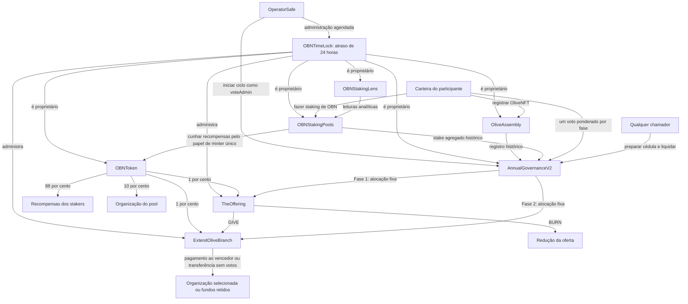

# Doação sem sacrifício: uma resposta de protocolo ao declínio da participação filantrópica em massa

[English](../THESIS.md) · [Tiếng Việt](THESIS.vi.md) · [한국어](THESIS.ko.md) · [日本語](THESIS.ja.md) · [简体中文](THESIS.zh-CN.md) · [हिन्दी](THESIS.hi.md) · [العربية](THESIS.ar.md) · [Русский](THESIS.ru.md) · [Deutsch](THESIS.de.md) · **Português** · [Español](THESIS.es.md) · [Bahasa Indonesia](THESIS.id.md)

> Esta tradução é fornecida apenas por conveniência. A versão em inglês ([THESIS.md](../THESIS.md)) é a oficial; em caso de divergência, prevalece a versão em inglês. Esta tradução foi feita com auxílio de IA a partir da revisão `3c740d855` e ainda não foi revisada por um tradutor profissional. Nomes de contratos, nomes de funções e endereços permanecem em inglês.

**Tese da Olive Branch Network**

*Olive Branch Network — Base Mainnet*

*Julho de 2026 — revisão de governança de 14 de outubro de 2026*

---

## Resumo

A filantropia nos Estados Unidos apresenta um paradoxo: o total doado atinge recordes quase todos os anos, enquanto o número de pessoas que doam vem caindo há um quarto de século. A parcela de domicílios americanos que fizeram alguma contribuição filantrópica caiu de 66.2% em 2000 para 49.6% em 2018, e o número de doadores diminuiu todos os anos desde 2021, mesmo com o crescimento da receita total. A filantropia está se concentrando em uma classe de doadores menor e mais rica, esvaziando a participação em massa na qual repousa a legitimidade cívica do setor sem fins lucrativos.

Esta tese argumenta que a raiz do colapso da participação é estrutural, não moral: em todas as formas históricas de dinheiro — mercadoria, fiduciária e digital inicial — doar é *sacrificial*. Uma doação transfere permanentemente o principal do doador ao destinatário, de modo que o limiar de participação é o excedente disponível — uma barreira que uma parcela crescente dos domicílios já não consegue superar à medida que os ganhos de renda real se concentram no topo da distribuição. O dinheiro programável remove essa restrição pela primeira vez na história monetária. Como um contrato inteligente pode separar a *propriedade de um ativo* da *direção do rendimento que esse ativo gera*, torna-se possível projetar a **doação sem sacrifício**: um doador mantém seu principal permanentemente enquanto direciona continuamente uma parcela de sua produtividade, imposta pelo protocolo, para um benefício público verificável de forma independente.

O protocolo Olive Branch Network (OBN) é apresentado como uma implementação de referência desse design. A tese (i) situa a OBN na longa história da tecnologia monetária; (ii) documenta, com dados empíricos citados, o declínio da participação filantrópica que a motiva; (iii) formaliza o ciclo de retroalimentação participação–bloqueio do protocolo, no qual cada participante adicional transfere tokens OBN do float circulante para um escrow contratual não custodial, contraindo a oferta efetiva à medida que a adoção cresce; e (iv) fornece uma descrição técnica completa de cada contrato inteligente central — `OBNToken`, `OBNStakingPools`, `TheOffering`, `ExtendOliveBranch`, `AnnualGovernanceV2`, `OliveAssembly`, `OBNTimeLock`, `TeamVesting`, `OliveNFT` e `OBNStakingLens` — incluindo layouts de armazenamento, invariantes, estrutura de controle de acesso e mecânica de segurança de atualização, conforme implantados na mainnet da Base.

---

## Sumário

1. [Introdução](#capítulo-1--introdução)
2. [Uma história do dinheiro: da mercadoria à programabilidade](#capítulo-2--uma-história-do-dinheiro-da-mercadoria-à-programabilidade)
3. [O declínio empírico da participação filantrópica](#capítulo-3--o-declínio-empírico-da-participação-filantrópica)
4. [O mecanismo participação–bloqueio: economia de fluxo de tokens da OBN](#capítulo-4--o-mecanismo-participaçãobloqueio-economia-de-fluxo-de-tokens-da-obn)
5. [Os contratos centrais: uma descrição técnica completa](#capítulo-5--os-contratos-centrais-uma-descrição-técnica-completa)
6. [Arquitetura de segurança e design institucional](#capítulo-6--arquitetura-de-segurança-e-design-institucional)
7. [Limitações, ameaças à validade e trabalhos futuros](#capítulo-7--limitações-ameaças-à-validade-e-trabalhos-futuros)
8. [Conclusão](#capítulo-8--conclusão)
9. [Referências](#referências)

---

## Capítulo 1 — Introdução

### 1.1 Declaração do problema

Duas tendências de longo prazo enquadram este trabalho. Primeiro, a *amplitude* da doação filantrópica está colapsando: a fração de domicílios dos EUA que doam qualquer coisa caiu quase dezessete pontos percentuais entre 2000 e 2018 (Indiana University Lilly Family School of Philanthropy, 2021), e os dados posteriores a 2020 mostram o declínio acelerando em vez de estabilizar (Fundraising Effectiveness Project, 2025). Segundo, a *profundidade* da doação está se concentrando: o total atinge recordes — $592.50 billion em 2024 (Giving USA, 2025) — porque doações maiores de doadores menos numerosos e mais ricos substituem os milhões de pequenos doadores que saíram.

As explicações usuais — queda da religiosidade, estagnação salarial, desconfiança geracional nas instituições — descrevem o fenômeno, mas não o resolvem, porque todas se reduzem à mesma restrição estrutural: **doar, como historicamente constituído, é a alienação permanente do principal.** Um domicílio só participa da filantropia quando supera o limiar "tenho excedente suficiente para arcar com a perda". À medida que o excedente real disponível se concentrou no topo da distribuição de renda, a participação se concentrou junto.

### 1.2 Declaração da tese

Esta tese defende três afirmações:

1. **Afirmação histórica.** Toda tecnologia monetária anterior — do eletro lídio aos passivos do Federal Reserve e às criptomoedas de primeira geração usadas como meros instrumentos ao portador — torna a alienação do principal o *único* primitivo disponível para doar. O dinheiro programável é a primeira forma monetária na qual *propriedade* e *direção do rendimento* são separáveis no nível do próprio dinheiro, em vez de por intermediários confiáveis (fundos patrimoniais, trusts, fundos aconselhados por doadores) acessíveis principalmente aos ricos.

2. **Afirmação empírica.** A participação filantrópica em massa está em declínio secular, e esse declínio se concentra justamente na coorte de pequenos doadores, para quem o limiar de sacrifício é mais restritivo. Esta afirmação é apoiada por dados de painel (Philanthropy Panel Study), dados de transações de todo o setor (Fundraising Effectiveness Project) e estimativas macro (Giving USA), examinados no Capítulo 3.

3. **Afirmação do mecanismo.** Um protocolo que (a) permite aos participantes fazer staking de um token sem abrir mão dele, (b) direciona uma parcela fixa das emissões do protocolo a organizações sem fins lucrativos verificadas e (c) bloqueia o principal em staking em escrow não custodial produz uma retroalimentação entre participação e oferta: cada participante marginal retira tokens do float circulante, de modo que — mantidas constantes a demanda e a política de emissão — uma participação mais ampla aperta mecanicamente a oferta efetiva. O Capítulo 4 formaliza isso e declara honestamente suas premissas, incluindo a força contrária das emissões de recompensas.

### 1.3 Contribuições

- Uma síntese da história monetária orientada por um único eixo: *o que o próprio dinheiro pode impor* (Capítulo 2).
- Um registro empírico consolidado e citado do declínio da participação filantrópica nos EUA, 2000–2025 (Capítulo 3).
- Um modelo formal de fluxo de tokens da economia de staking da OBN, incluindo a identidade do float circulante, a condição de equilíbrio entre emissão e bloqueio e o dreno de queima controlado pela governança (Capítulo 4).
- A primeira especificação escrita completa do conjunto de contratos centrais da OBN, conforme implantado na Base e validado em um ambiente de teste de fork da mainnet, cobrindo cada variável de estado, função, evento, invariante e caminho de atualização (Capítulo 5), junto com sua arquitetura de segurança e institucional (Capítulo 6).

### 1.4 O protocolo em um parágrafo

A Olive Branch Network é um token ERC-20 (`OBN`) na Base com um sistema de staking de pools por organização sem fins lucrativos. Um participante deposita OBN no pool da organização que deseja apoiar. O depósito nunca é gasto, transferido à organização nem colocado em risco de perda para o protocolo; pode ser sacado a qualquer momento (exceto posições de bootstrap explicitamente bloqueadas). Enquanto em staking, o protocolo cunha emissões baseadas em tempo sobre o stake e divide cada recompensa realizada em quatro partes no momento do resgate: **88% para o staker, 10% para a organização do pool, 1% para o cofre comum (`TheOffering`) e 1% para o cofre de distribuição (`ExtendOliveBranch`).** O destino da alocação do cofre comum registrada no início do ciclo — queimar ou doar — é decidido anualmente por uma votação em duas fases de carteiras com um OliveNFT registrado, ponderada pela raiz quadrada do stake no snapshot (`AnnualGovernance`), cuja segunda fase direciona a alocação fixa do ciclo do cofre de distribuição a uma organização escolhida pela comunidade. O design concretiza o Artigo I da Carta: *"tornar possível que uma pessoa preserve a propriedade de seus ativos enquanto direciona continuamente uma parte do valor que esses ativos geram para um benefício público com prestação de contas independente"* (Carta da OBN, Art. I).

---

## Capítulo 2 — Uma história do dinheiro: da mercadoria à programabilidade

O propósito deste capítulo não é antiquário. Cada estágio da história do dinheiro é lido à luz de uma pergunta: *o que o próprio dinheiro pode impor, e o que precisa ser delegado a instituições confiáveis?* A resposta determina quais formas de doação são possíveis em cada estágio.

### 2.1 Antes da cunhagem: dádiva, dívida e o mito do escambo

A teoria popular das origens monetárias — o escambo inconveniente cedendo espontaneamente a um meio de troca — descende de Adam Smith (1776) e foi formalizada por Menger (1892), que modelou o dinheiro como a convergência emergente para a mercadoria mais *vendável*, e por Jevons (1875), que nomeou os atritos que ele resolve de "dupla coincidência de desejos". Os modelos modernos de teoria da busca (Kiyotaki & Wright, 1989) preservam essa lógica, e Kocherlakota (1998) destilou sua implicação mais profunda: o dinheiro é tecnologicamente equivalente a uma *memória* social de quem contribuiu com o quê — "dinheiro é memória".

Ainda assim, o registro antropológico não sustenta economias de puro escambo como predecessoras do dinheiro. Humphrey (1985) concluiu que "nenhum exemplo de uma economia de escambo, pura e simples, jamais foi descrito, muito menos o surgimento do dinheiro a partir dela". Graeber (2011) reuniu as evidências etnográficas e mesopotâmicas de que *crédito e obrigação precedem a moeda em milênios*: a contabilidade de templos e palácios na Suméria (c. 3000 a.C.) denominava dívidas em prata e cevada muito antes de alguém fazer a prata circular como dinheiro vivo. A teoria do crédito do dinheiro (Mitchell-Innes, 1913) e a teoria estatal (Knapp, 1905/1924) — dinheiro como dívida transferível e dinheiro como aquilo que o Estado aceita em pagamento de impostos — captam essa camada mais antiga.

Duas observações importam para o que se segue. Primeiro, o "dinheiro" mais antigo já era uma *tecnologia contábil* — um livro-razão — e seus tokens físicos eram secundários. Segundo, em economias de dádiva e obrigação, doar era constitutivo do pertencimento social, e não um ato discricionário de disposição de excedente (Mauss, 1925). A redução da doação à transferência voluntária de excedente é um artefato de formas monetárias posteriores, não uma constante humana.

### 2.2 Cunhagem: o dinheiro como instrumento soberano ao portador (c. 640 a.C. – 1000 d.C.)

A cunhagem padronizada surge na Lídia no século VII a.C. — peças de eletro carimbadas pelo Estado — e se espalha com velocidade surpreendente pelas pólis gregas, pela Pérsia, pela Índia (*karshapana* perfurados) e pela China dos Reinos Combatentes (Davies, 2002; Schaps, 2004). A inovação da moeda é a *verificação à primeira vista*: o carimbo soberano elimina o problema da aferição, tornando o valor transferível entre estranhos sem confiança nem registro.

Mas note o que a tecnologia impõe e o que não pode. Uma moeda impõe a *finalidade ao portador*: quem a detém a possui, de forma absoluta. Ela não pode codificar condições, fluxos, divisões ou reversões. Consequentemente, o único primitivo de doação que a cunhagem suporta é a transferência direta da moeda — puro sacrifício do principal. Qualquer coisa mais sofisticada (fundos de templos, as *alimenta* romanas, o *waqf* islâmico, a capela medieval) exigia envolver o dinheiro em uma *instituição jurídica* administrada por humanos confiáveis. A doação direcionada pelo rendimento existia — um waqf é precisamente um ativo cuja renda é perpetuamente direcionada ao benefício público enquanto o corpus é inalienável (Kuran, 2001) —, mas estava disponível apenas para quem fosse rico o bastante para constituir uma instituição em torno de seus ativos.

### 2.3 Papel, bancos e a superestrutura de crédito (1000–1971)

A China da dinastia Song emitiu o primeiro papel-moeda estatal (*jiaozi*, formalizado em 1024 d.C.), descobrindo tanto a emissão de notas conversíveis quanto, em dois séculos, a superemissão inflacionária (Von Glahn, 1996). Na Europa, a sequência passou por letras de câmbio, recibos de ourives, o Banco da Inglaterra (1694) e o padrão-ouro do século XIX — uma ordem monetária em que a oferta de dinheiro era disciplinada pela conversibilidade, mas o meio circulante real era majoritariamente *crédito* bancário (Ferguson, 2008; Eichengreen, 1996). O sistema de Bretton Woods (1944) preservou uma âncora de ouro a um passo de distância; sua suspensão pelos Estados Unidos em 15 de agosto de 1971 (o "choque Nixon") completou a transição para o puro dinheiro fiduciário: dinheiro como passivo sem lastro do Estado, valorizado por decreto, aceitação tributária e expectativa de rede — o cartalismo de Knapp plenamente realizado (Eichengreen, 1996).

Para a doação, a era fiduciária e bancária mudou a escala, não a estrutura. Os regimes de dedução filantrópica (nos EUA, desde 1917) subsidiaram o sacrifício; a fundação, o trust de remanescente filantrópico e o fundo aconselhado por doadores industrializaram o padrão do waqf — *propriedade mantida ou protegida, rendimento direcionado* —, mas cada um exige constituição legal, mínimos e consultores. A assimetria estrutural persistiu: **os ricos doam do rendimento; todos os demais doam do principal.** O Capítulo 3 documenta o resultado previsível.

### 2.4 Liquidação digital e dinheiro fiduciário eletrônico (1971–2008)

Entre o choque Nixon e 2008, o dinheiro se desmaterializou operacionalmente — Fedwire, SWIFT (1973), redes de cartões e pagamentos pela internet transformaram a maior parte do dinheiro em entradas de bancos de dados bancários — sem mudar sua lógica. O dinheiro fiduciário eletrônico continua sendo uma nota promissória cujas regras são impostas por intermediários regulados. Chaum (1983) mostrou que a criptografia podia criar dinheiro digital ao portador, mas seu DigiCash centralizou a emissão e fracassou comercialmente; o "b-money" de Dai (1998) e o "bit gold" de Szabo (concebido no fim dos anos 1990, publicado em 2005) esboçaram a emissão descentralizada sem resolver o gasto duplo.

### 2.5 Bitcoin: escassez sem soberano (2008)

Nakamoto (2008) resolveu o problema do gasto duplo sem uma parte confiável, combinando um consenso de proof-of-work sobre um livro-razão público com um cronograma fixo de emissão. A contribuição do Bitcoin para a história monetária é precisa: **escassez digital e liquidação final impostas por protocolo, não por instituição.** Pela primeira vez, as *regras do dinheiro* — sobretudo sua curva de oferta — tornaram-se propriedades do próprio dinheiro.

Ainda assim, o script do Bitcoin restringe deliberadamente a expressividade. Como dinheiro, permanece próximo da moeda: um instrumento ao portador com oferta rígida. Doar em Bitcoin ainda é alienação do principal.

### 2.6 Ethereum e o dinheiro programável (2015– )

Buterin (2014) generalizou a blockchain em uma máquina de estados Turing-completa. Com o Ethereum — e cadeias EVM como a Base, onde a OBN é implantada — o dinheiro se torna *programável*: lógica arbitrária é executada com a mesma finalidade do próprio pagamento. O padrão ERC-20 (Vogelsteller & Buterin, 2015) transformou valor tokenizado em um primitivo combinável; ERC-4626, sistemas de staking e governança on-chain (por exemplo, o padrão Governor da Compound) demonstraram que **custódia, rendimento, votação e desembolso podem ser todos propriedades do protocolo.**

Este é o eixo do argumento histórico. O padrão waqf/fundo patrimonial — corpus inalienável, usufruto direcionado ao benefício público — exigiu por mil anos uma instituição confiável e, portanto, era um instrumento de ricos. Um contrato inteligente implementa o mesmo padrão para qualquer detentor de qualquer tamanho, com:

- **escrow não custodial** (o "corpus do fundo" é mantido por código imutável, não por um curador);
- **designação contínua e revogável** (o participante pode redirecionar ou sacar a qualquer momento — a separabilidade do Artigo III da Carta);
- **divisões impostas pelo protocolo** (a divisão 88/10/1/1 na OBN é aritmética em `_mintSlices`, não discricionariedade de um curador);
- **registro verificável** (cada contribuição é um evento on-chain, cumprindo o Artigo VI da Carta).

Nessa leitura, a história do dinheiro é uma história de internalização progressiva, no próprio dinheiro, de funções antes delegadas a instituições: verificação (cunhagem), registro (bancos), escassez (Bitcoin) e, finalmente, *estrutura fiduciária* (dinheiro programável). A OBN é uma aplicação desse estágio final à função monetária mais antiga de todas — a dádiva.

---

## Capítulo 3 — O declínio empírico da participação filantrópica

Este capítulo estabelece a segunda premissa com dados publicados: **o número de pessoas que doam está caindo, de forma persistente e em todas as principais fontes de dados, mesmo com o aumento do total em dólares.**

### 3.1 O declínio de longo prazo da participação (Philanthropy Panel Study, 2000–2018)

A evidência longitudinal mais rigorosa vem do *Philanthropy Panel Study* da Indiana University Lilly Family School of Philanthropy, um painel nacionalmente representativo de mais de 9,000 domicílios dos EUA cuja doação é acompanhada a cada dois anos.

- Em **2000, 66.2% dos domicílios dos EUA** fizeram uma contribuição filantrópica.
- Em **2018, apenas 49.6%** o fizeram — a primeira vez registrada em que menos da metade dos domicílios americanos doou, uma queda de quase 17 pontos percentuais (Lilly Family School of Philanthropy, 2021).
- A doação religiosa caiu de **46% dos domicílios (2000–2004) para 29% (2018)**; a doação secular caiu de um patamar de 55–57% (2000–2008) para **42% em 2018** (Lilly Family School of Philanthropy, 2021).
- Análises posteriores constataram que o declínio **acelerou durante o primeiro ano da pandemia de COVID-19** (Lilly Family School of Philanthropy, *The Giving Environment*, 2022; NonProfit PRO, 2022) e que a participação caiu em todos os grupos raciais e étnicos (The NonProfit Times, 2023).

O relatório *Giving Environment* da escola atribui o declínio em parte à queda e à estagnação da renda de domicílios de renda média e baixa e às normas em mudança sobre afiliação religiosa (Lilly Family School of Philanthropy, 2022) — ambas expressões do limiar de sacrifício: os domicílios doam quando podem arcar com a perda do dinheiro, e cada vez menos podem.

### 3.2 O número de doadores continua caindo após 2018 (Fundraising Effectiveness Project, 2021–2025)

O Fundraising Effectiveness Project (FEP), que agrega dados reais de transações de doação em milhares de organizações, estende o registro para além dos estudos de painel e mostra que o declínio continua:

- O número de doadores diminuiu **todos os anos desde 2021** (AFP/FEP, 2026).
- De 2023 para 2024, o número de doadores caiu **4.5% ano a ano**, com o declínio *acelerando* em relação aos anos anteriores (relatório FEP Q4 2024; GlobeNewswire, 2025).
- Em **2025, o número de doadores caiu mais cerca de 3.6%**, mesmo com o total de dólares filantrópicos crescendo 5.0% — o crescimento de receita mais forte em cinco anos, alcançado com menos doadores (AFP/FEP, 2026).
- A perda se concentra na ponta pequena: doadores de **$1–$100 — mais da metade de todos os doadores — diminuíram 8.8% em 2024 e 11.1% ano a ano no Q1 2025** (FEP; NonProfit PRO, 2025).
- A retenção geral de doadores gira em torno de **43%**, e a retenção de novos doadores é muito menor, o que significa que a maioria dos que doam pela primeira vez nunca volta a doar (FEP, 2025–2026).

O próprio enquadramento do FEP é exatamente a tese da concentração: os ganhos de receita estão "concentrados em doações maiores", com "quedas contínuas no número total de doadores" (AFP, 2025).

### 3.3 Dólares em alta, doadores em baixa (Giving USA, 2024–2025)

O Giving USA, a estimativa macro mais antiga da filantropia dos EUA, completa o paradoxo:

- A doação total atingiu **$592.50 billion em 2024**, um recorde em dólares correntes, alta de 6.3% nominal e 3.3% ajustada pela inflação (Giving USA 2025).
- A doação total voltou a subir para cerca de **$617.2 billion em 2025** (Giving USA 2026; Give.org, 2026).
- Mas **a parcela da doação individual no total caiu de cerca de 80% em 1986–1990 para 66% em 2024 e 64% em 2025**, à medida que fundações, legados e empresas — veículos de riqueza acumulada — preenchem a lacuna (Giving USA 2026; Give.org, 2026; Stelter, 2026).

### 3.4 Síntese: o limiar de sacrifício

Em três metodologias independentes — painel de domicílios (PPS), agregação de transações (FEP) e estimativa macro (Giving USA) — surge o mesmo quadro:

| Indicador | Antes | Agora | Direção |
|---|---|---|---|
| Domicílios que doam algo (PPS) | 66.2% (2000) | 49.6% (2018) | ↓ 16.6 pts |
| Domicílios que doam à religião (PPS) | 46% (2000–04) | 29% (2018) | ↓ 17 pts |
| Número de doadores, ano a ano (FEP) | — | −4.5% (2024), −3.6% (2025) | ↓ acelerando |
| Pequenos doadores $1–$100 (FEP) | 50–57% de todos os doadores | −8.8% a −11.1% ano a ano | ↓ coorte mais acentuada |
| Parcela dos indivíduos na doação total (Giving USA) | ~80% (1986–90) | 64% (2025) | ↓ 16 pts |
| Total em dólares (Giving USA) | — | $592.5B (2024), $617.2B (2025) | ↑ recordes |

O setor está sendo recapitalizado de cima enquanto sua base participativa se desgasta. É exatamente o que se preveria se doar exige excedente e o excedente se concentrou. O problema de *financiamento* do setor sem fins lucrativos está sendo resolvido pelos ricos; seu problema de *participação* — a função cívica, democrática e legitimadora de milhões de pequenas doações — não está sendo resolvido de forma alguma, porque não existe instrumento que permita a um domicílio não rico doar continuamente sem perda.

O Capítulo 4 descreve tal instrumento.

---

## Capítulo 4 — O mecanismo participação–bloqueio: economia de fluxo de tokens da OBN

Este capítulo formaliza o núcleo econômico do protocolo: **a participação bloqueia a oferta.** Cada afirmação se baseia em código de contrato específico descrito integralmente no Capítulo 5; aqui tratamos o sistema como uma máquina de fluxo de tokens.

### 4.1 Alocações de gênese e reservas atuais

A tabela a seguir registra o mint gênese histórico, não as reservas atuais não gastas. `OBNToken.initialize` cunhou todo o fornecimento inicial exatamente uma vez, em proporções fixas (OBNToken.sol):

| Alocação | Parcela | Propósito |
|---|---|---|
| Liquidez | 40% | Liquidez em DEX para que o token possa ser adquirido |
| Airdrop | 30% | Semear uma ampla distribuição inicial |
| Fundo de caridade | 10% | Bootstrap de posições de pools sem fins lucrativos (permanentemente bloqueadas — §4.4) |
| Tesouraria | 10% | Operações do protocolo (alocação de gênese única; nenhum fluxo de emissão vai para ela) |
| Vesting da equipe | 10% | Bloqueado por tempo em `TeamVesting` (cliff de 4 meses, 20 meses lineares) |

Nenhum mint adicional é possível, exceto pelo minter único definido uma vez — o contrato de staking —, de modo que *todo* crescimento de oferta após a gênese são emissões de staking.

A Reserva de Sementes para Organizações tem alocação total de **300M OBN**, com **50M OBN** mantidos separadamente para necessidades do protocolo. As participações da tesouraria e do airdrop foram consolidadas na alocação de sementes. Naquele momento, 11M OBN já haviam financiado 11 sementes, restando 289M OBN para 289 sementes adicionais de 1M OBN cada.

Trata-se de uma realocação de participações existentes, não de um novo mint nem de uma alteração no inicializador implantado.

### 4.2 A identidade do float circulante

Defina no instante *t*:

- **S(t)** — oferta total: oferta de gênese mais emissões acumuladas menos queimas acumuladas.
- **K(t)** — tokens mantidos pelo contrato de staking: a soma de todos os saldos `userAmount` (apenas principal; as recompensas são cunhadas diretamente aos destinatários, nunca agrupadas).
- **V(t)** — tokens ainda bloqueados em `TeamVesting`.
- **G(t)** — tokens acumulados nos dois cofres de governança (`TheOffering` e `ExtendOliveBranch`) aguardando o ciclo anual.
- **B(t)** — tokens queimados acumulados (via `TheOffering.burn` e qualquer `ERC20Burnable.burn` voluntário).

Então o **float circulante** — a oferta realmente disponível para negociação — é:

> **F(t) = S(t) − K(t) − V(t) − G(t)**   com   **S(t) = S₀ + E(t) − B(t)**

onde E(t) são as emissões brutas acumuladas. A afirmação do mecanismo é uma declaração sobre ∂F/∂(participação): **cada depósito move tokens de F para K na proporção de um para um** (`_depositCore` executa `safeTransferFrom(msg.sender, address(this), amount)`), e os tokens permanecem em K até que esse participante específico decida sacar. O protocolo nunca empresta, rehipoteca nem gasta K; não há slashing nem direito do protocolo sobre o principal. K é escrow inerte.

### 4.3 Política de emissão: decrescente e proporcional à participação

As emissões *não* são uma torneira fixa. `_sumRewardAcrossPhases` acumula recompensas por pool como `poolStake × bps × Δt / (10000 × 365 days)` — isto é, um **percentual anualizado do que está efetivamente em staking**, em um cronograma decrescente:

| Anos desde a implantação | Taxa anual de emissão (sobre o saldo em staking) |
|---|---|
| 0–2 | 10.00% |
| 2–4 | 7.50% |
| 4–6 | 5.00% |
| 6–8 | 2.50% |
| 8–10 | 1.25% |
| 10+ | 3.00% de fallback (`FALLBACK_EMISSION_BPS`), até a governança alterar via `addPhase` |

Seguem-se duas consequências. Primeiro, **as emissões escalam com K, não com S**: tokens fora de staking não geram nada. Segundo, como as recompensas só são cunhadas em *eventos de resgate* (depósito, saque, resgate), as recompensas não resgatadas são apenas um lançamento contábil (`accRewardPerShare × balance − rewardDebt`) — não existem como tokens até serem realizadas.

### 4.4 A divisão em quatro partes e seus drenos

A cada realização, `_mintSlices` divide a recompensa bruta pendente:

- **88% → o staker.** O rendimento do participante. Recém-cunhado, entra em F (ou volta ao staking).
- **10% → a carteira da organização do pool.** A dádiva. Contínua, imposta pelo protocolo, proporcional ao stake e ao tempo do participante. Esta é a *Contribuição* do Artigo VII da Carta, e não custa principal ao staker — apenas uma parcela de rendimento que não existiria sem o protocolo.
- **1% → `TheOffering`** (o cofre comum). Acumula o ano todo; cada ciclo anual de governança vota para **queimar** a alocação registrada no início do ciclo (dreno deflacionário, reduz S) ou **doá-la** (transfere para `ExtendOliveBranch`).
- **1% → `ExtendOliveBranch`** (o cofre de distribuição). Acumula o ano todo; o voto da Fase 2 de cada ciclo anual de governança direciona a alocação fixa daquele ciclo a uma organização na lista de permissões escolhida pela comunidade (ou a transfere adiante se ninguém votar).

Note que **nenhum fluxo de emissão vai para uma tesouraria**: as duas fatias residuais alimentam cofres controlados pela governança. Até sua disposição anual, ambos os fluxos ficam em escrow nos cofres (G no §4.2) — fora do float negociável.

Além disso, a alocação de gênese de 10% do fundo de caridade é aplicada por meio de `charityFundBootstrap`/`depositForWithLock`, que faz staking de tokens *em nome da própria carteira de cada organização* com `lockedAmount` igual ao depósito — um **bloqueio permanente** (os bloqueios só podem aumentar, nunca diminuir). Portanto, as posições de bootstrap contribuem para K para sempre, garantem a cada pool um fluxo básico de recompensas para sua organização e nunca podem ser vendidas em massa.

### 4.5 O ciclo de retroalimentação participação–bloqueio

Reúna as peças. Seja *n* o número de participantes ativos e *k̄* o stake médio. Então K = n·k̄ (mais bloqueios de bootstrap), e:

1. **A adoção aperta o float.** Cada novo participante converte tokens do float em principal em escrow: ΔF = −Δstake. Com demanda constante, um float negociável menor eleva o preço de equilíbrio do mercado — o resultado padrão de oferta e demanda e o análogo on-chain do "encolhimento do float" há muito observado em economias de proof-of-stake, nas quais altas taxas de staking reduzem a oferta líquida.
2. **O rendimento recompensa a paciência, e 88% do rendimento pode ser capitalizado.** Stakers que colocam de volta em staking sua parcela de 88% movem tokens recém-cunhados diretamente de volta para K, apertando ainda mais F.
3. **O fluxo de dádivas financia legitimidade no mundo real.** O fluxo de 10% para organizações dá a instituições externas um motivo duradouro para promover a participação, o que recruta mais participantes — o único canal de marketing que é em si um ato de caridade.
4. **A governança pode converter o cofre comum em pura deflação.** Um resultado BURN na Fase 1 destrói a alocação comum registrada no início do ciclo, reduzindo S diretamente. Note que o padrão é deliberadamente deflacionário: *participação zero → BURN* (GIVE deve exceder *estritamente* BURN).
5. **A elegibilidade de voto exige participação no snapshot.** A V2 combina o status de NFT registrado com pelo menos 1 OBN de stake agregado com checkpoints e depois aplica ponderação por raiz quadrada. A governança oferece um motivo para estar em staking antes do início de cada ciclo; não exige permanecer em staking depois nem estabelece um bloqueio contínuo durante a votação (§5.5).

O ciclo: **mais participantes → mais tokens bloqueados → float menor e maior opção acumulada de queima → melhor sustentação de preço → maior valor de rendimento e de dádiva por token → recrutamento mais forte → mais participantes.**

### 4.6 Contabilidade honesta: o contrapeso das emissões

O mecanismo tem uma força contrária. As emissões são inflacionárias: à taxa inicial de 10%, S cresce em proporção a K. Se o float líquido *encolhe* depende dos fluxos realizados. Diferenciando a identidade do float, o fluxo de emissão que entra no float é:

> **dF/dt ≈ e·K·[0.88·(1−r) + 0.10 + 0.02·(1−β)·δ] − dK/dt**

onde *e* é a taxa de emissão atual, *r* a fração das recompensas de stakers recolocada em staking, *β* a fração dos fluxos dos cofres finalmente queimada na Fase 1 e *δ* ≤ 1 um fator de defasagem que reflete que os dois fluxos de 1% dos cofres só entram no float depois que o ciclo anual os distribui (valores queimados nunca entram; transferências adiam ainda mais a entrada). O float se contrai (dF/dt < 0) sempre que **o novo staking líquido supera a parte das emissões não recolocada em staking**. Características estruturais empurram nessa direção — o cronograma de emissão decresce 10% → 1.25% enquanto se pretende que a adoção cresça; os destinatários sem fins lucrativos são vendedores movidos pela missão, mas sua entrada é de apenas 10% das emissões; o padrão de queima remove permanentemente o comum; os bloqueios de bootstrap nunca saem —, mas a condição é empírica, não garantida. A afirmação defendida aqui é, portanto, precisamente delimitada: *o protocolo foi projetado para que o crescimento da participação contraia mecanicamente o float e crie condições que sustentem o preço do token, ceteris paribus; ele não garante nem pode garantir a valorização do preço, que também depende de demanda exógena.*

### 4.7 Doação sem sacrifício, reformulada

O design econômico resolve diretamente o problema do Capítulo 3. O limiar de participação já não é "excedente que posso perder", e sim "capital que estou disposto a estacionar". O domicílio que nunca poderia doar $500 pode fazer staking de $500, mantê-los, sacá-los em uma emergência e, enquanto isso, direcionar continuamente 10% do rendimento que seu stake gera — contribuições reais, impostas pelo protocolo e registradas publicamente — a uma organização verificada. Doar passa a ser uma *decisão de alocação de ativos*, e não um *sacrifício de consumo*. Essa é a resposta do design ao colapso da participação: não exortar as pessoas a doar mais, mas remover o motivo estrutural pelo qual pararam.

---

## Capítulo 5 — Os contratos centrais: uma descrição técnica completa

Todos os contratos têm como alvo Solidity ^0.8.28, são construídos sobre OpenZeppelin v5 e implantados na Base. Contratos atualizáveis usam o padrão UUPS (`_authorizeUpgrade` restrito ao proprietário, que é o `OBNTimeLock`). Este capítulo descreve cada contrato do conjunto: propósito, armazenamento, funções, eventos, invariantes e interações.

### 5.1 `OBNToken` — a base monetária (OBNToken.sol)

**Herança.** `Initializable`, `IOBNMintable`, `ERC20Upgradeable`, `ERC20PermitUpgradeable` (aprovações sem gas EIP-2612), `ERC20VotesUpgradeable` (delegação com checkpoints), `ERC20BurnableUpgradeable`, `OwnableUpgradeable`, `UUPSUpgradeable`.

**Identidade.** Nome "Olive Branch Network", símbolo "OBN".

**Armazenamento.** Uma única variável personalizada — `address public minter` — mais um `uint256[100] __gap` que reserva espaço para atualizações.

**Inicialização.** `initialize(initialOwner, initialSupply, liquidityAddress, airdropAddress, charityAddress, treasuryAddress, teamVestingAddress)` é executada uma vez (modificador initializer; o construtor chama `_disableInitializers()` para que a própria implementação nunca possa ser inicializada). Após verificar endereço não zero e oferta não zero, ela cunha toda a distribuição: 30% airdrop, 40% liquidez, 10% caridade, 10% tesouraria, 10% vesting da equipe (§4.1).

**Mecânica do minter.** `setMinterOnce(addr)` — apenas proprietário, exige `minter == address(0)`: o minter pode ser definido **exatamente uma vez** durante a vida da implementação (apenas uma atualização UUPS completa poderia alterá-lo). `mint(to, amount)` exige `msg.sender == minter`. Na implantação, o minter é o proxy `OBNStakingPools`; portanto, *toda a oferta futura são emissões de staking*. `isMinter(addr)` é uma visualização de conveniência.

**Sobrescritas.** O OZ v5 direciona todas as alterações de saldo por `_update`, de modo que uma única sobrescrita concilia `ERC20Upgradeable` e `ERC20VotesUpgradeable` (os checkpoints de voto acompanham transferências automaticamente). `nonces()` é sobrescrita para conciliar `ERC20PermitUpgradeable` com `NoncesUpgradeable`.

**Propriedades de segurança.** Sem pausa, sem lista de bloqueio, sem taxa de transferência: o token é maximamente neutro. A queima está disponível a qualquer detentor por meio de `ERC20Burnable` — o gancho que `TheOffering` usa para destruir o comum.

### 5.2 `OBNStakingPools` — o motor (StakingPoolsV931.sol; string de versão "9.3.1")

O contrato de staking é o maior e mais importante do sistema: é o único minter de OBN, o custodiante de todo o principal em staking (K no §4.2) e o oráculo de poder de voto da governança. Funciona atrás de um proxy UUPS em um endereço estável.

#### 5.2.1 Constantes — a divisão imutável

```solidity
STAKER_BPS = 8800; CHARITY_BPS = 1000; CHARITY_FUND_BPS = 100; TREASURY_BPS = 100;
TOTAL_BPS = 10000; FALLBACK_EMISSION_BPS = 300;
```

A divisão 88/10/1/1 é `constant` — compilada no bytecode, imutável sem uma atualização completa da implementação pelo timelock. As duas fatias de 100-bps são cunhadas para os endereços mantidos nas variáveis de armazenamento `treasury` e `charityFund`; **na configuração implantada, essas variáveis contêm `TheOffering` (0xc75B…E341) e `ExtendOliveBranch` (0xE1Bb…6d8B), respectivamente** — os identificadores são históricos, e os destinatários operacionais dos dois fluxos de 1% são os dois cofres de governança (§5.3, §5.4). `FALLBACK_EMISSION_BPS` é o piso perpétuo de 3% aplicado depois que o cronograma de fases definido se esgota (§4.3).

#### 5.2.2 Layout de armazenamento

Ordenado por slots e crítico para atualizações (o contrato documenta seu mapa de slots; a lacuna final é `uint256[93]`; o estado do auto-claim mensal fica fora deste mapa, no armazenamento com namespace ERC-7201 em `obn.storage.MonthlyAutoClaim`):

- **Configuração:** `stakingToken` (o token OBN como `IOBNMintable`), `treasury` (→ TheOffering), `charityFund` (→ ExtendOliveBranch), `version` (string, "9.3.1").
- **Cronograma de emissão:** `Phase[] phases`, cada uma `{start, end, bps}` em timestamps.
- **Pools:** `PoolInfo[] poolInfo`, cada um `{charityWallet, totalStaked}` — um pool por organização.
- **Contabilidade do usuário:** `userAmount[pid][user]`, `userRewardDebt[pid][user]` — o padrão acumulador/dívida de recompensa (§5.2.3).
- **Acumuladores:** `accRewardPerShare[pid]` (escala 1e12), `lastRewardTime[pid]`.
- **Global:** `globalTotalStaked`.
- **Bloqueios:** `lockedAmount[pid][user]` — o livro-razão de bloqueios permanentes (§4.4).
- **Estatísticas:** `totalClaimedByUser`, `totalDepositedByUser`, `totalWithdrawnByUser`, totais por pool de depósito/saque/charity cunhado, `uniqueStakersByPool`, `uniqueStakersGlobal`, `activePoolCount[user]`, `stakedSince[user]`, `cumulativeStakeSeconds[user]` (persiste após retiradas completas do staking — um registro permanente de tempo de participação).
- **Ciclo de vida:** `poolRemoved[pid]` (depósitos desativados), `poolFullyRemoved[pid]` (retirado das cédulas de governança — definido apenas por `removePool`, nunca por `shutdownPool`).
- **Acompanhamento de contribuição:** `charityContributedByUserInPool[pid][user]` e `totalCharityContributedByUser[user]` — a doação vitalícia atribuível a cada participante, o *Registro* on-chain do Artigo VI da Carta.
- **Infraestrutura de governança (slots 28–30):** `charityFundOperator` + `_migrationExecuted` + `upgradeBlock` (agrupados em um slot), `totalStakedByUser[user]` (total corrente entre pools) e `_stakeCheckpoints[user]` (`Checkpoints.Trace208` — o histórico de poder de voto). `poolFullyRemoved`, listado acima em Ciclo de vida, ocupa o slot 31.

#### 5.2.3 O modelo contábil

A OBN usa o esquema acumulador/dívida de recompensa com uma variação decisiva: **o acumulador acompanha recompensas BRUTAS.** Em qualquer toque no pool, `_accruePool` calcula a emissão bruta desde `lastRewardTime` por meio de `_sumRewardAcrossPhases` — que percorre o cronograma de fases segmento por segmento, tratando exatamente os limites de fase com `Math.mulDiv(poolStake, bps × duration, 10000 × 365 days)` e aplicando a taxa de fallback de 3% a qualquer intervalo além da última fase definida — e a incorpora em `accRewardPerShare[pid] += grossReward × 1e12 / totalStaked`. O bruto pendente de um usuário é então:

> `pending = userAmount × accRewardPerShare / 1e12 − userRewardDebt`

A divisão em 88/10/1/1 ocorre apenas na realização dentro de `_mintSlices`, que segue estritamente checks-effects-interactions: todas as estatísticas são atualizadas *antes* das quatro chamadas externas de `mint`. Nada é cunhado para um pool com stake zero (o acúmulo retorna cedo e apenas avança o relógio), e as recompensas nunca ficam no contrato — vão direto do mint ao destinatário final. Um wrapper público `sumRewardAcrossPhases` expõe o percurso de fases para o Lens somente leitura (§5.9).

#### 5.2.4 Funções voltadas ao usuário

- **`deposit(pid, amount)`** — fazer staking em um pool. Exige um pool válido e não encerrado. Efeitos: acumular o pool; registrar staker único (por pool e global, com `stakedSince` iniciando o relógio de tempo de participação em 0→1 pools); aumentar `userAmount`, `poolInfo.totalStaked`, `globalTotalStaked` e as estatísticas de depósito; redefinir a dívida de recompensa; adicionar um checkpoint `(block.number, totalStakedByUser)`; depois `safeTransferFrom` do principal e `_mintSlices` de qualquer recompensa pendente. Depositar *realiza* recompensas pendentes como efeito colateral.
- **`depositFor(pid, amount, beneficiary)`** — financiamento por terceiros do stake de outro endereço (doação em estilo de folha de pagamento, presentes de participação).
- **`depositWithPermit(...)`** — aprovação+stake em uma única transação via EIP-2612.
- **`withdraw(pid, amount)`** — saída. Impõe `amount ≤ userAmount − lockedAmount` (o saldo *não bloqueado*); atualiza todos os saldos, checkpoints e ganchos (`_afterWithdrawBalanceHooks` limita os bloqueios ao novo saldo, limpa os sinalizadores de staker ativo em zero e, na saída do último pool, registra a sessão em `cumulativeStakeSeconds` e diminui `uniqueStakersGlobal`); devolve o principal; realiza recompensas pendentes pela mesma divisão 88/10/1/1. **Sem período de espera, sem penalidade, sem taxa** — a separabilidade do Artigo III exige saída sem atrito.
- **`claim(pid)` / `claimFor(pid, user)` / `claimMultiple(pids)`** — realizam recompensas sem tocar no principal. `claimFor` é exclusiva do proprietário do contrato (atrás do timelock) e só pode enviar recompensas ao seu legítimo destinatário (cunha *para `user`*, não para o chamador). Os resgates programados usam o caminho separado `autoClaimFor`, baseado em consentimento e adicionado na V9.3.1 (Whitepaper §3.2.1); esse caminho não capitaliza recompensas.
- **Conjunto de visualizações:** `pendingRewards`, `getPoolInfo`, `getUserStakeValue`, `unlockedBalance`, `poolLength`, `isGloballyStaked`, `stakeElapsed`, `currentRewardsPerSecond` (análises mais pesadas ficam no Lens — §5.9).

#### 5.2.5 Bootstrap do fundo de caridade e congelamento do auto-staking

`charityFundBootstrap(pid, amount, beneficiary)` / `depositForWithLock(...)` — podem ser chamadas apenas por `charityFund` ou `charityFundOperator` (um Safe operacional), apenas para a própria carteira de caridade do pool, e passam por `_enforceCharitySelfStakePolicy`, que permite **exatamente um** depósito de bootstrap bloqueado por organização do pool: a carteira de caridade deve ter saldo zero, o chamador deve estar autorizado e o depósito deve estar bloqueado. Todo outro auto-staking pela organização do pool é rejeitado ("charity self-stake disabled"). Justificativa: uma organização fazendo staking em seu próprio pool devolveria a si mesma a fatia de caridade de 10%, capitalizando em um volante de peso de governança; o congelamento limita as posições de organizações a um único bootstrap transparente e permanentemente bloqueado.

`setLockedAmount(pid, user, amount)` — charityFund ou o operador (o operador restrito a endereços de caridade de pools) podem **apenas aumentar** os bloqueios, nunca diminuir, e nunca acima do saldo do usuário. Os bloqueios são unidirecionais por construção.

#### 5.2.6 Funções administrativas (todas atrás do `onlyOwner` de propriedade do timelock)

- **`addPool(charityWallet)`** — cria um pool para uma organização; inicializa seu relógio de acúmulo.
- **`shutdownPool(pid)`** — bloqueia *novos* depósitos; resgates e saques continuam para que os usuários sempre possam sair. Pools encerrados permanecem elegíveis para a cédula de governança.
- **`removePool(pid)`** — apenas quando `totalStaked == 0`; libera acúmulos legados de charity, define `poolFullyRemoved` (retirando a organização de cédulas futuras) e reaponta a carteira de caridade do pool para o endereço `treasury` (TheOffering), para que mints residuais nunca fiquem presos em address(0).
- **Fechamento de um pool** — Quando uma organização sem fins lucrativos sai, seu pool é encerrado: novos stakes são bloqueados, enquanto os stakers existentes ainda podem retirar seu stake e resgatar, e os stakes que permanecem continuam rendendo na divisão habitual 88/10/1/1. Antes de o pool ser removido, é feita a saída forçada de cada staker restante: `forceExitUserToSelf` devolve cada stake, com as recompensas pendentes, para a carteira do próprio staker e não pode enviá-lo a nenhum outro lugar. O stake semente bloqueado da organização é devolvido à Reserva de Sementes para Organizações. Só então, sem mais nada em stake, o pool é removido.
- **`updateCharityWallet(pid, newWallet)`** — faz a rotação de uma carteira de organização comprometida ou migrada.
- **`migrateBootstrap(pid, old, new)`** — move uma posição de bootstrap inteira (saldo, dívida de recompensa, bloqueio) entre endereços de organizações de forma atômica, levando os checkpoints de poder de voto por ambos os lados, com prova on-chain de que as recompensas pendentes são preservadas dentro de 1 wei (`pendingAfter ≥ pendingBefore && pendingAfter ≤ pendingBefore + 1`).
- **`addPhase(start, end, bps)`** — acrescenta fases de emissão; deve ser contígua à última. É também a alavanca da governança sobre a taxa de fallback de 3%.
- **`forceExitUserToSelf(pid, user, claimRewards)`** — emergência: devolve todo o principal de um usuário *ao próprio usuário* (nunca ao administrador), opcionalmente realizando recompensas, ignorando bloqueios. O administrador não pode confiscar; só pode forçar a devolução.
- **`sweep(token, amount)`** — recupera ERC-20 recebidos por engano para o endereço `treasury`, **excluindo explicitamente o token de staking** ("Cannot sweep staking token"), para que o administrador nunca possa tocar em K.
- **`migrateV93(newTreasury, newCharityFund, newOperator)`** — a função de conexão única, executada atomicamente com a implantação da implementação via `upgradeToAndCall` pelo timelock. Ela definiu `treasury` → TheOffering, `charityFund` → ExtendOliveBranch e `charityFundOperator` → o Safe operacional; registrou `upgradeBlock` como âncora de gênese dos checkpoints de poder de voto; e desativou a si mesma permanentemente (`_migrationExecuted`). A atualização V9.3.1 adicionou `initializeV931(executor)`, um reinitializer único e separado que definiu `version` como "9.3.1" e o executor de auto-claim; depois, `setAutoClaimExecutor(executor)` pode alterar esse executor, e o endereço zero pausa a automação.
- **`upgradeTo(newImpl, data)` / `setVersion`** — caminho de atualização UUPS compatível com o agendamento do timelock.

#### 5.2.7 Poder de voto com checkpoints

Os saldos em staking são *consultáveis por snapshot*, para que a governança possa ponderar votos em um bloco passado fixo em vez de confiar nos saldos atuais (o que convidaria ataques de flash-stake):

- Cada depósito, saque e migração de bootstrap adiciona `(block.number, totalStakedByUser)` em um `Checkpoints.Trace208` por usuário.
- **Bootstrap de gênese:** stakers cujas posições antecedem o sistema de checkpoints não têm entradas de histórico. Três caminhos complementares os inicializam em `upgradeBlock`: `_initializeCheckpointIfNeeded` (automático, na próxima interação do usuário, antes de qualquer alteração de saldo); `bootstrapCheckpoint(user)` (sem permissão — qualquer pessoa pode inicializar qualquer pessoa); e `batchBootstrap(users[])` (cerimônia em massa sem permissão). O `AnnualGovernance` também inicializa eleitores de forma preguiçosa em sua primeira tentativa de voto (§5.5).
- **`getPastVotingPower(user, blockNumber)`** — consulta por busca binária (`upperLookup`) do total em staking do usuário em qualquer bloco passado; **`checkpointCount(user)`** expõe o status de inicialização.
- Esta interface retorna **OBN bruto agregado em staking no snapshot**, não o peso final de voto da V2. O AnnualGovernanceV2 verifica primeiro o registro histórico no OliveAssembly e o mínimo de 1 OBN e depois aplica a ponderação por raiz quadrada (§5.5). Saldos de carteira fora de staking e delegação ERC20Votes não dão poder de voto anual. Ciclos históricos anteriores à votação por NFT mantêm sua ponderação linear original.

### 5.3 `TheOffering` — o cofre comum (TheOffering.sol)

Um cofre deliberadamente mínimo e **não atualizável** que recebe 1% de todas as emissões de staking de OBN ao longo do ano. Não lida com ETH; tem apenas dois papéis:

- `timelockOwner` (imutável, definido na construção) — pode chamar `setGovernance(addr)` (address(0) pausa a governança) e `emergencySweep(token, to)` (recuperação do saldo total de ERC-20, a anulação anterior à distribuição).
- `governance` (o proxy `AnnualGovernance`) — pode chamar exatamente duas funções, ambas após a votação: **`burn(amount)`** (invoca `ERC20Burnable.burn` do OBN, destruindo oferta) ou **`sendToExtend(amount)`** (transferência SafeERC20 para `ExtendOliveBranch`).

A ordem de implantação importa e está documentada no contrato: `ExtendOliveBranch` primeiro (seu endereço é um immutable aqui), governança conectada depois. O contrato mantém o comum acumulado do ano e não faz mais nada — uma superfície de ataque de duas funções protegidas.

### 5.4 `ExtendOliveBranch` — o cofre de distribuição (ExtendOliveBranch.sol)

O segundo cofre não atualizável, que recebe sua própria parcela de 1% de todas as emissões de staking mais quaisquer transferências de resultado GIVE de `TheOffering`. Armazenamento: `obn` e `timelockOwner` imutáveis; `governance` mutável; `mapping(address => bool) approvedNonprofit` — a **lista de permissões** que implementa o Artigo IV da Carta (a legitimidade do destinatário deve ser verificada de forma independente, não autodeclarada).

Dois caminhos de distribuição, deliberadamente assimétricos:

- **`distribute(nonprofit, amount)`** — timelockOwner ou governance; *lista de permissões aplicada*. Canal manual/pré-governança/de emergência.
- **`distributeFromGovernance(nonprofit, amount)`** — apenas governance; **lista de permissões omitida intencionalmente** neste caminho de distribuição. A V2 valida cada destinatário contra a lista de permissões quando seu lote de cédula é processado e depois preserva essa participação durante o ciclo. Uma revogação posterior da lista não pode remover um destinatário admitido nem invalidar o destinatário selecionado no pagamento. O Timelock mantém `emergencySweep`; sacar fundos reservados pode impedir a liquidação até que o déficit seja reposto.

Administração: `setApprovedNonprofit(addr, bool)`, `setGovernance(addr)`, `emergencySweep(token, to)` — todas exclusivas do timelock.

### 5.5 `AnnualGovernanceV2` — governança anual (AnnualGovernanceV2.sol)

Esta seção descreve o AnnualGovernanceV2, a implementação ativa por trás do proxy AnnualGovernance existente desde sua atualização em 7 de outubro de 2026 (bloco 52283807 da Base). Os contratos ativos não passaram por uma auditoria de segurança de terceiros; as revisões anteriores da própria equipe em `governance-operations` descrevem versões anteriores, não a implantação ativa.

#### 5.5.1 O que a comunidade decide

A governança anual direciona os dois fluxos compartilhados de emissão de 1%. Na Fase 1, os participantes escolhem queimar a alocação de TheOffering ou doá-la a ExtendOliveBranch. Na Fase 2, escolhem uma organização elegível para receber a alocação de ExtendOliveBranch do ciclo. As duas fases ocorrem mesmo quando a Fase 1 seleciona BURN. Essas votações não alteram a recompensa de 88% do staker, não redirecionam a parcela de 10% específica do pool, não gastam o principal dos usuários nem aprovam atualizações arbitrárias do protocolo.

O OperatorSafe, atuando como `voteAdmin`, inicia um ciclo diretamente. O proprietário continua sendo o Timelock, e a integração e a configuração de organizações permanecem controladas por meio dele. O termo *anual* descreve a cadência operacional pretendida: o contrato impõe duas janelas de votação de 30 dias e impede ciclos sobrepostos, mas não agenda um ciclo automaticamente nem exige um intervalo de um ano entre os inícios. Alguém precisa enviar cada transação de preparação e liquidação.

#### 5.5.2 Registro e poder de voto

Um eleitor usa a mesma carteira para fazer staking de OBN e registrar um OliveNFT no OliveAssembly. Depois de aprovar o proxy do Assembly para transferir o NFT, a carteira chama `deposit(tokenId)`. O Assembly mantém o NFT e faz checkpoint do registro da carteira; manter o NFT fora do Assembly é insuficiente. O registro persiste entre ciclos até o saque, e não é permitido registrar NFTs adicionais na mesma carteira. Staking e registro de NFT são ações separadas e nenhuma substitui a outra.

Para um ciclo que começa no bloco `B`, as duas fases usam o registro e o saldo agregado em staking no fim do bloco `B - 1`. Uma carteira registrada com pelo menos 1 OBN em staking é elegível. Depósitos ou registros no bloco `B` ou depois não aumentam o direito daquele ciclo. Saques posteriores de stake ou NFT não removem o direito já registrado pelo snapshot. O mecanismo, portanto, mede a participação em um ponto definido, em vez de impor um bloqueio de stake ou NFT de 60 dias.

Para carteiras elegíveis, o poder de voto em unidades legíveis é aproximadamente a raiz quadrada do OBN em staking. Para um valor de stake `s` de 18 casas decimais, o cálculo exato do contrato é `floor(sqrt(s)) * 10^9`, retornado em unidades de poder de voto de 18 casas decimais. O poder é zero abaixo do mínimo ou sem registro no snapshot.

| Stake agregado no snapshot | Unidades de poder de voto, se registrado |
|---|---:|
| Menos de 1 OBN | 0 |
| 1 OBN | 1 |
| 100 OBN | 10 |
| 10,000 OBN | 100 |

Isso reduz a vantagem do stake concentrado: aumentar o stake cem vezes aumenta o peso dez vezes. Isso não estabelece uma pessoa, um voto. Uma pessoa pode controlar várias carteiras e adquirir vários NFTs; dividir o stake entre carteiras elegíveis pode aumentar o peso combinado por raiz quadrada. O registro de NFT é um filtro de elegibilidade, não prova de identidade humana única.

Cada carteira elegível pode enviar um voto por fase usando `castOfferingVote(cycleId, burn)` e `castNonprofitVote(cycleId, nonprofit)`. Os votos não podem ser revistos por esses endpoints. Um eleitor da Fase 2 não precisa ter votado na Fase 1. O stake determina o peso em todos os pools, de modo que o eleitor pode selecionar qualquer organização da cédula, não apenas um pool em que aquela carteira faz staking. Não há quórum de comparecimento nem mecanismo de delegação nesses endpoints de votação anual.

#### 5.5.3 Ciclo de vida do ciclo e preparação da cédula

| Etapa | Quem age | Comportamento do contrato |
|---|---|---|
| Registrar e fazer staking | Participante | Estabelece o registro de NFT e o stake antes do snapshot |
| Iniciar a Fase 1 | Safe voteAdmin | Chama `startAnnualCycle(2592000, 2592000)`; registra os snapshots e abre uma votação de 30 dias |
| Preparar o restante da cédula | Qualquer chamador | Chama `prepareBallot(cycleId, maxPools)` ou `executeCurrentCycle()` em lotes limitados |
| Votar BURN ou GIVE | Carteiras elegíveis | Cada uma envia um voto ponderado da Fase 1 |
| Liquidar a Fase 1 | Qualquer chamador | Após o prazo e a preparação concluída, executa o resultado e abre a Fase 2 |
| Votar em uma organização | Carteiras elegíveis | Cada uma envia um voto ponderado da Fase 2 durante sua janela completa de 30 dias |
| Liquidar a Fase 2 | Qualquer chamador | Paga a alocação fixa do vencedor ou registra a transferência se não houve votos |

O início exige que o Assembly esteja vinculado à governança, pelo menos um registro no snapshot, histórico de pools não vazio e que qualquer ciclo anterior esteja concluído ou cancelado. Uma contagem de carteiras registradas não garante que alguma carteira atenda ao limite de staking. Os dois argumentos de duração devem ser exatamente 2,592,000 segundos. A ação de início do Safe não exige uma nova operação do Timelock nem uma segunda ação do Safe para abrir a Fase 2.

**Snapshot e fundos.** A transação de início fixa a elegibilidade dos eleitores e o stake agregado no bloco anterior e registra as duas alocações de fundos. Um OliveNFT deve estar registrado no OliveAssembly e o stake agregado deve ser de pelo menos 1 OBN. O poder é ponderado por raiz quadrada. As duas fases usam o mesmo snapshot; sacar depois não apaga o direito daquele ciclo. Recebimentos posteriores de fundos pertencem ao próximo ciclo, exceto a alocação GIVE do Offering deste ciclo.

**Preparação da cédula.** O início congela o comprimento do histórico de pools, abre a Fase 1 e processa os primeiros 100 IDs de pool. Chamadas de keeper sem permissão processam lotes adicionais de no máximo 100 IDs durante a Fase 1. Este é um limite de trabalho por transação, não um limite de participação. A eliminação de duplicatas usa um mapeamento, mantendo a ordem do primeiro PID elegível. Pools ativos e encerrados permanecem elegíveis, salvo se totalmente removidos. Nenhuma interação adicional de início do Safe ou do Timelock é necessária.

**Momento da configuração.** Os snapshots de eleitores e fundos são fixados no início, mas o contrato de staking não fornece configuração histórica de organizações. O status de remoção e a carteira de cada pool, e a aprovação de um novo destinatário, são lidos quando esse lote é executado. Destinatários já adicionados são imutáveis durante o ciclo; IDs de pool adicionados depois são excluídos. Alterações do Timelock durante a preparação podem, portanto, afetar pools não processados. Um destinatário não aprovado faz o lote reverter atomicamente; o Timelock deve corrigir a configuração ou cancelar o ciclo. A revogação da aprovação após a admissão não remove esse membro da cédula. Evite alterações na configuração de organizações enquanto a preparação estiver pendente.

**Execução.** Os votos da Fase 1 podem ser dados enquanto a cédula é preparada. A Fase 1 não pode ser executada até que a preparação esteja concluída e seu prazo tenha passado. O despachante avança lotes pendentes antes de executar a fase. Uma cédula final vazia não pode finalizar a preparação; o proprietário pode cancelar antes da execução da Fase 1. GIVE deve exceder estritamente BURN; empates e participação zero queimam apenas a alocação fixa do Offering. A Fase 2 então abre por 30 dias completos a partir da execução real. Cada voto em uma organização atualiza o líder com trabalho constante, e os empates vão para a posição mais antiga na cédula. A liquidação paga a esse líder apenas a alocação fixa do ciclo, ou a transfere se nenhum voto foi dado. Nem a preparação nem a liquidação examinam toda a cédula em uma única transação que altera estado.

Por exemplo, se o prazo da Fase 1 passa no dia 30, mas ela é liquidada no dia 34, a Fase 2 fecha no dia 64. Os votos da Fase 1 terminam no prazo original; a execução atrasada não prorroga essa votação. `executeCurrentCycle()` avança um lote ou uma liquidação por chamada, de modo que concluir o último lote de preparação pode exigir uma chamada posterior para liquidar a Fase 1. O modelo de execução sem permissão permite que qualquer chamador disposto faça esse trabalho; não garante que um serviço de keeper esteja em execução.

#### 5.5.4 Alocações fixas e regras de resultado

Seja `O` o saldo de OBN de TheOffering e `E` o saldo de ExtendOliveBranch na transação de início. A Fase 1 queima `O`, a menos que o total ponderado de GIVE exceda estritamente o de BURN. Um empate ou nenhum voto na Fase 1, portanto, resulta em BURN. Se GIVE vencer, `O` passa para ExtendOliveBranch. A alocação da Fase 2 é `E` para BURN ou `E + O` para GIVE. Recebimentos posteriores são excluídos e permanecem disponíveis para um ciclo futuro.

Por exemplo, com 1,000 OBN em TheOffering e 2,000 OBN em ExtendOliveBranch no início, GIVE disponibiliza 3,000 OBN para a Fase 2. Se ExtendOliveBranch receber depois mais 200 OBN, esses 200 não são somados ao pagamento atual. Com BURN, 1,000 OBN são destruídos e a Fase 2 aloca 2,000 OBN. Sem votos na Fase 2, sua alocação permanece no cofre para um ciclo futuro; o BURN já executado na Fase 1 não é revertido.

A Fase 2 seleciona o maior total ponderado, com empates resolvidos pela posição mais antiga na cédula, determinada pelo processamento crescente de IDs de pool e pela eliminação de duplicatas de destinatários. É uma alocação para um único destinatário, não uma distribuição proporcional entre todos os indicados. Os fundos permanecem nos cofres existentes: o snapshot é uma reserva contábil, não um escrow separado. Saques administrativos podem criar um déficit; a liquidação reverte em vez de pagar uma alocação reduzida e pode ser repetida após a reposição.

#### 5.5.5 Autoridade, compatibilidade e verificação

| Ator | Autoridade no design atual |
|---|---|
| Eleitores elegíveis registrados | Decidem os dois resultados de alocação anual usando o peso do snapshot |
| Safe voteAdmin | Inicia ciclos; não pode substituir cédulas por uma lista escolhida a dedo nem anular apurações pela função de início |
| Qualquer chamador | Prepara lotes determinísticos de cédula e executa resultados quando suas condições são atendidas |
| Proprietário Timelock | Altera voteAdmin, gerencia a configuração de organizações e a administração dos cofres, cancela antes da liquidação da Fase 1 e autoriza atualizações permitidas |

Os eleitores anuais não adquirem os poderes administrativos do Timelock. Governance e Assembly bloqueiam suas próprias atualizações durante ciclos ativos, mas as dependências de staking, token e cofres mantêm suas premissas administrativas de confiança. O ciclo não pode ser cancelado por `cancelCycle` após a execução da Fase 1; essa restrição não remove os poderes de emergência dos cofres nem garante liquidação ininterrupta.

**Compatibilidade e leituras.** Os campos Cycle existentes e os slots de nível superior permanecem no lugar; novos campos Cycle são acrescentados. O antigo valor maxBallotSize e seu setter permanecem para compatibilidade de ABI/armazenamento, mas não restringem a participação. O índice consultivo de pools não é usado para construir cédulas. getCyclePreparation expõe o progresso; getBallotPage lê até 100 membros por chamada. Para ciclos grandes, o evento legado CycleStarted inclui apenas o lote inicial; os indexadores devem usar eventos BallotBatchPrepared ou leituras paginadas para a cédula completa. O frontend aguarda a conclusão antes de apresentar a cédula da Fase 2 e lê as páginas em um único bloco.

**Confiança e limites práticos.** Não ter limite rígido de participação não significa capacidade infinita: a preparação exige mais transações de keeper à medida que o histórico cresce. O bootstrap legado de staking e os fallbacks de stake ativo ainda podem examinar o histórico de pools. Os poderes de atualização do Timelock e das dependências continuam sendo de confiança. O cancelamento só está disponível antes da execução da Fase 1; as atualizações de governance e Assembly permanecem bloqueadas durante ciclos ativos, inclusive na preparação.

Os leitores podem verificar o ciclo de vida por meio de `getCycleSummary`, `getCyclePreparation`, `getCycleFundSnapshot`, `getPhase2Allocation`, `getCycleParticipation` e `getPhase2Result`. Use `getVotingPowerForCycle` para o direito de uma carteira específico do ciclo; `getCurrentVoterInfo` descreve o registro e o stake atuais e pode diferir de um snapshot de ciclo. Stakers legados podem precisar de bootstrap de checkpoints, que os endpoints de voto tentam automaticamente. As visualizações de poder de staking e do Lens expõem stake bruto e não devem ser exibidas como peso final de voto da V2. Ciclos históricos não são reponderados retroativamente, e sinalizadores analíticos legados distinguem registros históricos indisponíveis de resultados genuinamente zero.

#### 5.5.6 Custódia e saque no OliveAssembly

O OliveAssembly é um proxy UUPS separado, de propriedade do Timelock, para a coleção OliveNFT existente. Ele registra um NFT depositado por carteira, seu depositante, checkpoints históricos de registro e contagens históricas de carteiras registradas. Vincula-se uma vez ao proxy de governança e exige propriedade compatível e configuração recíproca. Sua autorização de atualização verifica que a governança está ociosa.

Os depositantes podem chamar `withdraw()` para receber seu NFT ou `withdrawTo(recipient)` para escolher um destinatário. `withdrawExpected(tokenId, recipient)` verifica adicionalmente que o token registrado é aquele que o depositante pretendia sacar. Não há período de bloqueio nem caminho administrativo de saque para NFTs registrados. O saque altera snapshots futuros de registro sem reescrever os passados. Safe transfers não solicitadas revertem; transferências ERC-721 simples não registram um eleitor e podem exigir recuperação pelo Timelock com referência ao histórico de transferências. O registro deve, portanto, usar `deposit`, não uma transferência direta de NFT.

As referências de implantação são o proxy AnnualGovernance `0x1135d5fEA8098b09b4ED3AFbfFDc7B248359D270`, sua implementação V2 `0x000a76f74b47498D6a9A593F9Cb7cfB71d975437` e o proxy OliveAssembly `0xE1ba5a8bC457E60FC2377B1837a40FF85da1578c`. Os usuários interagem com os proxies. Implantar ou atualizar esses contratos não inicia por si só um ciclo de votação.

### 5.6 `OBNTimeLock` — o atraso constitucional (OBNTimeLock.sol)

Uma subclasse simples do `TimelockController(minDelay, proposers, executors, admin)` da OpenZeppelin, implantada com atraso mínimo de 24 horas. Ela é proprietária de cada contrato atualizável (token, staking, governance, lens e Assembly) e detém o papel `timelockOwner` nos dois cofres. Sua brevidade é o ponto: toda a complexidade está na implementação OZ testada em batalha, e as ações controladas pelo proprietário listadas aqui — atualizações, administração de pools, alterações na lista de permissões, conexão da governança, recuperações de emergência — devem ser agendadas publicamente e passar por um dia inteiro de escrutínio antes da execução. Iniciar ciclos é uma permissão separada de voteAdmin; preparação e liquidação são sem permissão. Essas ações não exigem uma nova operação do Timelock de 24 horas.

### 5.7 `TeamVesting` — insiders alinhados (TeamVesting.sol)

Cofre `Ownable` não atualizável para a alocação de 10% da equipe. Imutáveis: `token`, `start`. Constantes: `CLIFF = 4 × 30 days`, `DURATION = 20 × 30 days` após o cliff. `vestedAmount()` calcula o vesting linear sobre `(balance + released)`, de modo que a matemática é robusta a aportes; `release()` (sem permissão) segue CEI (efeitos, evento, depois transferência) e paga a `teamWallet`. Auxiliares de interface (`claimableNow`, `timeUntilCliff`, `timeUntilNextRelease`, `nextReleaseTimestamp`) expõem um modelo amigável de marcação diária sobre o cronograma linear contínuo. `updateTeamWallet` é exclusiva do proprietário; `rescueERC20` exclui explicitamente o token em vesting. Os insiders, portanto, não podem acessar nenhum token da equipe por quatro meses e só atingem o vesting completo no mês 24 — alinhando a equipe ao cronograma de emissão de vários anos, e não à movimentação de preço da janela de lançamento.

### 5.8 `OliveNFT` — o artefato cultural (OliveNFT.sol)

Uma coleção ERC-721Enumerable que não mantém OBN e não concede rendimento de staking. Desde o AnnualGovernanceV2, depositar um OliveNFT no OliveAssembly atende ao requisito de registro para a votação anual; o peso do voto continua vindo do stake no snapshot, não da quantidade de NFTs (§5.5). Apenas possuir o NFT não confere elegibilidade para a votação anual. `MAX_SUPPLY = 20,000` e `MINT_PRICE = 0.005 ether` são constantes. Mecânicas notáveis:

- **Um de cada vez por carteira** (`enforceOnePerAddress`, alternável): `mint()` cunha exatamente um token, revertendo com `AlreadyHolding()` se a carteira já possuir um — uma postura de distribuição antibaleias e voltada à amplitude, que espelha a ética de participação do protocolo.
- **Justiça de commit–reveal:** o proprietário faz commit de `keccak256(seed)` antes da venda (`commitMetadataSeed`) e só pode revelar a pré-imagem exata (`revealMetadata`), tornando a atribuição de características comprovadamente pré-comprometida sem aleatoriedade on-chain nem variáveis de bloco manipuláveis.
- **Dispersão de Feistel:** os tipos de metadados (N grupos cujas contagens devem somar exatamente 20,000; congeláveis via `freezeTypeCounts`) são mapeados para IDs de token por uma permutação de Feistel de 4 rodadas e 16 bits semeada pela semente revelada, com cycle-walking (`_scatterIndex` reaplica a permutação até que a imagem fique abaixo de `MAX_SUPPLY` — com término garantido, pois os ciclos de permutação são finitos). Isso dispersa a raridade uniformemente pela ordem de mint, de modo que quem cunha em sequência não pode mirar faixas raras.
- `tokenURI` retorna um marcador antes da revelação; depois da revelação, `baseURI + typeIndex + ".json"`. ETH recebido por engano é rejeitado revertendo `receive`/`fallback`; `withdraw` usa `Address.sendValue` com o evento emitido antes da chamada externa.

### 5.9 `OBNStakingLens` — o plano analítico somente leitura (OBNStakingLens.sol)

Um contrato de **pura visualização**, atualizável por UUPS e de propriedade do timelock, que não mantém fundos e não possui privilégios: seu único slot de armazenamento aponta para o *proxy* de staking (endereço estável entre atualizações). Ele fornece o conjunto analítico completo para frontends — `getUserStats`, `getUserPoolView`, `getPoolStats`, `listPoolsBasic`, `pendingRewards[Multiple]`, `getPoolAPR`, `getGlobalStats`, `currentRewardsPerSecond`, `pendingCharityFor` — recalculando projeções ao vivo do acumulador pelo wrapper público `sumRewardAcrossPhases` do contrato de staking, e acrescenta `getVotingPower(user, snapshotBlock)` para stake histórico bruto. As interfaces de governança anual devem usar `getVotingPowerForCycle` da V2 para o peso de voto por raiz quadrada condicionado a NFT. O princípio arquitetônico é a separação de planos: *caminhos de escrita e custódia permanecem mínimos e de mudança lenta no motor; a iteração de leitura/UX acontece em um contrato que pode ser atualizado livremente porque não pode roubar nada.*

### 5.10 Topologia de interação



---

## Capítulo 6 — Arquitetura de segurança e design institucional

### 6.1 Defesas no nível do código

- **Checks-effects-interactions em todos os pontos importantes:** `_mintSlices` atualiza todas as estatísticas antes do mint; `TeamVesting.release` atualiza `released` antes de transferir; `OliveNFT.withdraw` emite o evento antes de enviar.
- **Proteções contra reentrância** em todos os caminhos de usuário que alteram estado em staking e mint de NFT.
- **SafeERC20** para todo movimento de token; `Math.mulDiv` para toda aritmética proporcional (produtos intermediários de largura total, sem penhascos de overflow ou precisão).
- **Minimização de custódia:** as recompensas são cunhadas diretamente aos destinatários finais; o contrato de staking mantém apenas o principal, e o `sweep` do administrador explicitamente não pode tocar no token de staking.
- **Catracas unidirecionais:** o minter do token é definido uma vez; bloqueios só aumentam; `migrateV93` se desativa; as contagens de tipos congelam; commit–reveal é de uso único.
- **Votação por snapshot anterior ao início** (bloco − 1) mais stake com checkpoints e registro de NFT impedem que mudanças de elegibilidade no mesmo bloco contem; cada carteira dá no máximo um voto ponderado por fase, com eventos registrados. Isso não estabelece identidade de pessoa única nem impede todo empréstimo através do snapshot.
- **Disciplina de atualização:** UUPS com `_disableInitializers()` em cada construtor; mapas de armazenamento documentados e contabilidade de lacunas; proibição on-chain de atualizar governance ou OliveAssembly no meio de um ciclo.

### 6.2 Defesas institucionais

A Carta funciona como a constituição do sistema, e os contratos implementam seus artigos quase cláusula por cláusula: consentimento e revogabilidade (`withdraw` sem penalidade), separabilidade entre propriedade e direção do rendimento (o próprio staking), responsabilidade do destinatário (a lista de permissões e a validação da cédula), governança do comum (o ciclo de duas fases com padrões deflacionários) e verificabilidade (a superfície de eventos e estatísticas, incluindo o acompanhamento vitalício de contribuição por usuário). A autoridade é deliberadamente fragmentada: o timelock pode administrar, mas não confiscar (`forceExitUserToSelf` paga ao *usuário*); o administrador de votação pode iniciar ciclos, mas não decidi-los; a governança pode mover o comum, mas apenas por dois caminhos pré-autorizados; e, depois que a Fase 1 é executada, ninguém — nem mesmo o timelock — pode cancelar o ciclo por `cancelCycle`. Os poderes de emergência dos cofres e as atualizações de dependências permanecem premissas de confiança separadas, como detalhado no §5.5.5.

---

## Capítulo 7 — Limitações, ameaças à validade e trabalhos futuros

1. **A afirmação de sustentação de preço é condicional.** Como derivado no §4.6, a contração do float exige que a entrada líquida de staking supere as emissões não recolocadas em staking. Choques exógenos de demanda, profundidade dos pools de liquidez e pressão de venda das organizações sobre o fluxo de 10% estão todos fora do controle do protocolo. Esta tese afirma um *mecanismo*, não um retorno.
2. **A doação financiada por emissões herda o risco de preço do token.** O valor real do fluxo para organizações depende do mercado de OBN. Uma queda prolongada de preço encolhe o fluxo de dádivas mesmo que as emissões nominais continuem. A diversificação das tesourarias das organizações é uma necessidade off-chain que o protocolo não pode impor.
3. **Concentração de stake e participação com várias carteiras.** A ponderação por raiz quadrada da V2 reduz a influência do stake concentrado em comparação com a ponderação linear, mas não elimina as vantagens da riqueza. Dividir o stake entre várias carteiras, cada uma com um NFT registrado, pode aumentar o peso combinado. O registro não é verificação de pessoa única; os checkpoints impedem a manipulação de stake no mesmo bloco, mas não toda forma de stake emprestado ou participação coordenada. Designs de identidade, delegação, quórum e tempo de participação continuam sendo possíveis trabalhos futuros, e não garantias implantadas.
4. **Centralização da lista de permissões.** A verificação de organizações atualmente passa pelo proprietário timelock. O Artigo IV da Carta exige verificabilidade *independente*; um registro descentralizado de atestações (cf. os CDRs do registro canônico de benefício público do projeto) é o sucessor pretendido.
5. **Generalização empírica.** Os dados de participação são centrados nos EUA; a teoria do limiar de sacrifício deve ser testada com painéis de participação em doações de outras economias e, em última análise, com os próprios dados de coorte on-chain da OBN — o protocolo é, entre outras coisas, um experimento natural sobre se remover a perda de principal aumenta a participação.
6. **Postura regulatória.** A análise do Capítulo 4 é econômica, não um parecer de direito de valores mobiliários; a distribuição e o marketing do token devem ser avaliados segundo a lei aplicável, independentemente desta tese.

---

## Capítulo 8 — Conclusão

O dinheiro sempre foi uma tecnologia de imposição; a pergunta de cada era é quais promessas ele pode impor sem uma instituição confiável por trás. A cunhagem impôs o valor ao portador, os bancos impuseram livros-razão, o Bitcoin impôs a escassez — e o dinheiro programável impõe a *estrutura fiduciária*, condensando o padrão milenar do fundo patrimonial em um primitivo sem permissão que qualquer domicílio pode manter.

Essa condensação chega no exato momento histórico em que é necessária. Os dados são inequívocos: a participação americana em doações caiu de dois terços dos domicílios para menos da metade em uma geração, o número de doadores diminui todos os anos enquanto dólares recordes se concentram em cada vez menos mãos, e o pequeno doador — a espinha dorsal cívica do setor — é a coorte que desaparece mais rápido. A causa defendida aqui é estrutural: doar sempre exigiu o sacrifício do principal, e a população capaz de arcar com esse sacrifício diminuiu.

A Olive Branch Network responde com um mecanismo, e não com uma exortação. Um participante faz staking e mantém seu capital; o protocolo cunha emissões decrescentes e proporcionais à participação e divide irrevogavelmente cada recompensa realizada em 88/10/1/1 entre o staker, a organização escolhida e os dois cofres de governança; o comum é queimado por padrão, a menos que a comunidade vote afirmativamente por transformá-lo em dádiva; e cada participante adicional aperta o float circulante ao mover o principal para um escrow inerte — de modo que o ato de aderir é simultaneamente um ato de doação e um ato de contração da oferta. Os contratos especificados no Capítulo 5 implementam isso com uma arquitetura de segurança cujo tema é a *catraca unidirecional*: minters definidos uma vez, bloqueios que só crescem, votos que não podem ser cancelados após a execução e um administrador que pode devolver fundos aos usuários, mas nunca tomá-los.

A afirmação mais profunda desta tese é a mais simples: a generosidade não deveria exigir sacrifício e, pela primeira vez na história do dinheiro, não precisa exigir.

---

## Referências

### História e teoria monetária

- Buterin, V. (2014). *Ethereum: A Next-Generation Smart Contract and Decentralized Application Platform.* Ethereum whitepaper.
- Chaum, D. (1983). "Blind Signatures for Untraceable Payments." *Advances in Cryptology: Proceedings of Crypto 82.*
- Davies, G. (2002). *A History of Money: From Ancient Times to the Present Day.* University of Wales Press.
- Eichengreen, B. (1996). *Globalizing Capital: A History of the International Monetary System.* Princeton University Press.
- Ferguson, N. (2008). *The Ascent of Money: A Financial History of the World.* Penguin.
- Graeber, D. (2011). *Debt: The First 5,000 Years.* Melville House.
- Humphrey, C. (1985). "Barter and Economic Disintegration." *Man*, 20(1), 48–72.
- Jevons, W. S. (1875). *Money and the Mechanism of Exchange.* D. Appleton & Co.
- Kiyotaki, N., & Wright, R. (1989). "On Money as a Medium of Exchange." *Journal of Political Economy*, 97(4), 927–954.
- Knapp, G. F. (1924 [1905]). *The State Theory of Money.* Macmillan.
- Kocherlakota, N. (1998). "Money is Memory." *Journal of Economic Theory*, 81(2), 232–251.
- Kuran, T. (2001). "The Provision of Public Goods under Islamic Law: Origins, Impact, and Limitations of the Waqf System." *Law & Society Review*, 35(4), 841–898.
- Mauss, M. (1925). *The Gift: Forms and Functions of Exchange in Archaic Societies.*
- Menger, C. (1892). "On the Origin of Money." *Economic Journal*, 2(6), 239–255.
- Mitchell-Innes, A. (1913). "What is Money?" *Banking Law Journal*, May 1913.
- Nakamoto, S. (2008). *Bitcoin: A Peer-to-Peer Electronic Cash System.*
- Schaps, D. (2004). *The Invention of Coinage and the Monetization of Ancient Greece.* University of Michigan Press.
- Smith, A. (1776). *An Inquiry into the Nature and Causes of the Wealth of Nations.*
- Vogelsteller, F., & Buterin, V. (2015). *EIP-20: Token Standard.*
- Von Glahn, R. (1996). *Fountain of Fortune: Money and Monetary Policy in China, 1000–1700.* University of California Press.

### Dados de participação filantrópica (fontes online)

- Indiana University Lilly Family School of Philanthropy (2021). ["Latest data shows new low in share of Americans who donated to charity."](https://philanthropy.indianapolis.iu.edu/news-events/news/_news/2021/latest-data-shows-new-low-in-share-of-americans-who-donated-to-charity.html)
- Indiana University Lilly Family School of Philanthropy (2022). [*The Giving Environment: Understanding How Donors…*](https://scholarworks.indianapolis.iu.edu/server/api/core/bitstreams/9631fc6a-945b-4d25-b6dd-06bd0bcf233e/content)
- Newsweek (2021). ["Number of Americans Giving to Charities Declined to 49.6 Percent, Study Shows."](https://www.newsweek.com/number-americans-giving-charities-declines-42-percent-study-shows-1613539)
- NonProfit PRO (2022). ["Study: Drop in Share of Americans Who Give to Charity Accelerated in First Year of Pandemic."](https://www.nonprofitpro.com/article/study-drop-in-share-of-americans-who-give-to-charity-accelerated-in-first-year-of-pandemic/)
- The NonProfit Times (2023). ["Philanthropy Rates Dropped Across Racial, Ethnic Groups: Report."](https://thenonprofittimes.com/npt_articles/philanthropy-rates-dropped-across-racial-ethnic-groups-report/)
- The Chronicle of Philanthropy. ["In Search of … America's Missing Donors."](https://www.philanthropy.com/news/in-search-of-americas-missing-donors/)
- Stanford Social Innovation Review. ["Collapse of Grassroots Giving Threatens Social Innovation."](https://ssir.org/articles/entry/grassroots-giving-collapse-social-innovation-threat)
- Philanthropy Roundtable. ["What to Make of New Insights into Pre-Pandemic Giving."](https://www.philanthropyroundtable.org/what-to-make-of-new-insights-into-pre-pandemic-giving/)
- Giving USA (2025). ["U.S. charitable giving grew to $592.50 billion in 2024, lifted by stock market gains."](https://givingusa.org/giving-usa-2025-u-s-charitable-giving-grew-to-592-50-billion-in-2024-lifted-by-stock-market-gains/)
- Give.org / BBB Wise Giving Alliance (2026). ["As America Nears 250, Giving USA 2026 Highlights Changing Giving Trends."](https://give.org/news/giving-usa-2026-charitable-giving-trends)
- NonProfit PRO (2026). ["Bequests Lift Giving USA 2026 Total Past $600B."](https://www.nonprofitpro.com/article/giving-usa-2026-bequests-do-the-heavy-lifting-as-total-giving-tops-600b/)
- Candid (2025). ["Key takeaways from Giving USA on 2025 philanthropy trends."](https://candid.org/blogs/philanthropy-trends-giving-usa/)
- Stelter (2026). ["Beyond the Record High: What Giving USA 2026 Numbers Reveal."](https://blog.stelter.com/2026/06/23/beyond-the-record-high-what-giving-usa-2026-numbers-reveal-and-what-comes-next/)
- Association of Fundraising Professionals / Fundraising Effectiveness Project (2025). ["FEP Data for Q1 2025 Shows Increases in Dollars Raised, but Declining Numbers of Donors."](https://afpglobal.org/news/fundraising-effectiveness-project-data-q1-2025-shows-increases-dollars-raised-declining)
- GlobeNewswire (2025). ["FEP Data for Q4 2024 highlights the growing role of high-dollar donors."](https://www.globenewswire.com/news-release/2025/04/25/3068473/0/en/Fundraising-Effectiveness-Project-Data-for-Q4-2024-highlights-the-growing-role-of-high-dollar-donors-in-driving-fundraising-performance-across-the-sector.html)
- Association of Fundraising Professionals / FEP (2026). ["FEP Reports Strongest Revenue Growth in Five Years, Even as Fewer Donors Give."](https://afpglobal.org/news/fundraising-effectiveness-project-reports-strongest-revenue-growth-five-years-even-fewer)
- NonProfit PRO (2025). ["FEP Q3 Report: Nonprofits Continue to Rely on Fewer Donors."](https://www.nonprofitpro.com/article/nonprofits-continue-to-rely-on-fewer-donors-to-fund-their-missions-per-latest-fep-data/)
- Nonprofit Quarterly. ["Donor Base Continues to Decline, FEP Report Says."](https://nonprofitquarterly.org/donor-base-continues-to-decline-fep-report-says/)
- National Philanthropic Trust. ["Charitable Giving Statistics."](https://www.nptrust.org/philanthropic-resources/charitable-giving-statistics/)

### Fontes do protocolo

- Whitepaper da OBN — [WHITEPAPER.md](WHITEPAPER.pt.md)
- Contratos centrais — [`obn-project/contracts/`](../obn-project/contracts/): `OBNToken.sol`, `StakingPoolsV931.sol`, `MonthlyAutoClaimUpgradeable.sol`, `TheOffering.sol`, `ExtendOliveBranch.sol`, `AnnualGovernanceV2.sol`, `OliveAssembly.sol`, `OBNTimeLock.sol`, `TeamVesting.sol`, `OliveNFT.sol`, `OBNStakingLens.sol`
- Carta da OBN v0.1 e *The Philosophy of Olive Branch Network* — documentos de governança do protocolo

---

*Preparado originalmente em julho de 2026. As seções de governança foram revisadas em 14 de outubro de 2026 com base no código-fonte de AnnualGovernanceV2 e OliveAssembly e nos registros do repositório sobre a ativação de 7 de outubro (bloco 52283807 da Base, chain ID 8453). Esta revisão documenta o comportamento dos contratos, não o status atual de um ciclo de votação individual.*
